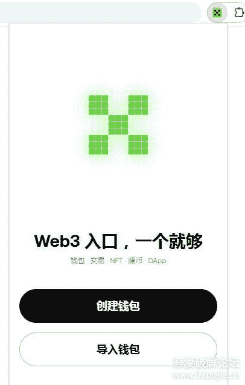
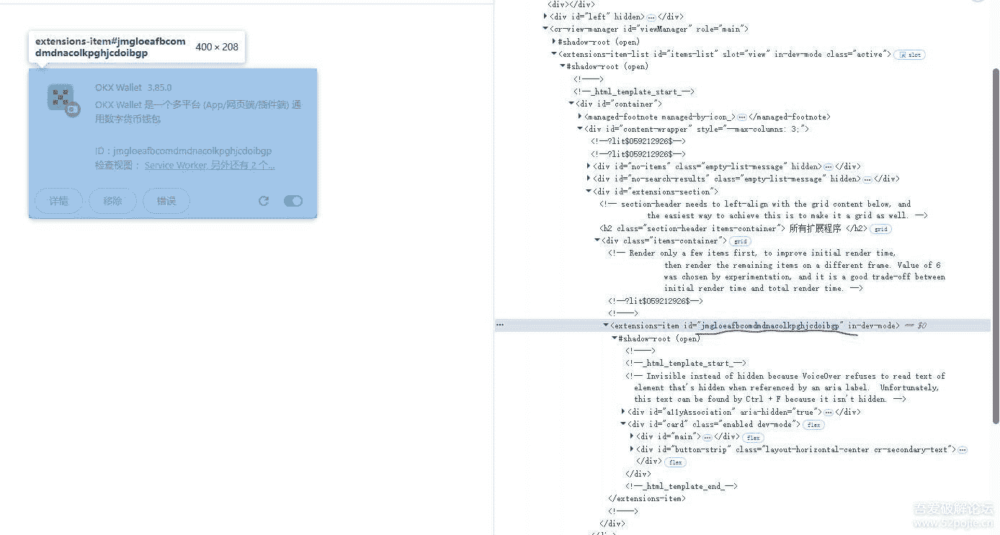
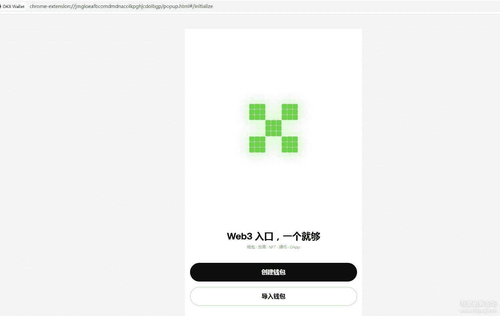
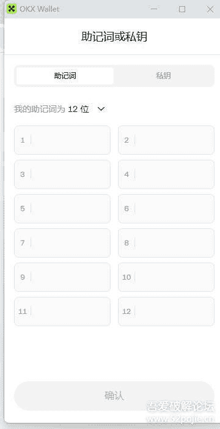
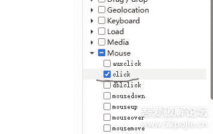
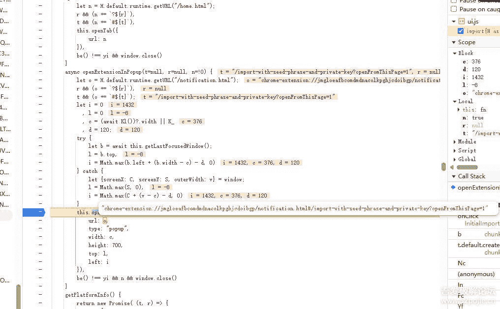
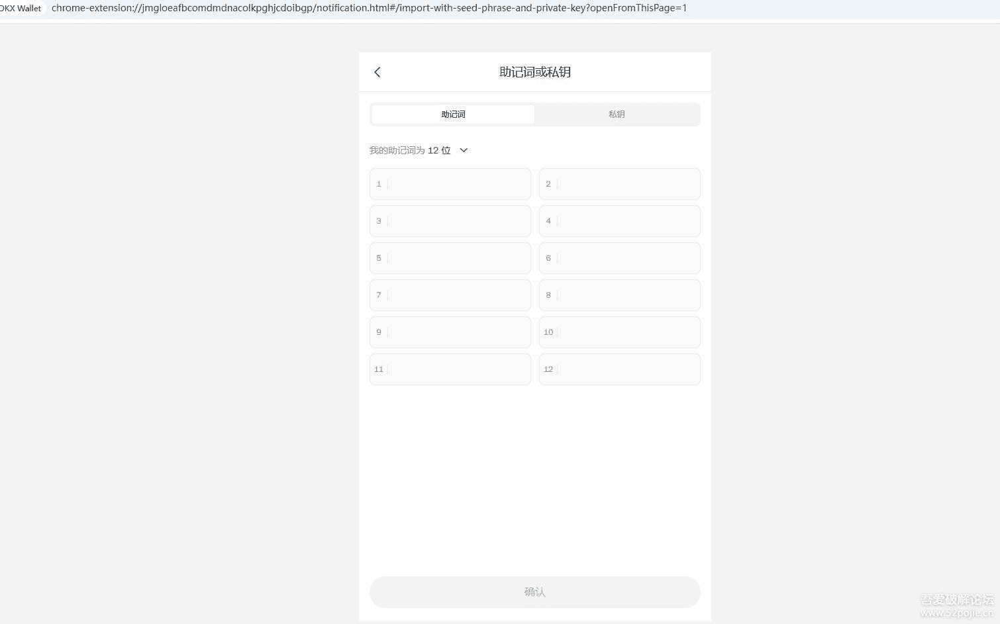

# [Web逆向] 欧易谷歌插件转换成网页

- 原帖: `https://www.52pojie.cn/forum.php?mod=viewthread&tid=2082856`
- 抓取时间: `2026-11-01T21:58:04`

我这几天遇到个奇怪的需求 说是要求把欧易钱包(OKX Wallet)转换成网页方式 方便去自动化操作输入 助记词或短语
因为平时谷歌插件都是popup弹窗方式存在的 所以没办法直接`F12` 选中对应元素

Snipaste_2025-12-28_12-17-34.jpg (21.5 KB, 下载次数: 0)
[href="forum.php?mod=attachment&aid=MjgyMzQ4NXwxZDFlMGRlZnwxNzkzNTcwMjgyfDE2ODA4NnwyMDgyODU2&nothumb=yes" target="_blank"](https://www.52pojie.cn/forum.php?mod=attachment&aid=MjgyMzQ4NXwxZDFlMGRlZnwxNzkzNTcwMjgyfDE2ODA4NnwyMDgyODU2&nothumb=yes)
2025-12-28 12:18 上传
于是我就去研究了下谷歌的插件应该怎么样才能选中元素然后自动化
后面发现了 其实每个插件本质都是一个网页来的 于是是可以通过url来进行访问

Snipaste_2025-12-28_12-22-12.jpg (129.29 KB, 下载次数: 0)
[href="forum.php?mod=attachment&aid=MjgyMzQ4N3xkOGQ5YTBkYXwxNzkzNTcwMjgyfDE2ODA4NnwyMDgyODU2&nothumb=yes" target="_blank"](https://www.52pojie.cn/forum.php?mod=attachment&aid=MjgyMzQ4N3xkOGQ5YTBkYXwxNzkzNTcwMjgyfDE2ODA4NnwyMDgyODU2&nothumb=yes)
2025-12-28 12:22 上传
`chrome-extension://{extension_id}/popup.html` 这个地址就是欧易的打开界面 `extension_id` 可以在拓展程序中`F12` 找到
于是就这样顺利进入了界面

Snipaste_2025-12-28_12-23-35.jpg (52.87 KB, 下载次数: 0)
[href="forum.php?mod=attachment&aid=MjgyMzQ4OHwwYzU5NjZlZHwxNzkzNTcwMjgyfDE2ODA4NnwyMDgyODU2&nothumb=yes" target="_blank"](https://www.52pojie.cn/forum.php?mod=attachment&aid=MjgyMzQ4OHwwYzU5NjZlZHwxNzkzNTcwMjgyfDE2ODA4NnwyMDgyODU2&nothumb=yes)
2025-12-28 12:23 上传
当我点击 ->导入钱包 -> 助记词或私钥 的时候结果又变成弹窗了 网页不见了！

Snipaste_2025-12-28_12-28-12.jpg (21.96 KB, 下载次数: 0)
[href="forum.php?mod=attachment&aid=MjgyMzQ5MHwzYzEzOWQwYXwxNzkzNTcwMjgyfDE2ODA4NnwyMDgyODU2&nothumb=yes" target="_blank"](https://www.52pojie.cn/forum.php?mod=attachment&aid=MjgyMzQ5MHwzYzEzOWQwYXwxNzkzNTcwMjgyfDE2ODA4NnwyMDgyODU2&nothumb=yes)
2025-12-28 12:28 上传
那这怎么办 我如果想自动化就必须找到网页元素 但现在没办法找到
于是我想到了调试下看看 给 `click` 事件进行 debug

Snipaste_2025-12-28_12-30-36.jpg (12.17 KB, 下载次数: 0)
[href="forum.php?mod=attachment&aid=MjgyMzQ5MXw5YWY0MjcwZnwxNzkzNTcwMjgyfDE2ODA4NnwyMDgyODU2&nothumb=yes" target="_blank"](https://www.52pojie.cn/forum.php?mod=attachment&aid=MjgyMzQ5MXw5YWY0MjcwZnwxNzkzNTcwMjgyfDE2ODA4NnwyMDgyODU2&nothumb=yes)
2025-12-28 12:30 上传
看看有没有可能是经过了 `js` 跳转页面 结果一找确实发现了 最后发现经过 `this.openwindow` 后立马出现弹窗

Snipaste_2025-12-28_12-31-42.jpg (104.6 KB, 下载次数: 0)
[href="forum.php?mod=attachment&aid=MjgyMzQ5MnxkM2VjMjZlNXwxNzkzNTcwMjgyfDE2ODA4NnwyMDgyODU2&nothumb=yes" target="_blank"](https://www.52pojie.cn/forum.php?mod=attachment&aid=MjgyMzQ5MnxkM2VjMjZlNXwxNzkzNTcwMjgyfDE2ODA4NnwyMDgyODU2&nothumb=yes)
2025-12-28 12:32 上传
然后一访问 确实是这样的

Snipaste_2025-12-28_12-32-57.jpg (55.59 KB, 下载次数: 0)
[href="forum.php?mod=attachment&aid=MjgyMzQ5M3xlOTY3NDdmZnwxNzkzNTcwMjgyfDE2ODA4NnwyMDgyODU2&nothumb=yes" target="_blank"](https://www.52pojie.cn/forum.php?mod=attachment&aid=MjgyMzQ5M3xlOTY3NDdmZnwxNzkzNTcwMjgyfDE2ODA4NnwyMDgyODU2&nothumb=yes)
2025-12-28 12:33 上传
就这样结束了
这次我觉得虽然说很简单
但我了解到了以下几个知识点
1. 谷歌插件都是网页形式的 只要是网页就可以访问
2. 通过 `js` 方式进行弹窗 其实我们可以对插件进行修改的 让它不弹窗 从而也能达到我们的要求
