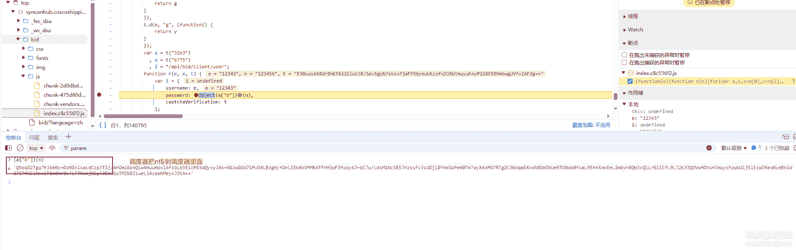
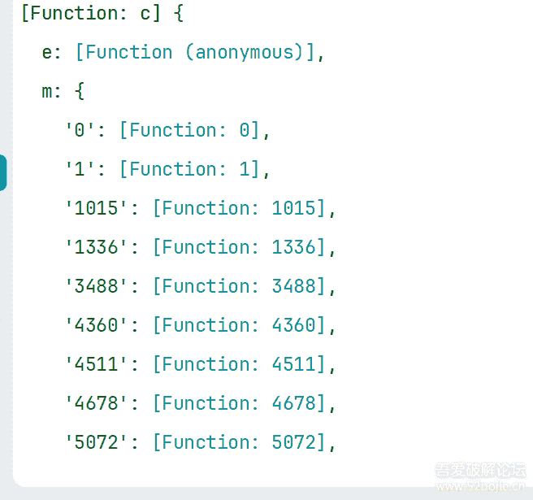
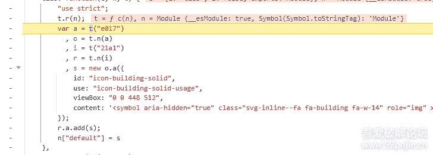
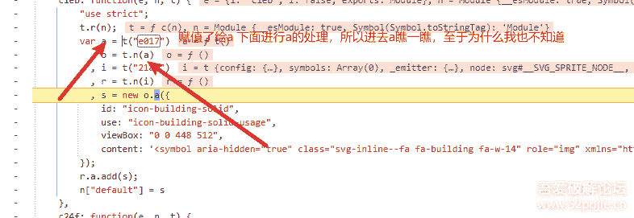

# [Web逆向] JS逆向外贸教育平台，调度器的理解

- 原帖：[https://www.52pojie.cn/forum.php?mod=viewthread&tid=2083501](https://www.52pojie.cn/forum.php?mod=viewthread&tid=2083501)
- 抓取时间：2026-11-01T21:57:56

本人小白，无聊没事干，没方向，学了又忘，忘又学毫无进展，原地踏步

本次的实验对象是SynconHub - Cosco Shipping Lines外贸登录的密码逆向

## 逆向目标与定位方法

要逆向的加密值

我们发现是`password`进行了加密，那我们如何定位`password`呢！

目前我掌握的方法是

1. 在请求堆栈往回跟，在关键的地方下断调试分析
2. 关键字搜索，找到关键位置下段
3. 别人总结的技巧，例如找`decrypt()`翻译（解密）或者`encrypt`（加密）

这些方法都要去尝试，因为不知道那一条路可以达到目的，就一条条尝试进行排除法，逆向本来就是不断的实践和学习的过程

我通过了`password:`的关键词搜索找到了有57个匹配，对逆向的来说这个已经很多了（这里值的很多的是因为关键词搜索要筛选出来的一般是在1-10这个区间），但是本人有时间一个个看，是哪一个倒霉蛋是我们要找的对象

这些`password`都不对，因为什么呢，因为这个值是加密的，而加密的话，应该是调用了一个函数，这个函数进行加密处理生成结果在返回值出来

## 加密函数示例

例如

```javascript
function md5Encrypt(input) {
    // 确保输入是字符串
    const str = typeof input === 'string' ? input : String(input);
    return crypto.createHash('md5').update(str, 'utf8').digest('hex');
}

console.log(md5Encrypt(123456));   // 同样输出 e10adc3949ba59abbe56e057f20f883e
```



`image.png`（94.74 KB，下载次数：0；[附件下载](https://www.52pojie.cn/forum.php?mod=attachment&aid=MjgyNDAxNnxjY2RkNzkzNHwxNzkzNTcwMjc0fDE2ODA4NnwyMDgzNTAx&nothumb=yes)）

2025-12-31 12:40 上传

这里有一个简单的例子，自己刚刚想出来的，希望对你们有帮助，我想让你们理解的意思是如果要加密就会有可能调用加密的函数传入参数进行加密处理，所以例如`password:`（直接输出）这些都不是我们想要的

这个才是我们想要的至于为什么，我也不知道为什么，我就觉得他有鬼，要想在调用函数进行加密，所以下一个断点来调试一下

`n`是为加密的值，经过`a["b"]`的拷打，进行的加密，现在的目标进行看`a["b"]`里面搞了什么鬼

进去之后发现，里面的怪兽还特别多，要怎么打败呢

1. 扣代码，补环境
2. 理解本节课的一个知识点调度器，通过调度器来完成这个数值的加密

## 调度器的理解

我知道你很懵逼，但是不要懵逼因为我也很懵逼。怎么理解调度器呢，例如，我是一个送外卖的（我还真送外卖嘿嘿嘿），要找到这个小区里面的居住的客户，肯定会有分区，和门牌号，调度器例如是一个门铃，你想要去哪一个客户哪里就要先告诉它，我来了，这样子客户才会出来拿外卖

通过调度器来得到用户的响应，所以我们要找调度器



`image.png`（56.55 KB，下载次数：0；[附件下载](https://www.52pojie.cn/forum.php?mod=attachment&aid=MjgyNDAyOHxkYzVlOWFmNXwxNzkzNTcwMjc0fDE2ODA4NnwyMDgzNTAx&nothumb=yes)）

2025-12-31 13:06 上传

### 定位调度器来源

因为是要找`a["b"]`，所以找到`a`来自哪里



`image.png`（28.92 KB，下载次数：1；[附件下载](https://www.52pojie.cn/forum.php?mod=attachment&aid=MjgyNDAxOXxjYWZjNjUzMnwxNzkzNTcwMjc0fDE2ODA4NnwyMDgzNTAx&nothumb=yes)）

2025-12-31 12:56 上传

来自方法`t`掉调用，进入

发现它就是一个调度器，所以把它拿到本地里面

### 补环境与本地运行

运行之后发现缺少

缺少`window`，所以要补`window = global;`

我们已经把加载器拿下来咯

把一个方法赋值给了全局变量的`loader`，把`c`赋值进去

这个是运行的结果，我们想要的是

`("e017")`但是发现没有这个参数，所以我们要找这个参数在哪里生成的错误信息。纯小白，我不太懂，希望谅解。发现这个方法里面的确有，所以就要把它的代码拿下来本地拷打一下（把我电脑干炸了那么多）



`image.png`（50.7 KB，下载次数：0；[附件下载](https://www.52pojie.cn/forum.php?mod=attachment&aid=MjgyNDAzMXw1MjhiZDcwZHwxNzkzNTcwMjc0fDE2ODA4NnwyMDgzNTAx&nothumb=yes)）

2025-12-31 13:14 上传

### 调用 JS

接下来就是调用JS了。我无法逆向出来还在学希望指导


`image.png`（24.34 KB，下载次数：2；[附件下载](https://www.52pojie.cn/forum.php?mod=attachment&aid=MjgyNDAzM3w3OGJjZjVmNXwxNzkzNTcwMjc0fDE2ODA4NnwyMDgzNTAx&nothumb=yes)）

2025-12-31 13:18 上传
