# [系统底层] Win10 x64 APC的分析与玩法

- 原帖：https://www.52pojie.cn/forum.php?mod=viewthread&tid=1743643
- 抓取时间：2026-11-01T21:57:45

## 引

这段时间没啥事干，就断断续把 Windows 的 APC机制给分析了一下，发现许多地方还是比较有趣的，例如：用户特殊APC一开始是插入到内核APC链表中的，然后再通过它的 `kernelroutine` 将APC插回用户APC链表。

还发现了我调试的这个win10版本在用户特殊APC执行的时候的存在的BUG（[BUG](#bug)）。

APC的作用我这里就略了，可以百度一下。

Windows 10版本（同以前文章的版本）：`10.0.17763` 版本 17763

废话少说，正文开始：

## 快速导航

（网络文档无法使用页内跳转，只能往下划来看了）

- [APC结构篇](#APC结构篇)
- [APC插入篇](#APC插入篇)
- [APC插入篇总结](#APC插入篇总结)
- [APC执行篇](#APC执行篇)
- [APC执行篇总结](#APC执行篇总结)
- [APC玩法篇](#APC玩法篇)
  1. [第一个玩法](#第一个玩法)
  2. [第二个玩法](#第二个玩法)

文档pdf版本和相关资料下载：

> 如果网络文档内的“跳转”无法使用，推荐阅读PDF版本

链接：[https://pan.baidu.com/s/1owtKjfL80f1WbQj4blIoKQ](https://pan.baidu.com/s/1owtKjfL80f1WbQj4blIoKQ)

提取码：`ICEY`

## APC结构

### `_KAPC_STATE`

```
ntdll!_KAPC_STATE

   +0x000 ApcListHead      : [2] _LIST_ENTRY

   +0x020 Process          : Ptr64 _KPROCESS

   +0x028 InProgressFlags  : UChar

   +0x028 KernelApcInProgress : Pos 0, 1 Bit

   +0x028 SpecialApcInProgress : Pos 1, 1 Bit

   +0x029 KernelApcPending : UChar

   +0x02a UserApcPendingAll : UChar

   +0x02a SpecialUserApcPending : Pos 0, 1 Bit

   +0x02a UserApcPending   : Pos 1, 1 Bit
```

`kthread.ApcState` 指向 `_KAPC_STATE`

`ApcListHead`：

`ApcListHead[0]` 指向 内核APC链表

`ApcListHead[1]` 指向 用户APC链表

当 `ApcListHead.Flink == ApcListHead.Blink == &ApcListHead.Flink` 时，APC链表为空

否则 `ApcListHead.Flink = & _KAPC.ApcListEntry`，`ApcListHead.Blink = & _KAPC.ApcListEntry`

`Process`：

线程所属或者所挂靠的进程

`InProgressFlags`：

是否有APC正在执行 :

第0位置1：内核APC正在执行

第1位置1：特殊APC正在执行

`KernelApcPending`：

是否有内核APC正在等待

`UserApcPendingAll`：

用户APC正在等待

第0位置1：用户特殊APC正在等待

第1位置1：用户普通APC正在等待

### `_KAPC`

```
ntdll!_KAPC
   +0x000 Type             : UChar
   +0x001 SpareByte0       : UChar
   +0x002 Size             : UChar
   +0x003 SpareByte1       : UChar
   +0x004 SpareLong0       : Uint4B
   +0x008 Thread           : Ptr64 _KTHREAD
   +0x010 ApcListEntry     : _LIST_ENTRY
   +0x020 KernelRoutine    : Ptr64     void 
   +0x028 RundownRoutine   : Ptr64     void 
   +0x030 NormalRoutine    : Ptr64     void 
   +0x020 Reserved         : [3] Ptr64 Void
   +0x038 NormalContext    : Ptr64 Void
   +0x040 SystemArgument1  : Ptr64 Void
   +0x048 SystemArgument2  : Ptr64 Void
   +0x050 ApcStateIndex    : Char
   +0x051 ApcMode          : Char
   +0x052 Inserted         : UChar
```

- `Type` 和 `Size`：内核层对象必须存在的常量值。
- `Thread`：目标线程内核对象。
- `ApcListEntry`：APC链表
- `KernelRoutine`：无论那种APC，都会先执行这个函数（以内核的身份）
- `RundownRoutine`：如果插入APC失败，则会调用这个函数（详情查看 APC插入 篇）
- `NormalRoutine`：我们想让线程执行的函数（内核函数 或 用户函数）
- `NormalContext`：第0个参数。
- `SystemArgument1`：第1个参数
- `SystemArgument2`：第2个参数
- `ApcMode`：APC的类型：0内核APC 1用户APC
- `Inserted`：一个布尔标志，指示 APC 是否已插入。

## APC插入

### R3

我们就不讨论`QueueUserAPC`这个函数了，因为他最后是调用`NtQueueApcThread`进入R0的。

`QueueUserAPC`调用栈如下：

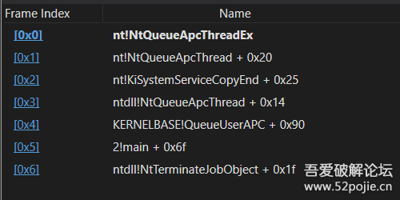

QueueUserAPC调用栈.png (23.59 KB, 下载次数: 1)

[附件](https://www.52pojie.cn/forum.php?mod=attachment&aid=MjU4OTQ3Mnw1NmI4NDRiOHwxNzkzNTcwMjYzfDE2ODA4NnwxNzQzNjQz&nothumb=yes)

2023-2-8 23:29 上传

所以呀，我们直接干R0的`NtQueueApcThread`就行啦！！

### R0

```
NTSTATUS __stdcall NtQueueApcThread(
        HANDLE ThreadHandle,
        PKNORMAL_ROUTINE ApcRoutine,
        PVOID NormalContext,
        PVOID SystemArgument1,
        PVOID SystemArgument2)
{
  return NtQueueApcThreadEx(ThreadHandle, 0i64, ApcRoutine, NormalContext, SystemArgument1, SystemArgument2);//通过NtQueueApcThread申请的APC全是用户普通APC
}
```

我们可以发现！`NtQueueApcThread`里面只是调用了`NtQueueApcThreadEx`。

说明`NtQueueApcThread`就是一个被阉割功能的函数了hhhh。

注意1：当用户APC触发时，返回的一定是R3的`ntdll!KiUserApcDispatcher`，然后`ntdll!KiUserApcDispatcher`再调用`ApcRoutine`。

注意2：`QueueUserApc`在插入APC调用`NtQueueApcThread`时，参数`ApcRoutine`是`ntdll!RtlDispatchAPC`，并不是我们提供给`QueueUserApc`的函数指针。我们的函数指针需要由`ntdll!RtlDispatchAPC`再次分发执行。

及 `NtQueueApcThread`的第二个参数为`ntdll!RtlDispatchAPC`，第三个参数才是我们我们提供给`QueueUserApc`的函数指针。

`QueueUserApc`简直就是`NtQueueApcThreadEx`的二次阉割函数。（墙裂谴责）

我们继续分析`NtQueueApcThreadEx`：

#### `NtQueueApcThreadEx`


# NtQueueApcThreadEx 分析

## 函数原型

```
NTSTATUS __fastcall NtQueueApcThreadEx(
        void *ThreadHandle,                        //需要插入的线程句柄
        BOOLEAN flag,                                //0：用户普通APC  1：用户特殊APC
        __int64 ApcRoutine,                        //需要执行的APC函数指针
        __int64 NormalContext,                //需要执行的APC函数的第零个参数
        __int64 SystemArgument1,        //需要执行的APC函数的第一个参数
        __int64 SystemArgument2)        //需要执行的APC函数的第二个参数
```

这个函数首先会判断一些参数是否正确，例如：会判断我们给的`ApcRoutine`地址合不合理。不允许给0。

说明从`R3`调用函数插入用户APC，APC的`NormalRoutine`不能为0，非常可惜。少了很多玩法。

## 内部分析1（节选）

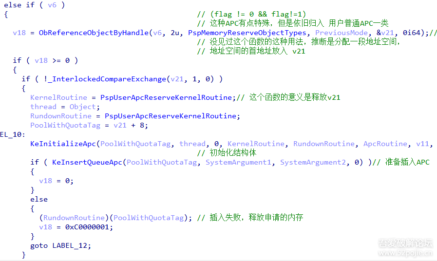

Ex普通特殊APC插入.png (42.16 KB, 下载次数: 1)

[href="forum.php?mod=attachment&aid=MjU4OTQ3M3xlMWZiMWE0ZXwxNzkzNTcwMjYzfDE2ODA4NnwxNzQzNjQz&nothumb=yes" target="_blank"](https://www.52pojie.cn/forum.php?mod=attachment&aid=MjU4OTQ3M3xlMWZiMWE0ZXwxNzkzNTcwMjYzfDE2ODA4NnwxNzQzNjQz&nothumb=yes)

2023-2-8 23:30 上传

可以看出，如果(`flag != 0 && flag != 1`)，那么就会执行这段代码。

这个类型的APC不同于一般的用户APC（用户普通APC 和 用户特殊APC）

主要的区别就是 `_KAPC`的地址空间是通过特殊手段申请和释放的，并且 `KernelRoutine` 和 `RundownRoutine` 和一般的用户APC不同。

## 内部分析2（节选）

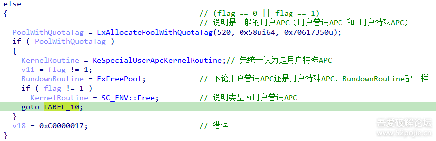

Ex一般APC插入1.png (27.04 KB, 下载次数: 1)

[href="forum.php?mod=attachment&aid=MjU4OTQ3NHxlODY3NWY4M3wxNzkzNTcwMjYzfDE2ODA4NnwxNzQzNjQz&nothumb=yes" target="_blank"](https://www.52pojie.cn/forum.php?mod=attachment&aid=MjU4OTQ3NHxlODY3NWY4M3wxNzkzNTcwMjYzfDE2ODA4NnwxNzQzNjQz&nothumb=yes)

2023-2-8 23:30 上传

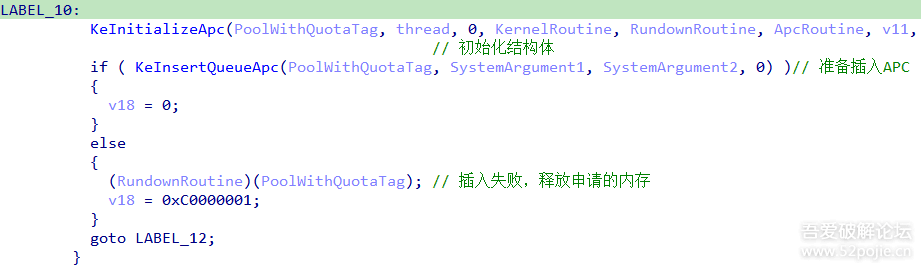

Ex一般APC插入2.png (21.5 KB, 下载次数: 0)

[href="forum.php?mod=attachment&aid=MjU4OTQ3NXwwMzBmMjc1NHwxNzkzNTcwMjYzfDE2ODA4NnwxNzQzNjQz&nothumb=yes" target="_blank"](https://www.52pojie.cn/forum.php?mod=attachment&aid=MjU4OTQ3NXwwMzBmMjc1NHwxNzkzNTcwMjYzfDE2ODA4NnwxNzQzNjQz&nothumb=yes)

2023-2-8 23:30 上传

可以看出：

1、一般的用户APC的`_KAPC`都是通过`ExAllocatePoolWithQuotaTag`申请，且大小为0x58。

2、用户普通APC的 `KernelRoutine` = `SC_ENV::Free`；而用户特殊APC的 `KernelRoutine` = `KeSpecialUserApcKernelRoutine`；

3、用户普通APC和用户特殊APC的 `RundownRoutine` = `ExFreePool`;

如果插入失败！则会调用`RundownRoutine`释放申请的 `_KAPC` 的内存。

## KeInitializeApc

填充`_KAPC`的各个成员。

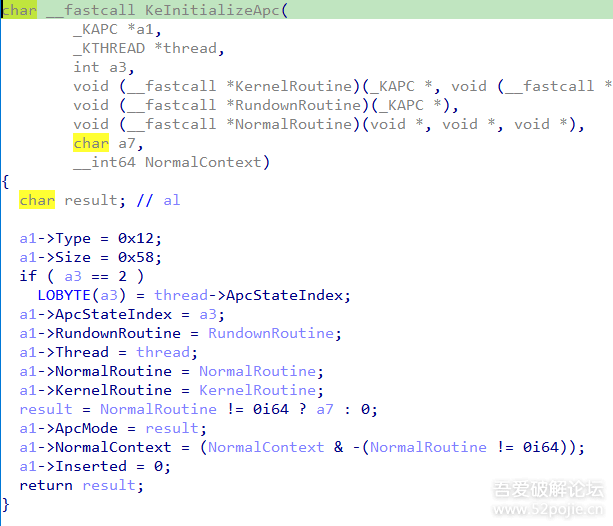

KeInitializeApc.png (38.84 KB, 下载次数: 1)

[href="forum.php?mod=attachment&aid=MjU4OTQ3NnxkNTkzNzQ2YnwxNzkzNTcwMjYzfDE2ODA4NnwxNzQzNjQz&nothumb=yes" target="_blank"](https://www.52pojie.cn/forum.php?mod=attachment&aid=MjU4OTQ3NnxkNTkzNzQ2YnwxNzkzNTcwMjYzfDE2ODA4NnwxNzQzNjQz&nothumb=yes)

2023-2-8 23:30 上传

这里补充一个非常离谱的设定：

通过`NtQueueApcThreadEx`插入用户APC时：

当初始用户普通APC时，传入`a7` = 1，用户特殊APC时，传入`a7` = 0。

然后`ApcMode`的值竟然由 `a7` 来确定！！？？

那么说明我们注册的 用户特殊APC，它的 `ApcMode` 竟然是 0 ！！
也就是说待会插入时，是插入的内核APC链表。（详情见下文）

## KeInsertQueueApc

这个函数主要作用就是上锁，填充APC的两个参数指针。

然后调用函数将APC插入 `_KTHREAD._KAPC_STATE`（内核APC和用户APC都是通过这个函数插入！）。

然后解锁。

上锁部分：（略）

填充参数指针、插入APC部分：

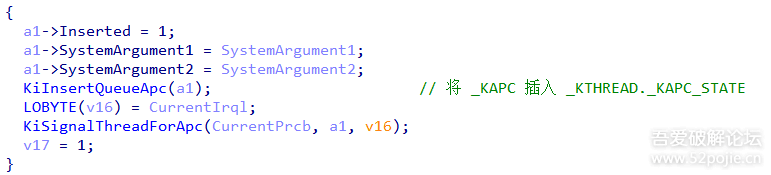

填充参数，插入APC队列.png (18.45 KB, 下载次数: 1)

[href="forum.php?mod=attachment&aid=MjU4OTQ3N3xiMDJkNjc2OXwxNzkzNTcwMjYzfDE2ODA4NnwxNzQzNjQz&nothumb=yes" target="_blank"](https://www.52pojie.cn/forum.php?mod=attachment&aid=MjU4OTQ3N3xiMDJkNjc2OXwxNzkzNTcwMjYzfDE2ODA4NnwxNzQzNjQz&nothumb=yes)

2023-2-8 23:30 上传

`KiDeliverApc`把这个用户特殊APC视作内核APC，并执行它的`KernelRoutine` = `KeSpecialUserApcKernelRoutine`，

`KeSpecialUserApcKernelRoutine`会把这个用户特殊APC重新插入到用户APC链表内。

详情请点击这里。

## KiInsertQueueApc

这个函数的功能就是将 `_KAPC` 插入 `_KTHREAD._KAPC_STATE`。

用户APC 插入 `_KAPC.ApcListHead[1]`

内核APC插入`_KAPC.ApcListHead[0]`

### 第一步

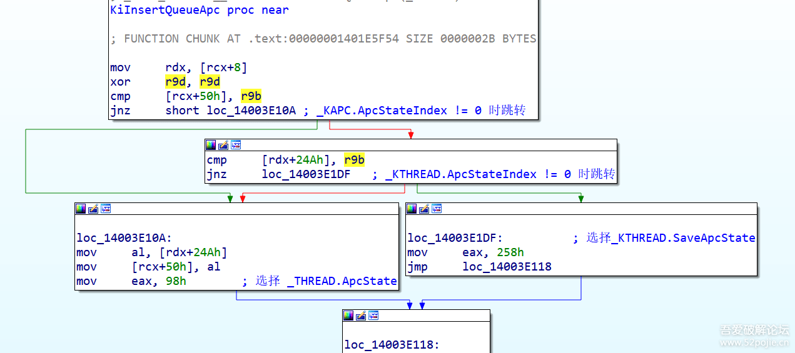

KiInsertQueueApc_Head.png (53.74 KB, 下载次数: 1)

[href="forum.php?mod=attachment&aid=MjU4OTQ3OXw2NzBjNjUwMHwxNzkzNTcwMjYzfDE2ODA4NnwxNzQzNjQz&nothumb=yes" target="_blank"](https://www.52pojie.cn/forum.php?mod=attachment&aid=MjU4OTQ3OXw2NzBjNjUwMHwxNzkzNTcwMjYzfDE2ODA4NnwxNzQzNjQz&nothumb=yes)

2023-2-8 23:33 上传

`_KTHREAD.ApcStateIndex`表示这个线程当前是否附加到其他进程。0：没有、1：附加到了其他进程

`_KTHREAD.ApcState`是这个线程当前需要执行的APC。

`_KTHREAD.SaveApcState`是这个线程的备份APC。

当需要插入的 `_KAPC.ApcState` != 0时，直接插入线程的`ApcState`。

当需要插入的`_KAPC.ApcState` == 0 && 需要插入的线程未附加到其他进程时，直接插入线程的`ApcState`。

当需要插入的`_KAPC.ApcState` == 0 && 需要插入的线程已经附加到其他进程时，插入线程的`SaveApcState`。

关于`_KTHREAD.ApcStateIndex`、`_KTHREAD.ApcState`、`_KTHREAD.SaveApcState`三者的关系:

设：

有两个进程：进程A、进程B。和一个线程A_T是属于进程A的。

此时：A_T(`_KTHREAD`).`ApcStateIndex` = 0。

接下来，线程A_T将要执行`KeStackAttachProcess`附加到进程B，那么会发生：（代码节选自`KiAttachProcess`）

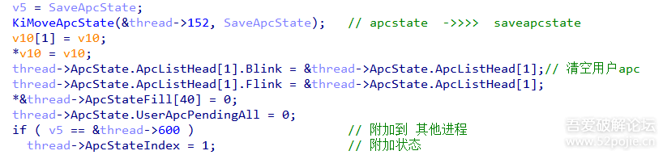

saveApc.png (24.29 KB, 下载次数: 1)

[href="forum.php?mod=attachment&aid=MjU4OTQ4MHxmMGMxOWU0ZHwxNzkzNTcwMjYzfDE2ODA4NnwxNzQzNjQz&nothumb=yes" target="_blank"](https://www.52pojie.cn/forum.php?mod=attachment&aid=MjU4OTQ4MHxmMGMxOWU0ZHwxNzkzNTcwMjYzfDE2ODA4NnwxNzQzNjQz&nothumb=yes)

2023-2-8 23:33 上传

将原有的`ApcState`备份到`SaveApcState`，然后将用户APC清空，再将 `ApcState`置1。当然了，解除附加状态的时候，会把`SaveApcState`恢复到`ApcState`，然后将`ApcState`置0（代码就不贴图了）。

### 第二步

插入APC，插入方式分为两类（插入链表头部、插入链表尾部）：

用户普通APC 和 内核普通APC 和 用户特殊APC第一次 的插入方式：

插入链表头部。

注意！！！一开始用户特殊APC的 `ApcMode` = 0，也就是说，这个时候，用户特殊APC 插入的是内核APC链表！

用户特殊APC第一次插入也是通过这段代码插入，插入到内核APC链表。

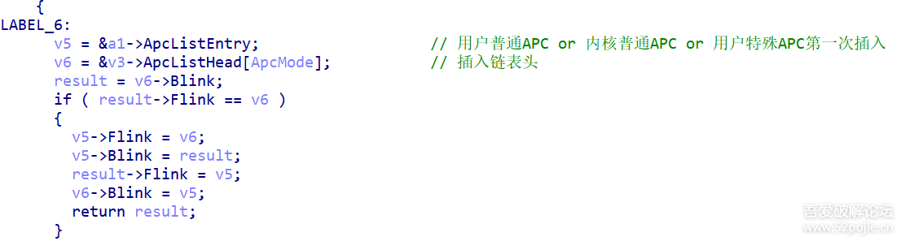

普通APC插入.png (29.82 KB, 下载次数: 1)

[href="forum.php?mod=attachment&aid=MjU4OTQ4MXwxZGZkNTZhY3wxNzkzNTcwMjYzfDE2ODA4NnwxNzQzNjQz&nothumb=yes" target="_blank"](https://www.52pojie.cn/forum.php?mod=attachment&aid=MjU4OTQ4MXwxZGZkNTZhY3wxNzkzNTcwMjYzfDE2ODA4NnwxNzQzNjQz&nothumb=yes)

2023-2-8 23:33 上传

那用户特殊APC插入到了内核APC链表，这不是乱套了吗？？！！！其实并没有，

阿三哥这个地方整了一手骚操作：还记得 用户普通APC的 `KernelRoutine` = `KeSpecialUserApcKernelRoutine`吗。

它会将这个APC重新插入用户APC链表。（下文详解）

用户特殊APC！第二次！插入方式：

（`KeSpecialUserApcKernelRoutine`会将APC重新插入到 用户APC链表）

将 `ApcState.UserApcPendingAll` or 1 后，将此APC插入链表尾部

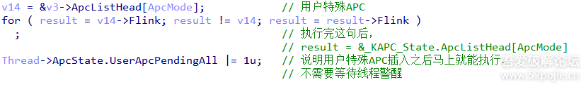

用户特殊apc插入.png (17.33 KB, 下载次数: 1)

[href="forum.php?mod=attachment&aid=MjU4OTQ4Mnw1ZGU0Y2ZjNXwxNzkzNTcwMjYzfDE2ODA4NnwxNzQzNjQz&nothumb=yes" target="_blank"](https://www.52pojie.cn/forum.php?mod=attachment&aid=MjU4OTQ4Mnw1ZGU0Y2ZjNXwxNzkzNTcwMjYzfDE2ODA4NnwxNzQzNjQz&nothumb=yes)

2023-2-8 23:33 上传

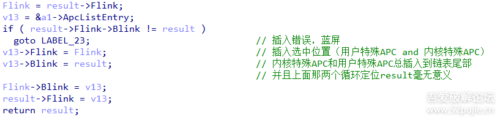

用户特殊apc和内核特殊apc插入.png (20.48 KB, 下载次数: 0)

[href="forum.php?mod=attachment&aid=MjU4OTQ4NHw3ODIwMjg4OXwxNzkzNTcwMjYzfDE2ODA4NnwxNzQzNjQz&nothumb=yes" target="_blank"](https://www.52pojie.cn/forum.php?mod=attachment&aid=MjU4OTQ4NHw3ODIwMjg4OXwxNzkzNTcwMjYzfDE2ODA4NnwxNzQzNjQz&nothumb=yes)

2023-2-8 23:33 上传

内核特殊APC插入方式：

插入链表尾部。

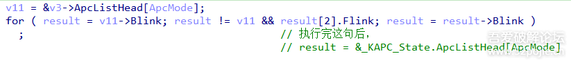

内核特殊APC.png (14.06 KB, 下载次数: 1)

[href="forum.php?mod=attachment&aid=MjU4OTQ4M3w2YWE1NjUyZHwxNzkzNTcwMjYzfDE2ODA4NnwxNzQzNjQz&nothumb=yes" target="_blank"](https://www.52pojie.cn/forum.php?mod=attachment&aid=MjU4OTQ4M3w2YWE1NjUyZHwxNzkzNTcwMjYzfDE2ODA4NnwxNzQzNjQz&nothumb=yes)

2023-2-8 23:33 上传

## APC插入篇总结

用户普通APC 和 用户特殊APC 最终都插入到用户 APC 链表中。

内核普通APC 和 内核特殊APC 最终都插入到内核 APC 链表中。

用户普通APC 和 内核普通APC 最终总是插入到 APC 链表的头部。

用户特殊APC 和 内核特殊APC 最终总是插入到 APC 链表的尾部。

用户特殊APC 一开始插入到 内核APC链表中，然后再取出来插入到 用户APC链表。

用户特殊APC会很快执行，不需要等待线程变为可接警状态。

用户普通APC的`_KAPC.KernelRoutine` = `SC_ENV::Free`。

而用户特殊APC的 `KernelRoutine` = `KeSpecialUserApcKernelRoutine`。

用户普通APC和用户特殊APC的 `RundownRoutine` = `ExFreePool`。

当APC插入失败时，会调用`RundownRoutine`。

## APC执行

首先知道想要执行插入的APC，必须先通过`KiDeliverApc`来处理。

通常，当线程在进行一些特殊操作（R0返回R3、睡眠、之类的）时，就会调用这个函数，可以通过IDA的交叉引用窗口查询一下。

这里挑一个典型的案例，用户调用NT函数后从R0返回R3的时候：（代码节选自`KiSystemCall64`结尾附近）

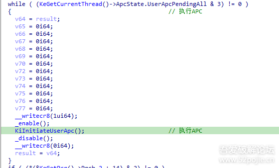

sysret附近调用执行用户APC.png (25.85 KB, 下载次数: 1)

[href="forum.php?mod=attachment&aid=MjU4OTQ3MXwyY2U4YWFjZnwxNzkzNTcwMjYzfDE2ODA4NnwxNzQzNjQz&nothumb=yes" target="_blank"](https://www.52pojie.cn/forum.php?mod=attachment&aid=MjU4OTQ3MXwyY2U4YWFjZnwxNzkzNTcwMjYzfDE2ODA4NnwxNzQzNjQz&nothumb=yes)

2023-2-8 23:29 上传

满足条件（(`_KTHREAD.ApcState.UserApcPendingAll` & 3) != 0）

即：有用户APC等待执行时，进入。

`KiInitiateUserApc` 调用 `KiDeliveApc`(1)

内核APC会在一轮`KiDeliverApc`内全部调用，

用户APC一轮`KiDeliverApc`只能选出一个，添信息加入用户堆栈。

上图通过while循环，可将需要执行的用户APC信息添加入用户堆栈（详情见下文），再交给`R3ntdll!KiUserApcDispatcher`处理。

## KiDeliverApc

```


# `KiDeliverApc`

```
KiDeliverApc (

    IN KPROCESSOR_MODE PreviousMode,//置1说明处理用户APC，置0不处理用户APC

    IN PKEXCEPTION_FRAME ExceptionFrame,

    IN PKTRAP_FRAME TrapFrame

    )
```

代码我就不贴了，太多了，我会另外提供一个文本，文本内是注释过后的`KiDeliverApc`代码，可以看细节。

这里贴大致的流程图，然后简单说明一下就行：

## 内核APC

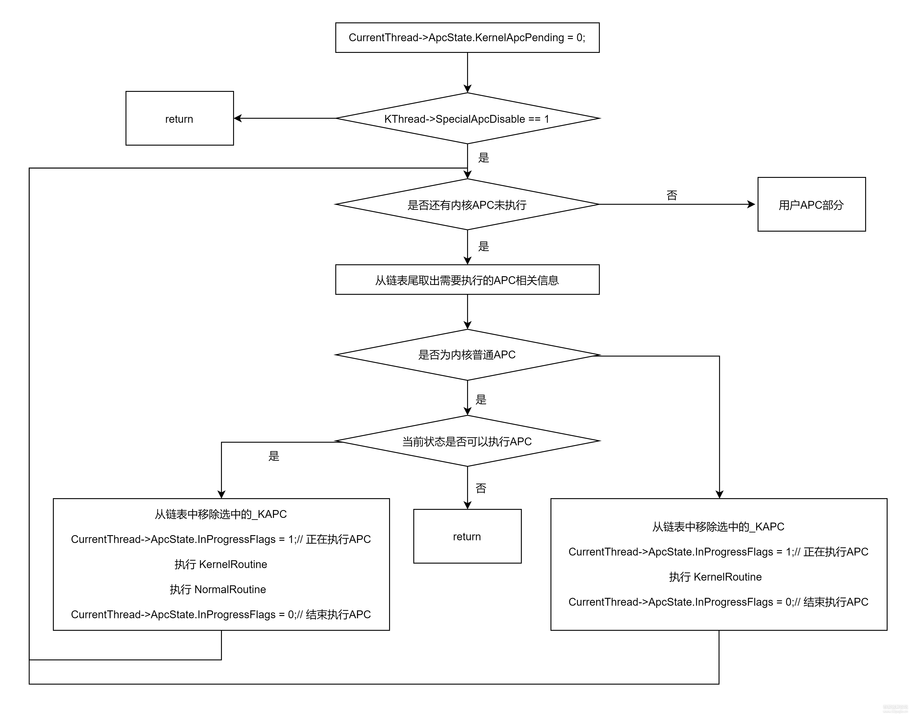

内核执行内核APC.png (446.19 KB, 下载次数: 1)

[href="forum.php?mod=attachment&aid=MjU4OTQ4NXwyMDQxNDllN3wxNzkzNTcwMjYzfDE2ODA4NnwxNzQzNjQz&nothumb=yes" target="_blank"](https://www.52pojie.cn/forum.php?mod=attachment&aid=MjU4OTQ4NXwyMDQxNDllN3wxNzkzNTcwMjYzfDE2ODA4NnwxNzQzNjQz&nothumb=yes)

2023-2-8 23:33 上传

### 内核普通APC（`NormalRoutine`不为空）：

`CurrentThread->ApcState.InProgressFlags = 1`

执行`KernelRoutine`，

执行`NormalRoutine`。

`CurrentThread->ApcState.InProgressFlags = 0`

### 内核特殊APC（`NormalRoutine`为空）：

`CurrentThread->ApcState.InProgressFlags = 2`

执行`KernelRoutine`

`CurrentThread->ApcState.InProgressFlags = 0`

### 补充：

对于内核APC来说：

`KernelRoutine`这个函数的意义不那么清晰，有时候是一些功能，或者挥幸惶� return 指令的函数，有时候又是释放`KAPC`的内存。

`NormalRoutine`就是我们想要让线程执行的函数啦。

内核APC处理的非常快！因为内核代码中有许多地方都会调用`KiDeliverApc(0)`

（仅执行内核APC，这也是为什么用户特殊APC能快速从内核APC链表中取出重新插入用户APC链表的原因。）

## 用户APC

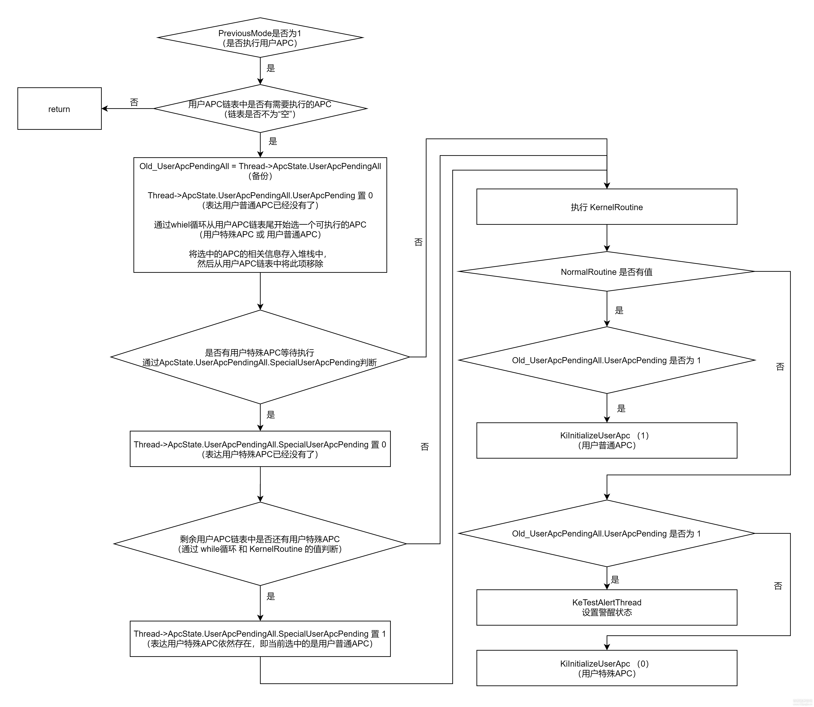

用户APC执行.png (864.34 KB, 下载次数: 1)

[href="forum.php?mod=attachment&aid=MjU4OTQ4NnwyNzRiZDBkN3wxNzkzNTcwMjYzfDE2ODA4NnwxNzQzNjQz&nothumb=yes" target="_blank"](https://www.52pojie.cn/forum.php?mod=attachment&aid=MjU4OTQ4NnwyNzRiZDBkN3wxNzkzNTcwMjYzfDE2ODA4NnwxNzQzNjQz&nothumb=yes)

2023-2-8 23:33 上传

### 用户普通APC

#### 执行`KernelRoutine`

还记得在 APC插入 篇中，提到的：

用户普通APC的`KernelRoutine = SC_ENV::Free`；

所以对用户普通APC来说：执行这个函数`KernelRoutine = SC_ENV::Free`相当于把选中的`KAPC`释放掉。

#### 执行`NormalRoutine`

对于用户APC（不管是用户普通APC还是用户特殊APC）来说，

需要将`NormalRoutine`下放到R3的`ntdll!KiUserApcDispatcher`。

所以他们的执行`NormalRoutine`的流程是一样一样的！

下面的图是调试用户特殊APC的时候截的，所以函数名字是 `SpecialUserApc`，

但是不用在意，都一样的，不影响。

`KiInitiateUserApc`


```
VOID KiInitializeUserApc(
                v61,
                (_DWORD)TrapFrame_1,
                (_DWORD)NormalRoutine,
                (_DWORD)NormalContext,
                (__int64)SystemArgument1,
                (__int64)SystemArgument2,
                v36);
```

作用就是设置陷阱帧的各个值，然后拓展用户堆栈的空间，将对应参数填入用户堆栈。使得待会从`KiSystemCall64`返回`R3`时，返回到设定的地址。一定要记得是拓展了用户堆栈空间，这和多个用户特殊APC的执行有关系！

（代码节选）这一段代码的赋值结果，和下一张图的堆栈是对应起来的。

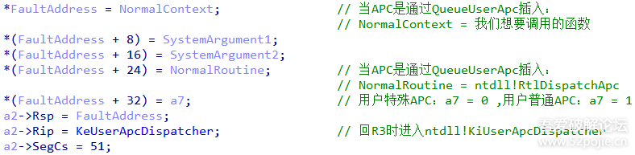

我们在相同线程的`ntdll!KiUserApcDispatcher`处下断点，中断后堆栈和调用栈（[bug](#bug)）：

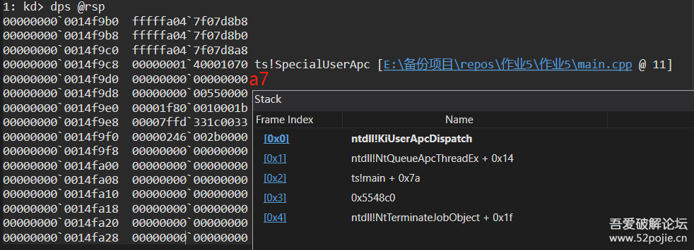

看调用栈中还保留着`ntdll!NtQueueApcThreadEx`，待会要通过`ZwContinue`返回此处。

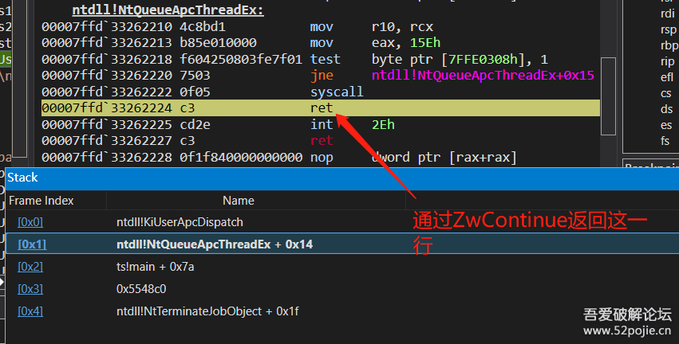

`ntdll!KiUserApcDispatcher`：
代码节选：

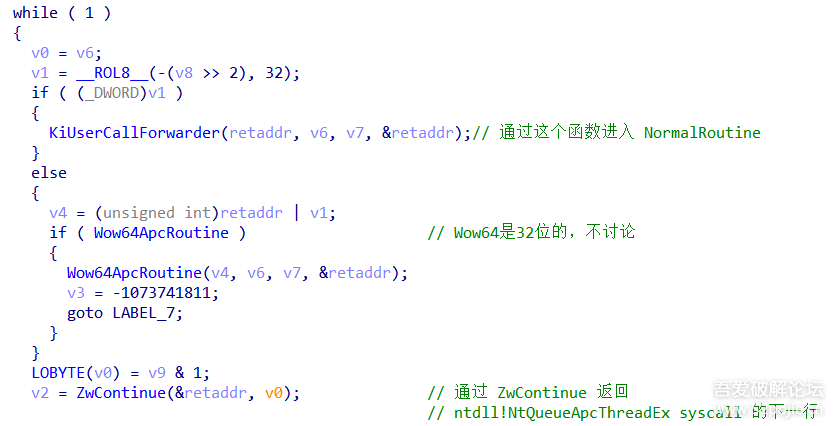

通过`KiUserCallForwarder`把栈中的参数放入寄存器，`jmp`进我们设置的`NormalRoutine`：

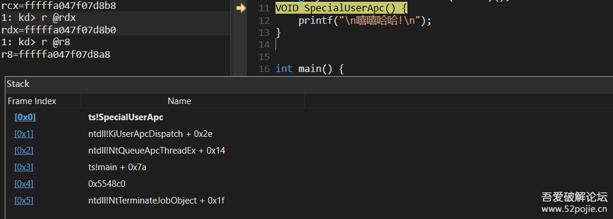

看三个参数值和上图堆栈中的一模一样。

那么参数`a7`用哪了？上文已经说了，`a7`的值：

当是用户普通APC时，`a7 = 1`，用户特殊APC时，`a7 = 0`。

上图中调用`ZwContinue`时，第二个参数就是`a7`。第一个参数是内核帮我们准备好的`Context`（这个`_CONTEXT`的地址就是刚从`R0`返回到`R3` `ntdll!KiUserApcDispatcher`时`RSP`的值），方便我们直接返回到`ntdll!NtQueueApcThreadEx`中`syscall`的下一行。（[特殊APC栈](#特殊APC栈)）

看图：

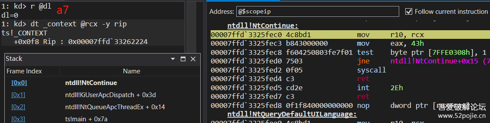

`0x00007ffd33262224`就是`ntdll!NtQueueApcThreadEx`中`syscall`的下一行（[userapc_next](#userapc_next)）。

关于`a7`的作用：

当是用户普通APC时，`a7 = 1`，用户特殊APC时，`a7 = 0`。

当`a7`作为`ZwContinue`的第二个参数传入时，填入`0`说明不将线程设置为可警醒，填入`1`说明将线程设置为可警醒。

与`SleepEx`的第二个参数有异曲同工之妙。

浅逆一下`NtContinue`：`NtContinue`会再调用`KiContinueEx`，`NtContinueEx`内有一段：


那为什么用户普通APC执行后要将线程设置警醒，而用户特殊APC就不用呢？？

这个机制和多个用户APC的执行有关（[原因](#原因)）！

### 5> 用户特殊APC

对用户特殊APC来说，有一个非常有趣（傻逼）的机制：

我们知道用户特殊APC的`KernelRoutine = KeSpecialUserApcKernelRoutine`。

那我们分析一下`KeSpecialUserApcKernelRoutine`，关于用户特殊APC的一切都清楚了。

内核APC处理得非常快！因为内核代码中有许多地方都会调用`KiDeliverApc(0)`（仅执行内核APC，这也是为什么用户特殊APC能快速从内核APC链表中取出重新插入用户APC链表的原因）。

#### 6> 执行KernelRoutine

`KeSpecialUserApcKernelRoutine`

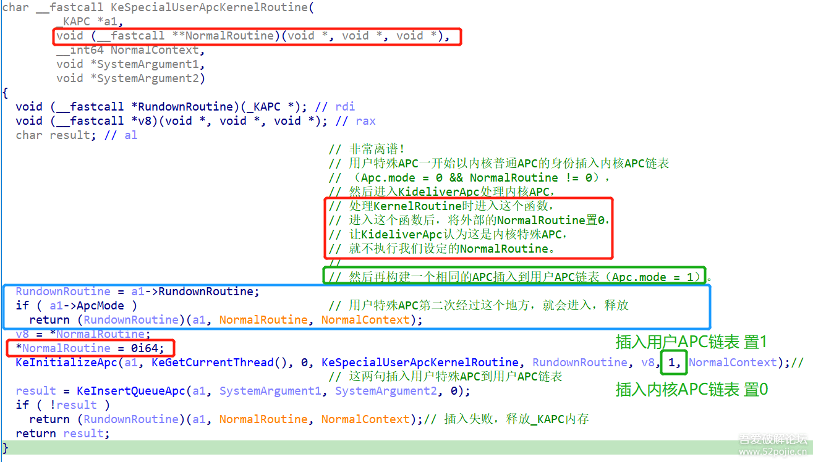

（[bug](#bug)）

红圈对应红圈说明，绿圈对应绿圈说明.....

上文中说到：内核APC的处理是很快的。

那么进入`KiDeliverApc`后，因为用户特殊APC插入到的是内核APC链表，所以就被选中执行。

会先执行`KernelRoutine = KeSpecialUserApcKernelRoutine`：

把外部的`NormalRoutine`置`0`，让`KiDeliverApc`认为这是内核特殊APC，不执行我们设置的`NormalRoutine`。

然后再将此APC以用户特殊APC的身份重新插入到用户APC链表。（这里在上文已经讲过了）

因为第二次插入用户特殊APC时，将`Thread.ApcState.UserApcPendingAll`置有值，因此接下来执行到`KiDeliverApc(1)`时，就会执行这个APC。

（注意是`KiDeliverApc(1)`不是`KiDeliverApc(0)`，第一个参数置`0`的话`KiDeliverApc`不执行用户APC）

第一次插入用户特殊APC，插入到内核APC链表，调用栈：

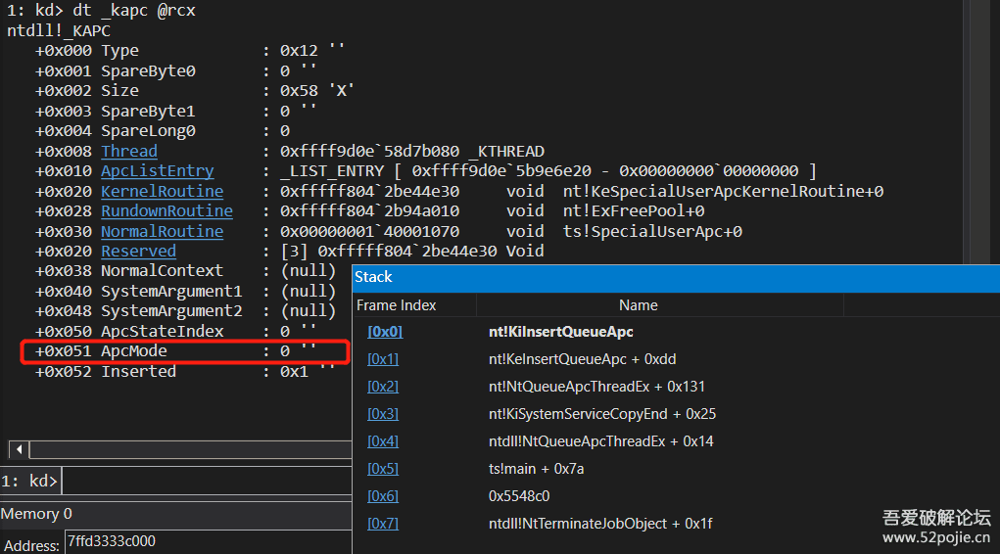

第二次插入用户特殊APC，插入到用户APC链表，调用栈：

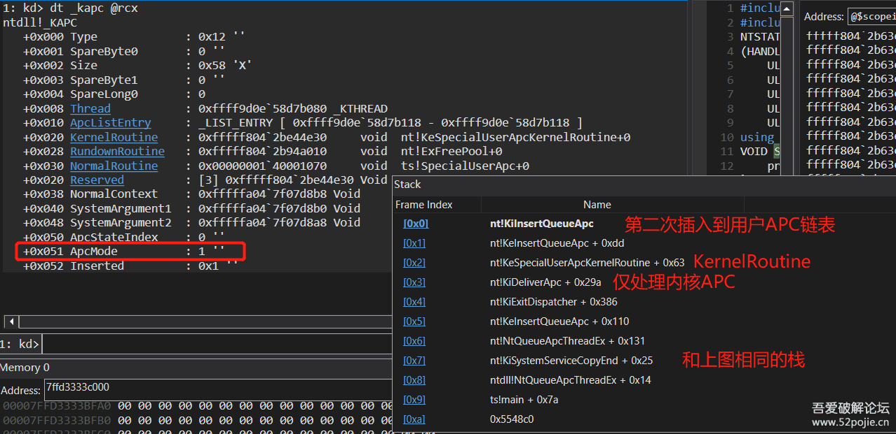

注意，我发现我调试的这个版本，这里是有BUG的，它在`KeSpecialUserApcKernelRoutine`内重新创建一个`KAPC`时，传入参数是`NormalContext`、`SystemArgument1`、`SystemArgument2`它们在内核里面的地址，并不是值！（可惜的是在新版本的Windows中修复了这个BUG）所以导致`KAPC`内`NormalContext`、`SystemArgument1`、`SystemArgument2`都为内核地址，这些内核地址会传入`R3`，所以，如果执行了需要参数的用户特殊APC函数，就会触发内存访问异常。（仅用户特殊APC会触发这个BUG）

BUG版本：

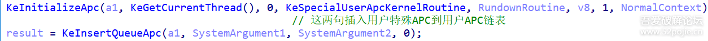

无BUG版本：

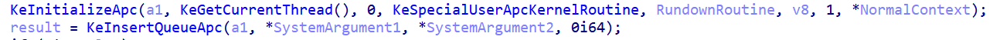

#### 6> 执行NormalRoutine

同用户普通APC（[用户NormalRoutine](#用户NormalRoutine)）。

关于用户特殊APC执行后不需要设置线程警醒，而用户普通APC执行后需要设置线程警醒的原因：

在用户APC执行的执行过程中，不论选中的是普通APC还是特殊APC，总会先将`ApcState.UserApcPendingAll.UserApcPeding`置`0`，告诉（欺骗）操作系统已经没有用户普通APC在执行了。

所以在执行完选中的用户APC后，需要通过`NtContinue`调用`TestAlertThread`判断是否还有用户APC尚未执行。

`TestAlertThread`代码节选：

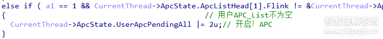

所以对用户普通APC来说：

即便使用`while`循环调用`KiDeliverApc(1)`处理了用户APC（[while_ua](#while_ua)），再返回`R3`进入`ntdll!KiUserApcDispatcher`后，只能执行一个用户普通APC（因为没有用户特殊APC的话，这个`while`内的指令只执行了一次）。

而对于用户特殊APC来说：

（[用户APC流程图](#用户APC流程图)）我已经说了：在`KiDeliverApc`里面就通过一个`while`循环来判断用户APC链表中是否还存在用户特殊APC。

如果还存在用户特殊APC，那么会重新将`ApcState.UserApcPendingAll.SpecialUserApcPeding`置`1`。

若使用`while`循环调用`KiDeliverApc(1)`处理用户APC（[while_ua](#while_ua)），就会重复在用户堆栈中添加相应用户特殊APC的信息（因为这个`while`内的指令执行了多次），在返回`R3`，进入`ntdll!KiUserApcDispatcher`后，可配合`ZwContinue`一次性执行多个用户特殊APC。

例：

当用户APC链表中存在3个用户特殊APC时：

通过`while`循环调用`KiDeliverApc(1)`处理后，返回`R3` `ntdll!KiUserApcDispatcher`时的堆栈：（`_context`仅展示部分）

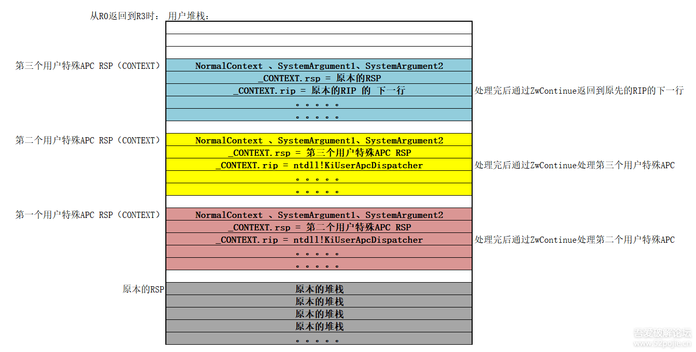

当返回`R3`时，此时`RIP`定位到`ntdll!KiUserApcDispatcher`，`RSP`定位到红色部分，准备处理第一个APC（红色部分）。

处理完第一个APC后（红色部分），通过`ZwContinue`再次跳转到`ntdll!KiUserApcDispatcher`，同时`RSP`也定位到了黄色部分，处理第二个APC（黄色部分）。

处理完第二个APC后，又通过`ZwContinue`再次跳转到`ntdll!KiUserApcDispatcher`，同时`RSP`也定位到了青色部分，处理第三个APC（青色部分）。

处理完第三个APC后，已经没有APC要执行了，就通过`ZwContinue`返回到原本`RIP`的下一行，同时`RSP`也恢复到灰色部分。

自此，三个用户特殊APC执行完成。线程也就可以干自己的事情了。

注意这种情况只有用户特殊APC才会有！！！

### 3> APC执行篇总结

整理了一下

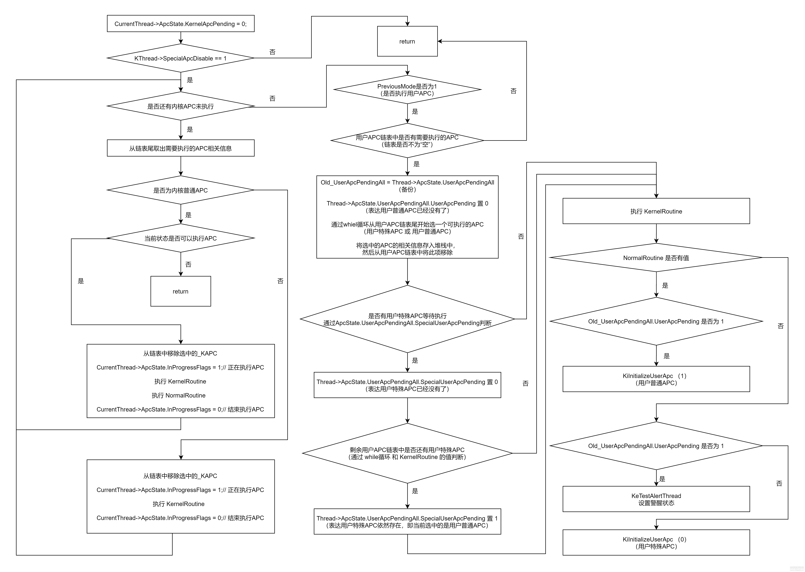

APC的执行总是从链表表尾开始，所以特殊APC执行的比普通APC要早。

内核特殊APC的`_KAPC.NormalRoutine`为空。

不论是内核APC还是用户APC，选中后总要先执行`_KAPC.KernelRoutine`。

调用一次`KiDeliverApc`，就会把全部内核APC执行。

调用一次`KiDeliverApc`，只能选出一个用户普通APC，然后将相关信息添加到用户堆栈中。

用户APC总是在从`R0`返回`R3`的时候执行。

用户普通APC只能在一个一个分开的时间段执行。而用户特殊APC是一次性连续全部执行。

用户普通APC只能等待线程可接警时才能执行，而用户特殊APC不需要，它可以快速执行。

### 2> APC玩法

#### 3> R3注册用户特殊APC

`NtQueueApcThreadEx`这个函数竟然是`ntdll`导出的！微软还把它藏起来不让用了是吧？！


# `NtQueueApcThreadEx` 原型

```c
NTSTATUS __fastcall NtQueueApcThreadEx(
        void *ThreadHandle,                        //需要插入的线程句柄
        BOOLEAN flag,                                //0：用户普通APC  1：用户特殊APC  其余值也为普通APC
        __int64 ApcRoutine,                        //需要执行的APC函数指针
        __int64 NormalContext,                //需要执行的APC函数的第零个参数
        __int64 SystemArgument1,        //需要执行的APC函数的第一个参数
        __int64 SystemArgument2)        //需要执行的APC函数的第二个参数
```

示例代码：

```
#include
#include

NTSTATUS(*NtQueueApcThreadEx)
(HANDLE thread,                                        //线程句柄
        ULONG64 flag,                                //1：用户特殊APC，无需使用 TestAlert
        ULONG64 NormalRoutine,                //需要执行的函数
        ULONG64 NormalContext,                //第零个参数
        ULONG64 s1,                                        //第一个参数
        ULONG64 s2                                        //第二个参数
        ) = NULL;

VOID SpecialUserApcTest(ULONG64 a, ULONG64 b, ULONG64 c) {
        //打印参数测试
        printf("\n%X %X %X \n", a, b, c);
}

int main() {
        PULONG64 NtQueueApcThreadEx_s = (PULONG64)&NtQueueApcThreadEx;

        //获取NtQueueApcThreadEx函数指针
        *NtQueueApcThreadEx_s = (ULONG64)GetProcAddress(GetModuleHandleA("ntdll"), "NtQueueApcThreadEx");

        //插入用户特殊APC
        NtQueueApcThreadEx(GetCurrentThread(), 1, (ULONG64)SpecialUserApcTest, 0x1111, 0x2222, 0x3333);

        system("pause");
}
```

有其他进程的线程句柄的话，也能向其他进程插入用户特殊APC。

### 3> R0通过插入内核特殊APC读取进程内存

内核特殊APC，是能执行的APC中最早执行的，因此可以用它来做些事情。（不仅限于读内存）

项目地址：`https://github.com/IcEy-999/Kernel-Special-APC-ReadProcessMemory`

因为我电脑上没有网络游戏，所以还没测试过读取受保护进程的内存。但是理论上是可读的。

更详细的信息请点击项目地址查看。

代码仅作学习与交流使用，请勿用作非法用途！！！！！

### 4> 优点

无需获取进程句柄，无需挂靠进程（线程），无需切换`CR3`，让目标进程自己将内存交出来。

### 4> 缺点

因为没有创建新的线程在目标进程上下文，所以，读取内存的时间相比挂靠进程（线程）的方式要慢上许多。（但也可以接受）

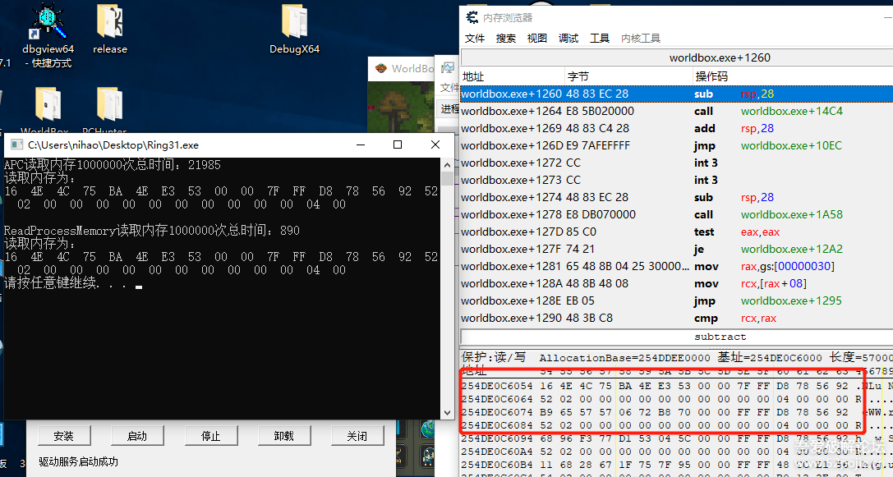

`tsapctest.png` (139.44 KB, 下载次数: 0)

[href="forum.php?mod=attachment&aid=MjU4OTUwNHw2YjYwMjAzNnwxNzkzNTcwMjYzfDE2ODA4NnwxNzQzNjQz&nothumb=yes" target="_blank"](https://www.52pojie.cn/forum.php?mod=attachment&aid=MjU4OTUwNHw2YjYwMjAzNnwxNzkzNTcwMjYzfDE2ODA4NnwxNzQzNjQz&nothumb=yes)

2023-2-8 23:42 上传

读取速度测试（Read speed test）

`KernelSpecialAPC`：

读取 1000000 次长度为 30 字节的内存所需时间为：21985 ms

`ReadProcessMemory`：

读取 1000000 次长度为 30 字节的内存所需时间为：890 ms

当进程全部线程被挂起时，无法读取内存！
