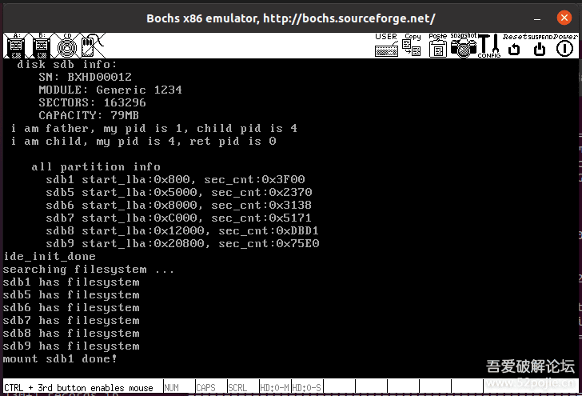
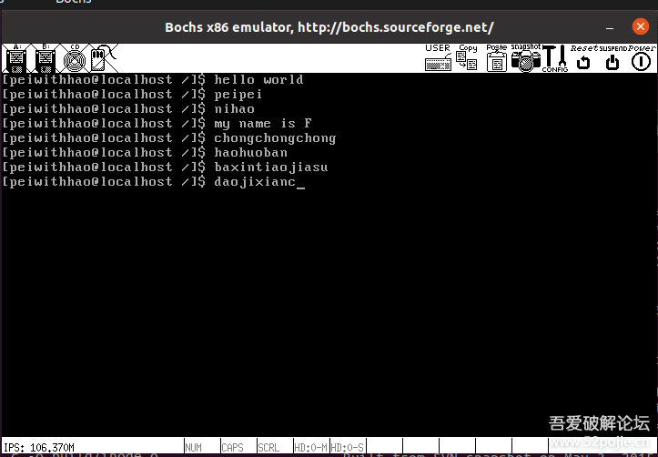
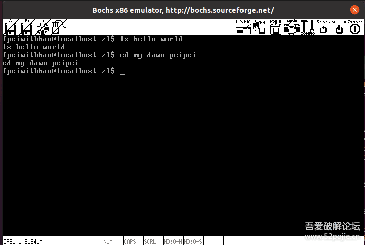
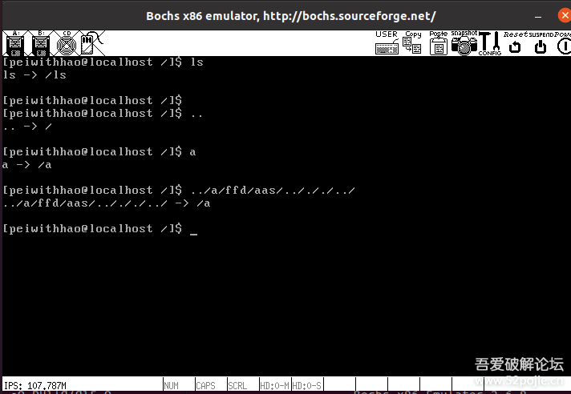
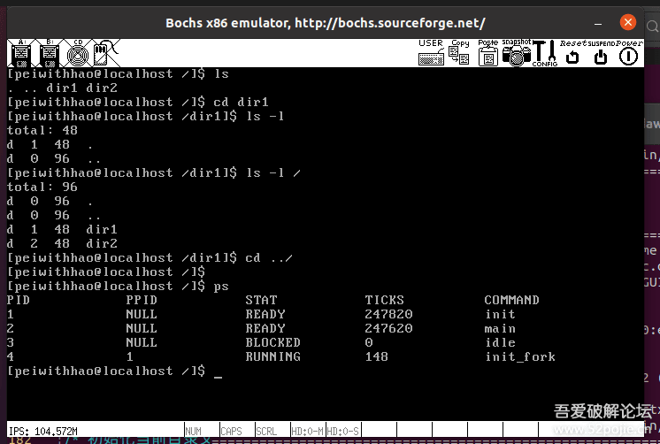

# [系统底层] 从0到-1写一个操作系统-0x14-同用户对话

- 原帖: https://www.52pojie.cn/forum.php?mod=viewthread&tid=1747788
- 抓取时间: 2026-11-01T21:57:34

这里写个往期推荐，这样可以来回跳跃（狗头

- https://www.52pojie.cn/thread-1730367-1-1.html
- https://www.52pojie.cn/thread-1730510-1-1.html
- https://www.52pojie.cn/thread-1731150-1-1.html
- https://www.52pojie.cn/thread-1731546-1-1.html
- https://www.52pojie.cn/thread-1732769-1-1.html
- https://www.52pojie.cn/thread-1733670-1-1.html
- https://www.52pojie.cn/thread-1734041-1-1.html
- https://www.52pojie.cn/thread-1734628-1-1.html
- https://www.52pojie.cn/thread-1735431-1-1.html
- https://www.52pojie.cn/thread-1736676-1-1.html
- https://www.52pojie.cn/thread-1737679-1-1.html
- https://www.52pojie.cn/thread-1738486-1-1.html
- https://www.52pojie.cn/thread-1739792-1-1.html
- https://www.52pojie.cn/thread-1740859-1-1.html
- https://www.52pojie.cn/thread-1741733-1-1.html
- https://www.52pojie.cn/thread-1743642-1-1.html
- https://www.52pojie.cn/thread-1744456-1-1.html
- https://www.52pojie.cn/thread-1745523-1-1.html
- https://www.52pojie.cn/thread-1746479-1-1.html
- https://www.52pojie.cn/thread-1746861-1-1.html
- https://www.52pojie.cn/thread-1747788-1-1.html

## 0x00 `fork`基础

### 1. `fork`基本概念

`fork`直译为叉子，这里咱们可以看作分支，当我们在C语言中进行编程的时候有时会使用`fork`函数来创建子进程，这里有一点那就是创建的过程是整个进程全部复制，当然程序执行到的指令数也会复制过来，也就是说当我们执行了`fork`函数创建子进程之后，父进程和子进程均会按照接下来的指令运行，而咱们平时的通过`pid`来判断父子进程是因为如果你是子进程，上面的`fork`函数会返回0，若是父进程则会返回自身的`pid`，如果`fork`失败，则会返回-1。

总结：用于创建一个进程，所创建的进程复制父进程的代码段/数据段/BSS段/堆/栈等所有用户空间信息；在内核中操作系统重新为其申请了一个PCB，并使用父进程的PCB进行初始化。

### 2. `fork`的实现

由于`fork`是复制了父进程的信息创建新进程，所以我们需要先复制进程资源，然后转过去执行，下面是咱们需要分配的基本资源：

- PCB
- 用户栈
- 内核栈
- 虚拟地址池
- 页表

而子进程想要执行，我们只需要将其`pcb`放入就绪队列就行。我们还需要到`task_struct`中分配一些基础信息，如下：

```
int16_t parent_pid;
```

然后我们到进程初始化函数中添加他的默认值为-1，表示没有父进程。我们再到`thread/thread.c`中添加一个供外部调用的分配`pid`的函数：

```
pid_t fork_pid() {
  return allocate_pid();
}
```

然后我们再到`memory.c`中增加个函数：

```
/* 安装1页大小的vaddr， 专门针对fork时虚拟地址位图无需操作的情况 */
void* get_a_page_without_opvaddrbitmap(enum pool_flags pf, uint32_t vaddr) {
  struct pool* mem_pool = pf & PF_KERNEL ? &kernel_pool : &user_pool;
  lock_acquire(&mem_pool->lock);
  void* page_phyaddr = palloc(mem_pool);
  if(page_phyaddr == NULL) {
    lock_release(&mem_pool->lock);
    return NULL;
  }
  page_table_add((void*)vaddr, page_phyaddr);
  lock_release(&mem_pool->lock);
  return (void*)vaddr;
}
```

这个函数功能同`get_a_page`类似，区别是他不会修改虚拟位图。

紧接着我们就开始正式编写`fork`功能，我们创建文件`userprog/fork.c`：

```
#include "fork.h"
#include "thread.h"
#include "global.h"
#include "memory.h"
#include "interrupt.h"
#include "file.h"
#include "string.h"
#include "debug.h"
#include "process.h"

extern void intr_exit(void);

/* 将父进程的pcb拷贝给子进程 */
static int32_t copy_pcb_vaddrbitmap_stack0(struct task_struct* child_thread, struct task_struct* parent_thread) {
  /* a 复制pcb所在的整个页，里面包含进程信息和0级特权栈，里面包含返回地址 */
  memcpy(child_thread, parent_thread, PG_SIZE);
  /* 这里再单独修改子线程 */
  child_thread->pid = fork_pid();
  child_thread->elapsed_ticks = 0;  //运行时间
  child_thread->status = TASK_READY;
  child_thread->ticks = child_thread->priority;     //时间片加满
  child_thread->parent_pid = parent_thread->pid;
  child_thread->general_tag.prev = child_thread->general_tag.next = NULL;
  child_thread->all_list_tag.prev = child_thread->all_list_tag.next = NULL;
  block_desc_init(child_thread->u_block_desc);  //内存块描述符，也就是malloc的地方

  /* b 复制父进程的虚拟地址池位图 */
  uint32_t bitmap_pg_cnt = DIV_ROUND_UP((0xc0000000 - USER_VADDR_START)/PG_SIZE / 8, PG_SIZE);  //获取用户虚拟地址池所需要的页数
  void* vaddr_btmp = get_kernel_pages(bitmap_pg_cnt);
  /* 此时子进程的虚拟用户位图仍指向父进程的，所以这里我们复制过来先 */
  memcpy(vaddr_btmp, child_thread->userprog_vaddr.vaddr_bitmap.bits, bitmap_pg_cnt * PG_SIZE);
  /* 然后将子进程的虚拟用户位图的地址指向新分配的位图 */
  child_thread->userprog_vaddr.vaddr_bitmap.bits = vaddr_btmp;
  /* 调试用 */
  ASSERT(strlen(child_thread->name) name, "_fork");
  return 0;
}

/* 复制子进程的进程体（代码和数据）以及用户栈 */
static void copy_body_stack3(struct task_struct* child_thread, struct task_struct* parent_thread, void* buf_page) {
  uint8_t* vaddr_btmp = parent_thread->userprog_vaddr.vaddr_bitmap.bits;
  uint32_t btmp_bytes_len = parent_thread->userprog_vaddr.vaddr_bitmap.btmp_bytes_len;  //获取位图字节数
  uint32_t vaddr_start = parent_thread->userprog_vaddr.vaddr_start;
  uint32_t idx_byte = 0;
  uint32_t idx_bit = 0;
  uint32_t prog_vaddr = 0;

  /* 在父进程的用户空间中查找已有数据的页 */
  while(idx_byte eax = 0;
  /* b 为switch_to构建struct thread_stack */
  uint32_t* ret_addr_in_thread_stack = (uint32_t*)intr_0_stack - 1;
  /**************************************************************/
  uint32_t* esi_ptr_in_thread_stack = (uint32_t*)intr_0_stack - 2;
  uint32_t* edi_ptr_in_thread_stack = (uint32_t*)intr_0_stack - 3;
  uint32_t* ebx_ptr_in_thread_stack = (uint32_t*)intr_0_stack - 4;
  /**************************************************************/
  /* ebp在thread_stack中的地址便是当时的esp(0级栈地址)
   * 也就是esp为"(uint32_t*)intr_0_stack - 5;" */
  uint32_t* ebp_ptr_in_thread_stack = (uint32_t*)intr_0_stack - 5;

  /* switch_to的返回地址更新为intr_exit，直接从中断返回 */
  *ret_addr_in_thread_stack = (uint32_t)intr_exit;
  /* 下面两行是使得构建的thread_stack更加清晰 */
  *ebp_ptr_in_thread_stack = *ebx_ptr_in_thread_stack = *edi_ptr_in_thread_stack = *esi_ptr_in_thread_stack = 0;
  /***************************************************************/
  /* 把构建的thread_stack的栈顶作为switch_to恢复数据时的栈顶 */
  child_thread->self_kstack = ebp_ptr_in_thread_stack;
  return 0;
}

/* 更新inode打开数 */
static void update_inode_open_cnts(struct task_struct* thread) {
  int32_t local_fd = 3, global_fd = 0;
  while(local_fd fd_table[local_fd];
    ASSERT(global_fd i_open_cnts++;
    }
    local_fd++;
  }
}

/* 拷贝父进程本身资源给子进程 */
```


```c
static int32_t copy_process(struct task_struct* child_thread, struct task_struct* parent_thread){

  /* 同样内核缓冲区作为中转站 */

  void* buf_page = get_kernel_pages(1);

  if(buf_page == NULL){

    return -1;

  }

  /* a 复制父进程的pcb、虚拟地址位图、内核栈到子进程 */

  if(copy_pcb_vaddrbitmap_stack0(child_thread, parent_thread) == -1){

    return -1;

  }

  /* b 为子进程创建页表，此页表仅仅包括内核空间 */

  child_thread->pgdir = create_page_dir();

  if(child_thread->pgdir == NULL){

    return -1;

  }

  /* c 复制父进程的进程体及用户栈给子进程 */

  copy_body_stack3(child_thread, parent_thread, buf_page);

  /* d 构建子进程thread_stack,这里也就是完善子进程0级特权栈，使得其可以返回0 */

  build_child_stack(child_thread);

  /* e 更新文件inode的打开数 */

  update_inode_open_cnts(child_thread);

  mfree_page(PF_KERNEL, buf_page, 1);

  return 0;

}

/* fork子进程，内核线程不可直接调用 */

pid_t sys_fork(void){

  struct task_struct* parent_thread = running_thread();

  struct task_struct* child_thread = get_kernel_pages(1);   //为子进程创建pcb

  if(child_thread == NULL){

    return -1;

  }

  ASSERT(INTR_OFF == intr_get_status() && parent_thread->pgdir != NULL);

  if(copy_process(child_thread, parent_thread) == -1){

    return -1;

  }

  /* 添加爱到就绪线程队列和所有线程队列，子进程调度由调度器安排运行 */

  ASSERT(!elem_find(&thread_ready_list, &child_thread->general_tag));

  list_append(&thread_ready_list, &child_thread->general_tag);

  ASSERT(!elem_find(&thread_all_list, &child_thread->all_list_tag));

  list_append(&thread_all_list, &child_thread->all_list_tag);

  return child_thread->pid;     //父进程就返回子进程的pid

}
```

上面我们实现了将父进程整个拷贝到子进程，其中也添加了一点子进程独有的东西，如果上述代码看懂，大伙就会知道为什么子进程调用`fork`函数后会返回0,而父进程是返回子进程`pid`了，这里我提示一下那就是构造中断返回栈。

## 添加`fork`系统调用与实现`init`进程

在Linux当中，`init`是用户级进程，它是第一个启动的程序，因此他的`pid`为1,而后续所有的进程都是他的子进程，换句话来讲`init`是所有进程的父进程，所以他还负责所有子进程的资源回收。所以这里我们需要实现系统调用`fork`来使得他能够构造子进程。

下面我们回忆一下咱们以前添加系统调用的步骤：

- 在`syscall.h`当中的枚举结构中添加对应值，比如我们要实现的`fork`，就是添加`SYS_FORK`
- 在`syscall.c`当中添加`fork()`函数
- 在`syscall-init.c`中的函数`syscall_init`当中添加系统调用表的函数地址值，也就是咱们的`sys_fork`函数

下面我们就来写`init`函数，也是`init`进程，注意需要写到`kernel/main.c`当中

```c
/* init进程 */
void init(void){
  uint32_t ret_pid = fork();
  if(ret_pid){
    printf(" i am father, my pid is %d, child pid is %d\n", getpid(), ret_pid);
  }else{
    printf(" i am child, my pid is %d, ret pid is %d\n", getpid(), ret_pid);
  }
  while(1);
}
```

我们的`pid`是从1开始分配的，而`init`的`pid`需要为1,但是目前来说我么主线程的`pid`是1,`idle`线程的`pid`是2,所以我们需要在`make_main_thread`函数执行之前创建`init`，同样是在`thread_init`函数之中添加

这里可以看到我们已经成功分配了`init`进程了



[Screenshot 2023-02-17 175400.png (30.85 KB, 下载次数: 0)](https://www.52pojie.cn/forum.php?mod=attachment&aid=MjU5MTUyMnw3N2RmYjExY3wxNzkzNTcwMjUyfDE2ODA4NnwxNzQ3Nzg4&nothumb=yes)

2023-2-18 20:56 上传

## 0x01 添加`read`系统调用

我们现在的目标是同系统进行交互，那么我们肯定需要知道用户键入了什么命令，所以我们先从键盘中获取输入，所以我们迫切的需要添加`read`的系统调用，之前我们已经实现了`sys_read`函数，但是他只能从文件上面读取信息，还不能从标准输入设备获取数据，因此我们来修改一下`sys_read`函数

```c
/* 从文件描述符fd指向的文件中读取count个字节到buf，若成功则返回读出的字节数，失败则返回-1 */

int32_t sys_read(int32_t fd, void* buf, uint32_t count){

  ASSERT(buf != NULL);

  int32_t ret = -1;

  if(fd 
```

完善好`sys_read`之后我们再按照正常步骤添加系统调用即可,至于测试等我们接下来完成一些别的系统调用后再一同测试

## 0x02 添加`putchar`、`clear`系统调用

我们本节的任务依然很简单，那就是实现单字符输出系统调用和清屏系统调用，我们输出字符早已有了内核实现，也就是`console_put_char`,所以系统调用实现起来十分简单，而至于清屏我们并没有对其有内核实现，所以这里我们仍旧采用汇编的方式。

我们将其定义在`print.S`当中，如下：

```asm
global cls_screen
cls_screen:
  pushad
  ;;;;;;;;;;;;;;;;
  ;由于用户程序的cpl为3,显存段的dpl为0,所以这里用于显存段的选择子gs在低于自己特权的环境中为0
  ;导致用户程序再次进入中断后，gs为0,因此直接在put_str中每次都为gs赋值
  mov ax, SELECTOR_VIDEO    ;不能直接把立即数送入gs，须要由ax中转
  mov gs, ax

  mov ebx, 0
  mov ecx, 80*25
  .cls:
    mov word [gs:ebx], 0x0720   ;0x0720是黑底白字的空格建
    add ebx, 2
    loop .cls
    mov ebx, 0

.set_cursor:
;将光标设为bx值，这里和之前获取类似
;;;;;;;; 先设置高8位 ;;;;;;;;
  mov dx, 0x03d4
  mov al, 0x0e
  out dx, al
  mov dx, 0x03d5
  mov al, bh
  out dx, al

;;;;;;;; 再设置低8位 ;;;;;;;;
  mov dx, 0x03d4
  mov al, 0x0f
  out dx, al
  mov dx, 0x03d5
  mov al, bl
  out dx, al
  popad
  ret
```

好久不见汇编代码，还是挺怀念的，这里比较简单也就是设置显存然后更新光标位置，然后我们再到外面套个壳就行

```c
/* 系统调用putchar,输出一个字符 */

void putchar(char char_asci){

  _syscall1(SYS_PUTCHAR, char_asci);

}

/* 清空屏幕 */

void clear(void){

  _syscall0(SYS_CLEAR);

}
```

然后到`syscall-init.c`中增加映射即可

## 0x03 实现shell

### 1. 显示提示符以及输入

简单来讲，咱们的`shell`的功能就是获取用户命令然后执行，真正的`shell`是十分复杂的，我们这里就单单实现一个比较简单的版本，我们创建文件`shell/shell.c`

```c
#include "shell.h"
#include "stdint.h"
#include "assert.h"
#include "fs.h"
#include "file.h"
#include "stdio.h"
#include "global.h"
#include "syscall.h"
#include "string.h"

#define cmd_len 128     //最大支持键入128个字符的命令行输入
#define MAX_ARG_NR 16   //加上命令外，最多支持15个参数

/* 存储输入的命令 */
static char cmd_line[cmd_len] = {0};

/* 用来记录当前目录，是当前目录的缓存，每次执行cd命令会更新他 */
char cwd_cache[64] = {0};

/* 输出提示符 */
void print_prompt(void){
  printf("[peiwithhao[//www.52pojie.cn/home.php?mod=space&uid=485241" target="_blank"](https://www.52pojie.cn/home.php?mod=space&uid=485241:href="https) %s]$ ", cwd_cache);
}

/* 从键盘缓冲区最多读入count个字节到buf */
static void readline(char* buf, int32_t count){
  assert(buf != NULL && count > 0);
  char* pos = buf;
  while(read(stdin_no, pos, 1) != -1 && (pos - buf) 
```

大致意思就是从键盘缓冲区读取字符然后输出到屏幕且存入`buf`当中，然后我们通过`init`来调用就行了

```c
int main(void){

  put_str("I am Kernel\n");

  init_all();

  cls_screen();

  console_put_str("[peiwithhao@localhost /]$ ");

  while(1);

  return 0;

}

/* init进程 */

void init(void){

  uint32_t ret_pid = fork();

  if(ret_pid){  //父进程

    while(1);

  }else{    //子进程

    my_shell();

  }

  panic("init: should not be here");

}
```

紧接着我们立刻进行测验

```c
int main(void){
  put_str("I am Kernel\n");
  init_all();
  intr_enable();
  cls_screen();
  console_put_str("[peiwithhao@localhost /]$ ");
  while(1);
  return 0;
}

/* init进程 */
void init(void){
  uint32_t ret_pid = fork();
  if(ret_pid){  //父进程
    while(1);
  }else{    //子进程
    my_shell();
  }
  panic("init: should not be here");
}
```

这里我们的`init`进程会创建子进程来运行`shell`函数，结果如下



[Screenshot 2023-02-17 205601.png (25.86 KB, 下载次数: 0)](https://www.52pojie.cn/forum.php?mod=attachment&aid=MjU5MTUyM3xkOWM1MzQwOXwxNzkzNTcwMjUyfDE2ODA4NnwxNzQ3Nzg4&nothumb=yes)

2023-2-18 20:56 上传

### 2. 添加`ctrl+u` 和 `ctrl+l` 快捷键

我们在平时使用linux的时候，经常会使用快捷键来避免咱们频繁输入命令，接下来我们需要使用的命令就是`Ctrl+u` 和 `Ctrl+l`的组合快捷键，他们的功能分别是清除输入和清屏，也就是等同于`Clear`指令

我们首先的操作需要先在`keyboard.c`当中添加一些对于这两个快捷键的特殊处理，如果你要添加也是类似

```c
    if(cur_char){

      /********************* 快捷键ctrl+l和ctrl+u的处理 **********************

       * cur_char的asc码-字符a的asc码，此差值比较小，

       * 属于asc码表当中不可见字符的部分，故不会产生可见字符

       * 我们在shell当中将ascii值为l-a和u-a的分别处理为清屏和删除输入的快捷键 */

      if((ctrl_down_last && cur_char == 'l') || (ctrl_down_last && cur_char == 'u')){

        cur_char -= 'a';

      }

      /***********************************************************************/

      /* 若kbd_buf中未满且待加入的cur_char不为0,

       * 则将其加入到缓冲区kbd_buf当中 */

      if(!ioq_full(&kbd_buf)){

        ioq_putchar(&kbd_buf, cur_char);

      }

      return;

    }
```

我们就到处理`cur_char`的地方添加这一个判断即可，然后剩余的工作交给咱们上层函数来办，总不能什么都交给底层驱动吧。接下来我们到`shell.c`当中实现判断

```c
/* 从键盘缓冲区最多读入count个字节到buf */
static void readline(char* buf, int32_t count){
  assert(buf != NULL && count > 0);
  char* pos = buf;
  while(read(stdin_no, pos, 1) != -1 && (pos - buf) 
```

这里的演示我就不放出来了，也就是一些组合键清屏操作

### 3. 解析键入字符

目前为止咱们的`shell`还是什么功能都没有，他只能输出咱们的输入的字符，所以咱们在`shell`中添加一个`cmd_str`函数来解析咱们的输入，如下

```c
char final_path[MAX_PATH_LEN] = {0};    //用于洗路径时的缓冲

/* 用来记录当前目录，是当前目录的缓存，每次执行cd命令会更新他 */

char cwd_cache[64] = {0};

char* argv[MAX_ARG_NR];     //argv作为全局变量为了以后exec程序可访问参数

int32_t argc = -1;

/* 分析字符串cmd_str中以token为分割符的单词，将各单词存入argv数组 */

static int32_t cmd_parse(char* cmd_str, char** argv, char token){

  assert(cmd_str != NULL);

  int32_t arg_idx = 0;

  while(arg_idx  MAX_ARG_NR){

      return -1;

    }

    argc++;

  }

  return argc;

}

/* 简单的shell */

void my_shell(void){

  cwd_cache[0] = '/';


```c
cwd_cache[1] = 0;

while(1){

    print_prompt();

    memset(cmd_line, 0, cmd_len);

    memset(final_path, 0, MAX_PATH_LEN);

    readline(cmd_line, MAX_PATH_LEN);

    if(cmd_line[0] == 0){ //如果只输入了一个回车

      continue;

    }

    argc = -1;

    argc = cmd_parse(cmd_line, argv, ' ');

    if(argc == -1){

      printf("num of arguments exceed %d\n", MAX_ARG_NR);

      continue;

    }

    char buf[MAX_PATH_LEN] = {0};

    int32_t arg_idx = 0;

    while(arg_idx 
```

上述代码并不难，其中涉及的操作只是字符串的切割，现在我们来运行一下虚拟机查看情况



Screenshot 2023-02-18 085130.png (22.12 KB, 下载次数: 0)

[href="forum.php?mod=attachment&aid=MjU5MTUyNHw4NDBhOWMzM3wxNzkzNTcwMjUyfDE2ODA4NnwxNzQ3Nzg4&nothumb=yes" target="_blank"](https://www.52pojie.cn/forum.php?mod=attachment&aid=MjU5MTUyNHw4NDBhOWMzM3wxNzkzNTcwMjUyfDE2ODA4NnwxNzQ3Nzg4&nothumb=yes)

2023-2-18 20:56 上传

### 4. 添加系统调用

这里我们统一将以前的系统调用都加进来，开始充实咱们的用户层能干的事

```c
enum SYSCALL_NR{
  SYS_GETPID,
  SYS_WRITE,
  SYS_MALLOC,
  SYS_FREE,
  SYS_FORK,
  SYS_READ,
  SYS_PUTCHAR,
  SYS_CLEAR,
  SYS_GETCWD,
  SYS_OPEN,
  SYS_CLOSE,
  SYS_LSEEK,
  SYS_UNLINK,
  SYS_MKDIR,
  SYS_OPENDIR,
  SYS_CLOSEDIR,
  SYS_CHDIR,
  SYS_RMDIR,
  SYS_READDIR,
  SYS_REWINDDIR,
  SYS_STAT,
  SYS_PS
};
```

然后我们同样的到`syscall.c`当中添加对应函数

```c
/* 获取当前工作目录 */
char* getcwd(char* buf, uint32_t size){
  return (char*)_syscall2(SYS_GETCWD, buf, size);
}

/* 以flag方式打开文件pathname */
int32_t open(char* pathname, uint8_t flag) {
   return _syscall2(SYS_OPEN, pathname, flag);
}

/* 关闭文件fd */
int32_t close(int32_t fd) {
   return _syscall1(SYS_CLOSE, fd);
}

/* 设置文件偏移量 */
int32_t lseek(int32_t fd, int32_t offset, uint8_t whence) {
   return _syscall3(SYS_LSEEK, fd, offset, whence);
}

/* 删除文件pathname */
int32_t unlink(const char* pathname) {
   return _syscall1(SYS_UNLINK, pathname);
}

/* 创建目录pathname */
int32_t mkdir(const char* pathname) {
   return _syscall1(SYS_MKDIR, pathname);
}

/* 打开目录name */
struct dir* opendir(const char* name) {
   return (struct dir*)_syscall1(SYS_OPENDIR, name);
}

/* 关闭目录dir */
int32_t closedir(struct dir* dir) {
   return _syscall1(SYS_CLOSEDIR, dir);
}

/* 删除目录pathname */
int32_t rmdir(const char* pathname) {
   return _syscall1(SYS_RMDIR, pathname);
}

/* 读取目录dir */
struct dir_entry* readdir(struct dir* dir) {
   return (struct dir_entry*)_syscall1(SYS_READDIR, dir);
}

/* 回归目录指针 */
void rewinddir(struct dir* dir) {
   _syscall1(SYS_REWINDDIR, dir);
}

/* 获取path属性到buf中 */
int32_t stat(const char* path, struct stat* buf) {
   return _syscall2(SYS_STAT, path, buf);
}

/* 改变工作目录为path */
int32_t chdir(const char* path) {
   return _syscall1(SYS_CHDIR, path);
}

/* 显示任务列表 */
void ps(void) {
   _syscall0(SYS_PS);
}
```

这里咱们的`ps`系统调用之前还没有实现，所以咱们需要到`thread.c`当中先实现

```c
/* 以填充空格的方式输出buf */
static void pad_print(char* buf, int32_t buf_len, void* ptr, char format){
  memset(buf, 0, buf_len);
  uint8_t out_pad_0idx = 0;
  switch(format){
    case 's':
      out_pad_0idx = sprintf(buf, "%s", ptr);
      break;
    case 'd':
      out_pad_0idx = sprintf(buf, "%d", *((int16_t*)ptr));
    case 'x':
      out_pad_0idx = sprintf(buf, "%x", *((uint32_t*)ptr));
  }
  while(out_pad_0idx pid, 'd');
  if(pthread->parent_pid == -1){
    pad_print(out_pad, 16, "NULL", 's');
  }else{
    pad_print(out_pad, 16, &pthread->parent_pid, 'd');
  }
  switch(pthread->status){
    case 0:
      pad_print(out_pad, 16, "RUNNING", 's');
    case 1:
      pad_print(out_pad, 16, "READY", 's');
    case 2:
      pad_print(out_pad, 16, "BLOCKED", 's');
    case 3:
      pad_print(out_pad, 16, "WAITING", 's');
    case 4:
      pad_print(out_pad, 16, "HANGING", 's');
    case 5:
      pad_print(out_pad, 16, "DIED", 's');
  }
  pad_print(out_pad, 16, &pthread->elapsed_ticks, 'x');
  memset(out_pad, 0, 16);
  ASSERT(strlen(pthread->name) name, strlen(pthread->name));
  strcat(out_pad, '\n');
  sys_write(stdout_no, out_pad, strlen(out_pad));
  return false;     //为了使用list_traversal继续遍历，所以返回false
}

/* 返回任务列表 */
void sys_ps(void){
  char* ps_title = "PID         PPID        STAT        TICKS       COMMAND\n";
  sys_write(stdout_no, ps_title, strlen(ps_title));
  list_traversal(&thread_all_list, elem2thread_info, 0);
}
```

在这里我们添加一个从全局进程列表中获取线程信息的函数然后格式化输出即可

### 5. 路径解析转换

这个路径解析是什么呢，其实就是咱们相对路径转换为绝对路径，你想在Linux当中我们并不是什么文件都是以绝对路径进行引用的，我们时不时会采用基于当前目录的相对路径从而获取文件信息，而操作系统底层肯定都是采用绝对路径进行资源定位的，所以这里我们需要实现将用户输入的相对路径转换为绝对路径的函数，这里我们创建函数`shell/buildin_cmd.c`

```c
#include "buildin_cmd.h"
#include "assert.h"
#include "file.h"
#include "dir.h"
#include "syscall.h"
#include "stdio.h"
#include "string.h"
#include "global.h"
#include "fs.h"
#include "shell.h"

/* 将路径old_abs_path中的..和.转换为实际路径后存入new_abs_path */
static void wash_path(char* old_abs_path, char* new_abs_path){
  assert(old_abs_path[0] == '/');
  char name[MAX_FILE_NAME_LEN] = {0};
  char* sub_path = old_abs_path;
  sub_path = path_parse(sub_path, name);
  if(name[0] == 0){     //如果解析后发现没字符，说明路径只有'/'
    new_abs_path[0] = '/';
    new_abs_path[1] = 0;
    return;
  }
  new_abs_path[0] = 0;      //避免传给new_abs_path的缓冲区不干净
  strcat(new_abs_path, "/");
  while(name[0]){
    /* 如果是上一级目录 */
    if(!strcmp("..", name)){
      char* slash_ptr = strrchr(new_abs_path, '/');
      /* 如果未到new_abs_path中的顶层目录，就将最右边的'/'替换为0,
       * 这样便取出了new_abs_path中最后一层路径，相当与到了上一级目录*/
      if(slash_ptr != new_abs_path){    //就比如/a/b ， 这之后就变为/a
        *slash_ptr = 0;
      }else{
        /* 如果new_abs_path中只有1个'/'，即表示已经到了顶层目录，就将下一个字符置为结束符0 */
        *(slash_ptr + 1) = 0;
      }
    }else if(strcmp(".", name)){    //如果路径不是'.'，就将name拼接到new_abs_path
      if(strcmp(new_abs_path, "/")){    //这里判断是为了避免形成"//"的情况
        strcat(new_abs_path, "/")
      }
      strcat(new_abs_path, name);
    }   //如果name为当前目录"."，则无需处理
    memset(name, 0, MAX_FILE_NAME_LEN);
    if(sub_path){
      sub_path = path_parse(sub_path, name);
    }
  }
}

void make_clear_abs_path(char* path, char* final_path){
  char abs_path[MAX_PATH_LEN] = {0};
  /* 先判断是否输入的是绝对路径 */
  if(path[0] != '/'){   //如果不是绝对路径那就拼接成绝对路径
    memset(abs_path, 0, MAX_PATH_LEN);
    if(getcwd(abs_path, MAX_PATH_LEN) != NULL){ //获取当前绝对目录
      if(!((abs_path[0] == '/') && (abs_path[1] == 0))){ //若abs_path表示的当前目录不是根目录
        strcat(abs_path, "/");
      }
    }
  }
  strcat(abs_path, path);
  wash_path(abs_path, final_path);
}
```

这里我们首先将输入的相对路径，通过获取当前路径来进行拼接的到绝对路径，然后调用`wash_path`来清除掉绝对路径中的`"."`和`".."`以此来获取真正的绝对路径

紧接着我们到`shell.c`当中添加应用

```c
/* 简单的shell */
void my_shell(void){
  cwd_cache[0] = '/';
  cwd_cache[1] = 0;
  while(1){
    print_prompt();
    memset(cmd_line, 0, cmd_len);
    memset(final_path, 0, MAX_PATH_LEN);
    readline(cmd_line, MAX_PATH_LEN);
    if(cmd_line[0] == 0){ //如果只输入了一个回车
      continue;
    }
    argc = -1;
    argc = cmd_parse(cmd_line, argv, ' ');
    if(argc == -1){
      printf("num of arguments exceed %d\n", MAX_ARG_NR);
      continue;
    }
    char buf[MAX_PATH_LEN] = {0};
    int32_t arg_idx = 0;
    while(arg_idx  %s\n", argv[arg_idx], buf);
      arg_idx++;
    }
    printf("\n");
  }
  panic("my_shell: should not be here");
}
```

这里我们进行一个简单的测试



Screenshot 2023-02-18 112742.png (23.44 KB, 下载次数: 0)

[href="forum.php?mod=attachment&aid=MjU5MTUyNXw0NjhjMDA0MHwxNzkzNTcwMjUyfDE2ODA4NnwxNzQ3Nzg4&nothumb=yes" target="_blank"](https://www.52pojie.cn/forum.php?mod=attachment&aid=MjU5MTUyNXw0NjhjMDA0MHwxNzkzNTcwMjUyfDE2ODA4NnwxNzQ3Nzg4&nothumb=yes)

2023-2-18 20:56 上传

可以看到这里我们是确实随便输入相对路径他都会返回一个正确的绝对路径，这为咱们接下来的工作打好了基础

### 6. 实现ls、cd、mkdir、ps、rm等命令

这里我们实现这些命令的内建函数

```c
#include "buildin_cmd.h"
#include "assert.h"
#include "file.h"
#include "dir.h"
#include "syscall.h"
#include "stdio.h"
#include "string.h"
#include "global.h"
#include "fs.h"
#include "shell.h"
#include "dir.h"

/* 将路径old_abs_path中的..和.转换为实际路径后存入new_abs_path */
```


```
static void wash_path(char* old_abs_path, char* new_abs_path){

  assert(old_abs_path[0] == '/');

  char name[MAX_FILE_NAME_LEN] = {0};

  char* sub_path = old_abs_path;

  sub_path = path_parse(sub_path, name);

  if(name[0] == 0){     //如果解析后发现没字符，说明路径只有'/'

    new_abs_path[0] = '/';

    new_abs_path[1] = 0;

    return;

  }

  new_abs_path[0] = 0;      //避免传给new_abs_path的缓冲区不干净

  strcat(new_abs_path, "/");

  while(name[0]){

    /* 如果是上一级目录 */

    if(!strcmp("..", name)){

      char* slash_ptr = strrchr(new_abs_path, '/');

      /* 如果未到new_abs_path中的顶层目录，就将最右边的'/'替换为0,
       * 这样便取出了new_abs_path中最后一层路径，相当与到了上一级目录*/

      if(slash_ptr != new_abs_path){    //就比如/a/b ， 这之后就变为/a

        *slash_ptr = 0;

      }else{

        /* 如果new_abs_path中只有1个'/'，即表示已经到了顶层目录，就将下一个字符置为结束符0 */

        *(slash_ptr + 1) = 0;

      }

    }else if(strcmp(".", name)){    //如果路径不是'.'，就将name拼接到new_abs_path

      if(strcmp(new_abs_path, "/")){    //这里判断是为了避免形成"//"的情况

        strcat(new_abs_path, "/");

      }

      strcat(new_abs_path, name);

    }   //如果name为当前目录"."，则无需处理

    memset(name, 0, MAX_FILE_NAME_LEN);

    if(sub_path){

      sub_path = path_parse(sub_path, name);

    }

  }

}

void make_clear_abs_path(char* path, char* final_path){

  char abs_path[MAX_PATH_LEN] = {0};

  /* 先判断是否输入的是绝对路径 */

  if(path[0] != '/'){   //如果不是绝对路径那就拼接成绝对路径

    memset(abs_path, 0, MAX_PATH_LEN);

    if(getcwd(abs_path, MAX_PATH_LEN) != NULL){ //获取当前绝对目录

      if(!((abs_path[0] == '/') && (abs_path[1] == 0))){ //若abs_path表示的当前目录不是根目录

        strcat(abs_path, "/");

      }

    }

  }

  strcat(abs_path, path);

  wash_path(abs_path, final_path);

}

/* pwd命令的内建函数 */

void buildin_pwd(uint32_t argc, char** argv UNUSED){

  if(argc != 1){

    printf("pwd: no argument supprot!\n");

    return;

  }else{

    if(NULL != getcwd(final_path, MAX_PATH_LEN)){

      printf("%s\n", final_path);

    }else{

      printf("pwd: get current work directory failed\n");

    }

  }

}

/* cd命令内建函数 */

char* buildin_cd(uint32_t argc, char** argv){

  if(argc > 2){

    printf("cd: only support 1 argument!\n");

    return NULL;

  }

  /* 如果只有cd无参数，则直接返回到根目录 */

  if(argc == 1){

    final_path[0] = '/';

    final_path[1] = 0;

  }else{

    make_clear_abs_path(argv[1], final_path);

  }

  if(chdir(final_path) == -1){

    printf("cd: no such directory %s\n", final_path);

    return NULL;

  }

  return final_path;

}

/* ls命令内建函数 */

void buildin_ls(uint32_t argc, char** argv){

  char* pathname = NULL;

  struct stat file_stat;

  memset(&file_stat, 0, sizeof(struct stat));

  bool long_info = false;

  uint32_t arg_path_nr = 0;

  uint32_t arg_idx = 1;     //跨过argv[0], argv[0]是字符串"ls"

  while(arg_idx f_type == FT_REGULAR){

          ftype = '-';

        }

        sub_pathname[pathname_len] = 0;

        strcat(sub_pathname, dir_e->filename);

        memset(&file_stat, 0, sizeof(struct stat));

        if(stat(sub_pathname, &file_stat) == -1){

          printf("ls: cannot access %s: No such file or directory\n", dir_e->filename);

          return;

        }

        printf("%c  %d  %d  %s\n", ftype, dir_e->i_no, file_stat.st_size, dir_e->filename);

      }

    }else{      //如果没使用-l参数

      while((dir_e == readdir(dir))){

        printf("%s ", dir_e->filename);

      }

      printf("\n");

    }

    closedir(dir);

  }else{

    if(long_info){

      printf("- %d  %d  %s\n", file_stat.st_ino, file_stat.st_size, pathname);

    }else{

      printf("%s\n", pathname);

    }

  }

}

/* ps命令内建函数 */

void buildin_ps(uint32_t argc, char** argv UNUSED){

  if(argc != 1){

    printf("pc: no argument support!\n");

    return;

  }

  ps();

}

/* clear命令内建函数 */

void buildin_clear(uint32_t argc, char** argv UNUSED){

  if(argc != 1){

    printf("clear: no argument support!\n");

    return;

  }

  clear();

}

/* mkdir命令内建函数 */

int32_t buildin_mkdir(uint32_t argc, char** argv){

  int32_t ret = -1;

  if(argc != 2){

    printf("mkdir: only support 1 argument!\n");

  }else{

    make_clear_abs_path(argv[1], final_path);

    /* 若创建的不是根目录 */

    if(strcmp("/", final_path)){

      if(mkdir(final_path) == 0){

        ret = 0;

      }else{

        printf("mkdir: create directory %s failed.\n", argv[1]);

      }

    }

  }

  return ret;

}

/* rmdir命令内建函数 */

int32_t buildin_rmdir(uint32_t argc, char** argv){

  int32_t ret = -1;

  if(argc != 2){

    printf("rmdir: only support 1 argument!\n");

  }else{

    make_clear_abs_path(argv[1], final_path);

    /* 若删除的不是根目录 */

    if(strcmp("/", final_path)){

      if(rmdir(final_path) == 0){

        ret = 0;

      }else{

        printf("rmdir: remove %s failed.\n", argv[1]);

      }

    }

  }

  return ret;

}

/* rm命令内建函数 */

int32_t buildin_rm(uint32_t argc, char** argv){

  int32_t ret = -1;

  if(argc != 2){

    printf("rm: only support 1 argument!\n");

  }else{

    make_clear_abs_path(argv[1], final_path);

    /* 若删除的不是根目录 */

    if(strcmp("/", final_path)){

      if(unlink(final_path) == 0){

        ret = 0;

      }else{

        printf("rm: delete %s failed.\n", argv[1]);

      }

    }

  }

  return ret;

}
```

而这些内建函数的使用是通过`shell.c`来进行调用，如下

```
/* 简单的shell */
void my_shell(void){
  cwd_cache[0] = '/';
  cwd_cache[1] = 0;
  while(1){
    print_prompt();
    memset(cmd_line, 0, cmd_len);
    memset(final_path, 0, MAX_PATH_LEN);
    readline(cmd_line, MAX_PATH_LEN);
    if(cmd_line[0] == 0){ //如果只输入了一个回车
      continue;
    }
    argc = -1;
    argc = cmd_parse(cmd_line, argv, ' ');
    if(argc == -1){
      printf("num of arguments exceed %d\n", MAX_ARG_NR);
      continue;
    }
    if(!strcmp("ls", argv[0])){
      buildin_ls(argc, argv);
    }else if(!strcmp("cd", argv[0])){
      if(buildin_cd(argc, argv) != NULL){
        memset(cwd_cache, 0, MAX_PATH_LEN);
        strcpy(cwd_cache, final_path);
      }
    }else if(!strcmp("pwd", argv[0])){
      buildin_pwd(argc, argv);
    }else if(!strcmp("ps", argv[0])){
      buildin_ps(argc, argv);
    }else if(!strcmp("clear", argv[0])){
      buildin_clear(argc, argv);
    }else if(!strcmp("mkdir", argv[0])){
      buildin_mkdir(argc, argv);
    }else if(!strcmp("rmdir", argv[0])){
      buildin_rmdir(argc, argv);
    }else if(!strcmp("rm", argv[0])){
      buildin_rm(argc, argv);
    }else{
      printf("external command\n");
    }
  }
  panic("my_shell: should not be here");
}
```

然后我们到虚拟机当中测试一些基本命令，可以看到如下确实成功解析了咱们的输入



[Screenshot 2023-02-18 203108.png](https://www.52pojie.cn/forum.php?mod=attachment&aid=MjU5MTUyNnw5YmNlY2U1NXwxNzkzNTcwMjUyfDE2ODA4NnwxNzQ3Nzg4&nothumb=yes) (36.69 KB, 下载次数: 0)

2023-2-18 20:56 上传

### 0x04 总结

目前用户交互的部分已经完结，剩下最后一部分那就是用户进程了。代码整体上来看还是挺简单的，所以我们后期的任务比之前轻松许多。还有最后一部分，加油吧

本次我的所有源码已在github上成功上传，分支名定为Interaction，欢迎各位指教

> [Simple_OS_For_Studing](https://github.com/PeiandHao/Simple_OS_For_Studing)
