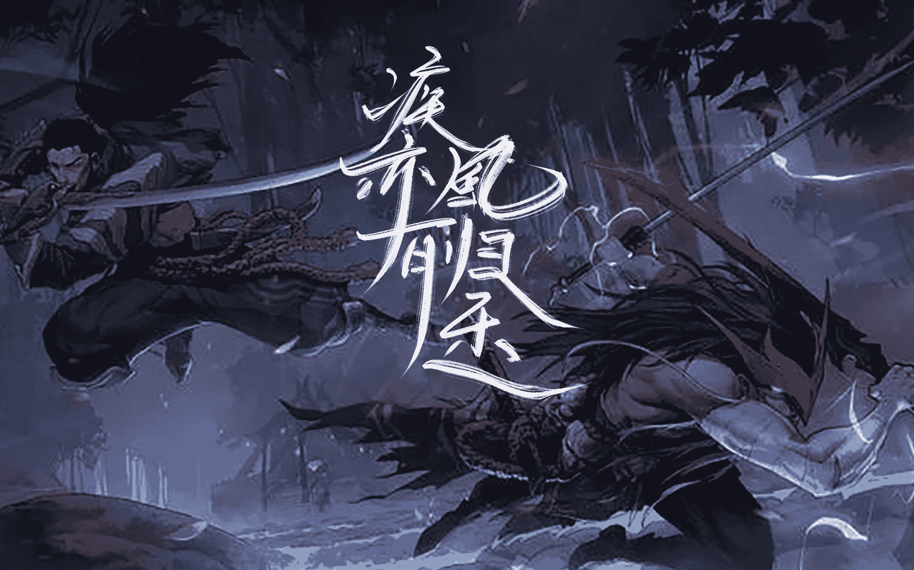

# [系统底层] 从0到-1写一个操作系统-`0xFF`-!!完结撒花!!

- 原帖: https://www.52pojie.cn/forum.php?mod=viewthread&tid=1748588
- 抓取时间: 2026-11-01T21:57:28

## `0xFF` 大总结!!!

截至目前，我们的操作系统已经实现完毕，这个项目即将跟大家说再见，在这里我来总结一下这一个多月的工作。

这是我网上找的一个世界上第一台计算机的图片，计算机从打孔批处理机器跨越到多道程序机器，再跨越到至今的个人操作系统，其中比较接近大众的windows或Linux，还有macOS都取得了不俗的成就，而本操作系统也仍然是基于Linux，毕竟Linux开源哈哈哈，还有就是经过这么多年的大师不断开发，Linux也逐渐完善，这也就体现出来开源的优势

经过一个多月的奋斗，最初希望构建一个操作系统的理想也顺利实现了，但是这里得提一嘴的是我的这个操作系统是基于《操作系统真象还原》来进行编写的，这本书就我自身来讲写的还是蛮好的，其中的一些讲的特别细心，之前像大学课程中学习的操作系统或是计算机组成原理等都在这里用行动来验证自己的学习，将这些知识付诸实践，也确实，经过一个完整的操作系统实现，你可以更深的了解用户程序、内核、保护模式、实模式等，真正实现了从0到1的过程。

上面就是成品书，这里并不是推广，我也没收钱，纯粹是这本书出的确实好，作者的代码十分精炼且易懂，让你慢慢实现的过程中了解了操作系统的精妙之处，其中我也了解到了为什么说有的二进制工作者天生就是一个`pwn`大师，这是因为再操作系统底层也使用过许多类似`pwn`的手法，其实也不应该这么说，应该说`pwn`的手法借鉴了操作系统实现的手法，只是这些手法是使用了欺骗的手法来达到正确的结果，其中让我印象深刻的就是该操作系统中经常使用的欺骗CPU的操作，虽然底层，但是十分简单易懂。

说回总结，这标题我虽然使用的从零到负一，但这不过是调侃而已。不过这里有个巧妙的就是标题中`0xFF`也是1字节表示的数字负一的补码形式，有上过计算机组成原理课程的同学可能对这十分熟悉。

这一个多月以来碰到过许多问题，其中让我头疼的就是`PF`异常，也就是`page Fault`异常，相反那些并不是怎么熟悉的时钟中断控制器等硬件的理解我倒是十分顺畅，这个页每次报错我就只能回头来看页面分配以及内存管理的代码，有一次甚至将代码追查到保护模式最开始建立页目录以及页表的汇编代码，最后检查出来是页目录项和页表项中低12位其中的一个访问位写错，导致用户无法正常访问页面，找出这个问题还真是让我头疼了好几天，刚好那几天还在过年，真的让我过年也过不安逸

但是最后好在还是成功实现了，功能也算比较完善，当然也可以往里面增加咱们自定义的一些系统调用，在以后如果想实现了就紧接着实现。如果有同学也想获取一个项目来锻炼自己，并且是从事底层工作的同学，其实也可以拿该项目来练练手。

我在之前学习内核`pwn`的过程中，由于学到了`KPTI`就把我搞劝退了，我想什么叫都映射在同一块，这映射在同一块是怎么实现的？就这么一点我当时硬是理解的不透彻，更不必说后面的漏洞利用了，即使我之前已经学过书本上的操作系统页表分配或映射的知识了（自我感觉应试部分还行哈，不是装杯，这是事实！）还是不理解，但是在实现了整个操作系统之后，对于这些知识确实通透了。

因此之后的工作还是接着学习安全的知识，然后如果学习的进度较快还想着能不能复现一下以前真实存在的漏洞，因为本来就是奔着二进制安全去的，操作系统是为之后学习所做的铺垫，顺便也锻炼一下自己的基本功。

之后给后来的同学也打打气，如果你也希望同我一样亲手实现一个操作系统，那么就来吧，当我的儿**

以上是开玩笑大伙别当真，不过同我一样实现这个操作系统的邀请却不假，我已经替大伙提前尝试过了，可行且十分有价值。

如果大伙实现的过程中遇到问题也可以根据我划分的进度到github上面查看代码，由于我的分布是每一节一个分支，因此不同阶段代码也十分清晰，地址如下：

https://github.com/PeiandHao/`Simple_OS_For_Studing`

下面就是我的每一个阶段的整体链接，最后祝贺大家在以后的生活中顺顺利利

https://www.52pojie.cn/thread-1730367-1-1.html
https://www.52pojie.cn/thread-1730510-1-1.html
https://www.52pojie.cn/thread-1731150-1-1.html
https://www.52pojie.cn/thread-1731546-1-1.html
https://www.52pojie.cn/thread-1732769-1-1.html
https://www.52pojie.cn/thread-1733670-1-1.html
https://www.52pojie.cn/thread-1734041-1-1.html
https://www.52pojie.cn/thread-1734628-1-1.html
https://www.52pojie.cn/thread-1735431-1-1.html
https://www.52pojie.cn/thread-1736676-1-1.html
https://www.52pojie.cn/thread-1737679-1-1.html
https://www.52pojie.cn/thread-1738486-1-1.html
https://www.52pojie.cn/thread-1739792-1-1.html
https://www.52pojie.cn/thread-1740859-1-1.html
https://www.52pojie.cn/thread-1741733-1-1.html
https://www.52pojie.cn/thread-1743642-1-1.html
https://www.52pojie.cn/thread-1744456-1-1.html
https://www.52pojie.cn/thread-1745523-1-1.html
https://www.52pojie.cn/thread-1746479-1-1.html
https://www.52pojie.cn/thread-1746861-1-1.html
https://www.52pojie.cn/thread-1747788-1-1.html
https://www.52pojie.cn/thread-1748413-1-1.html

