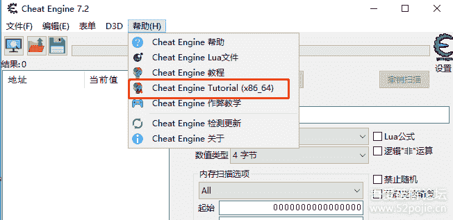
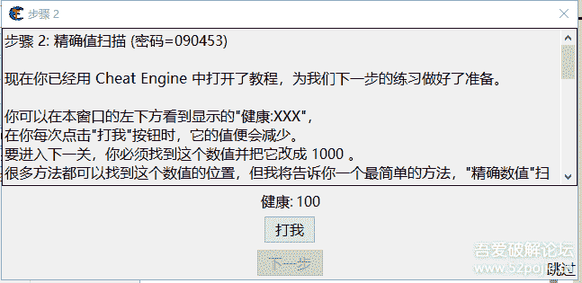
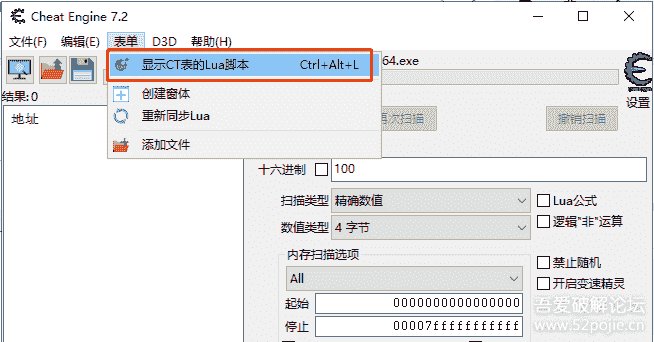
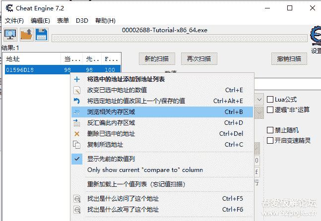
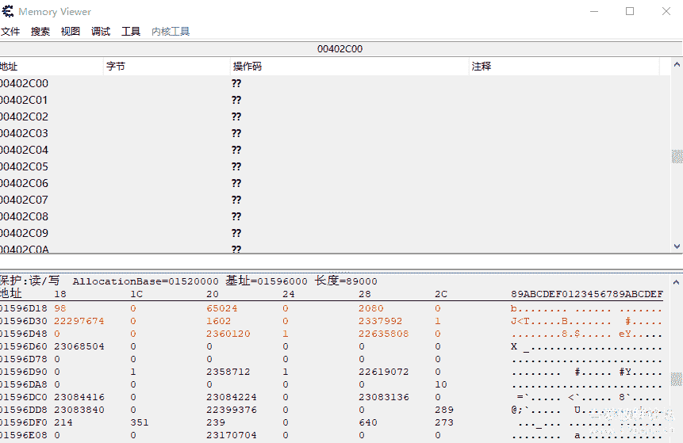
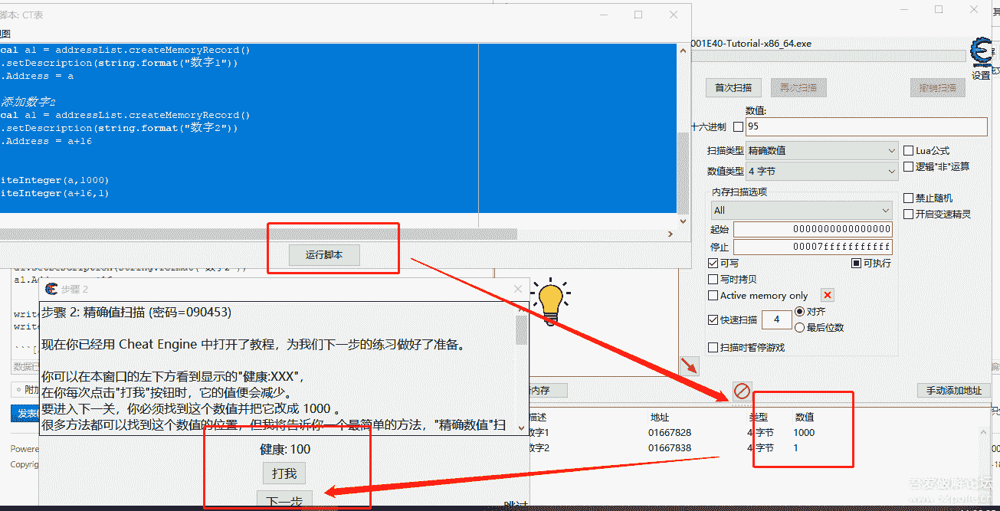

# [游戏安全] Cheat Engine 教程：对步骤 2 教程编写一个 lua 脚本

- 原帖：<https://www.52pojie.cn/forum.php?mod=viewthread&tid=1775318>
- 抓取时间：2026-11-01T21:56:52

## 前言

最近玩游戏用到了 Cheat Engine 工具修改数值，但每次修改都要手工重复输入，麻烦死了。所以简单学习了下 lua 脚本编写，希望对大家有帮助。

## 演示软件和修改思路

- 演示软件：Cheat Engine 自带教程步骤 2（`Tutorial-x86_64.exe`）
- 修改操作：在这个教程界面中，按提示直接搜值进行修改。这个操作在 CE 操作中属于最常见的了。



`1.png`（39.08 KB，下载次数：2）；附件：[打开教程](https://www.52pojie.cn/forum.php?mod=attachment&aid=MjYwODQ0MHxkZGI1YWZlYXwxNzkzNTcwMjA5fDE2ODA4NnwxNzc1MzE4&nothumb=yes)；2023-4-18 14:45 上传



`2.png`（35.65 KB，下载次数：1）；附件：[打开程序](https://www.52pojie.cn/forum.php?mod=attachment&aid=MjYwODQ0MXxhYzIwMmNlOXwxNzkzNTcwMjA5fDE2ODA4NnwxNzc1MzE4&nothumb=yes)；2023-4-18 14:47 上传

## 编写脚本

整体编写思路：将 CE 手动修改步骤一步步转为代码形式。



`6.png`（36.17 KB，下载次数：2）；附件：[下载附件](https://www.52pojie.cn/forum.php?mod=attachment&aid=MjYwODQ1MXw1NzIxMDQ5OHwxNzkzNTcwMjA5fDE2ODA4NnwxNzc1MzE4&nothumb=yes)；2023-4-18 14:54 上传

### 1. 附加程序

在进程列表中找到要修改的程序名称，附加到 CE 里面。

```lua
openProcess ("Tutorial-x86_64.exe")
```

### 2. 搜索条件设置（群组和内存特征排列）

将要在 CE 界面上要输入的条件值添加到脚本中。

搜索过这个健康值时，发现减的值会随机，并且重启后精确搜索方式会失效。所以这里换个思路，用查找内存排列和群组搜索进行定位。

#### a. 内存排列查找

先按教程精确搜索，搜索出结果后浏览内存区域。将附近的值复制出来，粘贴到记事本里。关掉程序，重复之前步骤。

将几次值进行文本比对，可以看到下面数值分布十分简单。

内存特征分布为：“`健康值 0 65024 0 2080 0`”



`3.png`（51.68 KB，下载次数：1）；附件：[浏览内存](https://www.52pojie.cn/forum.php?mod=attachment&aid=MjYwODQ0NnwzZThjZjlmNXwxNzkzNTcwMjA5fDE2ODA4NnwxNzc1MzE4&nothumb=yes)；2023-4-18 14:51 上传

```text
第1次搜索：98 0 65024 0 2080 0 22297674 0 1602 0 2337992 1 0 0 2360120 1 22635808 0
第2次重启搜索：97 0 65024 0 2080 0 21711114 0 1602 0 2337992 1 0 0 2360120 1 22049248 0
第3次重启搜索：95 0 65024 0 2080 0 932826 0 1602 0 2337992 1 0 0 2360120 1 1270960 0
```



`4.png`（45.1 KB，下载次数：0）；附件：[下载附件](https://www.52pojie.cn/forum.php?mod=attachment&aid=MjYwODQ0OHw3YzBiZDc3YXwxNzkzNTcwMjA5fDE2ODA4NnwxNzc1MzE4&nothumb=yes)；2023-4-18 14:52 上传

#### b. 群组条件转换

经过上面的查找出的内存排列，接下来就是群组条件转换了。

群组：`4:100 w:12 4:2080`

注释：`4:` 表示 4 字节类型，`w:` 表示跳过多少字节（`4*3`），`100`：第一次启动后界面的健康值 100，`2080`：不知道干嘛的，为了修改多个值时的场景就加进来了。

将要在 CE 界面上要输入的条件值和搜索设置添加到脚本中。

```lua
local search_num = string.format("4:100 w:12 4:2080")
local Scan = createMemScan();
Scan.OnlyOneResult=true;
Scan.firstScan(soExactValue, vtGrouped, rtTruncated, search_num, "", 0, 0x00000001ffffffff, "", fsmNotAligned, "", true, false, false, false);
Scan.waitTillDone();
a=Scan.getOnlyResult()
if a==nil then print("未能搜寻到值") return end
```

### 3. 将搜索结果加入地址栏

上面有 2 个值，分别注释为“数字1”“数字2”加到地址栏。最后加入 Active 锁定值。

```lua
--添加数字1
local addressList = getAddressList()
local a1 = addressList.createMemoryRecord()
a1.setDescription(string.format("数字1"))
a1.Address = a

--添加数字2
local a1 = addressList.createMemoryRecord()
a1.setDescription(string.format("数字2"))
a1.Address = a+16
```

### 4. 修改结果值

将 2 个值，分别修改为 1000 和 2。

```lua
writeInteger(a,1000)
writeInteger(a+16,2)
```

## 总结

最后重启教程软件试试脚本效果。打开步骤 2 界面，运行脚本后界面直接就出现下一步按钮。同时发现这个教程软件十分有趣，界面上的值和实际值不一样，后面有时间再研究一下。



`5.png`（113.79 KB，下载次数：1）；附件：[下载附件](https://www.52pojie.cn/forum.php?mod=attachment&aid=MjYwODQ1NHxkOGE2YThjNnwxNzkzNTcwMjA5fDE2ODA4NnwxNzc1MzE4&nothumb=yes)；2023-4-18 15:00 上传

## 脚本整合

```lua
openProcess ("Tutorial-x86_64.exe")

local search_num = string.format("4:100 w:12 4:2080")

local Scan = createMemScan();

Scan.OnlyOneResult=true;

Scan.firstScan(soExactValue, vtGrouped, rtTruncated, search_num, "", 0, 0x00000001ffffffff, "", fsmNotAligned, "", true, false, false, false);

Scan.waitTillDone();

a=Scan.getOnlyResult()

if a==nil then print("未能搜寻到值") return end

--添加数字1

local addressList = getAddressList()

local a1 = addressList.createMemoryRecord()

a1.setDescription(string.format("数字1"))

a1.Address = a

--添加数字2

local a1 = addressList.createMemoryRecord()

a1.setDescription(string.format("数字2"))

a1.Address = a+16

writeInteger(a,1000)

writeInteger(a+16,1)
```
