# [调试逆向] Windows x64中断门提权 R3调用R0函数

- 原帖：https://www.52pojie.cn/forum.php?mod=viewthread&tid=1778935
- 抓取时间：2026-11-01T21:56:36

> 声明：
>
> （1）本篇文章实验针对未开启内核隔离（`KPTI`）的Window10系统
>
> （2）本次实验的实现并不代表R3调用R0可以完全只由`Ring3`完成

```text
win10并不使用调用门、陷阱门、任务门，一律只用中断门，本次实验采用中断门提权实现R3调用R0函数。
没开启KPTI，Cr3始终为内核Cr3。
```

## 环境工具

> （1）调式工具：`Windbg`
>
> （2）虚拟机：`windows10 19044.2846`
>
> （3）IDE：`VS2019`

## 一、原理分析

### 1. `IDT` 表、中断描述符

- 中断：只使用一张`IDT`表，内核可以根据栈上的`CS`判断先前模式。
- `IDT`表地址位于`KPCR`偏移`0x38`处。

> `nt!_KPCR`
>
> `+0x038 IdtBase : Ptr64 _KIDTENTRY64`

- 64位中断门描述符：

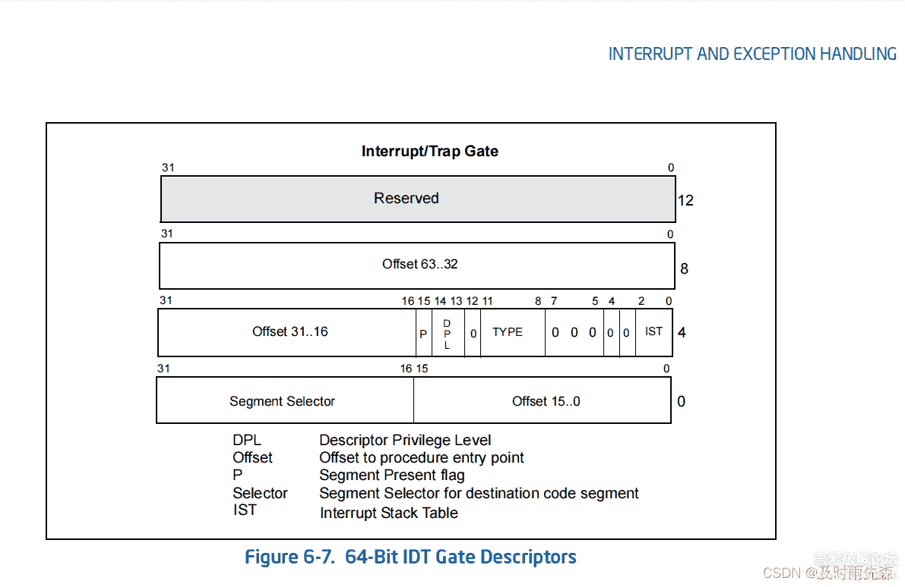

1.png（77.2 KB，下载次数：1；2023-4-26 16:13 上传）

附件：[下载](https://www.52pojie.cn/forum.php?mod=attachment&aid=MjYxMDYwM3w5NTBmODY5N3wxNzkzNTcwMTk0fDE2ODA4NnwxNzc4OTM1&nothumb=yes)

图来自Intel 第3卷 Figure 6-7. 64-Bit IDT Gate Descriptors

参照此图方便后续构造中断门

### 2. `Fs`、`Gs` 寄存器

- X86：0环时`FS`指向`KPCR`，3环时`FS`指向`TEB`
- X64：0环时`GS`指向`KPCR`，3环时`GS`指向`TEB`

`FS`和`GS`的基址在3个`MSR`寄存器中：

- `IA32_FS_BASE`（下标`0xC0000100`）
- `IA32_GS_BASE`（下标`0xC0000101`）
- `IA32_KERNEL_GS_BASE`（下标`0xC0000102`）

### 3. 简单分析3环进0环过程

#### （1）分析`int 3`中断

> `windbg`输入指令：`!idt`

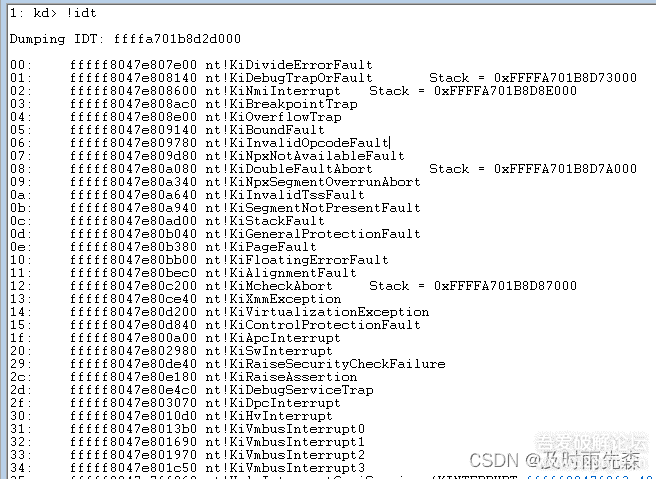

2.png（32.82 KB，下载次数：0；2023-4-26 16:13 上传）

附件：[下载](https://www.52pojie.cn/forum.php?mod=attachment&aid=MjYxMDYwNnw5ZDBiMmJlNnwxNzkzNTcwMTk0fDE2ODA4NnwxNzc4OTM1&nothumb=yes)

可看到3号中断函数是`KiBreakpointTrap`，这是因为笔者的测试机是未开启`KPTI`的。

而在开启`KPTI`时：3号中断函数调用的是`KiBreakpointTrapShadow`。

用`IDA`对内核文件`ntoskrnl.exe`的`KiBreakpointTrapShadow`分析：

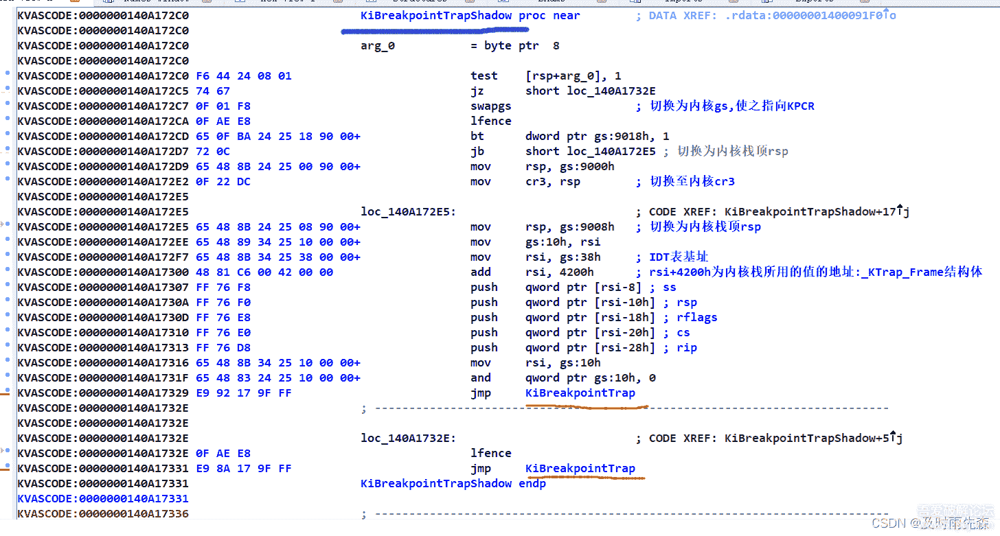

3.png（153.99 KB，下载次数：1；2023-4-26 16:13 上传）

附件：[下载](https://www.52pojie.cn/forum.php?mod=attachment&aid=MjYxMDYwN3wxYmUyMTkzNXwxNzkzNTcwMTk0fDE2ODA4NnwxNzc4OTM1&nothumb=yes)

由`IDA`分析可知，`KiBreakpointTrapShadow`只是做了一些调用0环函数前的准备行为，如切换内核`Cr3`，切换内核`rsp`，切换内核`gs`等，最后跳到了`KiBreakpointTrap`真正执行中断函数。

而未开启`KPTI`时，中断函数并不是`KiBreakpointTrapShadow`而是`KiBreakpointTrap`，而`KiBreakpointTrap`中并没有这些进内核的准备行为，笔者猜测进`KiBreakpointTrap`前肯定还执行过类似的代码，目前还未查到。

后面本人通过构建中断门进行测试发现，进去中断函数时`rsp`已经切换为0环的`rsp`，`_KTrap_Frame`的那5个寄存器也在栈中，`cr3`本身就是内核`cr3`，不需要改，但是`gs`还没修改，所以我们的构建中断门函数代码里边只用修改`gs`就可以调用内核函数了。

## 二、代码实现

### 1. 配置项目

1. 创建`vs`空项目，笔者项目名为`IntGate`。
2. 创建`main.cpp`文件和`x64asm.asm`文件（`asm`文件随便创建一个文件后，将后缀为`.asm`就行）。
3. 右键项目 -> 生成依赖性 -> 生成自定义，第四个打上勾。

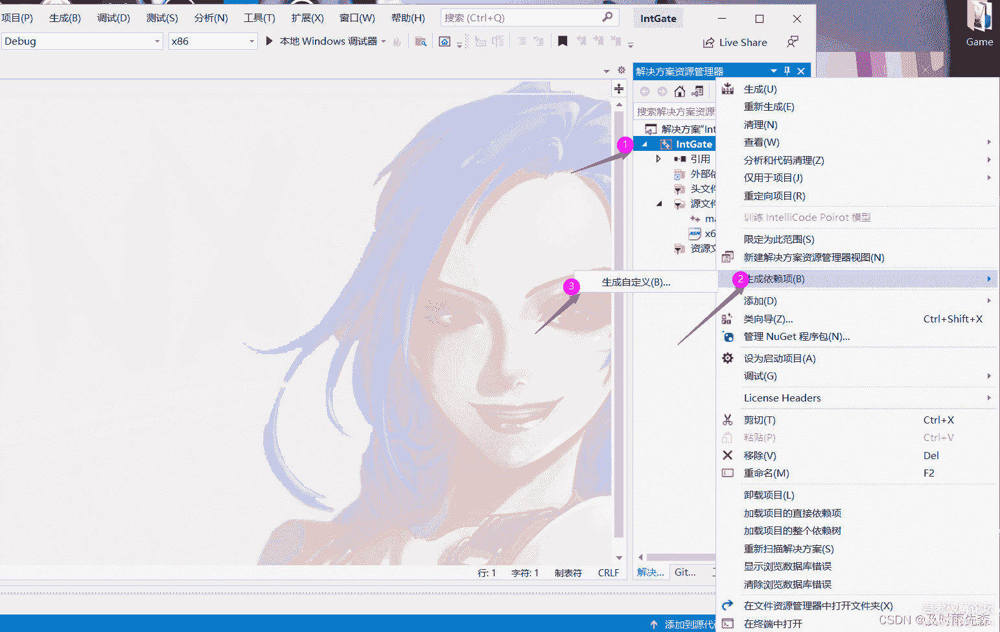

4.png（486.09 KB，下载次数：0；2023-4-26 16:14 上传）

附件：[下载](https://www.52pojie.cn/forum.php?mod=attachment&aid=MjYxMDYwOHw2YjlmNzBhOHwxNzkzNTcwMTk0fDE2ODA4NnwxNzc4OTM1&nothumb=yes)

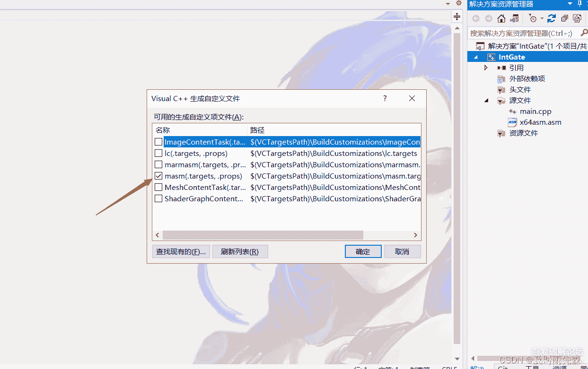

5.png（263.83 KB，下载次数：1；2023-4-26 16:14 上传）

附件：[下载](https://www.52pojie.cn/forum.php?mod=attachment&aid=MjYxMDYwOXxlNjQ4ZThkN3wxNzkzNTcwMTk0fDE2ODA4NnwxNzc4OTM1&nothumb=yes)

4. 右键`x64asm.asm`，按如下图选择。

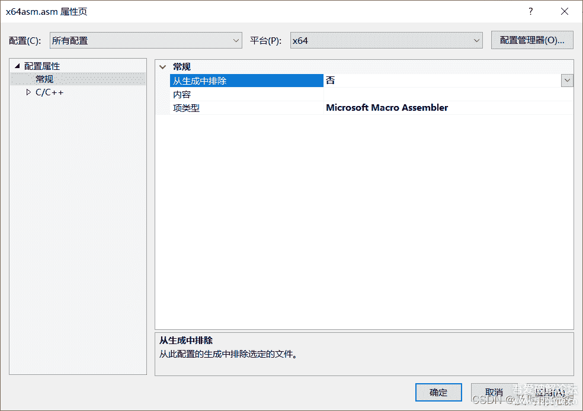

6.png（36.17 KB，下载次数：0；2023-4-26 16:14 上传）

附件：[下载](https://www.52pojie.cn/forum.php?mod=attachment&aid=MjYxMDYxMHxiZWUyOTAxNnwxNzkzNTcwMTk0fDE2ODA4NnwxNzc4OTM1&nothumb=yes)

5. 打开项目属性设置固定基址，并关闭增量链接。

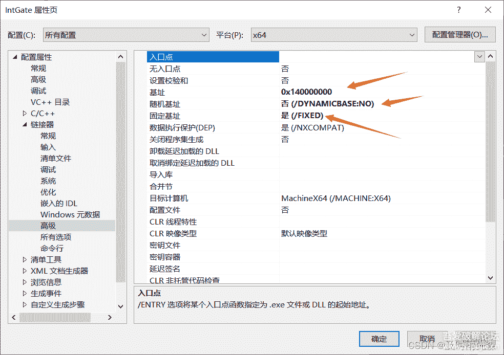

7.png（80.9 KB，下载次数：0；2023-4-26 16:14 上传）

附件：[下载](https://www.52pojie.cn/forum.php?mod=attachment&aid=MjYxMDYxMXw4ODE5YmM2NHwxNzkzNTcwMTk0fDE2ODA4NnwxNzc4OTM1&nothumb=yes)

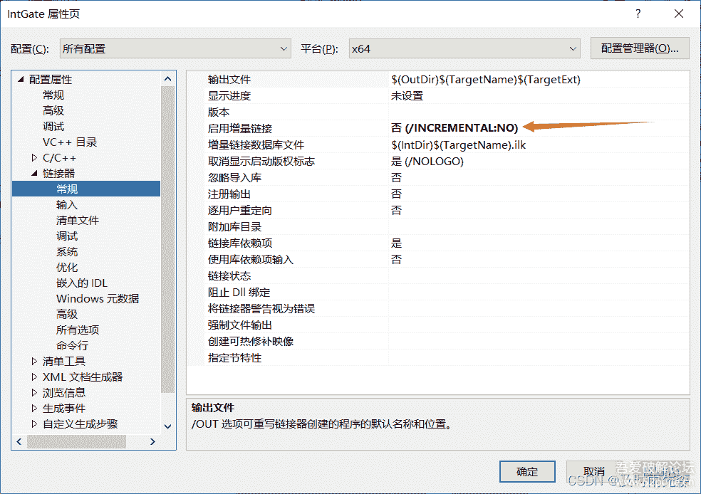

8.png（79.14 KB，下载次数：0；2023-4-26 16:14 上传）

附件：[下载](https://www.52pojie.cn/forum.php?mod=attachment&aid=MjYxMDYxMnxkM2YyZDNiZXwxNzkzNTcwMTk0fDE2ODA4NnwxNzc4OTM1&nothumb=yes)

### 2. 代码实现

> 代码如下（部分硬编码的地方需要更改）：

#### `main.cpp`

```cpp
#include 

#include 

extern "C" void InterruptEntry();
extern "C" void CaseInterrupt();

int main()
{
        printf("InterruptEntry Addr:%p\n", (ULONG64)InterruptEntry);
        // 笔者InterruptEntry为0x0000000140001200
        if ((ULONG64)InterruptEntry != 0x0000000140001200)
        {
                printf("InterruptEntry地址与中断门构建的地址不一样\n");
                system("pause");
                return 0;
        }

        system("pause");
        CaseInterrupt();
        system("pause");
        return 0;
}
```

#### `x64asm.asm`

```asm
option casemap:none

.data
pStr db 'I am the DbgPrint func', 0DH, 0AH

.code

InterruptEntry proc
        ;切换gs
        swapgs

        ;调用DbgPrint函数. 为方便直接用windbg查了之后将函数地址写成硬编码了
        mov rax,0fffff8047e7647b0h
        sub rsp,20h
        lea rcx,[pStr]
        call rax
        add rsp,20h

        ; 恢复gs
        swapgs
        iretq
InterruptEntry endp

CaseInterrupt proc
        int 0fh ;f号中断系统未使用
        ret
CaseInterrupt endp

end
```

#### `windbg` 配置

1. 构建中断门

笔者`InterruptEntry`地址为`0x0000000140001200`，中断门属性就填3号中断的属性，地址填`0x0000000140001200`。

`windbg`：

```text
eq idtr+f0 4000ee00`00101200
eq idtr+f8 00000000`00000001
!idt f
```

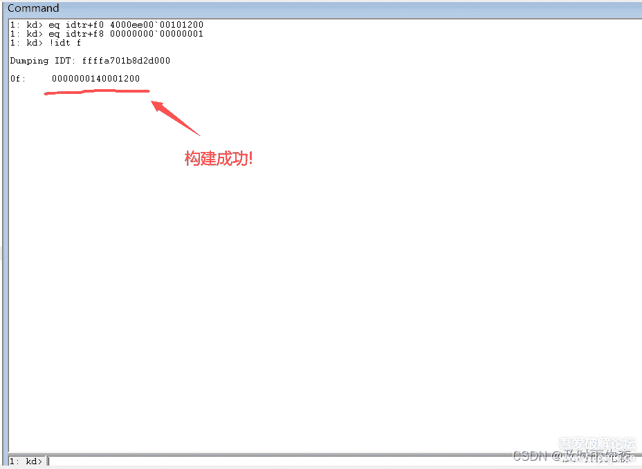

9.png（22.02 KB，下载次数：1；2023-4-26 16:26 上传）

附件：[下载](https://www.52pojie.cn/forum.php?mod=attachment&aid=MjYxMDYxN3xjZWM1M2U5ZHwxNzkzNTcwMTk0fDE2ODA4NnwxNzc4OTM1&nothumb=yes)

2. 设置`Cr4`寄存器中`SMEP`和`SMAP`，把3去掉就行。

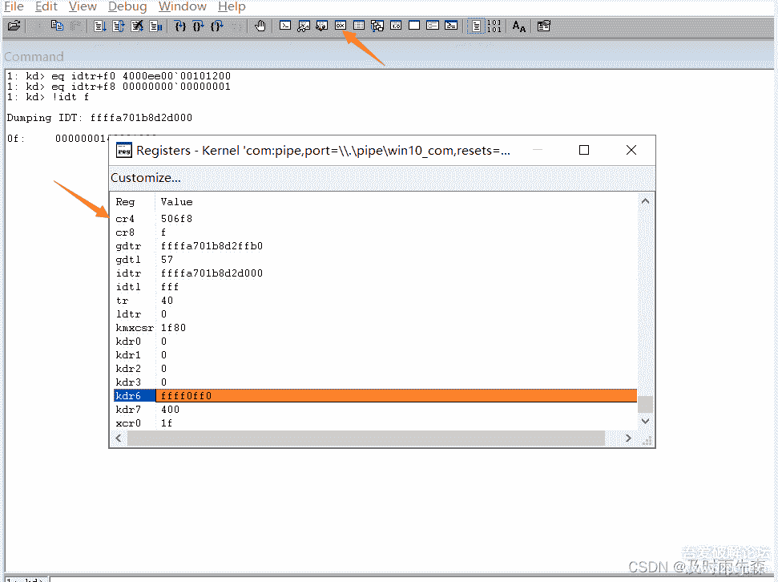

10.png（32.3 KB，下载次数：0；2023-4-26 16:13 上传）

附件：[下载](https://www.52pojie.cn/forum.php?mod=attachment&aid=MjYxMDYwNHw2Y2I0M2ZmZXwxNzkzNTcwMTk0fDE2ODA4NnwxNzc4OTM1&nothumb=yes)

#### 运行截图

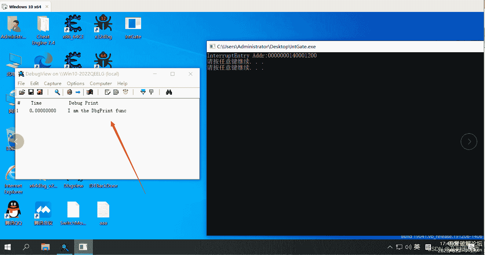

11.png（267.18 KB，下载次数：0；2023-4-26 16:13 上传）

附件：[下载](https://www.52pojie.cn/forum.php?mod=attachment&aid=MjYxMDYwNXwzMTNiMWFjNnwxNzkzNTcwMTk0fDE2ODA4NnwxNzc4OTM1&nothumb=yes)

## 参考资料

- bilibili博主_周壑：[https://space.bilibili.com/37877654/channel/seriesdetail?sid=1467288](https://space.bilibili.com/37877654/channel/seriesdetail?sid=1467288)
- Intel 第3卷 段页机制

> 如有错误，还请大佬指正
