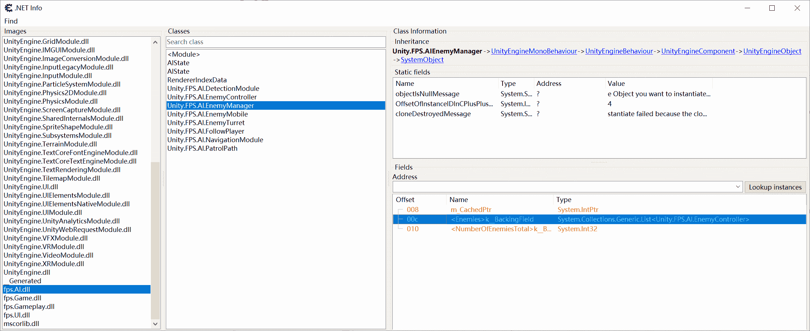
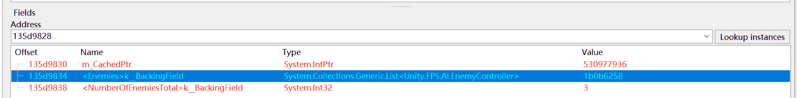
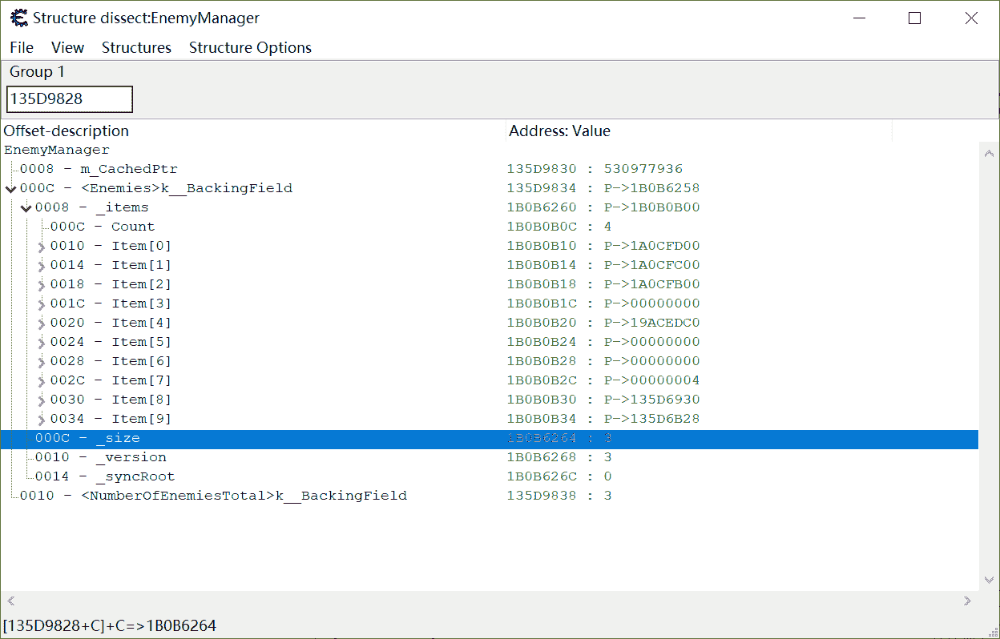
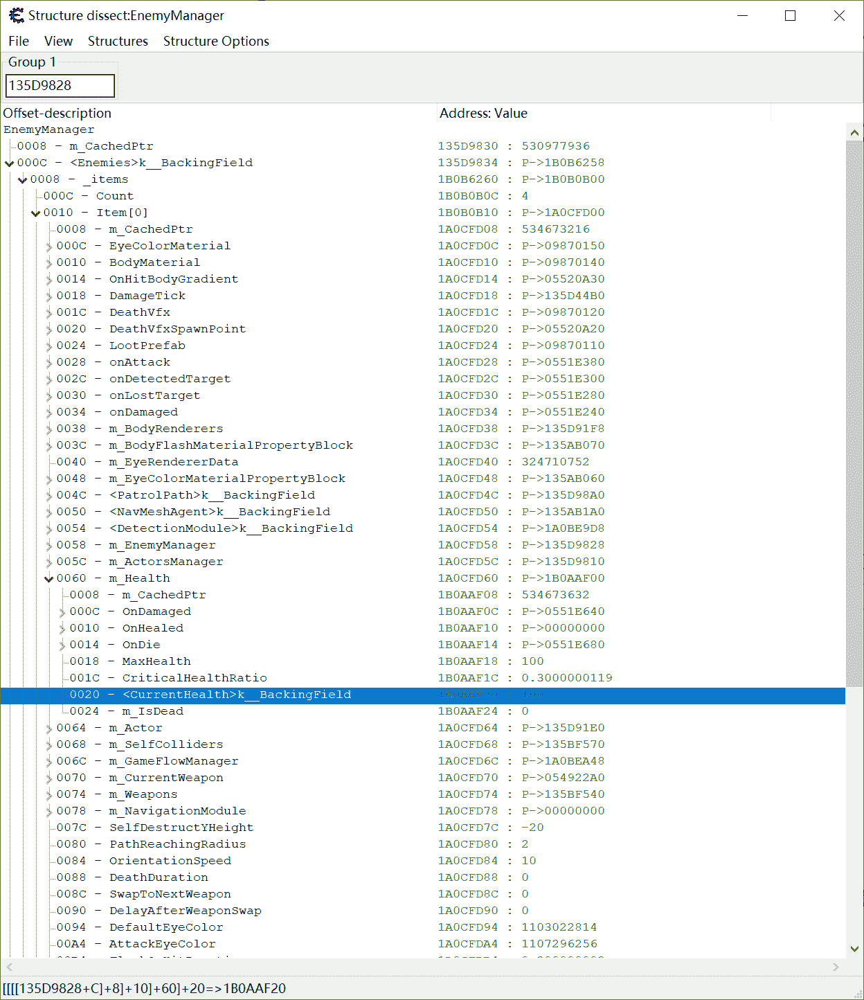
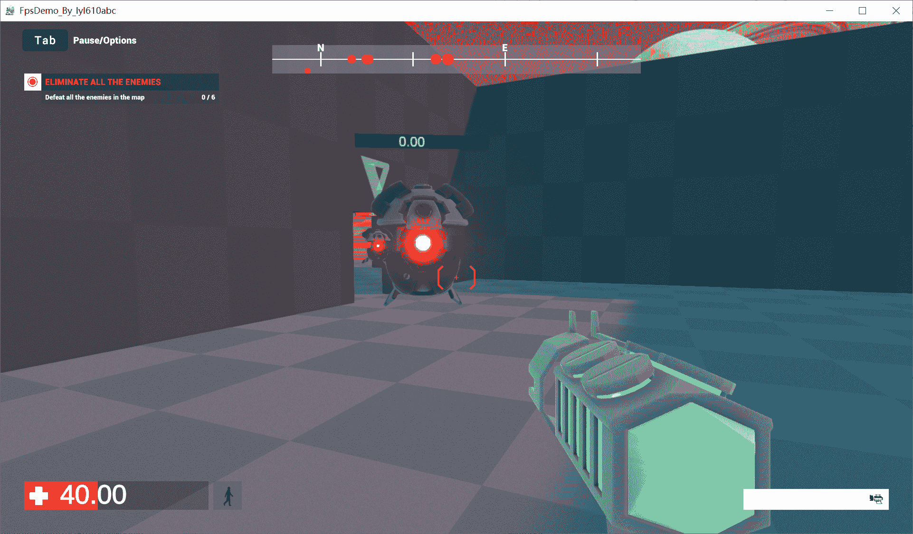
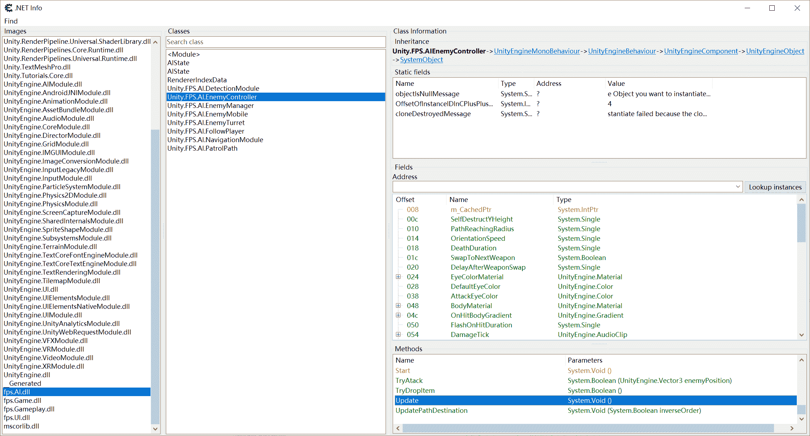
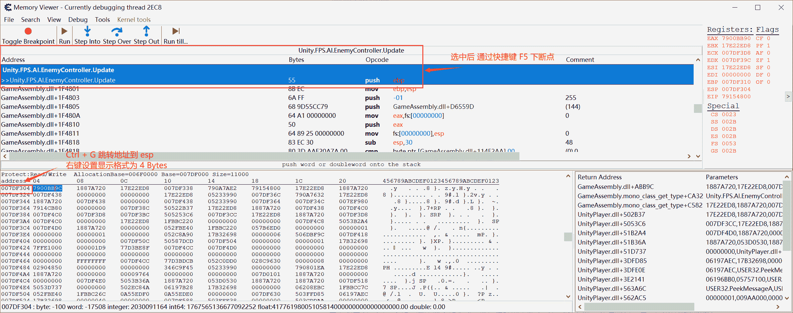

# [游戏安全] 通杀爆改 Unity FPS 游戏系列-第二章：HOOK实现全屏改血+秒杀

- 原帖: https://www.52pojie.cn/forum.php?mod=viewthread&tid=1832964
- 抓取时间: 2026-11-01T21:55:50

本篇为 Windows 篇，Android 篇将和 [href="home.php?mod=space&uid=1109458"](https://www.52pojie.cn/home.php?mod=space&uid=1109458) 梦幻联动，敬请期待

## 索引

[//www.52pojie.cn/thread-1829474-1-1.html](https://www.52pojie.cn/thread-1829474-1-1.html)  
[//www.52pojie.cn/thread-1830230-1-1.html](https://www.52pojie.cn/thread-1830230-1-1.html)  
[//www.52pojie.cn/thread-1835443-1-1.html](https://www.52pojie.cn/thread-1835443-1-1.html)  
[//www.52pojie.cn/thread-1993511-1-1.html](https://www.52pojie.cn/thread-1993511-1-1.html)

## 本章内容

本篇以 windows il2cpp 包为例实现功能：

- 全屏改血
- 全屏秒杀

## 思路

先对全屏秒杀这个功能进行拆解

- 全屏：作用范围为作用域内的所有敌人
- 秒杀：修改血量为 0 触发死亡

### 作用域

出于性能考虑，许多游戏并不会将整个地图上的所有敌人都加载出来

比如经典的吃鸡，其作用域就是几百米，游戏只加载了玩家附近几百米的敌人，透视自瞄也只能读到整个作用域内的敌人

当然我的 demo 肯定没有这个限制，作用域内的敌人就是所有敌人了

### 全屏

有了作用域的概念后，所谓的全屏实质上就是得要能够作用到作用域内的敌人

这里就有 2 个思路：遍历和公共函数HOOK

#### 遍历

通常来说，游戏开发者为了方便管理，都会将所有敌人放到一个数组/列表 中

所谓的遍历，通俗来讲，就是每次从敌人数组/列表中取一个敌人出来，一直取到所有敌人都取完为止

取出来 --> 执行秒杀操作

#### 公共函数HOOK

##### 公共函数

公共函数，即所有目标都会调用到的函数

在此次案例中就是所有敌人都会调用到的函数

既然每个敌人都会调用到，在调用的时候通过 HOOK ，加点私货就可以达到秒杀的效果

##### HOOK

HOOK：钩子，粗浅来说就是拦截后再放行

好比：正己老师某天要从家里去上班，但好巧不巧，路上被人打劫了，被劫色后（杰哥不要{{{(>_把这个事情转换一下

类对象是：正己老师

函数是：上班

HOOK是：打劫

HOOK干了啥：劫色

正己老师的目标是什么：上班

目标完成了没：完成了，还是一瘸一拐地上班去了。这里的一瘸一拐是什么造成的？ 劫色

也就是可以通过 劫色 对 正己老师 造成 一瘸一拐 的效果；通过 HOOK 对 类对象 的 状态 进行修改

浅浅总结一下：通过 HOOK，可以对被 HOOK 的对象进行状态修改，但对象原本要做的事情还是会去做

由此，到这里的全屏就是：

找到一个所有敌人都会调用到的函数，HOOK 这个函数，劫色敌人，不好意思走错片场了，是把敌人的状态弄成死亡，最后再去执行函数原本的逻辑

## 实战

### 遍历

有了第一章的铺垫，直接使用 `mono` + 关键词法，可以迅速定位到存储所有敌人的列表：`fps.AI` 下的 `Unity.FPS.AI.EnemyManager`

然后使用第一章的 `Lookup instances` 大法，可以很轻松地过滤得到所有敌人：

把这个内存地址丢到 `Structure Dissect` 里（忘记在哪的回去翻第一章！╰（‵□′）╯）

展开 `_items` 后，这里的 `_size` 表示的是当前敌人数量，毕竟刚开始，所以只有 3 个敌人

然后展开到这个敌人的血量，改成 0 试试

改成 0 后返回游戏可以看到是有效果的，但是敌人没有死掉 QAQ

这是因为死亡逻辑是在敌人受到伤害时做判断，如果受伤后血量小于 0 才会执行死亡函数

这里直接修改血量，并不会触发死亡，所以遍历后只是修改血量还不够，还得再调用死亡函数

死亡函数的内容放到后面 HOOK 里，这里主要是介绍一下遍历和重温下上一章的内容

### 公共函数HOOK

#### 挑选公共函数

按照前面的前面的思路，第一步就是要寻找合适的公共函数

所谓的合适指的是函数执行的时机，还是以前面的正己老师为例

温故下例子：正己老师某天要从家里去上班，但好巧不巧，路上被人打劫了，被劫色后（杰哥不要{{{(>_这里的时机，就是上班

但万一某天正己老师没上班（未触发函数），那不就没法对他进行劫色（HOOK）了吗

因此可以换个更好的时机，比如正己老师呼吸的时候

正己老师每呼吸一次，就对他进行劫色，这个时机就可以说是能够覆盖到正己老师的大多情况了

回归主题，对应到游戏内敌人的情况，则是需要找一个函数

这个函数的触发时机最好能够覆盖到所有敌人，且不需要特殊的触发条件，正常就能触发到

先定位到敌人对应的类：`fps.AI.dll` 下的 `Unity.FPS.AI.EnemyController`

虽然敌人没有呼吸这个函数，但有个关键的函数 `Update` 刷新

这个刷新函数能够完美满足我们的需求，于此同时其实还有一些其他函数，HOOK 他们能实现其他效果

比如 `TryAttack` 函数，敌人尝试攻击我们的时候直接让它死掉 w(ﾟДﾟ)w

这里就选定 `Update` 函数了

#### 关联公共函数和功能

先理一下联系

在公共函数处能拿到的类地址是：`EnemyController` 敌人

实现敌人死亡需要的类地址是：`Health` 生命

所以需要做的事：`EnemyController` → `m_Health` → `CurrentHealth` 修改为 0 → 调用死亡函数

只是修改敌人血量为 0 不会触发死亡，还需要额外调用死亡函数，死亡函数具体在后面再展开

### HOOK实现全屏改血

先从相对简单的改血开始，死亡函数先放在后面

先下双击 `Update` 函数，跳转到函数头部，然后快捷键下断点（这部分在第一章详细演示过，这里稍微简略些）

查看寄存器和堆栈数据

根据第一章的找血量部分的内容

对照函数的参数，其实是可以推测出堆栈中内存地址的含义的

| 内容 | 含义 |

ESP
