# [游戏安全] 逆向UE4最简单的一集

- 原帖: https://www.52pojie.cn/forum.php?mod=viewthread&tid=1838396
- 抓取时间: 2026-11-01T21:55:43

## 逆向UE4最全的一集

潜水时间过长，水一篇文章

在视频网站上看到许多课程，其中流行使用`CE`（Cheat Engine）来寻找数据。然而，这种介于模糊搜索、扫描和过滤的方式，不仅效率低下，对于逆向工程帮助甚微。有时候甚至换个游戏都难以取得有效成果。这时候就需要学习更高级的技巧。

随着时间的推移，对于`UE4`的逆向已经形成了一套成熟的方法和技术

以下介绍几个我认为很强的项目：

- [UnrealDumper-4.25](https://github.com/guttir14/UnrealDumper-4.25)，适用于Windows，早期版本的dump工具
- [UEDumper](https://github.com/Spuckwaffel/UEDumper)，适用于Windows，强大的工具
- [UE4Dumper](https://github.com/kp7742/UE4Dumper)，适用于Android的简单dump数据工具
- [AndUE4Dumper](https://github.com/MJx0/AndUE4Dumper)，适用于Android的可扩展dump工具，可导入`Android Studio`食用
- [iOS_UE4Dumper](https://github.com/MJx0/iOS_UE4Dumper)，适用于iOS的可扩展dump工具，可导入`Xcode`食用
- [UE4SDKGenerator](https://github.com/s4m33r89/UE4SDKGenerator)，适用于Android，强大的工具

通过上述项目，我们可以看到，在逆向`UE4`游戏时，对于引擎级别的逆向毫无疑问是最为主流和有效的。这些项目提供了强大的功能，能够避免低效的搜索方法，同时能生成可导入到相应平台开发环境中使用的SDK，进而通过调用游戏自身提供的函数和方法来实现相应的功能。

掌握上述项目的使用方法，可轻松应对`UE`系列的游戏，这里分享我在实际操作中遇到的一些困难。

### 游戏说明

游戏名: `StateOfDecay2` (4.13，无调试符号)

游戏名: `Absolver` (4.18，有调试符号)

我会通过两者的不同，来介绍当其中一种方法失效后应该怎么做

### 获取基础信息

首先需要获取游戏的一些基础信息，比如游戏使用的引擎版本、`GUObjectArray`、`GName`等，下面是针对4.23以下版本的演示，思路是通用的

#### 引擎版本

- `IDA`中搜索字符串：`"+UE"`

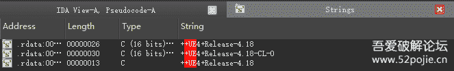

2023-09-25-23-11-19-image.png (13.21 KB, 下载次数: 6)

[href="forum.php?mod=attachment&aid=MjY0NzY3OHwyNmUzYTQ4ZHwxNzkzNTcwMTQxfDE2ODA4NnwxODM4Mzk2&nothumb=yes" target="_blank"](https://www.52pojie.cn/forum.php?mod=attachment&aid=MjY0NzY3OHwyNmUzYTQ4ZHwxNzkzNTcwMTQxfDE2ODA4NnwxODM4Mzk2&nothumb=yes)

2023-10-8 18:43 上传

- 在对应目录检查
- Windows: 游戏目录下运行的可执行文件，右键->属性->详细信息->产品版本

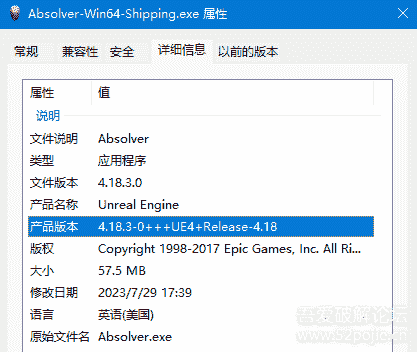

2023-09-25-23-21-55-image.png (26.53 KB, 下载次数: 4)

[href="forum.php?mod=attachment&aid=MjY0NzY3OXwzNWExZjliZHwxNzkzNTcwMTQxfDE2ODA4NnwxODM4Mzk2&nothumb=yes" target="_blank"](https://www.52pojie.cn/forum.php?mod=attachment&aid=MjY0NzY3OXwzNWExZjliZHwxNzkzNTcwMTQxfDE2ODA4NnwxODM4Mzk2&nothumb=yes)

2023-10-8 18:43 上传

- Android: 游戏apk中的`AndroidManifest.xml`

- iOS: 没试过

#### `GUObjectArray`

`IDA`中搜索字符串：`"Max UObject count is invalid. It must be a number that is greater than 0."`

有调试符号：

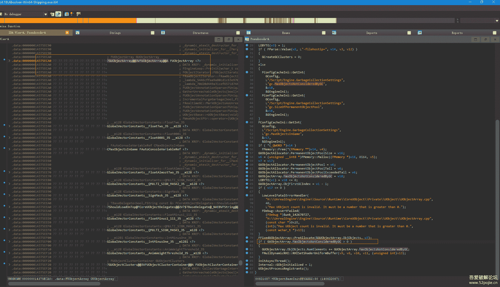

2023-09-25-23-29-26-image.png (301.06 KB, 下载次数: 5)

[href="forum.php?mod=attachment&aid=MjY0NzY4MHw1NDZlNzc5ZnwxNzkzNTcwMTQxfDE2ODA4NnwxODM4Mzk2&nothumb=yes" target="_blank"](https://www.52pojie.cn/forum.php?mod=attachment&aid=MjY0NzY4MHw1NDZlNzc5ZnwxNzkzNTcwMTQxfDE2ODA4NnwxODM4Mzk2&nothumb=yes)

2023-10-8 18:44 上传

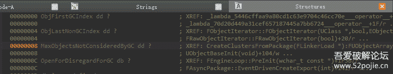

2023-09-25-23-30-53-image.png (30.77 KB, 下载次数: 4)

[href="forum.php?mod=attachment&aid=MjY0NzY4MXwxYmQ1YzAxNHwxNzkzNTcwMTQxfDE2ODA4NnwxODM4Mzk2&nothumb=yes" target="_blank"](https://www.52pojie.cn/forum.php?mod=attachment&aid=MjY0NzY4MXwxYmQ1YzAxNHwxNzkzNTcwMTQxfDE2ODA4NnwxODM4Mzk2&nothumb=yes)

2023-10-8 18:44 上传

无调试符号：

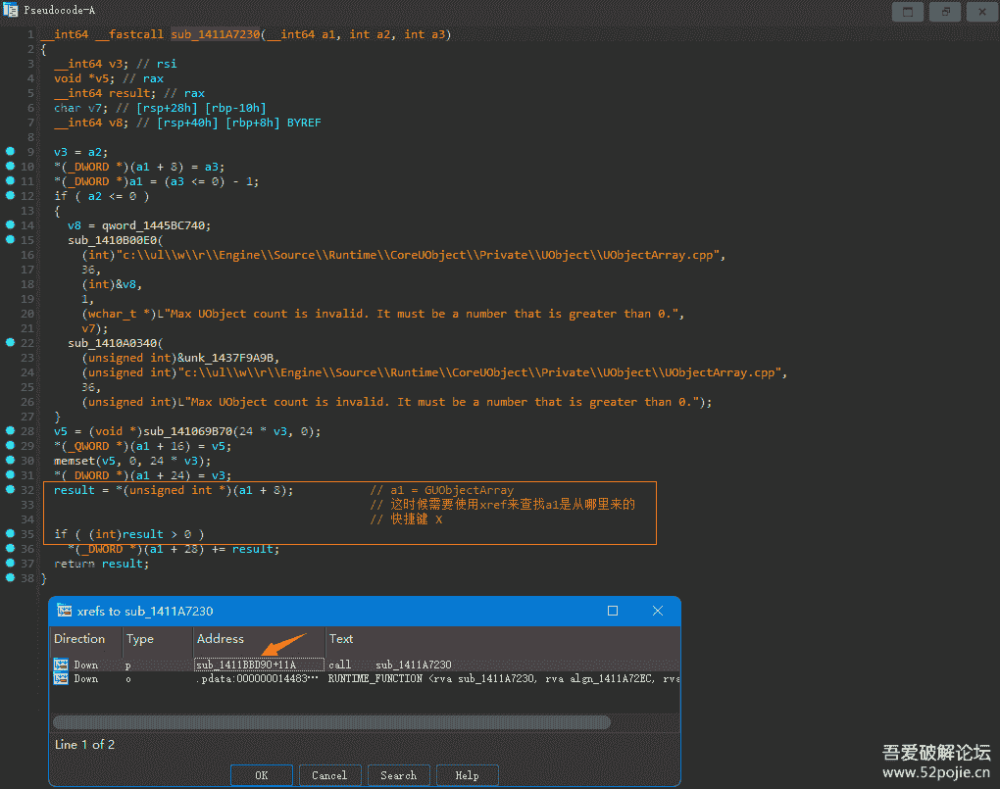

2023-09-25-23-48-14-image.png (84.17 KB, 下载次数: 3)

[href="forum.php?mod=attachment&aid=MjY0NzY4Mnw1MTRhMTdiYXwxNzkzNTcwMTQxfDE2ODA4NnwxODM4Mzk2&nothumb=yes" target="_blank"](https://www.52pojie.cn/forum.php?mod=attachment&aid=MjY0NzY4Mnw1MTRhMTdiYXwxNzkzNTcwMTQxfDE2ODA4NnwxODM4Mzk2&nothumb=yes)

2023-10-8 18:45 上传

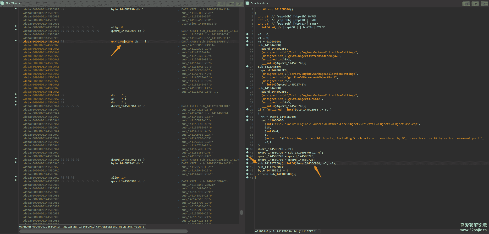

2023-09-25-23-49-53-image.png (233.64 KB, 下载次数: 3)

[href="forum.php?mod=attachment&aid=MjY0NzY4M3xkYTlmNWFhY3wxNzkzNTcwMTQxfDE2ODA4NnwxODM4Mzk2&nothumb=yes" target="_blank"](https://www.52pojie.cn/forum.php?mod=attachment&aid=MjY0NzY4M3xkYTlmNWFhY3wxNzkzNTcwMTQxfDE2ODA4NnwxODM4Mzk2&nothumb=yes)

2023-10-8 18:45 上传

如果字符串搜索不到，可在源代码中寻找其他的字符串

#### `GName`

`CE`搜索字符串：`"ByteProperty"`，在`None`前下断点

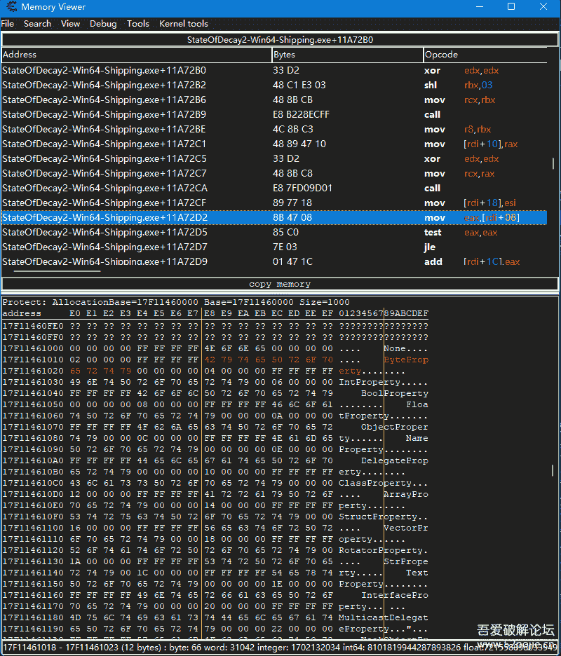

2023-09-26-00-48-33-image.png (123.91 KB, 下载次数: 4)

[href="forum.php?mod=attachment&aid=MjY0NzY4NXxjYjE3NzRlZXwxNzkzNTcwMTQxfDE2ODA4NnwxODM4Mzk2&nothumb=yes" target="_blank"](https://www.52pojie.cn/forum.php?mod=attachment&aid=MjY0NzY4NXxjYjE3NzRlZXwxNzkzNTcwMTQxfDE2ODA4NnwxODM4Mzk2&nothumb=yes)

2023-10-8 18:46 上传

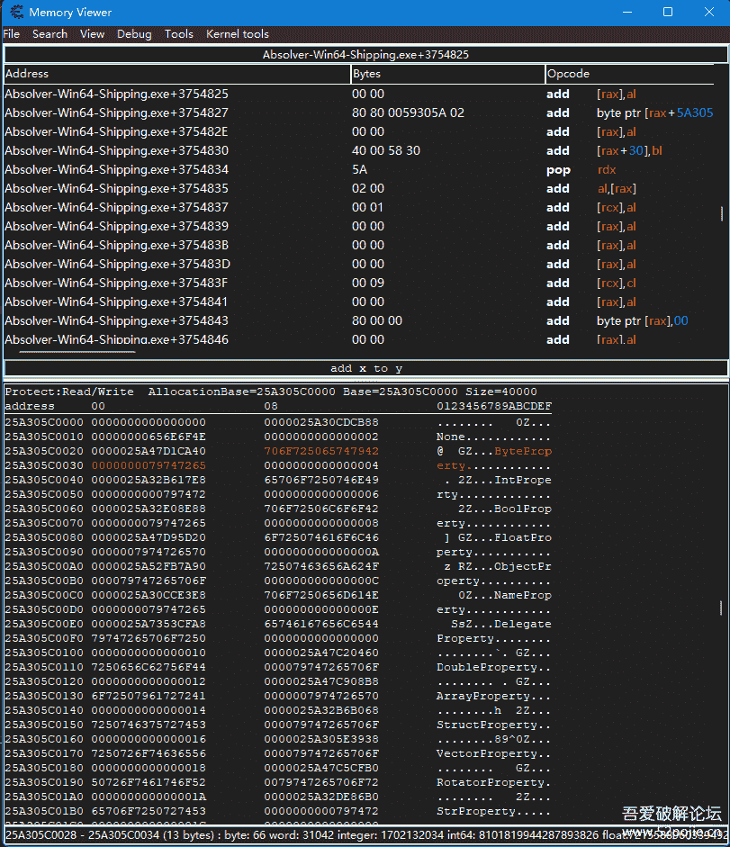

2023-09-26-00-46-25-image.png (116.6 KB, 下载次数: 2)

[href="forum.php?mod=attachment&aid=MjY0NzY4NHxlYTAwYjBmOHwxNzkzNTcwMTQxfDE2ODA4NnwxODM4Mzk2&nothumb=yes" target="_blank"](https://www.52pojie.cn/forum.php?mod=attachment&aid=MjY0NzY4NHxlYTAwYjBmOHwxNzkzNTcwMTQxfDE2ODA4NnwxODM4Mzk2&nothumb=yes)

2023-10-8 18:46 上传

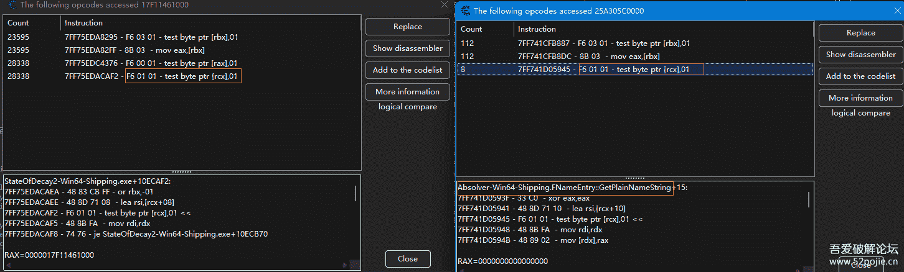

2023-09-26-00-49-51-image.png (69.72 KB, 下载次数: 4)

[href="forum.php?mod=attachment&aid=MjY0NzY4NnwwOWE0NjFiYXwxNzkzNTcwMTQxfDE2ODA4NnwxODM4Mzk2&nothumb=yes" target="_blank"](https://www.52pojie.cn/forum.php?mod=attachment&aid=MjY0NzY4NnwwOWE0NjFiYXwxNzkzNTcwMTQxfDE2ODA4NnwxODM4Mzk2&nothumb=yes)

2023-10-8 18:46 上传

```
//对应路径: `UnrealEngine-4.xx.x-release\Engine\Source\Runtime\Core\Private\UObject\UnrealNames.cpp`

FString FNameEntry::GetPlainNameString() const

{

if( IsWide() )

{

    return FString(WideName);

}

else

{

    return FString(AnsiName);

}

}
```

`IDA`对应伪代码：

有调试符号：

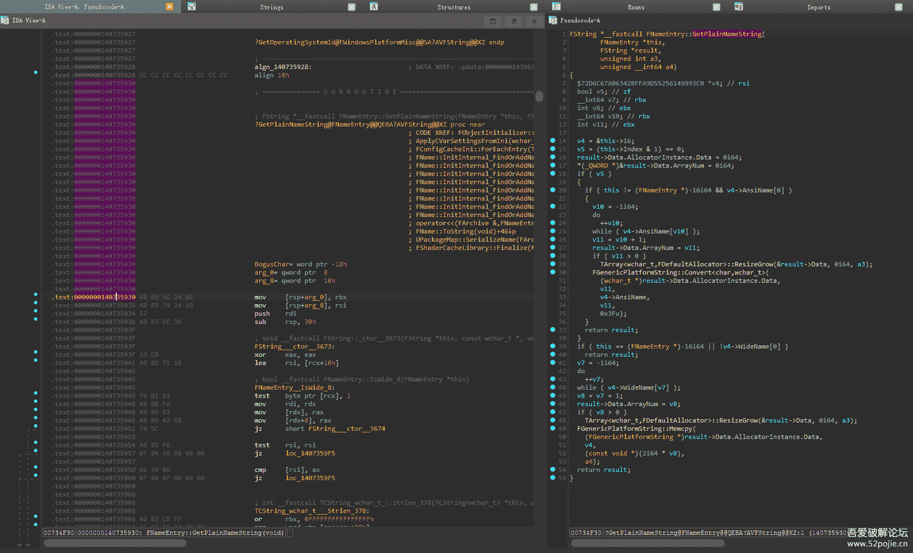

2023-09-26-00-55-33-image.png (235.52 KB, 下载次数: 2)

[href="forum.php?mod=attachment&aid=MjY0NzY4N3wzZmE1OGY5ZXwxNzkzNTcwMTQxfDE2ODA4NnwxODM4Mzk2&nothumb=yes" target="_blank"](https://www.52pojie.cn/forum.php?mod=attachment&aid=MjY0NzY4N3wzZmE1OGY5ZXwxNzkzNTcwMTQxfDE2ODA4NnwxODM4Mzk2&nothumb=yes)

2023-10-8 18:47 上传

无调试符号：

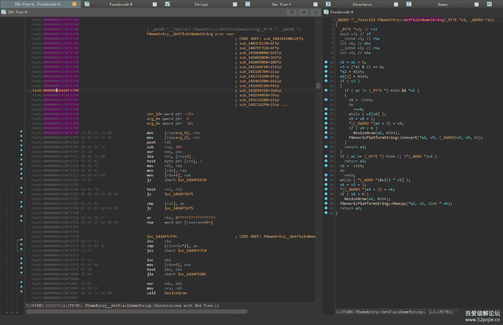

2023-09-26-00-56-25-image.png (206.14 KB, 下载次数: 3)

[href="forum.php?mod=attachment&aid=MjY0NzY4OHw5OTg2MmVhZnwxNzkzNTcwMTQxfDE2ODA4NnwxODM4Mzk2&nothumb=yes" target="_blank"](https://www.52pojie.cn/forum.php?mod=attachment&aid=MjY0NzY4OHw5OTg2MmVhZnwxNzkzNTcwMTQxfDE2ODA4NnwxODM4Mzk2&nothumb=yes)

2023-10-8 18:47 上传

找到此函数后按`X`，寻找上层引用(默认是第一个)

有调试符号：

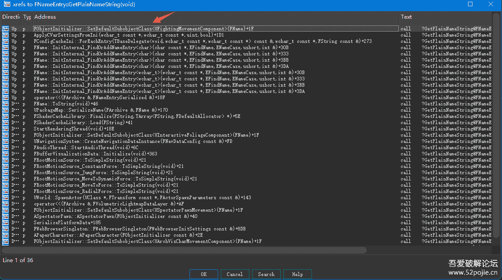

2023-09-26-01-00-23-image.png (74.28 KB, 下载次数: 2)

[href="forum.php?mod=attachment&aid=MjY0NzY4OXxhMDg3MDMyMXwxNzkzNTcwMTQxfDE2ODA4NnwxODM4Mzk2&nothumb=yes" target="_blank"](https://www.52pojie.cn/forum.php?mod=attachment&aid=MjY0NzY4OXxhMDg3MDMyMXwxNzkzNTcwMTQxfDE2ODA4NnwxODM4Mzk2&nothumb=yes)

2023-10-8 18:49 上传

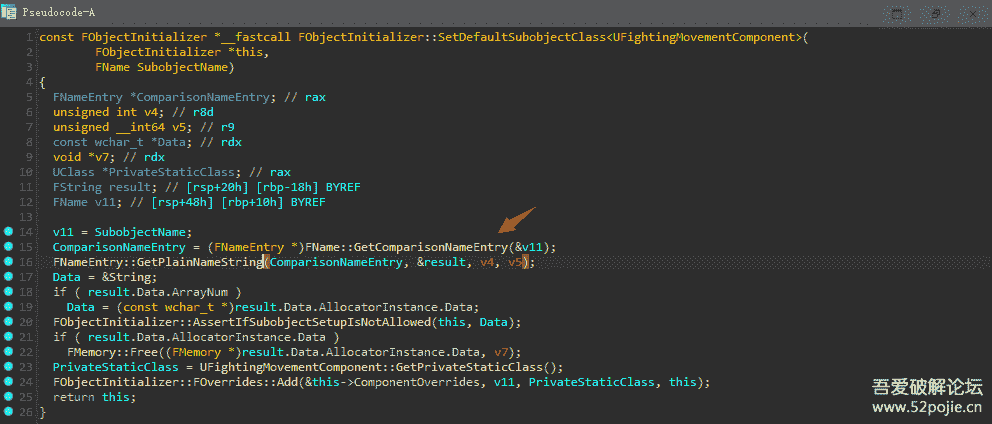

2023-09-26-01-01-26-image.png (63.16 KB, 下载次数: 2)

[href="forum.php?mod=attachment&aid=MjY0NzY5MHxkMzlmMjNiNXwxNzkzNTcwMTQxfDE2ODA4NnwxODM4Mzk2&nothumb=yes" target="_blank"](https://www.52pojie.cn/forum.php?mod=attachment&aid=MjY0NzY5MHxkMzlmMjNiNXwxNzkzNTcwMTQxfDE2ODA4NnwxODM4Mzk2&nothumb=yes)

2023-10-8 18:49 上传

无调试符号：

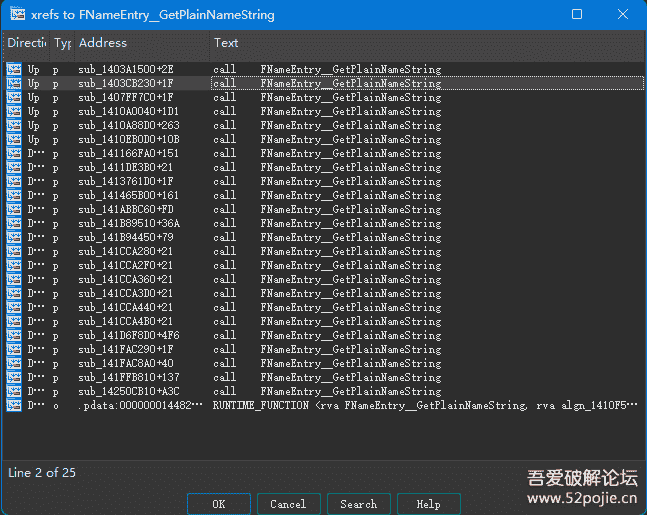

2023-09-26-01-00-54-image.png (42.86 KB, 下载次数: 2)


[href="forum.php?mod=attachment&aid=MjY0NzY5MXwxYjhhNmU0OXwxNzkzNTcwMTQxfDE2ODA4NnwxODM4Mzk2&nothumb=yes" target="_blank"](https://www.52pojie.cn/forum.php?mod=attachment&aid=MjY0NzY5MXwxYjhhNmU0OXwxNzkzNTcwMTQxfDE2ODA4NnwxODM4Mzk2&nothumb=yes)

2023-10-8 18:49 上传

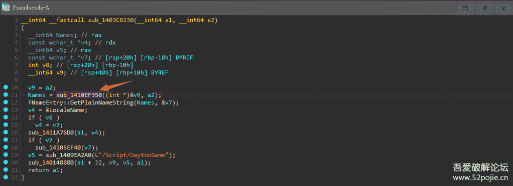

2023-09-26-01-02-16-image.png (45.18 KB, 下载次数: 3)

[href="forum.php?mod=attachment&aid=MjY0NzY5MnxlZjRhOWRjOHwxNzkzNTcwMTQxfDE2ODA4NnwxODM4Mzk2&nothumb=yes" target="_blank"](https://www.52pojie.cn/forum.php?mod=attachment&aid=MjY0NzY5MnxlZjRhOWRjOHwxNzkzNTcwMTQxfDE2ODA4NnwxODM4Mzk2&nothumb=yes)

2023-10-8 18:49 上传

## 关键函数

`FName::GetComparisonNameEntry`是关键，能够获取到`GName`

```
const FNameEntry* FName::GetComparisonNameEntry() const
{
    TNameEntryArray& Names = GetNames();
    const NAME_INDEX Index = GetComparisonIndex();
    return Names[Index];
}
```

## 有调试符号

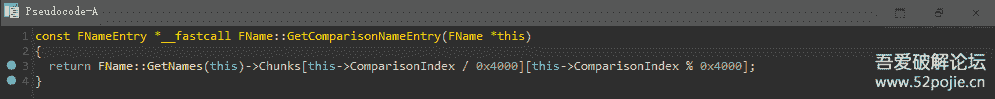

2023-09-26-01-09-13-image.png (15.19 KB, 下载次数: 3)

[href="forum.php?mod=attachment&aid=MjY0NzY5M3wyNzBiM2M5MHwxNzkzNTcwMTQxfDE2ODA4NnwxODM4Mzk2&nothumb=yes" target="_blank"](https://www.52pojie.cn/forum.php?mod=attachment&aid=MjY0NzY5M3wyNzBiM2M5MHwxNzkzNTcwMTQxfDE2ODA4NnwxODM4Mzk2&nothumb=yes)

2023-10-8 18:50 上传

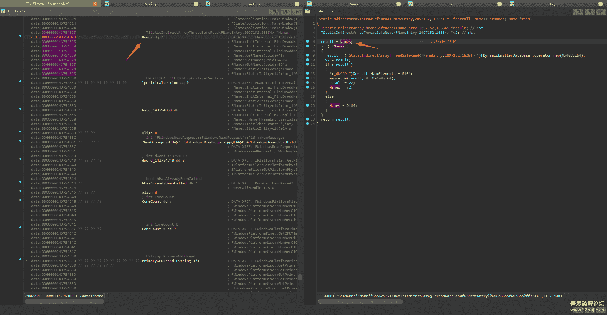

2023-09-26-01-10-03-image.png (208.13 KB, 下载次数: 3)

[href="forum.php?mod=attachment&aid=MjY0NzY5NHw1ZTQ0MDgzOXwxNzkzNTcwMTQxfDE2ODA4NnwxODM4Mzk2&nothumb=yes" target="_blank"](https://www.52pojie.cn/forum.php?mod=attachment&aid=MjY0NzY5NHw1ZTQ0MDgzOXwxNzkzNTcwMTQxfDE2ODA4NnwxODM4Mzk2&nothumb=yes)

2023-10-8 18:50 上传

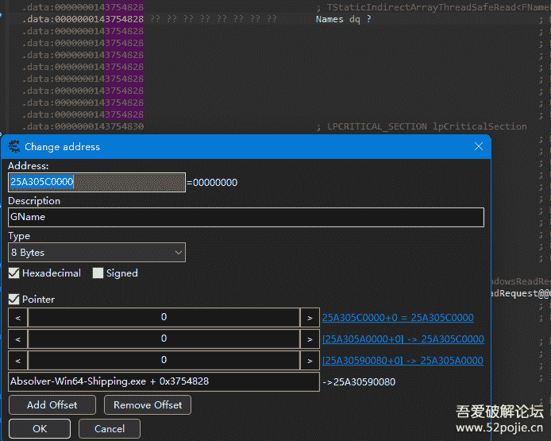

2023-09-26-01-11-41-image.png (49.66 KB, 下载次数: 4)

[href="forum.php?mod=attachment&aid=MjY0NzY5NXw1ZTI2OTYxY3wxNzkzNTcwMTQxfDE2ODA4NnwxODM4Mzk2&nothumb=yes" target="_blank"](https://www.52pojie.cn/forum.php?mod=attachment&aid=MjY0NzY5NXw1ZTI2OTYxY3wxNzkzNTcwMTQxfDE2ODA4NnwxODM4Mzk2&nothumb=yes)

2023-10-8 18:51 上传

正常来说到这一步就结束了，只需要将偏移丢进`dump`工具跑一下就能出数据

## 无调试符号

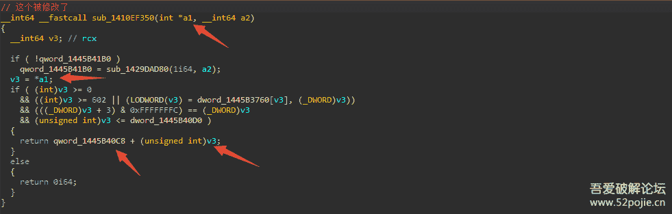

2023-09-26-01-13-26-image.png (31.56 KB, 下载次数: 2)

[href="forum.php?mod=attachment&aid=MjY0NzY5NnwzZDU0Y2E1OXwxNzkzNTcwMTQxfDE2ODA4NnwxODM4Mzk2&nothumb=yes" target="_blank"](https://www.52pojie.cn/forum.php?mod=attachment&aid=MjY0NzY5NnwzZDU0Y2E1OXwxNzkzNTcwMTQxfDE2ODA4NnwxODM4Mzk2&nothumb=yes)

2023-10-8 18:51 上传

### 解决被修改的问题

### 根据伪代码可以得出

`v3 = *a1`（解引用，将`a1`存放的值赋值给`v3`）

返回值为 `qword_1445B40C8` + `v3`

检查`qword_1445B40C8`的值是什么

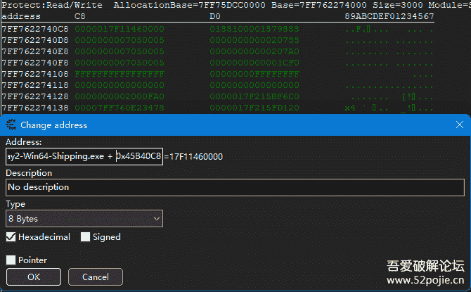

2023-09-26-01-20-42-image.png (36.86 KB, 下载次数: 3)

[href="forum.php?mod=attachment&aid=MjY0NzY5OHwwZjc4YjZkMXwxNzkzNTcwMTQxfDE2ODA4NnwxODM4Mzk2&nothumb=yes" target="_blank"](https://www.52pojie.cn/forum.php?mod=attachment&aid=MjY0NzY5OHwwZjc4YjZkMXwxNzkzNTcwMTQxfDE2ODA4NnwxODM4Mzk2&nothumb=yes)

2023-10-8 18:51 上传

当读取此地址的时候发现是空的

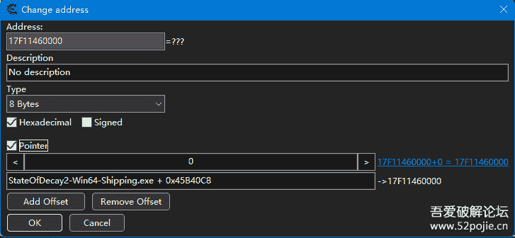

2023-09-26-01-21-48-image.png (22.28 KB, 下载次数: 2)

[href="forum.php?mod=attachment&aid=MjY0NzY5OXxlNmY1ZjhiMnwxNzkzNTcwMTQxfDE2ODA4NnwxODM4Mzk2&nothumb=yes" target="_blank"](https://www.52pojie.cn/forum.php?mod=attachment&aid=MjY0NzY5OXxlNmY1ZjhiMnwxNzkzNTcwMTQxfDE2ODA4NnwxODM4Mzk2&nothumb=yes)

2023-10-8 18:51 上传

说明需要将此地址加上某个数值才会得到具体的名称

检查`a1`的值，`CE`下断点在被修改后的函数

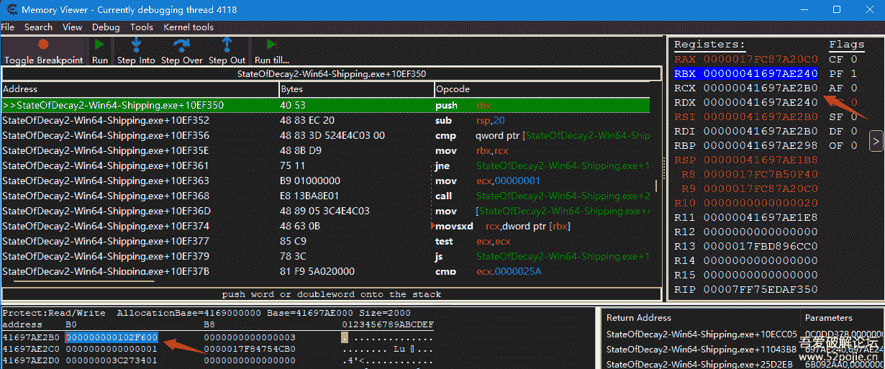

2023-09-26-01-25-23-image.png (118.82 KB, 下载次数: 3)

[href="forum.php?mod=attachment&aid=MjY0NzcwMHw2ODRjZTc4MHwxNzkzNTcwMTQxfDE2ODA4NnwxODM4Mzk2&nothumb=yes" target="_blank"](https://www.52pojie.cn/forum.php?mod=attachment&aid=MjY0NzcwMHw2ODRjZTc4MHwxNzkzNTcwMTQxfDE2ODA4NnwxODM4Mzk2&nothumb=yes)

2023-10-8 18:52 上传

将该值与`qword_1445B40C8`相加

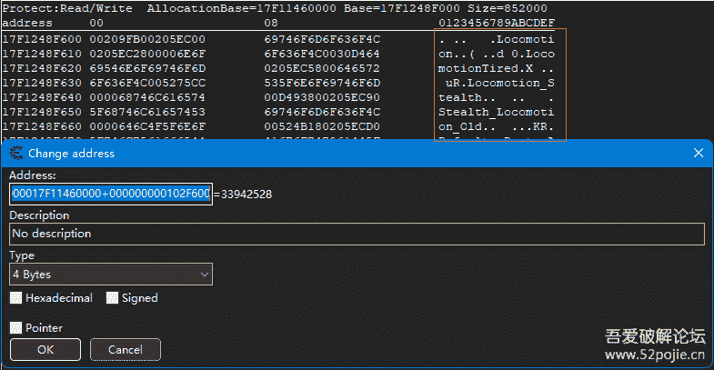

2023-09-26-01-26-22-image.png (39.3 KB, 下载次数: 3)

[href="forum.php?mod=attachment&aid=MjY0NzcwMXw0ZjQ5ZWQxOXwxNzkzNTcwMTQxfDE2ODA4NnwxODM4Mzk2&nothumb=yes" target="_blank"](https://www.52pojie.cn/forum.php?mod=attachment&aid=MjY0NzcwMXw0ZjQ5ZWQxOXwxNzkzNTcwMTQxfDE2ODA4NnwxODM4Mzk2&nothumb=yes)

2023-10-8 18:52 上传

OK，成功获取到一个字符串，确认了`a1`存放的一个ID，但仔细看就会发现还是差了一点。还记得在上面`FNameEntry::GetPlainNameString`吗，获取`FString`使用`AnsiName`或者`WideName`。通过两者的对比，发现这里偷偷加了一个`0x8`，且通过对其他的函数的伪代码来看同样如此

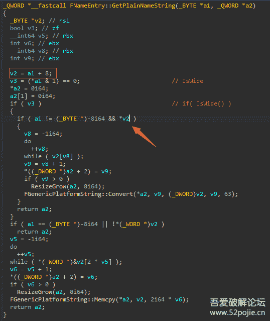

2023-09-26-01-34-36-image.png (45.13 KB, 下载次数: 3)

[href="forum.php?mod=attachment&aid=MjY0NzcwMnxkNzcxMzVmMXwxNzkzNTcwMTQxfDE2ODA4NnwxODM4Mzk2&nothumb=yes" target="_blank"](https://www.52pojie.cn/forum.php?mod=attachment&aid=MjY0NzcwMnxkNzcxMzVmMXwxNzkzNTcwMTQxfDE2ODA4NnwxODM4Mzk2&nothumb=yes)

2023-10-8 18:52 上传

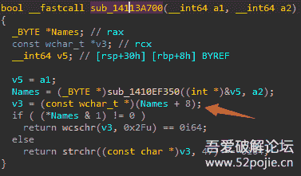

2023-09-26-01-37-15-image.png (22.57 KB, 下载次数: 3)

[href="forum.php?mod=attachment&aid=MjY0NzcwM3w5YjQ4NjJjZHwxNzkzNTcwMTQxfDE2ODA4NnwxODM4Mzk2&nothumb=yes" target="_blank"](https://www.52pojie.cn/forum.php?mod=attachment&aid=MjY0NzcwM3w5YjQ4NjJjZHwxNzkzNTcwMTQxfDE2ODA4NnwxODM4Mzk2&nothumb=yes)

2023-10-8 18:54 上传

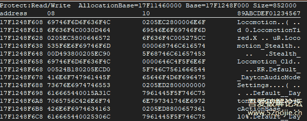

2023-09-26-01-37-53-image.png (37.91 KB, 下载次数: 3)

[href="forum.php?mod=attachment&aid=MjY0NzcwNHxhNTkxZmZmNHwxNzkzNTcwMTQxfDE2ODA4NnwxODM4Mzk2&nothumb=yes" target="_blank"](https://www.52pojie.cn/forum.php?mod=attachment&aid=MjY0NzcwNHxhNTkxZmZmNHwxNzkzNTcwMTQxfDE2ODA4NnwxODM4Mzk2&nothumb=yes)

2023-10-8 18:54 上传

解决办法也很简单

通过读取`qword_1445B40C8`的值然后加上一个ID，即可得出一个`FString`

又或者使用函数指针，直接传入一个ID也行

## 总结

通过以上的逆向过程，我们成功地获取了项目所需的基础信息。接下来，只需要将这些偏移填入对应的项目中，就能够成功导出数据了。

尽管这一集相对简单，但仍然存在一些问题。其中，项目默认的配置可能无法适配所有游戏，从而导致生成SDK文件时出现错误。这时我们就需要手动检查每个结构体的偏移，包括`UStruct`、`UFunction`、`UField`、`UProperty`等。

希望此文章对你有所帮助。感谢造出轮子的人，让逆向变得如此简单。
