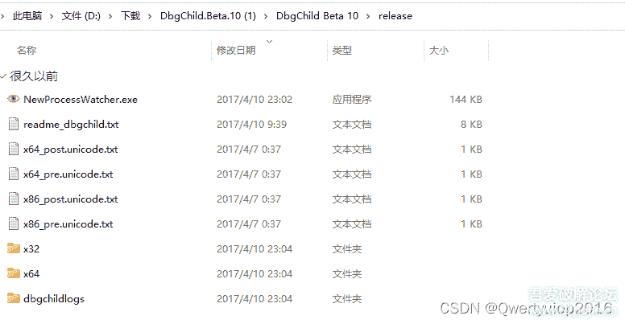
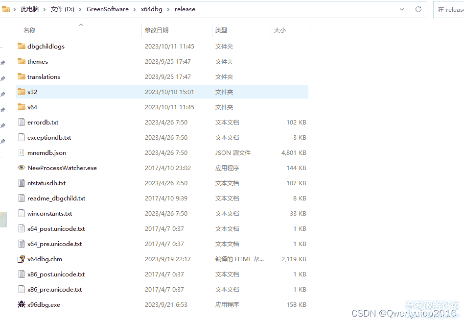
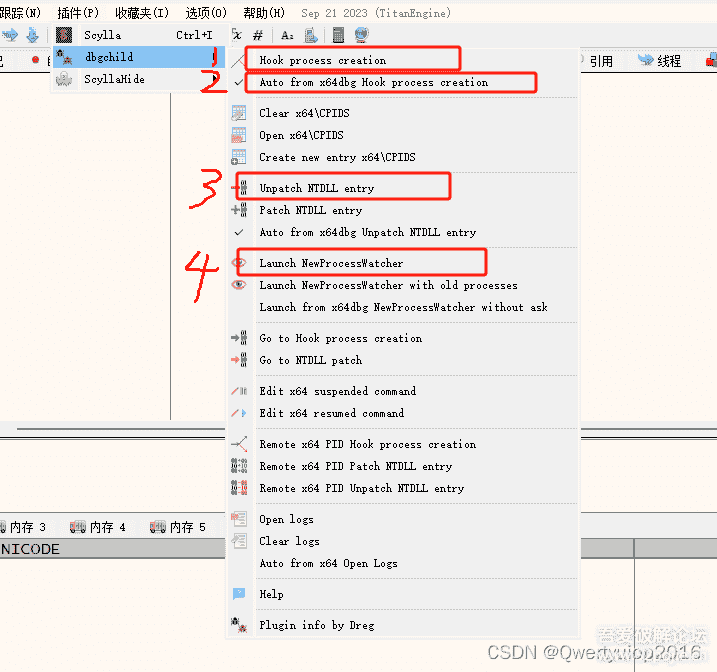
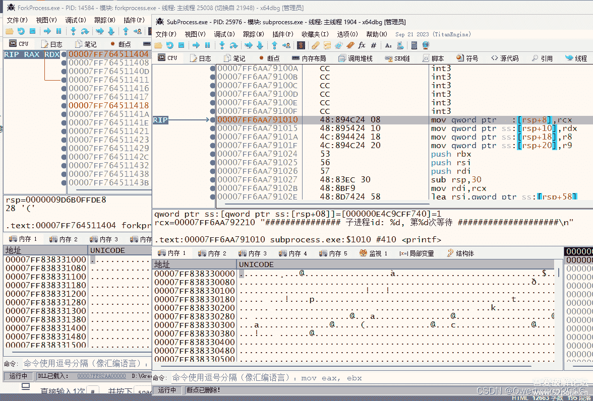
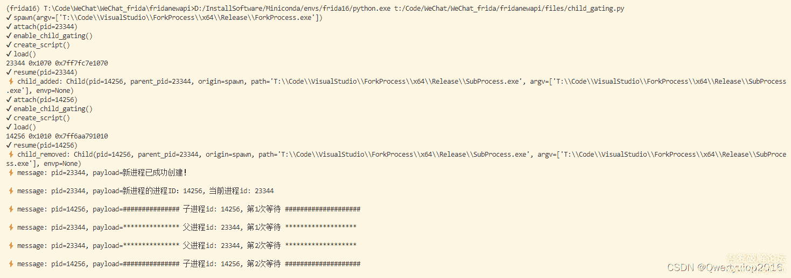

# [调试逆向] 使用frida来spawn Fork 的子进程

- 原帖: https://www.52pojie.cn/forum.php?mod=viewthread&tid=1843175
- 抓取时间: 2026-11-01T21:55:38

## 需求

最近在学基础的Windows逆向知识，遇到个小问题。一个进程使用`CreateProcessW`创建的进程该如何在启动时附加，我想调试这个子进程启动时运行的函数。

谷歌搜索都给我翻烂了，最后发现还是得用英文搜。比如x64dbg attach child process就出现了这个结果： [https://github.com/x64dbg/x64dbg/issues/2214](https://github.com/x64dbg/x64dbg/issues/2214)

在测试完这个x64dbg插件之后，我想着frida有没有这样的功能，于是也搜索了一下frida hook muti process，也出现了一个方案，说是frida10就已经有了这个功能： [https://reverseengineering.stackexchange.com/questions/30349/frida-hook-multiple-processes](https://reverseengineering.stackexchange.com/questions/30349/frida-hook-multiple-processes)

下面我简单说一下这两种的使用方法

## 测试程序

先用C++写一个简单的测试程序，用来创建子进程，代码很简单，直接调用`CreateProcessW`来启动一个子进程

### 父进程代码

```cpp
#include 
#include 
#include 

int main() {
    // 定义进程信息结构体
    PROCESS_INFORMATION pi;
    // 定义启动信息结构体
    STARTUPINFO si;
    // 初始化结构体
    ZeroMemory(&si, sizeof(si));
    si.cb = sizeof(si);
    ZeroMemory(&pi, sizeof(pi));

    // Notepad 可执行文件的路径
    LPCWSTR notepadPath = L"SubProcess.exe";

    // 文件路径作为命令行参数
    LPWSTR cmdLine = NULL;

    DWORD currentProcessId = GetCurrentProcessId();

    // 创建新进程
    if (CreateProcessW(notepadPath, cmdLine, NULL, NULL, FALSE, 0, NULL, NULL, &si, &pi)) {
        printf("新进程已成功创建！\n");
        printf("新进程的进程ID：%d, 当前进程id: %d \n", pi.dwProcessId, currentProcessId);

        // 可以等待进程结束，或者继续执行其他操作
        // WaitForSingleObject(pi.hProcess, INFINITE);

        // 关闭进程和线程句柄
        CloseHandle(pi.hProcess);
        CloseHandle(pi.hThread);
    }
    else {
        printf("无法创建新进程。错误代码：%d", GetLastError());
    }
    int i = 0;

    while (true) {
        i += 1;
        printf("*************** 父进程id: %d, 第%d次等待 *******************\n", currentProcessId, i);
        Sleep(2000);
    }

    return 0;
}
```

### 子进程代码

```cpp
#include 

#include 

int main()

{

    int i = 0;

    DWORD currentProcessId = GetCurrentProcessId();

    while (true) {

        i += 1;

        printf("############### 子进程id: %d, 第%d次等待 ####################\n", currentProcessId, i);

        Sleep(3000);

    }

}
```

## x64dbg

x64dbg是使用插件来附加子进程

插件地址： [https://github.com/therealdreg/DbgChild](https://github.com/therealdreg/DbgChild)

安装步骤：

- 先下载releases下面的文件`DbgChild.Beta.10.zip`
- 解压到x64dbg目录
- 打开x64dbg，插件里面就有`DbgChild`

解压后的目录结构



1.png (42.75 KB, 下载次数: 0) [下载附件](https://www.52pojie.cn/forum.php?mod=attachment&aid=MjY0ODQ1NXxmOTk0NzUxNXwxNzkzNTcwMTM2fDE2ODA4NnwxODQzMTc1&nothumb=yes)

2023-10-11 15:35 上传

复制到x64dbg之后的目录结构



2.png (71.76 KB, 下载次数: 0) [下载附件](https://www.52pojie.cn/forum.php?mod=attachment&aid=MjY0ODQ1NnwwNjViNzIyMnwxNzkzNTcwMTM2fDE2ODA4NnwxODQzMTc1&nothumb=yes)

2023-10-11 15:36 上传

### 插件功能

我说一下我用的几个选项的含义



3.png (46.74 KB, 下载次数: 0) [下载附件](https://www.52pojie.cn/forum.php?mod=attachment&aid=MjY0ODQ1OXxkNmEyOGJkY3wxNzkzNTcwMTM2fDE2ODA4NnwxODQzMTc1&nothumb=yes)

2023-10-11 15:38 上传

- 主动去触发hook进程创建
- 自动hook进程创建，一般选这个就行
- 取消hook `NTDLL`，我看演示的视频在启动子进程的时候都会主动点一次这个，不过下面有个自动取消hook默认是勾选的，我测试的时候不点这个也可以
- 启动监听程序，这个是必须的，且要在创建子进程之前启动

### 开始调试

勾选第二个选项并启动监听程序，使用x64dbg打开`ForkProcess.exe`，运行程序，这时候会有一个很长的等待，我开始以为是卡住了，后面发现它只是比较慢，要等个一分钟吧。用任务管理搜索其实`SubProcess.exe`已经启动了，不知道是哪里卡住了。

接着就会弹出一个新的x64dbg窗口，并且已经附加到了`SubProcess`了，



4.png (175.61 KB, 下载次数: 0) [下载附件](https://www.52pojie.cn/forum.php?mod=attachment&aid=MjY0ODQ1N3xmMzg1MTBjMXwxNzkzNTcwMTM2fDE2ODA4NnwxODQzMTc1&nothumb=yes)

2023-10-11 15:36 上传

这里不清楚为啥子进程没有在入口断点断住，不过影响不大，因为x64dbg会记忆断点位置，我只需要现在打上断点，那么在下次启动的时候就会自动断下，比如这里在`SubProcess`的x64dbg程序里用`Ctrl+G`跳转到`printf`函数并且打上断点。重复上面的操作重新启动`ForkProcess`的时候，附加到`SubProcess`的x64dbg就会断在`printf`

如果在启动`ForkProcess`之后再想去附加`SubProcess`，`printf`的前几次就无法下断点了。

## frida

根据上面搜索到的 [https://frida.re/news/#child-gating](https://frida.re/news/#child-gating) 显示，frida10就已经支持这个功能了。不过现在已经frida16了，这里面的代码也不能用了，得看github的最新代码： [https://github.com/frida/frida-python/blob/main/examples/child_gating.py](https://github.com/frida/frida-python/blob/main/examples/child_gating.py)

直接拷下来，稍微做点改动，代码比较长，为了方便讲js和Python代码分开

`child_gating.py`


```python
import threading
import os
import frida
from frida_tools.application import Reactor

class Application:
    def __init__(self):
        self._stop_requested = threading.Event()
        self._reactor = Reactor(run_until_return=lambda reactor: self._stop_requested.wait())

        self._device = frida.get_local_device()
        self._sessions = set()

        self._device.on("child-added", lambda child: self._reactor.schedule(lambda: self._on_child_added(child)))
        self._device.on("child-removed", lambda child: self._reactor.schedule(lambda: self._on_child_removed(child)))
        self._device.on("output", lambda pid, fd, data: self._reactor.schedule(lambda: self._on_output(pid, fd, data)))

    def run(self):
        self._reactor.schedule(lambda: self._start())
        self._reactor.run()

    def _start(self):
        argv = [r"T:\Code\VisualStudio\ForkProcess\x64\Release\ForkProcess.exe"]
        env = {}
        print(f"✔ spawn(argv={argv})")
        pid = self._device.spawn(argv, env=env, stdio="pipe")
        self._instrument(pid)

    def _stop_if_idle(self):
        if len(self._sessions) == 0:
            self._stop_requested.set()

    def _instrument(self, pid):
        print(f"✔ attach(pid={pid})")
        session = self._device.attach(pid)
        session.on("detached", lambda reason: self._reactor.schedule(lambda: self._on_detached(pid, session, reason)))
        print("✔ enable_child_gating()")
        session.enable_child_gating()
        print("✔ create_script()")
        frida_js_code = self.read_jscode()
        script = session.create_script(frida_js_code)
        script.on("message", lambda message, data: self._reactor.schedule(lambda: self._on_message(pid, message)))
        print("✔ load()")
        script.load()
        print(f"✔ resume(pid={pid})")
        self._device.resume(pid)
        self._sessions.add(session)

    def read_jscode(self):
        path = os.path.dirname(os.path.abspath(__file__))
        file = os.path.join(path, "child_gating.js")
        with open(file, encoding='utf-8') as f:
            jscode = f.read()
        return jscode

    def _on_child_added(self, child):
        print(f"⚡ child_added: {child}")
        self._instrument(child.pid)

    def _on_child_removed(self, child):
        print(f"⚡ child_removed: {child}")

    def _on_output(self, pid, fd, data):
        pass
        #print(f"⚡ output: pid={pid}, fd={fd}, data={repr(data)}")

    def _on_detached(self, pid, session, reason):
        print(f"⚡ detached: pid={pid}, reason='{reason}'")
        self._sessions.remove(session)
        self._reactor.schedule(self._stop_if_idle, delay=0.5)

    def _on_message(self, pid, message):
        if message["type"] == "send":
            payload = message['payload']
            s = payload["format_str"] % tuple(payload["format_args"])
            print(f"⚡ message: pid={pid}, payload={s}")
        elif message["type"] == "error":
            print(f"⚡ message: pid={pid}, error: description={message['description']} stack={message['stack']}")
        else:
            print(f"⚡ message: pid={pid}, payload={message}")

app = Application()
app.run()
```

### `child_gating.js`

```javascript
// 根据%读取printf的参数

function vspritf(format_str, args){

    let printf_args = [];

    if (format_str.indexOf("%") === -1) {

        return printf_args;

    }

    var pos = 0;

    for (let index = 0; index 
```

运行结果如下：



5.png (63.16 KB, 下载次数: 0)

[href="forum.php?mod=attachment&aid=MjY0ODQ1OHw5ZTFlMjM4N3wxNzkzNTcwMTM2fDE2ODA4NnwxODQzMTc1&nothumb=yes" target="_blank"](https://www.52pojie.cn/forum.php?mod=attachment&aid=MjY0ODQ1OHw5ZTFlMjM4N3wxNzkzNTcwMTM2fDE2ODA4NnwxODQzMTc1&nothumb=yes)

2023-10-11 15:36 上传

这里我只测试了`Windows`，`Linux`和安卓应该也可以，官网给的例子是`Linux`的，安卓的话自行测试

## 运行环境

- `python`==3.8.17
- `frida`==16.1.2
- `frida-tools`==12.1.3
- `vs2017`

## 用到的文件和代码

[//github.com/kanadeblisst00/frida_child_gating](https://github.com/kanadeblisst00/frida_child_gating)
