# [游戏安全] 简单利用Cheat Engine的`mono`功能修改Unity游戏(动物迷城)

- 原帖：<https://www.52pojie.cn/forum.php?mod=viewthread&tid=1857152>
- 抓取时间：2026-11-01T21:55:28

## 前言

今天说的游戏指：Unity 框架开发的游戏（或者有说 MONO 系游戏）。

Unity 框架游戏使用 C# 开发，主要利用它跨平台的特性，这里面跨平台的不是 C#，而是 C# 生产的中间代码 CIL，这种代码只要放在支持 CLR 的平台上就都可以编译执行。而 MONO 就是 Unity 所使用的开源 CLR 实现。这样你就明白了 Unity 和 Mono 的关系，更多可参详 [//zhuanlan.zhihu.com/p/266037775](https://zhuanlan.zhihu.com/p/266037775)。

总结：使用 Cheat Engine 的 `mono` 功能可以快速修改 Unity 游戏的源码。

测试游戏地址：[//www.cracked-gamespc.com/games/back-to-the-dawn](https://www.cracked-gamespc.com/games/back-to-the-dawn)

## 1. 简单修改作者留的后台的 `GM` 代码

### 1.1 ce 附加进程并开启 `mono`

如果是 Unity 的游戏会有 `mono` 这个选项，此时点击 `Active mono`（可以看出这是一个 feature 的功能），然后我们打开 `.Netinfo`。

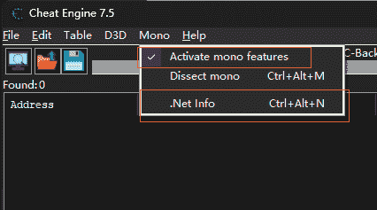

### 1.2 `.Netinfo`

因为 .Net 的原因，所有函数都是明参数和返回值的。

所有游戏的代码都是在 `Assembly-CSharp` 下的，这里我们搜索 `GM`，发现有很多东西可以修改，这里只举两个例子：`GMThrowDice1value`、`GMThrowDice2value`，修改这两个可以修改游戏中 roll 的点数。

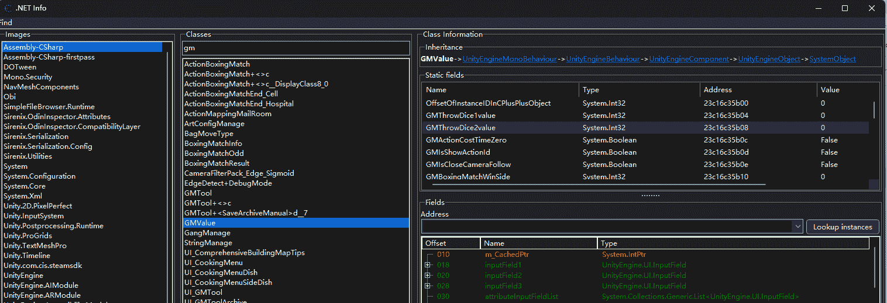

## 2. 修改彩票中奖函数

上面是一个作者留的后台，下面我们进行一个普通函数的修改。

这里以买彩票为例，彩票的英文是 lottery ticket，在 `classes` 中搜索 `lottery`。

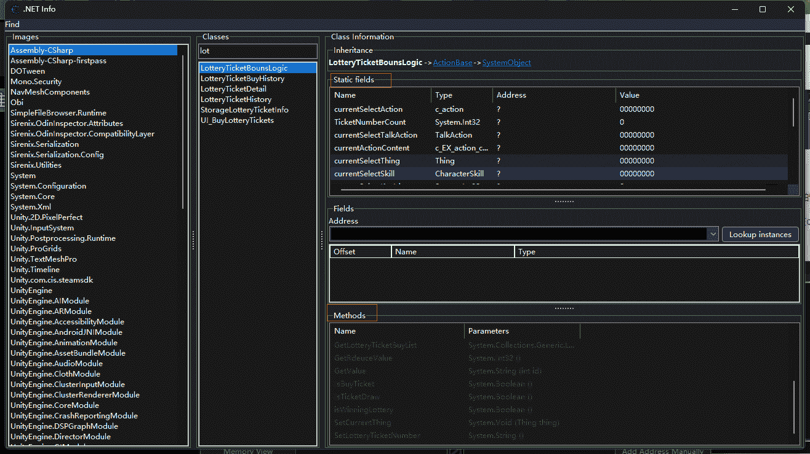

我们可以看到所有的相关类以及类的静态成员和方法。

这里可以看到有一个 `LotteryTicketBounsLogic` 是彩票相关的逻辑类，里面有一个方法 `SetLotteryTicketNumber`，这个就是生成彩票号码的函数，但是它没有传参，双击进去，就是内存的代码。

### 2.1 如果简单的话可以直接修改

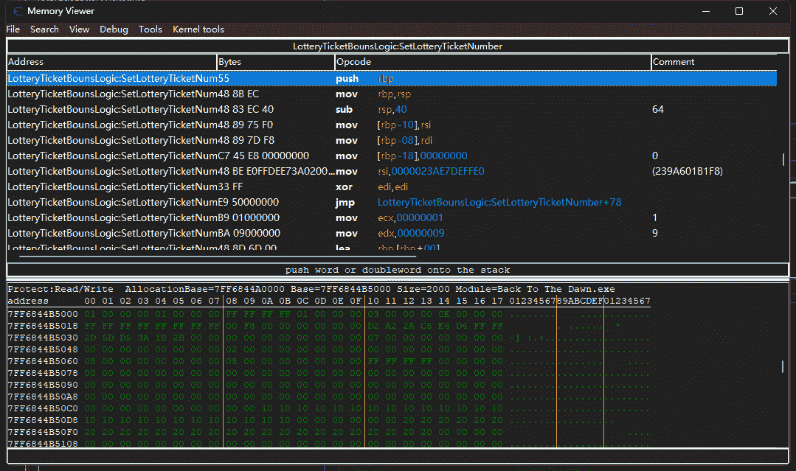

### 2.2 在 ce 中更推荐用脚本修改

#### 2.2.1 lua&C

在函数上右键 `Generate patch template for method`。

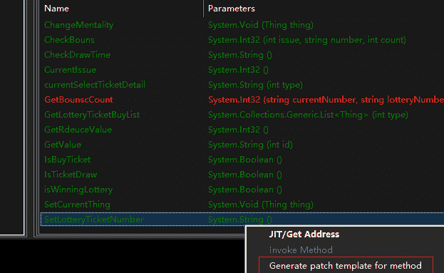

我们可以看到这是一个 lua 脚本，红色的内容是 C# 的脚本，重载了该函数。

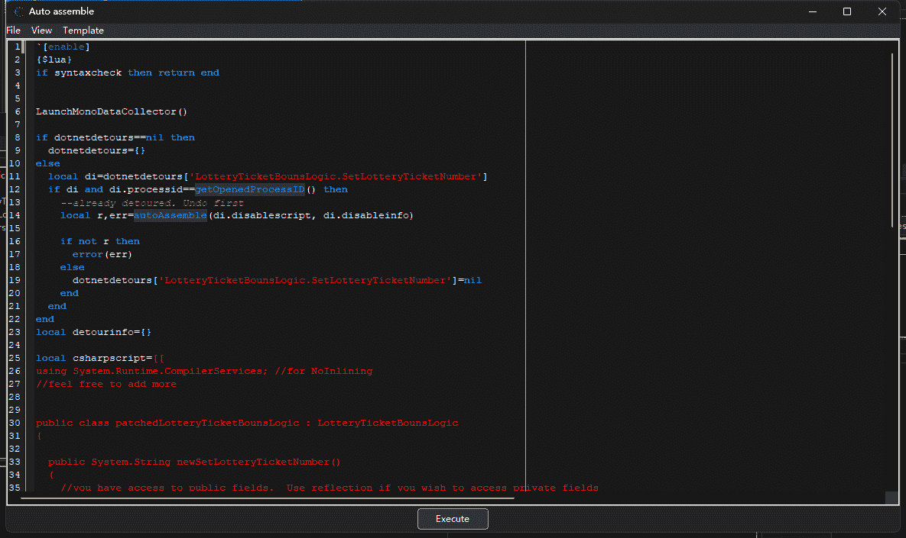

直接修改 C# 中的函数：

原本：

```
public System.String newSetLotteryTicketNumber()
{
  //you have access to public fields.  Use reflection if you wish to access private fields
  return oldSetLotteryTicketNumber();    
}
```

修改为：

```
public System.String newSetLotteryTicketNumber()
{
  //you have access to public fields.  Use reflection if you wish to access private fields
  return "88888";    
}
```

这样这个返回值就一直是 `88888` 了。

这个时候不要点击 `Execute`，点击 `file-Assign to current cheat table`。

这样就是一个可以随时开启/关闭的状态，就是我们普通的脚本。


#### 2.2.2 其他方式

除了上面的 lua&C# 的方式，还有其他很多方式，ce 都给出了模板：

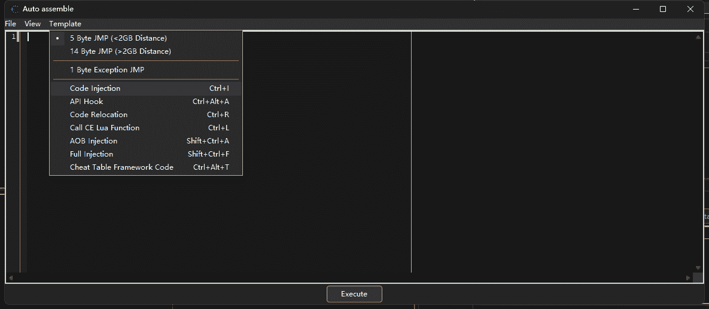

这里简述两个模式：

#### 2.2.3 Code Injectien

代码模板如下：

```
alloc(newmem,2048,LotteryTicketBounsLogic:SetLotteryTicketNumber) 
label(returnhere)
label(originalcode)
label(exit)

newmem: //this is allocated memory, you have read,write,execute access
//place your code here

originalcode:
push rbp
mov rbp,rsp
sub rsp,40

exit:
jmp returnhere

LotteryTicketBounsLogic:SetLotteryTicketNumber:
jmp newmem
nop 3
returnhere:
```

因为是通过 `mono` 的函数名定位的，所以这个需要开启 `mono`，即 `Active mono`。


#### 2.2.4 AOB Injection

代码模板如下：

```
[ENABLE]
aobscan(INJECT,55 48 8B EC 48 83 EC 40 48 89 75 F0 48 89 7D F8 C7 45 E8) // should be unique
alloc(newmem,$1000,INJECT)
label(code)
label(return)

newmem:

code:
  push rbp
  mov rbp,rsp
  sub rsp,40
  jmp return

INJECT:
  jmp newmem
  nop 3
return:
registersymbol(INJECT)

[DISABLE]
INJECT:
  db 55 48 8B EC 48 83 EC 40
unregistersymbol(INJECT)
dealloc(newmem)
```

可以看到是通过特征码定位的，所以是不需要开启 `mono` 的，但是会搜索特征码，会很慢。

## 3. 如何调试函数

上面修改了某一个函数，如何看它是否生效呢？

### 3.1 可以在游戏内直接看

### 3.2 使用 `mono_invoke_method` 调试

如果游戏很麻烦，或者写错了崩溃，可以使用 `mono_invoke_method` 调试。

官网如下：[`mono_invoke_method`](https://wiki.cheatengine.org/index.php?title=Mono:Lua:mono_invoke_method)

里面有示例。我自己测试的脚本如下：

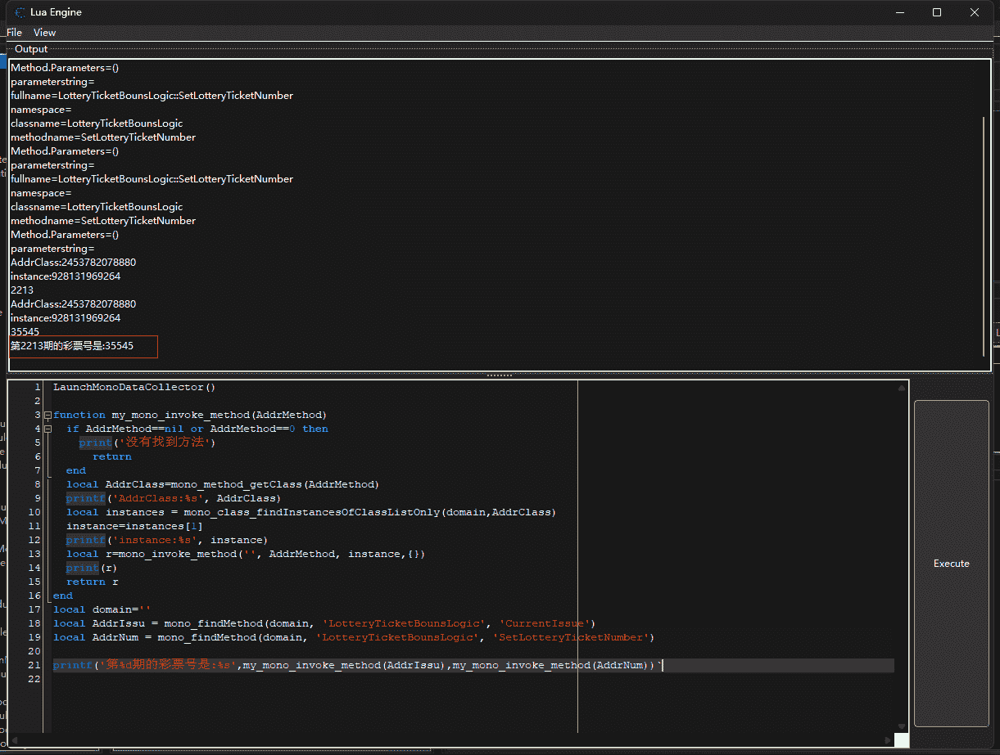

```
LaunchMonoDataCollector()

function my_mono_invoke_method(AddrMethod)
  if AddrMethod==nil or AddrMethod==0 then
    print('没有找到方法')
      return
  end
  local AddrClass=mono_method_getClass(AddrMethod)
  printf('AddrClass:%s', AddrClass)
  local instances = mono_class_findInstancesOfClassListOnly(domain,AddrClass)
  instance=instances[1]
  printf('instance:%s', instance)
  local r=mono_invoke_method('', AddrMethod, instance,{})
  print(r)
  return r
end
local domain=''
local AddrIssu = mono_findMethod(domain, 'LotteryTicketBounsLogic', 'CurrentIssue')
local AddrNum = mono_findMethod(domain, 'LotteryTicketBounsLogic', 'SetLotteryTicketNumber')

printf('第%d期的彩票号是:%s',my_mono_invoke_method(AddrIssu),my_mono_invoke_method(AddrNum))
```

## 4. 如何快速写汇编

上面修改了 `LotteryTicketBounsLogic.SetLotteryTicketNumber` 这个函数，但是需要用户输入特定的数字，有没有不需要输入特定数字的方法呢？

可以同时修改：

- 是否中奖函数 `LotteryTicketBounsLogic:isWinningLottery`
- 对几个数字函数 `LotteryTicketBounsLogic:GetBounscCount`

如果不想写汇编可以使用这个 [//godbolt.org/](https://godbolt.org/)，把任意一个语言的代码，通过不同的编译器转为汇编。

如 `LotteryTicketBounsLogic:GetBounscCoun` 直接返回 `5`（即所有数字都对）。

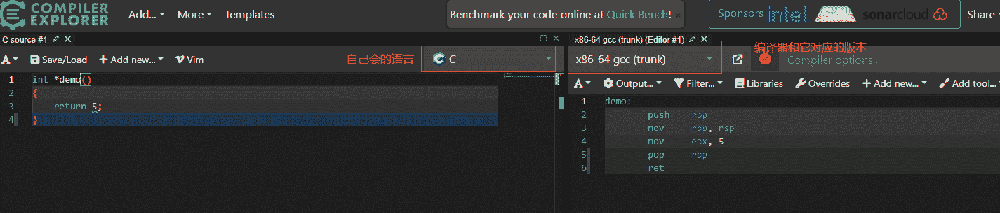

效果图如下：

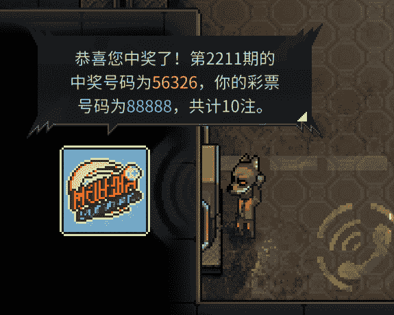

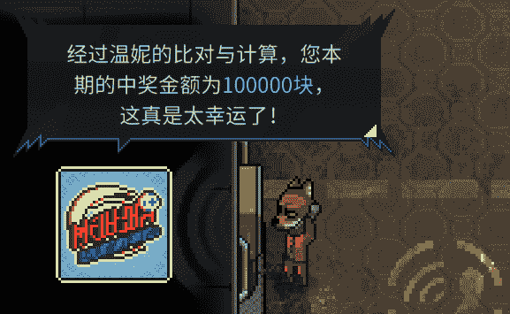
