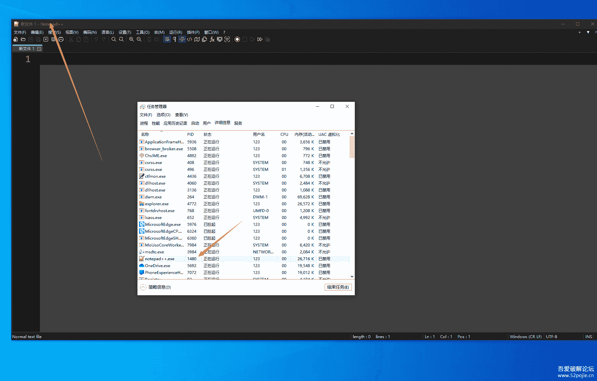
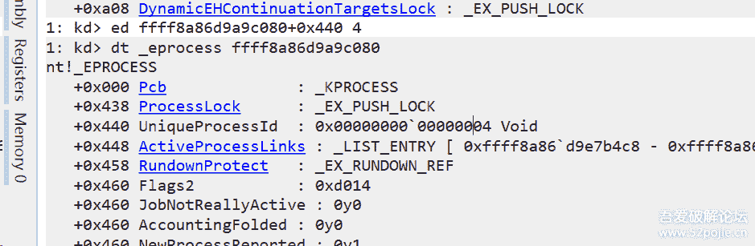
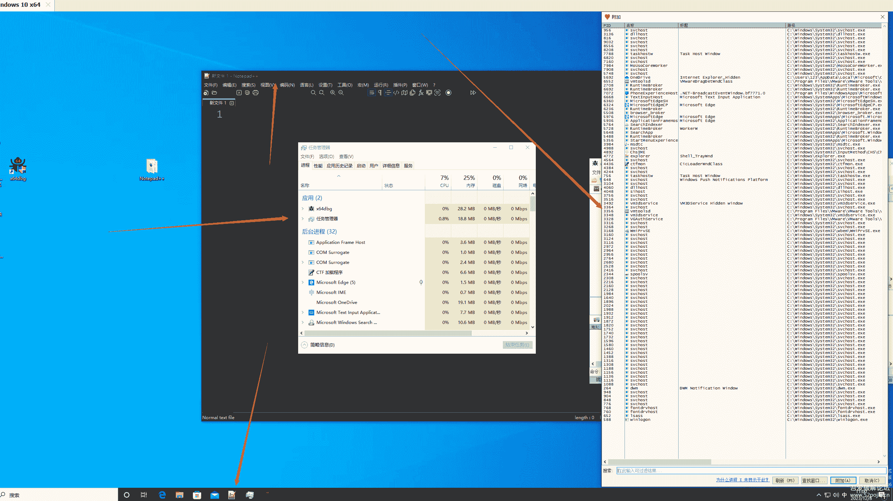

# [系统底层] win10-win11进程隐藏小技巧

- 原帖: https://www.52pojie.cn/forum.php?mod=viewthread&tid=1866668
- 抓取时间: 2026-11-01T21:55:25

## win10-win11进程隐藏小技巧

### 1.`EPROCESS`结构

在Windows内核中进程信息的数据存储结构有一个是叫做`EPROCESS`，通过这个数据结构我们能够遍历系统中的进程信息，同理我们对该结构进行操作也可以隐藏进程信息，接下来我们用`windbg`来解析一下这个结构：

```
0: kd> dt _eprocess
nt!_EPROCESS
   +0x000 Pcb              : _KPROCESS
   +0x438 ProcessLock      : _EX_PUSH_LOCK
   +0x440 UniqueProcessId  : Ptr64 Void
   +0x448 ActiveProcessLinks : _LIST_ENTRY
   +0x458 RundownProtect   : _EX_RUNDOWN_REF
   +0x460 Flags2           : Uint4B
   +0x460 JobNotReallyActive : Pos 0, 1 Bit
   +0x460 AccountingFolded : Pos 1, 1 Bit
   +0x460 NewProcessReported : Pos 2, 1 Bit
   +0x460 ExitProcessReported : Pos 3, 1 Bit
   +0x460 ReportCommitChanges : Pos 4, 1 Bit
   +0x460 LastReportMemory : Pos 5, 1 Bit
   +0x460 ForceWakeCharge  : Pos 6, 1 Bit
   +0x460 CrossSessionCreate : Pos 7, 1 Bit
   +0x460 NeedsHandleRundown : Pos 8, 1 Bit
   +0x460 RefTraceEnabled  : Pos 9, 1 Bit
   +0x460 PicoCreated      : Pos 10, 1 Bit
   +0x460 EmptyJobEvaluated : Pos 11, 1 Bit
   +0x460 DefaultPagePriority : Pos 12, 3 Bits
   +0x460 PrimaryTokenFrozen : Pos 15, 1 Bit
   +0x460 ProcessVerifierTarget : Pos 16, 1 Bit
   +0x460 RestrictSetThreadContext : Pos 17, 1 Bit
   +0x460 AffinityPermanent : Pos 18, 1 Bit
   +0x460 AffinityUpdateEnable : Pos 19, 1 Bit
   +0x460 PropagateNode    : Pos 20, 1 Bit
   +0x460 ExplicitAffinity : Pos 21, 1 Bit
   +0x460 ProcessExecutionState : Pos 22, 2 Bits
   +0x460 EnableReadVmLogging : Pos 24, 1 Bit
   +0x460 EnableWriteVmLogging : Pos 25, 1 Bit
   +0x460 FatalAccessTerminationRequested : Pos 26, 1 Bit
   +0x460 DisableSystemAllowedCpuSet : Pos 27, 1 Bit
   +0x460 ProcessStateChangeRequest : Pos 28, 2 Bits
   +0x460 ProcessStateChangeInProgress : Pos 30, 1 Bit
   +0x460 InPrivate        : Pos 31, 1 Bit
   +0x464 Flags            : Uint4B
   +0x464 CreateReported   : Pos 0, 1 Bit
   +0x464 NoDebugInherit   : Pos 1, 1 Bit
   +0x464 ProcessExiting   : Pos 2, 1 Bit
```

4> 因为成员太多我就只例举到上面这些，其中`+0x440 UniqueProcessId  : Ptr64 Void`是进程的ID，也就是`pid`，我们将这个值改为一个其他进程的ID的话就能够将该进程隐藏起来，我们试一下：



image-20231208105711396.png (168.43 KB, 下载次数: 3)

[href="forum.php?mod=attachment&aid=MjY2MjQzNXw4ODMxZjA4NHwxNzkzNTcwMTIyfDE2ODA4NnwxODY2NjY4&nothumb=yes" target="_blank"](https://www.52pojie.cn/forum.php?mod=attachment&aid=MjY2MjQzNXw4ODMxZjA4NHwxNzkzNTcwMTIyfDE2ODA4NnwxODY2NjY4&nothumb=yes)

1

2023-12-8 11:04 上传

4> 此时`notepad`进程是在任务管理器的，我们现在将他的进程id改为4试试。



image-20231208105841910.png (93.22 KB, 下载次数: 3)

[href="forum.php?mod=attachment&aid=MjY2MjQzNnw0OTYyM2NjMXwxNzkzNTcwMTIyfDE2ODA4NnwxODY2NjY4&nothumb=yes" target="_blank"](https://www.52pojie.cn/forum.php?mod=attachment&aid=MjY2MjQzNnw0OTYyM2NjMXwxNzkzNTcwMTIyfDE2ODA4NnwxODY2NjY4&nothumb=yes)

2

2023-12-8 11:04 上传

4> 修改成功，看一下各个软件能够遍历到的进程有包括吗：



image-20231208110016621.png (500.16 KB, 下载次数: 3)

[href="forum.php?mod=attachment&aid=MjY2MjQzN3xmZDU0YjJlOHwxNzkzNTcwMTIyfDE2ODA4NnwxODY2NjY4&nothumb=yes" target="_blank"](https://www.52pojie.cn/forum.php?mod=attachment&aid=MjY2MjQzN3xmZDU0YjJlOHwxNzkzNTcwMTIyfDE2ODA4NnwxODY2NjY4&nothumb=yes)

3

2023-12-8 11:05 上传

4> 可以看到`notepad`在运行，但是`x32dbg`和任务管理器都枚举不到了，这个隐藏不是基于hook某个dll的`ntqueryxxx`函数，所以是全局生效的

3> 2.实践了win10 1503 - win11 23h1 都生效，因为每个版本的偏移可能有所不同，大家要写成成品的话自己收集一下偏移即可，成品我就不放出来了，自己动手丰衣足食。
