# [调试逆向] XAntiDenbug的检测逻辑与基本反调试

- 原帖：https://www.52pojie.cn/forum.php?mod=viewthread&tid=1895800
- 抓取时间：2026-11-01T21:55:00

可能存在错误，大佬方便可以直接说入口相关代码。

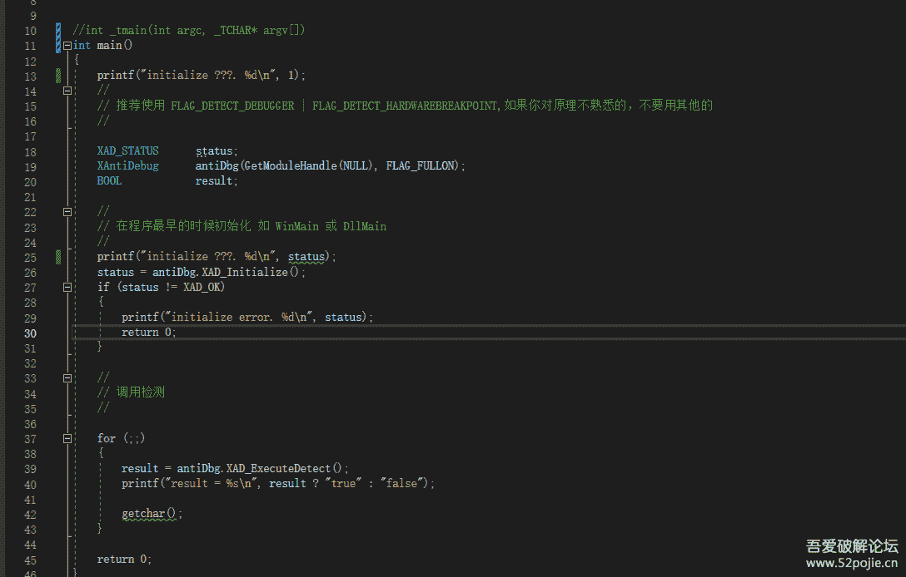

## 初始化与标识

`XAntiDebug`初始化获取当前模块地址，并设置了一个标识。

```c
#define FLAG_FULLON (FLAG_CHECKSUM_NTOSKRNL | FLAG_CHECKSUM_CODESECTION | \
    FLAG_DETECT_DEBUGGER | FLAG_DETECT_HARDWAREBREAKPOINT)
```

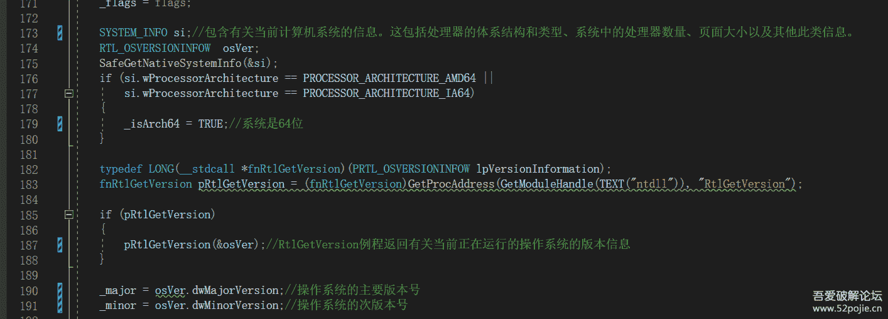

获取当前系统相关信息。`_isArch64`代表是64位架构；`_isWow64`代表是64位环境运行32位程序。

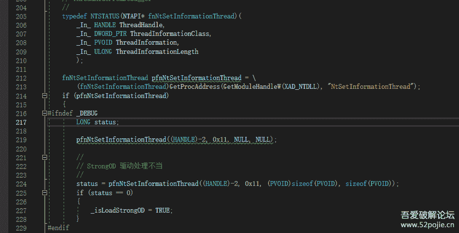

## 线程隐藏与调试端口检测

`NtSetInformationThread`设置线程的优先级，句柄`-1`是进程的句柄，`-2`是当前线程的句柄，`0x11` `ThreadHideFromDebugger = 17`，wrk源码。

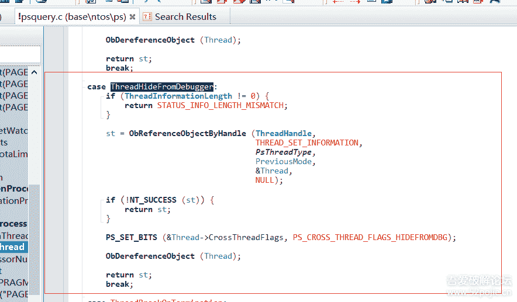

会设置线程标识。

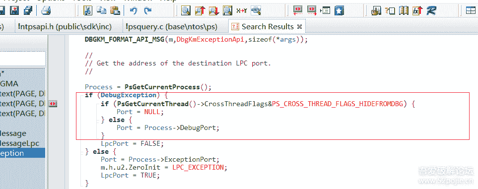

把调试端口置空，然后继续调用但是传递了错误的地址；如果没调试器应该返回错误，调试器可能处理全部设置为`0`，证明其存在。

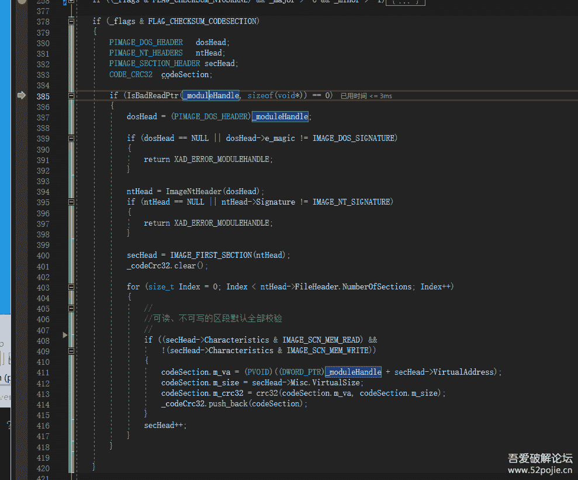

## XAD_Initialize 初始化

然后运行`XAD_Initialize`函数。

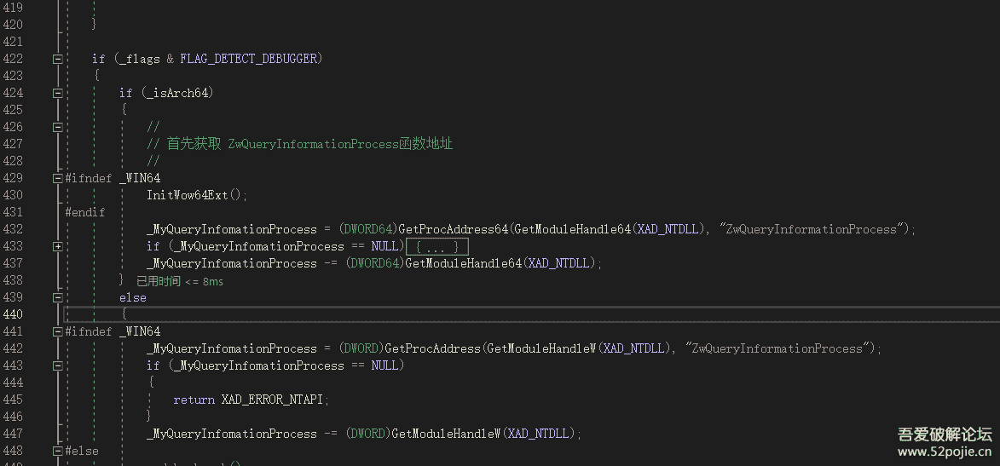

添加调加校验`crc32`的初始值。

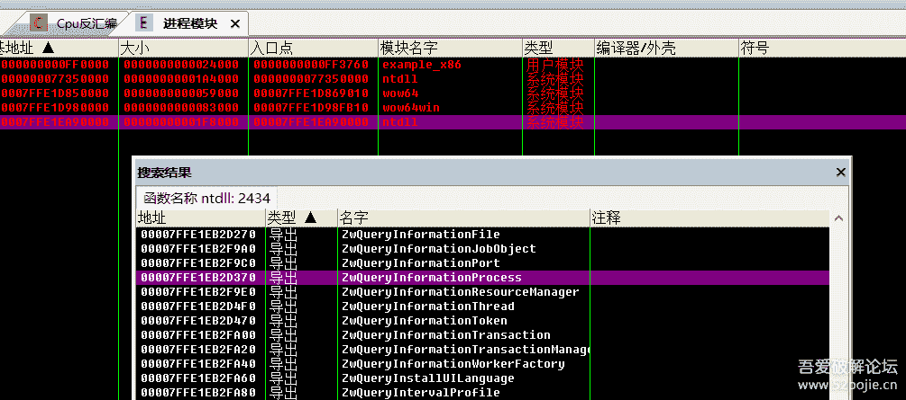

获取64位`ZwQueryInformationProcess`的地址，然后减去`ntdll` 64位模块地址，算偏移 = `0x000000000009d370`。

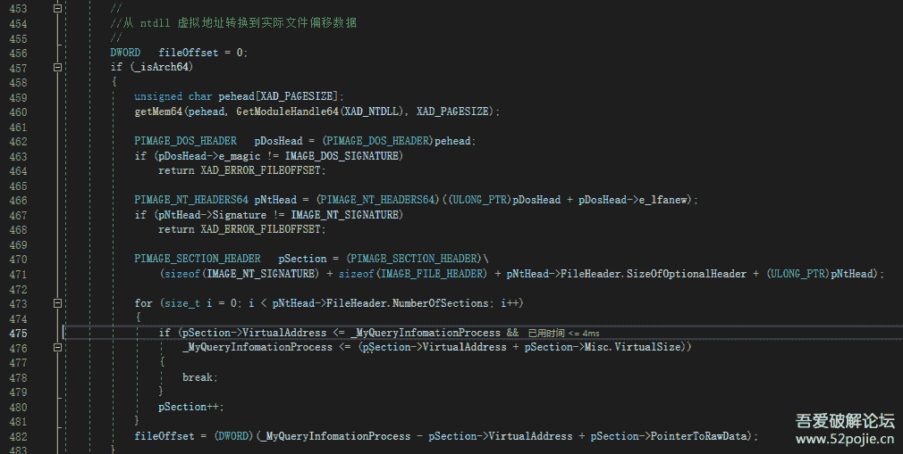

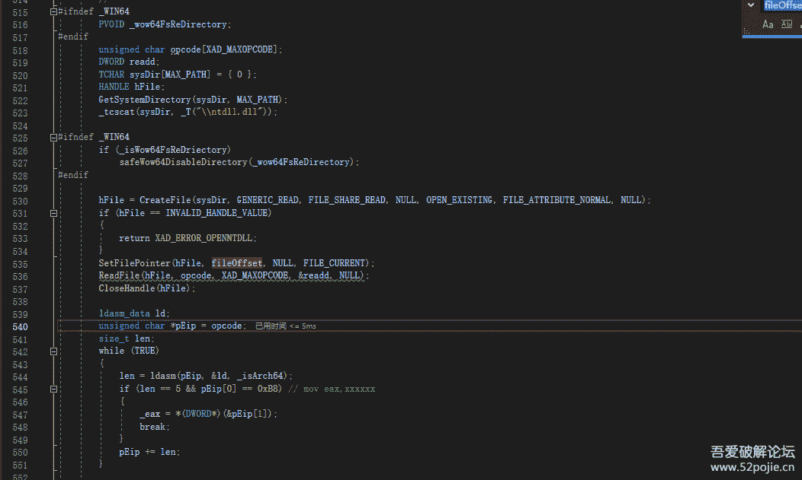

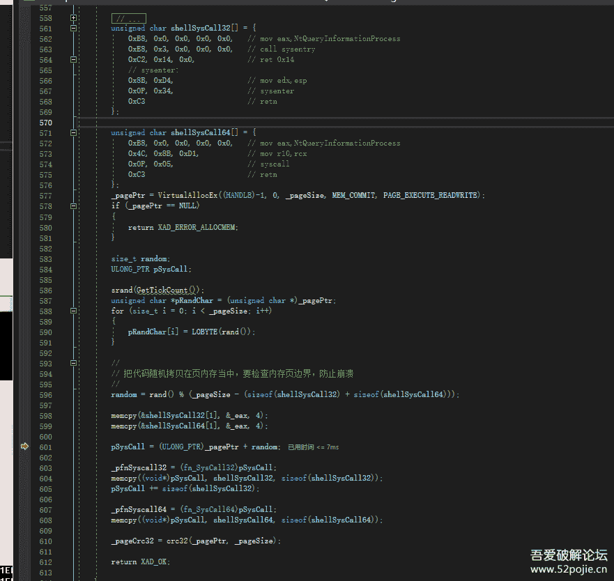

这段代码是直接分析`ntdl` PE结构，然后计算这个偏移，得到代码，直接得到文件中的代码。

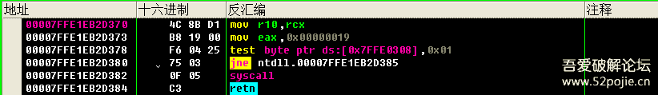

为了得到映射的下标，构造系统调用，代码目保证应用层的`NtQueryInformationProcess`正确，并使用`crc`保护自己的代码。

然后调用`XAD_ExecuteDetect`进行检测。

## XAD_ExecuteDetect 检测逻辑

### 1. `crc` 检测

节表，我们的构造的系统调用可以防止下代码段被修改。

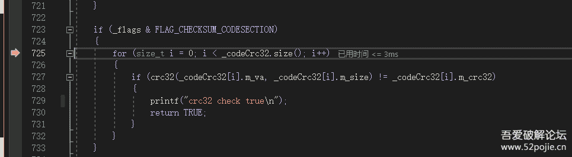

### 2. `IsDebuggerPresent`

检测当前是否正在被调试。

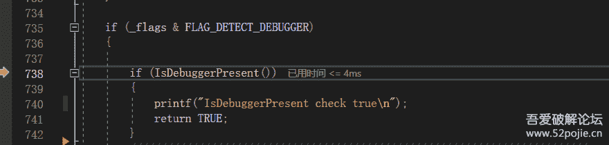

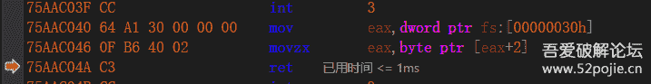

`fs:[30h]`指向`PEB`的基址。

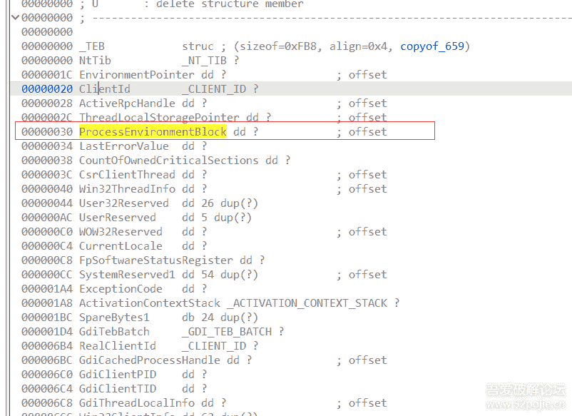

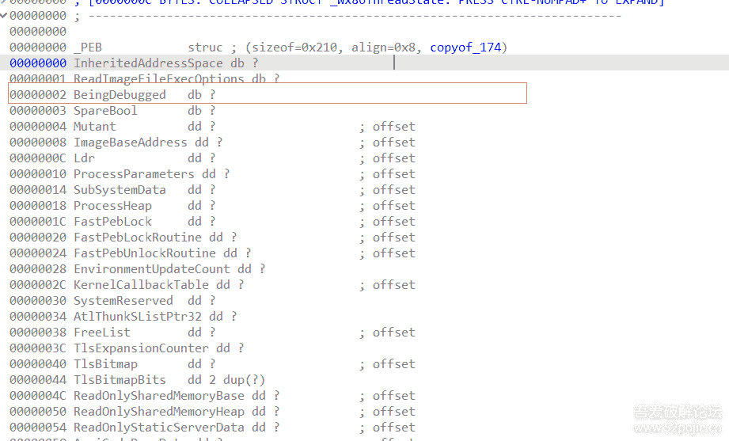

检测`BeingDebugged`的值。

### 3. `CheckRemoteDebuggerPresent`

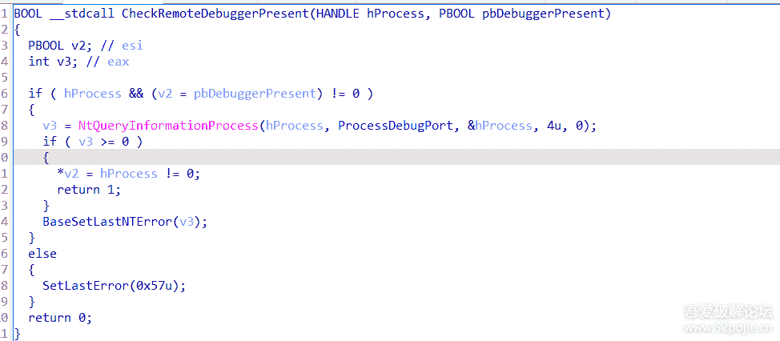

实际上是查询`NtQueryInformationProcess` `ProcessDebugPort`。

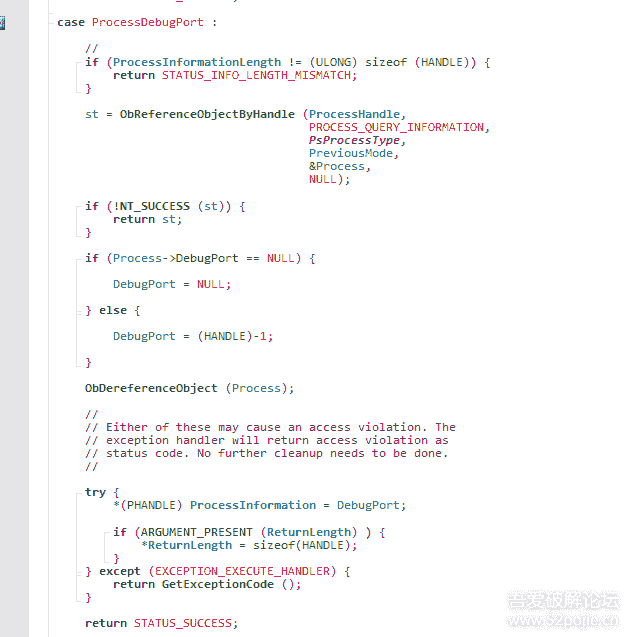


截图18.png (39.92 KB, 下载次数: 1)

[href="forum.php?mod=attachment&aid=MjY3OTM0N3w4MzM5ODQ4M3wxNzkzNTcwMDk4fDE2ODA4NnwxODk1ODAw&nothumb=yes" target="_blank"](https://www.52pojie.cn/forum.php?mod=attachment&aid=MjY3OTM0N3w4MzM5ODQ4M3wxNzkzNTcwMDk4fDE2ODA4NnwxODk1ODAw&nothumb=yes)

2024-3-2 17:16 上传

如果`DebugPort`存在返回 true

## 4 关闭一个无效句柄 如果被调试会进入异常

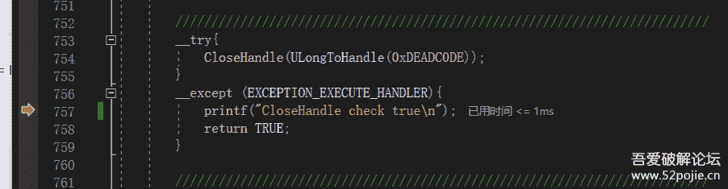

截图19.png (43.08 KB, 下载次数: 0)

[href="forum.php?mod=attachment&aid=MjY3OTMyMHxmNDJhNGM0NXwxNzkzNTcwMDk4fDE2ODA4NnwxODk1ODAw&nothumb=yes" target="_blank"](https://www.52pojie.cn/forum.php?mod=attachment&aid=MjY3OTMyMHxmNDJhNGM0NXwxNzkzNTcwMDk4fDE2ODA4NnwxODk1ODAw&nothumb=yes)

2024-3-2 17:10 上传

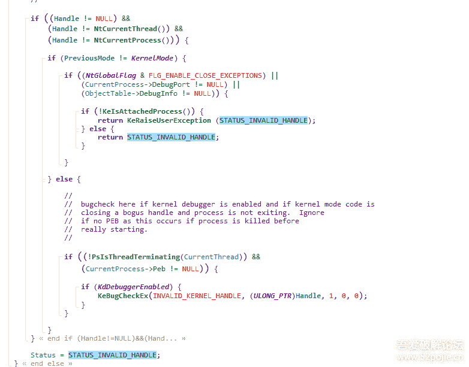

截图200.png (45.84 KB, 下载次数: 0)

[href="forum.php?mod=attachment&aid=MjY3OTM0OHxmNzdhZDg2Y3wxNzkzNTcwMDk4fDE2ODA4NnwxODk1ODAw&nothumb=yes" target="_blank"](https://www.52pojie.cn/forum.php?mod=attachment&aid=MjY3OTM0OHxmNzdhZDg2Y3wxNzkzNTcwMDk4fDE2ODA4NnwxODk1ODAw&nothumb=yes)

2024-3-2 17:22 上传

`CloseHandle`->`NtClose` 如果存在`debuginfo`与`debugPort`抛出异常 0xC0000008L被调试器接管

## 5 使用`DuplicateHandle`进行检测

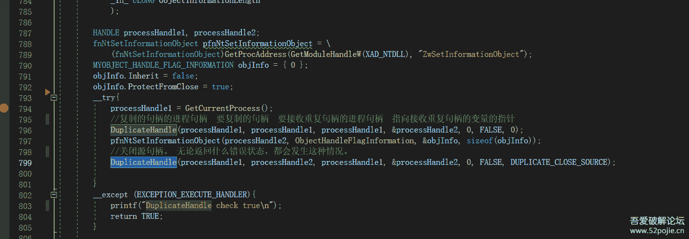

截图21.png (158.84 KB, 下载次数: 0)

[href="forum.php?mod=attachment&aid=MjY3OTMyM3xhZDA5ZWRmNnwxNzkzNTcwMDk4fDE2ODA4NnwxODk1ODAw&nothumb=yes" target="_blank"](https://www.52pojie.cn/forum.php?mod=attachment&aid=MjY3OTMyM3xhZDA5ZWRmNnwxNzkzNTcwMDk4fDE2ODA4NnwxODk1ODAw&nothumb=yes)

2024-3-2 17:10 上传

我这边追流程 好像还是`DuplicateHandle`...->`ObDuplicateObject` 调用了`NtClose`

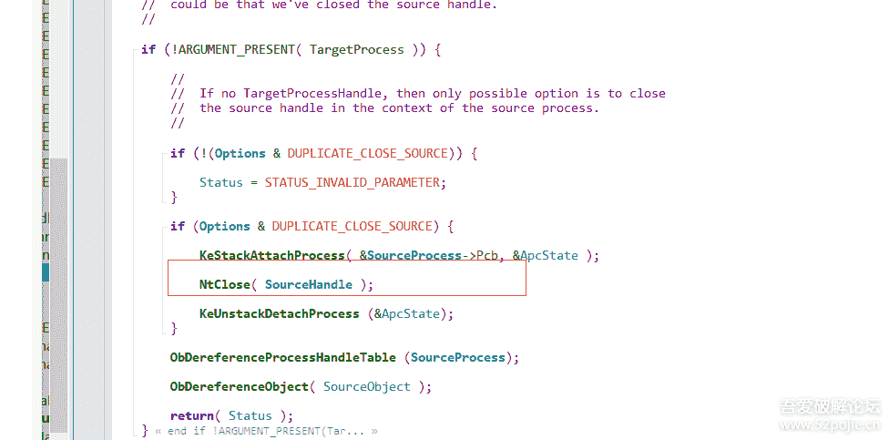

截图22.png (42.91 KB, 下载次数: 0)

[href="forum.php?mod=attachment&aid=MjY3OTM0OXw4ZDMxZDkxYXwxNzkzNTcwMDk4fDE2ODA4NnwxODk1ODAw&nothumb=yes" target="_blank"](https://www.52pojie.cn/forum.php?mod=attachment&aid=MjY3OTM0OXw4ZDMxZDkxYXwxNzkzNTcwMDk4fDE2ODA4NnwxODk1ODAw&nothumb=yes)

2024-3-2 17:22 上传

## 6 检测`StrongOD`

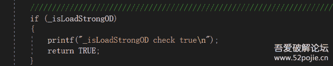

截图23.png (19.57 KB, 下载次数: 0)

[href="forum.php?mod=attachment&aid=MjY3OTMyNXxkOGZjNGI1N3wxNzkzNTcwMDk4fDE2ODA4NnwxODk1ODAw&nothumb=yes" target="_blank"](https://www.52pojie.cn/forum.php?mod=attachment&aid=MjY3OTMyNXxkOGZjNGI1N3wxNzkzNTcwMDk4fDE2ODA4NnwxODk1ODAw&nothumb=yes)

2024-3-2 17:11 上传

## 7 `NtQueryInformationProcess`检测 0x1E `ProcessDebugObjectHandle`

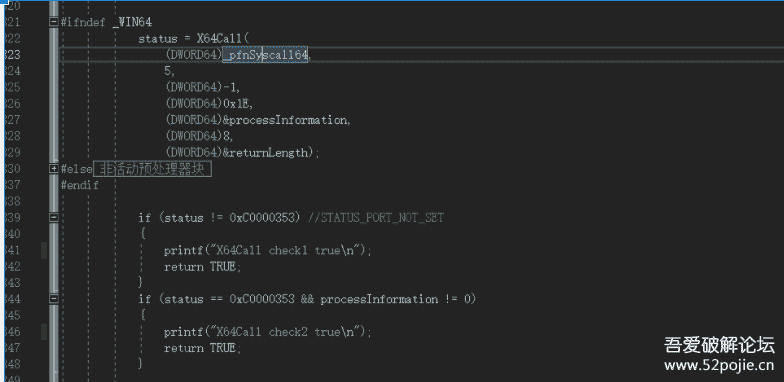

截图24.png (87.35 KB, 下载次数: 0)

[href="forum.php?mod=attachment&aid=MjY3OTM1MHwyNDlhZTQxNXwxNzkzNTcwMDk4fDE2ODA4NnwxODk1ODAw&nothumb=yes" target="_blank"](https://www.52pojie.cn/forum.php?mod=attachment&aid=MjY3OTM1MHwyNDlhZTQxNXwxNzkzNTcwMDk4fDE2ODA4NnwxODk1ODAw&nothumb=yes)

2024-3-2 17:22 上传

0x1E `ProcessDebugObjectHandle`

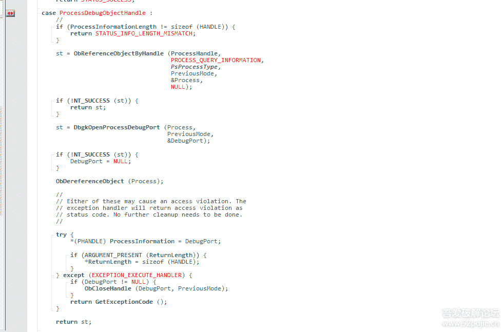

截图25.png (48.99 KB, 下载次数: 0)

[href="forum.php?mod=attachment&aid=MjY3OTMyNnxlZTJiMzdiYnwxNzkzNTcwMDk4fDE2ODA4NnwxODk1ODAw&nothumb=yes" target="_blank"](https://www.52pojie.cn/forum.php?mod=attachment&aid=MjY3OTMyNnxlZTJiMzdiYnwxNzkzNTcwMDk4fDE2ODA4NnwxODk1ODAw&nothumb=yes)

2024-3-2 17:11 上传

`DbgkOpenProcessDebugPort`

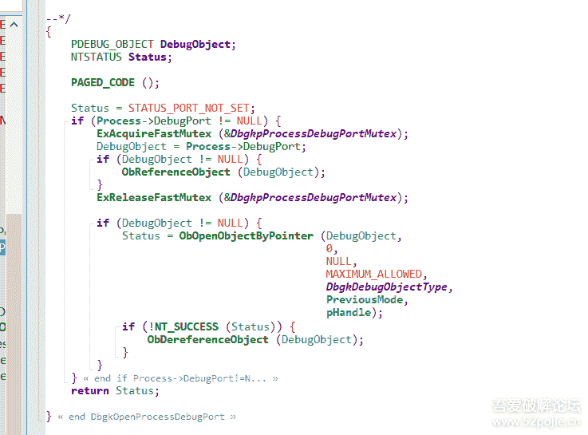

截图26.png (48.9 KB, 下载次数: 0)

[href="forum.php?mod=attachment&aid=MjY3OTM1MXwxMTJiYzBiNHwxNzkzNTcwMDk4fDE2ODA4NnwxODk1ODAw&nothumb=yes" target="_blank"](https://www.52pojie.cn/forum.php?mod=attachment&aid=MjY3OTM1MXwxMTJiYzBiNHwxNzkzNTcwMDk4fDE2ODA4NnwxODk1ODAw&nothumb=yes)

2024-3-2 17:22 上传

如果`DebugPort`未存在 返回 `STATUS_PORT_NOT_SET` 端口未设置

## 8 内核二次覆盖的BUG来检测反调试

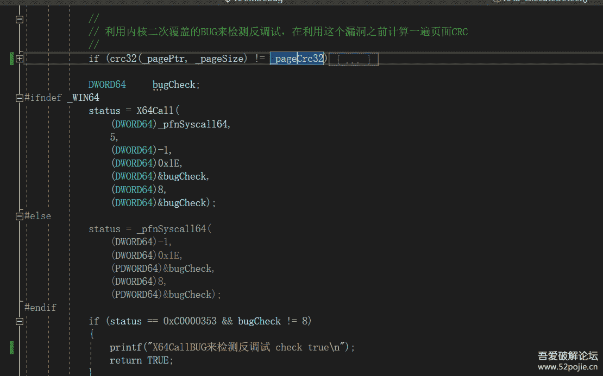

截图27.png (124.13 KB, 下载次数: 0)

[href="forum.php?mod=attachment&aid=MjY3OTMyOHwwYzY3YmJiYnwxNzkzNTcwMDk4fDE2ODA4NnwxODk1ODAw&nothumb=yes" target="_blank"](https://www.52pojie.cn/forum.php?mod=attachment&aid=MjY3OTMyOHwwYzY3YmJiYnwxNzkzNTcwMDk4fDE2ODA4NnwxODk1ODAw&nothumb=yes)

2024-3-2 17:11 上传

这个没看懂和上面有区别吗 😥

## 9 使用`GetThreadContext`检测 检测当前线程是否使用硬件断点

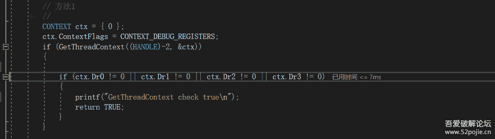

截图28.png (51.22 KB, 下载次数: 0)

[href="forum.php?mod=attachment&aid=MjY3OTM1Mnw5YjI4ZTE1NHwxNzkzNTcwMDk4fDE2ODA4NnwxODk1ODAw&nothumb=yes" target="_blank"](https://www.52pojie.cn/forum.php?mod=attachment&aid=MjY3OTM1Mnw5YjI4ZTE1NHwxNzkzNTcwMDk4fDE2ODA4NnwxODk1ODAw&nothumb=yes)

2024-3-2 17:22 上传

## 10 使用`VEH`检测

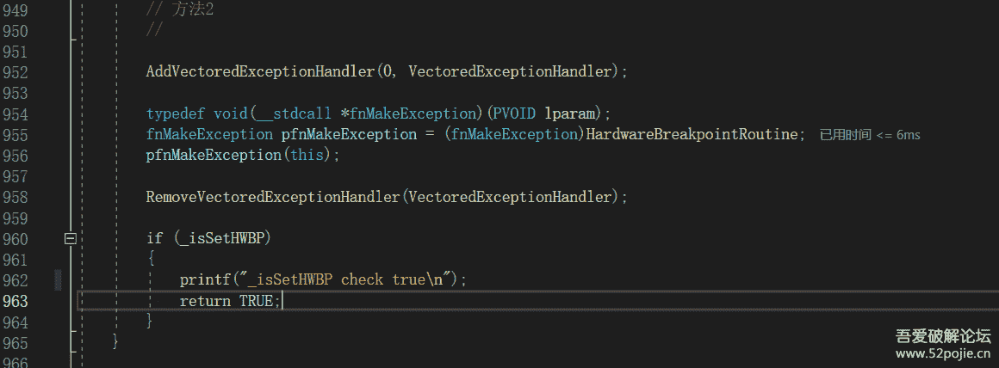

截图29.png (94.43 KB, 下载次数: 0)

[href="forum.php?mod=attachment&aid=MjY3OTMzMHwxOTFmZDJmZXwxNzkzNTcwMDk4fDE2ODA4NnwxODk1ODAw&nothumb=yes" target="_blank"](https://www.52pojie.cn/forum.php?mod=attachment&aid=MjY3OTMzMHwxOTFmZDJmZXwxNzkzNTcwMDk4fDE2ODA4NnwxODk1ODAw&nothumb=yes)

2024-3-2 17:11 上传

添加`VEH` 到最前面

调用`HardwareBreakpointRoutine`触发异常 检测硬件断点

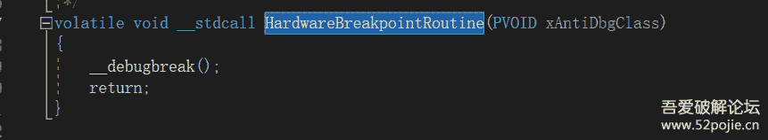

截图30.png (23.22 KB, 下载次数: 0)

[href="forum.php?mod=attachment&aid=MjY3OTMzMnxmMGIzNmU0NXwxNzkzNTcwMDk4fDE2ODA4NnwxODk1ODAw&nothumb=yes" target="_blank"](https://www.52pojie.cn/forum.php?mod=attachment&aid=MjY3OTMzMnxmMGIzNmU0NXwxNzkzNTcwMDk4fDE2ODA4NnwxODk1ODAw&nothumb=yes)

2024-3-2 17:11 上传

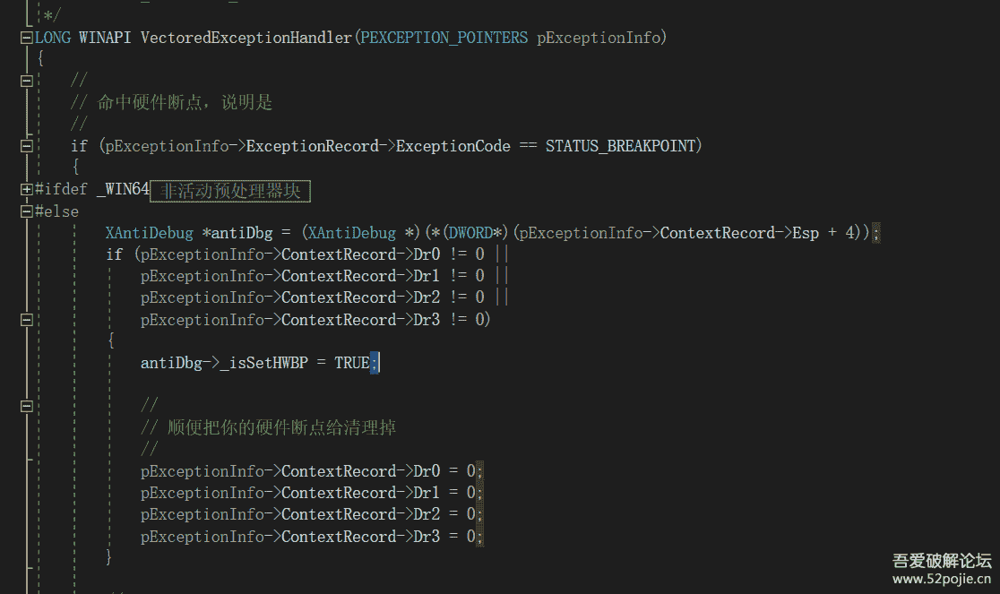

截图31.png (141.08 KB, 下载次数: 0)

[href="forum.php?mod=attachment&aid=MjY3OTMzM3w4YWEzMGIxOHwxNzkzNTcwMDk4fDE2ODA4NnwxODk1ODAw&nothumb=yes" target="_blank"](https://www.52pojie.cn/forum.php?mod=attachment&aid=MjY3OTMzM3w4YWEzMGIxOHwxNzkzNTcwMDk4fDE2ODA4NnwxODk1ODAw&nothumb=yes)

2024-3-2 17:11 上传
