# [游戏安全] Cheat Engine(CE)游戏修改-共用代码-更方便比对的方法-以《赤痕》为例

- 原帖: https://www.52pojie.cn/forum.php?mod=viewthread&tid=1910990
- 抓取时间: 2026-11-01T21:54:44

## 一、前言
共用代码的一般处理流程：
1、找到关键的数值地址；
2、找出是什么访问了此地址；
3、在若干代码中找较为有用的代码；(下文假设此是共用代码)
4、找出代码改写的地址；
5、找到己方和敌方若干地址；
6、比较这些地址的不同点；
7、根据不同，写汇编代码进行注入。
8、保存代码并运行测试。

在第6步，比较若干地址的异同，`CE`程序经历了3个发展阶段。
（1）较早的`ce`版本，只能分别打开若干“浏览内存相关区域”窗口或者寄存器窗口，肉眼比对；
图1
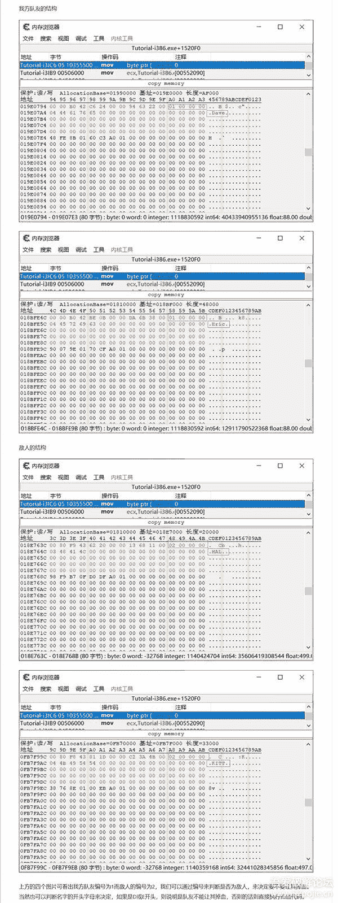
1.jpg (294.84 KB, 下载次数: 4)
[href="forum.php?mod=attachment&aid=MjY4ODEyNnw5Y2I0YWNhMXwxNzkzNTcwMDgyfDE2ODA4NnwxOTEwOTkw&nothumb=yes" target="_blank"](https://www.52pojie.cn/forum.php?mod=attachment&aid=MjY4ODEyNnw5Y2I0YWNhMXwxNzkzNTcwMDgyfDE2ODA4NnwxOTEwOTkw&nothumb=yes)
2024-4-8 12:37 上传
（2）`CE`第二阶段，作者加入分析数据-结构分析，来较为方便的进行列表比对。这一步已经非常方便了。
图2
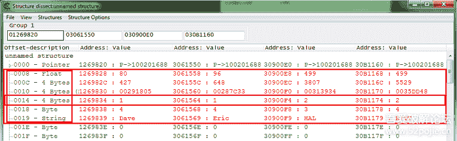
2.png (106.72 KB, 下载次数: 4)
[href="forum.php?mod=attachment&aid=MjY4ODEyOXw0ZDFmMzA1Y3wxNzkzNTcwMDgyfDE2ODA4NnwxOTEwOTkw&nothumb=yes" target="_blank"](https://www.52pojie.cn/forum.php?mod=attachment&aid=MjY4ODEyOXw0ZDFmMzA1Y3wxNzkzNTcwMDgyfDE2ODA4NnwxOTEwOTkw&nothumb=yes)
2024-4-8 12:38 上传
，图2-2
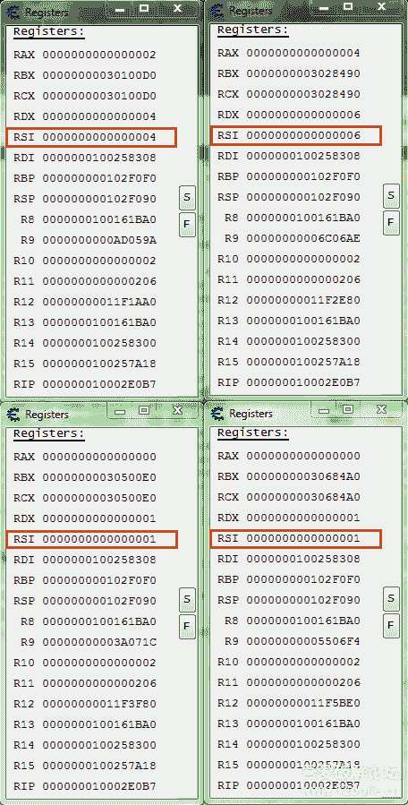
2-2.png (112.72 KB, 下载次数: 5)
[href="forum.php?mod=attachment&aid=MjY4ODEzMHw0NGI5YTFmOXwxNzkzNTcwMDgyfDE2ODA4NnwxOTEwOTkw&nothumb=yes" target="_blank"](https://www.52pojie.cn/forum.php?mod=attachment&aid=MjY4ODEzMHw0NGI5YTFmOXwxNzkzNTcwMDgyfDE2ODA4NnwxOTEwOTkw&nothumb=yes)
2-2
2024-4-8 12:38 上传
（3）`CE`第三阶段，增加新功能--分组查找共同特征。`CE`自动比对不同组别的地址和寄存器，提示用户不同。
图3
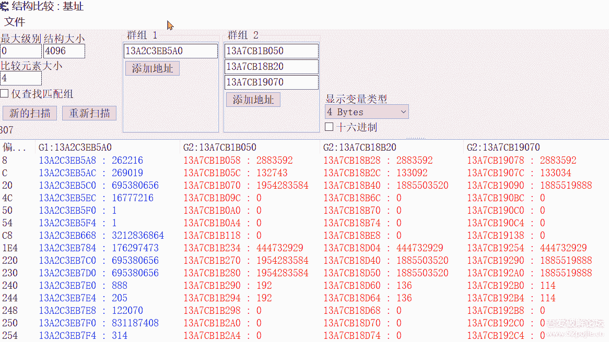
3.png (96.83 KB, 下载次数: 4)
[href="forum.php?mod=attachment&aid=MjY4ODEzMXxlNTQ2ODlmYXwxNzkzNTcwMDgyfDE2ODA4NnwxOTEwOTkw&nothumb=yes" target="_blank"](https://www.52pojie.cn/forum.php?mod=attachment&aid=MjY4ODEzMXxlNTQ2ODlmYXwxNzkzNTcwMDgyfDE2ODA4NnwxOTEwOTkw&nothumb=yes)
2024-4-8 12:38 上传
现在就来介绍一下这个新的方便功能的使用。
这里假设读者已经熟练掌握`CE`的基本操作。
本教程学习自b站up主：我婧，创作的视频：[//www.bilibili.com/video/BV18g41117Sa/?spm_id_from=333.999.0.0&vd_source=74c03e6f5fd3f4ea5af556998228a799" target="_blank" rel="noopener noreferrer nofollow"](https://www.bilibili.com/video/BV18g41117Sa/?spm_id_from=333.999.0.0&vd_source=74c03e6f5fd3f4ea5af556998228a799:rel="nofollow noopener" href="https)

## 二、以《赤痕》Bloodstained-Ritual of the Night 为例说明：
赤痕游戏中，玩家和怪物减血的代码是典型的共享代码。无论玩家击打怪物，还是怪物杀伤玩家，都是运行同一段代码。
这里已经找到该代码，为写例程，在进行脚本注入，使双方都不被减血。
图4
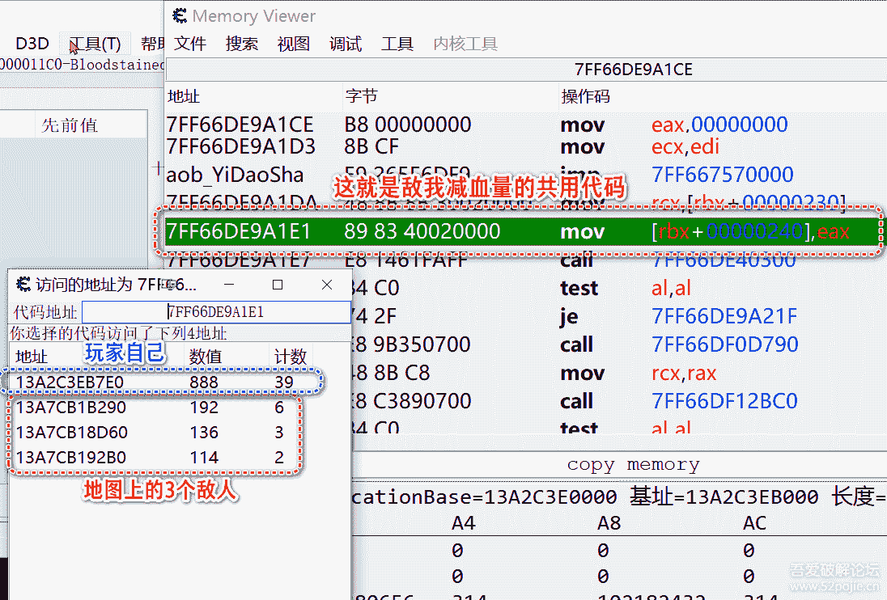
4.png (176.15 KB, 下载次数: 2)
[href="forum.php?mod=attachment&aid=MjY4ODEzMnxlODI3NTk3OHwxNzkzNTcwMDgyfDE2ODA4NnwxOTEwOTkw&nothumb=yes" target="_blank"](https://www.52pojie.cn/forum.php?mod=attachment&aid=MjY4ODEzMnxlODI3NTk3OHwxNzkzNTcwMDgyfDE2ODA4NnwxOTEwOTkw&nothumb=yes)
4
2024-4-8 12:39 上传
那么新功能怎么使用呢？

### (一)对敌我地址进行分组:
图5
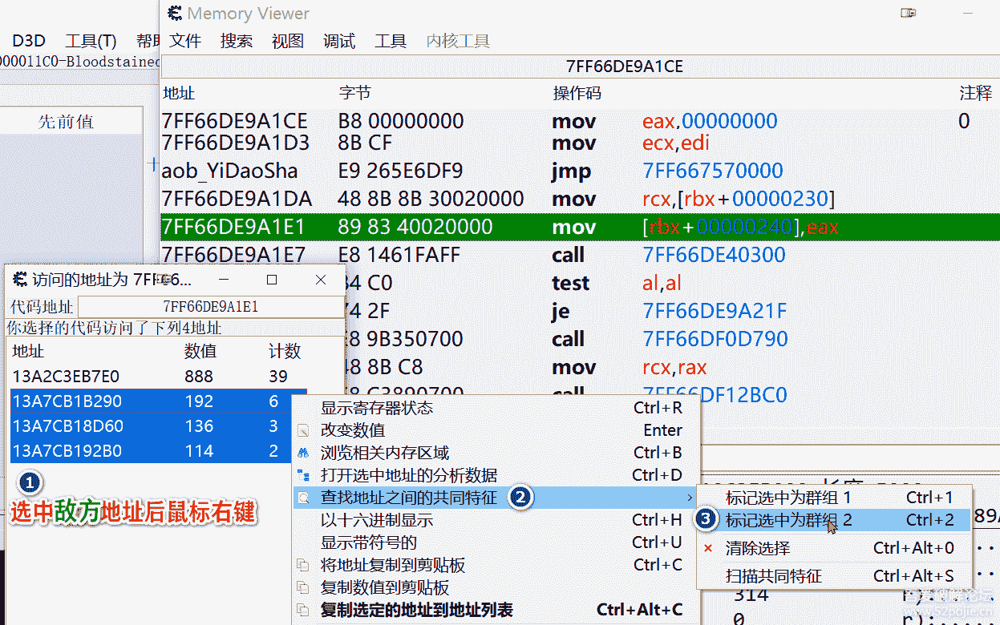
5.png (167.67 KB, 下载次数: 3)
[href="forum.php?mod=attachment&aid=MjY4ODEzM3xiOWI4ZGE3ZHwxNzkzNTcwMDgyfDE2ODA4NnwxOTEwOTkw&nothumb=yes" target="_blank"](https://www.52pojie.cn/forum.php?mod=attachment&aid=MjY4ODEzM3xiOWI4ZGE3ZHwxNzkzNTcwMDgyfDE2ODA4NnwxOTEwOTkw&nothumb=yes)
5
2024-4-8 12:52 上传
图6
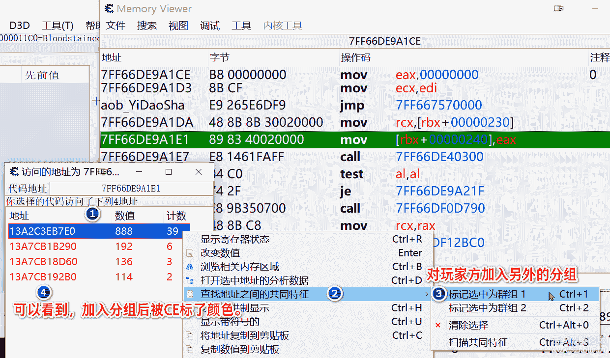
6.png (179.08 KB, 下载次数: 2)
[href="forum.php?mod=attachment&aid=MjY4ODEzNHxlNTU5MmUxM3wxNzkzNTcwMDgyfDE2ODA4NnwxOTEwOTkw&nothumb=yes" target="_blank"](https://www.52pojie.cn/forum.php?mod=attachment&aid=MjY4ODEzNHxlNTU5MmUxM3wxNzkzNTcwMDgyfDE2ODA4NnwxOTEwOTkw&nothumb=yes)
6
2024-4-8 12:39 上传
哪一方做为分组1或2都没有关系，关键是不要把地址分错阵营，例如将敌人的地址误以为是己方。
下图是标注完毕分组后的情况。
图7
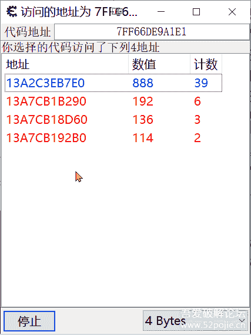
7.png (29.56 KB, 下载次数: 2)
[href="forum.php?mod=attachment&aid=MjY4ODEzNXxhZGE1ZTFlOHwxNzkzNTcwMDgyfDE2ODA4NnwxOTEwOTkw&nothumb=yes" target="_blank"](https://www.52pojie.cn/forum.php?mod=attachment&aid=MjY4ODEzNXxhZGE1ZTFlOHwxNzkzNTcwMDgyfDE2ODA4NnwxOTEwOTkw&nothumb=yes)
2024-4-8 12:40 上传

### (二)扫描共同特征前设置：
图8
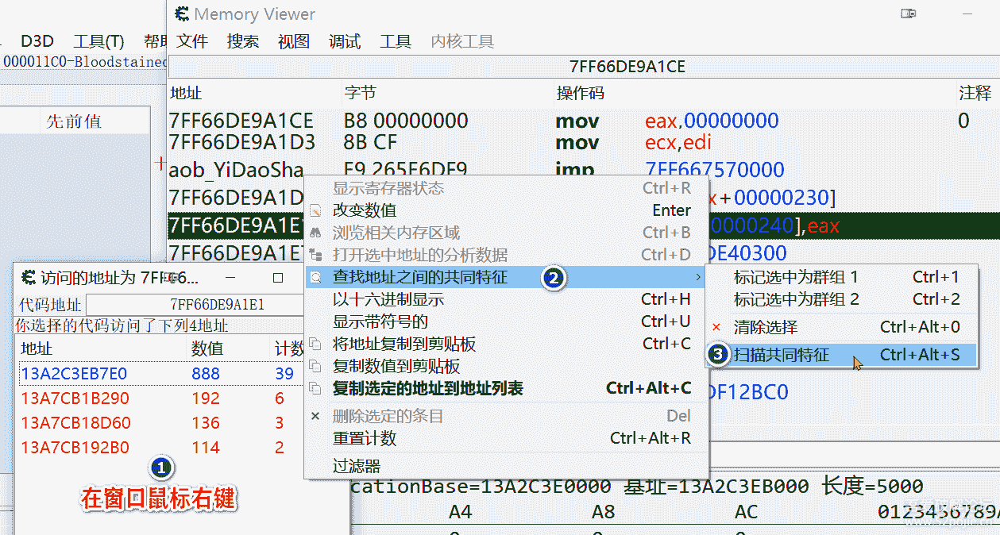
8.png (148.87 KB, 下载次数: 2)
[href="forum.php?mod=attachment&aid=MjY4ODEzNnw0MDNmN2UwYXwxNzkzNTcwMDgyfDE2ODA4NnwxOTEwOTkw&nothumb=yes" target="_blank"](https://www.52pojie.cn/forum.php?mod=attachment&aid=MjY4ODEzNnw0MDNmN2UwYXwxNzkzNTcwMDgyfDE2ODA4NnwxOTEwOTkw&nothumb=yes)
2024-4-8 12:40 上传
图9
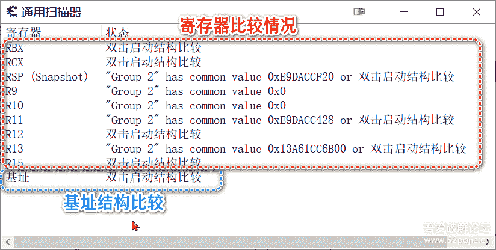
9.png (92.52 KB, 下载次数: 2)
[href="forum.php?mod=attachment&aid=MjY4ODEzN3wzMzA5NDNmN3wxNzkzNTcwMDgyfDE2ODA4NnwxOTEwOTkw&nothumb=yes" target="_blank"](https://www.52pojie.cn/forum.php?mod=attachment&aid=MjY4ODEzN3wzMzA5NDNmN3wxNzkzNTcwMDgyfDE2ODA4NnwxOTEwOTkw&nothumb=yes)
2024-4-8 12:40 上传
双击后出现比较窗口，注意3的位置请填写0，否则会查找多级指针，造成速度下降且用途不大。
图10
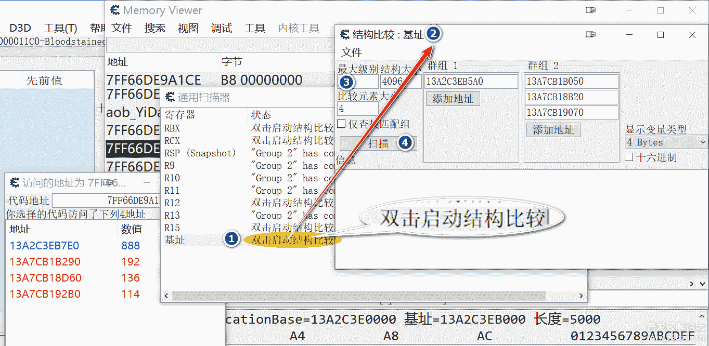
10.png (205.7 KB, 下载次数: 3)
[href="forum.php?mod=attachment&aid=MjY4ODEzOHxkMjI2MGJkNHwxNzkzNTcwMDgyfDE2ODA4NnwxOTEwOTkw&nothumb=yes" target="_blank"](https://www.52pojie.cn/forum.php?mod=attachment&aid=MjY4ODEzOHxkMjI2MGJkNHwxNzkzNTcwMDgyfDE2ODA4NnwxOTEwOTkw&nothumb=yes)
2024-4-8 12:40 上传

### (三)扫描后的结构比对结果：
单击上面的图中-位置4--扫描--按钮。`CE`提示保存扫描文件，之后打开下图的比对情况：
图11
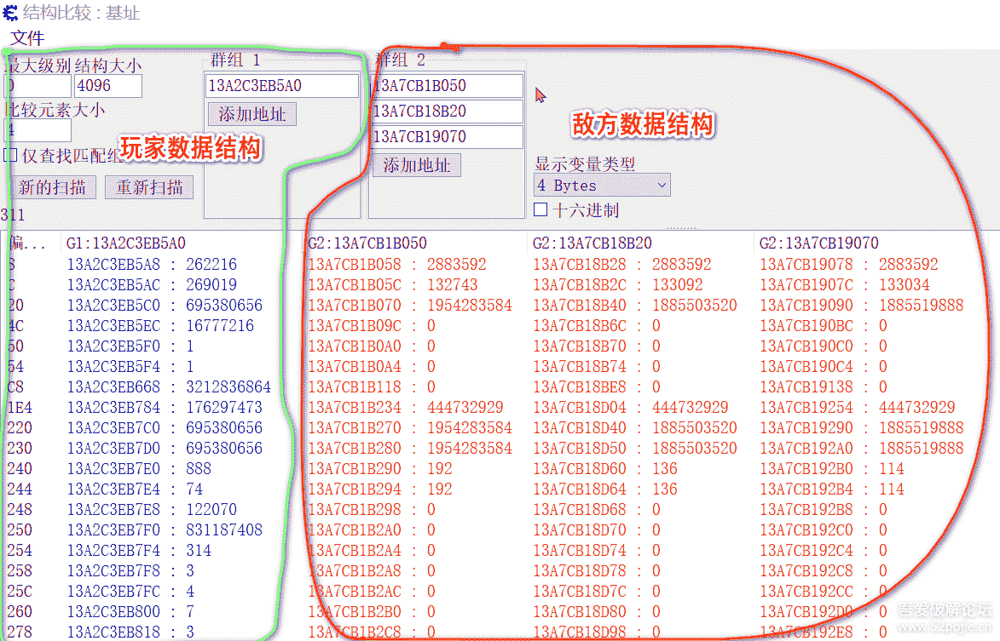
11.png (206.84 KB, 下载次数: 4)
[href="forum.php?mod=attachment&aid=MjY4ODEzOXwxYmUxOTA0Y3wxNzkzNTcwMDgyfDE2ODA4NnwxOTEwOTkw&nothumb=yes" target="_blank"](https://www.52pojie.cn/forum.php?mod=attachment&aid=MjY4ODEzOXwxYmUxOTA0Y3wxNzkzNTcwMDgyfDE2ODA4NnwxOTEwOTkw&nothumb=yes)
11
2024-4-8 12:40 上传
可以看到，在偏移240的位置是`HP`，各不相同，偏移244的位置是玩家魔法值。偏移248位置是玩家经验值。
这里，`CE`将双方阵营的数据结构呈现，这里已经略去的相同的地址部分，仅仅呈现组1与组2不同的部分，且不比较组2中3个数据相同与否。这样就非常方便玩家选择合适的地址进行汇编区分。
这里以使用偏移54位置值为例进行代码比较。
```
cmp [rcx+54],0  //敌人
  je Diren_HP     //相等则跳到写敌人HP代码处
  cmp [rcx+54],1  //玩家
  je Player_HP    //相等则跳到写玩家HP代码处
```

## 三、脚本参考
附件：
1、游戏存档

[href="forum.php?mod=attachment&aid=MjY4ODE0MnxmNDExYjk1ZnwxNzkzNTcwMDgyfDE2ODA4NnwxOTEwOTkw" target="_blank"](https://www.52pojie.cn/forum.php?mod=attachment&aid=MjY4ODE0MnxmNDExYjk1ZnwxNzkzNTcwMDgyfDE2ODA4NnwxOTEwOTkw)
(1.03 MB, 下载次数: 3)
2024-4-8 12:42 上传
点击文件名下载附件
下载积分: 吾爱币 -1 CB
2、`CE`学习脚本

[href="forum.php?mod=attachment&aid=MjY4ODE0MXwzYzA4YWZhYXwxNzkzNTcwMDgyfDE2ODA4NnwxOTEwOTkw" target="_blank"](https://www.52pojie.cn/forum.php?mod=attachment&aid=MjY4ODE0MXwzYzA4YWZhYXwxNzkzNTcwMDgyfDE2ODA4NnwxOTEwOTkw)
(15.73 KB, 下载次数: 21)
2024-4-8 12:41 上传
点击文件名下载附件
下载积分: 吾爱币 -1 CB
在学习脚本中，沙地和陆地分别写了一个注入，达成自定义二段跳次数。后来尝试将2者合并为1个脚本，能够顺利运行。后来，恰巧在b站看到 up主：我婧 的脚本合并教程，真是巧了。
在之后，继续查看陆地和沙地反汇编代码，发现一个共同的`call`，于是进入`call`里面查看，在其中一个位置进行了注入，这个注入脚本可以达成在陆地、沙地、水中自定义跳跃次数，不用单独开陆地、沙地跳跃次数脚本了。

## 四、其他：
在扫描器中，双击这些寄存器，`CE`会打开寄存器比较情况，供玩家参考。
图12.
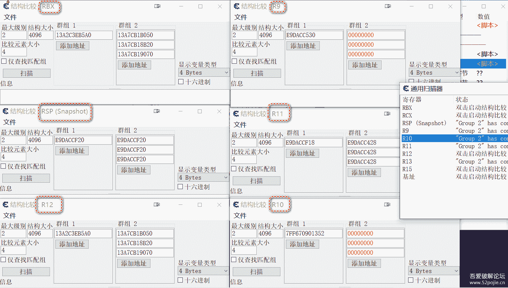
12.png (218.2 KB, 下载次数: 4)
[href="forum.php?mod=attachment&aid=MjY4ODE0MHxlNDFhOGYxZnwxNzkzNTcwMDgyfDE2ODA4NnwxOTEwOTkw&nothumb=yes" target="_blank"](https://www.52pojie.cn/forum.php?mod=attachment&aid=MjY4ODE0MHxlNDFhOGYxZnwxNzkzNTcwMDgyfDE2ODA4NnwxOTEwOTkw&nothumb=yes)
2024-4-8 12:41 上传
好了。这次的学习分享就到这里，祝大家`CE`愉快！
