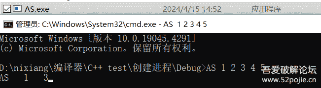
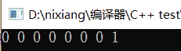
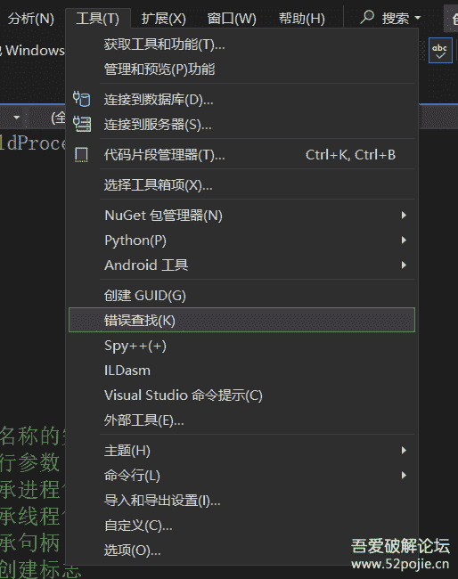
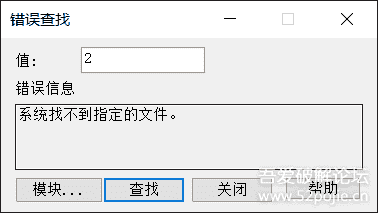

# [系统底层] win32笔记三 创建进程

- 原帖：https://www.52pojie.cn/forum.php?mod=viewthread&tid=1914451
- 抓取时间：2026-11-01T21:54:34

之前的索引：[https://www.52pojie.cn/thread-1914443-1-1.html](https://www.52pojie.cn/thread-1914443-1-1.html)

## 创建进程

在创建一个进程之前，首先介绍一个 win API：`CreateProcess()`。

### 给出定义

```c
BOOL CreateProcess(
  [in, optional]    LPCTSTR lpApplicationName,                // name of executable module
  [in, out, optional]   LPTSTR lpCommandLine,                     // command line string
  [in, optional]    LPSECURITY_ATTRIBUTES lpProcessAttributes, // SD
  [in, optional]    LPSECURITY_ATTRIBUTES lpThreadAttributes,  // SD
  [in]          BOOL bInheritHandles,                     // handle inheritance option
  [in]          DWORD dwCreationFlags,                     // creation flags
  [in, optional]    LPVOID lpEnvironment,                      // new environment block
  [in, optional]    LPCTSTR lpCurrentDirectory,                // current directory name
  [in]          LPSTARTUPINFO lpStartupInfo,               // startup information
  [out]         LPPROCESS_INFORMATION lpProcessInformation // process information
);
```

可以看到参数是非常多的。

但是目前我们只需要知道其中的四个就可以了。

#### 4> `lpApplicationName`

应用程序路径，也就是文件的路径（我认为最好写上绝对路径），必须包含文件扩展名。

#### 4> `lpCommandLine`

命令行参数。在 windows 中，有两种启动 `.exe` 文件的方法：一个是双击，还有一个就是在终端输入命令，例如：

```c
#include 

int main(int argc,char* argv[])
{
    printf("%s - %s - %s",argv[0],argv[1],argv[3]);
    getchar();
    return 0;
}
```

比如上面的代码，也许见过很多次，但从没用过，这里就演示一次。

编译上面的代码，并找到 exe 文件的路径。



`image-20240415145412693.png` (28.7 KB, 下载次数: 0)

[附件下载](https://www.52pojie.cn/forum.php?mod=attachment&aid=MjY5MTA5MnxmODU2Y2QxOHwxNzkzNTcwMDcyfDE2ODA4NnwxOTE0NDUx&nothumb=yes)

2024-4-22 00:07 上传

这里我输入了参数 `AS` `1` `2` `3` `4` `5`。`AS` 就算第一个参数，依次类推，参数之间以空格隔开。

这就是命令行参数。

#### 4> `lpStartupInfo`

指定创建时进程的窗口工作站、桌面、标准句柄和 `main` 窗口的外观。

结构体：

```c
typedef struct _STARTUPINFOA {
  DWORD  cb;
  LPSTR  lpReserved;
  LPSTR  lpDesktop;
  LPSTR  lpTitle;
  DWORD  dwX;
  DWORD  dwY;
  DWORD  dwXSize;
  DWORD  dwYSize;
  DWORD  dwXCountChars;
  DWORD  dwYCountChars;
  DWORD  dwFillAttribute;
  DWORD  dwFlags;
  WORD   wShowWindow;
  WORD   cbReserved2;
  LPBYTE lpReserved2;
  HANDLE hStdInput;
  HANDLE hStdOutput;
  HANDLE hStdError;
} STARTUPINFOA, *LPSTARTUPINFOA;
```

这个不用了解的太详细，只用知道第一个 `cd` 的含义，这个就是存储的这个结构体有多大，方便后续这个结构体的更新而使大小变大，从而带来不易计算大小的麻烦，这个成员可以在很多的结构体里看到。

前面还有个 `[in]`，这是个 `in` 参数，表示需要你传进去给当前的程序用，即 `lpStartupInfo` 参数给 `CreateProcess()` 函数提供参数。

#### 4> `lpProcessInformation`

包含有关新创建的进程及其主线程的信息。

结构体：

```c
typedef struct _PROCESS_INFORMATION {
  HANDLE hProcess;
  HANDLE hThread;
  DWORD  dwProcessId;
  DWORD  dwThreadId;
} PROCESS_INFORMATION, *PPROCESS_INFORMATION, *LPPROCESS_INFORMATION;
```

可以看到有四个成员，分别是：进程句柄、线程句柄、进程 ID、线程 ID。

这里先不涉及句柄是什么，后面在详细说明。

这里也就应证了，创建进程的时候至少会创建一个线程。

这里的 `[out]`，意思为 `out` 参数，表示当我这个程序执行完成，会通过这个指针写结果，即当程序执行成功，结果会写入到 `PROCESS_INFORMATION` 定义的指针里，相当于返回值。

`in` 参数只管往里传，`out` 参数只管往回传。

### 3> 代码实验

```cpp
//环境：win10 VS2022 
#define _CRT_SECURE_NO_WARNINGS 1
#include 
#include 

//启动参数的相关信息，后面的拓展会提到
void GetStartInfo()
{
    STARTUPINFO si;
    GetStartupInfo(&si);
    printf("%X %X %X %X %X %X %X %X\n", si.dwX, si.dwY, si.dwXCountChars, si.dwYCountChars, si.dwFillAttribute, si.dwXSize, si.dwYSize, si.dwFlags);
}

//创建一个子进程
BOOL CreateChildProcess(PTCHAR ChildProcessName, PTCHAR CommandLine)
{
    STARTUPINFO si;
    PROCESS_INFORMATION pi;

    ZeroMemory(&si, sizeof(si));        //置0
    ZeroMemory(&pi, sizeof(pi));        //置0
    si.cb = sizeof(si);                 //这个成员是要初始化的

    //创建子进程 返回是否成功
    if (!CreateProcess(
        ChildProcessName,   //对象名称的完整路径
        CommandLine,        //命令行参数
        NULL,               //不继承进程句柄
        NULL,               //不继承线程句柄
        FALSE,              //不继承句柄
        0,                  //没有创建标志
        NULL,               //使用父进程环境变量
        NULL,               //使用父进程目录作为当前目录，可以自己设置目录
        &si,                //STARTUPINFO结构体
        &pi)                //PROCESS_INFORMATION结构体
        )
    {
        printf("创建进程错误 代码：%d\n", GetLastError());
        return FALSE;
    }
    printf("进程句柄：%X\t进程ID：%X\n线程句柄：%X\t线程ID：%X\n", pi.hProcess,pi.dwProcessId, pi.hThread,pi.dwThreadId);

    //释放句柄
    CloseHandle(pi.hProcess);
    CloseHandle(pi.hThread);
    return TRUE;
}

int main(int argc,char* argv[])
{
    //C:\\Program Files\\Internet Explorer\\iexplore.exe
    //C:\\Program Files (x86)\\Microsoft\\Edge\\Application\\msedge.exe
    TCHAR ApplicationName[] = TEXT("C:\\Program Files\\Internet Explorer\\iexplore.exe");
    TCHAR CmdLine[] = TEXT(" https://www.baidu.com");   //注意前面要加个空格
    CreateChildProcess(ApplicationName, CmdLine);       //调用函数
    //GetStartInfo();

    getchar();          //终端输入，类似于断点的作用
    return 0;
}
```

### 3> 运行结果


`image-20240415161814847.png` (46.06 KB, 下载次数: 0)

[附件下载](https://www.52pojie.cn/forum.php?mod=attachment&aid=MjY5MTA5M3w1ZTg1NzJhOXwxNzkzNTcwMDcyfDE2ODA4NnwxOTE0NDUx&nothumb=yes)

2024-4-22 00:08 上传


`image-20240415161826025.png` (14.85 KB, 下载次数: 0)

[附件下载](https://www.52pojie.cn/forum.php?mod=attachment&aid=MjY5MTA5NHxkNGQwNzk2YXwxNzkzNTcwMDcyfDE2ODA4NnwxOTE0NDUx&nothumb=yes)

2024-4-22 00:08 上传

程序也是执行成功，进程与线程的东西也是获取到了。

（有个小问题，我用 `msedge` 来测试的时候不行，不给我弹百度，但是在终端命令行参数输入的时候却可以，不得已换成 `iexplore`，还请大佬说说其中的缘由。）

### 3> 拓展1

在代码中，会注意到这里：

```c
//启动参数的相关信息，后面的拓展会提到

void GetStartInfo()
{
    STARTUPINFO si;
    GetStartupInfo(&si);
    printf("%X %X %X %X %X %X %X %X\n", si.dwX, si.dwY, si.dwXCountChars, si.dwYCountChars, si.dwFillAttribute, si.dwXSize, si.dwYSize, si.dwFlags);
}
```

这里就是 `lpStartupInfo` 参数的东西，我选择了一部分来打印。

（运行的时候记得把该函数调用。）

首先在 `VS` 里直接运行看效果。


`image-20240415162428611.png` (2.69 KB, 下载次数: 0)

[附件下载](https://www.52pojie.cn/forum.php?mod=attachment&aid=MjY5MTA5NXxmNWEzZDQyNnwxNzkzNTcwMDcyfDE2ODA4NnwxOTE0NDUx&nothumb=yes)

2024-4-22 00:08 上传

发现全是零。

那么如果我双击运行呢？



`image-20240415162524957.png` (2.83 KB, 下载次数: 0)

[附件下载](https://www.52pojie.cn/forum.php?mod=attachment&aid=MjY5MTA5Nnw0Yzk3OWM4N3wxNzkzNTcwMDcyfDE2ODA4NnwxOTE0NDUx&nothumb=yes)

2024-4-22 00:08 上传

会发现不同。

那在其他的调试器呢？这里不浪费篇幅，直接说结果，`xdbg` 为全 0，`OD` 为全 0。

`DTDebug`：


`image-20240415162719364.png` (13.9 KB, 下载次数: 0)

[附件下载](https://www.52pojie.cn/forum.php?mod=attachment&aid=MjY5MTA5N3xlOGI4NGZiOXwxNzkzNTcwMDcyfDE2ODA4NnwxOTE0NDUx&nothumb=yes)

2024-4-22 00:09 上传

可以发现，不同的调试器，所给的值是不同的，那么就可以做反调试的内容了（理论上）。

### 3> 拓展2

在代码中有这样一段：


```
printf("创建进程错误 代码：%d\n", GetLastError());
```

`GetLastError()`函数：检索调用线程的最后错误代码值。最后一个错误代码按线程进行维护。多个线程不会覆盖彼此的最后一个错误代码。

如果出现了这个问题，会在终端输出一个错误代码，例如：

我把路径修改一下，然后运行：


`image-20240415165929537.png` (13.01 KB, 下载次数: 0)

[下载附件](https://www.52pojie.cn/forum.php?mod=attachment&aid=MjY5MTA5OXw0ODE4NDJiY3wxNzkzNTcwMDcyfDE2ODA4NnwxOTE0NDUx&nothumb=yes)

2024-4-22 00:09 上传

会得到一个2，那我就可以去查询是什么错误：



`image-20240415170013350.png` (57.67 KB, 下载次数: 0)

[下载附件](https://www.52pojie.cn/forum.php?mod=attachment&aid=MjY5MTEwMHw3ODFmZTY5MnwxNzkzNTcwMDcyfDE2ODA4NnwxOTE0NDUx&nothumb=yes)

2024-4-22 00:09 上传

点击菜单栏上的工具，选择错误查找，然后输入错误代码，就可以知道是什么问题了：



`image-20240415170119314.png` (10.71 KB, 下载次数: 0)

[下载附件](https://www.52pojie.cn/forum.php?mod=attachment&aid=MjY5MTEwMXxhNGNmN2Y0MHwxNzkzNTcwMDcyfDE2ODA4NnwxOTE0NDUx&nothumb=yes)

2024-4-22 00:09 上传

## 总结

1. 进程的创建通过API来实现
2. 命令行参数的解释
3. 启动信息以及进程相关信息的输出
4. 错误代码的查询
