# [系统底层] win32笔记五 进程相关API

- 原帖: https://www.52pojie.cn/forum.php?mod=viewthread&tid=1916213
- 抓取时间: 2026-11-01T21:54:31

之前的索引：[https://www.52pojie.cn/thread-1914443-1-1.html](https://www.52pojie.cn/thread-1914443-1-1.html)

## 进程相关API

在前面的学习中，我们知道了，成功创建了一个进程，`CreateProcess()`就会返回来四个数据，分别是：进程句柄、线程句柄、进程ID、线程ID。

相信大家对句柄都有了深刻的理解，这次就来聊聊进程ID，也叫PID。

还是以前的代码：

```c
//环境：虚拟机 win xp VC++ 6
#include <windows.h>
#include <stdio.h>

BOOL CreateChildProcess(PTCHAR ChildProcessName, PTCHAR CommandLine)
{
    STARTUPINFO si;
    PROCESS_INFORMATION pi;

    ZeroMemory(&si, sizeof(si));
    ZeroMemory(&pi, sizeof(pi));
    si.cb = sizeof(si);

    //创建子进程 返回是否成功
    if (!CreateProcess(
        ChildProcessName,   //对象名称的完整路径
        CommandLine,        //命令行参数
        NULL,               //不继承进程句柄
        NULL,               //不继承线程句柄
        FALSE,              //不继承句柄
        0,                  //没有创建标志
        NULL,               //使用父进程环境变量
        NULL,               //使用父进程目录作为当前目录，可以自己设置目录
        &si,                //STARTUPINFO结构体
        &pi)                //PROCESS_INFORMATION结构体
        )
    {
        printf("创建进程错误 代码：%d\n", GetLastError());
        return FALSE;
    }
    printf("进程句柄：%X\t进程ID：%X\n线程句柄：%X\t线程ID：%X\n", pi.hProcess,pi.dwProcessId, pi.hThread,pi.dwThreadId);

    //释放句柄
    CloseHandle(pi.hProcess);
    CloseHandle(pi.hThread);
    return TRUE;
}

int main(int argc,char* argv[])
{
    //C:\\Program Files\\Internet Explorer\\iexplore.exe
    //C:\\Program Files (x86)\\Microsoft\\Edge\\Application\\msedge.exe
    TCHAR ApplicationName[] = TEXT("C:\\Program Files\\Internet Explorer\\iexplore.exe");
    TCHAR CmdLine[] = TEXT(" https://www.baidu.com");
    CreateChildProcess(ApplicationName, NULL);
    getchar();
    return 0;
}
```

运行后会直接打开一个网页，然后看输出的PID。

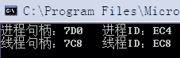

image-20240417234437206.png (3.68 KB, 下载次数: 0)

[附件](https://www.52pojie.cn/forum.php?mod=attachment&aid=MjY5MTEwMnxjMTkzMWI4N3wxNzkzNTcwMDY5fDE2ODA4NnwxOTE2MjEz&nothumb=yes)

2024-4-22 00:15 上传

得到PID：`0xEC4`，换算成十进制为：3780，然后看看资源管理器，有没有3780的进程。

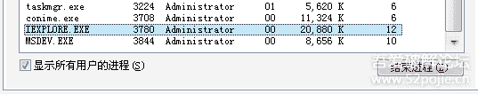

image-20240417234605023.png (11.63 KB, 下载次数: 0)

[附件](https://www.52pojie.cn/forum.php?mod=attachment&aid=MjY5MTEwM3w4NjY5MzI3NXwxNzkzNTcwMDY5fDE2ODA4NnwxOTE2MjEz&nothumb=yes)

2024-4-22 00:15 上传

可以看到都一一对应上了，从这里就能感受到进程句柄与PID的略微差异。

然后我们继续。

回想句柄，句柄是每个进程私有的一张表，里面存储的所有创建的或打开的内核对象，除了每个进程以外，操作系统也有一张表，操作系统的这张表就不叫私有句柄表，而是全局句柄表，整个操作系统一份。

### 3> 那这个全局句柄表包含了啥呢？

下面画了个粗略的图，别的先不管，全局句柄表包含了所有正在运行中的进程和线程，这个表里结构跟私有表的结构没有多大的区别。

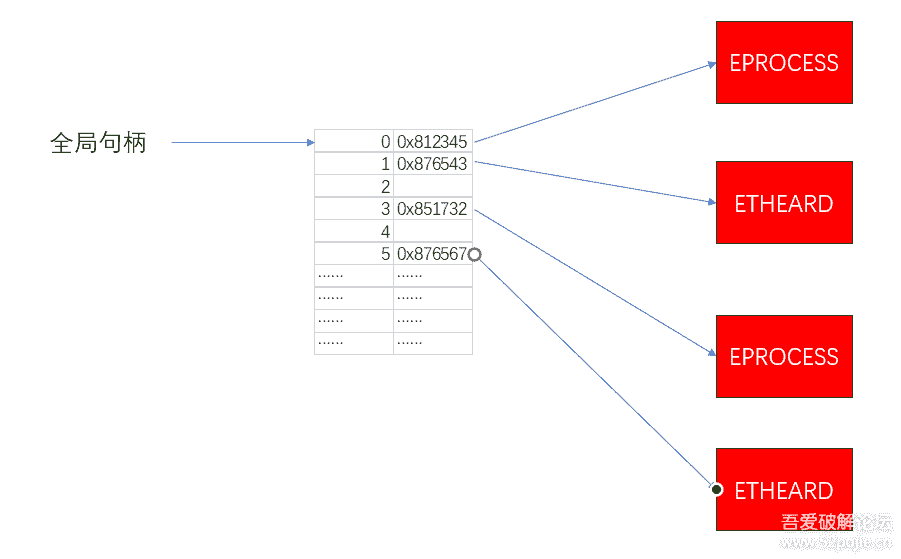

image-20240417230825006.png (33.81 KB, 下载次数: 0)

[附件](https://www.52pojie.cn/forum.php?mod=attachment&aid=MjY5MTEwNHwyMzRkYTgzZnwxNzkzNTcwMDY5fDE2ODA4NnwxOTE2MjEz&nothumb=yes)

2024-4-22 00:15 上传

那为什么又要有PID的概念，和进程句柄的概念呢？

进程句柄是当前进程的索引，而PID就是全局的索引，意味着，你把进程句柄拿到其他地方没有任何意义，而PID不一样，他是全局的，拿到其他的进程，他仍然有意义。这就是两者最大的区别。

进程ID和线程ID都是全局的索引，并且唯一。你绝对不可能在管理器中同时看见相同的进程ID或线程ID，但是唯一不代表不变，比如在某一时刻，一个进程死了，但又有新的进程进来，操作系统就有可能把这个编号给新的进程。

### 3> 接下来代码论证

```c
#define _CRT_SECURE_NO_WARNINGS 1

#include <windows.h>
#include <stdio.h>

BOOL CreateChildProcess(PTCHAR ChildProcessName, PTCHAR CommandLine)
{
    STARTUPINFO si;
    PROCESS_INFORMATION pi;

    ZeroMemory(&si, sizeof(si));
    ZeroMemory(&pi, sizeof(pi));
    si.cb = sizeof(si);

    //创建子进程 返回是否成功
    if (!CreateProcess(
        ChildProcessName,   //对象名称的完整路径
        CommandLine,        //命令行参数
        NULL,               //不继承进程句柄
        NULL,               //不继承线程句柄
        FALSE,              //不继承句柄
        0,                  //没有创建标志
        NULL,               //使用父进程环境变量
        NULL,               //使用父进程目录作为当前目录，可以自己设置目录
        &si,                //STARTUPINFO结构体
        &pi)                //PROCESS_INFORMATION结构体
        )
    {
        printf("创建进程错误 代码：%d\n", GetLastError());
        return FALSE;
    }
    printf("进程句柄：%X\t进程ID：%X\n线程句柄：%X\t线程ID：%X\n", pi.hProcess,pi.dwProcessId, pi.hThread,pi.dwThreadId);

    //SuspendThread(pi.hThread);
    //ResumeThread(pi.hThread);
    //释放句柄
    CloseHandle(pi.hProcess);
    CloseHandle(pi.hThread);
    return TRUE;
}

int main(int argc,char* argv[])
{
    HANDLE hProcess;
    hProcess = (HANDLE)0x7D0;
    //hProcess = OpenProcess(PROCESS_ALL_ACCESS, FALSE, 0xB94);
    if (!TerminateProcess(hProcess, 1))
    {
        printf("终止进程失败：%d", GetLastError());
    }
    /*
    //C:\\Program Files\\Internet Explorer\\iexplore.exe
    //C:\\Program Files (x86)\\Microsoft\\Edge\\Application\\msedge.exe
    TCHAR ApplicationName[] = TEXT("C:\\Program Files\\Internet Explorer\\iexplore.exe");
    TCHAR CmdLine[] = TEXT(" https://www.baidu.com");
    CreateChildProcess(ApplicationName, NULL);
    //GetStartInfo();
    */
    getchar();
    return 0;
}
```

代码解释：

```c
HANDLE hProcess;
    hProcess = (HANDLE)0x7D0;
    //hProcess = OpenProcess(PROCESS_ALL_ACCESS, FALSE, 0xB94);
    if (!TerminateProcess(hProcess, 1))
    {
        printf("终止进程失败：%d", GetLastError());
    }
```

首先定义一个空句柄，然后在获得原来IE进程的句柄和ID，我这里是：

`进程句柄：0x7D0`，`PID：0xB94`

（注意：运行出来的网页不要关哦）

### 4> `TerminateProcess()`

然后是 `TerminateProcess()` 函数，看看定义：

> Terminates the specified process and all of its threads.
>
> 意为终止指定的进程。

```c
BOOL TerminateProcess(
  HANDLE hProcess,
  UINT   uExitCode
);
```

这里有两个参数，第一个参数知道了，第二个参数的意思是，这个进程以什么原因退出的。

> If the function fails, the return value is zero. To get extended error information, call [`GetLastError()`](https://msdn.microsoft.com/d852e148-985c-416f-a5a7-27b6914b45d4).

退出的话，就可以用 `GetLastError()` 来获取错误，这错误随便给个值，123都可以，你自己定。

然后运行，会得到：

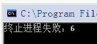

image-20240418004023582.png (2.37 KB, 下载次数: 0)

[附件](https://www.52pojie.cn/forum.php?mod=attachment&aid=MjY5MTEwNXw3Y2I1OGNhNXwxNzkzNTcwMDY5fDE2ODA4NnwxOTE2MjEz&nothumb=yes)

2024-4-22 00:16 上传

去查，说的是句柄无效，当然无效啊，我传的进程句柄，这是个私有的概念，拿到别的进程，注定失败，网页还生龙活虎着呢。

然后注释掉当前代码，执行下一行代码，遇到了一个新API。

### 4> `OpenProcess()`

然后是 `OpenProcess()`，嘿嘿，老熟人了，这次具体来看看：

```c
HANDLE OpenProcess(
  DWORD dwDesiredAccess,
  BOOL  bInheritHandle,
  DWORD dwProcessId
);
```

#### 5> `dwDesiredAccess`

你打开这个进程你希望拥有什么权力。

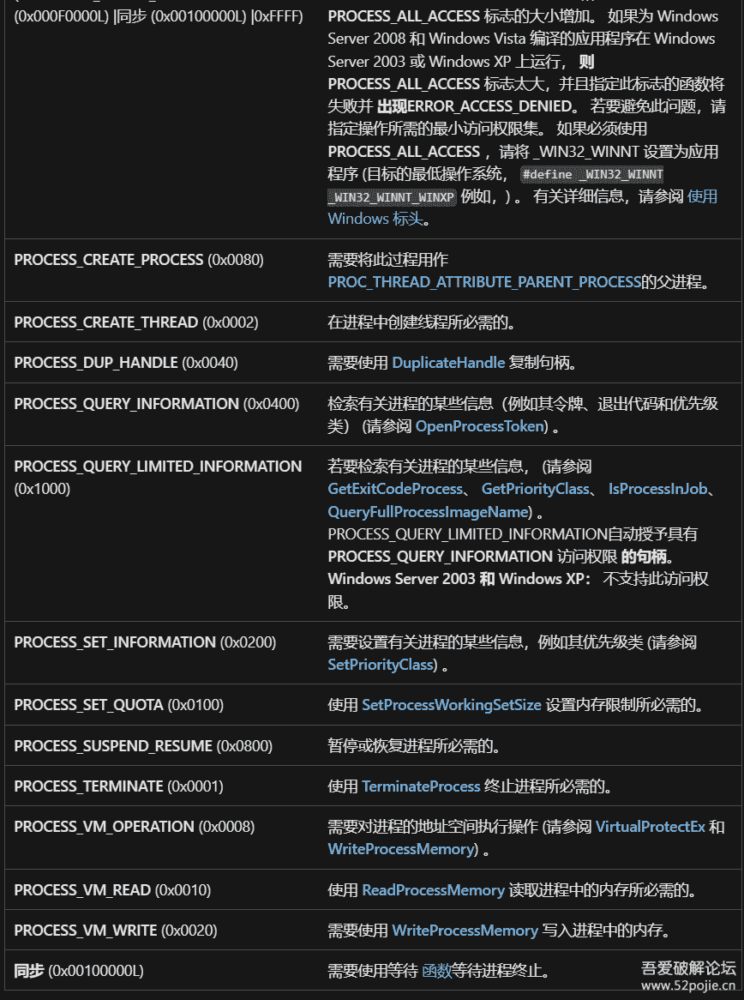

image-20240418003726580.png (245.57 KB, 下载次数: 0)

[附件](https://www.52pojie.cn/forum.php?mod=attachment&aid=MjY5MTEwNnwxNjllZWNkOXwxNzkzNTcwMDY5fDE2ODA4NnwxOTE2MjEz&nothumb=yes)

2024-4-22 00:16 上传

这些就是权力，这里我们就选拥有所有权利，就选第一个。

#### 5> `bInheritHandle`

是否被继承，不多说，是个熟人。

#### 5> `dwProcessId`

`PID`。

开始运行，会发现，网页直接关闭了，所以验证了两者的区别。

### 3> 以挂起的形式创建进程

在说之前，还要介绍 `CreateProcess()` 里的函数：

```c
[in]                  DWORD dwCreationFlags,                     // creation flags
```

第六个参数，不知道就查文档，即便是不认识的英语，那就去翻译，沉下心来。

> `dwCreationFlags`
>
> The flags that control the priority class and the creation of the process. For a list of values, see [Process Creation Flags](https://msdn.microsoft.com/fd3384ad-8635-4ea1-9054-0572ef86b86d).
>
> 意思为：控制优先级类别和进程创建的标志。有关数值列表，请参阅“进程创建标志”。

那我们再去看看 Process Creation Flags。


image-20240418181336366.png (26.11 KB, 下载次数: 0)

[href="forum.php?mod=attachment&aid=MjY5MTEwN3wzZDU3YjljMXwxNzkzNTcwMDY5fDE2ODA4NnwxOTE2MjEz&nothumb=yes" target="_blank"](https://www.52pojie.cn/forum.php?mod=attachment&aid=MjY5MTEwN3wzZDU3YjljMXwxNzkzNTcwMDY5fDE2ODA4NnwxOTE2MjEz&nothumb=yes)

2024-4-22 00:16 上传

## 标志说明
这里的标志有点多，就不截完了，感兴趣的可自行去搜索

此标志的意思为创建新的控制台

## 实验
来看实验

### 实验程序
首先需要看一下实验程序

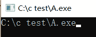

image-20240418181813628.png (3.15 KB, 下载次数: 0)

[href="forum.php?mod=attachment&aid=MjY5MTEwOHxhNmRmZWY5NXwxNzkzNTcwMDY5fDE2ODA4NnwxOTE2MjEz&nothumb=yes" target="_blank"](https://www.52pojie.cn/forum.php?mod=attachment&aid=MjY5MTEwOHxhNmRmZWY5NXwxNzkzNTcwMDY5fDE2ODA4NnwxOTE2MjEz&nothumb=yes)

2024-4-22 00:17 上传

他会读取当前的工作路径（后面会解释），并输出他的路径

代码如下

```
#include
#include

int main()
{
    char path[100];
    getcwd(path,100);
    printf("%s\\A.exe",path);
    getchar();
    return 0;
}
```

（说明一下，刚开始没有弄懂这玩意，我又懒得重新截图了，各位就当他打印出12345一样，不用管输出的结果，这个不影响后面的内容，望各位大佬谅解）

然后我们在把路径写入以前的代码中

```
//环境：win10 VS2022

#define _CRT_SECURE_NO_WARNINGS 1

#include 

#include 

BOOL CreateChildProcess(PTCHAR ChildProcessName, PTCHAR CommandLine)

{

    STARTUPINFO si;

    PROCESS_INFORMATION pi;

    ZeroMemory(&si, sizeof(si));

    ZeroMemory(&pi, sizeof(pi));

    si.cb = sizeof(si);

    //创建子进程 返回是否成功

    if (!CreateProcess(

        ChildProcessName,   //对象名称的完整路径

        CommandLine,        //命令行参数

        NULL,               //不继承进程句柄

        NULL,               //不继承线程句柄

        FALSE,              //不继承句柄

        0,                  //没有创建标志

        NULL,               //使用父进程环境变量

        NULL,               //使用父进程目录作为当前目录，可以自己设置目录

        &si,                //STARTUPINFO结构体

        &pi)                //PROCESS_INFORMATION结构体

        )

    {

        printf("创建进程错误 代码：%d\n", GetLastError());

        return FALSE;

    }

    printf("进程句柄：%X\t进程ID：%X\n", pi.hProcess,pi.dwProcessId);

    //释放句柄

    CloseHandle(pi.hProcess);

    CloseHandle(pi.hThread);

    return TRUE;

}

int main(int argc,char* argv[])

{

    TCHAR ApplicationName[] = TEXT("C:\\c test\\A.exe");

    TCHAR CmdLine[] = TEXT("1 https://www.baidu.com");

    CreateChildProcess(ApplicationName, NULL);

    //GetStartInfo();

    getchar();

    return 0;

}
```

`0,`                  //没有创建标志

这里我设置为空，先看看效果

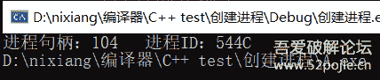

image-20240418182250857.png (18.27 KB, 下载次数: 0)

[href="forum.php?mod=attachment&aid=MjY5MTEwOXwzY2NmOWM3NXwxNzkzNTcwMDY5fDE2ODA4NnwxOTE2MjEz&nothumb=yes" target="_blank"](https://www.52pojie.cn/forum.php?mod=attachment&aid=MjY5MTEwOXwzY2NmOWM3NXwxNzkzNTcwMDY5fDE2ODA4NnwxOTE2MjEz&nothumb=yes)

2024-4-22 00:17 上传

可以看到这两个输出都在同一个控制台，如果我想把这两个分开，那么这个参数就要添上我刚刚说的那个标志

然后运行

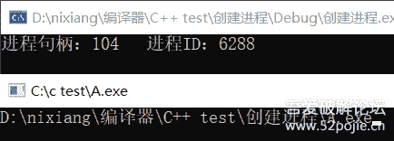

image-20240418182459798.png (20.86 KB, 下载次数: 0)

[href="forum.php?mod=attachment&aid=MjY5MTExMHwyMmM4MmRhOHwxNzkzNTcwMDY5fDE2ODA4NnwxOTE2MjEz&nothumb=yes" target="_blank"](https://www.52pojie.cn/forum.php?mod=attachment&aid=MjY5MTExMHwyMmM4MmRhOHwxNzkzNTcwMDY5fDE2ODA4NnwxOTE2MjEz&nothumb=yes)

2024-4-22 00:17 上传

看到用了两个控制台

### 挂起创建进程
接下来是这个函数最重要的参数（我认为的，嘿嘿），就是


image-20240418212715582.png (18.98 KB, 下载次数: 0)

[href="forum.php?mod=attachment&aid=MjY5MTExMXw4NTEyOWVmYXwxNzkzNTcwMDY5fDE2ODA4NnwxOTE2MjEz&nothumb=yes" target="_blank"](https://www.52pojie.cn/forum.php?mod=attachment&aid=MjY5MTExMXw4NTEyOWVmYXwxNzkzNTcwMDY5fDE2ODA4NnwxOTE2MjEz&nothumb=yes)

2024-4-22 00:18 上传

以挂起的状态来起一个新的进程

还记得以前说的进程的创建过程吗，如果要以挂起的方式创建，那么这个流程就要发生变化了

创建后，系统不会启动线程，而是等着你去启动

所以流程图变为：

- 映射exe文件
- 创建内核对象`EPROCESS`
- 映射系统DLL（`ntdll.dll`）
- 创建线程内核对象`ETHREAD`
- 如果以挂起的方式创建进程
…………………………
- 恢复后执行
- 映射DLL（`ntdll.LdrlnitializeThunk`）
- 线程开始执行

所以，在这恢复之前的地方就可以加些你想加的东西（嘿嘿嘿）

#### 代码演示
```
//环境：win10 VS2022

#define _CRT_SECURE_NO_WARNINGS 1

#include 

#include 

BOOL CreateChildProcess(PTCHAR ChildProcessName, PTCHAR CommandLine)

{

    STARTUPINFO si;

    PROCESS_INFORMATION pi;

    ZeroMemory(&si, sizeof(si));

    ZeroMemory(&pi, sizeof(pi));

    si.cb = sizeof(si);

    //创建子进程 返回是否成功

    if (!CreateProcess(

        ChildProcessName,   //对象名称的完整路径

        CommandLine,        //命令行参数

        NULL,               //不继承进程句柄

        NULL,               //不继承线程句柄

        FALSE,              //不继承句柄

        CREATE_SUSPENDED,   //以挂起的方式创建

        NULL,               //使用父进程环境变量

        NULL,               //使用父进程目录作为当前目录，可以自己设置目录

        &si,                //STARTUPINFO结构体

        &pi)                //PROCESS_INFORMATION结构体

        )

    {

        printf("创建进程错误 代码：%d\n", GetLastError());

        return FALSE;

    }

    printf("进程句柄：%X\t进程ID：%X\n", pi.hProcess,pi.dwProcessId);

    for (int i = 0; i 
```

运行结果

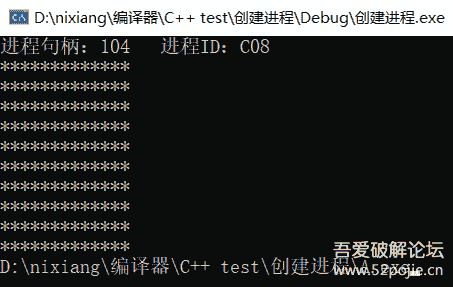

image-20240418214401262.png (21.18 KB, 下载次数: 0)

[href="forum.php?mod=attachment&aid=MjY5MTExMnw3YjlmMmU4MnwxNzkzNTcwMDY5fDE2ODA4NnwxOTE2MjEz&nothumb=yes" target="_blank"](https://www.52pojie.cn/forum.php?mod=attachment&aid=MjY5MTExMnw3YjlmMmU4MnwxNzkzNTcwMDY5fDE2ODA4NnwxOTE2MjEz&nothumb=yes)

2024-4-22 00:18 上传

会发现多了许多原本没有的东西，就是因为在恢复之前，添加了代码，然后再让他继续跑

## 模块路径与工作路径
容我吐槽一下，这么简单的东西，我竟然搞了半天，啊，心态炸了

在开始之前我要先介绍两位新API

`GetModuleFileName`

```
DWORD GetModuleFileName(
  HMODULE hModule,    // handle to module
  LPTSTR lpFilename,  // file name of module
  DWORD nSize         // size of buffer
);
```

大概意思就是获取当前运行的exe文件的路径，具体参数就自行搜索吧文档吧

`GetCurrentDirectory`

```
DWORD GetCurrentDirectory(

  DWORD nBufferLength,  // size of directory buffer

  LPTSTR lpBuffer       // directory buffer

);
```

大概意思就是获取这个exe文件的工作路径，那啥是工作路径？可以简单的理解为，谁创建这个进程的人添的，也就是他的父进程给他添的，比如说，我先运行一下

代码


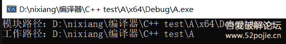


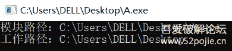

```
#include
#include

int main()
{
    CHAR fileModule[256];
    GetModuleFileNameA(NULL, fileModule, 256);//模块路径
    CHAR fileWork[1000];
    GetCurrentDirectoryA(1000, fileWork);//工作路径
    printf("模块路径：%s\n工作路径：%s\n", fileModule, fileWork);
    getchar();
    return 0;
}
//说明：我的VS2022是以宽字符为格式的，所以这里用ASCII编码模式的API，所以加了个A，
image-20240418234839418.png (21.04 KB, 下载次数: 0)

[href="forum.php?mod=attachment&aid=MjY5MTExM3xjM2JhZDg0YXwxNzkzNTcwMDY5fDE2ODA4NnwxOTE2MjEz&nothumb=yes" target="_blank"](https://www.52pojie.cn/forum.php?mod=attachment&aid=MjY5MTExM3xjM2JhZDg0YXwxNzkzNTcwMDY5fDE2ODA4NnwxOTE2MjEz&nothumb=yes)

2024-4-22 00:18 上传

得到这样的，模块路径没什么好解释的，工作路径，是VS2022这个进程帮我填的所以是这个路径，那我把这个exe文件放到桌面上
image-20240418235021789.png (14.5 KB, 下载次数: 0)

[href="forum.php?mod=attachment&aid=MjY5MTExNHxiNmNkMDAyNHwxNzkzNTcwMDY5fDE2ODA4NnwxOTE2MjEz&nothumb=yes" target="_blank"](https://www.52pojie.cn/forum.php?mod=attachment&aid=MjY5MTExNHxiNmNkMDAyNHwxNzkzNTcwMDY5fDE2ODA4NnwxOTE2MjEz&nothumb=yes)

2024-4-22 00:19 上传

这个父进程就是explore这个进程添的。

注意这个工作路径是可以改的

在`CreateProcess`中

```
[in, optional]    LPCTSTR lpCurrentDirectory,                // current directory name
```

这个参数就可以设置工作路径

用以前的代码来打开输出工作路径的exe文件

就不贴全代码了，只用改里面的参数和文件路径就行了


### 创建子进程

```
TCHAR Direc[] = TEXT("C:\\");
//创建子进程 返回是否成功
if (!CreateProcess(
    ChildProcessName,   //对象名称的完整路径
    CommandLine,        //命令行参数
    NULL,               //不继承进程句柄
    NULL,               //不继承线程句柄
    FALSE,              //不继承句柄
    0,                  //没有创建标志
    NULL,               //使用父进程环境变量
    Direc,              //使用父进程目录作为当前目录，可以自己设置目录
    &si,                //STARTUPINFO结构体
    &pi)                //PROCESS_INFORMATION结构体
    )


```

由于我的VS2022是宽字符格式的，所以难免要类型转换的，在win xp就不用了，可以直接在参数位置写上`"C:\"`

### 运行结果
`image-20240419000354043.png`（20.98 KB，下载次数：0）
[附件下载](https://www.52pojie.cn/forum.php?mod=attachment&aid=MjY5MTExNXw2MTlhZmU1ZXwxNzkzNTcwMDY5fDE2ODA4NnwxOTE2MjEz&nothumb=yes)
2024-4-22 00:19 上传

可以看到更改成功

这个参数不设置的就默认跟他的父进程一样

### 4> 那这个有什么用呢？

在以前，我们写文件操作类代码基本上都是

```
FILE* fp = fopen("A.exe","r");
```

相信大家对这个代码不陌生，通常情况下，我们会写文件的绝对路径，但如果不写呢？，那他就是找的工作路径

#### 实验

```
FILE* fp = fopen("A.exe", "r");
if (fp)
{
    printf("成功\n");
}
else
{
    printf("失败\n");
}
```

首先这个没有在工作路径

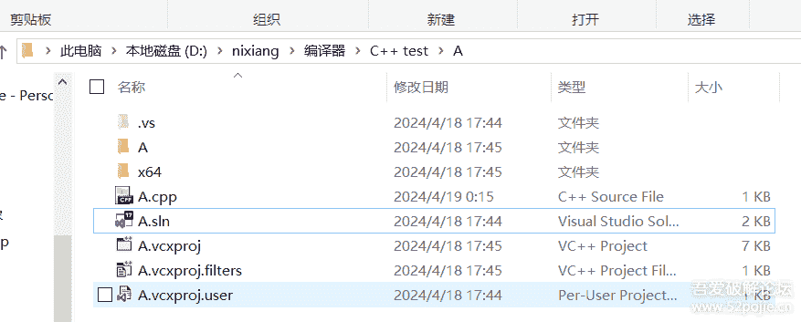
`image-20240419001804751.png`（44.54 KB，下载次数：0）
[附件下载](https://www.52pojie.cn/forum.php?mod=attachment&aid=MjY5MTExNnw3MzNlYTMwM3wxNzkzNTcwMDY5fDE2ODA4NnwxOTE2MjEz&nothumb=yes)
2024-4-22 00:19 上传

运行一下，失败

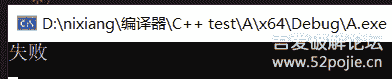
`image-20240419001850502.png`（10.64 KB，下载次数：0）
[附件下载](https://www.52pojie.cn/forum.php?mod=attachment&aid=MjY5MTExN3wwYjNjMDA1ZnwxNzkzNTcwMDY5fDE2ODA4NnwxOTE2MjEz&nothumb=yes)
2024-4-22 00:20 上传

那把文件放入到工作路径

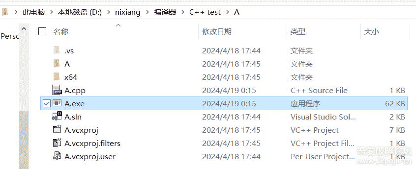
`image-20240419001950722.png`（43.5 KB，下载次数：0）
[附件下载](https://www.52pojie.cn/forum.php?mod=attachment&aid=MjY5MTExOHw2MjMyZDUzZXwxNzkzNTcwMDY5fDE2ODA4NnwxOTE2MjEz&nothumb=yes)
2024-4-22 00:20 上传

在运行，成功


`image-20240419002015599.png`（10.78 KB，下载次数：0）
[附件下载](https://www.52pojie.cn/forum.php?mod=attachment&aid=MjY5MTExOXw0YmZiMWYzNXwxNzkzNTcwMDY5fDE2ODA4NnwxOTE2MjEz&nothumb=yes)
2024-4-22 00:20 上传

### 3> 其他进程相关API

- 获取进程PID：`GetCurrentProcessId`
- 获取进程句柄：`GetCurrentProcess`
- 获取命令行：`GetCommandLine`
- 获取启动信息：`GetStartupInfo`
- 遍历进程ID：`EnumProcesses`
- 快照：`CreateToolhelp32Snapshot` 获取进程的一些相关信息和模块，像拍照一样记录下来

这些API感兴趣的也可去了解一下，还是比较常用的

### 3> 总结

- 全局句柄表的结构与解析
- 知道挂起方式创建进程，可以在里面嘿嘿嘿
- 工作路径与模块路径
