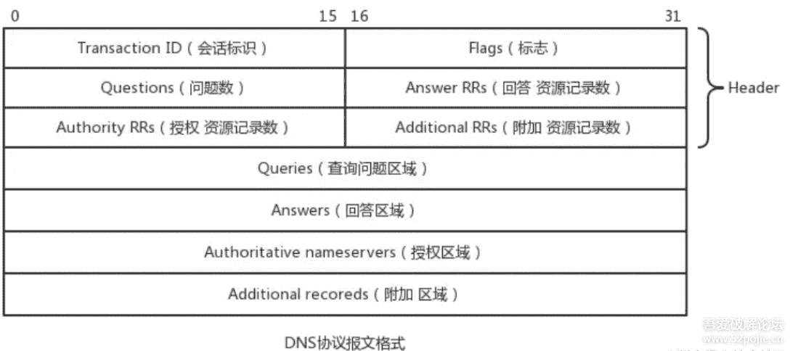
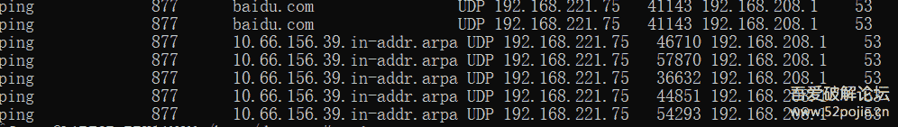

# [系统底层] 【ebpf系列】一，监控进程DNS查询

- 原帖: https://www.52pojie.cn/forum.php?mod=viewthread&tid=1918743
- 抓取时间: 2026-11-01T21:54:20

## ebpf-监控进程DNS查询

### DNS查询介绍

DNS，全称Domain Name System，负责将域名解析为IP地址。

在互联网上，公网IP是每台公网主机的门牌号，有了IP才能够访问到对应的公网主机。IP地址形如：111.111.111.111，由四段三位数字组成，这导致其非常不容易记忆。因此，为了方便，域名（Domain）诞生了。

域名，可以把它看做IP的昵称，它和IP具有对应关系，通常具有一定的意义，因此十分方便记忆。例如，百度的域名为：baidu.com，而百度的IP为：39.156.66.10。前者显然更方便我们使用和记忆。

在我们使用域名访问网站的时候，会先进行DNS查询这个操作。DNS查询，简单来说就是将域名解析为IP地址的过程。使用域名，必然绕不过DNS查询。

### DNS数据包

DNS报文格式如下，前12字节为DNS报文首部，紧接着就是我们的查询字段。查询字段里存放着我们需要查询的域名。



1.png (146.07 KB, 下载次数: 1)

[href="forum.php?mod=attachment&aid=MjY5MjY3OHw1NzkyODBmZHwxNzkzNTcwMDU4fDE2ODA4NnwxOTE4NzQz&nothumb=yes" target="_blank"](https://www.52pojie.cn/forum.php?mod=attachment&aid=MjY5MjY3OHw1NzkyODBmZHwxNzkzNTcwMDU4fDE2ODA4NnwxOTE4NzQz&nothumb=yes)

2024-4-28 19:11 上传

这里介绍一下查询字段的格式，假设我们查询的域名为：baidu.com

那么这个域名在查询字段是以这样的形式存在的：

05 62 61 69 64 75 03 63 6f 6d 00

其中，05是位数，代表着baidu的长度，62 ... 75是baidu的十六进制ASCII码。03代表着com的长度，63 6f 6d是com的十六进制ASCII码。00代表查询字段终止。

总结一下，我们可以将域名按点分段：

组分1.组分2.组分3

那么查询字段的组成为

(组分1的长度)(组分1的ASCII)(组分2的长度)(组分2的ASCII)(组分3的长度)(组分3的ASCII)

### 恶意软件

当你的主机不幸感染了恶意软件，有时候这些恶意软件会与攻击者准备好的恶意地址进行通信。当我们通过恶意域名检测定位到受害主机时，需要进行应急响应，以解决风险。虽然我们知道了哪台主机处于风险当中，但处理恶意软件却并不是一件简单的事情。通常，恶意软件会把自己伪装起来，并且将自身存放到一些难以注意的角落，更有甚者仅存在于内存当中。

因此，如果有方法能够快速定位到恶意软件的进程信息以及路径的话，对处置受害主机将有一定的帮助。

### ebpf

`ebpf`是一种linux的内核技术，它能够在不修改内核的情况下，动态的插入我们的代码，以获取我们想要的信息。`ebpf`中的`kprobe`允许我们挂载到内核函数上，获取其传入参数，之后我们可以将参数通过某种方式传递回用户空间。

#### 内核函数：`udp_sendmsg()`

当程序进行DNS查询时，通常会用到UDP协议。在linux网络协议栈中，`udp_sendmsg()`函数有着关键的地位。

其函数原型为：

```
int udp_sendmsg(struct sock *sk, struct msghdr *msg, size_t len);
```

这里不对该函数做过多的介绍，我们将目光放在第二个参数：`struct msghdr *msg`

简单来说，在DNS查询的情况下，这个结构体存放着我们的DNS报文，获取报文头部指针和报文长度的代码如下：

```
const struct iovec * iov = msg -> msg_iter.iov;
// 获取iov结构体中的iov_base和iov_len字段
void __user *iov_base = iov->iov_base; //报文头指针
u32 iov_len = iov->iov_len;//报文长度
```

根据以上全部内容，我们准备使用`ebpf`技术来监控Linux主机上进程DNS查询情况

### 实验环境

1. `BCC`框架（Python）
2. `WSL2` Ubuntu 22.04.3 LTS (GNU/Linux 5.15.137.3-microsoft-standard-WSL2 x86_64)

### 代码实现

```
#!/usr/bin/env python3
from bcc import BPF,Table
from socket import htonl, inet_ntoa
from struct import pack

C_BPF_KPROBE = """
#include 
#include 
- 
#include 
- 
#include 
- 
#include 
- 
#include 
- 
#include 
- 

struct DNSinfo {
    char comm[16];
    char domain[64];

    u32 pid;
    u32 tgid;
    u32 uid;
    u32 gid;

    u8 proto;
    u32 saddr;
    u32 daddr;
    u16 sport;
    u16 dport;
};

BPF_PERF_OUTPUT(dns_events);

int trace_udp_sendmsg(struct pt_regs *ctx) {
    struct sock *sk = (struct sock *)PT_REGS_PARM1(ctx);

    u16 sport = sk->sk_num;
    u16 dport = sk->sk_dport;

    // 通常来说，DNS查询使用53端口
    // 13568 = ntohs(53);
    if (sport == 13568 || dport == 13568) {
        // 获取基本信息（ip、端口、pid等）
        u32 saddr = sk->sk_rcv_saddr;
        u32 daddr = sk->sk_daddr;
        u64 pid_tgid = bpf_get_current_pid_tgid();
        u64 uid_gid = bpf_get_current_uid_gid();
        // UDP --> 17
        struct DNSinfo key = {.proto = 17};
        key.saddr = htonl(saddr);
        key.daddr = htonl(daddr);
        key.sport = sport;
        key.dport = htons(dport);

        key.pid = pid_tgid >> 32;
        key.tgid = (u32)pid_tgid;
        key.uid = (u32)uid_gid;
        key.gid = uid_gid >> 32;

        //获取进程名字
        bpf_get_current_comm(key.comm, 64);

        struct msghdr * msg = (struct msghdr *)PT_REGS_PARM2(ctx);
        const struct iovec * iov = msg -> msg_iter.iov;
        // 获取iov结构体中的iov_base和iov_len字段
        void __user *iov_base = iov->iov_base;
        u32 iov_len = iov->iov_len;
        // 确保长度不超过domain的大小
        u32 len = iov_len sk_num;
    u16 dport = sk->sk_dport;

    if (sport == 13568 || dport == 13568) {

        u32 saddr = sk->sk_rcv_saddr;
        u32 daddr = sk->sk_daddr;
        u64 pid_tgid = bpf_get_current_pid_tgid();
        u64 uid_gid = bpf_get_current_uid_gid();

        struct DNSinfo key = {.proto = 6};
        key.saddr = htonl(saddr);
        key.daddr = htonl(daddr);
        key.sport = sport;
        key.dport = htons(dport);

        key.pid = pid_tgid >> 32;
        key.tgid = (u32)pid_tgid;
        key.uid = (u32)uid_gid;
        key.gid = uid_gid >> 32;
        bpf_get_current_comm(key.comm, 64);

        struct msghdr * msg = (struct msghdr *)PT_REGS_PARM2(ctx);
        const struct iovec * iov = msg -> msg_iter.iov;

        void __user *iov_base = iov->iov_base;
        u32 iov_len = iov->iov_len;

        u32 len = iov_len 
```

### 效果



2.png (35.21 KB, 下载次数: 1)

[href="forum.php?mod=attachment&aid=MjY5MjY3OXw4MWE1MjJmN3wxNzkzNTcwMDU4fDE2ODA4NnwxOTE4NzQz&nothumb=yes" target="_blank"](https://www.52pojie.cn/forum.php?mod=attachment&aid=MjY5MjY3OXw4MWE1MjJmN3wxNzkzNTcwMDU4fDE2ODA4NnwxOTE4NzQz&nothumb=yes)

2024-4-28 19:11 上传

### 预告

下次文章，我将介绍如何获取进程的存在路径及`cmdline`

另：

我个人在学习`ebpf`过程中实现的一些小功能都会上传至我的`GitHub`仓库，方便大家学习和CV

本次代码已上传至GitHub：

https://github.com/MapleLCG/ebpf-tools-examples
