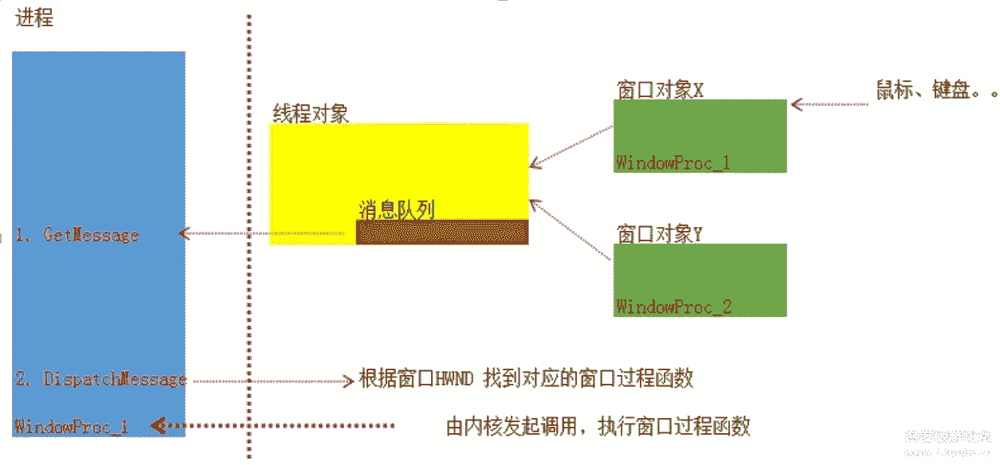
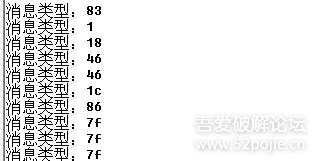
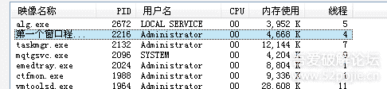
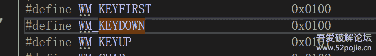
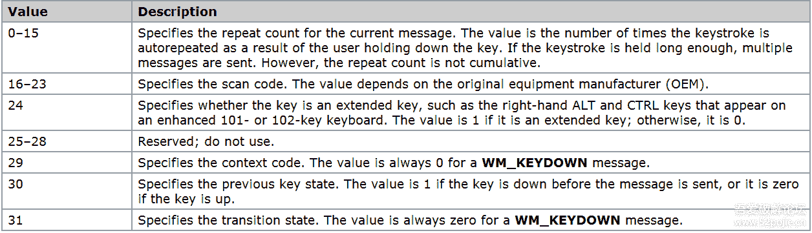
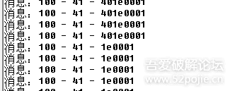
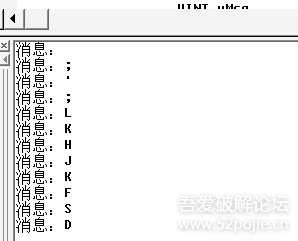

# [系统底层] win32笔记十三 消息类型

- 原帖: https://www.52pojie.cn/forum.php?mod=viewthread&tid=1921113
- 抓取时间: 2026-11-01T21:54:09

之前的笔记索引

[//www.52pojie.cn/thread-1914443-1-1.html" target="_blank" rel="noopener noreferrer nofollow"](https://www.52pojie.cn/thread-1914443-1-1.html:href="https)

## 消息类型



image-20240426152549256.png (208.02 KB, 下载次数: 0)

[href="forum.php?mod=attachment&aid=MjY5NDEyM3w1NTllODJjYnwxNzkzNTcwMDQ2fDE2ODA4NnwxOTIxMTEz&nothumb=yes" target="_blank"](https://www.52pojie.cn/forum.php?mod=attachment&aid=MjY5NDEyM3w1NTllODJjYnwxNzkzNTcwMDQ2fDE2ODA4NnwxOTIxMTEz&nothumb=yes)

2024-5-7 00:18 上传

当我们点击某个窗口，就会产生一个消息，操作系统就会得到这个消息，然后判断点在那个窗口上，找到后，会根据窗口的一个成员来找到是属于那个线程的，找到后，就会把封装好后的消息放在结构体里，存储到消息队列里来，应用层的`GetMessage`就会不停的从消息队列里取消息

### MSG

看下代码中的`MSG`结构体的成员

```
 /*
 * Message structure
 */
typedef struct tagMSG {
    HWND        hwnd;
    UINT        message;
    WPARAM      wParam;
    LPARAM      lParam;
    DWORD       time;
    POINT       pt;
#ifdef _MAC
    DWORD       lPrivate;
#endif
} MSG, *PMSG, NEAR *NPMSG, FAR *LPMSG;
```

消息由谁产生的呢？

- 可能是鼠标
- 可能是键盘
- 可能是其他应用程序
- 可能是内核程序

那这么多的消息，操作系统会把所有消息给他们分成不同的类别，每一种类型的消息起一个独一无二的编号，即`message`成员

#### hwnd

句柄，消息针对窗口

#### wParam, lParam

详细描述这个消息是什么样的，比如说，我按下键盘，`message`就会给我一个编号，至于我按的什么键等信息就会封装到`wParam`，`lParam`这两个成员

#### time

消息什么时候产生的

#### pt

这个消息在什么位置产生的，记录产生时的坐标

看着这些成员，就会明白为什么不直接处理消息，要分发了，因为这些成员只知道索引，不知道窗口函数在哪，所以没有办法，只能在传给分发函数，分发函数根据窗口句柄找到对应的窗口，然后从内核发起的调用

看这些成员可能你会觉得眼熟，发现不就是`WindowProc`里的函数吗，所以这些参数就是通过`GetMessage`来获得的

### 输出消息类型

```
LRESULT CALLBACK WindowProc(
                    HWND hwnd,      // handle to window
                    UINT uMsg,      // message identifier
                    WPARAM wParam,  // first message parameter
                    LPARAM lParam   // second message parameter
)

{
    char OutBuff[0x80];
    sprintf(OutBuff,"消息类型：%x\n",uMsg);
    OutputDebugString(OutBuff);
    return DefWindowProc(hwnd,uMsg,wParam,lParam);
}
```

在原来的代码上加上这些



image-20240426160724109.png (7.22 KB, 下载次数: 0)

[href="forum.php?mod=attachment&aid=MjY5NDEyNHwwY2JiNzRjYXwxNzkzNTcwMDQ2fDE2ODA4NnwxOTIxMTEz&nothumb=yes" target="_blank"](https://www.52pojie.cn/forum.php?mod=attachment&aid=MjY5NDEyNHwwY2JiNzRjYXwxNzkzNTcwMDQ2fDE2ODA4NnwxOTIxMTEz&nothumb=yes)

2024-5-7 00:19 上传

得到这些类型，以1举例说明，在`WinUser.h`文件中可找到

```
#define WM_NULL                         0x0000
#define WM_CREATE                       0x0001
#define WM_DESTROY                      0x0002
#define WM_MOVE                         0x0003
#define WM_SIZE                         0x0005
```

知道当窗口创建的时候，内核就会创建1这样的消息，有些消息可以忽略的，只用找感兴趣的消息来做文章

这些消息是一直存在的，只要对应的线程不死，就会一直产生消息

所以当我把窗口关闭了，但在管理里还是能看到



image-20240426162256252.png (11.22 KB, 下载次数: 0)

[href="forum.php?mod=attachment&aid=MjY5NDEyNXw1NTAzYzExOHwxNzkzNTcwMDQ2fDE2ODA4NnwxOTIxMTEz&nothumb=yes" target="_blank"](https://www.52pojie.cn/forum.php?mod=attachment&aid=MjY5NDEyNXw1NTAzYzExOHwxNzkzNTcwMDQ2fDE2ODA4NnwxOTIxMTEz&nothumb=yes)

2024-5-7 00:19 上传

所以就要写一个代码来让程序真正的退出

通过上面的宏定义的名字，就能猜个大概了

### 关闭代码

```
LRESULT CALLBACK WindowProc(
                    HWND hwnd,      // handle to window
                    UINT uMsg,      // message identifier
                    WPARAM wParam,  // first message parameter
                    LPARAM lParam   // second message parameter
)

{
    switch(uMsg)
    {
    case WM_DESTROY:
        {
            PostQuitMessage(0);
            return 0;
        }
    }
    return DefWindowProc(hwnd,uMsg,wParam,lParam);
}
```

#### PostQuitMessage

向系统指示线程已发出终止请求， (退出) 。 它通常用于响应 `WM_DESTROY` 消息。

这样点叉，去看管理器就没了

### 输出键盘消息

如果我想获取键盘消息的话，那么就要先知道是什么类型

类型是`WM_KEYDOWN`



image-20240426165436563.png (30.71 KB, 下载次数: 0)

[href="forum.php?mod=attachment&aid=MjY5NDEyNnxlYzFiZmZiN3wxNzkzNTcwMDQ2fDE2ODA4NnwxOTIxMTEz&nothumb=yes" target="_blank"](https://www.52pojie.cn/forum.php?mod=attachment&aid=MjY5NDEyNnxlYzFiZmZiN3wxNzkzNTcwMDQ2fDE2ODA4NnwxOTIxMTEz&nothumb=yes)

2024-5-7 00:19 上传

```
switch(uMsg)
    {
    case WM_DESTROY:
        {
            PostQuitMessage(0);
            return 0;
        }
    case WM_KEYDOWN:
        {
            MessageBox(0,0,0,0);
            return 0;
        }
    }
```

这样按下键盘就会弹出一个窗口，这样代表着能够捕捉到键盘消息

接下来就要显示了

去文档查具体的解释

#### WM_KEYDOWN

```
LRESULT CALLBACK WindowProc(
  HWND hwnd,       // handle to window
  UINT uMsg,       // WM_KEYDOWN
  WPARAM wParam,   // virtual-key code
  LPARAM lParam    // key data
);
```
`wParam`, `lParam`这里的这两个参数就是详细信息的

##### wParam

虚拟码

##### lParam

其他辅助信息



image-20240426175122059.png (44.64 KB, 下载次数: 0)

[href="forum.php?mod=attachment&aid=MjY5NDEyN3xhZDJjNGMyOHwxNzkzNTcwMDQ2fDE2ODA4NnwxOTIxMTEz&nothumb=yes" target="_blank"](https://www.52pojie.cn/forum.php?mod=attachment&aid=MjY5NDEyN3xhZDJjNGMyOHwxNzkzNTcwMDQ2fDE2ODA4NnwxOTIxMTEz&nothumb=yes)

2024-5-7 00:20 上传

0~15：当前按键被按了几次

30：标明之前key的状态，值为1 ，则被按下过，为0则没有

```
switch(uMsg)
    {
    case WM_DESTROY:
        {
            PostQuitMessage(0);
            return 0;
        }
    case WM_KEYDOWN:
        {
            char OutBuff[0x80];
            sprintf(OutBuff,"消息：%x - %x - %x\n",uMsg,wParam,lParam);
            OutputDebugString(OutBuff);
            return 0;
        }
    }
```



image-20240426175749184.png (7.56 KB, 下载次数: 0)

[href="forum.php?mod=attachment&aid=MjY5NDEyOHxjMGUyOGRhMnwxNzkzNTcwMDQ2fDE2ODA4NnwxOTIxMTEz&nothumb=yes" target="_blank"](https://www.52pojie.cn/forum.php?mod=attachment&aid=MjY5NDEyOHxjMGUyOGRhMnwxNzkzNTcwMDQ2fDE2ODA4NnwxOTIxMTEz&nothumb=yes)

2024-5-7 00:20 上传

当我短按的时候就是1E0001，长按的时候就是401E0001

前面的0x41就是A的ASCII码

1E0001

000 0000    0   0001 1110   0000 0000 0000 0001

（31 30 29 …… 0）被按了一次，以前没有被按

401E0001

010 0000    0   0001 1110   0000 0000 0000 0001

一次，以前被按过

每个消息都会有这两个参数，而这个参数是根据消息类型来决定的，不同的消息类型对应的含义不同，比如

`WM_DESTROY`

```
LRESULT CALLBACK WindowProc(
  HWND hwnd,       // handle to window
  UINT uMsg,       // WM_DESTROY
  WPARAM wParam,   // not used
  LPARAM lParam    // not used
);
```

这两个参数就是无意义的

### 按什么键显示什么键

#### WM_CHAR

```
LRESULT CALLBACK WindowProc(
  HWND hwnd,       // handle to window
  UINT uMsg,       // WM_CHAR
  WPARAM wParam,   // character code (TCHAR)
  LPARAM lParam    // key data
);
```

##### wParam

具体的按键

#### TranslateMessage

将虚拟密钥消息转换为字符消息。 字符消息将发布到调用线程的消息队列，以便下次线程调用 `GetMessage` 或 `PeekMessageA` 函数时读取。

```
switch(uMsg)
    {
    case WM_DESTROY:
        {
            PostQuitMessage(0);
            return 0;
        }
    case WM_CHAR:
        {
            char OutBuff[0x80];
            sprintf(OutBuff,"消息：%c \n",wParam);
            OutputDebugString(OutBuff);
            return 0;
        }
    }
```

运行结果，别忘了把转换消息给去掉注释



image-20240426181927976.png (7.39 KB, 下载次数: 0)


[forum.php?mod=attachment&aid=MjY5NDEyOXw1NWJjZmE4YXwxNzkzNTcwMDQ2fDE2ODA4NnwxOTIxMTEz&nothumb=yes](https://www.52pojie.cn/forum.php?mod=attachment&aid=MjY5NDEyOXw1NWJjZmE4YXwxNzkzNTcwMDQ2fDE2ODA4NnwxOTIxMTEz&nothumb=yes)

2024-5-7 00:20 上传
