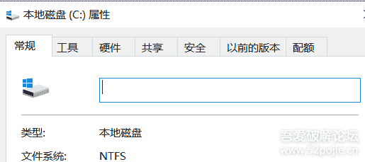
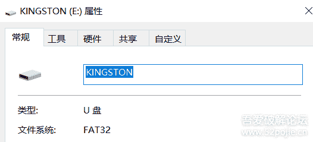

# [系统底层] win32笔记 十六 文件系统相关

- 原帖：<https://www.52pojie.cn/forum.php?mod=viewthread&tid=1923205>
- 抓取时间：2026-11-01T21:53:58

之前的索引：<https://www.52pojie.cn/thread-1914443-1-1.html>

## 文件系统

文件系统是操作系统用于管理磁盘上文件的方法和数据结构，简单点说就是在磁盘上如何组织文件的方法。

任何东西存在硬盘上就是一堆 0 和 1，但是文件怎么存，以什么格式存就是文件系统说了算。不同的操作系统都有自己用来管理文件的方法和数据结构，我们称之为文件系统。

我们如何来看我们的盘是什么系统呢？在盘右键点击属性就能看到。

`image-20240507205035704.png`（16.19 KB，下载次数：0）

<https://www.52pojie.cn/forum.php?mod=attachment&aid=MjY5NTI2MHxhOWVmZTYyY3wxNzkzNTcwMDM2fDE2ODA4NnwxOTIzMjA1&nothumb=yes>

2024-5-12 10:00 上传

这是我主机的 C盘的文件系统，D盘（我主机就两个盘）。

`image-20240507205257935.png`（14.88 KB，下载次数：0）

<https://www.52pojie.cn/forum.php?mod=attachment&aid=MjY5NTI2MXxiNjFiZmNmZnwxNzkzNTcwMDM2fDE2ODA4NnwxOTIzMjA1&nothumb=yes>

2024-5-12 10:01 上传

这是我的 U盘的文件系统。

| NTFS | FAT32 | 磁盘分区容量 |
| --- | --- | --- |
