# [系统底层] win32笔记十七 静动态链接库

- 原帖：https://www.52pojie.cn/forum.php?mod=viewthread&tid=1927589
- 抓取时间：2026-11-01T21:53:53

之前的笔记索引：[https://www.52pojie.cn/thread-1914443-1-1.html](https://www.52pojie.cn/thread-1914443-1-1.html)

## 静态链接库

随着时代的发展，软件也逐渐零件化，一个大的软件项目，需要很多人同时编写，但又不可能编写在同一文件或者同一项目中，所以很好的一个办法就是把项目拆成很多份，不同的人去做不同的事，就像汽车零件，零件做好后组装起来，所以静态链接库就是一种软件模块化的一种解决方案。

我们在编写代码的时候一直在用，只是不自知而已。

现在我们就开始自己写个静态库。

实验环境：winxp VC++ 6

在创建新项目选择静态库。

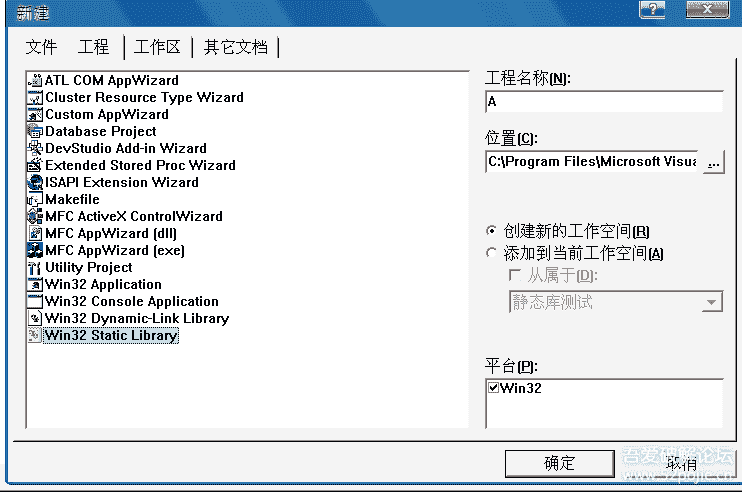

然后就是起项目名称，这个看自己，我这里就从简了，命名为`A`。

创建后编译器就会生成这些东西，原来里面有C++的东西，把这些删掉不要。

```c
// A.h: interface for the A class.
//
//////////////////////////////////////////////////////////////////////

#if !defined(AFX_A_H__E3758508_09B2_4D22_9607_1D6B9A0AAE8C__INCLUDED_)
#define AFX_A_H__E3758508_09B2_4D22_9607_1D6B9A0AAE8C__INCLUDED_

#if _MSC_VER > 1000
#pragma once
#endif // _MSC_VER > 1000

int add(int x,int y);

#endif // !defined(AFX_A_H__E3758508_09B2_4D22_9607_1D6B9A0AAE8C__INCLUDED_)
```

这个头文件就先定义一个加法，然后再去`AA.cpp`里写这个函数的具体实现方法。

```c
// A.cpp: implementation of the A class.

//
//////////////////////////////////////////////////////////////////////

#include "stdafx.h"

#include "A.h"

//////////////////////////////////////////////////////////////////////

// Construction/Destruction

//////////////////////////////////////////////////////////////////////

int add(int x,int y)

{

    return x+y;

}
```

然后就可以编译了，点`F7`，在文件中找`AA.lib`和`AA.h`。

接下来就是要怎么使用这个静态库了。

首先去重新开启一个空项目，然后把得到的两个文件复制进这个项目的工作路径。

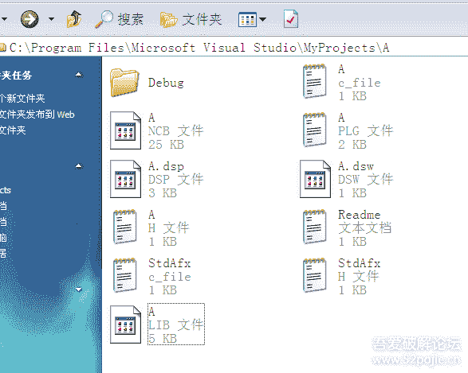

在头文件添加进刚刚传进去的`A.h`文件，这里需要一个插件，因为VC6有bug，后面附上文件。

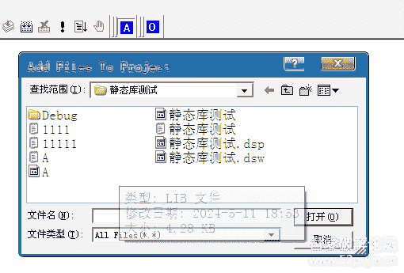

添加进去。

```c
#include "A.h"
#include 
int main()
{
    int x = add(1, 2);
    printf("%d", x);
    return 0;
}
```

`Test.cpp`文件这样写，但还不够，我们还需要告诉编译器我们要使用静态库，因此，还需要加上这么一句。

```c
#include "A.h"

#include 

#pragma comment(lib,"AA.lib")

int main()

{

    int x = add(1, 2);

    printf("%d", x);

    return 0;

}
```

这样算是个固定格式吧，多写就知道了。

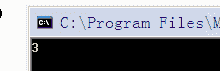

运行没有问题。

这么写可能还是会感到麻烦，还要写那么多的配置，还要导入文件，马上就说一个一劳永逸的办法。

刚刚不是生成了两个文件，一个`A.h`，一个`A.lib`，把这两个文件放进系统库就可以了，不仅这个项目需要，如果其它系统也需要，也能直接引用。

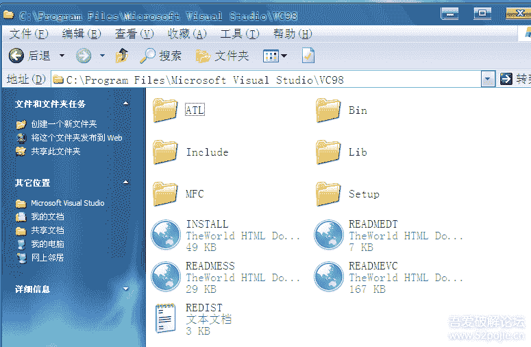

在VC6下的路径里就能看到`include`和`lib`了，就在里面加上两个文件，我把`.h`文件放在`Include`目录下，`lib`我放在`Lib`目录下。

然后在工程->设置中->连接中添加`A.lib`。

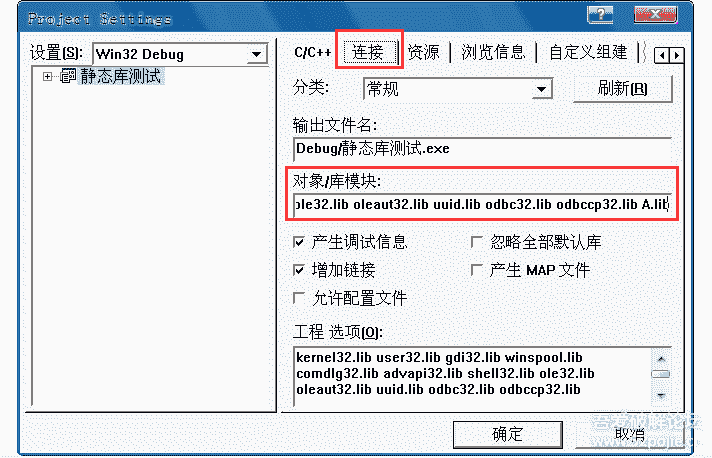

然后这样，就可以用尖括号来引用了。

### 缺点

相信大家都知道动态链接库也就是dll文件，正是因为有dll所以才能证明静态链接库有弊端。

1. 使用静态链接生成的可执行文件体积较大
2. 包含相同的公共代码，造成浪费

第一个缺点什么意思呢，你去看汇编，发现自己定义的静态链接库的函数也在主函数附近，相当于是他把这个自定义的函数给你装进了这个exe文件里。

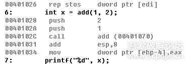

离得很近，所以会使体积变大。

第二个缺点就是假如我有十个代码需要用到这个函数，那么我的CPU就要跑十份相同的代码，造成资源的浪费。

所以才会有dll，静态链接库的缺点就是dll的优点。

## 动态链接库

### 什么是动态链接库？

动态链接库（Dynamic Link Library，缩写为DLL），是微软公司在Windows操作系统中，实现共享函数库概念的一种方式。

扩展名有：`.dll`、`.ocx`（包含ActiveX控制的库）。

随便用OD打开个exe文件，点击E模块。

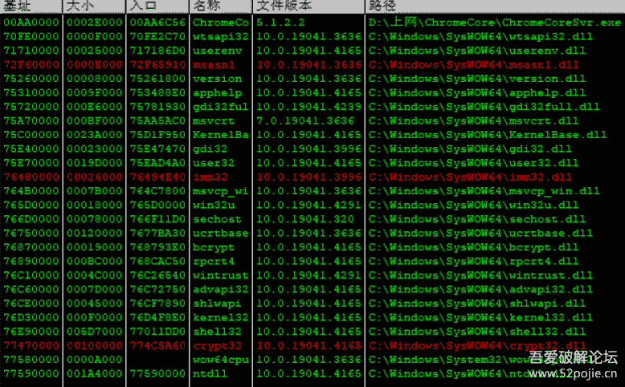

我们也叫这个为进程，可以看到这里有许多的dll，如果是采用静态库的话，就会跟exe编在一起，这里的dll是等需要exe用的时候才会加载过来，是独立存在的，所以不会使exe文件变大。

静态库的第二个缺点是重复使用，造成浪费，还记得内存映射文件共享吗，这些exe是用物理页的方式来使用这些dll的，而这个物理页也只有一份，所以不会造成浪费。

### 创建dll

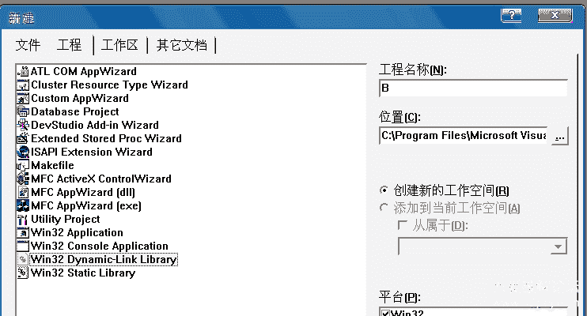

新建，名字从简，选择简单的dll工程，这里生成的`B.cpp`是dll的入口函数，没有需求的话就不要动他。

然后右键选择New Class。

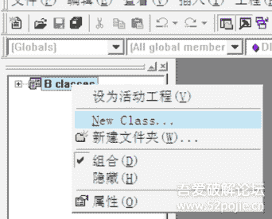

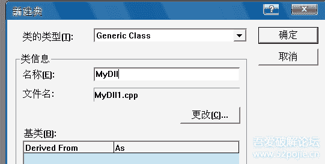

确定后，把原来的C++部分删掉，然后就开始创建函数。

这里采用固定的格式。

```c
extern "C" _declspec(dllexport) 调用约定 返回类型 函数名(参数列表);
```

```c
// MyDll.h: interface for the MyDll class.

#endif // _MSC_VER > 1000

extern "C" _declspec(dllexport) _stdcall int add(int x,int y);

extern "C" _declspec(dllexport) _stdcall int sub(int x,int y);

#endif
```

我把其它部分删了，节省空间，写法大概就是这么个写法，调用约定不写的话会采用你编译器设定的方式，然后在`MyDll.cpp`写上他的实现方法。


# DLL 开发与使用示例

```cpp
// MyDll.cpp: implementation of the MyDll class.

#include "stdafx.h"
#include "MyDll.h"

_stdcall int add(int x,int y)
{
    return x+y;
}

_stdcall int sub(int x,int y)
{
    return x-y;
}
```

这样就写好了一个`dll`

`extern`就相当于是向别人说明我提供这个函数，来使用我啊，那别的模块怎么使用并且知道这个模块的函数，有几个函数呢？

这里就涉及`PE`知识里的导入导出表了，通常情况下，`exe`有导入表，`dll`导入导出都有，但是不绝对，`exe`也可以有导入表。别的模块就可以通过这些表来知道你有多少函数，分别是啥等

我们用一个工具来看看我们写的`dll`的函数

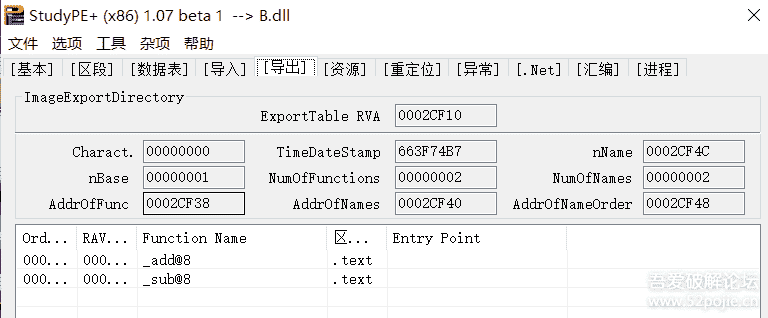

image-20240511214646150.png (20.24 KB, 下载次数: 0)

[href="forum.php?mod=attachment&aid=MjY5NzU0Nnw5YTNjYTdlOXwxNzkzNTcwMDMxfDE2ODA4NnwxOTI3NTg5&nothumb=yes" target="_blank"](https://www.52pojie.cn/forum.php?mod=attachment&aid=MjY5NzU0Nnw5YTNjYTdlOXwxNzkzNTcwMDMxfDE2ODA4NnwxOTI3NTg5&nothumb=yes)

2024-5-24 00:15 上传

随便查看`PE`文件都有查询功能，看到这个导出函数，有两个，所以从导出表就能看到提供了那些函数。这个函数名不是我们想要的，有点难看话，可以自己定义函数名

`extern`那部分删掉，留下函数的声明，新建一个文本文件，后缀改成`.def`

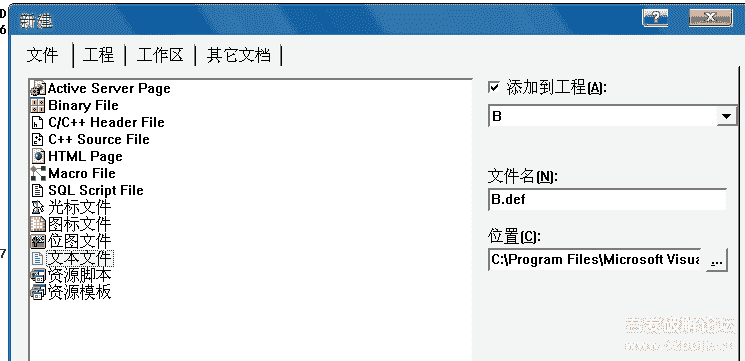

image-20240511215151473.png (24.75 KB, 下载次数: 0)

[href="forum.php?mod=attachment&aid=MjY5NzU0N3wzMWEyOWMxZXwxNzkzNTcwMDMxfDE2ODA4NnwxOTI3NTg5&nothumb=yes" target="_blank"](https://www.52pojie.cn/forum.php?mod=attachment&aid=MjY5NzU0N3wzMWEyOWMxZXwxNzkzNTcwMDMxfDE2ODA4NnwxOTI3NTg5&nothumb=yes)

2024-5-24 00:15 上传

在`.def`上写上

也是固定格式

```
EXPROTS

函数名     @编号

函数名     @编号     NANAME
```

```
//B.def
EXPORTS

add     @12
sub     @13     NONAME
```

所以函数就有两种方式导出，一个是函数名，一个是编号

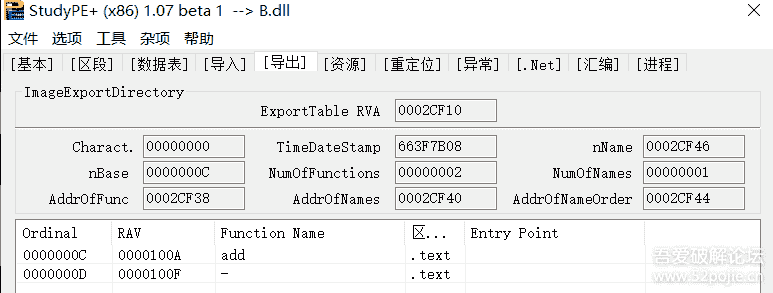

image-20240511220531756.png (19.76 KB, 下载次数: 0)

[href="forum.php?mod=attachment&aid=MjY5NzU0OHxlMmY4MzcxNXwxNzkzNTcwMDMxfDE2ODA4NnwxOTI3NTg5&nothumb=yes" target="_blank"](https://www.52pojie.cn/forum.php?mod=attachment&aid=MjY5NzU0OHxlMmY4MzcxNXwxNzkzNTcwMDMxfDE2ODA4NnwxOTI3NTg5&nothumb=yes)

2024-5-24 00:15 上传

（一定要写对英文单词啊，就因为写错了，又找了一会儿错误QAQ）

看到上面一个有名字，一个没名字，要用的话也可以用序号，为什么要设置没有名字的呢？

对于一个大项目来说，一个函数的名字就能看出这个函数是在干啥了，如果你胡乱起名，其他人接手或者其他人使用的时候不利于交接，所以，为了不改函数名的条件下，但也不想让人知道这个函数做了什么，就可以用这个`NONAME`，但是对于懂底层的人来说，隐不隐藏都一样，切到汇编看一下就知道这函数做了什么，所以这招是防君子不防小人

## 使用 dll

首先先把`dll`复制到测试的工作路径下

然后根据步骤来写

```cpp
//步骤1：定义函数指针

typedef int(_stdcall *lpadd)(int,int);

typedef int(_stdcall *lpsub)(int,int);

//步骤2：声明函数指针变量

lpadd myadd;

lpsub mysub;

//步骤3：动态加载dll到内存中

HINSTANCE hDll = LoadLibrary("*.dll");

//步骤4：获取函数地址

myadd = (lpadd)GetProcAddress(hDll,"add");

mysub = (lpsub)GetProcAddress(hDll,(char*)0xD);

//步骤5：调用函数

int a = myadd(10,2);

int b = mysub(10,2);

//步骤6：释放动态链接库

FreeLibrary(hDll);
```

```cpp
//Test.cpp

#include 
#include 

typedef int(_stdcall *lpAdd)(int,int);
typedef int(_stdcall *lpSub)(int,int);

lpAdd myAdd;
lpSub mySub;

int main()
{
    HINSTANCE hDll = LoadLibrary("B.dll");//加载dll

    myAdd = (lpAdd)GetProcAddress(hDll,"add");
    mySub = (lpSub)GetProcAddress(hDll,(char*)0xD);

    int a = myAdd(1,2);
    int b = mySub(5,2);

    FreeLibrary(hDll);
    return 0;
}
```

注意调用约定一定要一致，不然会出现栈区混乱的问题

这些`API`感兴趣的也可以自己查查，这里就不多介绍了

## 隐式链接

在上一章，我们用代码使用了`dll`，这个方式我们称为显式链接，优点就是非常灵活，只用一个`dll`文件，缺点就是比较麻烦，需要一个一个的去获取函数的地址

隐式链接的优点就是只要配置完成，就可以直接调用函数

先去把上一章的`dll`复制一下，我这里把两个函数都设置成有名字了

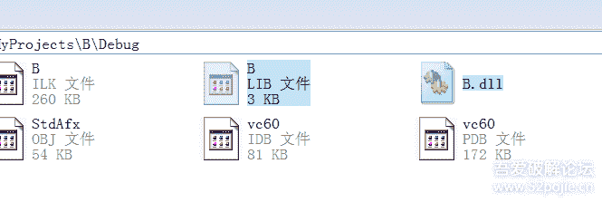

image-20240512230450092.png (19.53 KB, 下载次数: 0)

[href="forum.php?mod=attachment&aid=MjY5NzU0OXw2MmFlMjc3OXwxNzkzNTcwMDMxfDE2ODA4NnwxOTI3NTg5&nothumb=yes" target="_blank"](https://www.52pojie.cn/forum.php?mod=attachment&aid=MjY5NzU0OXw2MmFlMjc3OXwxNzkzNTcwMDMxfDE2ODA4NnwxOTI3NTg5&nothumb=yes)

2024-5-24 00:16 上传

在`dll`的项目里找到`dll`和`lib`这两个文件，在显式链接中，只需要`dll`就够了，但在隐式链接中则还需要`lib`文件，这个跟静态库的`lib`文件不同，这里存的都是些辅助信息，编译器需要这些辅助信息来找到函数在哪

把这两个文件复制到测试的项目里，也可以放到库目录里，配置一下就就可以了。这是第一步

第二步就是添加辅助信息把

第三步是声明函数

```cpp
// 隐式链接Test.cpp

#include "stdafx.h"

//第二步：添加辅助信息

#pragma comment(lib,"B.lib")

//第三步：声明函数

_declspec(dllimport) _cdecl int add(int x,int y);

_declspec(dllimport) _cdecl int sub(int x,int y);

int main(int argc, char* argv[])

{

    int a = add(2,3);

    int b = sub(5,2);

    return 0;

}
```


image-20240512231219952.png (871 Bytes, 下载次数: 0)

[href="forum.php?mod=attachment&aid=MjY5NzU1MHw2YjgwYmFlY3wxNzkzNTcwMDMxfDE2ODA4NnwxOTI3NTg5&nothumb=yes" target="_blank"](https://www.52pojie.cn/forum.php?mod=attachment&aid=MjY5NzU1MHw2YjgwYmFlY3wxNzkzNTcwMDMxfDE2ODA4NnwxOTI3NTg5&nothumb=yes)

2024-5-24 00:16 上传

也是没有问题

配置好后可以直接使用函数，不用再去获取函数地址，因为在辅助信息中得到过了

所以可以根据别人的给的文件而来自由选择链接的方式

看到这个代码你可能会觉得这跟静态太库很相似，那就来看看汇编

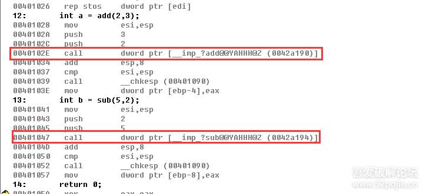

image-20240512231742268.png (14.97 KB, 下载次数: 0)

[href="forum.php?mod=attachment&aid=MjY5NzU1MXw4ZTllNWZiM3wxNzkzNTcwMDMxfDE2ODA4NnwxOTI3NTg5&nothumb=yes" target="_blank"](https://www.52pojie.cn/forum.php?mod=attachment&aid=MjY5NzU1MXw4ZTllNWZiM3wxNzkzNTcwMDMxfDE2ODA4NnwxOTI3NTg5&nothumb=yes)

2024-5-24 00:16 上传

看这里并不是直接调用而是间接调用，调用的是一个固定的内存位置

也就是

```
call 0x40101234    这就是直接调用，这个地址就是函数的地址
call dword ptr [__imp_?add@@YAHHH@Z (0042a190)]     而这个就只是间接调用，每当加载dll获取函数地址时，这个地址就会存进42a190这个地址，中间有个过度
```

所以隐式链接并没有把函数写进`exe`文件里

还需要注意的是，如果使用的`extern "C"`的指令的方式来声明函数，那么在这儿的第三步也要加进去，调用约定还是要保持一致

## 如何实现的

在上一章我说到了导入导出表，当我们把上面的代码编译运行，编译器就会生成导入导出表

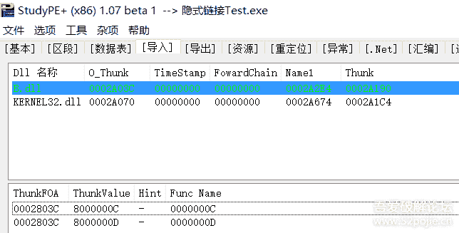

image-20240512233222085.png (17.78 KB, 下载次数: 0)

[href="forum.php?mod=attachment&aid=MjY5NzU1MnwwOGY5M2VmNnwxNzkzNTcwMDMxfDE2ODA4NnwxOTI3NTg5&nothumb=yes" target="_blank"](https://www.52pojie.cn/forum.php?mod=attachment&aid=MjY5NzU1MnwwOGY5M2VmNnwxNzkzNTcwMDMxfDE2ODA4NnwxOTI3NTg5&nothumb=yes)

2024-5-24 00:16 上传

可以看到`B.dll`已经加载进去了，使用隐式链接的时候就导进去了，这个导入表就会详细记录这个`exe`需要哪些`dll`，那些函数

所以使用隐式链接的话，系统会帮我们使用`LoadLibrary`和`GetProceAddress`，因此显式也好，隐式也罢，实现的方法一样，只是一个是我们自己动手，一个系统帮忙

## DllMain函数

```cpp
BOOL WINAPI DllMain(
  HINSTANCE hinstDLL,  // handle to the DLL module
  DWORD fdwReason,     // reason for calling function
  LPVOID lpvReserved   // reserved
);
```

在平常的`exe`代码中，会有`main`函数，也叫主函数，也是整个程序的入口，然后跑到`return`就停止了

但是`DllMain`不一样，不一定只执行一次就结束了

先介绍参数

### hinstDLL

用来知晓`dll`被加载到了什么位置，一个`dll`可能会被许多的进程加载，比如说`A`进程把`dll`加载到了`10000`的位置，`B`进程把`dll`加载到了`20000`的位置，所以就是用来得知把`dll`加载到了什么位置

### fdwReason

这个`dll`被调用的原因，根据以下的情况分类

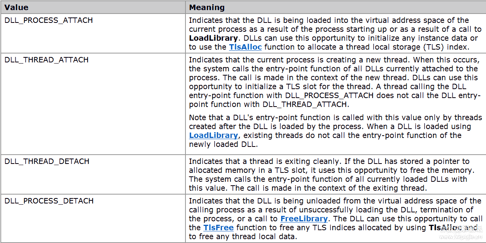

image-20240512235435601.png (72.92 KB, 下载次数: 0)

[href="forum.php?mod=attachment&aid=MjY5NzU1M3w0NmUyMDkyZnwxNzkzNTcwMDMxfDE2ODA4NnwxOTI3NTg5&nothumb=yes" target="_blank"](https://www.52pojie.cn/forum.php?mod=attachment&aid=MjY5NzU1M3w0NmUyMDkyZnwxNzkzNTcwMDMxfDE2ODA4NnwxOTI3NTg5&nothumb=yes)

2024-5-24 00:17 上传

这里提到了四种，那么就有四种情况被调用，那么就来一个个分析

#### DLL_PROCESS_ATTACH

> 
Indicates that the DLL is being loaded into the virtual address space of the current process as a result of the process starting up or as a result of a call to `LoadLibrary`. DLLs can use this opportunity to initialize any instance data or to use the `TlsAlloc` function to allocate a thread local storage (TLS) index.

这表示`DLL`正在被加载到当前进程的虚拟地址空间中，这是由于进程启动或调用`LoadLibrary`函数的结果。`DLL`可以利用这个机会来初始化任何实例数据，或者使用`TlsAlloc`函数来分配一个线程本地存储（TLS）索引。

这个是首次使用`LoadLibrary`时，会得到这个宏

后面的代码会实验

#### DLL_PROCESS_DETACH

> 
Indicates that the DLL is being unloaded from the virtual address space of the calling process as a result of unsuccessfully loading the DLL, termination of the process, or a call to `FreeLibrary`. The DLL can use this opportunity to call the `TlsFree` function to free any TLS indices allocated by using `TlsAlloc` and to free any thread local data. 

这表明`DLL`（动态链接库）正在从调用进程的虚拟地址空间中卸载，这可能是因为`DLL`加载失败、进程终止，或者调用了`FreeLibrary`函数。`DLL`可以利用这个机会调用`TlsFree`函数，以释放通过`TlsAlloc`分配的所有`TLS`（线程局部存储）索引，并释放任何线程本地数据。

这里是调用了`FreeLibrary`就会传进这个宏，但是后面的实验是，只输出了一个，所以推断只是最后一次使用`FreeLibrary`才会传这个宏

#### DLL_THREAD_ATTACH

>


Indicates that the current process is creating a new thread. When this occurs, the system calls the entry-point function of all DLLs currently attached to the process. The call is made in the context of the new thread. DLLs can use this opportunity to initialize a TLS slot for the thread. A thread calling the DLL entry-point function with `DLL_PROCESS_ATTACH` does not call the DLL entry-point function with `DLL_THREAD_ATTACH`.

Note that a DLL's entry-point function is called with this value only by threads created after the DLL is loaded by the process. When a DLL is loaded using `LoadLibrary`, existing threads do not call the entry-point function of the newly loaded DLL.

这表明当前进程正在创建一个新的线程。当这种情况发生时，系统会调用当前附加到该进程的所有动态链接库（DLL）的入口点函数。这个调用是在新线程的上下文中进行的。DLL可以利用这个机会为线程初始化一个线程局部存储（TLS）槽。一个线程在调用DLL的入口点函数并带有`DLL_PROCESS_ATTACH`参数时，不会再次以`DLL_THREAD_ATTACH`参数调用DLL的入口点函数。

请注意，只有当DLL被进程加载后创建的线程才会使用此值调用DLL的入口点函数。当使用`LoadLibrary`加载DLL时，已经存在的线程不会调用新加载的DLL的入口点函数。

意思为当我创建一个线程并在里面使用`LoadLibrary`时会传入这个宏，并且只要是在不同的线程里使用就会传入这个宏

## 5> `DLL_THREAD_DETACH`

Indicates that a thread is exiting cleanly. If the DLL has stored a pointer to allocated memory in a TLS slot, it uses this opportunity to free the memory. The system calls the entry-point function of all currently loaded DLLs with this value. The call is made in the context of the exiting thread. 

这表明线程正在正常退出。如果DLL在TLS（线程局部存储）槽中存储了指向已分配内存的指针，它将利用这个机会释放该内存。系统会用这个值调用当前已加载的所有DLL的入口点函数。这个调用是在正在退出的线程的上下文中进行的。

意思为线程正常的退出就会传入这个宏

## 4> 代码演示

用了显式链接，更能体现出中间的这个参数使用情况

```
#include 
#include 

typedef int(_cdecl *lpAdd)(int,int);
typedef int(_cdecl *lpSub)(int,int);

lpAdd myAdd;
lpSub mySub;

DWORD WINAPI ThreadProc1(
  LPVOID lpParameter   // thread data
)
{
    HINSTANCE hDll = LoadLibrary("B.dll");//断点
    FreeLibrary(hDll);
    return 0;
}

DWORD WINAPI ThreadProc2(
  LPVOID lpParameter   // thread data
)
{
    HINSTANCE hDll = LoadLibrary("B.dll");//断点
    return 0;
}

int main()
{
    HANDLE hThread[2];

    HINSTANCE hDll1 = LoadLibrary("B.dll");//断点
    HINSTANCE hDll2 = LoadLibrary("keyhook.dll");

    hThread[0] = CreateThread(NULL,0,ThreadProc1,NULL,0,NULL);

    hThread[1] = CreateThread(NULL,0,ThreadProc2,NULL,0,NULL);

    WaitForMultipleObjects(2,hThread,TRUE,INFINITE);//验证两个线程的参数传入

    myAdd = (lpAdd)GetProcAddress(hDll1,"add");
    mySub = (lpSub)GetProcAddress(hDll1,(char*)0xD);

    int a = myAdd(1,2);
    int b = mySub(5,2);
    getchar();

    FreeLibrary(hDll1);
    OutputDebugString("———————————\n");
    FreeLibrary(hDll2);
    return 0;
}
```

还有在`Dllmain`上面写上输出代码来验证

```
// B.cpp : Defines the entry point for the DLL application.

//

#include "stdafx.h"

BOOL APIENTRY DllMain( HANDLE hModule, 

                       DWORD  ul_reason_for_call, 

                       LPVOID lpReserved

                     )

{

    switch(ul_reason_for_call)

    {

    case DLL_PROCESS_ATTACH:

        OutputDebugString("1. DLL_PROCESS_ATTACH\n");

        break;

    case DLL_PROCESS_DETACH:

        OutputDebugString("2. DLL_PROCESS_DETACH\n");

        OutputDebugString("———————————");

        break;

    case DLL_THREAD_ATTACH:

        OutputDebugString("3. DLL_THREAD_ATTACH\n");

        break;

    case DLL_THREAD_DETACH:

        OutputDebugString("4. DLL_THREAD_DETACH\n");

        break;

    }

    return TRUE;

}
```

编译后别忘了把dll重新复制到测试目录里

我这里说一下顺序

1. 为首次使用 `LoadLibrary`
2. 为最后使用的 `FreeLibrary`
3. 为线程中使用 `LoadLibrary`
4. 为线程正常退出

执行后看输出

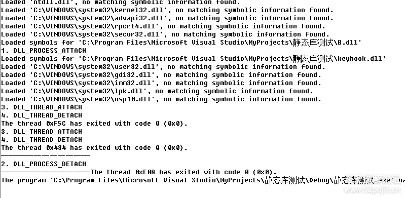

`image-20240513113453485.png` (25.47 KB, 下载次数: 0)

[href="forum.php?mod=attachment&aid=MjY5NzU1NHwzMGFmMjBlYXwxNzkzNTcwMDMxfDE2ODA4NnwxOTI3NTg5&nothumb=yes" target="_blank"](https://www.52pojie.cn/forum.php?mod=attachment&aid=MjY5NzU1NHwzMGFmMjBlYXwxNzkzNTcwMDMxfDE2ODA4NnwxOTI3NTg5&nothumb=yes)

2024-5-24 00:17 上传

可以看到首先1使用了，然后就是3、4、3、4，说明线程的也正常传入了，这里说明一下，你可能会看到3、3、4、4的情况，这里没有明确指定那个线程必须执行完才开始另一个线程，所以这是正常现象，随后我在两个free之间插入了一个输出，发现参数在输出之后，所以推断是最后一次使用。

三个free也是了一样的，害的我重新写了个dll（→_→）

所以，每当调用dll可以根据不同情况来些不同的代码，来做不同的事（嘿嘿嘿）都可以在`DllMain`里实现
