# [调试逆向] 微信接收消息分析

- 原帖：https://www.52pojie.cn/forum.php?mod=viewthread&tid=1948799
- 抓取时间：2026-11-01T21:53:21

## 书接上文

上文链接：https://www.52pojie.cn/thread-1948442-1-1.html

微信的版本我更新到最新的 3.9.11.25。

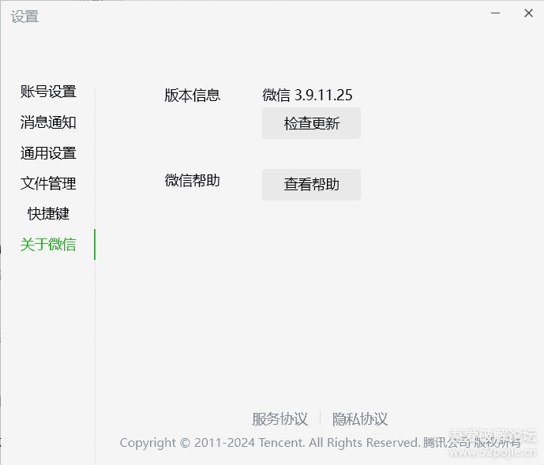 [附件下载](https://www.52pojie.cn/forum.php?mod=attachment&aid=MjcxMjYxNHxhNmZlYWMyM3wxNzkzNTY5OTk5fDE2ODA4NnwxOTQ4Nzk5&nothumb=yes) · *2024-7-28 13:41 上传*

最新的找发消息 call 思路不变。

今天找一下接收消息的 call。

## 方法一

利用日志的方法寻找 call。

### 打印日志

这里贴出打印日志的方法。

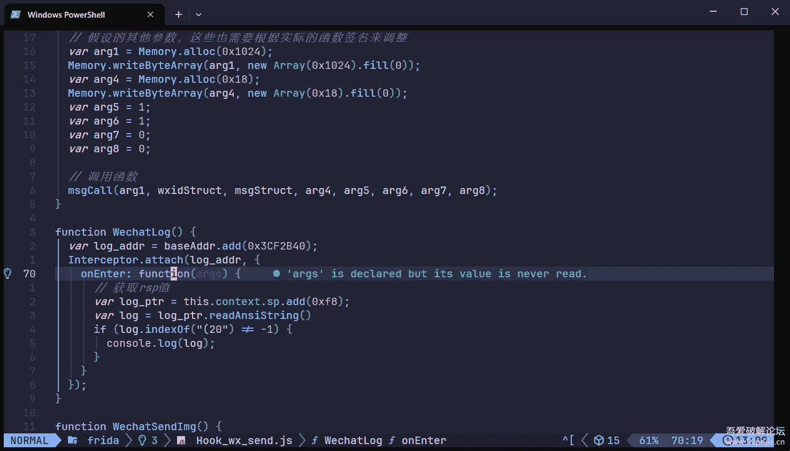 [附件下载](https://www.52pojie.cn/forum.php?mod=attachment&aid=MjcxMjYxM3wxZmZkNmU2NHwxNzkzNTY5OTk5fDE2ODA4NnwxOTQ4Nzk5&nothumb=yes) · *2024-7-28 13:41 上传*

### 观察日志

观察打印的日志。

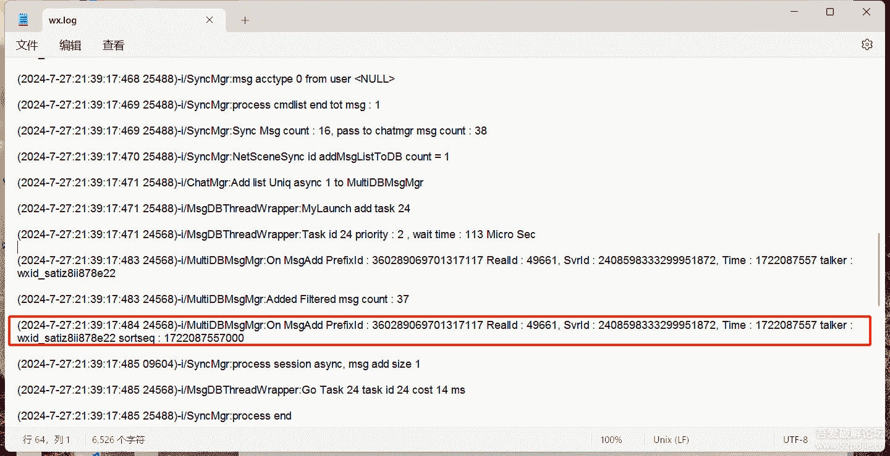 [附件下载](https://www.52pojie.cn/forum.php?mod=attachment&aid=MjcxMjYxNXxjOTc1YzZiYXwxNzkzNTY5OTk5fDE2ODA4NnwxOTQ4Nzk5&nothumb=yes) · *2024-7-28 13:41 上传*

`On MsgAdd PrefixId` 是需要关注的点。

### 搜索字符串并下断点

打开 `x64dbg` 搜索字符串。

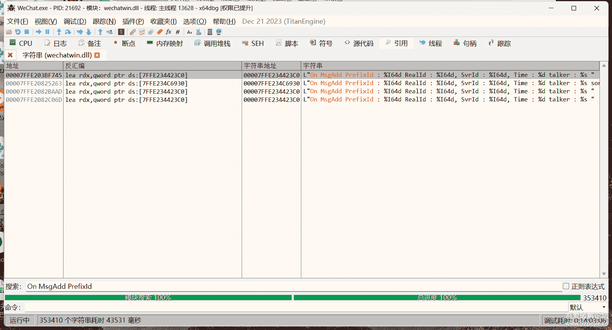 [附件下载](https://www.52pojie.cn/forum.php?mod=attachment&aid=MjcxMjYxNnxmYWZjODg2OXwxNzkzNTY5OTk5fDE2ODA4NnwxOTQ4Nzk5&nothumb=yes) · *2024-7-28 13:41 上传*

全部下断点。

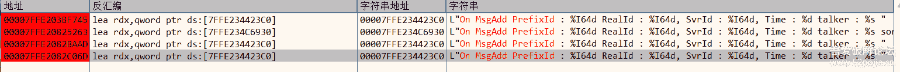 [附件下载](https://www.52pojie.cn/forum.php?mod=attachment&aid=MjcxMjYxN3wzYzhjMjUzOHwxNzkzNTY5OTk5fDE2ODA4NnwxOTQ4Nzk5&nothumb=yes) · *2024-7-28 13:41 上传*

### 定位数据库操作 call

断下来后往上下翻翻看堆栈窗口。

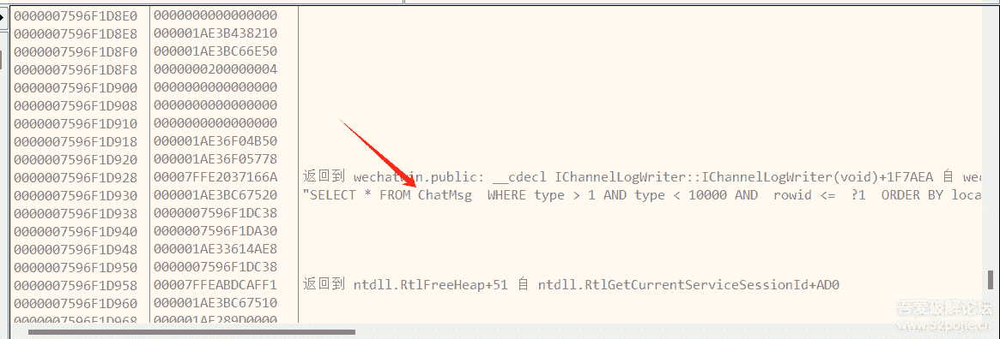 [附件下载](https://www.52pojie.cn/forum.php?mod=attachment&aid=MjcxMjYxOHxkZjQzMWViOHwxNzkzNTY5OTk5fDE2ODA4NnwxOTQ4Nzk5&nothumb=yes) · *2024-7-28 13:41 上传*

发现这是 `sql` 语句，找到对数据库操作的 call。

最后找到这里。

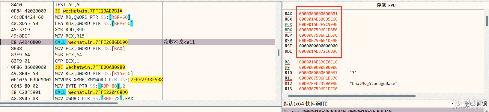 [附件下载](https://www.52pojie.cn/forum.php?mod=attachment&aid=MjcxMjYyMHw3ZTY4NDVkNnwxNzkzNTY5OTk5fDE2ODA4NnwxOTQ4Nzk5&nothumb=yes) · *2024-7-28 13:41 上传*

观察寄存器发现 `RBX = RDI` 是一个结构体。

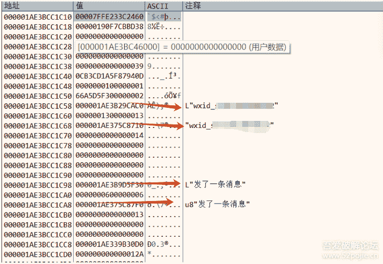 [附件下载](https://www.52pojie.cn/forum.php?mod=attachment&aid=MjcxMjYyMXw4ZTU4MTNjY3wxNzkzNTY5OTk5fDE2ODA4NnwxOTQ4Nzk5&nothumb=yes) · *2024-7-28 13:41 上传*

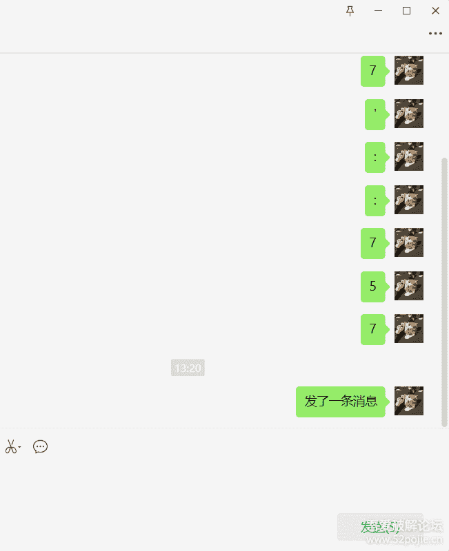 [附件下载](https://www.52pojie.cn/forum.php?mod=attachment&aid=MjcxMjYyM3w1OGYxOGI5NHwxNzkzNTY5OTk5fDE2ODA4NnwxOTQ4Nzk5&nothumb=yes) · *2024-7-28 13:41 上传*

之后发现 `wxid-8` 这个位置的前 4 字节是发送消息的时间。

写代码调用它。

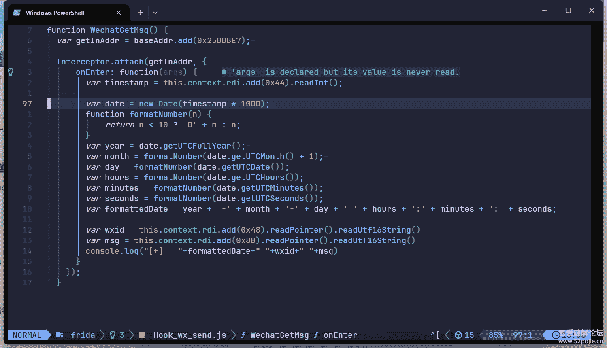 [附件下载](https://www.52pojie.cn/forum.php?mod=attachment&aid=MjcxMjYyNXwwNGU3M2Q1YnwxNzkzNTY5OTk5fDE2ODA4NnwxOTQ4Nzk5&nothumb=yes) · *2024-7-28 13:41 上传*

执行结果：

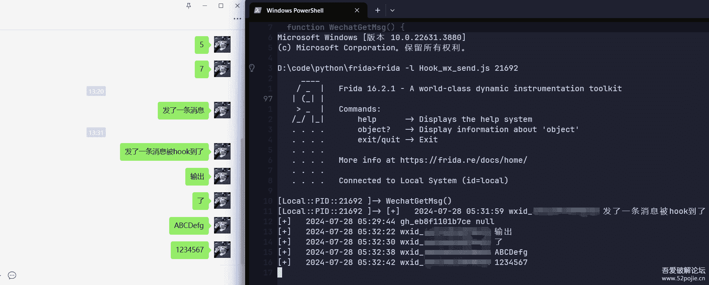 [附件下载](https://www.52pojie.cn/forum.php?mod=attachment&aid=MjcxMjYyN3xmYzNjYzFhZXwxNzkzNTY5OTk5fDE2ODA4NnwxOTQ4Nzk5&nothumb=yes) · *2024-7-28 13:41 上传*

## 方法二

用 `CE` 搜索最后一条发送的消息（最好找个小号，纯洁没有别的消息污染结果），多搜索几次一直到只剩一条消息，找到后下改写断点，或者 `CE` 是什么改写了这个地址一样可以来到相应的 call。

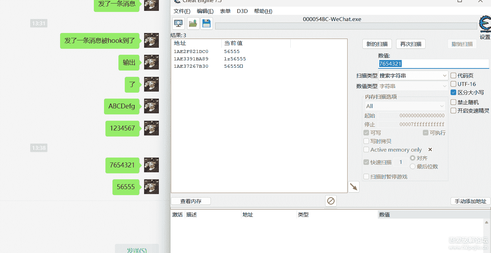 [附件下载](https://www.52pojie.cn/forum.php?mod=attachment&aid=MjcxMjYyOHw5NzdiNjg1OXwxNzkzNTY5OTk5fDE2ODA4NnwxOTQ4Nzk5&nothumb=yes) · *2024-7-28 13:41 上传*

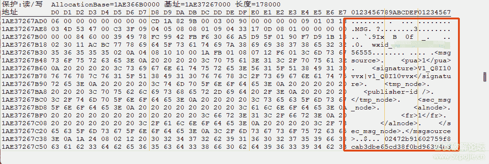 [附件下载](https://www.52pojie.cn/forum.php?mod=attachment&aid=MjcxMjYyOXw4OTc3ZmU3ZHwxNzkzNTY5OTk5fDE2ODA4NnwxOTQ4Nzk5&nothumb=yes) · *2024-7-28 13:41 上传*

带 `wxid` 和 `xml` 标签的就是了，后面方法一样。

目前已经实现接收消息和发送消息。
