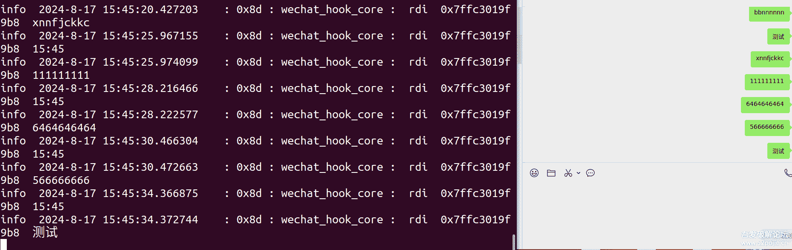
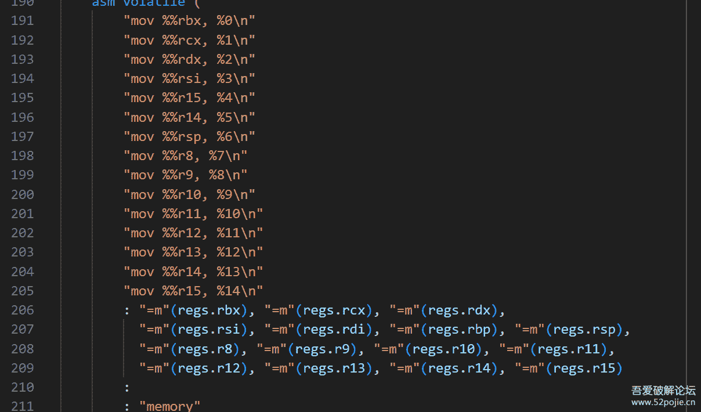
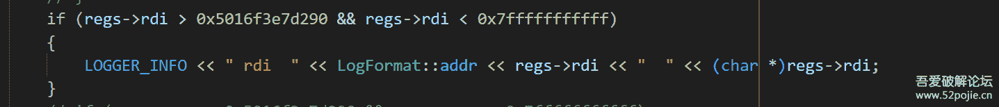
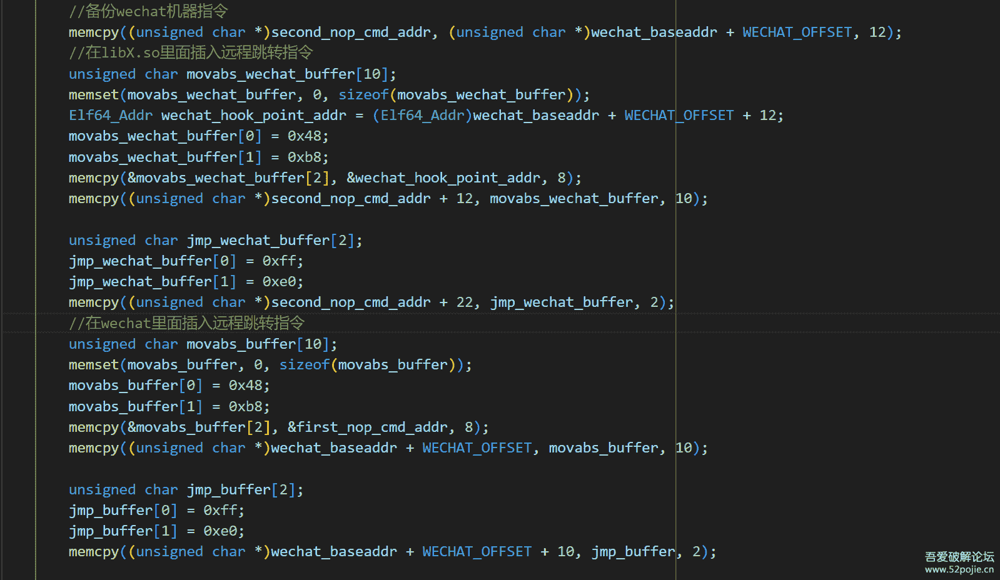

# [调试逆向] linux 微信 调试原创，可打印接收的消息，仅限技术交流，不定期更新

- 原帖: https://www.52pojie.cn/forum.php?mod=viewthread&tid=1955523
- 抓取时间: 2026-11-01T21:53:07

请先安装`wechat-beta_1.0.0.145_amd64.fixed.deb`版本的微信，然后将我的应用程序`wechat`还有`libX.so`替换进去，即可实现收消息打印，效果如下。

`content.png` (161.21 KB, 下载次数: 1) [下载附件](https://www.52pojie.cn/forum.php?mod=attachment&aid=MjcxODI2N3wwYzhjNTZkYXwxNzkzNTY5OTg0fDE2ODA4NnwxOTU1NTIz&nothumb=yes)

2024-8-17 18:25 上传

## 原理

通过`gdb`分析，当linux微信收到消息后，必然会走到地址`0x9b0a7a`，并且明文消息的内存地址会存放在x64架构的寄存器里面，我们接下来的做法就是hook这个地址位置，然后将寄存器里面的内容打印出来。

## hook原理

首先修改`wechat`的二进制文件，让其运行链接动态库时，多链接一个我的动态库`libX.so`。然后在`libX.so`里面做初始化操作，这个初始化操作主要就是修改机器指令，修改`wechat`应用内存地址`0x9b0a7a`的指令，修改前记得先将里面的指令读取出来做个备份，然后插入`mov rax, addr`和`jmp rax`。这两条指令的意思就是远程跳转，让CPU远程跳转到`libX.so`的动态库里面，跳转后，立即执行如下指令：

`123.png` (132.09 KB, 下载次数: 1) [下载附件](https://www.52pojie.cn/forum.php?mod=attachment&aid=MjcxODI2NHwzNDlmMTliYnwxNzkzNTY5OTg0fDE2ODA4NnwxOTU1NTIz&nothumb=yes)

2024-8-17 18:25 上传

这一步的操作主要是为了备份寄存器信息，避免因为`libX.so`内部的函数调用等操作污染之前的寄存器。

然后将备份的寄存器地址输出出来，取数据并打印出来，这个数据就是明文消息内容。

`222.png` (35.38 KB, 下载次数: 1) [下载附件](https://www.52pojie.cn/forum.php?mod=attachment&aid=MjcxODI2NXwyNTc3YjI0ZHwxNzkzNTY5OTg0fDE2ODA4NnwxOTU1NTIz&nothumb=yes)

2024-8-17 18:25 上传

如图所示，在`rdi`寄存器里面，

最后，我们要想办法把CPU跳转回`wechat`应用里面，恢复环境，

由于`wechat`应用内存机器指令被修改，所以现在拿出之前已经备份的`wechat`指令进行运行，然后再跳转回去，即可恢复环境，代码如下：

`333.png` (240.44 KB, 下载次数: 1) [下载附件](https://www.52pojie.cn/forum.php?mod=attachment&aid=MjcxODI2NnxhN2IyYzAwZHwxNzkzNTY5OTg0fDE2ODA4NnwxOTU1NTIz&nothumb=yes)

2024-8-17 18:25 上传

h

代码链接如下：

https://github.com/lmclmc/linux-wechat-hook.git
