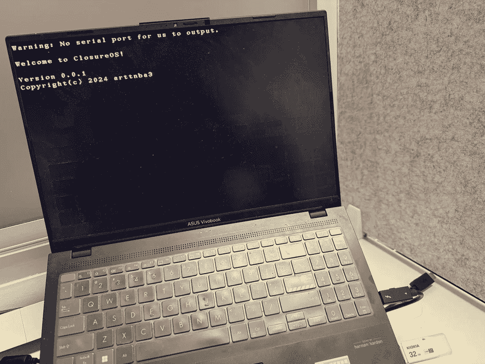

# [系统底层] 现代 64 位操作系统开发（一）：CMake 构建、UEFI 启动、frame buffer 文字绘制

- 原帖：<https://www.52pojie.cn/forum.php?mod=viewthread&tid=1967018>
- 抓取时间：2026-11-01T21:53:00

## 0x00. 一切开始之前

很久以前在知乎上曾经有过一个“程序员的三大浪漫”的讲法：「编译原理」、「操作系统」、「图形学」——当然这个似乎是某些知名答主杜撰的并没有任何的由头神必说法，笔者自己也不认为所谓的“程序员的浪漫”就仅是这几个东西，但对于笔者而言，“自己动手编写一个可以正常运行的操作系统”确乎是一件非常炫酷的事情。

笔者本科期间曾经跟着别人的书籍或是课程写过几个小的 32 位操作系统内核，大四那会又自己用 C 语言琢磨着搓了一个 64 位内核，但是最后的成品似乎都只是一个小玩具，只能在 `QEMU` 里看着黑框框跳动。

因此趁着现在笔者的心尚未老去，笔者想要真正地从零写一个可以在物理机上运行的 64 位操作系统内核，算是满足自己多年来的一个梦想吧，名字的话笔者决定叫 `ClosureOS` ——这个名字的由来比较简单，笔者一直很难想出比较好听的名字，看了看市面上有各种操作系统都叫 `Open*`，那笔者就叫 `Close` 好了，但是 `Close` 这个单词长得又不好看，于是笔者最终选择了 `Closure` 作为这个操作系统的名字——虽然似乎不是特别好听，但反正是否能写完都还是个未知数，所以也无所谓了（笑）。

本项目代码开源在 [GitHub 仓库](https://github.com/arttnba3/ClosureOS)，因为这个系统完全从零开始设计，同时现实生活还有各种事情，所以更新速度可能会非常非常非常非常非常非常非常慢……

本章对应分支为 `chapter-01`，本章代码在物理硬件上运行的效果如下图所示：

## 0x01. Boot Firmware

现代计算机的上电过程比较复杂，不过对于操作系统开发而言我们其实只需要关注当我们按下开机键之后所发生的事情，实际上无论是古老的 Legacy BIOS 启动还是逐渐成为主流的 UEFI 启动而言，其不外乎都遵循以下三个大阶段：

- `ROM Stage`：经历了一些基本的初始化工作后 CPU 被重置，主核心被唤醒，指令指针寄存器指向 `reset vector`（固件入口点）并由此开始执行，此时尚未进行内存探测，需要直接在 ROM 上执行。
- `RAM Stage`：内存探测完成，此时可以进行主板上各芯片组、CPU 等模块的初始化等工作。
- `Boot Stage`：找到启动设备，完成启动设备前的依赖项的准备，将控制权移交给设备上的下一阶段的启动器。

现有的固件通常分为两类：BIOS 与 UEFI。

### Legacy BIOS

基本输入输出系统（Basic Input/Output System，BIOS）是用来为计算机提供初始化服务与运行时服务的一组固件，其被预装在主板的 `ROM/FLASH` 芯片上，不同的 BIOS 通常仅能在特定的主板型号上运行。

当计算机启动后 BIOS 为第一个被运行的软件，此时计算机处于实模式下，仅能访问 1MB 内存的空间，其中物理内存 `0xF0000 ~ 0xFFFFF` 这 64KB 空间被映射到 BIOS ROM 当中，并以 `0xFFFF0` 处作为 BIOS 程序的入口点开始执行。

对于支持且开启了 BIOS shadowing 特性的计算机而言，BIOS 会被先从固件当中拷贝到内存中，而非直接在 ROM 空间上执行。

BIOS 会从南桥的 CMOS 芯片中读取 BIOS 程序的设置值、硬件参数侦测值等信息，在完成加电自检、设备测试等工作之后，会从启动设备中读取第一个扇区到物理内存 `0x7c00` 的位置，该扇区被称为主引导记录（Master Boot Recode，MBR），随后 BIOS 会跳转到 `0x7c00` 处继续执行，控制权转交给 MBR。

MBR 的结构如下图所示，其中不仅包含有 440 字节的第一阶段引导代码，同时还包含有磁盘的分区表信息，MBR 以末尾的两个字符 `0x55, 0xaa` 作为其标识：

这里我们可以看到 MBR 分区表仅支持不超过四个主分区，多余的分区则需要依赖操作系统在其上建立虚拟分区，此外 MBR 也不支持管理硬盘 2TB 以外的存储空间，因此这种分区方式其实已经正在逐渐地被淘汰。

由于 MBR 仅有 512 字节，无法完成过多的任务，因此通常的设计是由 MBR 从硬盘上读取第二阶段的 `boot loader`，由其来完成后续的系统环境初始化、载入操作系统内核等工作。

### Unified Extensible Firmware Interface

统一可扩展固件接口（Unified Extensible Firmware Interface，UEFI）为一套固件接口规范，用以初始化硬件、引导操作系统，并向操作系统提供一套统一的功能接口，解决不同厂牌 BIOS 分裂的现状，其最初起源于 Intel 开发的 EFI，在 2005 年由 Intel 交由 UEFI 论坛进行推广，UEFI 固件本质上与 BIOS 固件没有区别（都是封装在 `ROM/FLASH` 固件里的程序）。

例如 BIOS 厂商 A 提供的某个功能接口的使用方式是 `X`，BIOS 厂商 B 提供的相似功能接口使用方式是 `Y`，那操作系统就得为不同厂商的不同功能编写多套代码。

而有了 UEFI 规范，厂商 A、B 的 UEFI 固件都需要向上层提供统一的接口，从而使得操作系统可以用相同的方式调用某个功能，避免了代码分裂的情况。

这里引用一张非常经典的图片简述 UEFI 启动的基本过程：

相应地，UEFI 启动不再使用老旧的 MBR 分区表，而是使用 GUID Partion Table（GPT 分区表），以 512 字节为单位作为一个逻辑块（Logic Block，相对应的区块地址便称为 LBA），前 34 个 LBA 用来记录分区信息，其中 `LBA0` 为了兼容性保留给 MBR 使用，`LBA1` 记录分区表自身的信息、备份用 GPT 分区（最后 34 个 LBA 的位置）、分区的 CRC 校验码等，`LBA2 ~ LBA33` 则用来记录分区信息，每个 LBA 可以记录四个条目：

#### 扩展阅读：兼容支持模块（Compatibility Support Module）

在 UEFI 逐渐替换掉计算机底层固件的风潮涌动之时，尚有大量的设备仍旧使用传统的 MBR 分区表，为了进行兼容，CSM 这一兼容支持模块会模拟传统 BIOS 的功能，为这些设备系统按照传统的 BIOS + MBR 方式进行引导，并提供传统 BIOS 的 `0x10` 等中断服务。

### Coreboot

Coreboot 起源于 LinuxBIOS，最初的思路是：既然 Linux 有比较好的硬件支持，那计算机启动以后直接跳 Linux 就完事了，于是使用 20 行汇编完成初始化并将 Flash 中的 Linux 拷贝至内存后直接跳过去的 LinuxBIOS 诞生于 1999 年。随后经过不断发展，引导 Linux 所用的程序越来越大，于是项目在 2008 年改名为 `coreboot`，项目结构变为 `coreboot + payload`，Linux 则成为了可选的一段 `payload`。通过这样的模式，Coreboot 可以通过引入不同的 `payload` 来支持多种不同的启动规范，包括 Legacy BIOS 和 UEFI。

目前市面上正在使用 Coreboot 的主流产品有 Google Chromebook 和 System76 旗下的笔记本等。

## 0x02. 多重引导规范 & GNU GRUB

### Why GRUB？

现今的大部分所谓“教你自行编写操作系统”的无论是教程也好书籍也好，都存在着一个小小的问题：对 Legacy BIOS 的内核引导阶段大书特书——诚然，了解一台计算机从启动开始到内核真正运作这段期间的实现细节无疑是十分重要的一件事情，对于操作系统学习而言或许也有不小的帮助，但很容易让初学者陷入到与各种硬件博弈的苦战当中，同时对于实际的开发而言手动编写一个仅适用于我们自己的内核的客制化 MBR + `boot loader` 意义并不算特别大，且 MBR 启动已经逐渐开始过时了。

而 UEFI 规范虽然给了我们更为方便地通过 UEFI 的各种接口实现不同的功能，但 UEFI 的大部分功能在 Runtime 阶段是不可用的，同时这也少不了编写设备识别、文件系统解析等工作，再配上编写各种基础设施，一套写下来一个 EFI 程序其实差不多就已经是一个完整的小内核了——当然，直接用 EFI 程序作为操作系统内核不是不行，看着也确实像个样子，就是不太优雅，也不太现代。

因此，对于内核引导阶段，我们暂时选择直接复用现有的成熟的方案——例如「GNU GRUB」，其同时支持 Legacy BIOS 与 UEFI 引导，让我们不用在一开始就陷入到与各种存储设备斗争的泥潭当中。

当然，如果说仅从「学习」的角度而言自己亲手写一个 MBR + `boot loader` / EFI 并亲身体会到其载入内核的整个过程其实是一件非常有益处的事情（笑）。

> 先挖个坑：我们将在操作系统内核开发完成之后的后续补充文章中自行开发一个 EFI 程序以引导符合 `multiboot2` 规范的内核。

也有人会问：那为什么不用 [Limine](https://github.com/limine-bootloader/limine) 或是 [bootboot](https://gitlab.com/bztsrc/bootboot) 这样更加现代的 `boot loader` 呢？一个原因就是因为 GRUB 相对有着更好的兼容性，能够在更多设备上运行，教程资料也比较多。

### Multiboot2 规范

那么我们如何让 GNU GRUB 知道它该怎么引导一个什么样的内核呢？答案是通过 [Multiboot Specification](https://www.gnu.org/software/grub/manual/multiboot/multiboot.html)，该规范制定的目的是使得遵循该规范的操作系统可以被同样遵循该规范的 `boot loader` 引导，而无需编写特定于 OS 的 `boot loader`。

GNU GRUB 第二版进行了完全的重写，多重引导规范也有个 [Multiboot2 Specification](https://www.gnu.org/software/grub/manual/multiboot2/multiboot.html)，不过好在 GRUB2 同时支持两版引导规范——这里我们使用第二版的规范。

然而 Linux kernel 使用的并不是 `multiboot` 规范，而是其 [x86 boot protocol](https://www.kernel.org/doc/Documentation/x86/boot.txt)。

多重引导规范要求我们的内核映像的前 32768 字节中一个任意的 64 位对齐的位置必须要有一个 [Multiboot2 Header](https://www.gnu.org/software/grub/manual/multiboot2/multiboot.html#Header-layout) 来记录相应的信息，格式如下：

| Offset | Type | Field Name | Note |
| --- | --- | --- | --- |
| 0 |  |  |  |

