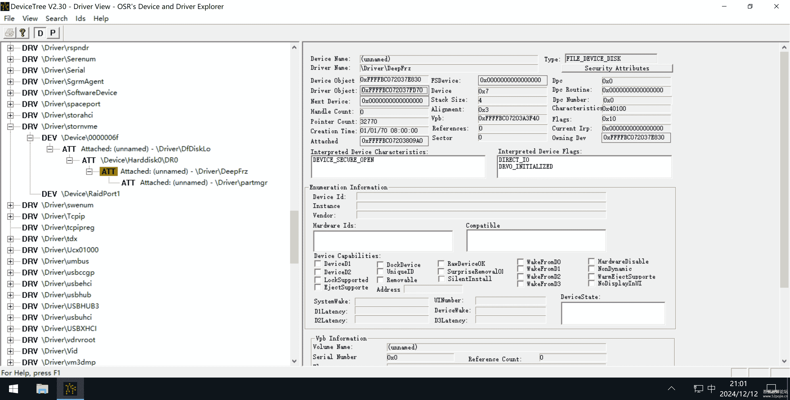
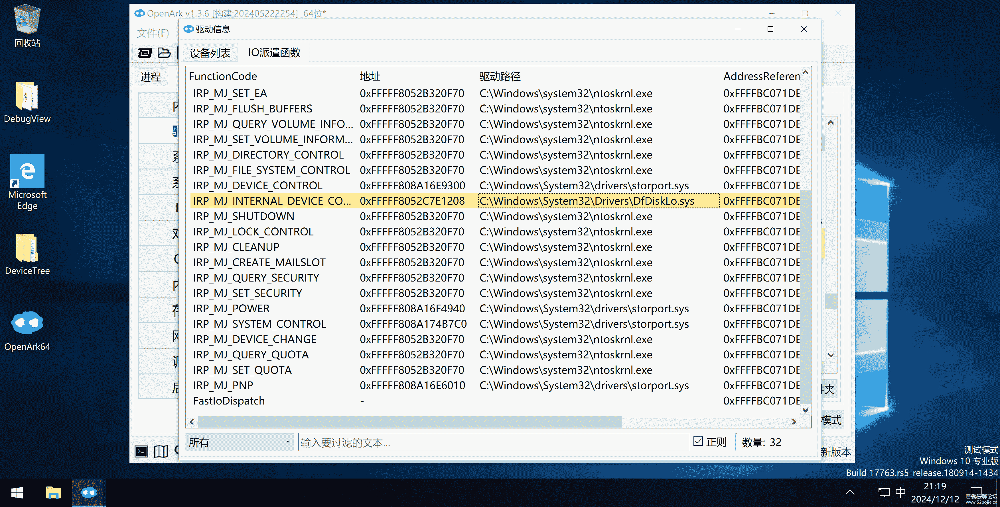

# [系统底层] 各类还原软件 影子系统的穿透方法

- 原帖: https://www.52pojie.cn/forum.php?mod=viewthread&tid=1990770
- 抓取时间: 2026-11-01T21:52:44

要穿透还原软件，首先要了解还原软件的原理，下面以××还原8.63标准版为例分析还原软件（注意：只分析硬盘还原功能，忽略鼠标键盘的过滤器和解冻空间的驱动）
首先使用`DeviceTree`观察硬盘的设备树，发现还原软件在硬盘上层和下层分别附加了过滤器，分别是`DeepFrz.sys`和`DfDiskLo.sys`


Windows 10 x64-2024-12-12-21-01-50.png (1009.76 KB, 下载次数: 3)
[href="forum.php?mod=attachment&aid=Mjc0MzI5OXxjNDk3Y2UyNHwxNzkzNTY5OTYyfDE2ODA4NnwxOTkwNzcw&nothumb=yes" target="_blank"](https://www.52pojie.cn/forum.php?mod=attachment&aid=Mjc0MzI5OXxjNDk3Y2UyNHwxNzkzNTY5OTYyfDE2ODA4NnwxOTkwNzcw&nothumb=yes)
硬盘设备树
2024-12-12 21:02 上传

通过看文件名和测试发现，`DeepFrz.sys`主要负责系统保护，`DfDiskLo.sys`主要负责MBR保护
发现可以通过进入内核直接向SCSI Miniport（本例中是设备`\Device\0000006f`驱动`\Driver\stornvme`）发送`IRP_MJ_SCSI`绕过还原软件直接读写硬盘，参考 这篇文章（https://www.cnblogs.com/robinh00d/archive/2010/01/17/1650135.html）
但同时也失去了`partmgr`和文件系统驱动，只能按扇区读写，需要自己解析硬盘分区和文件系统
FAT32的分区结构简单，很好解析，但现在的系统都使用NTFS文件系统作为系统分区，但NTFS的分区结构比较复杂，所以采用开源linux ntfs读写库 `ntfs-3g`（https://github.com/tuxera/ntfs-3g），使用cygwin把它移植到windows上（主要修改了`libntfs-3g`里的`win32_io.c`），这样就可以在硬盘保护模式中修改和读取任意文件
解除保护就可以直接把还原软件的保护驱动替换成自己的假驱动，重启后就可以解除还原（注意：不能直接利用系统api定位驱动文件存储扇区并修改，因为驱动需要数字签名，直接修改扇区会导致数字签名失效）
尝试修改MBR，用一样的方法修改扇区，提示成功，但重启后MBR没有被修改，猜测发送的IRP被钩子拦截
使用`OpenARK`工具查看`stornvme`的派遣函数，发现`IRP_MJ_INTERNAL_DEVICE_CONTROL`（`IRP_MJ_SCSI`）被挂钩（指向`DfDiskLo.sys`，正常的是指向`storport.sys!RaDriverScsiIrp`），恢复钩子后修改MBR成功


Windows 10 x64-2024-12-12-21-19-06.png (981.8 KB, 下载次数: 2)
[href="forum.php?mod=attachment&aid=Mjc0MzMxM3w4ZWY4ZjdiNHwxNzkzNTY5OTYyfDE2ODA4NnwxOTkwNzcw&nothumb=yes" target="_blank"](https://www.52pojie.cn/forum.php?mod=attachment&aid=Mjc0MzMxM3w4ZWY4ZjdiNHwxNzkzNTY5OTYyfDE2ODA4NnwxOTkwNzcw&nothumb=yes)
被挂钩的派遣函数
2024-12-12 22:02 上传

恢复`IRP_MJ_SCSI`的hook可以直接在`storport.sys`中搜索特征码定位函数地址

```c
NTSTATUS FindScsiMajorRoutineAddress(PULONG64 FuncAddress)
{
        UCHAR sign[] = {
                0x48, 0x89, 0x74, 0x24, 0x18, 0x57, 0x48, 0x83, 0xEC, 0x30, 0x48, 0x89, 0x6C, 0x24, 0x48, 0x48
        };
        RTL_PROCESS_MODULE_INFORMATION DriverInfo = { 0 };
        NTSTATUS status = GetDriverInfo("storport.sys", &DriverInfo);
        if (!NT_SUCCESS(status))
                return status;
        ULONG NeedSize = DriverInfo.ImageSize;
        PVOID StartAddr = DriverInfo.ImageBase;
        for (ULONG i = 0; i MajorFunction[IRP_MJ_SCSI], (LONG64)NewFuncAddress);
        return STATUS_SUCCESS;
}
```

## UPDATE 12/18

此技术在十几年前的机器狗病毒中出现过，还出现过直接读写端口绕过还原卡的技术（只适用于IDE硬盘）
防御办法：
1. 系统启动完成后，禁止加载驱动（或使用驱动白名单）
2. 挂钩硬盘驱动上端改为挂钩SCSI Miniport
3. 定时检测钩子是否被恢复
当然，安装硬件还原卡是最好的防御办法


[href="forum.php?mod=attachment&aid=Mjc0MzMwMnxkNTEwMjg3N3wxNzkzNTY5OTYyfDE2ODA4NnwxOTkwNzcw" target="_blank"](https://www.52pojie.cn/forum.php?mod=attachment&aid=Mjc0MzMwMnxkNTEwMjg3N3wxNzkzNTY5OTYyfDE2ODA4NnwxOTkwNzcw)
(888.01 KB, 下载次数: 72)
2024-12-12 21:35 上传
点击文件名下载附件
主要修改win32_io.c
下载积分: 吾爱币 -1 CB


[href="forum.php?mod=attachment&aid=Mjc0MzMxMnxjYzVlOTFjMHwxNzkzNTY5OTYyfDE2ODA4NnwxOTkwNzcw" target="_blank"](https://www.52pojie.cn/forum.php?mod=attachment&aid=Mjc0MzMxMnxjYzVlOTFjMHwxNzkzNTY5OTYyfDE2ODA4NnwxOTkwNzcw)
(1.15 MB, 下载次数: 92)
2024-12-12 22:00 上传
点击文件名下载附件
不包含修改MBR代码
下载积分: 吾爱币 -1 CB
