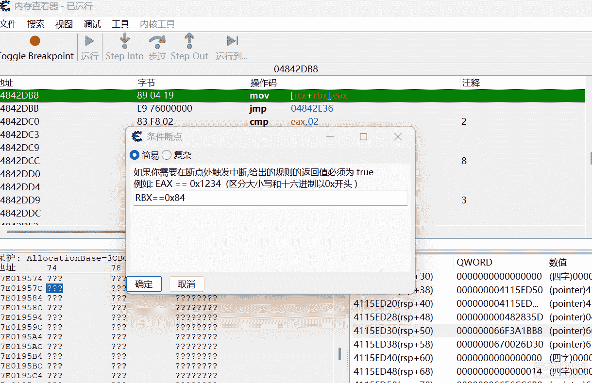
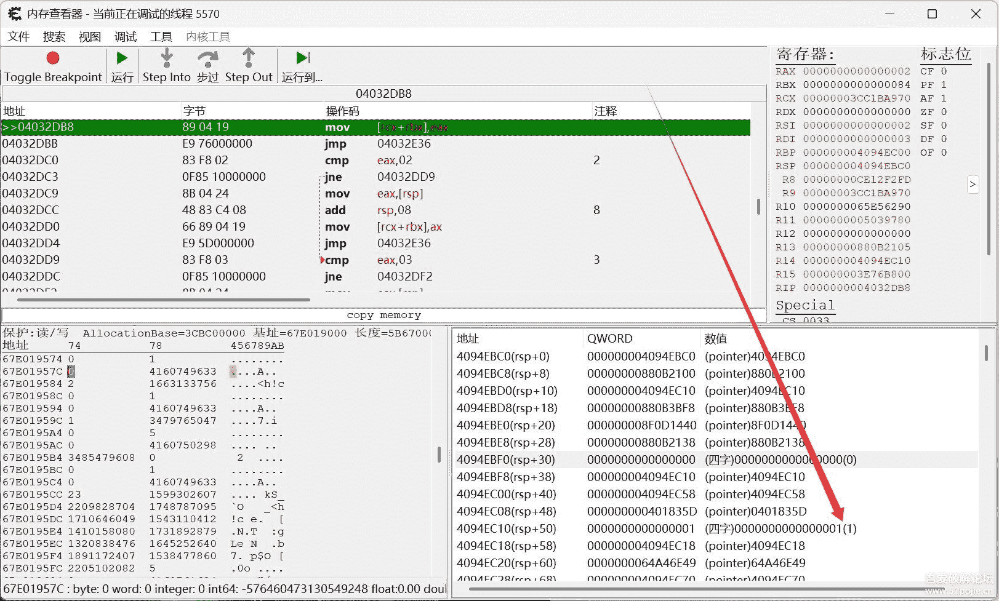
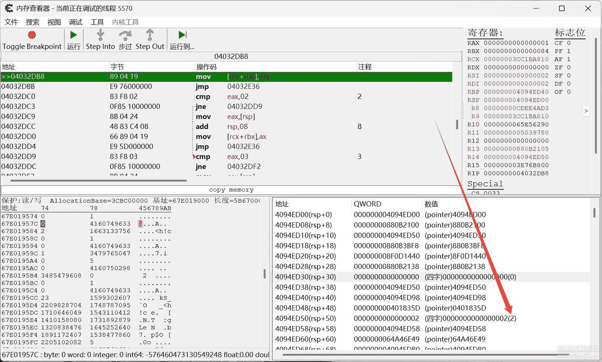
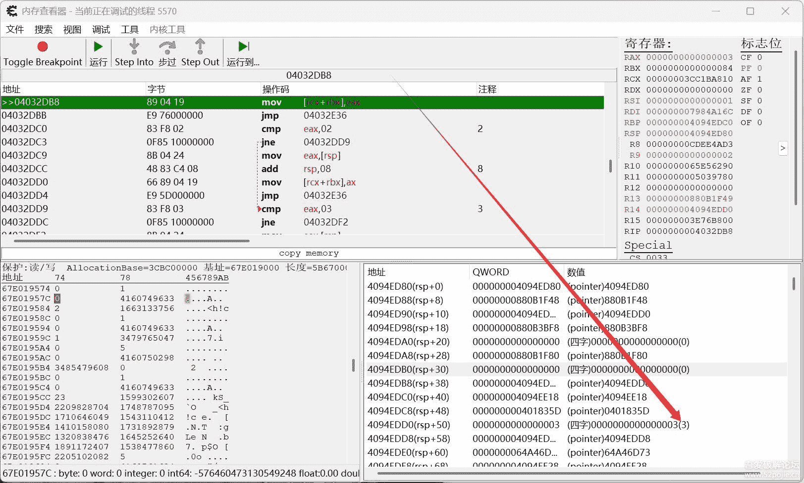
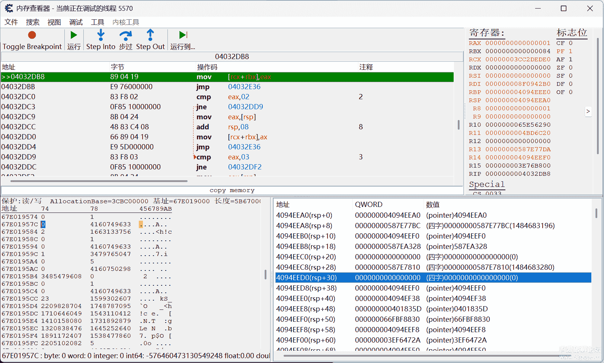
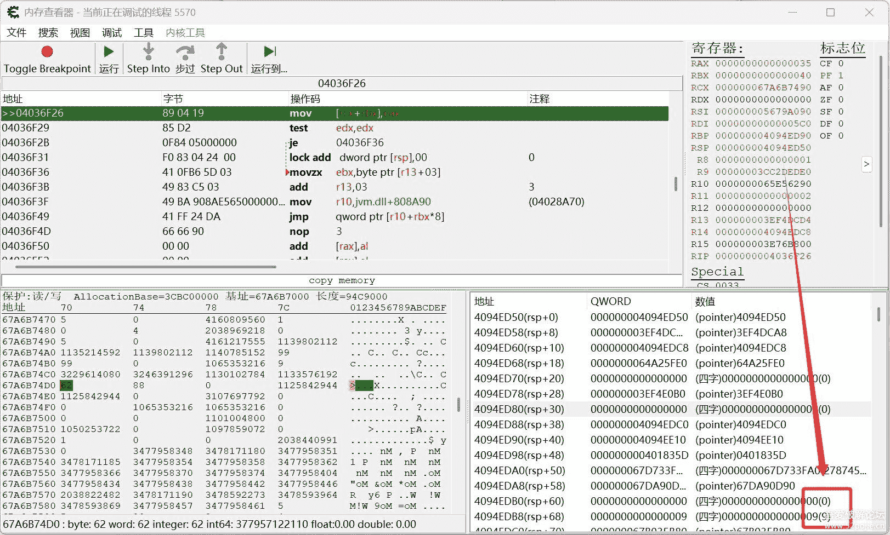
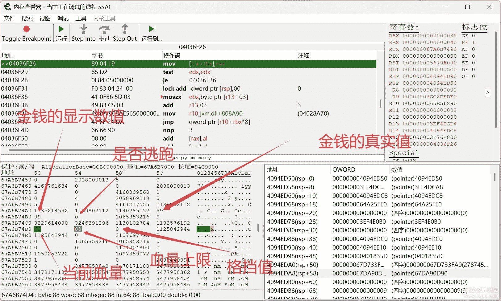
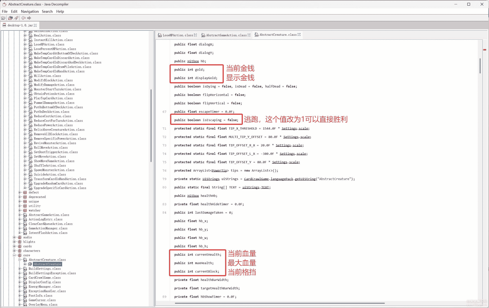
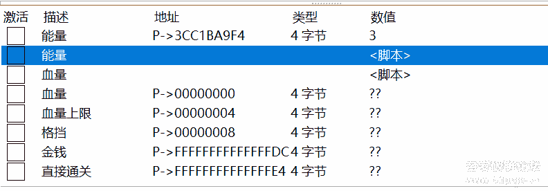

# [游戏安全] 人造指针修改java游戏-杀戮尖塔

- 原帖: https://www.52pojie.cn/forum.php?mod=viewthread&tid=2011479
- 抓取时间: 2026-11-01T21:52:29

接上个帖子https://www.52pojie.cn/thread-2010810-1-1.html，这个帖子详细写一下如何使用人造指针来进行修改

上个帖子的第一个方法存在诸多弊端，容易导致游戏崩溃，文章结尾略微带了一下人造指针，这次深入的去探讨一下。

## 一.能量值的修改

整体思路：首先利用找到的能量操作码的地址`[jvm.dll+7FF818]+749`（如何获得详见上个帖子），利用代码注入，筛选出能量地址，并写入一个可读可写的空白内存区域作为指针。
### 1.首先在能量操作码这里下一个条件断点，`RBX==0x84`，初步筛选出对能量的操作，然后观察堆栈的情况。

1.jpg (127.82 KB, 下载次数: 3)
[href="forum.php?mod=attachment&aid=Mjc1ODkyNnxkZWM5NTU2MXwxNzkzNTY5OTQ3fDE2ODA4NnwyMDExNDc5&nothumb=yes" target="_blank"](https://www.52pojie.cn/forum.php?mod=attachment&aid=Mjc1ODkyNnxkZWM5NTU2MXwxNzkzNTY5OTQ3fDE2ODA4NnwyMDExNDc5&nothumb=yes)
2025-3-4 20:45 上传

2.jpg (375.37 KB, 下载次数: 3)
[href="forum.php?mod=attachment&aid=Mjc1ODkyN3w5ZWZkOWU5NXwxNzkzNTY5OTQ3fDE2ODA4NnwyMDExNDc5&nothumb=yes" target="_blank"](https://www.52pojie.cn/forum.php?mod=attachment&aid=Mjc1ODkyN3w5ZWZkOWU5NXwxNzkzNTY5OTQ3fDE2ODA4NnwyMDExNDc5&nothumb=yes)
2025-3-4 20:46 上传
### 2.通过出不同费用的牌，我们观察堆栈的情况，注意到此处的数值为牌的费用。

3.jpg (375.45 KB, 下载次数: 0)
[href="forum.php?mod=attachment&aid=Mjc1ODkyOHwyMDVkYjA5M3wxNzkzNTY5OTQ3fDE2ODA4NnwyMDExNDc5&nothumb=yes" target="_blank"](https://www.52pojie.cn/forum.php?mod=attachment&aid=Mjc1ODkyOHwyMDVkYjA5M3wxNzkzNTY5OTQ3fDE2ODA4NnwyMDExNDc5&nothumb=yes)
2025-3-4 20:48 上传
### 3.我们再多次进行操作并观察。每回合开始时，也会触发断点，此处的值为3（因为每回合恢复为3点能量），那么我们可以根据该值来进行筛选，由于能量的变化一般为0-5之间，不过根据观察，其他非能量操作时，堆栈该处的值为地址，所以我采用判断该处的值是否在0-99之间作为判断依据。

4.jpg (376.65 KB, 下载次数: 3)
[href="forum.php?mod=attachment&aid=Mjc1ODkyOXw0ODRjMjBkY3wxNzkzNTY5OTQ3fDE2ODA4NnwyMDExNDc5&nothumb=yes" target="_blank"](https://www.52pojie.cn/forum.php?mod=attachment&aid=Mjc1ODkyOXw0ODRjMjBkY3wxNzkzNTY5OTQ3fDE2ODA4NnwyMDExNDc5&nothumb=yes)
2025-3-4 20:50 上传
### 4.当退出游戏回到主页面时，触发了断点，此时观察堆栈情况，并与能量变化时的堆栈进行对比，找出不同点从而筛选出目标地址

5.jpg (180.01 KB, 下载次数: 3)
[href="forum.php?mod=attachment&aid=Mjc1ODkzMHw3OGNiODFiNnwxNzkzNTY5OTQ3fDE2ODA4NnwyMDExNDc5&nothumb=yes" target="_blank"](https://www.52pojie.cn/forum.php?mod=attachment&aid=Mjc1ODkzMHw3OGNiODFiNnwxNzkzNTY5OTQ3fDE2ODA4NnwyMDExNDc5&nothumb=yes)
2025-3-4 20:54 上传
### 5.通过比对，我选择通过判断`rsp+20`的值是否为0判断是否回到了主页面，然后将指针置为0，避免把旧地址的值锁定到某个值而导致游戏崩溃。由于当回合开始时触发的能量变化操作，其`rsp+20`也为0，但`rsp+50`在0-99之间，为了避免在游戏过程中将指针置0而导致修改失效，所以先判断`rsp+50`的值是否满足，然后再判断`rsp+20`是否为0，写出汇编代码如下
```
[ENABLE]
alloc(newmem,2048)
label(returnhere)
label(originalcode)
label(inject)
label(exit)

newmem: //this is allocated memory, you have read,write,execute access
//place your code here
cmp rbx,84
jne originalcode
cmp [rsp+50],0//能量变化0到99之间
jl inject
cmp [rsp+50],99
jg inject
push rsi
push rdi
lea rsi,[rcx+rbx]
mov rdi,jvm.dll+7BA2A0
mov [rdi],rsi
pop rdi
pop rsi
jmp originalcode

inject:
cmp [rsp+20],0//是否回到主页面
jne originalcode
push rdi
mov rdi,jvm.dll+7BA2A0
mov qword ptr [rdi],0
pop rdi

originalcode:
mov [rcx+rbx],eax
mov rax,[jvm.dll+7FF818]
add rax,7C7
jmp rax

exit:
jmp returnhere

define(injectAddress,[jvm.dll+7FF818]+749)

injectAddress:
jmp newmem
nop 3
returnhere:

[DISABLE]
//code from here till the end of the code will be used to disable the cheat
dealloc(newmem)
injectAddress:
db 89 04 19 E9 76 00 00 00
//mov [rcx+rbx],eax
//jmp 04822E36
```
### 6.经过测试，打了一整局游戏，没有出现崩溃的情况，也没有出现其他不正常问题，方法可行。

## 二.血量的修改

整体思路和能量的差不多，但是血量地址隔一段时间就会变，很难搞，而且打到一半修改血量的操作码会变成另外一个，原操作码获取到的地址会变成怪物的血量地址（也就是说如果锁定了血量，玩着玩着你会发现怪物的血量被锁了）
### 1.血量的基本思路一样，这里就简单说一下分析。根据多次测试，可得出下图方框中上面0代表怪物未打破格挡，1则打破格挡，下面的数值为本次受到的伤害

6.jpg (434.51 KB, 下载次数: 2)
[href="forum.php?mod=attachment&aid=Mjc1ODkzMXwzM2Y2ZTRiOHwxNzkzNTY5OTQ3fDE2ODA4NnwyMDExNDc5&nothumb=yes" target="_blank"](https://www.52pojie.cn/forum.php?mod=attachment&aid=Mjc1ODkzMXwzM2Y2ZTRiOHwxNzkzNTY5OTQ3fDE2ODA4NnwyMDExNDc5&nothumb=yes)
2025-3-4 21:14 上传
### 2.以下是对血量及其附近内存数据的分析结果

7.jpg (454.46 KB, 下载次数: 3)
[href="forum.php?mod=attachment&aid=Mjc1ODkzMnwyMzg1MjlhZHwxNzkzNTY5OTQ3fDE2ODA4NnwyMDExNDc5&nothumb=yes" target="_blank"](https://www.52pojie.cn/forum.php?mod=attachment&aid=Mjc1ODkzMnwyMzg1MjlhZHwxNzkzNTY5OTQ3fDE2ODA4NnwyMDExNDc5&nothumb=yes)
2025-3-4 21:19 上传
### 3.因为是java,所以直接用`jd-gui`查看源码，可以了解到每个数据的真实含义。看了源码之后就可以知道为什么有两个金钱值并且其中一个修改无效了。至于那个值是怎么分析出逃跑的，是因为怪物和角色用的同一个类，所以当我修改了怪物的这个值后怪物逃跑了。

8.jpg (520.37 KB, 下载次数: 3)
[href="forum.php?mod=attachment&aid=Mjc1ODkzM3wxOTk0ZDM1NHwxNzkzNTY5OTQ3fDE2ODA4NnwyMDExNDc5&nothumb=yes" target="_blank"](https://www.52pojie.cn/forum.php?mod=attachment&aid=Mjc1ODkzM3wxOTk0ZDM1NHwxNzkzNTY5OTQ3fDE2ODA4NnwyMDExNDc5&nothumb=yes)
2025-3-4 21:24 上传
### 4.血量虽然也写了一个脚本，但是只能用于前半场，后半场血量的操作码换地址了，新的操作码可以用AOB注入来实现，不过太麻烦了，暂时不搞了。而且因为血量和金钱等数据是存放在一块的，所以找到一个等于找到一堆。
### 5.血量这个脚本是个半成品，能用但不多

这个CT表我分享在下面，也望大佬多多指教。

9.jpg (22.39 KB, 下载次数: 3)
[href="forum.php?mod=attachment&aid=Mjc1ODkzNHxiOGUxM2RjZHwxNzkzNTY5OTQ3fDE2ODA4NnwyMDExNDc5&nothumb=yes" target="_blank"](https://www.52pojie.cn/forum.php?mod=attachment&aid=Mjc1ODkzNHxiOGUxM2RjZHwxNzkzNTY5OTQ3fDE2ODA4NnwyMDExNDc5&nothumb=yes)
2025-3-4 21:32 上传

将扩展名修改为CT

[href="forum.php?mod=attachment&aid=Mjc1ODkzNnwyNTBlMjA5Y3wxNzkzNTY5OTQ3fDE2ODA4NnwyMDExNDc5" target="_blank"](https://www.52pojie.cn/forum.php?mod=attachment&aid=Mjc1ODkzNnwyNTBlMjA5Y3wxNzkzNTY5OTQ3fDE2ODA4NnwyMDExNDc5)
(4.65 KB, 下载次数: 58)
2025-3-4 21:41 上传

点击文件名下载附件

修改扩展名为CT
下载积分: 吾爱币 -1 CB
