# [漏洞分析] Vuln 注入 wordpress -_- Easy Quotes SQL (CVE-2025-26943)

- 原帖：https://www.52pojie.cn/forum.php?mod=viewthread&tid=2011783
- 抓取时间：2026-11-01T21:52:26

CVE-2025-26943 ImproperNeutralization of Special Elements used in an SQL Command ('SQL Injection')vulnerability in Jürgen Müller Easy Quotes allows Blind SQL Injection. Thisissue affects Easy Quotes: from n/a through 1.2.2.

即，wordpress 插件 Quotes 1.2.2 之前版本存在 SQL 注入问题。

## 定位漏洞

分别下载插件源码，1.2.3 补丁后版本和 1.2.2 版本经过对比，确实在文件 `\easy-quotes.1.2.2\easy-quotes\includes\quotes-data.php` 中有代码修改，包括多个函数：

- `get_fonts`：  
  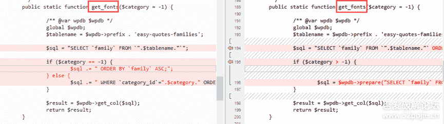  
  2025-3-5 15:59 上传

- `get_fonts_categories`：  
  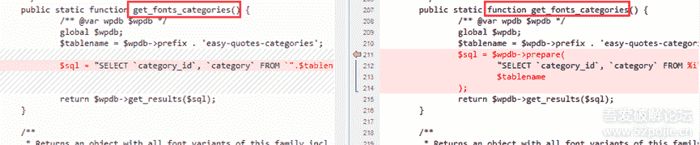  
  2025-3-5 16:00 上传

- `get_font_variants`：  
  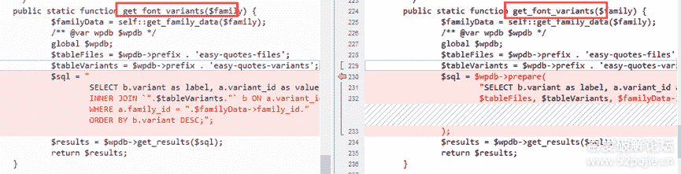  
  2025-3-5 16:00 上传

- `get_font_variant`：  
  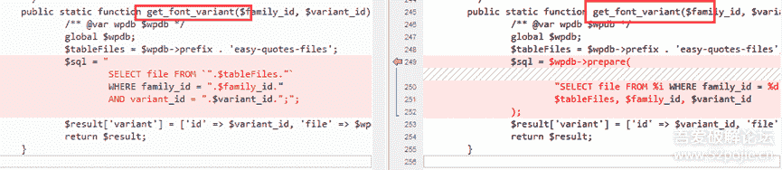  
  2025-3-5 16:00 上传

- `get_family_data`：  
  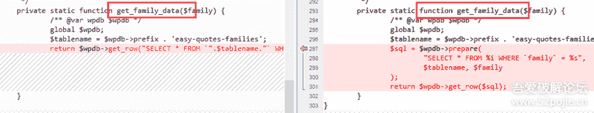  
  2025-3-5 16:00 上传

## 反推插件访问逻辑

在根目录看到有文件：`quotes-rest-route.php`，其中有逻辑如下：

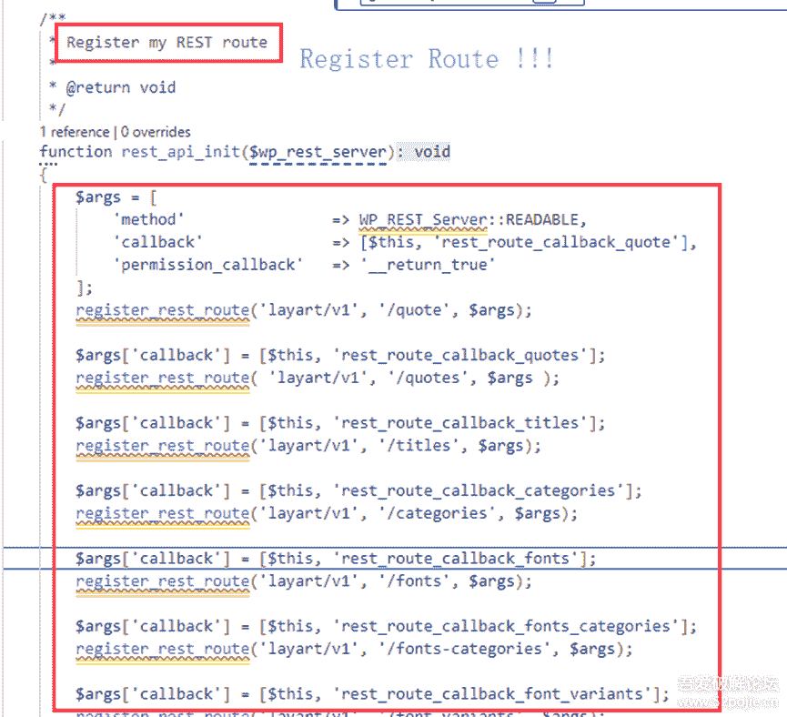

2025-3-5 16:01 上传

明显上面的代码是 Register Route 注册路由使用。再看下面的每一个 `register_rest_route`，正是对应的将路径和回调 `callback` 做了一一对应。

尝试访问看下结果。以第一项为例：`/layart/v1/quotes`。而 wordpress 的插件访问路径一般为 `XXX/wp-json/`，即 `XXX/wp-json/layart/v1/quotes`，如下，bingo。

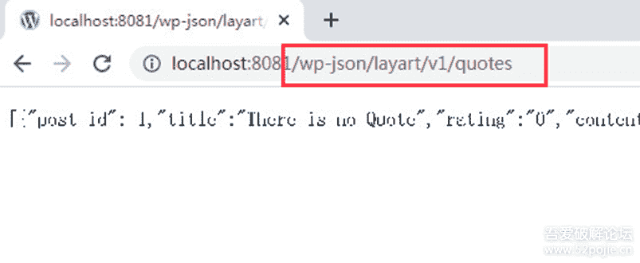

2025-3-5 16:01 上传

## 跟踪调用链

回过头看上面被 patch 的函数，以最后一个 `get_family_data` 函数为例。

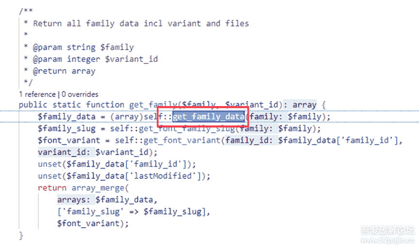

2025-3-5 16:01 上传

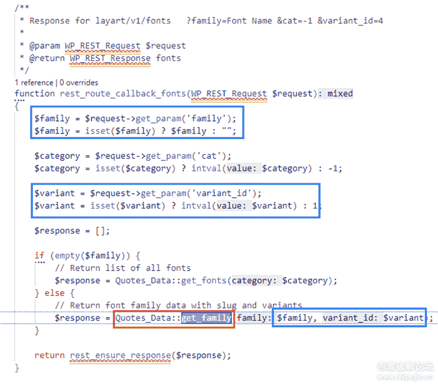

2025-3-5 16:02 上传

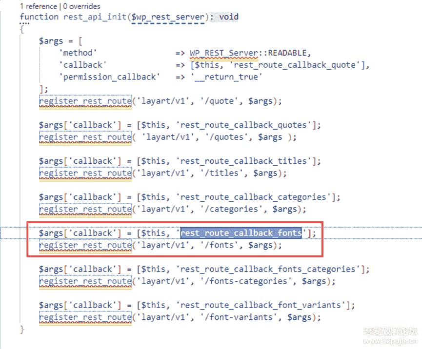

2025-3-5 16:02 上传

根据以上三处调用可以得出结论：

URL：`/layart/v1/fonts` 对应接口（回调函数）为 `rest_route_callback_fonts`，该接口调用链为：

```
rest_route_callback_fonts
{
    httpparam（family）
    ……
    get_family
    {
        ……
        get_family_data
        {
            patched sql 语句
        }
        ……
    }
    ……
}
```

## 利用验证

### 补丁差别

#### 1.2.2 代码

```php
/** @var wpdb $wpdb */
global $wpdb;
$tablename = $wpdb->prefix .'easy-quotes-families';
return $wpdb->get_row("SELECT *FROM `".$tablename."` WHERE `family`='".$family."';");
```

#### 1.2.3 代码

```php
/** @var wpdb $wpdb */
global $wpdb;
$tablename = $wpdb->prefix .'easy-quotes-families';
$sql = $wpdb->prepare(
    "SELECT* FROM %i WHERE `family` = %s",
    $tablename, $family
);
return $wpdb->get_row($sql);
```

### 构造 payload

正常访问数据：`/wp-json/layart/v1/fonts?family=test`

利用访问数据：`/wp-json/layart/v1/fonts?family=test`


结果如下：

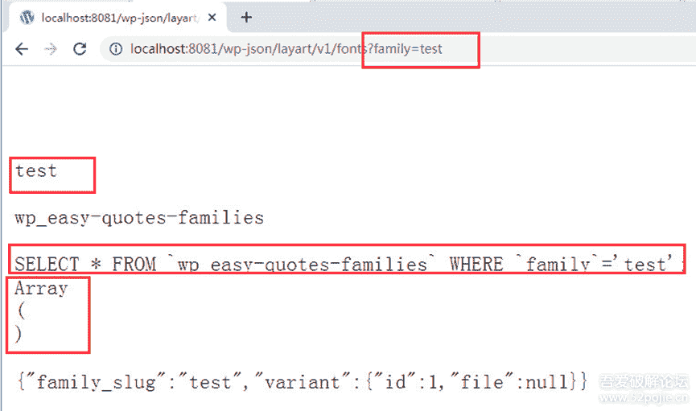

2025-3-5 16:04 上传

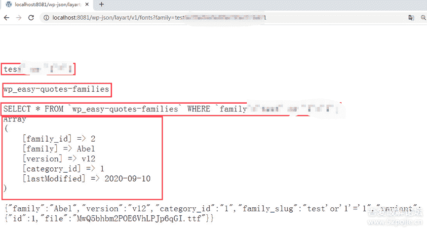

2025-3-5 16:06 上传
