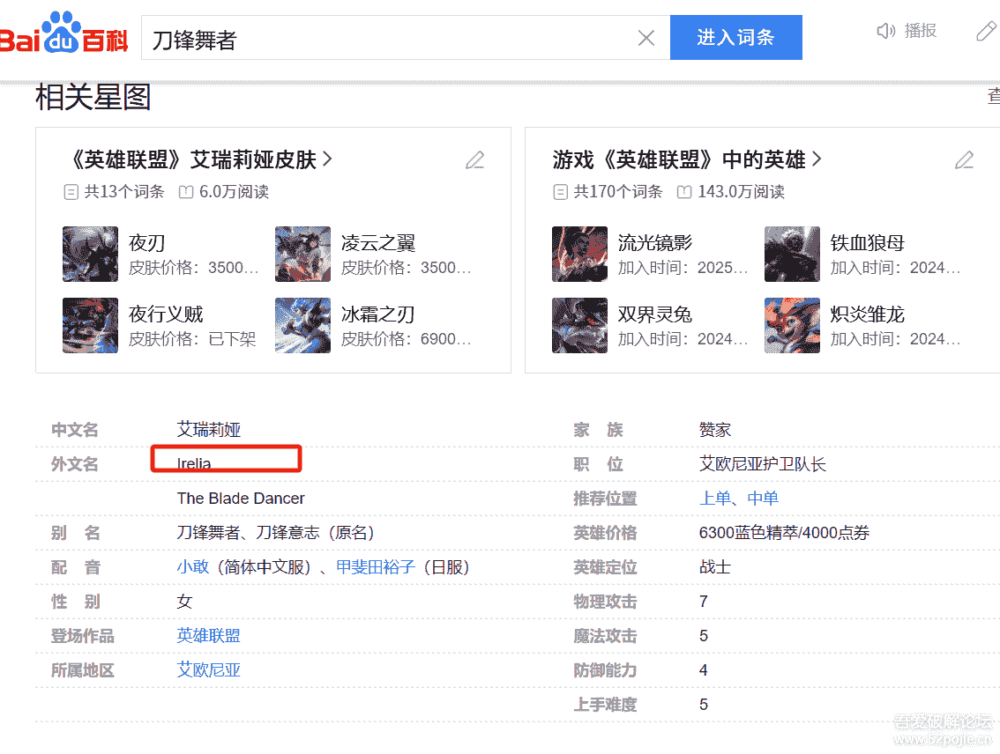
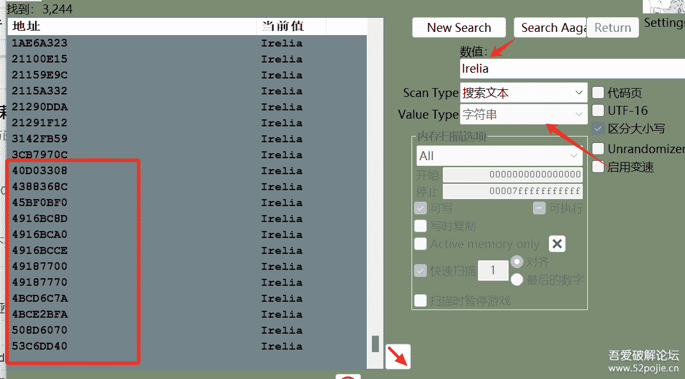
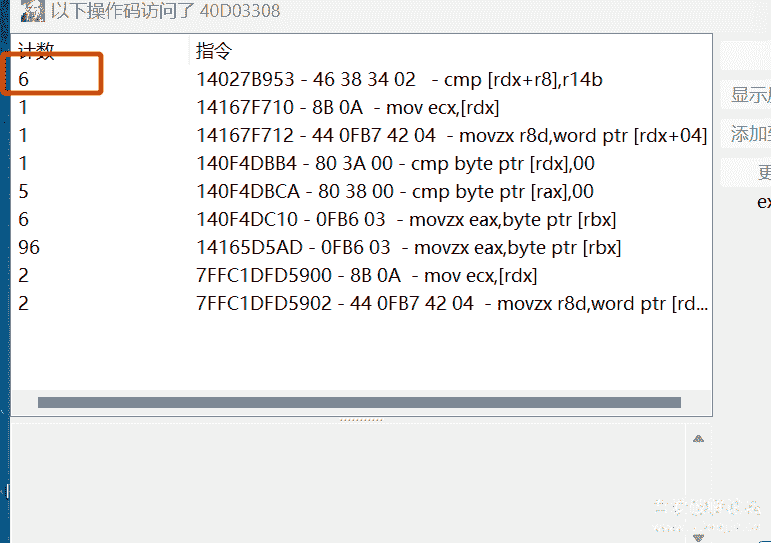
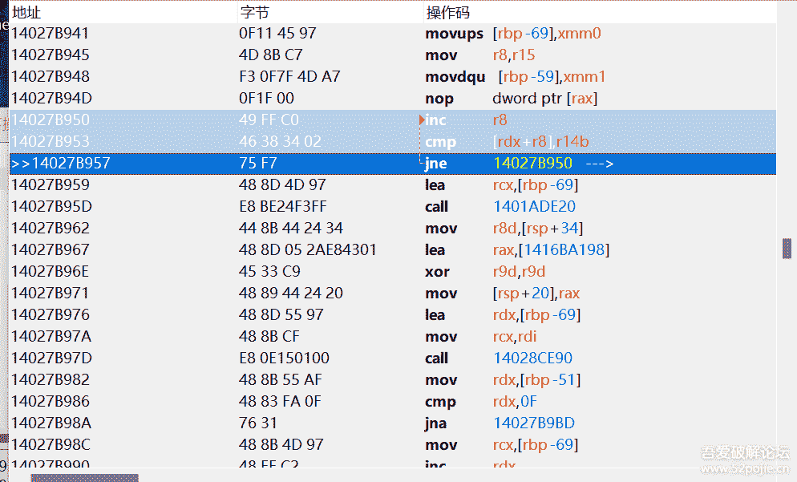
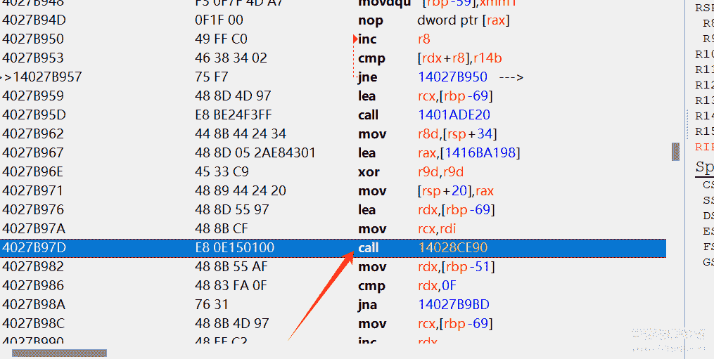

# [游戏安全] LOL 查找换肤 `CALL` 和调用（一）

- 原帖：https://www.52pojie.cn/forum.php?mod=viewthread&tid=2017198
- 抓取时间：2026-11-01T21:52:21

在论坛潜水学习许久，我终于鼓起勇气，尝试用自己尚显稚嫩的技术与有限的表达，在这里发了帖子。若内容有疏漏、错误之处，恳请各位大佬不吝赐教，感激不尽。

LOL 动态换肤原理不用过多赘述了，调用换肤 `CALL` 即可实现。

## 换肤 `CALL` 查找

### 1. 确认英雄名

随便找个英雄进入游戏，确认所选英雄英文名。我这边选的是刀妹，对应的为 `Irelia`；不知道的可以到百度百科上查。



`image.png`（195.29 KB，下载次数：2）；`Irelia`，2025-3-21 10:52 上传。

### 2. `CE` 启动

`CE` 字符串搜索 `Irelia`，3244 个结果不要怕，我们只需要看最下面的十几个地址就行。



`image.png`（87.38 KB，下载次数：1）；`Irelia` 查找，2025-3-21 10:54 上传。

选择第一个，查看什么访问了这个地址。计数为 6，`Irelia` 的长度也为 6，那么这个可能就是我们要找的地址。



`image.png`（52.87 KB，下载次数：2）；`Irelia` 访问，2025-3-21 10:59 上传。

进入汇编，这里就是对 `Irelia` 每个字符的确认；确认完成之后就是换肤了。



`image.png`（78.17 KB，下载次数：2）；名字汇编，2025-3-21 11:04 上传。

那么下面的 `CALL` 就是换肤 `CALL` 了。

一共 5 个参数：

- `r8`：换肤 ID
- `rax`：`1416BA198`
- `r9`：`0`
- `rdx`：人物名称
- `rcx`：人物地址

换肤 `CALL`：`14028c190`。

有了这些地址就能调用了。



`image.png`（69.06 KB，下载次数：2）；换肤 `CALL`，2025-3-21 11:08 上传。

以下是 deepseek 写的 `CALL` 代码：

```cpp
//通用CALL
typedef uintptr_t(__stdcall* UniversalCall_t)(uintptr_t, uintptr_t, uintptr_t, uintptr_t, uintptr_t);
uintptr_t UniversalCall(uintptr_t functionAddress, uintptr_t arg1, uintptr_t arg2, uintptr_t arg3, uintptr_t arg4, uintptr_t arg5) {
    UniversalCall_t callFunction = (UniversalCall_t)functionAddress;
    return callFunction(arg1, arg2, arg3, arg4, arg5);
}
```

调用：

```asm
UniversalCall(MODELFUNC,Read64(PLAYERBASE), Read64(PLAYERBASE)+ NAMEOFFERST,SKINID,0,RAX)
```

我用的是劫持 DLL 的方式，工具：`AheadLib`，劫持 DLL 名称：`version.dll`。
