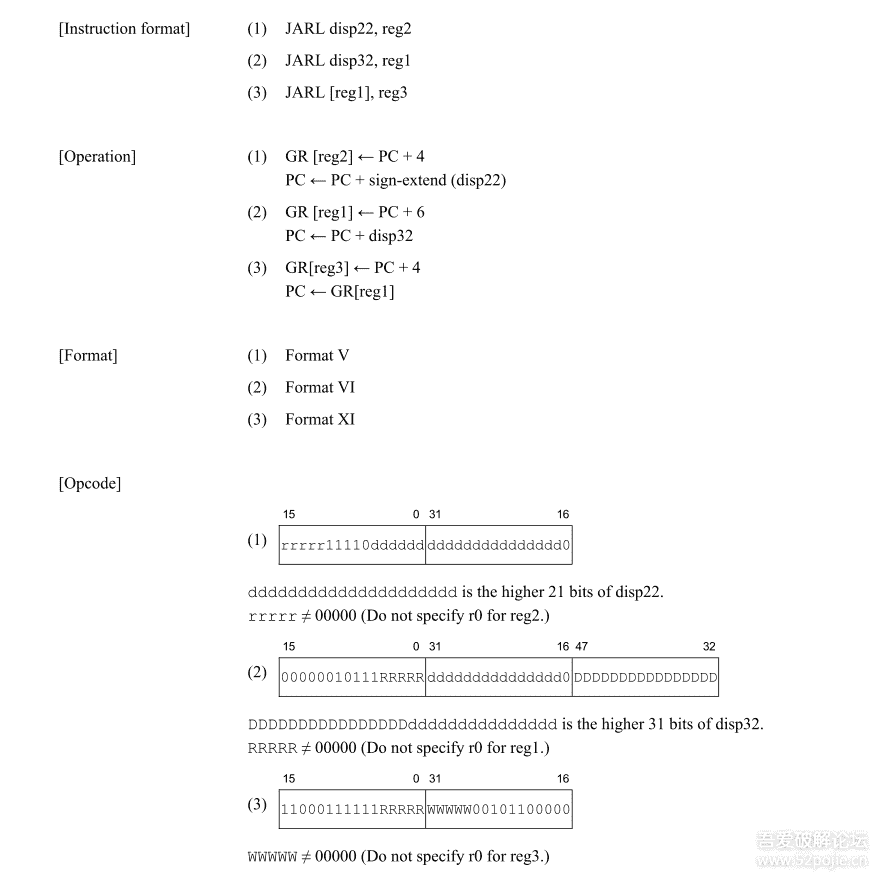
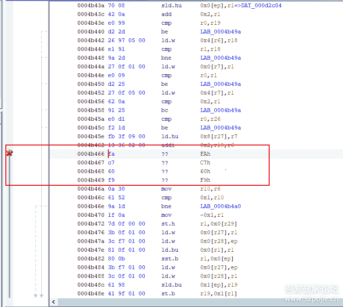
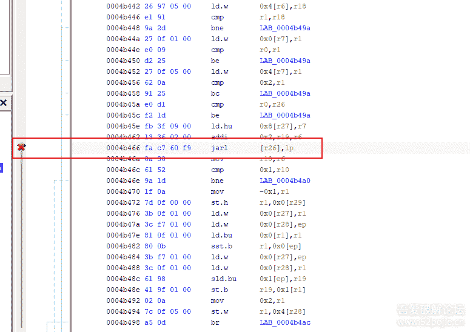

# [调试逆向] 如何手动给Ghidra添加自定义指令码，让软件能正常反汇编

- 原帖: https://www.52pojie.cn/forum.php?mod=viewthread&tid=2046353
- 抓取时间: 2026-11-01T21:51:56

最近在使用开源的Ghidra进行逆向工作，Ghidra相当强大，很多IDA不支持F5的处理器指令架构Ghidra都能支持，这个功能很好用，为分析程序功能提供了很大帮助（虽然反编译出来的代码也是一坨屎，但是总好过没有吧）。

逆向过程中常常会碰到Ghidra不能识别的指令，比如瑞萨的RH850指令集，这个就分好几个版本V850E1，V850E2，V850E3等等，每个子集又有少许差别，目前我使用的11.3.2版本对v850只支持到E2，往上就不支持了，而我目前需要逆向分析的固件就是V850E3V5架构，最初尝试使用E2的Ghidra反汇编程序文件，大部分是可以正常显示的，毕竟高版本兼容低版本指令集，不过高版本新增的指令集Ghidra就没法处理了，怎么办？经过各种搜索，发现都指向官方的添加新架构的教程，教程繁琐不说还要下载安装官方编译环境，看了就头大，人生苦短，直接劝退了，虽然软件不支持，但是活还是要干完，经过一番学习，我总结出了给特定处理器添加新指令的方法，不需要下载Ghidra编译开发SDK，直接改对应的指令描述文件就行，ghidra软件每次打开都会从新加载指令描述文件，步骤如下。

11.3.2版本的Ghidra对RH850架构的指令集支持不全，以`jarl`指令为例子，查看指令集手册，发现`jarl`指令有3种用法，如下图



0.png (98.8 KB, 下载次数: 1)

[href="forum.php?mod=attachment&aid=Mjc4OTQ3MnxlMTZhMzI5Y3wxNzkzNTY5OTE0fDE2ODA4NnwyMDQ2MzUz&nothumb=yes" target="_blank"](https://www.52pojie.cn/forum.php?mod=attachment&aid=Mjc4OTQ3MnxlMTZhMzI5Y3wxNzkzNTY5OTE0fDE2ODA4NnwyMDQ2MzUz&nothumb=yes)

2025-7-17 16:03 上传

Ghidra只支持第1和第2种用法，第三种用法是不能正确识别的，反汇编结果如下图



1.png (62.74 KB, 下载次数: 2)

[href="forum.php?mod=attachment&aid=Mjc4OTQ3M3w1OWIyZjJjZXwxNzkzNTY5OTE0fDE2ODA4NnwyMDQ2MzUz&nothumb=yes" target="_blank"](https://www.52pojie.cn/forum.php?mod=attachment&aid=Mjc4OTQ3M3w1OWIyZjJjZXwxNzkzNTY5OTE0fDE2ODA4NnwyMDQ2MzUz&nothumb=yes)

2025-7-17 16:03 上传

经过分析研究，发现Ghidra是通过一种叫做SLEIGH的描述语言来定义不同芯片的指令行为的，每种芯片的指令架构描述都在软件安装目录下`xxx\ghidra_11.3.2_PUBLIC\Ghidra\Processors`。以RH850为例，指令描述在`Ghidra\Processors\V850\data\languages`文件夹内，分析文件夹内的文件，发现和`jarl`指令描述有关的文件为`Special.sinc`这个文件，打开文件可以看到关于`jarl`指令的第一和第二个用法的描述如下：

```
# JARL disp22, reg2 - rrrrr11110dddddd|ddddddddddddddd0
:jarl adr22, R1115 is (op0610=0x1E & R1115) ... & adr22
{
	R1115 = inst_next;
	call adr22;
}
 
# JARL disp32, reg1 - 00000010111RRRRR|ddddddddddddddd0|DDDDDDDDDDDDDDDD
:jarl adr32, R0004 is op0515=0x017 & R0004; adr32
{
	R0004 = inst_next;
	call adr32;
}
```

仔细研究发现和上图指令集手册的描述是能对应上的，唯独缺了`JARL [reg1], reg3`的描述，我们可以依葫芦画瓢，手动添加`JARL [reg1], reg3`的指令描述，如下图

```
# JARL [reg1], reg3  - 11000111111RRRRR|WWWWW00101100000

:jarl [R0004], R2731 is op0515=0x63F & R0004; op1626=0x160 & R2731
{
	R2731 = inst_next;
	call [R0004];
}
```

这其中`11000111111RRRRR | WWWWW00101100000`说明了指令格式，指令有4字节32bit。

`opxxxx`是指操作码在指令内的位置，`op0515`指的是在低16位内，bit位置为5~15，对应`11000111111`，`R0004`表示reg1在低16位指令码的0~4bit，对应`RRRR`，`op1626`指的是数据在高16位的指令数据内，对应的bit为16~26也就是`00101100000`，`R2731`表示reg3数据在高16位的指令数据内，对应的bit为27~31也就是`WWWWW`，值得注意的是`op0515=0x63f`这个指令，原本以为`11000111111RRRRR`转为`1100011111100000`就等于`0xc7e0`，结果我写成了`op0515=0xc7e0`，导致Ghidra打开总是报错（坑爹的报错还不能提示正确的错误位置和错误原因），想了半天没搞明白，差点放弃了，后来慢慢对比sinc文件内的其他指令描述，慢慢分析理解，终于发现`11000111111RRRRR`转为`1100011111100000`还要右移5bit，等于把`RRRRR`去掉，`0xc7e0 >>5 = 0x63F`这样才正确了。

添加了这个指令描述后，关闭Ghidra，然后从新打开工程，软件会自动更新指令集文件，从新analysis一次或者找到不识别的位置，按D快捷键就可以正确识别了，如下图



2.png (57.89 KB, 下载次数: 3)

[href="forum.php?mod=attachment&aid=Mjc4OTQ3NHxkNmU5MGNlMXwxNzkzNTY5OTE0fDE2ODA4NnwyMDQ2MzUz&nothumb=yes" target="_blank"](https://www.52pojie.cn/forum.php?mod=attachment&aid=Mjc4OTQ3NHxkNmU5MGNlMXwxNzkzNTY5OTE0fDE2ODA4NnwyMDQ2MzUz&nothumb=yes)

2025-7-17 16:03 上传

又可以愉快玩耍摸鱼了，保住了头顶的头发，不用伤脑筋手啃汇编了，F5大法真香

顺带提一下，添加的自定义指令用到的`opxxxx`和`Rxxxx`其实是宏定义，这些定义可能原本没有被定义，需要自己手动添加，RH850架构在`Extras.sinc`和`Tokens.sinc`有定义，看一下目录内的其他文件，仔细研究一下也不太难懂
