# [调试逆向] 利用VMware debugStub机制调试中断现场 `KiDispatchException` `KiSystemCall64`

- 原帖: https://www.52pojie.cn/forum.php?mod=viewthread&tid=2048039
- 抓取时间: 2026-11-01T21:51:51

## 利用VMware debugStub机制调试中断现场/`KiDispatchException`/`KiSystemCall64`

中断现场、`KiDispatchException`、还有`syscall`/`sysenter`的内核入口的调试，似乎对很多新手都造成了不小的困扰。

最近突然想到VMware等常见虚拟机都是支持`GDB`调试的，而这种调试机制，是独立于客户机系统之外的。

`windbg`之所以不能调试中断现场/`KiDispatchException`主要就是因为这些代码处于异常分发的逻辑之中，而`gdb`调试不属于这一体系，所以就能绕过这种限制。

本文以VMware+IDA为例，VirtualBox、QEMU的大致情况应该也基本一致

#### 根据客户机的位数，选择对应的配置添加到`.vmx`文件中

``` 
debugStub.hideBreakpoints= "TRUE"
debugStub.listen.guest32 = "TRUE"
debugStub.listen.guest32.remote = "TRUE"
monitor.debugOnStartGuest32 = "TRUE"
```

``` 
debugStub.hideBreakpoints= "TRUE"
debugStub.listen.guest64 = "TRUE"
debugStub.listen.guest64.remote = "TRUE"
monitor.debugOnStartGuest64 = "TRUE"
```

`debugStub.listen.guest??.remote` 允许其他机器来远程调试，非必选项

`monitor.debugOnStartGuest??` 会让客户机开机一瞬间就等待调试器，方便调试BIOS，非必选项

#### 配置IDA

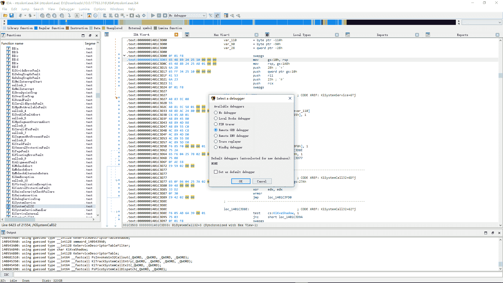

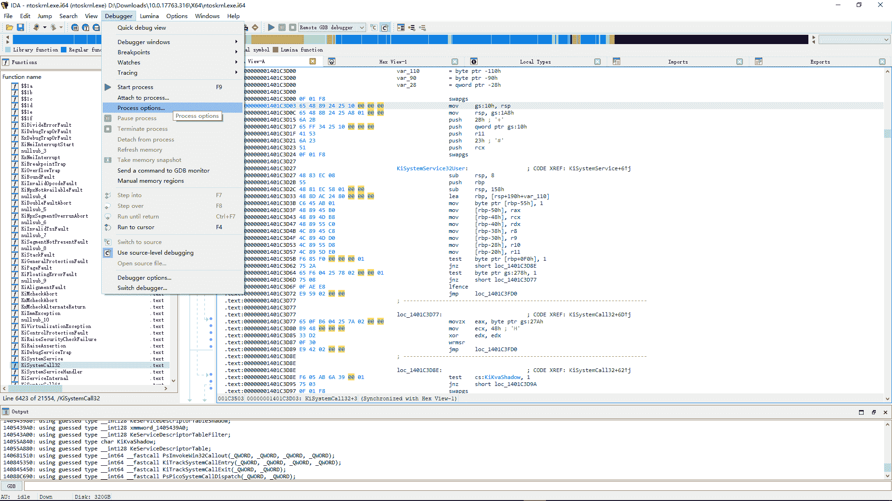

32位客户机，端口是8832

64位客户机，端口是8864

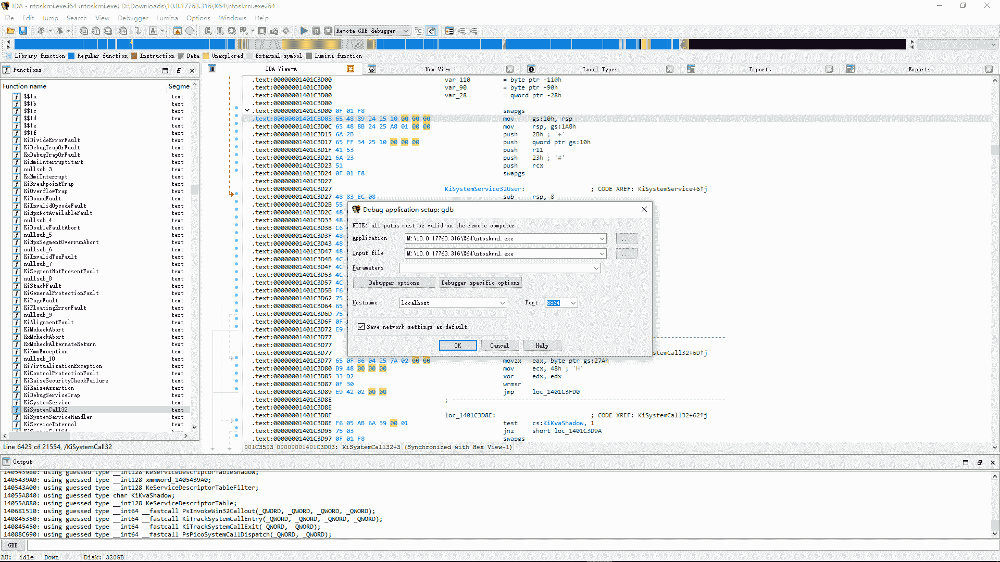

附加到虚拟机：

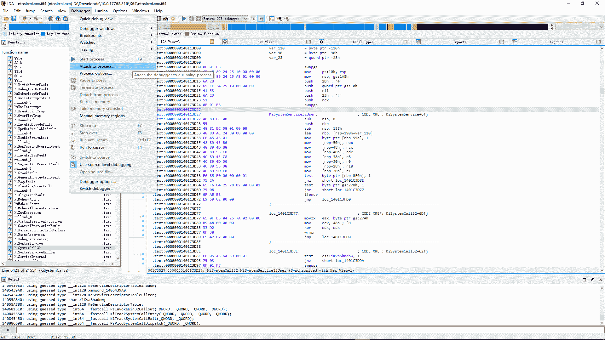

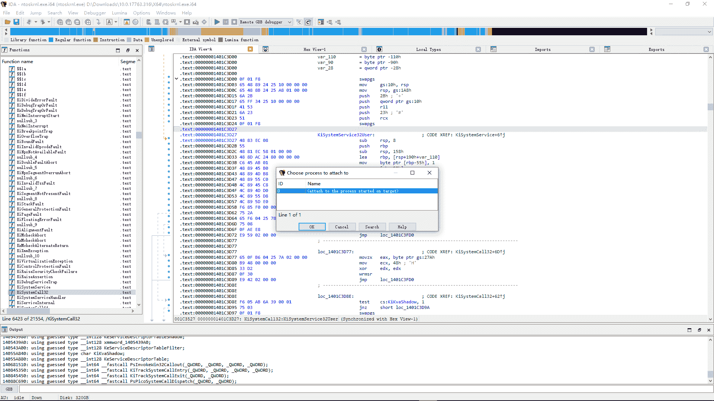

附加成功。但部分内存不能直接跳过去（我也不太清楚IDA为什么这么设计），我们手动设置一下内存区域：

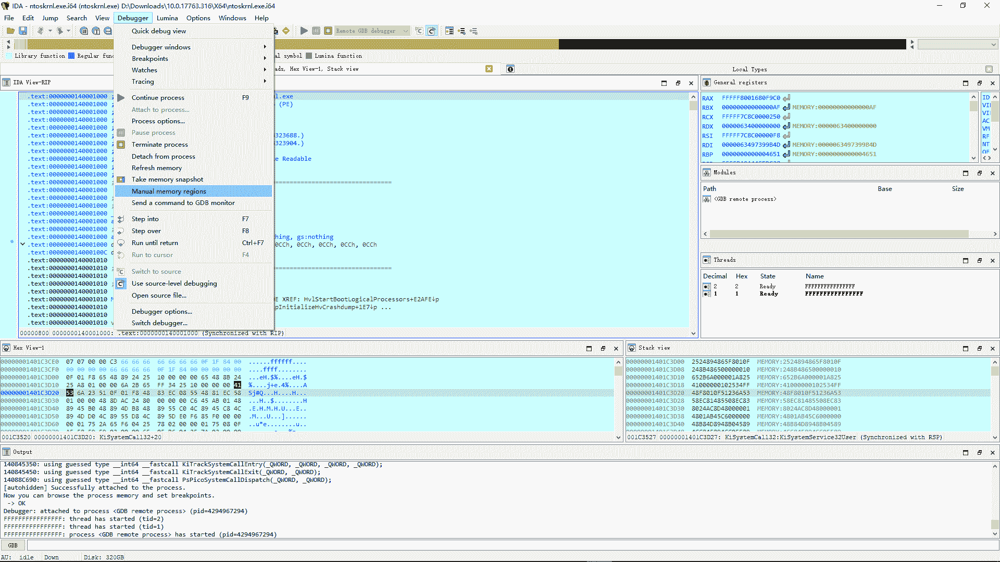

右键插入：

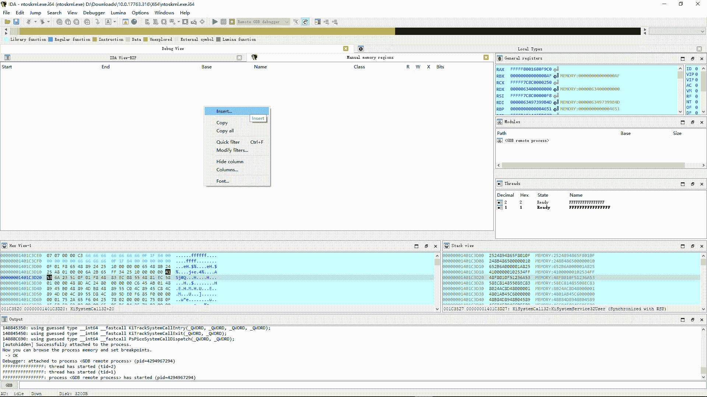

插入范围为`0`到`FFFFFFFFFFFFFF00`

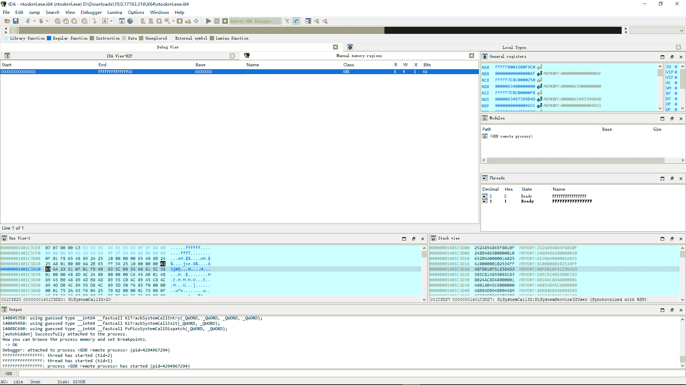

将地址Rebase过去，这样所有的符号都能直接用了

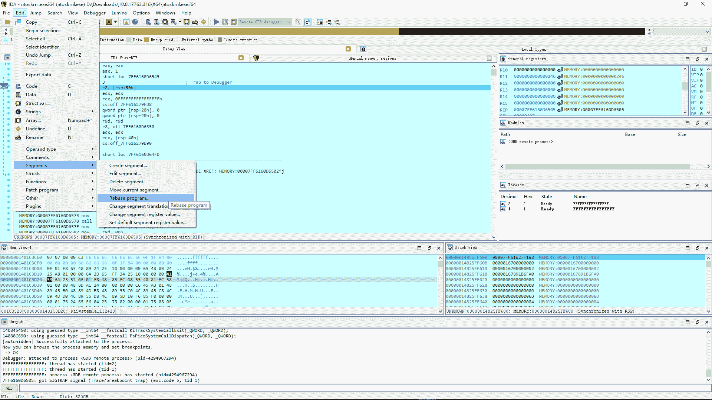

Rebase的地址就是内核镜像的地址。我这里是`0xFFFFF800168A3000`

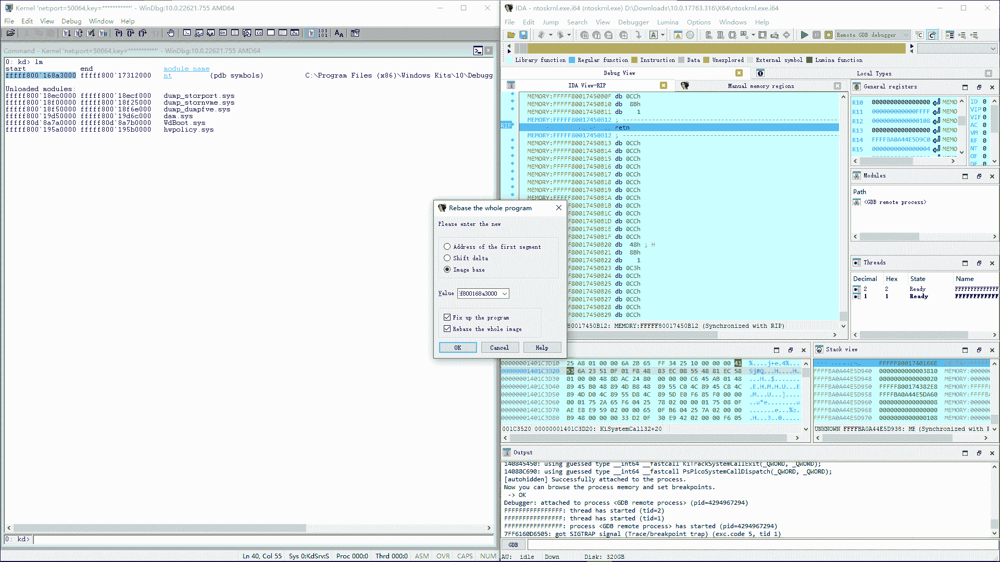

试试效果。

IDT中指向的`INT3`处理函数直接命中，可以单步调试

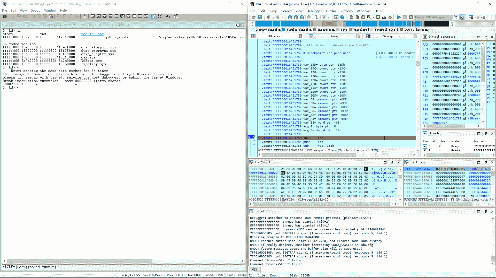

`syscall`的内核入口，可以单步

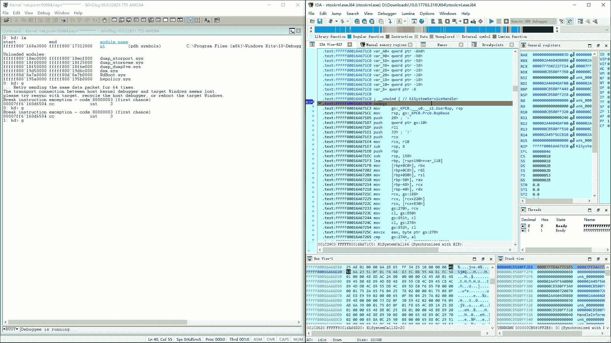

`KiDispatchException`更是不在话下

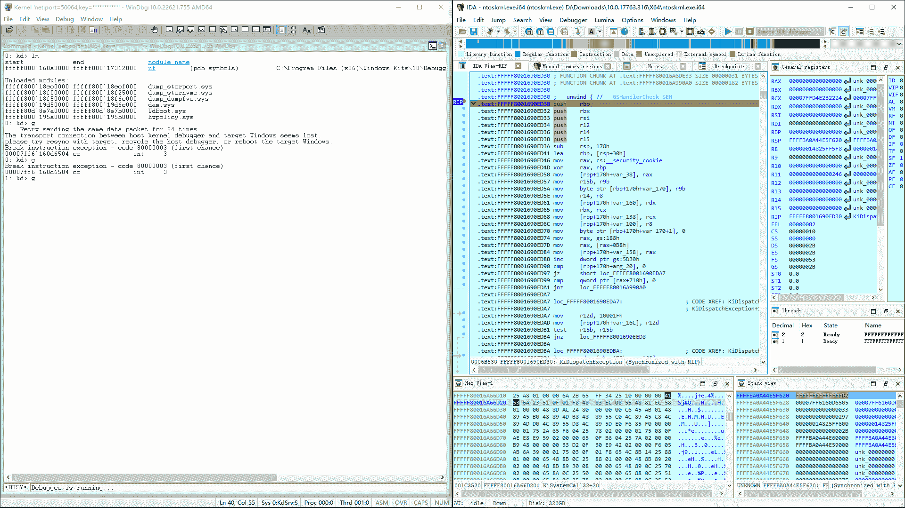
