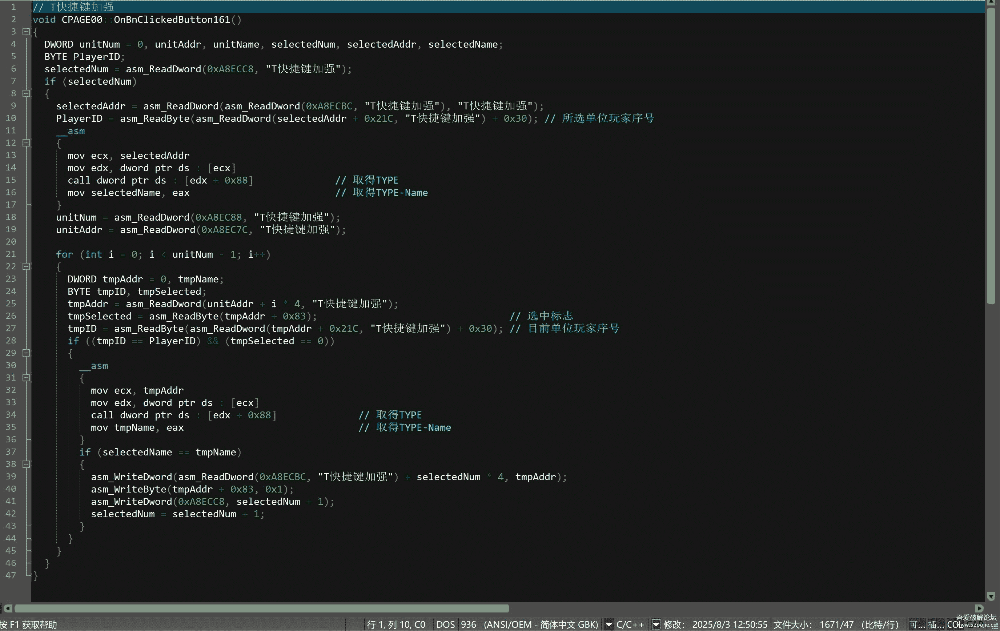
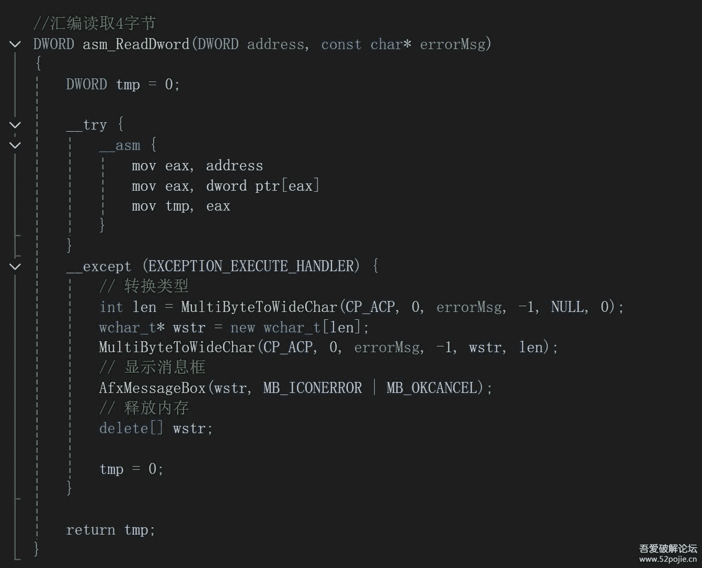

# [游戏安全] 红色警戒2-尤里复仇之T快捷键加强

- 原帖: https://www.52pojie.cn/forum.php?mod=viewthread&tid=2050677
- 抓取时间: 2026-11-01T21:51:46

## 问题
只能选中一个敌人单位，不能`T`选敌人的部队和建筑

## 解决方案
1）读取选中单位的单位基址`selectedAddr`，读取单位所属的玩家ID，读取单位名称`selectedName`
2）遍历所有单位，对于跟选中单位相同玩家ID的单位&未选中单位（`tmpID == PlayerID && tmpSelected == 0`），进一步读取单位名称
对于跟选中单位名称相同的单位（`selectedName == tmpName`），执行选中操作

## 游戏演示说明
游戏演示中，本机是黄色，电脑是蓝色，可`T`选自己的单位和部队，也可`T`选敌方的建筑，部队，加上控制所有，还可控制敌方部队移动

### 游戏操作演示

T快捷键加强4.gif (2.45 MB, 下载次数: 2)
[href="forum.php?mod=attachment&aid=Mjc5NDE4MHwxMTRmMzViZnwxNzkzNTY5OTA0fDE2ODA4NnwyMDUwNjc3&nothumb=yes" target="_blank"](https://www.52pojie.cn/forum.php?mod=attachment&aid=Mjc5NDE4MHwxMTRmMzViZnwxNzkzNTY5OTA0fDE2ODA4NnwyMDUwNjc3&nothumb=yes)
游戏演示
2025-8-3 12:49 上传

### 具体执行代码

code.jpg (407.97 KB, 下载次数: 2)
[href="forum.php?mod=attachment&aid=Mjc5NDE4N3xmMDMyYmI0MHwxNzkzNTY5OTA0fDE2ODA4NnwyMDUwNjc3&nothumb=yes" target="_blank"](https://www.52pojie.cn/forum.php?mod=attachment&aid=Mjc5NDE4N3xmMDMyYmI0MHwxNzkzNTY5OTA0fDE2ODA4NnwyMDUwNjc3&nothumb=yes)
执行代码
2025-8-3 13:31 上传

### 读取内存值函数

asm_ReadDword.jpg (102.79 KB, 下载次数: 3)
[href="forum.php?mod=attachment&aid=Mjc5NDE4OHwwYTY0MzRmYnwxNzkzNTY5OTA0fDE2ODA4NnwyMDUwNjc3&nothumb=yes" target="_blank"](https://www.52pojie.cn/forum.php?mod=attachment&aid=Mjc5NDE4OHwwYTY0MzRmYnwxNzkzNTY5OTA0fDE2ODA4NnwyMDUwNjc3&nothumb=yes)
读取内存
2025-8-3 13:31 上传
