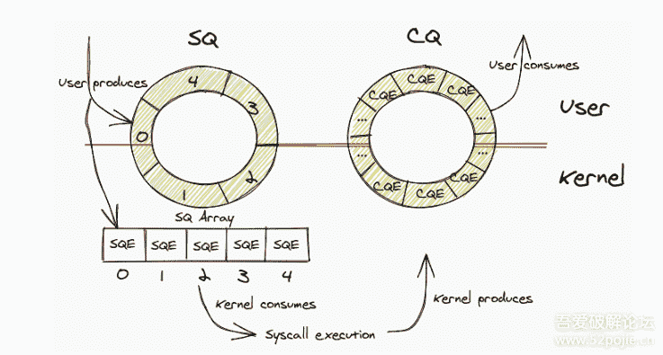
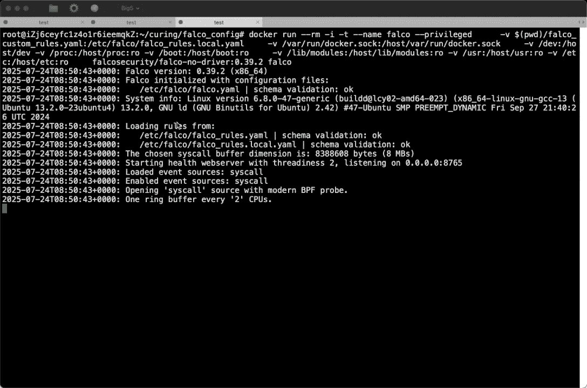
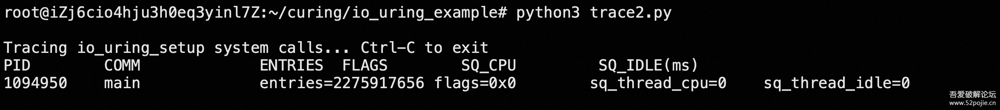
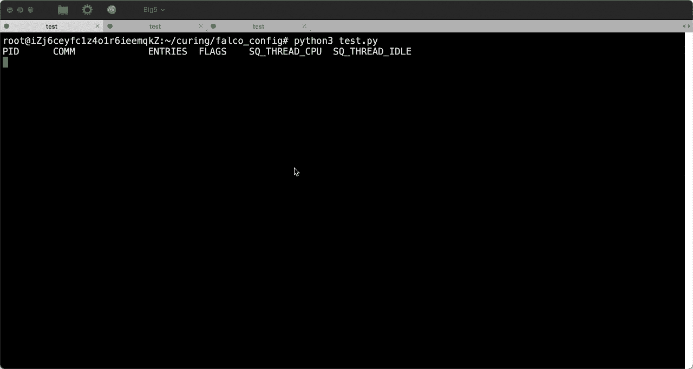

# [系统底层] 使用io-uring逃避安全检测和针对性的检测

- 原帖: https://www.52pojie.cn/forum.php?mod=viewthread&tid=2051281
- 抓取时间: 2026-11-01T21:51:44

## 背景

ARMO 研究团队近日披露 Linux 运行时安全工具存在重大缺陷，证实 io_uring 接口可使 rootkit 绕过常规监控方案，包括 Falco、Tetragon 等等在内的主流工具均无法检测利用该机制的攻击行为。并且 ARMO 团队也开源了基于 io_uring 的 rootkit 工具——Curing：[https://github.com/armosec/curing](https://github.com/armosec/curing)

## 关于 io_uring

众所皆知，传统的阻塞式 I/O 读写的系统调用 `write()` 和 `read()` 性能开销非常大，于是 Linux 社区提出了一些异步的 I/O 读写策略，比如线程池、AIO，其中 AIO 的简单原理：用户通过 `io_submit()` 提交 I/O 请求，过一会再调用 `io_getevents()` 轮询式地来检查哪些 events 已经 ready 了。当然 AIO 的问题也不少，Linus 曾经对 AIO 的评价（[https://lwn.net/Articles/671657/](https://lwn.net/Articles/671657/)）：

> AIO 是一个糟糕的临时设计，其主要借口是“其他不那么有天赋的人设计了这个设计，我们实现它是为了兼容，因为数据库人员——他们很少有一点品味——实际上会使用它”。
>
> 但 AIO 一直以来都非常非常丑陋。
>
> 现在你引入了在线程中异步执行几乎任意系统调用的概念，但你却使用那个糟糕的接口来实现。

在 AIO 的基础之上，Linux 社区在 5.1 版本中引入了一种全新（且因为漏洞多而臭名昭著）的异步 I/O 机制：io_uring，通过在内核态和用户态之间设置共享内存进行异步 I/O 读写，其核心结构如下：

- 提交队列（`SQ`）：用于存储用户应用发起的 I/O 请求。它是一个环形队列，用户将 I/O 请求项提交到该队列中。
- 完成队列（`CQ`）：用于存储内核处理完成的 I/O 结果。也是一个环形队列，内核将处理结果放入此队列，用户应用从中读取。
- 提交实体（`SQE`）：每个 I/O 请求的详细信息被存储在提交实体中，用户将这些实体加入到提交队列供内核态读取。

网上偷的图：



`iouring.png` (147.75 KB, 下载次数: 2)
[https://www.52pojie.cn/forum.php?mod=attachment&aid=Mjc5NDY3M3w0YWQxMmMwN3wxNzkzNTY5OTAyfDE2ODA4NnwyMDUxMjgx&nothumb=yes](https://www.52pojie.cn/forum.php?mod=attachment&aid=Mjc5NDY3M3w0YWQxMmMwN3wxNzkzNTY5OTAyfDE2ODA4NnwyMDUxMjgx&nothumb=yes)
2025-8-5 23:04 上传

更加通俗理解的话，用父亲给你买橘子为例：

- 传统的同步的系统调用，比如 `write()`：在火车站，你准备买个橘子（用户态），但是你没钱，只能托你的父亲去买橘子（`int 80` 触发 syscall），然后你的父亲离开家去买橘子（陷入内核态），在此期间，你只能在原地不要走动目送着你的父亲买橘子。
- io_uring 的异步的系统调用：你发短信让父亲买橘子（写 `SQE` 实体到 `SQ` 队列），发完做别的事情去了；父亲（内核）批量处理短信（收 `SQ` 请求），买完自动回一条“搞定”短信（`CQE` 实体）到 `CQ` 队列，你随时翻收件箱（查 `CQ`）看结果，不需要等在那里。

简单来说，相比于传统的系统调用，io_uring 设计了一对共享的 ring buffer（`SQ` & `CQ`） 用于应用和内核之间的通信——这个是不是特别像 ebpf 的用于在内核态和用户态交互数据的 map 结构，只能说一些提高性能的设计总是异曲同工的。

## io_uring 涉及的关键的调用

### syscall

#### `io_uring_setup()`

该系统调用用于创建设置上下文：

```
int io_uring_setup(
u32 entries,                     // [in] queue size元素的最小数量
struct io_uring_params *params   // [in/out] 用于配置io_uring，同时也用于拿到配置好的SQ/CQ
);
```

#### `io_uring_register()`

注册持久化的用于异步 I/O 的文件或用户缓冲区，这个操作只会在注册时执行一次：

```
int io_uring_register(
unsigned int fd,      // [in] io_uring_setup返回的文件描述符
unsigned int opcode,  // [in] 注册类型
void *arg,            // [in] 资源的指针（比如缓冲区数组地址）
unsigned int nr_args  // [in] 资源的数量（比如缓冲区数量）
);
```

#### `io_uring_enter()`

用于初始化和完成 I/O，可将 `SQ` 中的请求提交到内核（通过 `to_submit` 参数），也可通过 `min_complete` 参数阻塞等待 `CQ` 完成事件：

```
int io_uring_enter(
unsigned int fd,            // [in] io_uring_setup返回的文件描述符
unsigned int to_submit,     // [in] SQ中待提交的I/O请求数量
unsigned int min_complete,  // [in] 期望等待完成的最小事件数
unsigned int flags,         // [in] 控制标记（是否轮询/中断）
sigset_t *sig               // [in] 可选的信号屏蔽集
);
```

### 用户态库 liburing 的一些 API

#### `io_uring_queue_init()`

初始化 io_uring 实例：

```
int io_uring_queue_init(
unsigned entries,        // [in] queue size元素的最小数量
struct io_uring *ring,   // [out] io_uring实例内存指针
unsigned flags           // [in] 初始化标志(如IORING_SETUP_IOPOLL)
);
```

#### `io_uring_get_sqe()`

获取可以用的 `SQE`：

```
struct io_uring_sqe *io_uring_get_sqe(
struct io_uring *ring    // [in] io_uring实例指针
);
```

#### `io_uring_prep_write()`

配置写操作请求：

```
void io_uring_prep_write(
struct io_uring_sqe *sqe, // [in/out] 要配置的SQE指针
int fd,                   // [in] 目标文件描述符
const void *buf,          // [in] 数据缓冲区地址
unsigned nbytes,          // [in] 写入字节数
off_t offset              // [in] 文件写入偏移量
);
```

#### `io_uring_submit()`

提交批量请求：

```
int io_uring_submit(
struct io_uring *ring     // [in] io_uring实例指针
);
```

#### `io_uring_wait_cqe()`

等待事件完成，阻塞等待直到至少有一个 `CQE` 可用：

```
int io_uring_wait_cqe(
struct io_uring *ring,        // [in] io_uring实例指针
struct io_uring_cqe **cqe_ptr // [out] 完成事件指针的地址
);
```

### DEMO

```
#include 
#include 
#include 
#include 

#define QUEUE_DEPTH 1

int main() {
    // 1. 打开目标文件
    int fd = open("test.txt", O_WRONLY | O_CREAT | O_TRUNC, 0644);
    if (fd user_data = 1; // 可选的用户标识

    // 6. 提交请求到内核
    ret = io_uring_submit(&ring);
    if (ret res res) res 
```

strace结果：

```
openat(AT_FDCWD, "test.txt", O_WRONLY|O_CREAT|O_TRUNC, 0644) = 3
io_uring_setup(1, {flags=0, sq_thread_cpu=0, sq_thread_idle=0, sq_entries=1, cq_entries=2, features=IORING_FEAT_SINGLE_MMAP|IORING_FEAT_NODROP|IORING_FEAT_SUBMIT_STABLE|IORING_FEAT_RW_CUR_POS|IORING_FEAT_CUR_PERSONALITY|IORING_FEAT_FAST_POLL|IORING_FEAT_POLL_32BITS|IORING_FEAT_SQPOLL_NONFIXED|IORING_FEAT_EXT_ARG|IORING_FEAT_NATIVE_WORKERS|IORING_FEAT_RSRC_TAGS, sq_off={head=0, tail=64, ring_mask=256, ring_entries=264, flags=276, dropped=272, array=384}, cq_off={head=128, tail=192, ring_mask=260, ring_entries=268, overflow=284, cqes=320, flags=280}}) = 4
mmap(NULL, 388, PROT_READ|PROT_WRITE, MAP_SHARED|MAP_POPULATE, 4, 0) = 0x7f5c8930e000
mmap(NULL, 64, PROT_READ|PROT_WRITE, MAP_SHARED|MAP_POPULATE, 4, 0x10000000) = 0x7f5c892d4000
io_uring_enter(4, 1, 0, 0, NULL, 8)     = 1
io_uring_enter(4, 0, 1, IORING_ENTER_GETEVENTS, NULL, 8) = 0
```

可以看到此时虽然写了17个字符串，但是并没有触发 `write()` 系统调用，取而代之的是 io_uring 相关的系统调用。

## Curing：逃避安全产品检测

Curing 使用的是 [https://github.com/Iceber/iouring-go](https://github.com/Iceber/iouring-go) 项目实现的 rootkit 工具，这里由于 io_uring 也仅支持 I/O 读写的能力，所以这个后门并不支持在命令执行上的对传统 EDR 的绕过，而是在文件读写和网络连接方面进行逃逸。

读文件的代码片段：

```
flags := syscall.O_RDONLY
// 使用 io_uring 的 Openat 方法创建一个打开文件的请求
openReq, err := iouring.Openat(unix.AT_FDCWD, cmd.Path, uint32(flags), 0)
if err != nil {
    result.ReturnCode = 1
    result.Output = []byte("Failed to create open request: " + err.Error())
    return result
}
// 将打开文件的请求提交到 io_uring 队列中
if _, err := e.ring.SubmitRequest(openReq, e.resultChan); err != nil {
    result.ReturnCode = 1
    result.Output = []byte("Failed to submit open request: " + err.Error())
    return result
}
```

写文件的代码片段：

```
flags := syscall.O_WRONLY | syscall.O_CREAT | syscall.O_TRUNC
mode := uint32(0644)
// 使用 io_uring 的 Openat 方法创建一个打开文件的请求
openReq, err := iouring.Openat(unix.AT_FDCWD, cmd.Path, uint32(flags), mode)
if err != nil {
    result.ReturnCode = 1
    result.Output = []byte("Failed to create open request: " + err.Error())
    return result
}
// 将写文件的请求提交到 io_uring 队列中
if _, err := e.ring.SubmitRequest(openReq, e.resultChan); err != nil {
    result.ReturnCode = 1
    result.Output = []byte("Failed to submit open request: " + err.Error())
    return result
}
```

这里的底层原理和上述的文件读写实现基本差不多，然后是比较网络通信的部分（这也是 Curing 号称可以逃逸传统 EDR 检测的地方）：

```
request, err := iouring.Connect(sockfd, &syscall.SockaddrInet4{
    Port: cp.cfg.Server.Port,
    Addr: func() [4]byte {
        var addr [4]byte
        copy(addr[:], net.ParseIP(cp.cfg.Server.Host).To4())
        return addr
    }(),
})
```

这里的底层实现和文件读写差不多，只是将数据写入到 socket 管道中了，比如：

```
if (registerfiles) {
    // 将套接字描述符注册到io_uring的文件表
    ret = io_uring_register_files(ring, &sockfd, 1);
    if (ret) {
        fprintf(stderr, "file reg failed\n"); // 注册失败处理
        goto err;
    }
    use_fd = 0; // 使用注册后的文件描述符索引（0）
} else {
    use_fd = sockfd; // 直接使用原始套接字描述符
}

// 准备异步接收请求
sqe = io_uring_get_sqe(ring); // 获取空闲的SQE
io_uring_prep_recv(sqe, use_fd, iov->iov_base, iov->iov_len, 0);
if (registerfiles)
    sqe->flags |= IOSQE_FIXED_FILE; // 标记使用注册的文件描述符
sqe->user_data = 2; // 设置用户自定义数据标识符（用于结果识别）

// 提交请求到ring buffer
ret = io_uring_submit(ring);
if (ret 
```

测试下来，当配置 falco 对 curing 中配置的文件以及端口进行监控时，falco 是没动静的：



`d2ebcdb0d3d588377003d715002d347b.gif` (427.24 KB, 下载次数: 3)


[href="forum.php?mod=attachment&aid=Mjc5NDY3NXxlM2MzMGUyOXwxNzkzNTY5OTAyfDE2ODA4NnwyMDUxMjgx&nothumb=yes" target="_blank"](https://www.52pojie.cn/forum.php?mod=attachment&aid=Mjc5NDY3NXxlM2MzMGUyOXwxNzkzNTY5OTAyfDE2ODA4NnwyMDUxMjgx&nothumb=yes)

2025-8-5 23:12 上传

这里也吐槽下：`ARMO`在这里耍了小心思，给的官方被 bypass `falco`的策略里，明确只监听了`connect`系统调用，而在构造 bypass 的 demo 里，可以不被监控的网络请求的所需要的系统调用也只有`connect`，有根据答案问问题的嫌疑。当然，传统的针对文件读写的检测方案在`io_uring`的策略背景里是完全不适用的。

比如这里我直接`hook` 4层流量（比如 `kprobe` `tcp_v4_connect`）的话，其实是能看到网络通信的：


`true.png` (48.04 KB, 下载次数: 2)

[href="forum.php?mod=attachment&aid=Mjc5NDY3NHw5MWU4ODYxNHwxNzkzNTY5OTAyfDE2ODA4NnwyMDUxMjgx&nothumb=yes" target="_blank"](https://www.52pojie.cn/forum.php?mod=attachment&aid=Mjc5NDY3NHw5MWU4ODYxNHwxNzkzNTY5OTAyfDE2ODA4NnwyMDUxMjgx&nothumb=yes)

2025-8-5 23:05 上传

## 针对性的检测

拿 `Curing` 里提供的一个demo 的 `ltrace` 结果：

```
io_uring_queue_init(1, 0x7ffddf399a20, 0, 0x5632021d8d68)                = 0
io_uring_submit(0x7ffddf399a20, 0x7736655d4000, 577, 0x5632021d703b)     = 1
__io_uring_get_cqe(0x7ffddf399a20, 0x7ffddf399a10, 0, 1)                 = 0
io_uring_submit(0x7ffddf399a20, 0x7736655d4000, 5, 0x5632021d7008)       = 1
printf("Successfully wrote %d bytes to s"..., 5Successfully wrote 5 bytes to shadow.pdf
)                         = 41
io_uring_submit(0x7ffddf399a20, 0x7736655d4000, 0, 0)                    = 1
io_uring_queue_exit(0x7ffddf399a20, 1, 3, 0)                             = 3
+++ exited (status 0) +++
```

由于大多数应用程序通常不依赖`io_uring`，那其实我们 `hook` `io_uring`相关的 `probe` 就可以了，这里有一个坑点，就是可以看到 `ltrace` 的结果里没有`io_uring_prep_write`的相关代码，这是因为`io_uring_prep_write`是一个静态内联函数，其主要实现是通过`io_uring_prep_rw`函数实现的：

```
IOURINGINLINE void io_uring_prep_rw(int op, struct io_uring_sqe *sqe, int fd,
                                    const void *addr, unsigned len,
                                    __u64 offset)
{
        sqe->opcode = (__u8) op;
        sqe->flags = 0;
        sqe->ioprio = 0;
        sqe->fd = fd;
        sqe->off = offset;
        sqe->addr = (unsigned long) addr;
        sqe->len = len;
        sqe->rw_flags = 0;
        sqe->buf_index = 0;
        sqe->personality = 0;
        sqe->file_index = 0;
        sqe->addr3 = 0;
        sqe->__pad2[0] = 0;
}
```

那其实我们可以监控 `kprobe` `io_uring_setup`：

```
int trace_io_uring_setup(struct pt_regs *ctx) {
    // 通过寄存器拿参数
    unsigned int entries = PT_REGS_PARM1(ctx);
    struct io_uring_params *params = (struct io_uring_params *)PT_REGS_PARM2(ctx);

    struct event_data event = {};
    event.pid = bpf_get_current_pid_tgid() >> 32;
    bpf_get_current_comm(&event.comm, sizeof(event.comm)); 

    event.entries = entries;

    if (params) {
        bpf_probe_read_kernel(&event.flags, sizeof(event.flags), &params->flags);
        bpf_probe_read_kernel(&event.sq_thread_cpu, sizeof(event.sq_thread_cpu), &params->sq_thread_cpu);
        bpf_probe_read_kernel(&event.sq_thread_idle, sizeof(event.sq_thread_idle), &params->sq_thread_idle);
    }

    // 去ring3
    events.perf_submit(ctx, &event, sizeof(event));
    return 0;
}
```

这里的基于 `BCC` 的 demo 比较简单，可以来显示一部分的参数：



`mydemo.png` (274.99 KB, 下载次数: 2)

[href="forum.php?mod=attachment&aid=Mjc5NDY3N3wwYTJhY2NhZHwxNzkzNTY5OTAyfDE2ODA4NnwyMDUxMjgx&nothumb=yes" target="_blank"](https://www.52pojie.cn/forum.php?mod=attachment&aid=Mjc5NDY3N3wwYTJhY2NhZHwxNzkzNTY5OTAyfDE2ODA4NnwyMDUxMjgx&nothumb=yes)

2025-8-5 23:15 上传

`Curing` 也是类似的（毕竟系统调用都是一致的）：



`e52651b3953397ffd1ef0beea611907b.gif` (302.8 KB, 下载次数: 2)

[href="forum.php?mod=attachment&aid=Mjc5NDY3NnwwMDhhZTY1NnwxNzkzNTY5OTAyfDE2ODA4NnwyMDUxMjgx&nothumb=yes" target="_blank"](https://www.52pojie.cn/forum.php?mod=attachment&aid=Mjc5NDY3NnwwMDhhZTY1NnwxNzkzNTY5OTAyfDE2ODA4NnwyMDUxMjgx&nothumb=yes)

2025-8-5 23:12 上传

## 总结

简单来说，`Curing` 因为使用了非传统系统调用而采用了`io_uring`进行文件读写&网络通信，而绕过了传统的基于`write`、`read`、`connect`等 `kprobe` 的检测（`Microsoft Defender`、`Falco`），而针对性的检测也就是去检测`io_uring`相关的系统调用，毕竟因为组件的安全问题，`io_uring`的使用并不是很常见。
