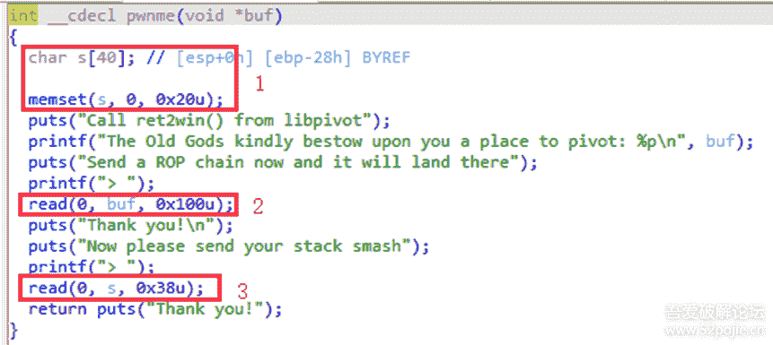
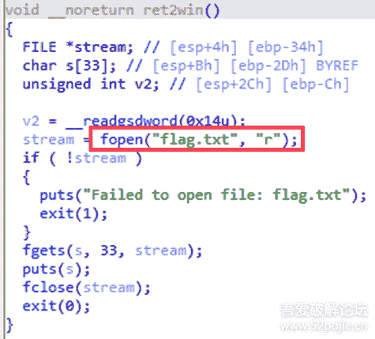

# [调试逆向] ropemporium ROP -- pivot32

- 原帖: https://www.52pojie.cn/forum.php?mod=viewthread&tid=2054428
- 抓取时间: 2026-11-01T21:51:38

在 `main` 中，`malloc` 在堆中申请了一块空间，并且将其中的一部分空间传递给 `pwnme` 函数使用。

image.png (162.71 KB, 下载次数: 3)

[forum.php?mod=attachment&aid=Mjc5NzczOHxjZGQzNzZhNHwxNzkzNTY5ODk2fDE2ODA4NnwyMDU0NDI4&nothumb=yes](https://www.52pojie.cn/forum.php?mod=attachment&aid=Mjc5NzczOHxjZGQzNzZhNHwxNzkzNTY5ODk2fDE2ODA4NnwyMDU0NDI4&nothumb=yes)

2025-8-19 16:48 上传

在 `pwnme` 中，开辟了局部空间，数组 `s`，使用 `memset`，配置空间0x20，往参数 `buf` 中写入 0x100 字节数据，往局部变量 `s` 中写入 0x38 字节数据，显然这里有溢出漏洞。`pivot32` 中包含函数 `userlessFunction`，该函数中调用了 `foothold_function()`，这个函数来自动态库 `libpivot32.so`。在这个动态库中，发现函数 `ret2win`，已经提供了最终的利用结果。

image.png (116.72 KB, 下载次数: 5)

[forum.php?mod=attachment&aid=Mjc5Nzc0MHw1MjJiZGYwZXwxNzkzNTY5ODk2fDE2ODA4NnwyMDU0NDI4&nothumb=yes](https://www.52pojie.cn/forum.php?mod=attachment&aid=Mjc5Nzc0MHw1MjJiZGYwZXwxNzkzNTY5ODk2fDE2ODA4NnwyMDU0NDI4&nothumb=yes)

2025-8-19 16:49 上传

到这里，可见这个用例，是通过 ret2so，调用到 `ret2win` 这种函数。首先要能定位到 `ret2win`，上面已经提供了函数 `foothold`，该函数在 `pivot32` 中导入了符号，而在 `libpivot32.so` 中 `ret2win` 已经为导出符号。可以通过 `foothold` 的 `got` 项和 `libpivot32.so` 库中两个符号 `foothold` 和 `ret2win` 的偏移，来找到 `ret2win` 的 `got` 表项值。另外，由于延迟绑定机制，所以需要先执行 `foothold` 才能获取到该项对应的 `got` 项值，如下：
