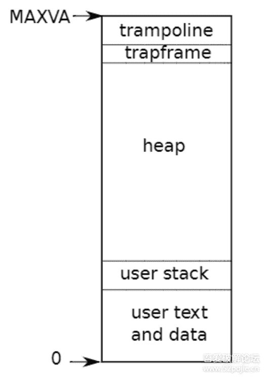

# [系统底层] xv6 陷入机制浅析

- 原帖：[https://www.52pojie.cn/forum.php?mod=viewthread&tid=2056903](https://www.52pojie.cn/forum.php?mod=viewthread&tid=2056903)
- 抓取时间：2026-11-01T21:51:33

## 前言

笔者最近在写 xv6 的 lab，阅读 xv6 book 后仍对 xv6 的陷入机制感到迷惑。在统整 xv6 book 中的内容与询问 GPT 的答案后，便产出此篇文章。

因为笔者仍是新手，错误之处请各位师傅指正，谢谢！

## 前置知识

xv6 的进程空间：

1.png (53.42 KB，下载次数：2)

附件链接：[附件](https://www.52pojie.cn/forum.php?mod=attachment&aid=Mjc5OTk1OXw5NmNhZTYwM3wxNzkzNTY5ODkxfDE2ODA4NnwyMDU2OTAz&nothumb=yes)

2025-8-30 21:38 上传

硬件线程（hardware thread, hart）：处理器核心中的一个执行单元。

per-CPU：每个核的资料。

控制与状态寄存器（Control and Status Register, CSR）：存放一些能改变 CPU 行为的控制，并反映处理器目前的状态。

`trampoline`：其中存放 `uservec` 与 `userret` 的汇编代码，帮助从用户模式切换为内核模式或从内核模式返回到用户模式。内核与每个进程都将 `trampoline` 映射到同一虚拟地址上，使得页表从一个模式切换到另一个模式后，对 `trampoline` 虚拟地址的访问不会造成 page fault。参考：[`/kernel/trampoline.S`](https://github.com/mit-pdos/xv6-riscv/blob/riscv/kernel/trampoline.S)。

`trapframe`：存放使用者寄存器，还有与进程相关的内核栈、`hartid`、`usertrap` 地址、内核页表地址等资讯，其地址由 `TRAMPOLINE` 定义。参考：[`/kernel/proc.h#L43`](https://github.com/mit-pdos/xv6-riscv/blob/riscv/kernel/proc.h#L43)。

## 陷入机制

以下为陷入机制使用的 CSR 寄存器：

- `stvec`：内核在此放置陷阱处理程序的地址。
- `sepc`：发生陷阱时，旧的 `pc` 值会保存在此，`sret` 会将 `sepc` 复制到 `pc` 从而从陷阱返回。
- `scause`：存放引起陷阱的原因。
- `sscratch`：保存 per-CPU 的 `struct cpu*` 指针。
- `sstatus`：其中 `SIE` 位控制设备中断是否启用，`SPP` 位保存陷阱是来自用户还是管理模式，并控制 `sret` 的返回模式。

当执行陷阱（除去计时器中断）时，RISC-V 执行以下操作：

- 若陷阱是设备中断，且 `SIE` 被清空，则不执行以下操作。
- 清除 `SIE` 禁止中断，防止处理程序被打断。
- 将 `pc` 复制到 `sepc`。
- 将当前模式（用户或管理）保存在状态的 `SPP` 位中。
- 设置 `scause` 反映原因。
- 将模式设置为管理模式。
- 将 `stvec` 复制到 `pc`。
- 跳转到 `pc` 运行。

当硬件执行完以下操作，交由软件（xv6）处理剩余操作。

xv6 从用户模式陷入内核模式与返回的过程（`uservec` -> `usertrap` -> `prepare_return` -> `userret`）：

- 当执行用户代码时，`stvec` 指向 `uservec`（即 `trampoline.S` 中协助从用户模式陷入内核的汇编码），所以一旦需要陷入内核就会跳转到 `uservec` 中。
- `uservec` 在 `trampoline` 中保存用户寄存器，以免进入内核时修改这些值。`uservec` 将 `trampoline` 保存在 `sscratch` 中。
- 从 `p->trapframe->kernel_satp` 中取得内核页表，将 `satp` 切换为内核页表并调用 `usertrap`（`p->trapframe->kernel_trap`）。`usertrap` 参考：[`/kernel/trap.c#L37`](https://github.com/mit-pdos/xv6-riscv/blob/riscv/kernel/trap.c#L37)。
- `usertrap` 会确认陷阱的原因，处理并返回。`usertrap` 会修改 `stvec` 指向 `kernelvec`，因为此时系统处于内核模式，所以所有中断与异常都由 `kerneltrap` 处理。
- 当以上处理结束，会调用 `prepare_return`。由 `trap.c` 返回到 `trampoline.c` 中的 `userret`。
- `userret` 会读出保存的用户寄存器，并切换页表回用户模式。

## 系统调用

以下用对 `exec` 的调用说明。

用户代码会将参数存在 `a0`、`a1` 中，然后将系统调用号存放在 `a7`。`syscall` 将返回值存放在 `a0`。系统调用号的定义存放在：[`/kernel/syscall.h`](https://github.com/mit-pdos/xv6-riscv/blob/riscv/kernel/syscall.h)。

参考：[`/kernel/syscall.c#L132`](https://github.com/mit-pdos/xv6-riscv/blob/riscv/kernel/syscall.c#L132)。
