# 大连理工网络安全课件（郭成）


## Chapter 1 Introduction

## Aim of the Course

- 我们会聚焦在网络互联安全上 Internet Security，包括阻挡、防止、检测和纠正在信息传输和存储过程中可能产生的违背安全原则的行为。
- 讲述密码编码学和网络安全

## Internet(网络互联)Security

- Internet 安全包括阻止、防止、检测和纠正信息传输和存储中出现的安全问题的措施
- Internet 安全的复杂性
  - 安全涉及到通信和网络
  - 安全机制或算法必须考虑各种各样潜在攻击
  - 要从可能存在哪些攻击方法来确定所需的安全机制
  - 安全机制的应用部署位置
  - 秘密信息的产生、分配和保护等问题

## 第1章 引言

- 本章要点
- 安全攻击分为被动攻击和主动攻击。被动攻击包括非授权阅读消息、文件以及流量分析；主动攻击包括对消息和文件的修改以及拒绝服务。
- 安全机制是一种处理过程，或含有该处理过程的设备，用来检测、阻止攻击或者从攻击状态里恢复为正常。这种机制如加密算法、数字签名和认证协议。
- 安全服务包括认证、访问控制、数据保密性、数据完整性、不可否认性以及可用性。

## 1.1 安全趋势

## Vulnerabilities Reported and Incidents Reported

## 1.3 安全攻击

- 对任何机构的信息资源进行破坏的行为即安全攻击
- 信息安全就是要检测和防范这种攻击行为
- 通常 threat 和 attack 指的是同样的事情
- 安全攻击的行为范围很广
- 通常有两大类安全攻击
- 被动攻击：对传输进行窃听和监测，通信和信息不受影响，用户感觉不到攻击存在，攻击通常是窃听或流量分析，判断通信性质
- 主动攻击：攻击者破坏通信过程，拦截、修改、伪造、丢弃信息、拒绝服务或假冒合法用户

## Passive Attack—traffic analysis
被动攻击之流量分析

Darth observe pattern of messages from Bob to Alice

Internet or other comms facility

Bob

Alice

(b) Traffic analysis

## Active Attack—Masquerade
主动攻击之伪装

## Active Attack—Replay
主动攻击之重放

Darth

Capture message from Bob to Alice; later replay message to Alice

Bob

Alice

Internet or other comms facility

(b) Replay

## Active Attack—Modification of messages 主动攻击之消息修改

Darth

Darth modifies message from Bob to Alice

Internet or other comms facility

Bob

Alice

(c) Modification of messages

## Active Attack—Denial of Service
主动攻击之拒绝服务

Darth

Darth disrupts service provided by server

Internet or other comms facility

Bob

Server

(d) Denial of service

## 对安全的攻击

- **Interruption**: 对 availability 的攻击
- **Interception**: 对 confidentiality 的攻击
- **Modification**: 对 integrity 的攻击
- **Fabrication**: 对 authenticity 的攻击

## 1.4 安全服务

- X.800 将安全服务定义为通信开放系统协议层提供的服务，从而保证系统或数据传输有足够的安全性
- RFC2828 定义安全服务为：一种由系统提供的对系统资源进行特殊保护的处理或通信服务；安全服务通过安全机制来实现安全策略
- X.800 将安全服务分为 5 类共 14 个特定服务
  - 认证、访问控制、数据保密性、数据完整性、不可否认性

## Security Services (X.800)

- **Authentication 认证** – 确保通信实体是合法和真实的，包括同等实体认证和数据源认证
- **Access Control 访问控制** – 防止资源非授权使用
- **Data Confidentiality 数据保密性** – 保护数据免于非授权泄漏，并防止流量分析
- **Data Integrity 数据完整性** – 确保接收到的数据是由授权用户发出的或者是未被修改过的
- **Non-Repudiation 不可否认性** – 防止通信方对通信行为的否认，包括源不可否认性和宿不可否认性
- **Availability Service** – 系统或系统资源能够按照要求根据系统性能规范被授权系统的实体访问和使用

## 1.5 安全机制

- 安全机制是用来检测、防止安全攻击，或从安全攻击中恢复的机制
- 单一的安全机制不能保证所需的所有安全服务
- 最重要的安全机制之一就是密码编码机制
- 本课程的目标集中在密码编码机制

## Security Mechanisms (X.800)

### Specific security mechanisms

- Encipherment(加密), digital signatures(数字签名), access controls(访问控制), data integrity(数据完整性), authentication exchange(认证交换), traffic padding(通信填充), routing control(路由控制), notarization(公证)

### Pervasive security mechanisms

- trusted functionality(可信功能), security labels(安全标识), event detection(事件检测), security audit trails(安全审计追踪), security recovery(安全恢复)

## 1.6 网络安全模型

- 在需要保护信息传输以防攻击者威胁消息的保密性、真实性等的时候，就会涉及信息安全，任何用来保证安全的方法都包含两个方面：
  - 被发送信息的安全相关变换，如对消息加密，打乱消息使得攻击者不能读懂消息，或者将基于消息的编码附于消息后，用于验证发送方的身份。
  - 双方共享某些秘密信息，并希望这些信息不为攻击者所知。如加密密钥，配合加密算法在消息传输之前将消息加密，在接收端将消息解密。
- 为实现安全传输，可能需要可信第三方，例如，由第三方复杂将秘密信息分配给通信双方，而对攻击者保密，或者当通信双方就关于信息传输的真实性发生争执时，由第三方来仲裁。

## 网络安全模型

Figure 1.5 Model for Network Security


## 设计安全服务的内容

- 设计一个算法，执行与安全相关的变换，该算法是攻击者无法攻破的；
- 产生算法所使用的秘密信息；
- 设计分配和共享秘密信息的方法；
- 指定通信双方使用的协议，该协议利用安全算法和秘密信息实现安全服务。

## Chapter 1 Introduction

## 第1章 一个简单的通信游戏

### 1.1 一个通信游戏

两个朋友Alice和Bob想在晚上一起外出，但是他们定不下来是去电影院还是歌剧院。尽管如此，他们达成了一个通过掷硬币来决定的协议，这和我们都很熟悉的掷硬币游戏一样。

在通信规程的研究中，对上述的一个多方游戏可以给予一个更“科学的”名字：协议。一个协议是一个适当定义的，在多个参与方之间执行的规程。这里要注意多个实体参与的重要性；如果一个规程仅由一个实体执行，那么它只是一种程序，不能称之为协议。

现在我们假想这两个朋友尝试在电话上执行上述协议，Alice向Bob说：“你选一面，然后我抛硬币并告诉你是否赢了”。

是否可行？为什么？

如何做？

### 1.1 一个通信游戏

现在我们假想这两个朋友尝试在电话上执行上述协议，Alice向Bob说：“你选一面，然后我抛硬币并告诉你是否赢了”。

我们引入一点密码技术，把它变成一个适合在电话上工作的形式。

#### 性质一：奇妙函数f

1）对任意整数x，由x计算f(x)是容易的，而给出f(x)，要找出对应的原像x是不可能的，不管x是奇数还是偶数。
2）不可能找出一对整数(x, y)，满足x≠y且f(x)=f(y)。

### 1.1 一个通信游戏

现在我们假想这两个朋友尝试在电话上执行上述协议，Alice向Bob说：“你选一面，然后我抛硬币并告诉你是否赢了”。

协议 1.1 电话掷币

假定

Alice 和 Bob 已经同意：

i) 具有性质 1.1 的一个特殊函数 \( f \)

ii) \( f(x) \) 中的偶数 \( x \) 代表“正面”，奇数 \( x \) 代表“背面”

(* 注意：由于(ii)，该协议有一个弱点，详见习题 1.2 * )

1. Alice 选择一个大随机数 \( x \) 并计算 \( f(x) \)；然后通过电话告诉 Bob \( f(x) \) 的值；
2. Bob 告诉 Alice 自己对 \( x \) 的奇偶性猜测；
3. Alice 告诉 Bob \( x \) 的值；
4. Bob 验证 \( f(x) \) 并察看他所做的猜测是正确或错误。

### 1.2 描述密码系统和协议的准则

一个基本问题：

什么是好的密码系统和协议？

#### 1. 保护的程度与应用需求相符合

对很多公平掷币的更重要的应用场合，使用杂凑函数不一定就是好的，必须用更加严格的密码技术。另一方面，对决定娱乐场点来说，使用重量级密码技术显然是不必要的。对有些应用来说，太强的保护甚至会妨碍想要的安全服务的正常性能。

#### 2. 对安全性的信心要依据所建立的 “种系”

我们如何才能相信一个密码算法或协议是安全的呢？能否因为还没有人攻破它就说它是安全的呢？
一般来说，对一个未被攻破的算法，我们只能说还不知道如何攻破它。因为在密码学中，一个被攻破的算法有时意味着能够定量地度量；如果一个未被攻破的算法没有这种度量，那我们就甚至无法断言一个未被攻破的算法是否比一个已被攻破的算法更安全。

#### 3. 实际效率

一个密码协议不仅是一个算法，也是一个通信过程，该过程包括不同协议参与者在一组约定规则下通过计算机网络进行的消息传递。因此，在效率度量方面协议就多了一个量纲：通信交互的次数，通常称为通信轮数。

### 1.2 描述密码系统和协议的准则

4. 采用实际的和可用的原型和服务

适用于某种应用的安全性级对于另外一种应用未必就足够好。

5. 开放性

### 1.2 描述密码系统和协议的准则

#### 6. 明确性

1. 明确所需要的所有假定；
2. 要明确所提供的确切的安全服务；
   机密性；认证；不可否认；知识证明
3. 要明确数学方面的一些特殊情况。


*Chapter 2*

*Classical Encryption Techniques*

## Part One – Symmetric Ciphers

- Road Map for Part One
  - Chp.2, Classical Encryption Techniques
  - Chp.3, Block Cipher and the Data Encryption Standard
  - Chp.4, Finite Fields
  - Chp.5, Advanced Encryption Standard
  - Chp.6, More on Symmetric Ciphers
  - Chp.7, Confidentiality Using Symmetric Encryption

## 密码学的演变历史(1)

- 1918, William Friedman’s The Index of Coincidence and its Applications in Cryptography

- **William Frederick Friedman** (September 24, 1891 – November 12, 1969) 美国陆军密码专家。 1930年代， 他领导了陆军的一个研究部门Signals Intelligence Service (SIS)， 其中一部分服务一直延续到五十年代。 三十年代晚期， 在他的指导下， Frank Rowlett 破解了日本人的PURPLE加密机， 这样就截获了日本的大量外交和军事的秘密。

## 密码学的演变历史(2)

- Edward Hebern, Rotor Machine for 50 Years.
- 1948, Claude Shannon’s “The Communication Theory of Secrecy System”成为现代密码学理论基础
  - Claude Elwood Shannon (Apr. 30, 1916 – Feb. 24, 2001)，是美国的一个电气工程师和数学家，被誉为信息论之父 "the father of information theory".
  - 香农之有名在于他以1948年发表的那篇旷世论文而奠定了现代信息论基础。其实早在1937年当21岁的香农还是MIT一个硕士研究生时，他便在他的硕士论文中论述了布尔代数的电子实现和应用，可以构建布尔逻辑任何逻辑的数字的电路。因此他奠定了数字计算机和数字电路设计理论的基础。他的硕士论文一直被认为是迄今最重要的硕士论文。
- 1949-1967，Cryptographic literature was barren

## 密码学的演变历史(3)

- 1971, IBM发明Luciffer Cipher, 128位密钥作分组加密。这项发明是由Horst Feistel(Jan.30, 1915–Nov.14,1990)领导的，他是密码学家，当时在IBM负责设计加密器，他的工作最终激发了70年代Data Encryption Standard (DES)的研发高潮

- 1976-1977，美国国家标准局正式公布实施DES

- 1975, Whitfield Diffie and Matin Hellman, A New Direction in Cryptography, 首次提出适应网络保密通信的公开密钥思想，揭开现代密码学研究的序幕，具有划时代的意义


## 密码学的演变历史(4)

- 1977—1978，Ronald Rivest, Adi Shamir, Len Adleman第一次提出公开密钥密码系统的实现方法RSA
- 1981，成立International Association for Cryptology Research
- 1985，Abbas El Gamal提出概率密码系统ElGamal方法
- 1990—1992，Lai Xuejia and James: IDEA, The International Data Encryption Algorithm
- 2000, AES, Advanced Encryption Standard


## 密码学基本术语 *Terminologies*

- Cryptology(保密学)，源自希腊语(Greek) Kryptós: hidden； logos: word，是密码学和密码处理过程的研究
- Cryptography: The Science and Study of Secret Writing，密码编码学
- Cryptanalysis: The Science and Study of Secret Breaking，密码破译学
- Cipher: A secret method of writing 加密方法
- Encipher (encipherment), encryption: 将明文转换成密文的过程
- Decipher (decipherment), decryption: 将密文还原成明文的过程
- Plaintext (cleartext): 原始的可读数据，明文
- Ciphertext (Cryptogram): 加密后的不可解读之文件，密文
- Key: 密钥，对加密与解密过程进行控制的参数
- E(m): Encryption Transformation 加密变换
- D(c): Decryption Transformation 解密变换

## 理论安全和实际安全

- **理论安全，或无条件安全** Theoretical Secure (or Perfect Secure)

攻击者无论截获多少密文，都无法得到足够的信息来唯一地决定明文。Shannon用理论证明：欲达理论安全，加密密钥长度必须大于等于明文长度，密钥只用一次，用完即丢，即一次一密，One-time Pad，不实用。

- **实际安全，或计算上安全** Practical Secure (or Computationally Secure)

如果攻击者拥有无限资源，任何密码系统都是可以被破译的；但是，在有限的资源范围内，攻击者都不能通过系统的分析方法来破解系统，则称这个系统是计算上安全的或破译这个系统是计算上不可行(Computationally Infeasible)。

## 对称密码体制和非对称密码体制

- 对称密码体制(Symmetric System, One-key System, Secret-key System)

加密密钥和解密密钥相同，或者一个密钥可以从另一个导出，能加密就能解密，加密能力和解密能力是结合在一起的，开放性差。

- 非对称密码体制(Asymmetric System, Two-key System, Public-key System)

加密密钥和解密密钥不相同，从一个密钥导出另一个密钥是计算上不可行的，加密能力和解密能力是分开的，开放性好。

## 序列密码体制和分组密码体制

- 序列密码

  - 如果密文不仅与最初给定的算法和密钥有关，同时也与明文位置有关(是所处位置的函数)，则称为序列密码体制。加密以明文比特为单位，以伪随机序列与明文序列模2加后，作为密文序列。

- 分组密码

  - 如果经过加密所得到的密文仅与给定的密码算法和密钥有关，与被处理的明文数据在整个明文中的位置无关，则称为分组密码体制。通常以大于等于64位的数据块为单位，加密得相同长度的密文。

## 其他加密体制

- 确定型密码体制和概率密码体制
  - 确定型：当明文和密钥确定后，密文也就唯一地确定了。
  - 概率型：当明文和密钥确定后，密文通过客观随机因素从一个密文集合中产生，密文形式不确定，称为概率型密码体制。

- 单向函数型密码体制和双向变换型密码体制
  - 单向函数型密码体制适用于不需要解密的场合，容易将明文加密成密文，如哈希函数；
  - 双向变换型密码体制可以进行可逆的加密、解密变换。

## 现代密码学基本原则

- 现代密码学的基本原则

- 设计加密系统时，总是假定密码算法是可以公开的，需要保密的是密钥。一个密码系统的安全性不在算法的保密，而在于密钥，即Kerckhoff原则。

- 对加密系统的要求

- 系统应该是实际上安全的(practical secure)，截获密文或已知明文—密文对时，要决定密钥或任意明文在计算上是不可行的。

- 加密解密算法适用于密钥空间中的所有元素。

- 系统易于实现，使用方便。

- 系统的安全性不依赖于对加密体制或加密算法的保密，而依赖于密钥。

- 系统的使用不应使通信网络的效率过分降低。

## 2.1 对称密码系统的模型

- 对称加密系统由以下五部分组成
  - Plaintext：明文
  - Encryption algorithm：加密算法
  - Key：密钥
  - Ciphertext：密文
  - Decryption algorithm：解密算法
- 加密算法必须足够强大，使破译者不能仅根据密文破译消息
- 收发双方必须在某种安全的形式下获得密钥并必须保证密钥的安全

## 传统密码的简化模型

Secret key shared by sender and recipient

Secret key shared by sender and recipient

Plaintext input

Encryption algorithm (e.g., DES)

Transmitted ciphertext

Decryption algorithm (reverse of encryption algorithm)

Plaintext output

# Figure 2.1 Simplified Model of Symmetric Encryption

## 对称密码系统的要求

- 使用对称密码系统有两个基本要求
  - 一个强加密算法
  - 一个只有发送方和接收方知道的秘密密钥
    Y = E_k(X)
    X = D_k(Y)
- 必须假定加密算法是公开的
- 因此必须有个安全的途径或信道分发密钥

## 传统密码体制的模型

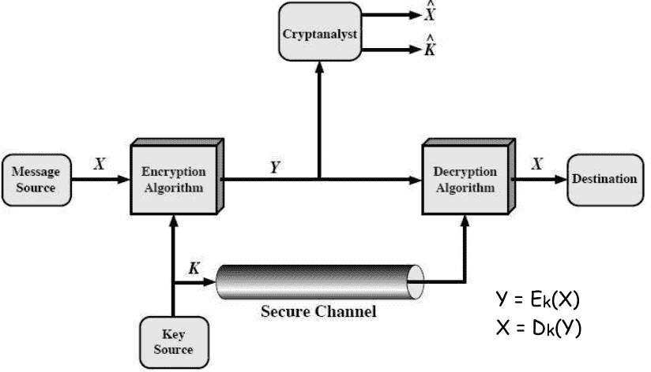

Figure 2.2 Model of Symmetric Cryptosystem

## Cryptology 密码学

- **密码编码学(Cryptography)**

密码编码系统根据以下三个独立方面进行分类
  - 用于将明文转换为密文的操作类型：代换和置换
  - 所使用的密钥的数量和方式：
    - 对称密码体制(单钥系统、秘密密钥系统)
    - 非对称密码体制(双钥系统、公钥密钥系统)
  - 明文的处理方式：分组加密和流加密

- **密码分析学(Cryptanalysis)**
  - 密码分析：试图破译密文得到明文或试图获得密钥的过程为密码分析，密码破译的策略取决于加密方法及可供破译者使用的信息。
  - 穷举攻击：对密文尝试所有可能的密钥，直到把它转化为可读的有意义的明文，至少要尝试1/2可能的密钥。

## 穷举攻击

- 总是可以简单地尝试每一个可能的密钥
- 穷举攻击是最基本的攻击，难度与密钥长度成正比
- 平均来说要获得成功必须尝试所有可能密钥的一半

**Table 2.2 Average Time Required for Exhaustive Key Search**

| Key size (bits) | Number of alternative keys | Time required at 1 decryption/μs | Time required at 10^6 decryptions/μs |
|---|---:|---:|---:|
| 32 | 2^32 = 4.3 × 10^9 | 2^31 μs = 35.8 minutes | 2.15 milliseconds |
| 56 | 2^56 = 7.2 × 10^16 | 2^55 μs = 1142 years | 10.01 hours |
| 128 | 2^128 = 3.4 × 10^38 | 2^127 μs = 5.4 × 10^24 years | 5.4 × 10^18 years |
| 168 | 2^168 = 3.7 × 10^50 | 2^167 μs = 5.9 × 10^36 years | 5.9 × 10^30 years |
| 26 characters (permutation) | 26! = 4 × 10^26 | 2 × 10^26 μs = 6.4 × 10^12 years | 6.4 × 10^6 years |


## 2.2 代换技术 (Substitution)

- 代换法是将明文字母替换成其他字母、数字或符号的加密方法
- 如果把明文看成是二进制序列的话，代换就是用密文位串来代换明文位串
- 代换法改变明文内容的表示形式，保持内容元素之间相对位置不变
- 已知最早的代换密码是由Julius Caesar发明的恺撒密码Caesar Cipher，对字母表中的每个字母用它之后的第3个字母来代换。例如：

```
meet me after the toga party
PHHW PH DIWHU WKH WRJD SDUWB
```

## Caesar Cipher

- 定义如下变换
  - `a b c d e f g h i j k l m n o p q r s t u v w x y z`
  - `D E F G H I J K L M N O P Q R S T U V W X Y Z A B C`

- 让每个字母等价于一个数值
  - `a b c d e f g h i j k l m`
  - `0 1 2 3 4 5 6 7 8 9 10 11 12`
  - `n o p q r s t u v w x y z`
  - `13 14 15 16 17 18 19 20 21 22 23 24 25`

- Caesar 密码可以表示如下
  - `C = E(p) = (p + k) mod (26)`
  - `p = D(C) = (C - k) mod (26)，这里 k = 3`

## 对Caesar密码的攻击

- 如果已知某给定密文是Caesar密码，穷举攻击是很容易实现的，因为只要简单地测试所有25种可能的密钥
- Caesar密码的三个重要特征使我们可以采用穷举攻击分析方法
- 已知加密和解密算法
- 所需测试的密钥只有25个
- 明文所用的语言是已知的，且其意义易于识别
- 比如，破解密文PHHW PH DIWHU WKH WRJD SDUWB，或者，GCUA VQ DTGCM

| KEY | PHNW | PH | DIWHU | WKH | WRJD | SDWNB |
|:---|:---|:---|:---|:---|:---|:---|
| 1 | oggv | og | chvgt | vjg | vqic | rctva |
| 2 | nffu | nf | bgufs | uif | uphb | qbsuz |
| 3 | meet | me | after | the | toga | party |
| 4 | ldds | ld | zesdq | sgd | snfz | ozq sx |
| 5 | kccr | kc | ydr cp | rfc | rmey | hypfw |
| 6 | jbbq | jb | xqbo | qeb | qldx | m xoqv |
| 7 | iaap | ia | wbpan | pda | pckw | lwnpu |
| 8 | hzzo | hz | vaozm | ocz | ojbv | kvmot |
| 9 | gyyn | gy | uznyl | nby | niau | julns |
| 10 | fxxm | fx | tymxk | max | mhzt | itk mr |
| 11 | ewwl | ew | sxlwj | lzw | lgys | nsjlq |
| 12 | dvvk | dv | rwkvi | kyv | kfxr | grikp |
| 13 | cuuj | cu | qvjuh | jxu | jewq | fqhjo |
| 14 | btti | bt | puitg | iwt | idvp | epgin |
| 15 | assh | as | oths f | hvs | hcuo | dofhm |
| 16 | zrrg | zr | nsgre | gur | gbtn | cnegl |
| 17 | yqqf | yq | mr fqd | ftq | fasm | bmdfk |
| 18 | x ppe | xp | lqepc | esp | ezrl | alcej |
| 19 | wood | wo | kpdob | dro | dyqk | zkbdi |
| 20 | vnnc | vn | jocna | cqn | cxpj | yjach |
| 21 | ummb | um | in bmz | bpm | bwoi | xizbg |
| 22 | tlla | tl | hmaly | aol | avnh | whyar |
| 23 | skkz | sk | glzkx | znk | zung | yg xze |
| 24 | rjjy | rj | fkyjw | ymj | ytl f | ufwyd |
| 25 | qiix | qi | ejxiv | xli | xske | tevxc |


# Figure 2.3 Brute-Force Cryptanalysis of Caesar Cipher

## 对 Caesar 密码的攻击

- 如果明文所用语言不为我们所知，则明文输出不可识别，而且输入可能按某种方式经过缩写或压缩，则识别就更加困难
- 例如

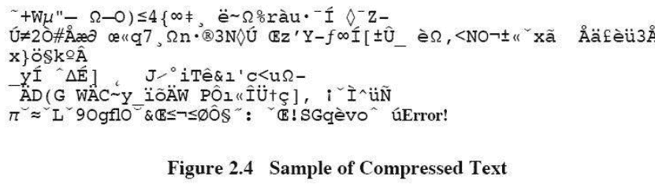

## 2.2.2 Monoalphabetic Cipher 单表替换密码

- 单表代换密码不只是25种可能的密钥，而是允许任意代换，增加密钥空间
- 每个明文字母可以随机映射到任意一个密文字母，密文行是26个字母的任意置换，那么有26!或大于4×10^26种可能的密钥，每条消息用一个字母表加密
- 这样密钥有26个字母长

```
Plain:  abcdefghijklmnopqrstuvwxyz
Cipher: DKVQFTBJWPESCXHTMYAUOLRGZN

Plaintext:  ifwewishtoreplaceletters
Ciphertext: WIRFRWAJUHYFISDVFSFUUFEYA
```

## 单表代换密码的安全性分析

- 单表代换密码每条消息用一个字母表加密
- 这样有 $26! = 4 \times 10^{26}$ 种可能的密钥，超过
  $400,000,000,000,000,000,000,000,000$
  $4 \times 10^{26} = 400万亿亿$
- 这比DES的密钥空间大10个数量级，看起来是安全的，应该可以抵御穷举攻击，其实不然
- 这是因为语言的一些规律和特性


## 语言的冗余性和密码攻击

- 人类的语言是有冗余性的
- 比如从“th lrd s m shphrd shll nt wnt”中我们可以大概猜出些什么
- 字母使用的频率是不一样的
- 英文字母E是使用最频繁的，然后是T，R，N，I，O，A，S等
- 有些字母使用得很少，如Z，J，K，Q，X
- 这样可以得到英文字母使用频率分布表
- 同时，统计双字母组合和三字母组合的使用频率也是非常有用的

## 英文字母的相对使用频率

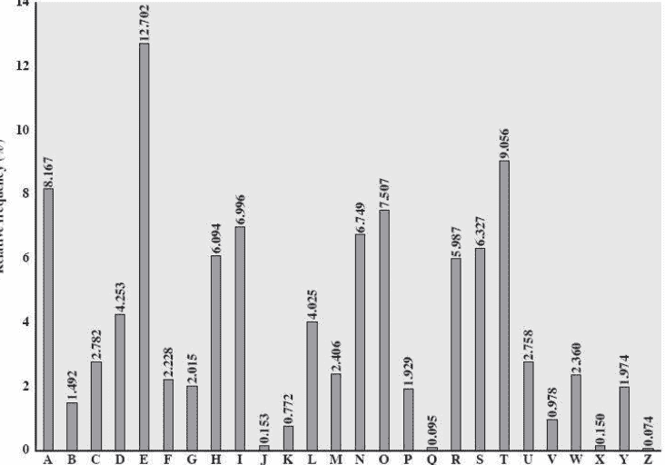

Figure 2.5  Relative Frequency of Letters in English Text

## 英文字母使用频率用于密码分析

- 关键的一点，单表代换不能改变相关字母出现的频率
- 这是由阿拉伯科学家在公元九世纪就分析发现了
- 所以，只要统计密文中字母出现的频率，与已知的统计值做比较就可以分析出相应明文字母了
- 如果Caesar密码中字母呈现出通常的峰值和低谷，那么单表代换也会呈现相同的特性，比如：
  - 峰值在：A-E-H-I, N-O, R-S-T
  - 低谷在：J-K, Q, X-Z
- 双字母、三字母出现特性表也会有助于破译密文

## 单表代换密码攻击举例

- 给定密文：
UZQSOVUOHXMOPVGPOZPEVSGZWSZOPFPESXUDBMETSXAIZ
VUEPHZHMDZSHZOWSFPAPPDTSVPQUZWYMXUZUHSX
EPYEPOPDZSZUFPOMBZWPFUPZHMDJUDTMOHMQ

- 统计相关字母出现的次数（see textbook）

- 可以猜测P和Z是e和t

- 可以猜测ZW是th，这样ZWP就是the

- 这样反复试验并不断修正错误，最后可得：
it was disclosed yesterday that several
informal but direct contacts have been made
with political representatives of the viet
cong in moscow


## 栅栏技术 Rail Fence cipher

- 按照对角线的顺序写出明文，按行的顺序读出作为密文

- 如加密 meet me after the toga party:

```
m e m a t r h t g p r y
```

```
e t e f e t e o a a t
```

- 可以得到密文

```
MEMATRHTGPRYETEFETEOAT
```

## 2.5 Steganography隐写术

- 隐写术不是加密技术
- 隐写术可以隐藏信息的存在，密码学则通过对文本信息的不同转换而实现信息的不可读
  - 字符标记
  - 不可见墨水
  - 针刺
  - 打字机的色带校正
- 隐写术需要许多额外的开销来隐藏相对较少的信息


*Chapter 3*
*Block Cipher and Data Encryption Standard*


## 第3章 分组密码和数据加密标准

- 分组密码是一种加密解密算法，将输入明文分组当做一个整体处理，输出一个等长的密文分组。
- 许多分组密码都采用Feistel结构，这样的结构由许多相同的轮函数组成。每一轮里，对输入数据的一半进行代换，接着用一个置换来交换数据的两个部分，扩展初始的密钥使得每一轮使用不同的子密钥。
- DES是应用最为广泛的分组密码，它扩展了经典的Feistel结构。DES的分组和密钥分别是64位和56位的。

## 乘积密码的设计思想

- Claude Shannon and Substitution-Permutation Ciphers
  
  1949年，Claude Shannon 引进了 substitution-permutation (S-P) networks 的思想，即现代的乘积加密器，形成了现代分组加密的基础。S-P Networks 是基于替代和置换这两个基本操作的。

- 提供了对明文信息处理所做的 *confusion* 和 *diffusion*。
  - Shannon认为，为了对付基于统计分析的密码破译，必须对明文作confusion(混淆)和diffusion(扩散)处理，以减少密文的统计特性，为统计分析制造障碍。

- **diffusion** – 明文统计结构扩散消失到大批密文统计特性中，使明文和密文之间统计关系尽量复杂；

- **confusion** – 混淆，使密文和加密密钥之间的关系尽量复杂。

## Table 3.1 Encryption and Decryption Tables for Substitution Cipher of Figure 3.4

| Plaintext | Ciphertext |
|-----------|------------|
| 0000      | 1110       |
| 0001      | 0100       |
| 0010      | 1101       |
| 0011      | 0001       |
| 0100      | 0010       |
| 0101      | 1111       |
| 0110      | 1011       |
| 0111      | 1000       |
| 1000      | 0011       |
| 1001      | 1010       |
| 1010      | 0110       |
| 1011      | 1100       |
| 1100      | 0101       |
| 1101      | 1001       |
| 1110      | 0000       |
| 1111      | 0111       |

| Ciphertext | Plaintext |
|------------|-----------|
| 0000       | 1110      |
| 0001       | 0011      |
| 0010       | 0100      |
| 0011       | 1000      |
| 0100       | 0001      |
| 0101       | 1100      |
| 0110       | 1010      |
| 0111       | 1111      |
| 1000       | 0111      |
| 1001       | 1101      |
| 1010       | 1001      |
| 1011       | 0110      |
| 1100       | 1011      |
| 1101       | 0010      |
| 1110       | 0000      |
| 1111       | 0101      |

## 3.1.3 Feistel密码结构

- 1973年，Horst Feistel提出了基于可逆乘积加密器概念的 Feistel Cipher：
  - 将输入分组分成左右两部分，实施 Shannon’s 的 substitution-permutation network 概念
  - 对左半部数据实施多回合的替代操作（substitution）
  - 对右半部数据和子密钥应用轮函数 F，其输出与左一半做异或
  - 将这两部分进行互换（permutation swapping）

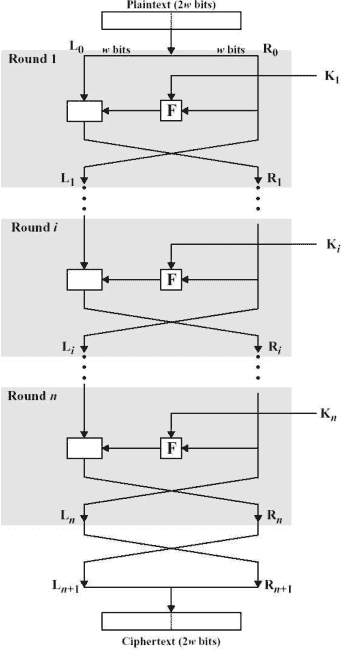

## Feistel加密器设计原则

- **分组长度**：分组越长则安全性越高，但加/解密速度越低，分组长度为64位是一个合理的折衷
- **密钥长度**：密钥越长越安全，但加/解密速度越低，64位长的密钥已被证明是不安全的，128位是常用的长度
- **迭代次数**：迭代越多越安全，通常为16次迭代
- **子密钥产生算法**：越复杂则密码分析越困难
- **轮循环函数**：越复杂则抗密码分析的能力越强
- **快速的软件加密/解密**：算法的执行速度很重要
- **简化分析难度**：算法简洁清楚，易于分析弱点，发现问题
- **Feistel解密算法**：以密文作为算法的输入，以相反的次序使用密钥 Kᵢ、Kₙ、Kₙ₋₁、…、K₀。

## Feistel Cipher Encryption and Decryption

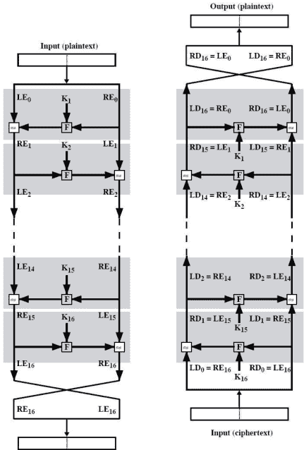

Figure 3.3 Feistel Encryption and Decryption

## 3.2 数据加密标准DES

- **历史的回顾**
  - IBM公司在1971年由Horst Feistel领导开发了Lucifer Cipher，使用128位密钥加密64位的分组
  - Tuchman-Mayer在此基础上开发了一个商用密码，使用56位密钥加密64位分组，容易在单个芯片上硬件实现
  - 1973美国国家标准局NBS全面征集加密方案，作为国家密码标准
  - IBM提交了经过修改的Lucifer加密器，并最终在1976年被接受，公布为数据加密标准DES

DES加密


## DES加密算法的一般描述

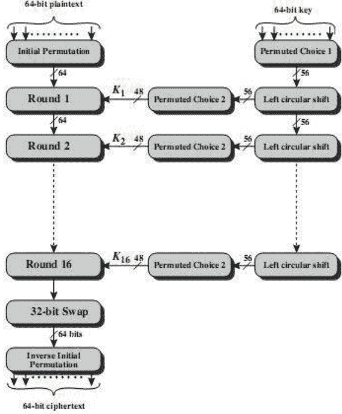

## Table 3.2 Permutation Tables for DES

### (a) Initial Permutation (IP)

| 58 | 50 | 42 | 34 | 26 | 18 | 10 | 2 |
|---|---|---|---|---|---|---|---|
| 60 | 52 | 44 | 36 | 28 | 20 | 12 | 4 |
| 62 | 54 | 46 | 38 | 30 | 22 | 14 | 6 |
| 64 | 56 | 48 | 40 | 32 | 24 | 16 | 8 |
| 57 | 49 | 41 | 33 | 25 | 17 | 9 | 1 |
| 59 | 51 | 43 | 35 | 27 | 19 | 11 | 3 |
| 61 | 53 | 45 | 37 | 29 | 21 | 13 | 5 |
| 63 | 55 | 47 | 39 | 31 | 23 | 15 | 7 |

### (b) Inverse Initial Permutation (IP⁻¹)

| 40 | 8 | 48 | 16 | 56 | 24 | 64 | 32 |
|---|---|---|---|---|---|---|---|
| 39 | 7 | 47 | 15 | 55 | 23 | 63 | 31 |
| 38 | 6 | 46 | 14 | 54 | 22 | 62 | 30 |
| 37 | 5 | 45 | 13 | 53 | 21 | 61 | 29 |
| 36 | 4 | 44 | 12 | 52 | 20 | 60 | 28 |
| 35 | 3 | 43 | 11 | 51 | 19 | 59 | 27 |
| 34 | 2 | 42 | 10 | 50 | 18 | 58 | 26 |
| 33 | 1 | 41 | 9 | 49 | 17 | 57 | 25 |


## 扩充置换(E)和置换函数(P)

### (c) Expansion Permutation (E)

| 32 | 1 | 2 | 3 | 4 | 5 |
|---|---|---|---|---|---|
| 4 | 5 | 6 | 7 | 8 | 9 |
| 8 | 9 | 10 | 11 | 12 | 13 |
| 12 | 13 | 14 | 15 | 16 | 17 |
| 16 | 17 | 18 | 19 | 20 | 21 |
| 20 | 21 | 22 | 23 | 24 | 25 |
| 24 | 25 | 26 | 27 | 28 | 29 |
| 28 | 29 | 30 | 31 | 32 | 1 |

### (d) Permutation Function (P)

| 16 | 7 | 20 | 21 | 29 | 12 | 28 | 17 |
|---|---|---|---|---|---|---|---|
| 1 | 15 | 23 | 26 | 5 | 18 | 31 | 10 |
| 2 | 8 | 24 | 14 | 32 | 27 | 3 | 9 |
| 19 | 13 | 30 | 6 | 22 | 11 | 4 | 25 |

## Feistel Cipher分组加密循环细节

- 将明文分成左右两部分
  - $L_i = R_{i-1}$
  - $R_i = L_{i-1} \mathbin{\mathrm{xor}} F(R_{i-1}, K_i)$
- 将32-bit右半部和48-bit子密钥做以下动作
  - 使用置换表E，将32位右半部R扩展成48位
  - 与48位子密钥做异或
  - 48位结果送给8个替换盒S-boxes，得到32位结果
  - 最后使用32位置换表P，把32位结果再进行一次置换处理

## Figure 3.5 Single Round of DES Algorithm


## S盒(Substitution Boxes)

- 有8个将6位数据映射成4位数据的S盒
- 6到4的映射规则是
  - 外侧的第1位和第6位用作行选择
  - 其余4位(2-5bit)用作列选择
  - 这样每盒就有4行16列，输出4位，8个S盒输出32位
- 行的选择依赖于数据和密钥
- 例如

$S(18\ 09\ 12\ 3d\ 11\ 17\ 38\ 39)=5fd25e03$

## Figure 3.6 Calculation of F(R, K)

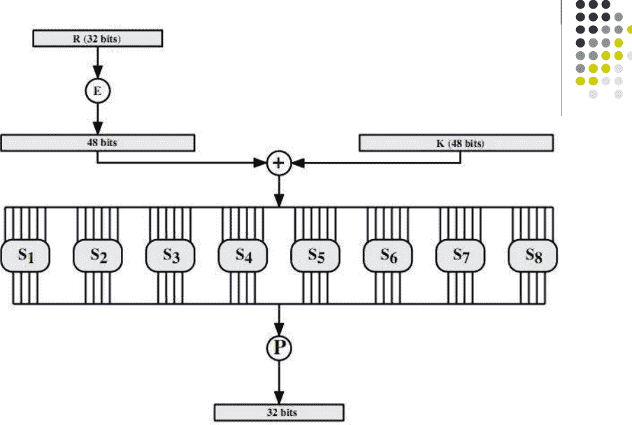

## Table 3.3 Definition of DES S-Boxes

|   |   |   |   |   |   |   |   |   |   |   |   |   |   |   |   |
|---|---|---|---|---|---|---|---|---|---|---|---|---|---|---|---|---|
| 14| 4 | 13| 1 | 2 | 15| 11| 8 | 3 | 10| 6 | 12| 5 | 9 | 0 | 7 |
| 0 | 15| 7 | 4 | 14| 2 | 13| 1 | 10| 6 | 12| 11| 9 | 5 | 3 | 8 |
| 4 | 1 | 14| 8 | 13| 6 | 2 | 11| 15| 12| 9 | 7 | 3 | 10| 5 | 0 |
| 15| 12| 8 | 2 | 4 | 9 | 1 | 7 | 5 | 11| 3 | 14| 10| 0 | 6 | 13|

|   |   |   |   |   |   |   |   |   |   |   |   |   |   |   |   |
|---|---|---|---|---|---|---|---|---|---|---|---|---|---|---|---|---|
| 15| 1 | 8 | 14| 6 | 11| 3 | 4 | 9 | 7 | 2 | 13| 12| 0 | 5 | 10|
| 3 | 13| 4 | 7 | 15| 2 | 8 | 14| 12| 0 | 1 | 10| 6 | 9 | 11| 5 |
| 0 | 14| 7 | 11| 10| 4 | 13| 1 | 5 | 8 | 12| 6 | 9 | 3 | 2 | 15|
| 13| 8 | 10| 1 | 3 | 15| 4 | 2 | 11| 6 | 7 | 12| 0 | 5 | 14| 9 |

|   |   |   |   |   |   |   |   |   |   |   |   |   |   |   |   |
|---|---|---|---|---|---|---|---|---|---|---|---|---|---|---|---|---|
| 10| 0 | 9 | 14| 6 | 3 | 15| 5 | 1 | 13| 12| 7 | 11| 4 | 2 | 8 |
| 13| 7 | 0 | 9 | 3 | 4 | 6 | 10| 2 | 8 | 5 | 14| 12| 11| 15| 1 |
| 13| 6 | 4 | 9 | 8 | 15| 3 | 0 | 11| 1 | 2 | 12| 5 | 10| 14| 7 |
| 1 | 10| 13| 0 | 6 | 9 | 8 | 7 | 4 | 15| 14| 3 | 11| 5 | 2 | 12|

|   |   |   |   |   |   |   |   |   |   |   |   |   |   |   |   |
|---|---|---|---|---|---|---|---|---|---|---|---|---|---|---|---|---|
| 7 | 13| 14| 3 | 0 | 6 | 9 | 10| 1 | 2 | 8 | 5 | 11| 12| 4 | 15|
| 13| 8 | 11| 5 | 6 | 15| 0 | 3 | 4 | 7 | 2 | 12| 1 | 10| 14| 9 |
| 10| 6 | 9 | 0 | 12| 11| 7 | 13| 15| 1 | 3 | 14| 5 | 2 | 8 | 4 |
| 3 | 15| 0 | 6 | 10| 1 | 13| 8 | 9 | 4 | 5 | 11| 12| 7 | 2 | 14|

|   |   |   |   |   |   |   |   |   |   |   |   |   |   |   |   |
|---|---|---|---|---|---|---|---|---|---|---|---|---|---|---|---|---|
| 2 | 12| 4 | 1 | 7 | 10| 11| 6 | 8 | 5 | 3 | 15| 13| 0 | 14| 9 |
| 14| 11| 2 | 12| 4 | 7 | 13| 1 | 5 | 0 | 15| 10| 3 | 9 | 8 | 6 |
| 4 | 2 | 1 | 11| 10| 13| 7 | 8 | 15| 9 | 12| 5 | 6 | 3 | 0 | 14|
| 11| 8 | 12| 7 | 1 | 14| 2 | 13| 6 | 15| 0 | 9 | 10| 4 | 5 | 3 |

|   |   |   |   |   |   |   |   |   |   |   |   |   |   |   |   |
|---|---|---|---|---|---|---|---|---|---|---|---|---|---|---|---|---|
| 12| 1 | 10| 15| 9 | 2 | 6 | 8 | 0 | 13| 3 | 4 | 14| 7 | 5 | 11|
| 10| 15| 4 | 2 | 7 | 12| 9 | 5 | 6 | 1 | 13| 14| 0 | 11| 3 | 8 |
| 9 | 14| 15| 5 | 2 | 8 | 12| 3 | 7 | 0 | 4 | 10| 1 | 13| 11| 6 |
| 4 | 3 | 2 | 12| 9 | 5 | 15| 10| 11| 14| 1 | 7 | 6 | 0 | 8 | 13|

|   |   |   |   |   |   |   |   |   |   |   |   |   |   |   |   |
|---|---|---|---|---|---|---|---|---|---|---|---|---|---|---|---|---|
| 4 | 11| 2 | 14| 15| 0 | 8 | 13| 3 | 12| 9 | 7 | 5 | 10| 6 | 1 |
| 13| 0 | 11| 7 | 4 | 9 | 1 | 10| 14| 3 | 5 | 12| 2 | 15| 8 | 6 |
| 1 | 4 | 11| 13| 12| 3 | 7 | 14| 10| 15| 6 | 8 | 0 | 5 | 9 | 2 |
| 6 | 11| 13| 8 | 1 | 4 | 10| 7 | 9 | 5 | 0 | 15| 14| 2 | 3 | 12|

|   |   |   |   |   |   |   |   |   |   |   |   |   |   |   |   |
|---|---|---|---|---|---|---|---|---|---|---|---|---|---|---|---|---|
| 13| 2 | 8 | 4 | 6 | 15| 11| 1 | 10| 9 | 3 | 14| 5 | 0 | 12| 7 |
| 1 | 15| 13| 8 | 10| 3 | 7 | 4 | 12| 5 | 6 | 11| 0 | 14| 9 | 2 |
| 7 | 11| 4 | 1 | 9 | 12| 14| 2 | 0 | 6 | 10| 13| 15| 3 | 5 | 8 |
| 2 | 1 | 14| 7 | 4 | 10| 8 | 13| 15| 12| 9 | 0 | 3 | 5 | 6 | 11|


## 3.3 DES的安全强度

### 密钥的长度问题

- 56-bit 密钥有 \(2^{56} = 72,057,584,037,927,936 \approx 7.2\) 亿亿之多
- 强力搜索 (brute force search) 似乎很困难，20 世纪 70 年代估计要 1000—2000 年
- 技术进步使穷举搜索成为可能

- 1997 年 1 月 29 日，RSA 公司发起破译 RC4、RC5、MD2、MD5，以及 DES 的活动，破译 DES 奖励 10000 美金。明文是：Strong cryptography makes the world a safer place. 结果仅搜索了 24.6% 的密钥空间便得到结果，耗时 96 天。
- 1998 年在一台专用机上 (EFF) 只要三天时间即可
- 1999 年在超级计算机上只要 22 小时！
- 现在只需要 10 小时！


*Chapter 4*

*Finite Fields*


## 本章要点

- 域是一些元素的集合，其上定义了两个算术运算（加法和乘法），具有常规算术性质，如封闭性、结合律、交换律、分配律、加法逆和乘法逆等。
- 模算术是一种整数算术，它将所有整数约减为一个固定的集合 `[0,1,⋯,n−1]`，`n` 为某个整数。任何这个集合外的整数通过除以 `n` 取余的方式约减到这个范围内。
- 两个整数的最大公因子是可以整除这两个整数的最大正整数。
- 一个有限域就是有有限个元素的域。可以证明有限域的阶（元素个数）一定可以写作素数的幂形式 `p^n`，`n` 为一个整数，`p` 为素数。
- 阶为 `p` 的有限域可以由模 `p` 的算术来定义。
- 阶为 `p^n`，`n>1` 的有限域可由多项式算术来定义。

## 4.1 群，环和域 Groups, Rings, and Fields

- 群 G，记作 {G, ·}，定义一个二元运算 · 的集合，G 中每一个序偶 (a, b) 通过运算生成 G 中元素 (a·b)，满足下列公理：
    - (A1) 封闭性 Closure：如果 a 和 b 都属于 G，则 a·b 也属于 G。
    - (A2) 结合律 Associative：对于 G 中任意元素 a, b, c，都有 a·(b·c) = (a·b)·c 成立
    - (A3) 单位元 Identity element：G 中存在一个元素 e，对于 G 中任意元素 a，都有 a·e = e·a = a 成立
    - (A4) 逆元 Inverse element：对于 G 中任意元素 a，G 中都存在一个元素 a’，使得 a·a’ = a’·a = e 成立

## 群、有限群和无限群

- 用 $N_n$ 表示 $n$ 个不同符号的集合，\{1,2,\ldots,n\}。$n$ 个不同符号的一个置换是一个 $N_n$ 到 $N_n$ 的一一映射。定义 $S_n$ 为 $n$ 个不同符号的所有置换组成的集合。$S_n$ 中的每一个元素都代表集合 $\{1,2,\ldots,n\}$ 的一个置换，容易验证 $S_n$ 是一个群：
    - **A1：** 如果 $\boldsymbol{\pi},\boldsymbol{\rho}\in S_n$，则合成映射 $\boldsymbol{\pi}\bullet\boldsymbol{\rho}$ 根据置换 $\boldsymbol{\pi}$ 来改变 $\boldsymbol{\rho}$ 中元素的次序而形成，如，$\{3,2,1\}\bullet\{1,3,2\}=\{2,3,1\}$，虽然 $\boldsymbol{\pi}\bullet\boldsymbol{\rho}\in S_n$
    - **A2：** 映射的合成显而易见满足结合律
    - **A3：** 恒等映射就是不改变 $n$ 个元素位置的置换，对于 $S_n$，单位元是 $\{1,2,\ldots,n\}$
    - **A4：** 对于任意 $\boldsymbol{\pi}\in S_n$，抵消由 $\boldsymbol{\pi}$ 定义置换的映射就是 $\boldsymbol{\pi}$ 的逆元，这个逆元总是存在，例如：$\{2,3,1\}\bullet\{3,1,2\}=\{1,2,3\}$

- 有限群 Finite Group 和无限群 Infinite Group：如果一个群的元素是有限的，则该群称为有限群，且群的阶等于群中元素的个数；否则称为无限群

## 交换群和循环群

- 交换群 Abelian Group：还满足以下条件的群称为交换群 (又称阿贝尔群)
    - (A5) 交换律 Commutative：对于 G 中任意的元素 a, b，都有 a•b = b•a 成立

- 当群中的运算符是加法时，其单位元是 0；a 的逆元是 -a，并且减法用以下的规则定义：
    - a – b = a + (-b)

- 循环群 Cyclic Group
    - 如果群中的每一个元素都是一个固定的元素 a (a ∈ G) 的幂 a^k (k 为整数)，则称群 G 为循环群。元素 a 生成了群 G，或者说 a 是群 G 的生成元。

## 域 (Fields)

- 域 F，可以记为 {F, +, x}，是有加法和乘法的两个二元运算的元素的集合，对于 F 中的任意元素 a, b, c，满足以下公理：
    - (A1-M6)，F 是一个整环
    - (M7)，乘法逆元，对于 F 中的任意元素 a (除 0 以外)，F 中都存在一个元素 a⁻¹，使得 aa⁻¹ = (a⁻¹)a = 1。
    - 域就是一个集合，在其上进行加减乘除而不脱离该集合，除法按以下规则定义：a/b = a(b⁻¹)。
- 有理数集合，实数集合和复数集合都是域；整数集合不是域，因为除了 1 和 -1 有乘法逆元，其他元素都无乘法逆元

## 群、环和域的关系

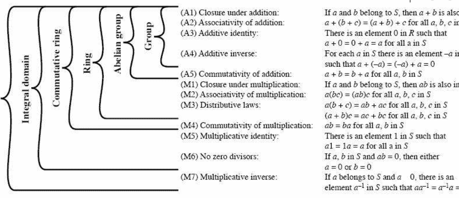

### Figure 4.1 Group, Ring, and Field

## 4.2 Modular Arithmetic

- 给定任意正整数 n 和 a，如果用 a 除以 n，得到的商 q 和余数 r 满足如下关系：
    - a = qn + r，0 ≤ r < n；q = ⌊a/n⌋，⌊x⌋ 表示小于等于 x 的最大整数
    - Eg: 11 = 1×7 + 4, r = 4; -11 = (-2)×7 + 3, r = 3

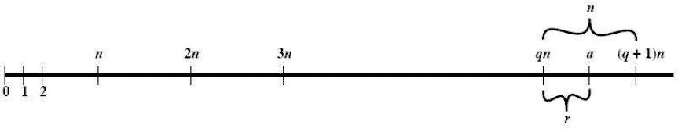

Figure 4.2 The Relationship \(a = qn + r; 0 \leq r < n\)

## 同余的性质

- 如果 n|(a-b)，则 a ≡ b mod n
    - 证明：如果 n|(a-b)，则有 (a-b) = kn，k 为某些整数，
    - 所以 a = b + kn。
    - 故 a mod n = (b + kn) 除以 n 的余数
    - = b 除以 n 的余数
    - = b mod n

- a ≡ b mod n 隐含 b ≡ a mod n

- a ≡ b mod n 和 b ≡ c mod n 隐含 a ≡ c mod n
    - Ex: 23 ≡ 8 (mod 5)，因为 23-8 = 15 = 5×3
    - -11 ≡ 5 (mod 8)，因为 -11-5 = -16 = 8×(-2)
    - 81 ≡ 0 (mod 27)，因为 81-0 = 81 = 27×3

## 模算术运算

$(a_1\ op\ a_2)\ mod\ n = [(a_1\ mod\ n)\ op\ (a_2\ mod\ n)]\ mod\ n$

- ① 反身性：a = a mod n
- ② 对称性：若 a = b mod n，则 b = a mod n
- ③ 传递性：若 a = b mod n 且 b = c mod n，则 a = c mod n
- ④ 如果 a = b mod n 且 c = d mod n，则
    - a + c = (b + d) mod n
    - a - c = (b - d) mod n
    - a • c = (b • d) mod n
- ⑤ (a + b) mod n = (a mod n + b mod n) mod n
    - (a - b) mod n = (a mod n - b mod n) mod n
    - (a • b) mod n = (a mod n • b mod n) mod n

## 模算术运算

(a + b) mod n = (a mod n + b mod n) mod n

证明：定义 (a mod n) = ra, (b mod n) = rb
于是存在整数 j, k 使得 a = ra + jn, b = rb + kn。
那么
(a + b) mod n = (ra + jn + rb + kn) mod n
= (ra + rb + (k + j)n) mod n
= (ra + rb) mod n
= [(a mod n) + (b mod n)] mod n


## 加法逆元和乘法逆元

- 加法逆元(-w)
- 对每一个w∈Zn，存在一个z，使得w+z≡0 mod n，则z即为加法逆元-w
- 乘法逆元(w⁻¹)
- 对每一个w∈Zp，存在一个z，使得wxz≡1 mod p，p为素数，w与p互素，则z即为乘法逆元w⁻¹
- 因为w与p互素，如果用w乘以Zp中的所有数模p，得到的余数将以不同次序涵盖Zp中的所有数，那么至少有一个余数的值为1。因此，在Zp中的某个数与w相乘模p的余数为1，这个数就是w的乘法逆元，w⁻¹
- 某些但非全部整数存在一个乘法逆元就将使模数不再是素数。如果gcd(a, n)=1，则能在Zn中找到b，使得axb ≡ 1 mod n，则b即为乘法逆元a⁻¹，因为a与n互素

## 4.3欧几里得算法Euclid Algorithm

a=q1b+r1  0≤r1<b  
假设r1≠0.因为b>r1，可以用r1除b，应用除法有  
b=q2r1+r2  0≤r2<r1  
如前所述，如果r2=0，则d=r1.如果r2≠0，则d=gcd(r1,r2)。  
继续除法过程直到余数为0，比如说在第(n+1)阶段有rn整除  
r(n-1)。结果为如下的方程系统：

a=q1b+r1  0<r1<b  
b=q2r1+r2  0<r2<r1  
r1=q2r2+r3  0<r3<r2  
...  
r n-2=qnrn-1+rn  0<rn<rn-1  
r n-1=qn+1rn+0  
d=gcd(a,b)=gcd(rn,0)=rn

## gcd(a, b) = gcd(b, a mod b)

使d等于gcd(a,b),根据gcd的定义，有d|a和d|b成立。对于任意正整数b,a可以表示为如下形式：

a=kb+r =r(mod b)
a mod b=r

其中k,r为整数。因此，对于某个整数k,有(a mod b)=a-kb。
因为d|b，所以有d|kb；又因为d|a，所以有d|(a mod b). 这说明d是b和(a mod b)的公因子。反之，如果d是b和(a mod b)的公因子，那么d|kb并且由此可知d|[kb+(a mod b)],即d|a。因此，a和b的公因子的集合与b和(a mod b)的公因子的集合相等。

## Example: 求 gcd(1970, 1066)

1970 = 1 x 1066 + 904　　　　　　gcd(1066, 904)
1066 = 1 x 904 + 162　　　　　　 gcd(904, 162)
904 = 5 x 162 + 94　　　　　　　 gcd(162, 94)
162 = 1 x 94 + 68　　　　　　　　gcd(94, 68)
94 = 1 x 68 + 26　　　　　　　　 gcd(68, 26)
68 = 2 x 26 + 16　　　　　　　　 gcd(26, 16)
26 = 1 x 16 + 10　　　　　　　　 gcd(16, 10)
16 = 1 x 10 + 6　　　　　　　　　gcd(10, 6)
10 = 1 x 6 + 4　　　　　　　　　 gcd(6, 4)
6 = 1 x 4 + 2　　　　　　　　　　gcd(4, 2)
4 = 2 x 2 + 0　　　　　　　　　　gcd(2, 0)

Gcd (1970, 1066)=2


## 4.3扩展的Euclid算法

从原始的Euclid算法知该过程当余数为0时结束，求得a和b的最大公因子为d=gcd(a,b)=rn。我们也决定了

\(d = r_n = ax_n + by_n.\)
\(x = x_n, y = y_n\)

## Galois Fields GF(p)

- 阶为 p 的有限域 GF(p)
  - 给定一个素数 p，元素个数为 p 的有限域 GF(p) 被定义为整数 {0,1，…，p-1} 的集合 Zₚ，其运算为模 p 的算术运算
  - Zₙ 中的任一整数有乘法逆元当且仅当该整数与 n 互素，若 n 为素数，Zₙ 中的所有非零整数都与 n 互素，因此 Zₙ 中所有非零整数都有乘法逆元
  - 对每一个 w∈Zₚ，存在一个 z，使得 w×z≡1 mod p，则 z 即为乘法逆元 w⁻¹
  - 因为 w 与 p 互素，如果用 w 乘以 Zₚ 中的所有数模 p，得到的余数将以不同次序涵盖 Zₚ 中的所有数，即余数集合是 {0,1，…，p-1} 的置换形，那么至少有一个余数的值为 1。因此，在 Zₚ 中的某个数与 w 相乘模 p 的余数为 1，这个数就是 w 的乘法逆元，w⁻¹。所以，Zₚ 是一个有限域。

### Table 4.3 Arithmetic in GF(7)

| + | 0 | 1 | 2 | 3 | 4 | 5 | 6 |
|---|---:|---:|---:|---:|---:|---:|---:|
| 0 | 0 | 1 | 2 | 3 | 4 | 5 | 6 |
| 1 | 1 | 2 | 3 | 4 | 5 | 6 | 0 |
| 2 | 2 | 3 | 4 | 5 | 6 | 0 | 1 |
| 3 | 3 | 4 | 5 | 6 | 0 | 1 | 2 |
| 4 | 4 | 5 | 6 | 0 | 1 | 2 | 3 |
| 5 | 5 | 6 | 0 | 1 | 2 | 3 | 4 |
| 6 | 6 | 0 | 1 | 2 | 3 | 4 | 5 |

(a) Addition modulo 7

| × | 0 | 1 | 2 | 3 | 4 | 5 | 6 |
|---|---:|---:|---:|---:|---:|---:|---:|
| 0 | 0 | 0 | 0 | 0 | 0 | 0 | 0 |
| 1 | 0 | 1 | 2 | 3 | 4 | 5 | 6 |
| 2 | 0 | 2 | 4 | 6 | 1 | 3 | 5 |
| 3 | 0 | 3 | 6 | 2 | 5 | 1 | 4 |
| 4 | 0 | 4 | 1 | 5 | 2 | 6 | 3 |
| 5 | 0 | 5 | 3 | 1 | 6 | 4 | 2 |
| 6 | 0 | 6 | 5 | 4 | 3 | 2 | 1 |

(b) Multiplication modulo 7

| w | −w | w⁻¹ |
|---|---:|---:|
| 0 | 0 | — |
| 1 | 6 | 1 |
| 2 | 5 | 4 |
| 3 | 4 | 5 |
| 4 | 3 | 2 |
| 5 | 2 | 3 |
| 6 | 1 | 6 |

(c) Additive and multiplicative inverses modulo 7

## 计算乘法逆元素

Computing multiplicative inverses

ax mod n = 1, x=a⁻¹=?

给定 a∈[0, n−1]，gcd (a, n)=1，若能找到唯一整数 x∈[0,n−1]，满足：ax mod n=1，则称 a 和 x 互逆

如 n=10，a=3，x=7，ax mod n=1 =3×7 mod 10

n=17，a=5，x=7，ax mod n=1 =5×7 mod 17

引理4.1：如果 gcd (a, n)=1，则对于每个 i, j，0≤i<j<n，ai mod n≠aj mod n

证明：（略）可以用反证法证明

此性质意味着每一个 ai mod n (i=0,…,n−1) 都是不同的模剩余，而 {ai mod n}ᵢ=0,1,…,n−1 是完全剩余集合 {0,1,…,n−1} 的置换形式

## 计算乘法逆元素

例如: n=5, a=3, gcd(3,5)=1, {0,1,...,n-1}={0,1,2,3,4}

- 3*0 mod 5=0
- 3*1 mod 5=3
- 3*2 mod 5=1
- 3*3 mod 5=4
- 3*4 mod 5=2

{ai mod n}<sub>i=0,1,...,n-1</sub>={0,3,1,4,2}

引理4.1说明，当gcd(a, n)=1时，a一定有一个唯一的逆元素。

## 定理4.1

如果gcd(a, n)=1，一定存在整数x，0<x<n，
满足 ax mod n=1

可以用Euclid’s计算最大公约数算法的扩展来求逆。


## 扩展的Euclid算法求逆

如果a和b互素，则b有模a的乘法逆元。也就是说，如果gcd(a,b)=1,那么b有模a的乘法逆元。即对于正整数b<a,存在b<sup>-1</sup><a使bb<sup>-1</sup>=1mod a. 如果a是素数并且b<a，则显然a和b互素，且最大公因子为1.

我们已经证明过该式可以用扩展Euclid算法来解：
ax+by=d=gcd(a, b)
如果gcd(a, b)=1,则有ax+by=1.
[(ax mod a)+(by mod a)]mod a = 1 mod a
0+(by mod a)=1
如果by mod a=1，则y=b<sup>-1</sup>.


## 4.5 多项式运算

### 三种多项式运算

- 使用代数基本规则的普通多项式运算
- 系数运算是模 \(p\) 运算的多项式运算，即系数在 \(GF(p)\) 中
- 系数在 \(GF(p)\) 中，且多项式被定义为模一个 \(n\) 次多项式 \(m(x)\) 的多项式运算

### 普通多项式运算

- 一个 \(n\) 次多项式（\(n \geq 0\)）的表达形式如下：

\[
f(x) = a_nx^n + a_{n-1}x^{n-1} + \cdots + a_1x + a_0 = \sum_{i=0}^n a_ix^i
\]

- 其中 \(a_i\) 是某个指定数集 \(S\) 中的元素，该数集称为系数集，且 \(a_n \neq 0\)，\(f(x)\) 是定义在系数集 \(S\) 上的多项式。
- 零次多项式称为常数多项式，是系数集里的一个元素；如果 \(a_n = 1\)，对应的 \(n\) 次多项式就称为首一多项式。

- 加或减就是相应系数的加减，乘则要用到所有系数。
- Ex.
  - let \( f(x) = x^3 + x^2 + 2 \) and \( g(x) = x^2 - x + 1 \)
  - \( f(x) + g(x) = x^3 + 2x^2 - x + 3 \)
  - \( f(x) - g(x) = x^3 + x + 1 \)
  - \( f(x) \times g(x) = x^5 + 3x^2 - 2x + 2 \)
  - \( f(x) \div g(x) = x + 2 \)，余 \( x \)

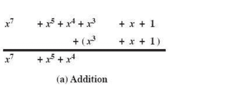
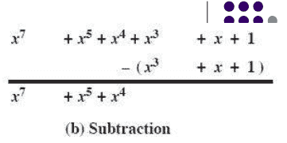
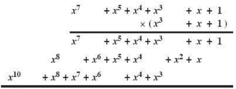
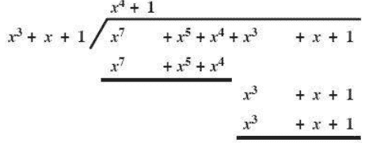

### Figure 4.4 Examples of Polynomial Arithmetic over GF(2)

### 多项式的模运算

- 多项式可以写成如下形式：
  - \( f(x) = q(x)g(x) + r(x) \)
  - 其中，\( r(x) \) 就可被看作是余数
  - \( r(x) = f(x) \bmod g(x) \)
- 如果没有余数，就称 \( g(x) \) 可以整除 \( f(x) \)。
- 如果 \( g(x) \) 除了 1 和它自身以外没有其他公因式，就称它是不可约多项式或素多项式 **irreducible** or **prime**。

### 求多项式的最大公因式

- 可以为多项式求解最大公因式：
  - 如果 \( c(x) \) 是可以整除 \( a(x) \) 和 \( b(x) \) 的最大公因式，则 \( c(x) = \gcd(a(x), b(x)) \)。
  - 可以用 Euclid's Algorithm 来求解多项式最大公因式：

\[
\gcd[a(x), b(x)] = \gcd[b(x), a(x) \bmod b(x)]
= \gcd[r_1(x), b(x) \bmod r_1(x)]
= \gcd[r_2(x), r_1(x) \bmod r_2(x)] = \cdots
\]

示例：

设 \(a(x) = x^6 + x^5 + x^4 + x^3 + x^2 + x + 1\)，\(b(x) = x^4 + x^2 + x + 1\)。

用 \(b(x)\) 除 \(a(x)\)，得商 \(q_1(x) = x^2 + x\)，余数 \(r_1(x) = x^3 + x^2 + 1\)。

接着用 \(r_1(x)\) 除 \(b(x)\)：

\[
x^4 + x^2 + x + 1 = (x + 1)(x^3 + x^2 + 1)
\]

余数 \(r_2(x) = 0\)，商 \(q_2(x) = x + 1\)。

因此：

\[
\gcd[a(x), b(x)] = r_1(x) = x^3 + x^2 + 1
\]

## 4.6 有限域 GF(2^n)

- 所有加密算法都涉及到整数集上的算术运算，如果用到除法，必须使用定义在域上的运算。
- 整数集里的数与给定的二进制位数所能表达的信息一一对应，即整数集的范围从 0 到 \(2^n - 1\)，正好对应一个 \(n\) 位的字。
- 将一个整数集不均匀地映射到自身的算法用于加密时可能要弱于一个提供一一映射的算法，因此，有限域 \(GF(2^n)\) 对加密算法是很有吸引力的。所以要寻找一个包含 \(2^n\) 个元素的集合，其上定义了加法和乘法使之成为一个域，给集合的每个元素赋值为 0 到 \(2^n - 1\) 之间的唯一整数，用多项式算术来构造所需的域。
- 可以使用扩展的欧几里德算法来为集合中的元素找到逆元。

### Table 4.5 Arithmetic in GF(2^3)

#### (a) Addition

| \(+\) | 000 | 001 | 010 | 011 | 100 | 101 | 110 | 111 |
|---|---|---|---|---|---|---|---|---|
| 000 | 0 | 1 | 2 | 3 | 4 | 5 | 6 | 7 |
| 001 | 1 | 0 | 3 | 2 | 5 | 4 | 7 | 6 |
| 010 | 2 | 3 | 0 | 1 | 6 | 7 | 4 | 5 |
| 011 | 3 | 2 | 1 | 0 | 7 | 6 | 5 | 4 |
| 100 | 4 | 5 | 6 | 7 | 0 | 1 | 2 | 3 |
| 101 | 5 | 4 | 7 | 6 | 1 | 0 | 3 | 2 |
| 110 | 6 | 7 | 4 | 5 | 2 | 3 | 0 | 1 |
| 111 | 7 | 6 | 5 | 4 | 3 | 2 | 1 | 0 |

#### (b) Multiplication

| \(\times\) | 000 | 001 | 010 | 011 | 100 | 101 | 110 | 111 |
|---|---|---|---|---|---|---|---|---|
| 000 | 0 | 0 | 0 | 0 | 0 | 0 | 0 | 0 |
| 001 | 0 | 1 | 2 | 3 | 4 | 5 | 6 | 7 |
| 010 | 0 | 2 | 4 | 6 | 3 | 1 | 7 | 5 |
| 011 | 0 | 3 | 6 | 5 | 7 | 4 | 1 | 2 |
| 100 | 0 | 4 | 3 | 7 | 6 | 2 | 5 | 1 |
| 101 | 0 | 5 | 1 | 4 | 2 | 7 | 3 | 6 |
| 110 | 0 | 6 | 7 | 1 | 5 | 3 | 2 | 4 |
| 111 | 0 | 7 | 5 | 2 | 1 | 6 | 4 | 3 |

#### (c) Additive and multiplicative inverses

| \(w\) | \(-w\) | \(w^{-1}\) |
|------|------|-----------|
| 0    | 0    | —         |
| 1    | 1    | 1         |
| 2    | 2    | 5         |
| 3    | 3    | 6         |
| 4    | 4    | 7         |
| 5    | 5    | 2         |
| 6    | 6    | 3         |
| 7    | 7    | 4         |


## 网络信息安全

## Chapter 6

## More on Symmetric Ciphers

## 本章要点

- 多重加密是将一个加密算法多次使用的技术，明文通过加密算法转化为密文，然后将该密文作为输入重新执行加密算法，该过程可以重复多次。
- 三重DES(3DES)在三个阶段使用DES算法，共用到两组或三组密钥。
- 选择工作模式是一项增强密码算法或者使算法适应具体应用的技术。
- 对称密码有5种工作模式，电码本模式、密文分组链接模式、密文反馈模式、输出反馈模式和计数器模式。

## 6.1 多重加密与三重DES算法

- 寻找代替DES的新密码的理由是显然的
  - 密钥的穷举攻击是可行的
- AES是一种新的安全的密码
- 在AES之前，还可以用DES进行多次加密，且使用多个密钥
- 三重DES(Triple-DES)被广泛接受

## 双重DES和三重DES

- 双重DES（Double DES）
  - 给定明文P和加密密钥K₁和K₂，
  - 加密：C=E_K₂[E_K₁[P]]
  - 解密：P=D_K₁[D_K₂[C]]
  - 密钥长度为56×2=112位

存在中途相遇攻击问题

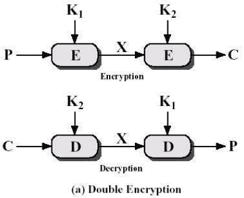

## 中途相遇攻击(Meet-in-the-Middle Attack)

- 这种攻击对使用两次加密的分组密码都有效
  C=E_{K_2}[E_{K_1}[P]]，则X=E_{K_1}[P]=D_{K_2}[C]
- 若已知(P，C)，则
  - 对 $2^{56}$ 个可能的 $K_1$ 加密P，结果存入表中，按X值排序
  - 对 $2^{56}$ 个可能的 $K_2$ 解密C，在表中寻找匹配
  - 如果产生匹配，则用一个新的明文密文对检测所得两个密钥
  - 如果两密钥产生正确的密文，则接受为正确密钥

对任意给定的明文P，双重DES产生的密文有 $2^{64}$ 可能，密钥空间为 $2^{112}$。对给定明文P，可产生给定密文C的密钥的个数平均为 $2^{112}/2^{64}=2^{48}$。上述攻击过程对第一个(P，C)对将产生 $2^{48}$ 个错误的结果，而对第二个(P，C)对，错误结果的概率就降为 $2^{48-64}=2^{-16}$，即中途相遇攻击使用两组已知明文密文对就可以检测到正确密钥的概率是 $1-2^{-16}$，攻击双重DES，工作量仅为 $2^{56}$，与攻击单DES所需的 $2^{55}$ 差不多。

## 6.1.2 使用两个密钥的三重DES

- 使用两个密钥进行三次加密：E-D-E sequence
  - `C ≡ E_{K1}[D_{K2}[E_{K1}[P]]]`
  - 如果 K1=K2，则相当于单次DES
- 已被用于密钥管理标准 ANSI X9.17 和 ISO8732
- 当前还没有对三重DES的可行攻击方法

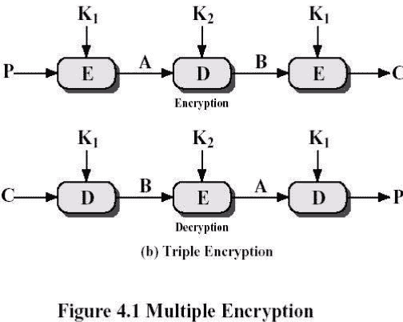

## 6.1.3 使用三个密钥的三重DES

- 虽然对于使用两个密钥的Triple-DES还没有实际的成功攻击，但是仍然令人有些担心
- 因此可以考虑使用三个密钥的Triple-DES，这样，密钥的长度就是168位
- \( C = E_{K3}[D_{K2}[E_{K1}[P]]] \)
- 使用三个密钥的Triple-DES如今已被广泛采用，如PGP，S/MIME
- 当然还有使用更多重DES的，如5DES

## 6.2 分组密码的工作模式

| Mode | Description | Typical Application |
|---|---|---|
| Electronic Codebook (ECB) | Each block of 64 plaintext bits is encoded independently using the same key. | • Secure transmission of single values (e.g., an encryption key) |
| Cipher Block Chaining (CBC) | The input to the encryption algorithm is the XOR of the next 64 bits of plaintext and the preceding 64 bits of ciphertext. | • General-purpose block-oriented transmission<br>• Authentication |
| Cipher Feedback (CFB) | Input is processed s bits at a time. Preceding ciphertext is used as input to the encryption algorithm to produce pseudorandom output, which is XORed with plaintext to produce next unit of ciphertext. | • General-purpose stream-oriented transmission<br>• Authentication |
| Output Feedback (OFB) | Similar to CFB, except that the input to the encryption algorithm is the preceding DES output. | • Stream-oriented transmission over noisy channel (e.g., satellite communication) |
| Counter (CTR) | Each block of plaintext is XORed with an encrypted counter. The counter is incremented for each subsequent block. | • General-purpose block-oriented transmission<br>• Useful for high-speed requirements |

## 电子密码本模式Electronic Codebook, ECB

- 明文分成64的分组进行加密，必要时填充，每个分组用同一密钥加密，同样明文分组加密得相同密文

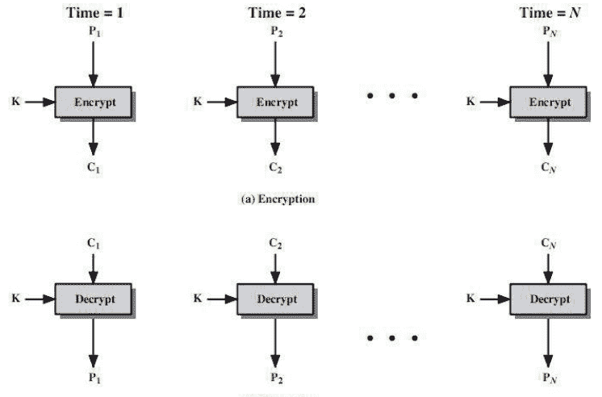

Figure 6.3  Electronic Codebook (ECB) Mode

## ECB模式的局限性

- ECB模式特别适合数据较少的情况，如安全传输DES密钥
- 一段明文消息中若有几个相同的明文组，则密文也将出现几个相同的片段
- 对于很长的消息，ECB是不安全的，如果消息是非常结构化的，密码分析可能利用其结构特征来破解
- ECB的弱点来源于其加密过的密文分组是互相独立的

## CBC的优点和局限

- 每个密文分组依赖于所有明文分组
- 明文消息中的任何一点变化都会影响所有的密文分组
- 发送方和接收方需要共享初始向量Initial Value(IV)
  - 如果IV被明文传送，则攻击者可以改变第一个分组的某些位，然后预先改变IV中的某些位，则接收者收到的P1也就相应改变了
  - 因此，IV必须是一个固定的值或者必须用ECB方式在消息之前加密传送
- 在消息的最后，还要处理不够长度的分组
  - 可以填充已知非数据值，或者在最后一块补上填充位长度
  - eg. [ b1 b2 b3 0 0 0 0 5 ] <- 3 data bytes, then 5 bytes pad+count

## 密码反馈模式Cipher FeedBack (CFB)

- 是一种将DES转化成流密码的技术，不再要求报文被填充完成整个分组，可以实时运行，如果要传输一个字符流，每个字符都可以使用面向字符的流密码加密后立即传输。
- 加密：加密函数的输入是一个64位的移位寄存器，产生初始向量IV。加密函数高端位与明文P1的第一单元异或，产生位密文C1进入移位寄存器低端，继续加密，与P2输入异或，如此重复直到所有明文单元都完成加密。
- 解密：采用相同方案，但是使用加密函数而非解密函数。


## Figure 6.5 s-bit Cipher Feedback (CFB) Mode

### (a) Encryption

### (b) Decryption

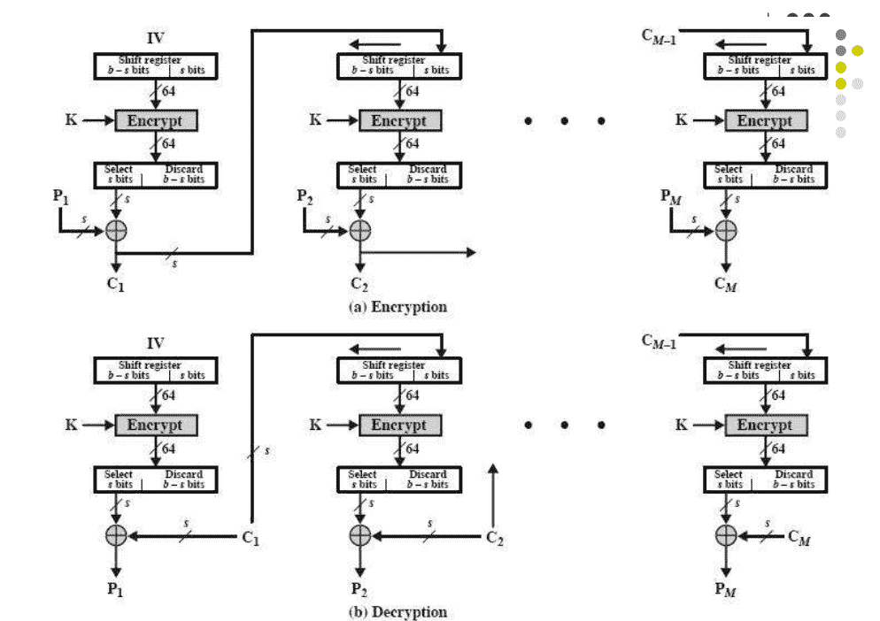

## 密码反馈模式 Cipher FeedBack (CFB)

- 解密：采用相同方案，但是使用加密函数而非解密函数。

设 MSN<sub>s</sub>(X) 表示 X 的最左边 s 位。则

\( C_1 = P_1 \oplus MSB_s[E(K, IV)] \)

从而有

\( P_1 = C_1 \oplus MSB_s[E(K, IV)] \)

## CFB 模式的优点和局限

- 当数据以位或字节形式到达时使用都是适当的
- 最通用的是流密码形式

## 输出反馈模式 Output FeedBack (OFB)

- 输出反馈模式 Output FeedBack (OFB)
  - 结构上类似 CFB，但是 OFB 中加密函数输出被反馈回移位寄存器，CFB 中是密文单元被反馈回移位寄存器。优点是传输中的比特差错不会传播，缺点是比 CFB 更容易受报文流篡改攻击。

## Figure 6.6 s-bit Output Feedback (OFB) Mode

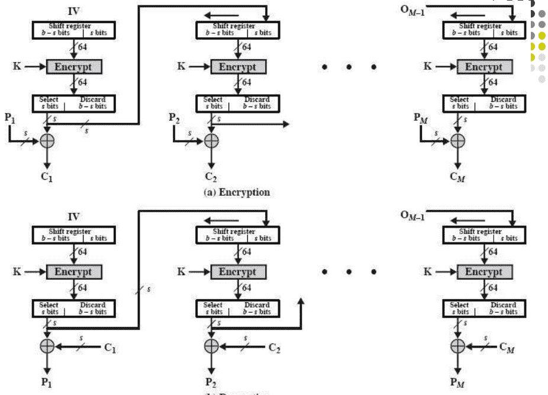

## OFB 的优点和局限

- OFB 的一个优点是传输过程中在某位上发生的错误不会影响到其他位。比如，C1 中有 1 位发生了错误，只会影响到 P1 的恢复，后续的明文单元不受影响。
- OFB 的缺点是，抗消息流篡改攻击的能力不如 CFB。即密文中的某位取反，恢复出的明文相应位也取反。

## （a）Encryption

## （b）Decryption

## Figure 6.7 Counter (CTR) Mode

## CTR 的优点和局限

- 高效
  - 可以做并行加密
  - 对高速链路的突发数据加密尤其有效
- 可以对被加密的分组进行随机存取
- 相当安全
- 简洁
- 必须决不重复使用密钥和计数器值


## 网络信息安全

## Chapter 8
Introduction to Number
Theory


## 第二部分 公钥密码和散列函数

第8章：数论入门

第9章：公钥密码与RSA

第10章：密钥管理和其他公钥密码体制

第11章：消息认证和散列函数

第12章：散列和MAC算法

第13章：数字签名和认证协议

## 本章要点

- 素数是一种整数，在整除意义下，它只能被自身(正负)和1整除。素数在数论和密码学里扮演重要角色。
- 在公钥密码里起重要作用的两个定理是费马定理和欧拉定理。
- 许多密码算法的一个重要前提是能够选择一个大的素数。开发有效算法判定一个随机整数是否为素数是密码研究重要课题。
- 离散对数是许多公钥算法的基础。离散对数和普通对数类似，但是在模算术上进行运算。

## 8.1 素数 Prime Numbers

- 素数的因子是1和其自身
  - 不能写作其他数的乘积形式
  - 1是素数，但是通常没有什么作用
- 如，2,3,5,7是素数，4,6,8,9,10不是
- 素数是数论的核心
- 小于200的素数如下

2  3  5  7  11  13  17  19  23  29  31  37  41  43
47  53  59  61  67  71  73  79  83  89  97  101
103  107  109  113  127  131  137  139  149  151
157  163  167  173  179  181  191  193  197  199

## 小于2000的素数

Table 8.1 Primes Under 2000

| 2 | 3 | 5 | 7 | 11 | 13 | 17 | 19 | 23 | 29 | 31 | 37 | 41 | 43 | 47 | 53 | 59 | 61 | 67 | 71 | 73 | 79 | 83 | 89 | 97 |
|---|---|---|---|---|---|---|---|---|---|---|---|---|---|---|---|---|---|---|---|---|---|---|---|---|
| 101 | 103 | 107 | 109 | 113 | 127 | 131 | 137 | 139 | 149 | 151 | 157 | 163 | 167 | 173 | 179 | 181 | 191 | 193 | 197 | 199 |  |  |  |  |
| 211 | 223 | 227 | 229 | 233 | 239 | 241 | 251 | 257 | 263 | 269 | 271 | 277 | 281 | 283 | 293 |  |  |  |  |  |  |  |  |  |
| 307 | 311 | 313 | 317 | 331 | 337 | 347 | 349 | 353 | 359 | 367 | 373 | 379 | 383 | 389 | 397 |  |  |  |  |  |  |  |  |  |
| 401 | 409 | 419 | 421 | 431 | 433 | 439 | 443 | 449 | 457 | 461 | 463 | 467 | 479 | 487 | 491 | 499 |  |  |  |  |  |  |  |  |
| 503 | 509 | 521 | 523 | 541 | 547 | 557 | 563 | 569 | 571 | 577 | 587 | 593 | 599 |  |  |  |  |  |  |  |  |  |  |  |
| 601 | 607 | 613 | 617 | 619 | 631 | 641 | 643 | 647 | 653 | 659 | 661 | 673 | 677 | 683 | 691 |  |  |  |  |  |  |  |  |  |
| 701 | 709 | 719 | 727 | 733 | 739 | 743 | 751 | 757 | 761 | 769 | 773 | 787 | 797 |  |  |  |  |  |  |  |  |  |  |  |
| 809 | 811 | 821 | 823 | 827 | 829 | 839 | 853 | 857 | 859 | 863 | 877 | 881 | 883 | 887 |  |  |  |  |  |  |  |  |  |  |
| 907 | 911 | 919 | 929 | 937 | 941 | 947 | 953 | 967 | 971 | 977 | 983 | 991 | 997 |  |  |  |  |  |  |  |  |  |  |  |
| 1009 | 1013 | 1019 | 1021 | 1031 | 1033 | 1039 | 1049 | 1051 | 1061 | 1063 | 1069 | 1087 | 1091 | 1093 | 1097 |  |  |  |  |  |  |  |  |  |
| 1103 | 1109 | 1117 | 1123 | 1129 | 1151 | 1153 | 1163 | 1171 | 1181 | 1187 | 1193 |  |  |  |  |  |  |  |  |  |  |  |  |  |
| 1201 | 1213 | 1217 | 1223 | 1229 | 1231 | 1237 | 1249 | 1259 | 1277 | 1279 | 1283 | 1289 | 1291 | 1297 |  |  |  |  |  |  |  |  |  |  |
| 1301 | 1303 | 1307 | 1319 | 1321 | 1327 | 1361 | 1367 | 1373 | 1381 | 1399 |  |  |  |  |  |  |  |  |  |  |  |  |  |
| 1409 | 1423 | 1427 | 1429 | 1433 | 1439 | 1447 | 1451 | 1453 | 1459 | 1471 | 1481 | 1483 | 1487 | 1489 | 1493 | 1499 |  |  |  |  |  |  |  |  |  |  |
| 1511 | 1523 | 1531 | 1543 | 1549 | 1553 | 1559 | 1567 | 1571 | 1579 | 1583 | 1597 |  |  |  |  |  |  |  |  |  |  |  |  |  |
| 1601 | 1607 | 1609 | 1613 | 1619 | 1621 | 1627 | 1637 | 1657 | 1663 | 1667 | 1669 | 1693 | 1697 | 1699 |  |  |  |  |  |  |  |  |  |  |
| 1709 | 1721 | 1723 | 1733 | 1741 | 1747 | 1753 | 1759 | 1777 | 1783 | 1787 | 1789 |  |  |  |  |  |  |  |  |  |  |  |  |  |
| 1801 | 1811 | 1823 | 1831 | 1847 | 1861 | 1867 | 1871 | 1873 | 1877 | 1879 | 1889 |  |  |  |  |  |  |  |  |  |  |  |  |  |
| 1901 | 1907 | 1913 | 1931 | 1933 | 1949 | 1951 | 1973 | 1979 | 1987 | 1993 | 1997 | 1999 |  |  |  |  |  |  |  |  |  |  |  |


## One-way Function and One-way Trapdoor Function

### 定义8.1 单向函数 (One-way Function)

一函数 $f$ 若满足下列条件，则称 $f$ 为单向函数：

- 对于所有属于 $f$ 域的任一 $x$，容易计算 $y=f(x)$。
- 对于几乎所有属于 $f$ 域的任一 $y$，求得 $x$，使 $y=f(x)$，在计算上不可行。

### 定义8.2 单向陷井门函数 (One-way Trapdoor Function)

一“可逆”函数 $F$ 若满足下列二条件，则称 $F$ 为单向陷井门函数：

- 对于所有属于 $F$ 域的任一 $x$，容易计算 $F(x)=y$；
- 对于几乎所有属于 $F$ 域的任一 $y$，除非获得暗门信息（trapdoor），否则求出 $x$，使得 $x=F^{-1}(y)$ 在计算上不可行，$F^{-1}$ 为 $F$ 之逆函数；如有额外信息（暗门），则容易求出 $x=F^{-1}(y)$。

## 单向函数举例

### 1. Discrete Logarithm Problem (DLP) 离散对数问题

令质数 $p$ 满足 $p-1$ 含有另一大质数 $q$ ($q$ 整除 $p-1$) 及一整数 $g$，$1<g<p-1$。

若给定整数 $x$，求 $y = g^x \bmod p$，最多需要 $\lfloor \log_2 x \rfloor + w(x) - 1$ 次乘法，$w(x)$ 为 $x$ 中所有 1 的个数。如 $x = 15$，即

$x = (1111)_2$，$w(x)=4$，则 $g^{15} = ((g^2)g)^2 \cdot g)^2 \cdot g \bmod p$，只需要 $3 + 4 - 1 = 6$ 次乘法。

但是若给定 $p, g$ 及 $y$，求 $x$，则为 DLP 问题，最快方法需要 $L(p) = \exp\{(\ln p \ln(\ln p))^{1/2}\}$ 次运算。

当 $p=512$ 位时，$L(p)$ 约为 $2^{256} \approx 10^{77}$，计算上不可行，因为 $2^{100} \approx 10^{30}$，计算要 $10^{16}$ 年。

## 单向函数举例（续）

### 2. Factorization Problem 因数分解问题

给定大素数 $p$ 和 $q$，求 $n = p \times q$，只要一次乘法。

给定 $n$，求 $p$ 和 $q$，即为因数分解问题 (FAC)，最快方法需要 $T(n) = \exp\{c(\ln n \ln(\ln n))^{1/2}\}$ 次运算，其中 $c$ 为大于 1 的正整数。若 $p \approx n$，解离散对数比因数分解难。

### 3. 背包问题 Knapsack Problem

给定有限个自然数序列集合 $B=(b_1,b_2,\dots,b_n)$ 及二进制序列 $x=(x_1,x_2,\dots,x_n)$，$x_i \in (0,1)$，求 $S=\sum x_i b_i$，最多只需 $n-1$ 次加法；但若给定 $B$ 和 $S$，求 $x$ 则非常困难。

穷举时有 $2^n$ 种可能，当 $n$ 很大时为计算上不可行。Garey 和 Johnson 证明，背包问题是 NP 问题 (Non-Polynomial)。

## 单向函数及其交换性

- 单向函数的交换性 (commutative property)

单向函数本身对近代密码学领域用处不大，但若具有交换性，则作用大。

### 定义8.3 交换性

令 $Z$ 为一集合，$F$ 为将 $Z$ 映射到 $Z$ 本身的函数集合。令 $z \in Z$，$F_x(z)$ 表示此函数集合之第 $x$ 函数，若 $F_x(F_y(z)) = F_y(F_x(z))$，则称此函数集合具有交换性。例：$D(E(m)) = E(D(m))$。

## 8.2 费马定理和欧拉定理

### 定理8.1 费马定理 Fermat’s Theorem

若 $p$ 是素数，$a$ 是正整数且不能被 $p$ 整除，则 $a^{p-1} \bmod p = 1$。

- 证明：
  - 因为 $\{a \bmod p, 2a \bmod p, \dots, (p-1)a \bmod p\}$ 是 $\{1, 2, \dots, (p-1)\}$ 的置换形式，所以，$(a \times 2a \times \dots \times (p-1)a) \equiv (1 \times 2 \times \dots \times (p-1)) \pmod p \equiv (p-1)! \pmod p$。
  - 但是，$a \times 2a \times \dots \times (p-1)a = (p-1)! a^{p-1}$，因此 $(p-1)! a^{p-1} \equiv (p-1)! \pmod p$，两边去掉 $(p-1)!$，即得 $a^{p-1} \bmod p = 1$。
  - 例如：$a=7$，$p=19$，$a^{p-1} \bmod p = 7^{18} \bmod 19 = ?$

    $7^2 = 49 \equiv 11 \pmod{19}$　　　 $7^4 = 121 \equiv 7 \pmod{19}$
    $7^8 = 49 \equiv 11 \pmod{19}$　　　 $7^{16} = 121 \equiv 7 \pmod{19}$

    $a^{p-1} = 7^{18} = 7^{16} \times 7^2 \equiv 7 \times 11 \equiv 1 \pmod{19}$

用 $a$ 乘以集合中所有元素并对 $p$ 取模，则得到集合 $X=\{a \bmod p, 2a \bmod p, \dots, (p-1)a \bmod p\}$。因为 $p$ 不能整除 $a$，所以 $X$ 的元素都不等于 0，而且各元素互不相等。

假设 $a \equiv ka \pmod p$，其中 $1 \le j < k \le p-1$，因为 $a$ 和 $p$ 互素，所以两边可以把 $a$ 消去，则推出 $j \equiv k \pmod p$，而这是不可能的。

因此 $X$ 的 $p-1$ 个元素都是正整数且互不相等。所以说 $X$ 和 $\{1, 2, \dots, p-1\}$ 构成相同，只是元素顺序不同。


## 费马定理的等价形式

- 费马定理等价形式
  - $a^p \equiv a \pmod p$，$p$ 是素数
  - 例如：$p=5, a=3, 3^5=243 \equiv 3 \pmod 5$
  - $p=5, a=10, 10^5=100000 \equiv 10 \pmod 5 \equiv 0 \pmod 5$

## 费马小定理（范例）

（1）计算 $6^{10} \bmod 11$；

（2）计算 $3^{12} \bmod 11$。

### （1）计算 $6^{10} mod 11$

若 $p$ 是素数，$a$ 是正整数且不能被 $p$ 整除，则 $a^{p-1} \bmod p = 1$。

解法：我们可得 $6^{10} \bmod 11 = 1$。这是 $p=11$ 时，可以使用费马小定理的第一个版本直接计算得到。

### （2）计算 $3^{12} mod 11$

$a^p = a \bmod p$，$p$ 是素数。

解法：此处指数（12）和模数（11）是不同的。

```
$3^{12} \bmod 11=(3^{11}\times3)\bmod11=(3^{11}\bmod11)(3\bmod11)=(3\times3)\bmod11=9$
```

## 费马大定理（费马最后定理）

- 将一个立方数分成两个立方数之和，或一个四次幂分成两个四次幂之和，或者一般地将一个高于二次的幂分成两个同次幂之和，这是不可能的。关于此，我确信已发现了一种美妙的证法，可惜这里空白的地方太小，写不下。

## 欧拉定理


- 欧拉（Euler, Léonard, 1707年4月15日—1783年9月18日）是瑞士数学家和物理学家。

## 欧拉函数 $arphi(n)$ 的证明

定理8.2 $p$ 和 $q$ 是素数，$n=p \times q$，$\varphi(n) = \varphi(p)\varphi(q) = (p-1)(q-1)$。

显然，对于素数 $p$，$\varphi(p) = p-1$。

证明：考虑余数集合 $\{0, 1, \dots, (pq-1)\}$ 中不与 $n$ 互素的余数集合是 $\{p, 2p, \dots, (q-1)p\}$，$\{q, 2q, \dots, (p-1)q\}$ 和 $0$，所以 $\varphi(n) = pq - [(q-1) + (p-1) + 1] = pq - (p+q) + 1 = (p-1)(q-1) = \varphi(p)\varphi(q)$。

## 欧拉定理

- 对任意互质的 $a$ 和 $n$ 有：

  $a^{\phi(n)} \equiv 1 \pmod{n}$

  $a^{\phi(n)+1} \equiv a \pmod{n}$

## 欧拉定理（证明）

$$\prod_{i=1}^{\varphi(n)}(ax_i \bmod n) = \prod_{i=1}^{\varphi(n)}x_i$$

$$\prod_{i=1}^{\varphi(n)} ax_i \equiv \prod_{i=1}^{\varphi(n)} x_i \pmod n$$

$$a^{\varphi(n)} \times \left[\prod_{i=1}^{\varphi(n)} x_i\right] \equiv \prod_{i=1}^{\varphi(n)} x_i \pmod n$$

$$a^{\varphi(n)} \equiv 1 \pmod n$$

## 8.4 Chinese Remainder Theorem

- 中国余数定理 CRT 说明某一范围内的整数可通过它对两两互素的整数取模所得的余数来重构。

- $Z_{10}(0,1,\dots,9)$ 中的 10 个整数可通过它们对 2 和 5 (10 的素因子) 取模所得的两个余数来重构。假设数 $x$ 的余数 $r_2=0$ 且 $r_5=3$，即 $x \bmod 2 = 0$，$x \bmod 5 = 3$，则 $x$ 是 $Z_{10}$ 中的偶数且被 5 除余 3，唯一解 $x=8$。

- 一种 CRT 的表示形式

  令 $M = \prod_{i=1}^k m_i$，其中 $m_i$ 两两互素，$1 \le i, j \le k, i \ne j, \gcd(m_i, m_j)=1$。

  将 $Z_m$ 中的任一整数对应一个 $k$ 元组，该 $k$ 元组的元素均在 $Z_{m_i}$ 中，对应关系为 $A \Leftrightarrow (a_1, a_2, \dots, a_k)$，其中 $A \in Z_m$，对 $1 \le i \le k, a_i \in Z_{m_i}$，且 $a_i = A \bmod m_i$。


## 8.4 Chinese Remainder Theorem

$$\left\{\begin{aligned} a_1&=A\bmod m_1\\ a_2&=A\bmod m_2\\ \vdots\\ a_k&=A\bmod m_k\end{aligned}\right. \quad \text{或} \quad \left\{\begin{aligned} A&\equiv a_1\pmod{m_1}\\ A&\equiv a_2\pmod{m_2}\\ \vdots\\ A&\equiv a_k\pmod{m_k}\end{aligned}\right.$$

### 断言一

对任何$A$，$0\le A\le M$，有唯一的k元组$(a_1,a_2,\ldots,a_k)$与之对应，其中$0\le a_i<m_i$；并且对任何这样的k元组$(a_1,a_2,\ldots,a_k)$，$\mathbb{Z}_M$中有唯一的$A$与之对应。

由$A$到$(a_1,a_2,\ldots,a_k)$的转换显然是唯一确定的。即只需取$a_i=A\bmod m_i$。对给定的$(a_1,a_2,\ldots,a_k)$，可如下计算$A$。

对$1\le i\le k$，令$M_i=M/m_i$，因为$M=m_1\times m_2\times\ldots\times m_{i-1}\times m_{i+1}\times\ldots\times m_k$，所以对所有的$j\ne i$，有$M_i\equiv0\pmod{m_j}$。令$c_i=M_i\times(M_i^{-1}\bmod m_i)$，$1\le i\le k$。根据$M_i$的定义有$M_i$与$m_i$互素，所以$M_i$有唯一的模$m$的乘法逆元，因此可得到唯一的$c_i$。计算

$$A=\left(\sum_{i=1}^{k}a_ic_i\right)\bmod M \tag{8.9}$$

要证明式(8.9)产生的$A$是正确的，必须证明对$1\le i\le k$有$a_i=A\bmod m_i$。由于$j\ne i$时，$c_j\equiv M_j\equiv0\pmod{m_i}$，而且$c_i\equiv1\pmod{m_i}$，故$a_i=A\bmod m_i$。

第二个断言与算术运算有关，可从模算术规则推出

若 $A \leftrightarrow (a_1, a_2, \dots, a_k)$，$B \leftrightarrow (b_1, b_2, \dots, b_k)$

则

$(A + B) \mod M \leftrightarrow ((a_1 + b_1) \mod m_1, \dots, (a_k + b_k) \mod m_k)$
$(A - B) \mod M \leftrightarrow ((a_1 - b_1) \mod m_1, \dots, (a_k - b_k) \mod m_k)$
$(A \times B) \mod M \leftrightarrow ((a_1 \times b_1) \mod m_1, \dots, (a_k \times b_k) \mod m_k)$

### 定理8.7 中国余数定理，Chinese Remainder Theorem

令 $d_1,\ldots,d_t$ 两两互素，$n=d_1d_2\cdots d_t$，则

$x \bmod d_i=x_i,\ i=1,\ldots,t$ 在 $[0,n-1]$ 中有一个公共解 $x$。

证明：对每一个 $i,\ i=1,\ldots,t$，$\gcd(d_i,\frac{n}{d_i})=1$，存在 $y_i$，使得

$\left(\frac{n}{d_i}\right)y_i\bmod d_i=1$；

进一步地，$\left(\frac{n}{d_i}\right)y_i\bmod d_j=0，j\ne i$，（因为 $d_j$ 是 $\left(\frac{n}{d_i}\right)$ 的一个因数）

令 $x=\left[\sum_{i=1}^{t}\left(\frac{n}{d_i}\right)y_i x_i\right]\bmod n$。

∵ $x\bmod d_i=\left(\frac{n}{d_i}\right)y_i x_i\bmod d_i=x_i，\left(\left(\frac{n}{d_i}\right)y_i\bmod d_i=1\right)$

∴ $x$ 是 $x\bmod d_i=x_i\ (1\le i\le t)$ 的公共解。

### 孙子定理(孙子算经, 3-5世纪)

今有物不知其数，三三数之剩二，五五数之剩三，七七数之剩二，问物几何。

- $x \bmod 3=2$
- $x \bmod 5=3$
- $x \bmod 7=2$

- $n=3\times5\times7=105$
- $d_1=3, d_2=5, d_3=7$
- $x_1=2, x_2=3, x_3=2$

(1) 求$y_i$，$(\frac{n}{d_i})y_i \mod d_i=1$

$(\frac{105}{3})y_1 \mod 3=1$
$(\frac{105}{5})y_2 \mod 5=1$
$(\frac{105}{7})y_3 \mod 7=1$

得：
$35 y_1 \mod 3=1$
$21 y_2 \mod 5=1$
$15 y_3 \mod 7=1$

$y_1=2$
$y_2=1$
$y_3=1$

(2) $x = (35\times2\times2+21\times1\times3+15\times1\times2) \mod 105=23$

### Discrete logarithms

- 模 $n$ 的整数幂
  - 根据欧拉定理(定理8.3)，$a^{\phi(n)} \bmod n=1$。
  - 考虑欧拉定理更一般的形式：$a^m \bmod n=1$，$\gcd(a,n)=1$，至少有一个整数 $m$ 满足 $a^m \bmod n=1$，即 $m=\phi(n)$，使其成立的最小正幂 $m$ 为下列之一：
    - $a(模n)$的阶
    - $a$所属的模的指数
    - $a$所产生的周期长度

- 7模19的各次幂
  - $7^1=7 \bmod 19$；$7^2=49=2\times19+11=11 \bmod 19$
  - $7^3=343=18\times19+1=1 \bmod 19$；$7^4=2401=126\times19+7=7 \bmod 19$
  - $7^5=16807=884\times19+11=11 \bmod 19$

  因为 $7^3=1 \bmod 19$，可得 $7^{3+j}=7^3 7^j=7^j \bmod 19$，这说明若7的两个指数相差3或3的倍数，则以它们为指数的7的模19幂是相同的，即该序列是周期性的，且其周期长是使 $7^m=1 \bmod 19$ 成立的最小正幂 $m$。

### 模19的整数幂

**Table 8.3 Powers of Integers, Modulo 19**

| a | a² | a³ | a⁴ | a⁵ | a⁶ | a⁷ | a⁸ | a⁹ | a¹⁰ | a¹¹ | a¹² | a¹³ | a¹⁴ | a¹⁵ | a¹⁶ | a¹⁷ | a¹⁸ |
|---:|---:|---:|---:|---:|---:|---:|---:|---:|---:|---:|---:|---:|---:|---:|---:|---:|---:|
| 1 | 1 | 1 | 1 | 1 | 1 | 1 | 1 | 1 | 1 | 1 | 1 | 1 | 1 | 1 | 1 | 1 | 1 |
| 2 | 4 | 8 | 16 | 13 | 7 | 14 | 9 | 18 | 17 | 15 | 11 | 3 | 6 | 12 | 5 | 10 | 1 |
| 3 | 9 | 8 | 5 | 15 | 7 | 2 | 6 | 18 | 16 | 10 | 11 | 14 | 4 | 12 | 17 | 13 | 1 |
| 4 | 16 | 7 | 9 | 17 | 11 | 6 | 5 | 1 | 4 | 16 | 7 | 9 | 17 | 11 | 6 | 5 | 1 |
| 5 | 6 | 11 | 17 | 9 | 7 | 16 | 4 | 1 | 5 | 6 | 11 | 17 | 9 | 7 | 16 | 4 | 1 |
| 6 | 17 | 7 | 4 | 5 | 11 | 9 | 16 | 1 | 6 | 17 | 7 | 4 | 5 | 11 | 9 | 16 | 1 |
| 7 | 11 | 1 | 7 | 11 | 1 | 7 | 11 | 1 | 7 | 11 | 1 | 7 | 11 | 1 | 7 | 11 | 1 |
| 8 | 7 | 18 | 11 | 12 | 1 | 8 | 17 | 18 | 11 | 12 | 1 | 8 | 17 | 18 | 11 | 12 | 1 |
| 9 | 5 | 7 | 6 | 12 | 11 | 4 | 17 | 1 | 9 | 5 | 7 | 6 | 12 | 11 | 4 | 17 | 1 |
| 10 | 5 | 12 | 6 | 3 | 11 | 15 | 17 | 18 | 9 | 14 | 7 | 13 | 16 | 8 | 4 | 2 | 1 |
| 11 | 7 | 1 | 11 | 7 | 1 | 11 | 7 | 1 | 11 | 7 | 1 | 11 | 7 | 1 | 11 | 7 | 1 |
| 12 | 11 | 18 | 7 | 8 | 1 | 12 | 11 | 18 | 7 | 8 | 1 | 12 | 11 | 18 | 7 | 8 | 1 |
| 13 | 17 | 12 | 4 | 14 | 11 | 10 | 16 | 18 | 6 | 2 | 7 | 15 | 5 | 8 | 9 | 3 | 1 |
| 14 | 6 | 8 | 17 | 10 | 7 | 3 | 4 | 18 | 5 | 13 | 11 | 2 | 9 | 12 | 16 | 15 | 1 |
| 15 | 16 | 12 | 9 | 2 | 11 | 13 | 5 | 18 | 4 | 3 | 7 | 10 | 17 | 8 | 6 | 14 | 1 |
| 16 | 9 | 11 | 5 | 4 | 7 | 17 | 6 | 1 | 16 | 9 | 11 | 5 | 4 | 7 | 17 | 6 | 1 |
| 17 | 4 | 11 | 16 | 6 | 7 | 5 | 9 | 1 | 17 | 4 | 11 | 16 | 6 | 7 | 5 | 9 | 1 |
| 18 | 1 | 18 | 1 | 18 | 1 | 18 | 1 | 18 | 1 | 18 | 1 | 18 | 1 | 18 | 1 | 18 | 1 |


## 总结

- 素数，合数，单项函数，单项阶门函数
- 费马定理
- 欧拉函数，欧拉定理
- 中国剩余定理
- 离散对数问题

## 网络信息安全

## Chapter 9

## Public-key Cryptography and RSA

## 本章要点

- 非对称密码是一种密码体制，其加密算法和解密算法使用不同的密钥，一个是公钥，一个是私钥。非对称密码也称为公钥密码。
- 非对称密码用两个密钥中的一个以及加密算法将明文转换为密文，用另一个密钥以及解密算法从密文恢复出明文。
- 非对称密码可以用来保密、认证或者两者兼而有之。
- 应用最广泛的公钥密码体制是RSA，破解RSA的困难，是基于分解大合数的素因子的困难。

## 9.1 公开密钥密码体制的基本原理

- 对称密码体制的问题
  - 加密能力与解密能力是捆绑在一起的
  - 密钥更换、传递和交换需要可靠信道，密钥分发困难
  - 如有N用户，则需要C=N (N-1)/2个密钥，n=1000时，C(1000，2)≈500000，密钥管理困难
  - 无法满足不相识的人之间通信的保密要求
  - 不能实现数字签名
- 非对称密码体制的基本特点
  - 加密能力与解密能力是分开的
  - 密钥分发简单
  - 需要保存的密钥量大大减少，N个用户只需要N个密钥
  - 可满足不相识的人之间保密通信
  - 可以实现数字签名

## 公开密钥密码体制

- 公钥算法依赖于一个加密密钥和一个与之相关的不同的解密密钥，算法有如下特点：
  - 仅根据密码算法和加密密钥来确定解密密钥在计算上是不可行的
  - 两个密钥的任何一个都可用来加密，另一个用来解密
- 公钥密码体制的组成
  - 明文：算法的输入，可读信息或数据
  - 加密算法：对明文进行各种转换
  - 公钥和私钥：算法的输入，分别用于加密和解密
  - 密文：算法的输出，依赖于明文和密钥
  - 解密算法：根据密文和密钥，还原明文

## 公钥算法的主要步骤

- 每个用户产生密钥，用来加密和解密消息
- 每个用户将其中一个密钥(公钥)存于公开的寄存器或其他可访问的文件中，另一密钥私有，每个用户可以拥有若干其他用户的公钥
- 若Bob要发消息给Alice，则要用Alice的公钥对消息加密
- Alice收到消息后，用其私钥对消息解密，由于只有Alice知道其自身的私钥，所以其他的接收者均不能解密消息
- 需要认证时示证方用自己的私钥加密消息(签名)
- 验证方用示证方的公钥解密消息(验证)，如果结果证实公钥与示证方的私钥相吻合，则可以确认示证方确为合法的用户(认证)
- 加密和认证可以结合起来，同时实现保密性和认证

## 公开密钥加密过程

### (a) Encryption

## 公开密钥认证过程

（b）Authentication

Figure 9.1 Public-Key Cryptography

## 公钥密码系统·保密性

## 公开密钥密码系统: 保密和认证

C = KR<sub>a</sub>(KU<sub>b</sub>(M))

Source A

M = KR<sub>b</sub>(KU<sub>a</sub>(C))

Destination B

Figure 9.4 Public-Key Cryptosystem: Secrecy and Authentication

## 公钥密码体制的应用

- **加密/解密**：发送方用接收方的公钥对消息加密
- **数字签名**：发送方用其私钥对消息签名，可以对整体消息签名或对消息的摘要签名
- **密钥交换**：通信双方交换会话密钥

Table 9.2 Applications for Public-Key Cryptosystems

| Algorithm | Encryption/Decryption | Digital Signature | Key Exchange |
|---|---|---|---|
| RSA | Yes | Yes | Yes |
| Elliptic Curve | Yes | Yes | Yes |
| Diffie-Hellman | No | No | Yes |
| DSS | No | Yes | No |

## Whitfield Diffie and Martin Hellman

WHITFIELD DIFFIE

MARTIN HELLMAN

Diffie, W.; Hellman, M. (1976). "New directions in cryptography". *IEEE Transactions on Information Theory* 22 (6): 644–654.

## Whitfield Diffie, IACR Fellow (2004)

For the invention of public-key cryptography.

## Martin Hellman, IACR Fellow, 2006

For the invention of public-key cryptography and for pioneering open research in cryptology.

## 公钥密码的分析

- 公钥密码易受穷举攻击，解决方法是使用长密钥；同时为了便于实现加密和解密，又希望密钥足够短，目前仅限于密钥管理和签名。
- 找出一种从给定的公钥计算出私钥是第二种攻击方法，尚未在数学上证明对一特定公钥算法这种攻击是不可行的，因此包括RSA在内的任何算法都是值得怀疑的。
- 穷举消息攻击是第三种攻击形式，攻击者用公钥对所有可能的消息加密，并与传送的密文匹配，从而解密任何消息；抵抗的方法是在要发送的消息后附加随机数。

## 9.2 RSA算法

- 概述
- 1977年，Rivest、Shamir、Adleman提出的非对称密码体制，是基于大合数的质因子分解问题的困难性。1994年4月一个小组通过Internet合作，8个月时间成功分解129位的数，大约428比特；1999年分解155位合数，最新的记录是2005年5月分解200位十进制数。
- RSA专利于2000年9月20日到期。

## 9.2 RSA算法

- 概述
- RSA体制是一种分组密码体制，其明文和密文均是0至某$n-1$之间的整数，通常$n$的大小为1024位二进制或309位十进制数，也就是说$n$小于$2^{1024}$。

## R-S-A Ron Rivest, Adi Shamir, Len Adleman

(Left to Right: Ron Rivest, Adi Shamir, Len Adleman)

## Ron Rivest, IACR Fellow (2004)

For breakthrough research contributions and for sustained leadership in the technical, educational, and commercial development of cryptology and security.

## Adi Shamir, IACR Fellow (2004)

For breakthrough research contributions and for sustained leadership in the technical, educational, and commercial development of cryptology and security.


## RSA密码体制基本原理

- 算法流程
  - 随机选择两个秘密大素数 p 和 q；
  - 计算公开模数 n = p × q；
  - 计算秘密的欧拉函数 φ(n) = (p − 1)(q − 1)；
  - 选择一个与 φ(n) 互素的数，作为 e 或 d；
  - 用 Euclid 算法计算模 φ(n) 的乘法逆元素，即根据 ed mod φ(n) = 1，求 d 或 e；
  - 加密：C = M^e mod n
  - 解密：M = C^d mod n = (M^e mod n)^d mod n = M

这里，φ(n) 为欧拉函数，即集合 {1, 2, ..., n−1} 中与 n 互素的数的个数。

## Key Generation

- 选择 p, q：p 和 q 均为素数
- 计算 n = p × q
- 计算 φ(n) = (p − 1)(q − 1)
- 选择整数 e：gcd(φ(n), e) = 1；1 < e < φ(n)
- 计算 d：d = e⁻¹ mod φ(n)
- 公钥：KU = {e, n}
- 私钥：KR = {d, n}

| Encryption | Decryption |
|---|---|
| Plaintext: M < n | Ciphertext: C |
| Ciphertext: C = M^e (mod n) | Plaintext: M = C^d (mod n) |

## Encryption

Plaintext 19 → 19^5 = 2476099 / 119 = 20807，余数 66 → Ciphertext 66

## Decryption

Ciphertext 66 → 66^77 = 1.27... × 10^140 / 119 = 1.06... × 10^138，余数 19 → Plaintext 19

KU = {5, 119}

KR = {77, 119}

*Figure 6.6 Example of RSA Algorithm*

## Encryption

Plaintext 88 → 88^7 mod 187 = 11 → Ciphertext 11

## Decryption

Ciphertext 11 → 11^23 mod 187 = 88 → Plaintext 88

KU = {7, 187}

KR = {23, 187}

*Figure 9.6 Example of RSA Algorithm*

## 一个例子

- p = 17, q = 11, e = 7, M = 88
- 求公钥 KU 和私钥 KR 分别为多少？
- 加密计算后所得到的 C 为多少？
- 并验证解密运算后，是否能恢复出明文 M。
- 解：n = pq = 17 × 11 = 187, φ(n) = (p−1)(q−1) = 16 × 10 = 160
- 选择 e = 7, gcd(7,160) = 1, 23 × 7 = 161, 所以 d = 23
- 公钥 KU = {7,187}, 私钥 KR = {23,187}, M = 88
- 加密计算 C = 88^7 mod 187
- 88^7 mod 187 = [(88^4 mod 187) × (88^2 mod 187) × (88^1 mod 187)] mod 187
- 88^1 mod 187 = 88
- 88^2 mod 187 = 7744 mod 187 = 77
- 88^4 mod 187 = 59969536 mod 187 = 132
- 88^7 mod 187 = (88 × 77 × 132) mod 187 = 894432 mod 187 = 11
- 解密计算 M = 11^23 mod 187 = 88

- RSA算法满足公开密钥加密的要求，必须符合下列条件：
  - 有可能找到 e, d, n 的值，使得对所有 M < n 有 M^ed mod n = M
  - 对于所有 M < n 的值，要计算 M^e 和 C^d 是相对容易的
  - 在给定 e 和 n 时，计算 d 是不可行的

- 几个关系：
  - φ(n) = φ(pq) = φ(p)φ(q) = (p−1)(q−1), p, q are prime
  - ed mod φ(n) = 1, ed = kφ(n)+1, 即 ed ≡ 1 mod φ(n), d ≡ e⁻¹ mod φ(n)

定理：给定 ed mod φ(n) = 1, m ∈ [0, n−1], gcd(m, n) = 1，则：

(m^e mod n)^d mod n = m^ed mod n = m

证明：∵ ed mod φ(n) = 1
∴ ed = kφ(n)+1，对某些整数 k
∴ m^ed mod n = m^{kφ(n)+1} mod n = m(m^{kφ(n)} mod n) mod n
∴ m^{kφ(n)} mod n = (m^{φ(n)} mod n)^k mod n = 1^k mod n = 1
∴ m^ed mod n = (m × 1) mod n = m

证明：M^ed mod n = M

由 ed mod φ(n) = 1，存在整数 k 满足 ed = kφ(n) + 1。

因此，我们必须证明 M^{kφ(n)+1} mod n = M^{k(p−1)(q−1)+1} mod n = M。

首先证明 M^{k(p−1)(q−1)+1} mod p = M mod p。

情况1：M 和 p 不是互素的，即 p 整除 M。此时 M mod p = 0，因此有 M^{k(p−1)(q−1)+1} mod p = 0，从而 M^{k(p−1)(q−1)+1} mod p = M mod p。

情况2：如果 M 和 p 互素，由欧拉定理，M^{φ(p)} mod p = 1。继续如下步骤：

M^{k(p−1)(q−1)+1} mod p = [(M)M^{k(p−1)(q−1)}] mod p

= [(M)(M^{φ(p)})^{k(q−1)}] mod p

= (M mod p) × [(M^{φ(p)}) mod p]^{k(q−1)}

= (M mod p) × (1)^{k(q−1)}

= M mod p

[M^{k(p−1)(q−1)+1} − M] mod p = [M^{k(p−1)(q−1)+1} mod p] − [M mod p] = 0

因此 p 整除 [M^{k(p−1)(q−1)+1} − M]，同理 q 也整除 [M^{k(p−1)(q−1)+1} − M]。

因为 p 和 q 为不同的素数，因此必定存在一个整数 r 满足

[M^{k(p−1)(q−1)+1} − M] = (pq)r = nr

因此，n 整除 [M^{k(p−1)(q−1)+1} − M]，所以

M^{kφ(n)+1} mod n = M^{k(p−1)(q−1)+1} mod n = M

- RSA方案概述
  - prime p, q，私有，选择
  - n = pq，公开，计算出
  - e, gcd(φ(n), e) = 1；1 < e < φ(n)，公开，选择
  - d = e⁻¹ mod φ(n)，私有，计算出

- RSA实现方面的考虑
  - 加密与解密
    - 模运算特性之一：[(a mod n) × (b mod n)] mod n = (a × b) mod n
    - 指数运算的效率问题

### 计算 a^b mod n 的算法和快速取模指数算法

```
c ← 0; d ← 1
for i ← k downto 0
    do c ← 2 × c
        d ← (d × d) mod n
        if b_i = 1
            then c ← c + 1
                d ← (d × a) mod n
return d
```

*Figure 9.7 Algorithm for Computing a^b mod n*

| i | 9 | 8 | 7 | 6 | 5 | 4 | 3 | 2 | 1 | 0 |
|---|---|---|---|---|---|---|---|---|---|---|
| b_i | 1 | 0 | 0 | 0 | 1 | 1 | 0 | 0 | 0 | 0 |
| c | 1 | 2 | 4 | 8 | 17 | 35 | 70 | 140 | 280 | 560 |
| d | 7 | 49 | 157 | 526 | 160 | 241 | 298 | 166 | 67 | 1 |

*Figure 9.8 Result of the Fast Modular Exponentiation Algorithm for a^b mod n, where a = 7, b = 560 = 1000110000, n = 561*


## 密钥的产生和检验素数

- 确定两个素数p和q，选择e或d并计算另外一个
- 检验素数

- 随机选择一个奇数，如使用伪随机数产生器
- 随机选一个整数a < n
- 完成随机素数性检验，如果n没有通过检验，则另选n
- 如果n通过了足够多次的检验，则接受n，否则另选

例：p = 5, q = 7, n = 35, φ(n)=24  
选d = 11，则e = inv(11, 24) = 11，M = 2  
C = mᵉ mod n = 2¹¹ mod 35 = 18  
M = Cᵈ mod n = 18¹¹ mod 35 = 2

## RSA的安全性

例：p = 53，q = 61，n = pq = 3233，  
φ(n)=52x60 = 3120  
令d = 791，则e = 71  
令m = RE NA IS SA NC E  
即m = 1704 1300 0818 1800 1302 0426  
1704^71 mod 3233 = 3106，...，  
C = 3106 0100 0931 2691 1984 2927

- RSA的安全性  
  - 有三种可能的对RSA的攻击方法  
    - 强行攻击：尝试所有可能的密钥  
    - 数学攻击：对两个素数乘积的因子分解(FAC问题)  
    - 计时攻击：依赖于解密算法的运行时间  
  RSA的安全性问题依赖于大合数的素因子分解，即factorization problem (FAC)，FAC的计算复杂性为T=exp((ln(n)ln(ln(n)))^1/2)，同DLP问题。

## Table 9.4 Progress in Factorization

| Number of Decimal Digits | Approximate Number of Bits | Date Achieved | MIPS-years | Algorithm |
|---|---|---|---|---|
| 100 | 332 | April 1991 | 7 | quadratic sieve |
| 110 | 365 | April 1992 | 75 | quadratic sieve |
| 120 | 398 | June 1993 | 830 | quadratic sieve |
| 129 | 428 | April 1994 | 5000 | quadratic sieve |
| 130 | 431 | April 1996 | 1000 | generalized number field sieve |
| 140 | 465 | February 1999 | 2000 | generalized number field sieve |
| 155 | 512 | August 1999 | 8000 | generalized number field sieve |
| 160 | 530 | April 2003 | — | Lattice sieve |
| 174 | 576 | December 2003 | — | Lattice sieve |
| 200 | 663 | May 2005 | — | Lattice sieve |

- p和q应满足下列约束条件：
  - P和q的长度应仅相差几位，p和q都应约在\(10^{75}\)到\(10^{100}\)之间
  - (p-1)和(q-1)都应有一个大的素因子
  - GCD(p-1, q-1)应该较小

另外，已经证明，若e<n且d<n<sup>1/4</sup>，则d很容易确定

## 针对RSA的计时攻击

- 计时攻击  
  - 类似通过观察他人转动保险柜拨号盘的时间长短来猜测密码  
- 可能的解决办法  
  - 不变的幂运行时间，可能会降低性能  
  - 在求幂运算中加入随机延时  
  - 隐蔽：在执行幂运算之前先将密文乘上一个随机数  
  - RSA数据安全算法，用私钥实现操作M=C^d mod n的过程如下  
    - 产生0—n-1之间的秘密随机数r  
    - 计算C'=C(r^e) mod n, e是公开的指数  
    - 计算M'=(C')^d mod n  
    - 计算M=M'r^-1 mod n, 其中r^-1是r模n的乘法逆元，根据redmod n=r，可以证明结论是正确的

## 几种不同复杂性的算法的代价

| Complexity | Size | Operations |
|---|---|---|
| \( \log_2 n \) | \( 2^{10^{12}} = 10^{3 \times 10^{11}} \) | \( 10^{12} \) |
| \( N \) | \( 10^{12} \) | \( 10^{12} \) |
| \( n^2 \) | \( 10^6 \) | \( 10^{12} \) |
| \( n^6 \) | \( 10^2 \) | \( 10^{12} \) |
| \( 2^n \) | 39 | \( 10^{12} \) |
| \( n! \) | 15 | \( 10^{12} \) |

## 网络信息安全

## Chapter 10 Key Management; Other Public Key Cryptosystem


## 本章要点

- 公钥密码方案是安全的，仅当公钥的真实性能够得到保证。公钥证书方案提供了必要的安全性。
- 一个简单的公钥算法是Diffie-Hellman密钥交换协议。这个协议使得通信双方利用基于离散对数问题的公钥算法建立秘密密钥。这个协议是安全的，仅当通信双方的真实性能够得到保证。

## 10.1.1 密钥管理之公钥的分配

- 公开密码的主要作用之一就是解决密钥分配问题，公钥密码实际上可以用于以下两个不同的方面  
  - 公钥的分配  
  - 公钥密码用于传统密码体制的密钥分配

- 几种公钥分配方法  
  - 公开发布、公开可访问的目录  
  - 公钥授权、公钥证书

- 公钥的公开发布  
  - 用户将他的公钥发送给另一通信方，或者广播给通信各方，比如在电子邮件后附上PGP密钥，或者发布到邮件列表上  
  - 最大问题在于任何人都可以伪造这种公钥的发布

## 自由的公钥发布

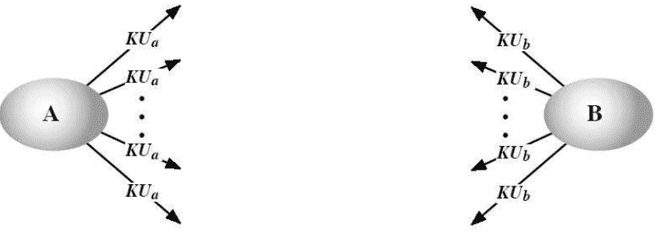

Figure 10.1 Uncontrolled Public Key Distribution

## 公开可访问的目录

- 维护一个动态可访问的公钥目录可以获得更大程度的安全性
- 一个可信实体或组织负责这个公开目录的维护和分配  
  - 目录包含{name, public-key}等项  
  - 每一通信方通过目录管理员以安全的方式注册一个公钥  
  - 通信方在任何时刻可以用新的密钥替代当前的密钥  
  - 目录定期更新  
  - 目录可通过电子方式访问  
- 一旦攻击者获得目录管理员私钥，则可传递伪造的公钥，可以假冒任何通信方以窃取消息，或者修改已有的记录

## 公钥授权

- A发送带有时间戳的消息给公钥管理员，请求B的当前公钥
- 管理员给A发送用其私钥\( KR_{auth} \)加密的消息，A用管理员的公钥解密，可以确信该消息来自管理员：  
  - B的公钥\( KU_b \)，用来加密；  
  - 原始请求，A可以验证其请求未被修改；  
  - 原始时间戳，A可以确定收到的不是来自管理员的旧消息。
- A保存B的公钥，并用它对包含A的标识\( ID_A \)和\( Nonce_1 \)的消息加密，然后发送给B
- B以同样方式从管理员处得到A的公钥
- B用\( KU_a \)对A的\( N_1 \)和B的\( N_2 \)加密，发送给A
- A用B的公钥对\( N_2 \)加密并发送给B，使B相信其通信伙伴是A

## 公钥分配方案

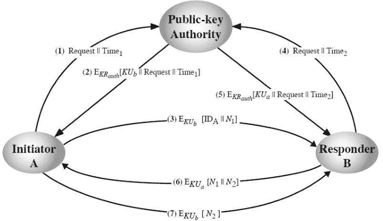

## 10.1.2 公钥证书

- 有了公钥证书使得不通过实时访问公钥授权部门而实现公钥交换成为可能

- 公钥证书将一个通信方的身份与他的公开密钥绑定在一起，通常还包括有效期和使用方法等

- 证书的所有内容必须经由可信公钥授权方或者证书授权方签名后方可生效

- 知道公钥授权当局公开密钥的任何人都可以验证一个用户的公开密钥证书的有效性

- 对于申请者A，管理员提供的证书为：

- \( C_A = E_{KRauth}[T, ID_A, KU_a] \)

- 其他人读取并验证：

- \( D_{KUauth}[C_A] = D_{KUauth}[E_{KRauth}[T, ID_A, KU_a]] = (T, ID_A, KU_a) \)


## 公钥证书的交换

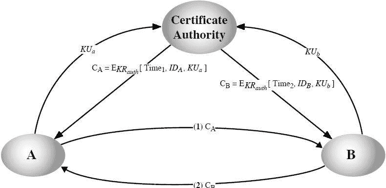

Figure 10.4  Exchange of Public-Key Certificates

## 一种简单的秘密密钥分配方法

- Merkle在1979年提出一种简单的方法
  - A产生公/私钥对{PUₐ, PRₐ}，将含有PUₐ和标识IDₐ的消息发给B
  - B产生秘密密钥（会话密钥）Kₛ，并用A的公钥加密后发给A
  - A解密D(PRₐ, E(PUₐ, Kₛ))，得到Kₛ，这样双方即可通信
- 这个协议不安全，因为会受到中间人攻击

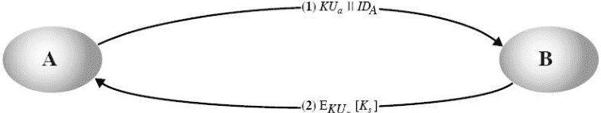

## 10.2 Diffie-Hellman密钥交换

- Diffie和Hellman在1976年首次提出了公钥算法，给出了公钥密码学的定义，该算法通常被称为Diffie-Hellman密钥交换算法

- Diffie-Hellman密钥交换算法是一种公钥分发机制
  - 它不是用来加密消息的
  - 所生成的是通信双方共享的会话密钥，必须保密，其值取决于通信双方的私钥和公钥信息

- Diffie-Hellman密钥交换算法是基于有限域GF中的指数运算的（模一个素数或多项式）

- Diffie-Hellman密钥交换算法的安全性依赖于求解离散对数问题DLP

## Diffie-Hellman Key Exchange

- 通信双方约定一个大素数（或多项式）\(p\)，和模\(p\)的一个素根\(\alpha\)
- 各方产生公开密钥
  - 选择一个秘密钥（数值），如\(x_A < p，x_B < p\)
  - 计算公钥，如\(y_A=\alpha^{x_A}\bmod p，y_B=\alpha^{x_B}\bmod p\)，并相互交换
- 双方共享的会话密钥\(K_{AB}\)可以如下算出

  \[
  K_{AB}=\alpha^{x_Ax_B}\bmod p
  \]

  \[
  =y_A^{x_B}\bmod p\quad\text{(which B can compute)}
  \]

  \[
  =y_B^{x_A}\bmod p\quad\text{(which A can compute)}
  \]

- \(K_{AB}\)是双方用对称密码通信时共享的密钥
- 如果双方继续通信，可以继续使用这个密钥，除非他们要选择新的密钥
- 攻击者如果想要获得x，则必须解决DLP问题

## Diffie-Hellman Example

- Users Alice & Bob who wish to swap keys
- Agree on prime p=353 and **a** =3
- Select random secret keys:
  - A chooses x<sub>A</sub>=97,
  - B chooses x<sub>B</sub>=233
- Compute public keys:
  - y<sub>A</sub>=3<sup>97</sup> mod 353 = 40　　　　(Alice)
  - y<sub>B</sub>=3<sup>233</sup> mod 353 = 248　　　(Bob)
- Compute shared session key as:
  K<sub>AB</sub>= y<sub>B</sub><sup>x<sub>A</sub></sup> mod 353 = 248<sup>97</sup> mod 353 = 160　　　(Alice)
  K<sub>AB</sub>= y<sub>A</sub><sup>x<sub>B</sub></sup> mod 353 = 40<sup>233</sup> mod 353 = 160　　　(Bob)

## 10.2.2 Diffie-Hellman密钥交换协议

- 本协议不能抵抗中间人攻击

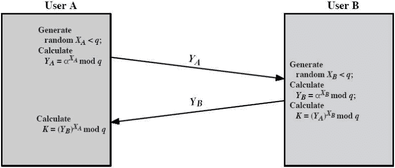

User A：Generate random $x_A < q$; Calculate $Y_A = α^{x_A} \bmod q$; Calculate $K = (Y_B)^{x_A} \bmod q$

User B：Generate random $x_B < q$; Calculate $Y_B = α^{x_B} \bmod q$; Calculate $K = (Y_A)^{x_B} \bmod q$

Figure 10.8  Diffie-Hellman Key Exchange

## 中间人攻击

假定A和B希望交换密钥，而D是攻击者，攻击过程如下：

- (1) 为了进行攻击，D先生成两个随机的私钥 $X_{D1}$ 和 $X_{D2}$，然后计算相应的公钥 $Y_{D1}$ 和 $Y_{D2}$。

- (2) Alice将 $Y_A$ 传递给Bob。

- (3) D截获了 $Y_A$，将 $Y_{D1}$ 传给B。D同时计算 $K_2=(Y_A)^{X_{D2}}\bmod q$。

- (4) B收到 $Y_{D1}$，计算 $K_1=(Y_{D1})^{X_B}\bmod q$。

- (5) B将 $Y_B$ 传给A。

- (6) D截获了 $Y_B$，将 $Y_{D2}$ 传给A。D计算 $K_1=(Y_B)^{X_{D1}}\bmod q$。

- (7) A收到 $Y_{D2}$，计算 $K_2=(Y_{D2})^{X_A}\bmod q$。

此时，B和A想，他们已共享了密钥，但实际上，B和D共享了密钥$K_1$，而A和D共享了密钥$K_2$。接下来，B和A之间的通信以下列方式泄密：

- (1) A发了一份加了密的消息 $M$：$E(K_2，M)$。

- (2) D截获了该秘密消息，解密，恢复出$M$。

- (3) D将 $E(K_1，M)$ 或 $E(K_1，M')$ 发给B，其中 $M'$ 是任意的消息。

## 基于DLP的概率密码系统

ElGamal Cryptosystem

- 假设A和B互相通信，共享大素数 $p$，本原元素 **α**，$0\le m\le p-1$
- **加密：**
  - A选择 $k\in[0,p-1]$，$k$的作用其实即为 $x_A$，A访问公共区域找到B的公开密钥 $Y_B=\alpha^{x_B}\bmod p$，计算：
    $K=(Y_B)^k\bmod p$，即 $K=\alpha^{x_Bk}\bmod p$

    $c_1=\alpha^k\bmod p$

    $c_2=mK\bmod p$

    密文即为 $(c_1,c_2)$
- **解密：**
  - B首先恢复K：$K=c_1^{x_B}\bmod p=\alpha^{kx_B}\bmod p$
  - 然后恢复m：$m=c_2/K\bmod p=c_2K^{-1}\bmod p$

## ElGamal Cryptosystem

这里特别注意，k不能重复使用，如果

(1) c₁,₁ = αᵏ mod p　　　　　　　　 c₂,₁ = m₁K mod p
(2) c₁,₂ = αᵏ mod p　　　　　　　　 c₂,₂ = m₂K mod p

得：m₁/m₂ = c₂,₁/c₂,₂ mod p. 如果m₁已知，m₂即可算出。

- ElGamal密码体制是概率密码体制，同样的明文每次加密得到不同的密文，因为每次随机选择k。
- ElGamal密码体制加密效率是50%，因为密文大小是明文的两倍。
- ElGamal密码体制的破译难度同Diffie-Hellman的方法，即基于DLP，离散对数问题，最快的算法需要T=exp((ln(p)lnln(p))^(1/2))次运算。

## ElGamal Cryptosystem

例：P = 17，α = 3，xₐ = 2，xᵦ = 5，m = 11，
从A发送到B，A选择k = 7。

求：密文(c₁, c₂)并解密


## 本章要点

- 消息认证是用来验证消息完整性的一种机制或服务。消息认证确保收到的数据确实和发送时的一样（即没有修改、插入、删除或重放），且发送方声称的身份是真实有效的。
- 对称密码在那些相互共享密钥的用户间提供认证。用消息发送方的私钥加密消息也可提供一种形式的认证。
- 用于消息认证的最常见的密码技术是消息认证码和安全散列(hash)函数。
- MAC是一种需要使用秘密密钥的算法，以可变长的消息和秘密密钥作为输入，产生一个认证码。拥有秘密密钥的接收方产生一个认证码来验证消息的完整性。
- 散列函数将可变长度的消息映射为固定长度的散列值，或叫消息摘要。对于消息认证码，安全散列函数必须以某种方式和秘密密钥捆绑起来。

## 报文认证Message Authentication

- 消息认证（报文认证）关心的问题是
  - 保护消息的完整性
  - 验证发起方身份
  - 消息源的不可否认（解决分歧）

- 消息认证要考虑安全需求

- 三种消息认证的方法
  - 消息加密
  - 消息认证码(MAC)
  - 哈希函数

## 11.1 对认证的要求

### 可能有下述攻击

- 泄密Disclosure，将消息透露给没有合法身份的第三方
- 传输分析Traffic analysis，分析双方通信模式
- 伪装Masquerade，欺诈源向网络中插入一条消息
- 内容篡改Content modification，对消息内容的修改
- 顺序篡改Sequence modification，对消息顺序的修改
- 计时篡改Timing modification，对消息的延时和重放
- 信源抵赖Source repudiation，发送方否认发送过某消息
- 信宿抵赖Destination repudiation，接收方否认接收过某消息

## 11.2 认证函数

### 11.2.1 消息加密

- 消息加密本身提供了一种认证手段
- 对称加密
- 接收方可以确信消息是由发送方产生的，因为除了接收方以外只有发送方拥有加密密钥，产生出用此密钥可以解密的密文
- 如果消息可以是任意的位模式，接收方无法确定收到的消息是合法明文的密文。因此，通常不管密文的值是什么，如果解密后得到的明文有合法明文的位模式，接收方都会作为真实的密文接收。

### 解决解密所得消息是否具有可读性的问题

- 要求明文具有某种易于识别的结构，如在加密前对每个消息附加一个帧校验序列FCS
- FCS和加密函数执行的顺序很重要

Figure 11.2 Internal and External Error Control

### 公钥加密作为认证手段

- 若要提供认证，发送方用自己的私钥对消息加密，接收方用发送方的公钥解密(验证)，就提供了认证功能。
- 如果发送方用私钥加密消息，再用接收方的公钥加密，就实现了既保密又认证的通信
- 既保密又认证的通信的代价是需要执行四次复杂的公钥算法而不是两次。

### 11.2.2 消息认证码MAC

- 使用密钥产生短小的定长数据分组，即所谓的密码检验MAC，将它附加在报文中。通信双方A和B共享密钥K，报文从A发往B，A计算MAC=C<sub>K</sub>(M)，附在报文后发给B。B对接收到的报文重新计算MAC，并与接收到的MAC比较。如果只有收发双方知道密钥且两个MAC匹配，则：
  - 接收方可以确信报文未被更改；
  - 接收方可以确信报文来自声称的发送者；
  - 接收方可以确信报文序号正确，如果有的话。
- 报文认证不提供保密
- MAC函数类似加密，但非数字签名，也无需可逆
- 将MAC直接与明文并置，然后加密传输比较常用

## MAC: 消息认证码的特点

- MAC加密所得的消息校验和
  \( MAC = C_K(M) \)
- 使用一个秘密密钥K，浓缩一个变长的消息M，产生一个固定长度的认证子
- MAC是一种多对一的函数
- 定义域由任意长的消息组成，值域由所有可能的MAC和密钥组成。若使用n位长的MAC，则有2^n个可能的MAC，有N条可能的消息，N>>2^n。若密钥长度为k，则有2^k种可能的密钥。
- 如N为100，n为10，共有2^100不同的消息，2^10种不同的MAC，平均而言同一MAC可由2^100/2^10=2^90条不同的消息产生。若密钥长度为5，则从消息集合到MAC值的集合有2^5=32不同映射。
- 可以证明，由于认证函数的数学性质，与加密相比，认证函数更不易被攻破

Figure 11.4 Basic Uses of Message Authentication Code (MAC)

(a) Message authentication

(b) Message authentication and confidentiality; authentication tied to plaintext

(c) Message authentication and confidentiality; authentication tied to ciphertext

## 11.2.3 散列函数 Hash Function

- 一个散列函数以变长的报文M作为输入，产生定长的散列码H(M)，作为输出，亦称作报文摘要Message Digest。散列码是报文所有比特的函数值，具有差错检测能力，报文任意一比特的改变都将引起散列码的改变
- 不同的散列码使用方式
  - 对附加了散列码的报文进行加密
  - 使用常规加密方法仅对散列码加密
  - 使用公开密钥方法仅对散列码加密，提供数字签名
  - 同时提供保密和签名，可以分别使用常规方法加密报文及使用公开密钥方法加密散列码
  - 其他
- 对避免加密的方法重视的原因
  加密过程很慢，硬件开销大

Figure 11.5 Basic Uses of Hash Function (page 2 of 2)

### Table 11.3 Basic Uses of Hash Function H (see Figure 11.5)

| A → B: \( E_K[M \| H(M)] \) |
|---|
| • Provides confidentiality<br>— Only A and B share \( K \)<br>• Provides authentication<br>— \( H(M) \) is cryptographically protected |
| (a) Encrypt message plus hash code |
| A → B: \( M \| E_K[H(M)] \) |
| • Provides authentication<br>— \( H(M) \) is cryptographically protected |
| (b) Encrypt hash code - shared secret key |
| A → B: \( M \| E_{KR_a}[H(M)] \) |
| • Provides authentication and digital signature<br>— \( H(M) \) is cryptographically protected<br>— Only A could create \( E_{KR_a}[H(M)] \) |
| (c) Encrypt hash code - sender's private key |
| A → B: \( E_K[M \| E_{KR_a}[H(M)]] \) |
| • Provides authentication and digital signature<br>• Provides confidentiality<br>— Only A and B share \( K \) |
| (d) Encrypt result of (c) - shared secret key |
| A → B: \( M \| H(M \| S) \) |
| • Provides authentication<br>— Only A and B share \( S \) |
| (e) Compute hash code of message plus secret value |
| A → B: \( E_K[M \| H(M) \| S] \) |
| • Provides authentication<br>— Only A and B share \( S \)<br>• Provides confidentiality<br>— Only A and B share \( K \) |
| (f) Encrypt result of (e) |


## 11.3 消息认证码MAC

- 对MAC的要求
  1. 若攻击者已知M和C(K,M)，则构造满足C(K,M')=C(K,M)的消息M'在计算上是不可行的
  2. C(K,M)应该是均匀分布的，即对任何随机选择的消息M和M'，C(K,M')=C(K,M)的概率是2^-n，其中n是MAC的位数
  3. 设M'是M的某个已知的变换，即M'=f(M)，如f可能表示逆转M的一位或多位，那么Pr[C(K,M)=C(K,M')]的概率是2^-n。

- 基于DES的消息认证码 FIPS PUB 113
  - 该算法定义为以密码分组链接(CBC)为操作方式的用0作为初始化向量的DES

Figure 11.6 Data Authentication Algorithm (FIPS PUB 113)

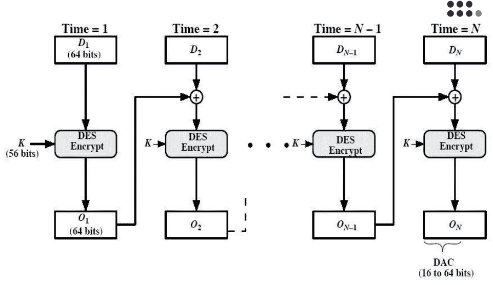

## 11.4 散列函数

- 散列函数

- 一个散列函数以变长的报文M作为输入，产生定长的散列码H(M)，作为输出，亦称作报文摘要Message Digest。散列码是报文所有比特的函数值，具有差错检测能力，报文任意一比特的改变都将引起散列码的改变。h=H(M)

- 报文摘要的基本原理

- 对任意长度的明文m，经由哈希函数(杂凑函数)h产生固定长度的哈希值h(m)，用来对明文作鉴别(authentication)或数字签名(digital signature)。哈希函数值是对明文的一种“指纹”(finger print)或是摘要(digest)。对哈希函数值的数字签名，就是对此明文的数字签名，可以用来提高数字签名的效率。

### (a) Using conventional encryption

### (b) Using public-key encryption

### (c) Using secret value

## 对散列函数的要求 h=H(M)

1. H可以应用于任意大小的数据块
2. H产生固定长度的输出
3. 对任意给定的明文x，计算H(x)容易，可由硬件或软件实现
4. 对任意给定的散列码h，找到满足H(x)=h的x，在计算上不可行，**单向性**
5. 对任何给定的分组x，找到满足y≠x且H(x)=H(y)的y，在计算上不可行，**抗弱碰撞性**
6. 找到任何满足H(x)=H(y)的偶对(x, y)，在计算上不可行，**抗强碰撞性**

## 强哈希函数

- 条件1, 2, 3是所谓单向性问题(One-way)
- 条件4, 5是对使用的哈希值的数字签名方法所做的安全保障，否则攻击者可由已知的明文及相关的数字签名任意伪造对其他明文的签名
- 条件6主要用于防范所谓的生日攻击法
- 能满足条件1-5的，称为弱哈希函数(Weak Hash Function)
- 能同时满足条件6的，称为强哈希函数(Strong Hash Function)
- 应用在数字签名上的哈希函数必须是强哈希函数

## 网络信息安全

## Chapter 13
Digital Signature and
Authentication Protocols


## 13.1 数字签名Digital Signature

- 数字签名的简单定义

- 数字签名是使以数字形式存储的明文信息经过特定密码变换生成密文，作为相应明文的签名，使明文信息的接收者能够验证信息确实来自合法用户，以及确认信息发送者身份。

- 对数字签名的基本要求

- 在收发双方不能完全信任的情况下，需要除认证之外的其他方法来解决假冒和否认的问题，数字签名则是解决办法；

- 签名接收者能容易地验证签字者对消息所做的数字签名，包括日期和时间；

- 任何人，包括签名接收者，都不能伪造签名者的签字；

- 发生争议时，可由第三方解决。

## 数字签名的基本形式

- 数字签名与消息认证的区别
  - 消息认证是使消息接收方验证消息发送者发送的内容有没有被修改过，对防止第三者破坏足够，但收发双方有利害冲突时就无法解决纷争，需要更严格的手段，即数字签名。

- 数字签名的基本形式
  - 对消息签名的两种方法
    - 对消息整体的签字，将被签消息整体经过密码变换得到签字；
    - 对消息摘要的签字，附在被签消息之后，或嵌在某一特定位置上一段签字图样。
  - 两类数字签名
    - 确定性数字签名，明文与签名一一对应；
    - 概率性数字签名，一个明文可以有多个合法签名，每次都不一样。

## 13.1.3 仲裁数字签名

- 涉及到一个仲裁方(arbiter A)
- 签名方的签名报文首先送给仲裁者
- 仲裁者对报文和签名进行测试以检验出处和内容，然后注上日期和仲裁说明后发给接收方
- 要求仲裁方在一定程度上是可以信任的
- 可以用对称密码或公开密钥密码实现
- 仲裁方可以知道消息，也可以不知道消息

## 13.2 认证协议

- 认证服务和功能

- 认证是证实信息交换过程有效性和合法性的一种手段，包括对通信对象的认证(身份认证)和报文内容的认证(报文认证)，起到数据完整性的保护。这里有

- 信息的真实性

- 存储数据的真实性

- 接收方提供回执

- 发送方不可否认

- 时效性和公证可能性

- 认证的目的

- 防窃听、防假冒或拦截、防窃取等

## 基本认证方法

- 单向认证
  - 使用对称加密方法，即一次一密方法的变形
  - 使用公开密钥方法：A向B声称是A，B则向A送一随机数R，A用其私有密钥加密送B，B用A的公开密钥验证。
  - 使用改进的口令方式
- 双向认证
  - 对称密钥方式(三次握手)
  - 公开密钥方式，A、B双方使用不同的R值
  - 时标方式
- 可信中继
  - 使用KDC密钥分发中心
  - 通过DASS (Distributed Authentication Security Service)
- 群认证(Group Authentication)

## 对称加密方法

- 使用两层传统加密密钥结构来保证分布环境中通信的保密性
- 通常需要可信密钥分发中心Key Distribution Center (KDC)
  - 每一方与KDC共享主密钥
  - KDC产生双方通信要用的会话密钥
  - 用主密钥来分发会话密钥

## ElGamal的数据加密方法

- 假定A和B互相通信，共享大素数p，本原元素a
  0<= m <= p-1, gcd(a, p) = 1，A和B各有自己的秘密xA和xB

- 加密
  A选择k∈[0, p-1]，k的作用即为xA，A访问公共区域找到B的公开密钥Y<sub>B</sub> = α<sup>x<sub>B</sub></sup> mod p，计算：
  K = (Y<sub>B</sub>)<sup>k</sup> mod p，即K = α<sup>x<sub>B</sub>k</sup> mod p
  c<sub>1</sub> = α<sup>k</sup> mod p
  c<sub>2</sub> = mK mod p
  密文即为 (c<sub>1</sub>, c<sub>2</sub>)

- 解密
  B首先恢复K： K = c<sub>1</sub><sup>x<sub>B</sub></sup> mod p = α<sup>kx<sub>B</sub></sup> mod p
  然后恢复m： m = c<sub>2</sub>/K mod p = c<sub>2</sub>K<sup>-1</sup> mod p


## ElGamal的数字签名方法

若A为B签署m，0≤m≤p-1，  
A随机选择k∈[0,p-1]，gcd(k,p-1)=1，  
计算r=α^k mod p，  
计算α^m=Y_A^r·r^s mod p，Y_A=α^{x_A} mod p，  
即α^m=α^{x_A r}·α^{ks} mod p，  
则m=(x_A r+ks) mod p-1。  
根据此式求s，则对于m的数字签名即为(r,s)，0≤r,s<p-1。

## ElGamal数字签名的验证

- 验证：给定m、r和s，容易计算  
  α^m mod p = Y_A^r·r^s mod p，看其是否一致，k不能重复使用。

- 例：p=17，α=3，x_A=2，x_B=5，m=11，k=5，求签名及验证。  
  签名：r=α^k mod p=3^5 mod 17=5，  
  11=(2×5+5s) mod 16=(10+5s) mod 16，  
  5s mod 16=1，s=13。  
  所以，签名为(5,13)。  
  验证：α^m mod p=3^{11} mod 17=10^2×10×9 mod 17=7，  
  Y_A^r·r^s mod p=(3^2)^5×5^{13} mod 17=7。

## 网络信息安全

## Chapter 14 Authentication Applications


## 本章要点

- Kerberos是一种设计用于分布式环境下的认证服务  
- Kerberos利用一个可信的第三方认证服务来完成客户端和服务器端的认证  
- X.509定义了公钥证书的格式，广泛使用于各个应用  
- 公钥基础设施(PKI)是建立在非对称加密算法之上的，用于创建、管理、存储、分发和撤消数字证书的一整套体系，其中包含硬件、软件、人员、政策以及相应的处理  
- PKI实现时使用了X.509的认证格式

## KERBEROS


In Greek mythology, a many headed dog, the guardian of the entrance of Hades

## 14.1.1 Kerberos动机

- Kerberos为保护用户信息和服务器资源，要求客户端向服务器提供身份认证，服务器向客户提供身份认证  
- Kerberos体系结构为分布的客户/服务器结构，并拥有一个或多个Kerberos服务器提供认证服务  
- Kerberos需求  
  - Security：网络监听不能通过冒充其他用户获得有用信息  
  - Reliability：高可靠性，且使用分布式服务结构  
  - Transparency：用户除了要输入口令，不需要知道认证的发生  
  - Scalability：能支持大量客户端和服务器，模块化、分布式体系结构  
- Kerberos实现时采用的是基于Needham-Schroeder的认证协议

## 14.1.2 Kerberos 版本4

- Kerberos的使用模式  
  - 主体是Client/Server  
    - 服务器：包括提供识别服务的Kerberos服务器和提供应用的各类服务器  
    - 客户机：用户  
    - 用户和服务器首先都到Kerberos服务器注册，与Kerberos服务器实现秘密共享，识别过程中Kerberos服务器为通信双方建立一个通信密钥。  

- 方法：使用中央式的识别服务器  
  (Authentication Server, AS)，为用户和应用服务器提供识别服务。AS与用户共享口令，与其他服务器共享密钥，在注册时以特别安全的方式分配给各方。

## 一个更安全的认证会话交互过程

- 增加通信票产生服务器TGS (Ticket-Granting Server)。AS中存储与用户和TGS共享的密钥，专门负责识别用户身份，然后将TGT (Ticket-Granting Ticket) 用与TGS共享的密钥加密交给用户。用户据此获得TGS的服务，TGS产生SGT (Service-Granting Ticket)，用户据此获得其他服务器的服务。  
- (1) C→AS：ID_c，ID_tgs  
- (2) AS→C：E_{K_c}[Ticket_{tgs}]  
  每种服务类型仅一次：  
- (3) C→TGS：ID_c，ID_V，Ticket_{tgs}  
- (4) TGS→C：Ticket_V  
  每次服务会话仅一次：  
- (5) C→V：ID_c，Ticket_V  

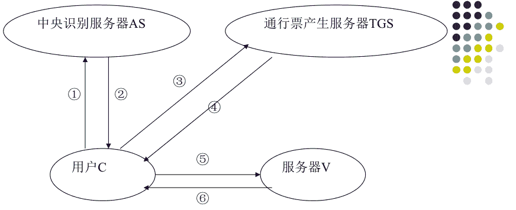

TGT→Ticket_{tgs}=E_{K_{tgs}}[ID_C, AD_C, ID_{tgs}, TS_1, Lifetime_1]  
SGT→Ticket_V=E_{K_V}[ID_C, ADC, TS_2, Lifetime_2]  
TS: time stamp; ADC: user’s network address  

- 攻击者可以截获TGT和SGT，在有效的时间内实施重播攻击。解决办法是在提交TGT或SGT的同时必须向服务器证明其身份仍同前面取得TGT和SGT时的用户相同。

## 认证会话交互过程的信息细节

① ID_C, ID_{tgs}, TS_1  
② E_{K_C}[K_{C,tgs}, ID_{tgs}, TS_2, Lifetime_1, Ticket_{tgs}]  
Ticket_{tgs}=E_{K_{tgs}}[K_{C,tgs}, ID_C, AD_C, ID_{tgs}, TS_2, Lifetime_2]  
③ ID_V, Ticket_{tgs}, Authenticator_C (用户身份证明文件)  
Authenticator_C=E_{K_{C,tgs}}[ID_C, AD_C, TS_3]  
④ E_{K_{C,tgs}}[K_{C,V}, ID_V, TS_4, Ticket_V]  
Ticket_V=E_{K_V}[K_{C,V}, ID_C, AD_C, ID_V, TS_4, Lifetime_4]  
⑤ Ticket_V, Authenticator_C  
Authenticator_C=E_{K_{C,V}}[ID_C, AD_C, TS_5]  
⑥ E_{K_{C,V}}[TS_5+1]  

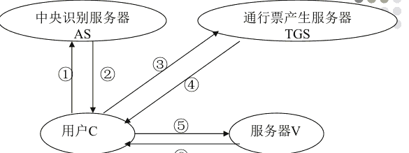

## Table 14.1 Summary of Kerberos Version 4 Message Exchanges

| (a) Authentication Service Exchange: to obtain ticket-granting ticket |
|---|
| **(1) C → AS:** $ID_c \parallel ID_{tgs} \parallel TS_1$ |
| **(2) AS → C:** $E_{K_c}[K_{c,tgs} \parallel ID_{tgs} \parallel TS_2 \parallel Lifetime_2 \parallel Ticket_{tgs}]$<br><br>$Ticket_{tgs}=E_{K_{tgs}}[K_{c,tgs} \parallel ID_c \parallel AD_c \parallel ID_{tgs} \parallel TS_2 \parallel Lifetime_2]$ |

| (b) Ticket-Granting Service Exchange: to obtain service-granting ticket |
|---|
| **(3) C → TGS:** $ID_v \parallel Ticket_{tgs} \parallel Authenticator_c$ |
| **(4) TGS → C:** $E_{K_{c,tgs}}[K_{c,v} \parallel ID_v \parallel TS_4 \parallel Ticket_v]$<br><br>$Ticket_{tgs}=E_{K_{tgs}}[K_{c,tgs} \parallel ID_c \parallel AD_c \parallel ID_{tgs} \parallel TS_2 \parallel Lifetime_2]$<br><br>$Ticket_v=E_{K_v}[K_{c,v} \parallel ID_c \parallel AD_c \parallel ID_v \parallel TS_4 \parallel Lifetime_4]$<br><br>$Authenticator_c=E_{K_{c,tgs}}[ID_c \parallel AD_c \parallel TS_3]$ |

| (c) Client/Server Authentication Exchange: to obtain service |
|---|
| **(5) C → V:** $Ticket_v \parallel Authenticator_c$ |
| **(6) V → C:** $E_{K_{c,v}}[TS_5+1]$ (for mutual authentication)<br><br>$Ticket_v=E_{K_v}[K_{c,v} \parallel ID_c \parallel AD_c \parallel ID_v \parallel TS_4 \parallel Lifetime_4]$<br><br>$Authenticator_c=E_{K_{c,v}}[ID_c \parallel AD_c \parallel TS_5]$ |


1. User logs on to workstation and requests service on host.

once per user logon session


2. AS verifies user's access right in database, creates ticket-granting ticket and session key. Results are encrypted using key derived from user's password.

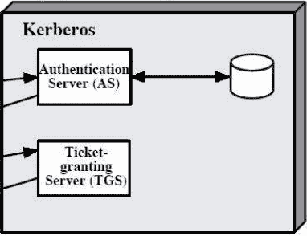

request ticket-granting ticket

ticket + session key

request service-granting ticket

ticket + session key

once per type of service

3. Workstation prompts user for password and uses password to decrypt incoming message, then sends ticket and authenticator that contains user's name, network address, and time to TGS.

once per server session

request service

provide server authenticator

4. TGS decrypts ticket and authenticator, verifies request, then creates ticket for requested server.


5. Workstation sends ticket and authenticator to server.

6. Server verifies that ticket and authenticator match, then grants access to service. If mutual authentication is required, server returns an authenticator.

## Figure 14.1 Overview of Kerberos

## Kerberos 4中所用元素之作用

## Table 14.2 Rationale for the Elements of the Kerberos Version 4 Protocol (page 1 of 2)

| Message (1)   | Client requests ticket-granting ticket                                       |
|---------------|------------------------------------------------------------------------------|
| \( ID_C \)     | Tells AS identity of user from this client                                   |
| \( ID_{TGS} \) | Tells AS that user requests access to TGS                                    |
| \( TS_1 \)     | Allows AS to verify that client's clock is synchronized with that of AS      |
| Message (2)   | AS returns ticket-granting ticket                                            |
| \( E_{K_c} \)  | Encryption is based on user's password, enabling AS and client to verify     |
|               | password, and protecting contents of message (2)                             |
| \( K_{c,tgs} \) | Copy of session key accessible to client; created by AS to permit secure     |
|               | exchange between client and TGS without requiring them to share a            |
|               | permanent key                                                                |
| \( ID_{tgs} \) | Confirms that this ticket is for the TGS                                     |
| \( TS_2 \)     | Informs client of time this ticket was issued                                |
| \( Lifetime_2 \) | Informs client of the lifetime of this ticket                                |
| \( Ticket_{tgs} \) | Ticket to be used by client to access TGS                                    |

| Message (3) | Client requests service-granting ticket |
| --- | --- |
| IDv: | Tells TGS that user requests access to server V |
| Tickettgs: | Assures TGS that this user has been authenticated by AS |
| Authenticatorc: | Generated by client to validate ticket |
| Message (4) | TGS returns service-granting ticket |
| Kc,tgs: | Key shared only by C and TGS; protects contents of message (4) |
| Kc,v: | Copy of session key accessible to client; created by TGS to permit secure exchange between client and server without requiring them to share a permanent key |
| IDv: | Confirms that this ticket is for server V |
| TS4: | Informs client of time this ticket was issued |
| Ticketv: | Ticket to be used by client to access server V |
| Tickettgs: | Reusable so that user does not have to reenter password |
| EKtgs | Ticket is encrypted with key known only to AS and TGS, to prevent tampering |
| Kc,tgs: | Copy of session key accessible to TGS; used to decrypt authenticator, thereby authenticating ticket |
| IDc: | Indicates the rightful owner of this ticket |
| ADc: | Prevents use of ticket from workstation other than one that initially requested the ticket |
| IDtgs: | Assures server that it has decrypted ticket properly |
| TS2: | Informs TGS of time this ticket was issued |
| Lifetime2: | Prevents replay after ticket has expired |
| Authenticatorc: | Assures TGS that the ticket presenter is the same as the client for whom the ticket was issued; has very short lifetime to prevent replay |
| EKc,tgs | Authenticator is encrypted with key known only to client and TGS, to prevent tampering |
| IDc: | Must match ID in ticket to authenticate ticket |
| ADc: | Must match address in ticket to authenticate ticket |
| TS5: | Informs TGS of time this authenticator was generated |


## (c) Client/Server Authentication Exchange

### Message (5)

Client requests service

- Ticket<sub>V</sub>: Assures server that this user has been authenticated by AS
- Authenticator<sub>C</sub>: Generated by client to validate ticket

### Message (6)

Optional authentication of server to client

- E<sub>K<sub>C,V</sub></sub>: Assures C that this message is from V
- TS<sub>5</sub> + 1: Assures C that this is not a replay of an old reply
- Ticket<sub>V</sub>: Reusable so that client does not need to request a new ticket from TGS for each access to the same server
- E<sub>K<sub>V</sub></sub>: Ticket is encrypted with key known only to TGS and server, to prevent tampering
- K<sub>C,V</sub>: Copy of session key accessible to client; used to decrypt authenticator, thereby authenticating ticket
- ID<sub>C</sub>: Indicates the rightful owner of this ticket
- AD<sub>C</sub>: Prevents use of ticket from workstation other than one that initially requested the ticket
- ID<sub>V</sub>: Assures server that it has decrypted ticket properly
- TS<sub>4</sub>: Informs server of time this ticket was issued
- Lifetime<sub>4</sub>: Prevents replay after ticket has expired
- Authenticator<sub>C</sub>: Assures server that the ticket presenter is the same as the client for whom the ticket was issued; has very short lifetime to prevent replay
- E<sub>K<sub>C,V</sub></sub>: Authenticator is encrypted with key known only to client and server, to prevent tampering
- ID<sub>C</sub>: Must match ID in ticket to authenticate ticket
- AD<sub>C</sub>: Must match address in ticket to authenticate ticket
- TS<sub>5</sub>: Informs server of time this authenticator was generated

## Kerberos域和多重Kerberos

- 一个Kerberos域包括Kerberos服务器，若干客户端和若干应用服务器
  - Kerberos服务器必须有存放用户标识(UID)和用户口令的数据库，所有用户必须在Kerberos服务器注册
  - Kerberos服务器必须与每个应用服务器共享一个特定密钥，所有应用服务器必须在Kerberos服务器上注册
- 隶属于不同行政机构的客户/服务器通常构成了不同域，在一个Kerberos服务器中注册的客户与服务器属于同一个行政区域。一个域中的客户可能需要访问另一个域中的服务器，而某些服务器也希望给其他域的客户提供服务，因此需要提供域间认证机制
  - 每个互操作域的Kerberos服务器应共享一个密钥，双方的Kerberos服务器应相互注册
- 一个域的Kerberos服务器必须信任其他域的Kerberos服务器对其用户的认证，其他域的应用服务器也必须信任第一个域中的Kerberos服务器

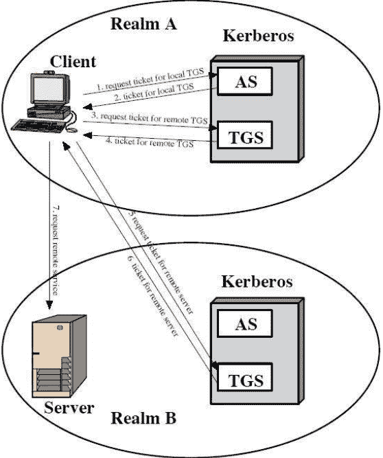

Figure 14.2 Request for Service in Another Realm

## Kerberos的安全问题和Kerberos 5

- Kerberos的安全性问题
  - 使用Time Stamp防止playback攻击；
  - 使用口令做密钥，不安全；
  - 集中式管理，使用AS和TGS，容易出危险。
- Kerberos 5的改进
  - 增加代理功能，委托授权与有限授权
  - 改进安全机制
  - 在鉴别符Authenticator中增加子密钥，可用于群通信
  - 增加域名，名字的结构分为两部分
  - PDU描述改为ASN.1，方便变长字段和可选字段的处理

## 14.1.3 Kerberos Version 5

- Kerberos v5是上个世纪90年代中期开发的
- Kerberos v4与Kerberos v5的区别

- 加密系统依赖性：v4使用DES，v5用加密类型标记密文，可以使用任何加密技术
- Internet协议依赖性：v4使用IP地址，不支持其他地址类型；v5用类型和长度标记网络地址，允许使用任何类型的网络地址
- 消息字节顺序：v4由发送方说明消息字节顺序；v5按编码规则确定消息字节顺序
- 票据的生命期：v4生命期8位表示，2⁸x5=1280分钟；v5有精确的起始时间和终止时间，允许任意长度生命期
- 向前认证：v4发给客户端的证书不能转发给其他用户进行其他相关操作；v5提供这项功能
- 域间认证：v4中N个域的互操作需要N2个Kerberos-to-Kerberos关系；v5需要的连接少

## Kerberos版本5的消息交换

| 阶段 | 消息交换 |
|---|---|
| **(a) Authentication Service Exchange: to obtain ticket-granting ticket** | **(1) C → AS:** Options ‖ IDc ‖ Realmc ‖ IDtgs ‖ Times ‖ Nonce₁<br><br>**(2) AS → C:** Realmc ‖ IDc ‖ Tickettgs ‖ Eₖc[ Kc,tgs ‖ Times ‖ Nonce₁ ‖ Realmtgs ‖ IDtgs ]<br><br>Tickettgs = Eₖtgs[ Flags ‖ Kc,tgs ‖ Realmc ‖ IDc ‖ ADc ‖ Times ] |
| **(b) Ticket-Granting Service Exchange: to obtain service-granting ticket** | **(3) C → TGS:** Options ‖ IDv ‖ Times ‖‖ Nonce₂ ‖ Tickettgs ‖ Authenticatorc<br><br>**(4) TGS → C:** Realmc ‖ IDc ‖ Ticketv ‖ Eₖc,tgs[ Kc,v ‖ Times ‖ Nonce₂ ‖ Realmv ‖ IDv ]<br><br>Tickettgs = Eₖtgs[ Flags ‖ Kc,tgs ‖ Realmc ‖ IDc ‖ ADc ‖ Times ]<br><br>Ticketv = Eₖv[ Flags ‖ Kc,v ‖ Realmc ‖ IDc ‖ ADc ‖ Times ]<br><br>Authenticatorc = Eₖc,tgs[ IDc ‖ Realmc ‖ TS₁ ] |
| **(c) Client/Server Authentication Exchange: to obtain service** | **(5) C → V:** Options ‖ Ticketv ‖ Authenticatorc<br><br>**(6) V → C:** Eₖc,v[ TS₂ ‖ Subkey ‖ Seq# ]<br><br>Ticketv = Eₖv[ Flags ‖ Kc,v ‖ Realmc ‖ IDc ‖ ADc ‖ Times ]<br><br>Authenticatorc = Eₖc,v[ IDc ‖ Realmc ‖ TS₂ ‖ Subkey ‖ Seq# ] |


## Table 14.4 Kerberos Version 5 Flags

| INITIAL | This ticket was issued using the AS protocol and not issued based on a ticket-granting ticket. |
|---|---|
| PRE-AUTHENT | During initial authentication, the client was authenticated by the KDC before a ticket was issued. |
| HW-AUTHENT | The protocol employed for initial authentication required the use of hardware expected to be possessed solely by the named client. |
| RENEWABLE | Tells TGS that this ticket can be used to obtain a replacement ticket that expires at a later date. |
| MAY-POSTDATE | Tells TGS that a postdated ticket may be issued based on this ticket-granting ticket. |
| POSTDATED | Indicates that this ticket has been postdated; the end server can check the authtime field to see when the original authentication occurred. |
| INVALID | This ticket is invalid and must be validated by the KDC before use. |
| PROXIABLE | Tells TGS that a new service-granting ticket with a different network address may be issued based on the presented ticket. |
| PROXY | Indicates that this ticket is a proxy. |
| FORWARDABLE | Tells TGS that a new ticket-granting ticket with a different network address may be issued based on this ticket-granting ticket. |
| FORWARDED | Indicates that this ticket has either been forwarded or was issued based on authentication involving a forwarded ticket-granting ticket. |

## 14.2 X.509认证服务

- X.509是X.500系列中定义目录服务的一部分，目录是指管理用户信息数据库的服务器或一组分布式服务器，用户信息包括用户名到网络地址的映射等
- X.509定义了X.500用户目录的一个认证服务框架，目录提供公钥证书库服务，还定义了基于公钥证书的一个认证协议
- X.509是关于证书结构和认证协议的一种重要标准
- X.509首次于1988年发布，1995年第3版，2000年再次修改
- X.509是基于公钥密码体制和数字签名的服务，推荐使用RSA，数字签名需要用到散列函数

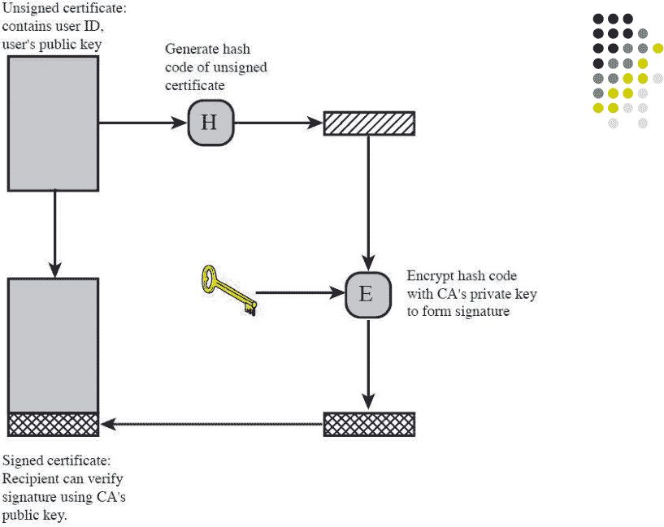

### Figure 14.3 Public-Key Certificate Use

## 14.2.1 X.509证书

- X.509证书由可信认证机构Certification Authority（CA）创建并放入目录服务器中，包括
  - 版本号(1, 2, or 3)
  - 序列号(unique within CA) identifying certificate
  - 签名算法标识
  - 发行商名(CA)
  - 有效期(from - to dates)
  - 证书主体名(name of owner)
  - 证书主体的公钥信息(algorithm, parameters, key)
  - 发行商唯一标识(v2+)
  - 证书主体唯一标识(v2+)
  - 扩展(v3)
  - 签名(of hash of all fields in certificate)
- Notation CA<<A>>=CA{V, SN, AI, CA, T_A, A, A_p} denotes certificate for A signed by CA

## X.509 Certificates

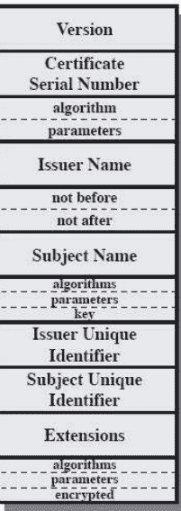

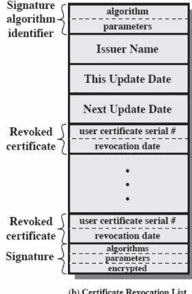

(a) X.509 Certificate

(b) Certificate Revocation List

## 证书的层次结构

- 如果用户有共同的CA，则他们应该知道彼此的公钥，否则CA必须形成层次结构并互相发放证书
- 每个CA目录入口包含两种证书
  - 向前证书：由其他CA发给X的证书（forward, client）
  - 向后证书：X发给其他CA的证书（backward, parent）
- 每一个用户信任他的父节点的证书
- 通过层次化的结构，可以使一个CA下的用户验证任何其他CA下的用户的公钥证书

## CA层次结构的使用

- A从目录获得证书以建立通往B的证书路径
  - X<<W>>W<<V>>V<<Y>>Y<<Z>>Z<<B>>
- B通过如下路径获得A的公开密钥
  - Z<<Y>>Y<<V>>V<<W>>W<<X>>X<<A>>

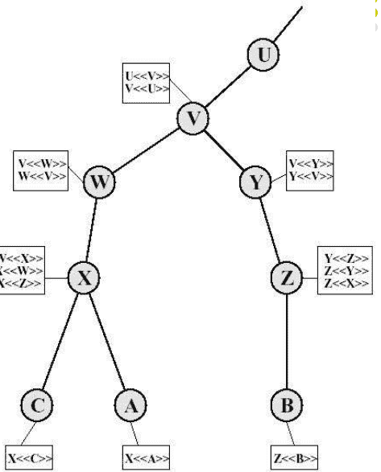

## 证书的撤销

- 每个证书都有一个有效期，到期失效
- 可能因为如下原因提前撤销证书
  1. 用户的私钥被认为不安全了
  2. 用户不再信任该CA
  3. CA的证书被认为不安全了
- 每个CA维护一张证书撤销列表
  - the Certificate Revocation List (CRL)
- 用户应该经常去CRL看看某个证书是否还有效

## 14.2.2 认证的过程

- X.509有三种可选的认证过程
  - One-Way Authentication
  - Two-Way Authentication
  - Three-Way Authentication
- 三种方法均使用公钥签名

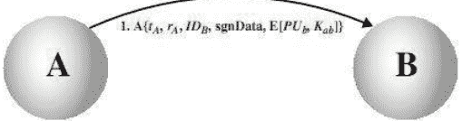

(a) One-way authentication

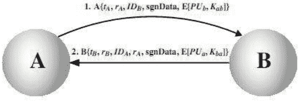

(b) Two-way authentication

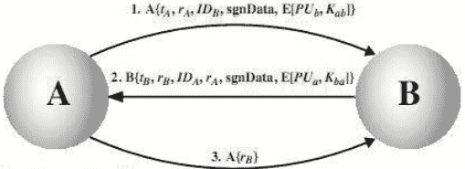

(c) Three-way authentication

## One-Way Authentication

- 使用一条消息( A->B)建立认证过程
  - A的标识和A创建的消息
  - B所需要的消息
  - 消息的完整性和原创性(不能多次发送)
- 消息必须包含时间戳， nonce， B的标识符， 并由A签名

## Two-Way Authentication

- 使用两条消息建立认证过程(A->B, B->A)
  - A的标识和A创建的消息
  - B所需要的消息
  - 消息的完整性和原创性(不能多次发送)
  - B的标识和B生成的应答消息
  - A需要的消息
  - 应答的完整性和真实性
- 应答消息包括从A得到的临时交互号nonce，时间戳和B生成的临时交互号
- 消息中可以包含签名的其他信息和用A的公钥加过密的会话密钥


## Three-Way Authentication

- 使用三条消息(A->B, B->A, A->B)建立认证过程而不需要同步时钟
- 最后从A发往B的消息中包含签了名的临时交互号r<sub>b</sub>，这样，其中的时间戳就不用检查了

## 14.2.3 X.509 Version 3

- 密钥和策略信息
  - 授权密钥标识符
  - 主体密钥标识符
  - 密钥使用
  - 私钥使用期
  - 证书策略
  - 策略映射
- 证书主体和发行商属性
  - 主体可选名字
  - 发行商可选名字
  - 主体目录属性
- 证书路径约束
  - 基本限制、名字限制、策略限制

## 14.3 公开密钥的全局管理体制PKI

- 基于X.509证书的PKI

- 公钥体制需要一个管理机制，保证公开密钥的可靠性。PKI (Public Key Infrastructure)是公开密钥证书的管理体制。除了登记注册、管理、发布公钥证书之外，PKI还要负责撤销过去签发但现已失效的密钥证书，即CRL(X.509证书和证书撤销列表)。

- PKI本质上是一种公证服务，通过离线的数字证书来证明某个公开密钥的真实性，并通过CRL来确认某个公开密钥的有效性。

- PKI的目标是向Internet用户和应用程序提供公开密钥管理服务，使其可靠地使用非对称密钥加密技术。数字证书是PKI的核心数据结构，引入了公认可信的第三方和数字证书，依赖证书上的第三方数字签名，用户可以离线地确认公钥的真实性。

## Public Key Infrastructure

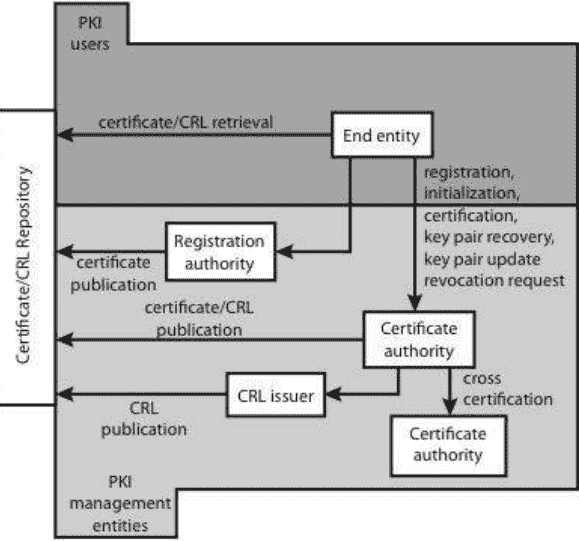

## PKI (Public Key Infrastructure)

- X.509证书和证书撤销列表CRL

  - X.509证书是由发布者数字签名的、用于绑定某公开密钥及其持有者身份的数据结构。

  - 证书撤销列表是另一种证书有效期控制机制，由发布者数字签名。证书使用者可以依据CRL (Certificate Revocation List)验证某证书是否已被撤销。

- PKI的结构模型

  - PKI是公钥的管理机制，为域结构形态，每个PKI都有一定的覆盖范围，形成一个管理域。这些管理域通过交叉证书相互关联，构成更大的管理域，最终形成全局性公钥管理体系。

## PKI (Public Key Infrastructure)

- PAA(Policy Approval Authority) 政策审批机构  
  - 制订整个体系结构的安全政策并制订所有下级机构都需要遵循的规章制度，主要是证书政策和证书使用规定。
- CA(Certificate Authority) 证书管理中心  
  - 负责具体的证书颁发与管理，如同颁发护照的部门，是可信任的第三方。
- ORA(Organizational Registry Authority) 单位注册机构  
  - 帮助用户在CA处注册并获得证书。
- PMA(Policy Management Authority) 政策管理机构，对PKI进行宏观管理。
- 端实体：数字签名和加密的实体

## PKI (Public Key Infrastructure)

### PKI的操作模型

PKI中有两种管理实体：证书管理中心CA和注册中心RA  
CA：能够发布和撤销证书，维护证书的生存周期  
RA：负责处理用户注册请求，在验证请求有效性后代用户向CA提交。

PKI中有两种端实体：持证者(Holder)和验证者(Verifier)

- 持证者是证书拥有者，是证书所声明事实的主体；验证者通常是授权方，确认证书持有者的证书有效后再授予对方相应权力。

- 不同实体之间通过PKI操作完成证书的请求、确认、发布、撤销、更新、获取等过程。PKI的操作主要分成两大类：存取操作和管理操作。

## 网络信息安全

## Chapter 1 Introduction


## 1.3 安全攻击

- 对任何机构的信息资源进行破坏的行为即安全攻击
- 信息安全就是要检测和防范这种攻击行为
- 通常 threat 和 attack 指的是同样的事情
- 安全攻击的行为范围很广
- 通常有两大类安全攻击
  - 被动攻击：对传输进行窃听和监测，通信和信息不受影响，用户感觉不到攻击存在，攻击通常是窃听或流量分析，判断通信性质
  - 主动攻击：攻击者破坏通信过程，拦截、修改、伪造、丢弃信息、拒绝服务或假冒合法用户

## Passive Attack -- release of contents 被动攻击之消息内容的泄漏


(a) Release of message contents

## Passive Attack—traffic analysis 被动攻击之流量分析

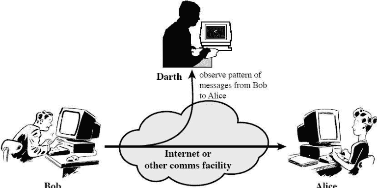

(b) Traffic analysis

## Active Attack—Masquerade 主动攻击之伪装

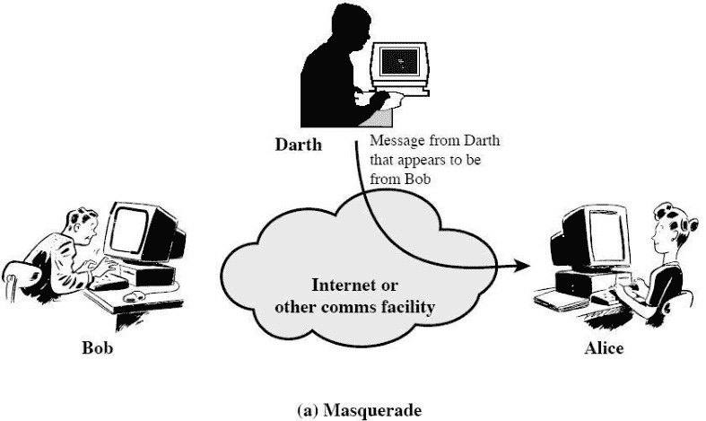

Darth  
Message from Darth that appears to be from Bob  
Internet or other comms facility  
Bob  
Alice  
(a) Masquerade

## Active Attack—Replay 主动攻击之重放

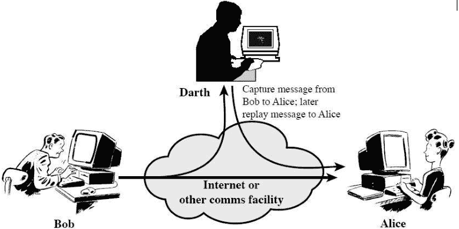

**Darth**  
Capture message from Bob to Alice; later replay message to Alice  
Internet or other comms facility  
**Bob**  
**Alice**  
(b) Replay

## Active Attack—Modification of messages 主动攻击之消息修改

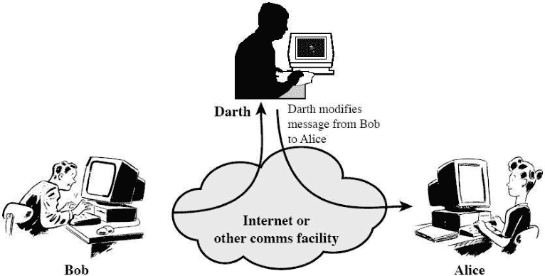

## Active Attack—Denial of Service 主动攻击之拒绝服务

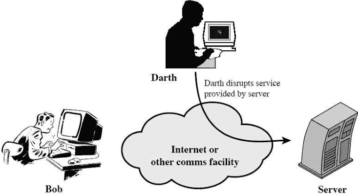

(d) Denial of service

## 网络信息安全

## Chapter 2 Classical Encryption Techniques


## 理论安全和实际安全

- **理论安全，或无条件安全** Theoretical Secure (or Perfect Secure)
  
  攻击者无论截获多少密文，都无法得到足够的信息来唯一地决定明文。Shannon用理论证明：欲达理论安全，加密密钥长度必须大于等于明文长度，密钥只用一次，用完即丢，即一次一密，One-time Pad，不实用。

- **实际安全，或计算上安全** Practical Secure (or Computationally Secure)
  
  如果攻击者拥有无限资源，任何密码系统都是可以被破译的；但是，在有限的资源范围内，攻击者都不能通过系统的分析方法来破解系统，则称这个系统是计算上安全的或破译这个系统是计算上不可行(Computationally Infeasible)。

## 对称密码体制和非对称密码体制

- 对称密码体制(Symmetric System, One-key System, Secret-key System)

  加密密钥和解密密钥相同，或者一个密钥可以从另一个导出，能加密就能解密，加密能力和解密能力是结合在一起的，开放性差。

- 非对称密码体制(Asymmetric System, Two-key System, Public-key System)

  加密密钥和解密密钥不相同，从一个密钥导出另一个密钥是计算上不可行的，加密能力和解密能力是分开的，开放性好。


## 序列密码体制和分组密码体制

- 序列密码
  - 如果密文不仅与最初给定的算法和密钥有关，同时也与明文位置有关(是所处位置的函数)，则称为序列密码体制。加密以明文比特为单位，以伪随机序列与明文序列模2加后，作为密文序列。

- 分组密码
  - 如果经过加密所得到的密文仅与给定的密码算法和密钥有关，与被处理的明文数据在整个明文中的位置无关，则称为分组密码体制。通常以大于等于64位的数据块为单位，加密得相同长度的密文。

## 其他加密体制

- 确定型密码体制和概率密码体制
  - 确定型：当明文和密钥确定后，密文也就唯一地确定了。
  - 概率型：当明文和密钥确定后，密文通过客观随机因素从一个密文集合中产生，密文形式不确定，称为概率型密码体制。

- 单向函数型密码体制和双向变换型密码体制
  - 单向函数型密码体制适用于不需要解密的场合，容易将明文加密成密文，如哈希函数；
  - 双向变换型密码体制可以进行可逆的加密、解密变换。

## 现代密码学基本原则

- 现代密码学的基本原则
- 设计加密系统时，总是假定密码算法是可以公开的，需要保密的是密钥。一个密码系统的安全性不在算法的保密，而在于密钥，即Kerckhoff原则。
- 对加密系统的要求
- 系统应该是实际上安全的(practical secure)，截获密文或已知明文—密文对时，要决定密钥或任意明文在计算上是不可行的。
- 加密解密算法适用于密钥空间中的所有元素。
- 系统易于实现，使用方便。
- 系统的安全性不依赖于对加密体制或加密算法的保密，而依赖于密钥。
- 系统的使用不应使通信网络的效率过分降低。

## 传统密码的简化模型

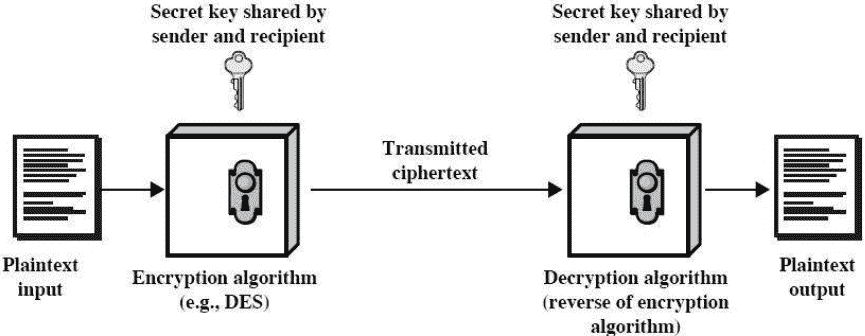

Figure 2.1 Simplified Model of Symmetric Encryption

## 传统密码体制的模型

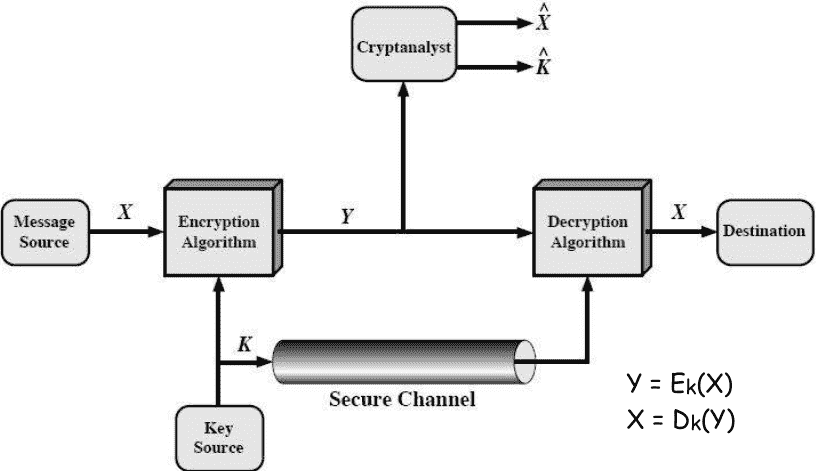

Figure 2.2 Model of Symmetric Cryptosystem

## 网络信息安全
Chapter 3
Block Cipher and Data Encryption Standard


## 第3章 分组密码和数据加密标准

- 分组密码是一种加密解密算法，将输入明文分组当做一个整体处理，输出一个等长的密文分组。
- 许多分组密码都采用Feistel结构，这样的结构由许多相同的轮函数组成。每一轮里，对输入数据的一半进行代换，接着用一个置换来交换数据的两个部分，扩展初始的密钥使得每一轮使用不同的子密钥。
- DES是应用最为广泛的分组密码，它扩展了经典的Feistel结构。DES的分组和密钥分别是64位和56位的。
- 差分分析和线性分析是两种重要的密码分析方法。DES对这两种攻击有一定的免疫性。

## 乘积密码的设计思想

- Claude Shannon and Substitution-Permutation Ciphers
  - 1949年，Claude Shannon 引进了substitution-permutation (S-P) networks的思想，即现代的乘积加密器，形成了现代分组加密的基础。S-P Networks 是基于替代和置换这两个基本操作的。
- 提供了对明文信息处理所做的 *confusion* 和 *diffusion*。
  - Shannon认为，为了对付基于统计分析的密码破译，必须对明文作confusion(混淆)和diffusion(扩散)处理，以减少密文的统计特性，为统计分析制造障碍。
- **diffusion** —明文统计结构扩散消失到大批密文统计特性中，使明文和密文之间统计关系尽量复杂；
- **confusion** —混淆，使密文和加密密钥之间的关系尽量复杂。

## Figure 3.5 Single Round of DES Algorithm

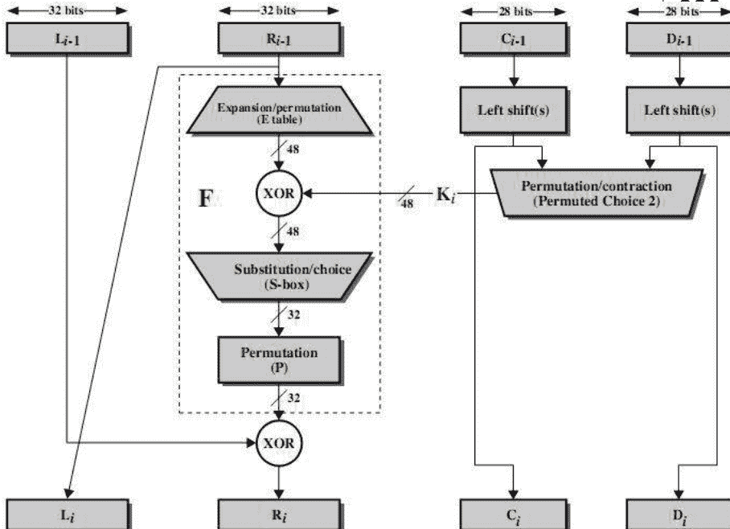

## 网络信息安全
## Chapter 4
## Finite Fields


## 4.1群，环和域 Groups, Rings, and Fields

- 群G，记作{G，⋅}，定义一个二元运算⋅的集合，G中每一个序偶(a, b)通过运算生成G中元素(a⋅b)，满足下列公理：
  - (A1) 封闭性Closure：如果a和b都属于G，则a⋅b也属于G。
  - (A2) 结合律Associative：对于G中任意元素a，b，c，都有a⋅(b⋅c)=(a⋅b)⋅c成立
  - (A3) 单位元Identity element：G中存在一个元素e，对于G中任意元素a，都有a⋅e=e⋅a=a成立
  - (A4) 逆元Inverse element：对于G中任意元素a，G中都存在一个元素a'，使得a⋅a'=a'⋅a=e成立

## 交换群和循环群

- 交换群Abelian Group：还满足以下条件的群称为交换群(又称阿贝尔群)
  - (A5) 交换律Commutative：对于G中任意的元素a，b，都有a·b=b·a成立

- 当群中的运算符是加法时，其单位元是0；a的逆元是-a，并且减法用以下的规则定义：
  - a − b = a + (-b)

- 循环群Cyclic Group
  - 如果群中的每一个元素都是一个固定的元素a（a ∈ G）的幂aᵏ(k为整数)，则称群G为循环群。元素a生成了群G，或者说a是群G的生成元。

## 环 (Rings)

- 环 R，由 {R, +, ×} 表示，是具有加法和乘法两个二元运算的元素的集合，对于环中的所有 a, b, c，都服从以下公理：
  - (A1-A5)，单位元是 0，a 的逆是 -a。
  - (M1)，乘法封闭性，如果 a 和 b 属于 R，则 ab 也属于 R。
  - (M2)，乘法结合律，对于 R 中任意 a、b、c，有 a(bc)=(ab)c。
  - (M3)，乘法分配律，a(b+c)=ab+ac or (a+b)c=ac+bc。
  - (M4)，乘法交换律，ab=ba，交换环。
  - (M5)，乘法单位元，R 中存在元素 1 使得所有 a 有 a1=1a。
  - (M6)，无零因子，如果 R 中有 a、b 且 ab=0，则 a=0 or b=0。
- 满足 M4 的是交换环；满足 M5 和 M6 的交换环是整环。

## 域 (Fields)

- 域F，可以记为{F, +, x}，是有加法和乘法的两个二元运算的元素的集合，对于F中的任意元素a, b, c，满足以下公理：
  - (A1-M6)，F是一个整环
  - (M7)，乘法逆元，对于F中的任意元素a(除0以外)，F中都存在一个元素a⁻¹，使得aa⁻¹=(a⁻¹)a=1。
  - 域就是一个集合，在其上进行加减乘除而不脱离该集合，除法按以下规则定义：a/b=a(b⁻¹)。
- 有理数集合，实数集合和复数集合都是域；整数集合不是域，因为除了1和-1有乘法逆元，其他元素都无乘法逆元

## 模算术运算

(a₁ op a₂) mod n =[(a₁ mod n )] op (a₂ mod n)] mod n

- ①反身性： a=a mod n
- ②对称性： 若a=b mod n， 则b=a mod n
- ③传递性：若a=b mod n 且b=c mod n， 则a=c mod n
- ④如果 a=b mod n且 c=d mod n， 则
  - a+c=(b+d) mod n
  - a-c=(b-d) mod n
  - a•c=(b•d) mod n
- ⑤ (a+b) mod n = (a mod n + b mod n) mod n
  - (a-b) mod n = (a mod n - b mod n) mod n
  - (a•b) mod n = (a mod n • b mod n) mod n

## 模算术运算

(a+b) mod n = (a mod n + b mod n) mod n

证明：定义 (a mod n)=ra, (b mod n)=rb
于是存在整数 j, k 使得 a=ra+jn, b=rb+kn.
那么
(a+b) mod n = (ra+jn+rb+kn) mod n
= (ra+rb+(k+j)n) mod n
= (ra+rb) modn
= [(a mod n)+(b mod n)] mod n


## 网络信息安全

Chapter 6
More on Symmetric Ciphers

## 6.1.1 双重DES

- 多次加密的最简单形式是进行两次加密，每次使用不同的密钥
  - `C = E_{K2}(E_{K1}(P))`
  - `P = D_{K1}(D_{K2}(C))`
  - 这种方法的密钥长度是56×2=112位

- 虽然双重DES对应的映射与单DES对应的映射不同，但是有中途相遇攻击“meet-in-the-middle”
  - 只要连续使用密码两次，这种攻击总是有效
  - 因为 `X = E_{K1}(P) = D_{K2}(C)`
  - 用所有可能的密钥加密明文P并把结果存储起来
  - 然后用所有可能的密钥解密密文C，寻找匹配的X值
  - 因此复杂度只有 `O(2^{56})`

## 双重DES和三重DES

- 双重DES (Double DES)
  给定明文P和加密密钥K₁和K₂，
  加密：C=Eₖ₂[Eₖ₁[P]]
  解密：P=Dₖ₁[Dₖ₂[C]]
  密钥长度为56x2=112位

  存在中途相遇攻击问题

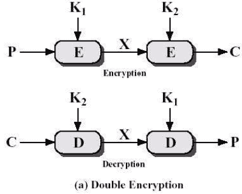

## 网络信息安全

## Chapter 8

## Introduction to Number Theory


## 费马小定理（范例）

### （1）计算610 mod 11

若p是素数，a是正整数且不能被p整除，则a<sup>p-1</sup> mod p=1

解法：我们可得6<sup>10</sup> mod 11 = 1。
这是p = 11 时，可以使用费马小定理的第一个版本直接计算得到。

## 费马小定理（范例）

### （2）计算3<sup>12</sup> mod 11

a<sup>p</sup>≡a mod p, p是素数
解法：此处指数（12）和模数（11）是不同的。

3<sup>12</sup> mod 11 = (3<sup>11</sup> × 3) mod 11 = (3<sup>11</sup> mod 11) (3 mod 11) = (3 × 3) mod 11 = 9

### 欧拉函数 \(\Phi(n)\)的证明

#### 定理8.2 \(p\)和\(q\)是素数，\(n=p*q\)，\(\Phi(n) = \Phi(p) \Phi(q) = (p-1)(q-1)\)

#### 显然，对于素数\(p\)，\(\Phi(p) = p-1\)

证明：考虑余数集合\(\{0, 1, \dots, (pq-1)\}\)中不与\(n\)互素的余数集合是\(\{p, 2p, \dots, (q-1)p\}\)，\(\{q, 2q, \dots, (p-1)q\}\)和\(0\)，所以  
\(\Phi(n) = pq - [(q-1) + (p-1) + 1] = pq - (p+q) + 1 = (p-1)(q-1) = \Phi(p) \Phi(q)\)

## 欧拉定理

- 对任意互质的a和n有：

  \( a^{\phi(n)} \equiv 1(\text{mod } n) \)

  \( a^{\phi(n)+1} \equiv a(\text{mod } n) \)

## 欧拉定理（证明）

\(a^{\phi(n)} \equiv 1(\text{mod } n)\)

（1）若 \(n\) 是素数，根据 \(\phi(n)=(n-1)\) 和费马小定理，则上式成立；

若p是素数，a是正整数且不能被p整除，则a<sup>p-1</sup> mod p=1

（2）所有小于 \(n\)，且与 \(n\) 互质的正整数的集合 \(R = \{x_1, x_2, \cdots, x_{\phi(n)}\}\)

## 欧拉定理（证明）

- 即每一个元素都有 $\gcd(x_i,n)=1$。用 $a$ 与 $R$ 中的每个元素模 $n$ 相乘：

  $$S=\{(ax_1\bmod n),(ax_2\bmod n),\ldots,(ax_{\phi(n)}\bmod n)\}$$

- $S$ 是 $R$ 的一个排列，因为

  (1) $a$ 与 $n$ 互素，且 $x_i$ 与 $n$ 互素，所以 $ax_i$ 必与 $n$ 互素，这样 $S$ 中所有元素均小于 $n$ 且与 $n$ 互素。

  (2) $S$ 中没有重复元素，所以集合 $S$ 是集合 $R$ 的一个置换。

## 欧拉定理（证明）

\(\prod_{i=1}^{\phi(n)}(ax_i \mod n) = \prod_{i=1}^{\phi(n)} x_i\)

\(\prod_{i=1}^{\phi(n)} ax_i \equiv \prod_{i=1}^{\phi(n)} x_i (\mod n)\)

\(a^{\phi(n)} \times \left[\prod_{i=1}^{\phi(n)} x_i \right] \equiv \prod_{i=1}^{\phi(n)} x_i (\mod n)\)

\(a^{\phi(n)} \equiv 1(\mod n)\)

## 8.4 Chinese Remainder Theorem

中国余数定理CRT说明某一范围内的整数可通过它对两两互素的整数取模所得的余数来重构

Z<sub>10</sub>(0,1,...,9)中的10个整数可通过它们对2和5(10的素因子)取模所得的两个余数来重构. 假设数x的余数r<sub>2</sub>=0 且r<sub>5</sub>=3, 即x mod 2=0, x mod 5=3, 则x是Z<sub>10</sub>中的偶数且被5除余3, 唯一解x=8.

一种CRT的表示形式

令M= \(\prod_{i=1}^k m_i\)，其中m<sub>i</sub>两两互素，1<=i, j<=k, i≠j，gcd(m<sub>i</sub>, m<sub>j</sub>)=1

将Z<sub>m</sub>中的任一整数对应一个k元组，该k元组的元素均在Z<sub>mi</sub>中，对应关系为A↔(a<sub>1</sub>,a<sub>2</sub>,...,a<sub>k</sub>)，其中A∈Z<sub>m</sub>，对1<=i<=k, a<sub>i</sub>∈Z<sub>mi</sub>，且a<sub>i</sub> = A mod m<sub>i</sub>

## 8.4 Chinese Remainder Theorem

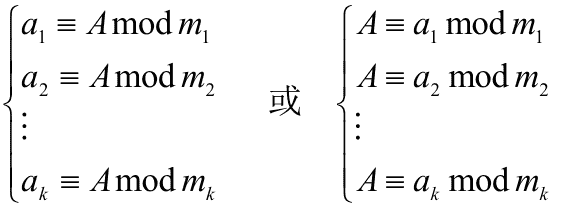

### 断言一

对任何A，0≤A≤M，有唯一的k元组(a₁,a₂,…,aₖ)与之对应，其中0≤aᵢ<mᵢ；并且对任何这样的k元组(a₁,a₂,…,aₖ)，ℤₘ中有唯一的A与之对应。

### 孙子定理(孙子算经，3-5世纪)

今有物不知其数，三三数之剩二，五五数之剩三，七七数之剩二，问物几何。

```
x mod 3=2        n=3*5*7=105
x mod 5=3        d₁=3, d₂=5, d₃=7
x mod 7=2        x₁=2, x₂=3, x₃=2
```

### 孙子定理(孙子算经，3-5世纪)

今有物不知其数，三三数之剩二，五五数之剩三，七七数之剩二，问物几何。

x mod 3=2  
x mod 5=3  
x mod 7=2

n=3*5*7=105  
d₁=3, d₂=5, d₃=7  
x₁=2, x₂=3, x₃=2

(1) 求yᵢ，\( (\frac{n}{d_i})y_i \mod d_i=1 \)

\( (\frac{105}{3})y_1 \mod 3=1 \)  
\( (\frac{105}{5})y_2 \mod 5=1 \)  
\( (\frac{105}{7})y_3 \mod 7=1 \)

得：  
35 y₁ mod 3=1  
21 y₂ mod 5=1  
15 y₃ mod 7=1

y₁=2  
y₂=1  
y₃=1

(2) x = (35×2×2+21×1×3+15×1×2) mod 105=23


## 公开密钥加密过程

Plaintext input

Alice's public key

Encryption algorithm (e.g., RSA)

Transmitted ciphertext

Alice's private key

Decryption algorithm (reverse of encryption algorithm)

Plaintext output

(a) Encryption

## 公开密钥认证过程

(b) Authentication

Figure 9.1 Public-Key Cryptography

## RSA密码体制基本原理

- 算法流程
  - 随机选择两个秘密大素数p和q；
  - 计算公开模数n=p*q；
  - 计算秘密的欧拉指数函数φ(n)=(p-1)(q-1)；
  - 选择一个与φ(n)互素的数，作为e或d；
  - 用Euclid算法计算模φ(n)的乘法逆元素，即根据ed mod φ(n)=1，求d或e；
  - 加密： C = Mᵉ mod n
  - 解密： M=Cᵈ mod n = (Mᵉ mod n)ᵈ mod n = M

这里，φ(n)为欧拉函数，即集合(1, 2, ..., n-1)中与n互素的数的个数。

## Key Generation

Select *p, q*　　　　　　　　　*p* and *q* both prime

Calculate *n* = *p* × *q*

Calculate φ(*n*) = (*p* − 1)(*q* − 1)

Select integer *e*　　　　　　　　　gcd(φ(*n*), *e*) = 1; 1 < *e* < φ(*n*)

Calculate *d*　　　　　　　　　　　*d* = *e*⁻¹ mod φ(*n*)

Public key　　　　　　　　　　　　KU = {*e*, *n*}

Private key　　　　　　　　　　　KR = {*d*, *n*}

| Encryption | Decryption |
|---|---|
| Plaintext: *M* < *n* | Ciphertext: *C* |
| Ciphertext: *C* = *M*ᵉ (mod *n*) | Plaintext: *M* = *C*ᵈ (mod *n*) |

## Encryption

## Decryption

Plaintext 19 → 19^(5) = 2476099 / 66 = 20807 with a remainder of 119 → Ciphertext 66

Ciphertext 66 → 66^(77) = 1.27... × 10^140 / 119 = 1.06... × 10^138 with a remainder of 19 → Plaintext 19

KU = 5, 119

KR = 77, 119

## Figure 6.6 Example of RSA Algorithm

## Encryption

## Decryption

plaintext 88 → 88^(7) mod 187 = 11 → ciphertext 11

ciphertext 11 → 11^(23) mod 187 = 88 → plaintext 88

KU = 7, 187

KR = 23, 187

## Figure 9.6 Example of RSA Algorithm

## 一个例子

- p=17, q=11, e=7, M=88
- 求公钥KU和私钥KR分别为多少？
- 加密计算后所得的C为多少？
- 并验证解密运算后，是否能恢复出明文M。

## 一个例子

- p=17,q=11,n=pq=17x11=187,  
  φ(n)=(p-1)(q-1)=16x10=160

- 选择e=7, gcd(7,160)=1, 23x7=161, 所以d=23

- 公钥KU={7,187}, 私钥KR={23,187}, M=88

- 加密计算C=88⁷ mod 187

- 88⁷ mod 187  
  =[(88⁴mod187)x88²mod187)x88¹mod187)]mod187

- 88¹mod187=88

- 88²mod187=7744mod187=77

- 88⁴mod187=59969536mod187=132

- 88⁷mod187=(88x77x132)mod187=894432mod187=11

- 解密计算M=11²³ mod 187 = 88

## RSA密码体制基本原理

- RSA算法满足公开密钥加密的要求，必须符合下列条件：
  - 有可能找到e, d, n的值，使得对所有M<n有  
    Med mod n = M  
  - 对于所有M<n的值，要计算Me和Cd是相对容易的  
  - 在给定e和n时，计算d是不可行的

- 几个关系
  - φ(n) = φ(pq)=φ(p)φ(q)=(p-1)(q-1), p,q are prime  
  - ed mod φ(n)=1, ed = kφ(n)+1, 即ed≡1 mod φ(n),  
    d≡e-1 mod φ(n)

## 10.1.1 密钥管理之公钥的分配

- 公共密钥的主要作用之一就是解决密钥分配问题，公钥密码实际上可以用于以下两个不同的方面
  - 公钥的分配
  - 公钥密码用于传统密码体制的密钥分配
- 几种公钥分配方法
  - 公开发布、公开可访问的目录
  - 公钥授权、公钥证书
- 公钥的公开发布
  - 用户将他的公钥发送给另一通信方，或者广播给通信各方，比如在电子邮件后附上PGP密钥，或者发布到邮件列表上
  - 最大问题在于任何人都可以伪造这种公钥的发布

## 自由的公钥发布

Figure 10.1 Uncontrolled Public Key Distribution

## 公开可访问的目录

- 维护一个动态可访问的公钥目录可以获得更大程度的安全性

- 一个可信实体或组织负责这个公开目录的维护和分配

- 目录包含{name, public-key}等项

- 每一通信方通过目录管理员以安全的方式注册一个公钥

- 通信方在任何时刻可以用新的密钥替代当前的密钥

- 目录定期更新

- 目录可通过电子方式访问

- 一旦攻击者获得目录管理员私钥，则可传递伪造的公钥，可以假冒任何通信方以窃取消息，或者修改已有的记录

## 公开可访问的目录

Figure 10.2 Public Key Publication

## 公钥授权

- A发送带有时间戳的消息给公钥管理员，请求B的当前公钥
- 管理员给A发送用其私钥\( KR_{auth} \)加密的消息，A用管理员的公钥解密，可以确信该消息来自管理员：
  - B的公钥\( KU_b \)，用来加密；
  - 原始请求，A可以验证其请求未被修改；
  - 原始时间戳，A可以确定收到的不是来自管理员的旧消息。
- A保存B的公钥，并用它对包含A的标识\( ID_A \)和\( Nonce_1 \)的消息加密，然后发送给B
- B以同样方式从管理员处得到A的公钥
- B用\( KU_a \)对A的\( N_1 \)和B的\( N_2 \)加密，发送给A
- A用B的公钥对\( N_2 \)加密并发送给B，使B相信其通信伙伴是A

## 公钥分配方案

Figure 10.3 Public-Key Distribution Scenario

## 10.1.2 公钥证书

- 有了公钥证书使得不通过实时访问公钥授权部门而实现公钥交换成为可能

- 公钥证书将一个通信方的身份与他的公开密钥绑定在一起，通常还包括有效期和使用方法等

- 证书的所有内容必须经由可信公钥授权方或者证书授权方签名后方可生效

- 知道公钥授权当局公开密钥的任何人都可以验证一个用户的公开密钥证书的有效性

- 对于申请者A，管理员提供的证书为：

- \( C_A = E_{KRauth} [T, ID_A, KU_a] \)

- 其他人读取并验证：

- \( D_{KUauth}[C_A] = D_{KUauth}[E_{KRauth}[T, ID_A, KU_a]] = (T, ID_A, KU_a) \)


## 公钥证书的交换

Figure 10.4 Exchange of Public-Key Certificates

## 10.1.3 利用公钥密码分配传统密码体制的密钥

- 采用前述方法获得的公钥可以用于保密和认证之需
- 公钥密码算法速度较慢，因此更适合作为传统密码中实现秘密密钥分配的一种手段
- 因此，需要产生会话密码来加密
- 已经有一些方法用来协商适当的会话密钥

## 10.2 Diffie-Hellman密钥交换

- Diffie和Hellman在1976年首次提出了公钥算法，给出了公钥密码学的定义，该算法通常被称为Diffie-Hellman密钥交换算法
- Diffie-Hellman密钥交换算法是一种公钥分发机制
  - 它不是用来加密消息的
  - 所生成的是通信双方共享的会话密钥，必须保密，其值取决于通信双方的私钥和公钥信息
- Diffie-Hellman密钥交换算法是基于有限域GF中的指数运算的(模一素数或多项式)
- Diffie-Hellman密钥交换算法的安全性依赖于求解离散对数问题DLP

## Diffie-Hellman Key Exchange

- 通信双方约定一个大素数(或多项式)p，和模p的一个素根α
- 各方产生公开密钥
  - 选择一个秘密钥(数值)，如x<sub>A</sub> < p，x<sub>B</sub> < p
  - 计算公钥，如y<sub>A</sub> = α<sup>x<sub>A</sub></sup> mod p, y<sub>B</sub> = α<sup>x<sub>B</sub></sup> mod p，并相互交换
- 双方共享的会话密钥K<sub>AB</sub>可以如下算出
  - K<sub>AB</sub> = α<sup>x<sub>A</sub>.x<sub>B</sub></sup> mod p
  - = y<sub>A</sub><sup>x<sub>B</sub></sup> mod p (which B can compute)
  - = y<sub>B</sub><sup>x<sub>A</sub></sup> mod p (which A can compute)
- K<sub>AB</sub>是双方用对称密码通信时共享的密钥
- 如果双方继续通信，可以继续使用这个密钥，除非他们要选择新的密钥
- 攻击者如果想要获得x，则必须解决DLP问题

## 10.2.2 Diffie-Hellman密钥交换协议

- 本协议不能抵抗中间人攻击

Figure 10.8 Diffie-Hellman Key Exchange

## 中间人攻击

假定A和B希望交换密钥，而D是攻击者，攻击过程如下：

(1) 为了进行攻击，D先生成两个随机的私钥\(X_{D1}\)和\(X_{D2}\)，然后计算相应的公钥\(Y_{D1}\)和\(Y_{D2}\)。

(2) Alice将\(Y_A\)传递给Bob。

(3) D截获了\(Y_A\)，将\(Y_{D1}\)传给B。D同时计算\(K_2 = (Y_A)^{X_{D2}} \mod q\)。

(4) B收到\(Y_{D1}\)，计算\(K_1 = (Y_{D1})^{X_B} \mod q\)。

(5) B将\(Y_B\)传给A。

(6) D截获了\(Y_B\)，将\(Y_{D2}\)传给A。D计算\(K_1 = (Y_B)^{X_{D1}} \mod q\)。

(7) A收到\(Y_{D2}\)，计算\(K_2 = (Y_{D2})^{X_A} \mod q\)。

此时，B和A想，他们已共享了密钥，但实际上，B和D共享了密钥\(K_1\)，而A和D共享了密钥\(K_2\)。接下来，B和A之间的通信以下列方式泄密：

(1) A发了一份加了密的消息M：\(E(K_2, M)\)。

(2) D截获了该秘密消息，解密，恢复出M。

(3) D将\(E(K_1, M)\)或\(E(K_1, M')\)发给B，其中\(M'\)是任意的消息。

2022-11-3 69/60 现代密码学理论与实践-10

## 基于DLP的概率密码系统 ElGamal Cryptosystem

- 假设A和B互相通信，共享大素数p，本原元素a，0≤m≤p-1
- 加密：
  - A选择k∈[0, p-1]，k的作用其实即为xA，A访问公共区域找到B的公开密钥YB = αxB mod p，计算：
    - K = (YB)k mod p，即K = αxBk mod p
    - c1 = αk mod p
    - c2 = mK mod p
    - 密文即为 (c1, c2)
- 解密：
  - B首先恢复K：K = c1xB mod p = αkxB mod p
  - 然后恢复m：m = c2/K mod p = c2K-1 mod p

## ElGamal Cryptosystem

例：P = 17，α = 3，x_A = 2，x_B = 5，m = 11，从A发送到B，A选择k = 7。

求：密文(c₁, c₂)并解密

## ElGamal Cryptosystem

例：P = 17, α= 3, xA = 2, xB = 5, m = 11，从A发送到B, A选择k = 7.

求：密文(c1, c2)并解密

加密：YA = αxA mod P = 32 mod 17 = 9  
YB = αxB mod P = 35 mod 17 = 5  
K = (YB)k mod P = 57 mod 17 = 10  
c1 = αk mod P = 37 mod 17 = 11  
c2 = mK mod P = 10x11 mod 17 = 8  
所以，密文C = (c1, c2) = (11, 8)

解密：K = c1xB mod P = 115 mod 17 = 10  
c2 = mK mod P = 10m mod 17 = 8  
m = c2/K mod P = c2K-1 mod P  
K K-1 mod P = 1，即10 K-1 mod 17 = 1，得K-1 = 12  
所以，明文m = c2K-1 mod P = 8x12 mod 17 = 11

## 网络信息安全

## Chapter 11 Message Authentication and Hash Functions

## MAC: 消息认证码的特点

- MAC加密所得的消息校验和
  - \( MAC = C_K(M) \)
- 使用一个秘密密钥K，浓缩一个变长的消息M，产生一个固定长度的认证子
- MAC是一种多对一的函数
- 定义域由任意长的消息组成，值域由所有可能的MAC和密钥组成。若使用n位长的MAC，则有2^n个可能的MAC，有N条可能的消息，N>>2^n。若密钥长度为k，则有2^k种可能的密钥。
- 如N为100，n为10，共有2^100不同的消息，2^10种不同的MAC，平均而言同一MAC可由2^100/2^10=2^90条不同的消息产生。若密钥长度为5，则从消息集合到MAC值的集合有2^5=32不同映射。
- 可以证明，由于认证函数的数学性质，与加密相比，认证函数更不易被攻破

## Figure 11.4 Basic Uses of Message Authentication Code (MAC)

(a) Message authentication

(b) Message authentication and confidentiality; authentication tied to plaintext

(c) Message authentication and confidentiality; authentication tied to ciphertext

## 11.2.3 散列函数 Hash Function

- 一个散列函数以变长的报文M作为输入，产生定长的散列码H(M)，作为输出，亦称作报文摘要Message Digest。散列码是报文所有比特的函数值，具有差错检测能力，报文任意一比特的改变都将引起散列码的改变
- 不同的散列码使用方式
- 对附加了散列码的报文进行加密
- 使用常规加密方法仅对散列码加密
- 使用公开密钥方法仅对散列码加密，提供数字签名
- 同时提供保密和签名，可以分别使用常规方法加密报文及使用公开密钥方法加密散列码
- 其他
- 对避免加密的方法重视的原因加密过程很慢，硬件开销大


## 对散列函数的要求 \( h=H(M) \)

- H可以应用于任意大小的数据块
- H产生固定长度的输出
- 对任意给定的明文x，计算H(x)容易，可由硬件或软件实现
- 对任意给定的散列码h，找到满足H(x)=h的x，在计算上不可行，单向性
- 对任何给定的分组x，找到满足y≠x且H(x)=H(y)的y，在计算上不可行，抗弱碰撞性
- 找到任何满足H(x)=H(y)的偶对(x, y)，在计算上不可行，抗强碰撞性

## 强哈希函数

- 条件1, 2, 3是所谓单向性问题(One-way)
- 条件4, 5是对使用的哈希值的数字签名方法所做的安全保障，否则攻击者可由已知的明文及相关的数字签名任意伪造对其他明文的签名
- 条件6主要用于防范所谓的生日攻击法
- 能满足条件1-5的，称为弱哈希函数(Weak Hash Function)
- 能同时满足条件6的，称为强哈希函数(Strong Hash Function)
- 应用在数字签名上的哈希函数必须是强哈希函数

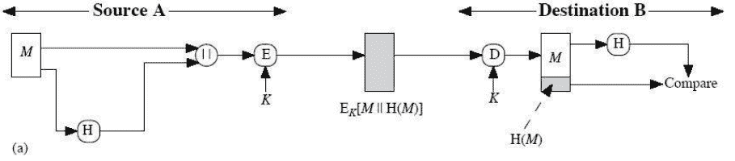

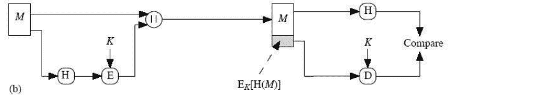

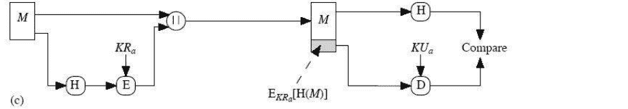

Figure 11.5 Basic Uses of Hash Function (page 1 of 2)

Figure 11.5 Basic Uses of Hash Function (page 2 of 2)

## 网络信息安全

## Chapter 13

### Digital Signature and Authentication Protocols

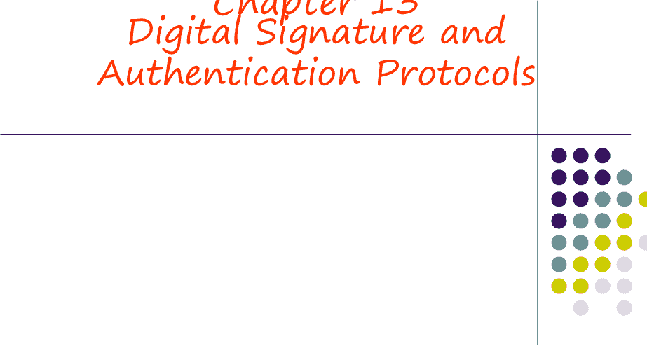

## 13.1 数字签名Digital Signature

- 数字签名的简单定义
- 数字签名是使以数字形式存储的明文信息经过特定密码变换生成密文，作为相应明文的签名，使明文信息的接收者能够验证信息确实来自合法用户，以及确认信息发送者身份。
- 对数字签名的基本要求
- 在收发双方不能完全信任的情况下，需要除认证之外的其他方法来解决假冒和否认的问题，数字签名则是解决办法；
- 签名接收者能容易地验证签字者对消息所做的数字签名，包括日期和时间；
- 任何人，包括签名接收者，都不能伪造签名者的签字；
- 发生争议时，可由第三方解决。

## 数字签名的基本形式

- **数字签名与消息认证的区别**
  - 消息认证是使消息接收方验证消息发送者发送的内容有无被修改过，对防止第三者破坏足够，但收发双方有利害冲突时就无法解决纷争，需要更严格的手段，即数字签名。
- **数字签名的基本形式**
  - 对消息签名的两种方法
    - 对消息整体的签字，将被签消息整体经过密码变换得到签字；
    - 对消息摘要的签字，附在被签消息之后，或嵌在某一特定位上作一段签字图样。
  - 两类数字签名
    - 确定性数字签名，明文与签名一一对应；
    - 概率性数字签名，一个明文可以有多个合法签名，每次都不一样。

## ElGamal的数据加密方法

- 假定A和B互相通信，共享大素数p，本原元素a，0<= m <= p-1, gcd(a, p) = 1，A和B各有自己的秘密xA和xB
- 加密
  - A选择k∈[0, p-1]，k的作用即为xA，A访问公共区域找到B的公开密钥Y<sub>B</sub> = α<sup>x<sub>B</sub></sup> mod p，计算：
    - K = (Y<sub>B</sub>)<sup>k</sup> mod p，即K = α<sup>x<sub>B</sub>k</sup> mod p
    - c<sub>1</sub> = α<sup>k</sup> mod p
    - c<sub>2</sub> = mK mod p
  - 密文即为 (c<sub>1</sub>, c<sub>2</sub>)
- 解密
  - B首先恢复K：K = c<sub>1</sub><sup>x<sub>B</sub></sup> mod p = α<sup>kx<sub>B</sub></sup> mod p
  - 然后恢复m：m = c<sub>2</sub>/K mod p = c<sub>2</sub>K<sup>-1</sup> mod p

## ElGamal的数字签名方法

若A为B签署m，0<= m <= p-1，
A随机选择k∈[0, p-1]，gcd(k, p-1) = 1
计算r = α^k mod p
计算α^m = Y_A^r s mod p，Y_A=α^x_A mod p
即α^m = α^x_A r α^k s mod p
则 m = (x_A r + ks) mod p-1
根据此式求s，则对于m的数字签名即为(r，s)，0≤r，s<p-1。

## ElGamal数字签名的验证

- 验证：给定 m，r，和 s，容易计算
  - α^m mod p = Y_A^r r^s mod p，看其是否一致，k不能重复使用。
  - （p287）
- 例：p = 17，α = 3，x_A = 2，x_B = 5，m = 11，k = 5，求签名及验证。

## 网络信息安全

## Chapter 14

## Authentication Applications


