# 大连理工网络安全课件（韩瑜）


请允许A同学和B同学访问软件学院教工周知

主动攻击（身份假冒）：用户是否是他声称的那个人。

解决方案？ · 用户身份认证系统

# 主动攻击（重放）：

延迟消息传输获得非授权效果

## 解决方案？

- 1. 时间戳
- 2. 随机数

## 主动攻击（否认）：实体的行为的可追溯性

## 解决方案？·数字签名

## 计算机安全概念

## 通俗定义：

是指 计算机 及其 网络系统资源 和 信息资源 不受自然和人为有害因素的威胁和危害，即是指计算机、网络系统的硬件、软件及其系统中的数据受到保护，不因偶然的或者恶意的原因而遭到破坏、更改、泄露。

## 学术定义：

通过各种计算机、网络、密码技术和信息安全技术，保护在公用通信网络中传输、交换、和存储的信息的保密性、完整性和可用性，并对信息的传播及内容有控制能力。

## 关键目标(CIA)

- ①保密性（Confidentiality）：数据保密性、隐私性
- ②完整性（Integrity）：数据完整性、系统完整性
- ③可用性（Availability）：真实性、可追溯性

## OSI安全框架

- **产生的原因：** 为了有效评价一个机构的安全需求，以及对安全产品和政策进行评估和选择，负责安全的管理员需要某种系统的方法来定义对安全的要求，并刻画满足这些要求的措施。
- **由ITU-T推荐的方案：** X.800，即OSI安全框架；
- OSI安全框架给出了满足上述要求的系统化的定义方法，作为国际标准被提出。计算机和电信销售商在他们的产品和服务上开发了其相关的安全特性。

## OSI安全框架：**安全攻击**

- **主动攻击：** 以各种方式有选择地破坏信息。如：**伪装**、**重放**、**消息修改**和**拒绝攻击**。
- **被动攻击：** 对传输内容进行窃听和监测。如：**信息内容泄露**和**流量分析**。

## OSI安全框架： 安全服务

- 在RFC2828中的定义： 一种由系统提供的对系统资源进行特殊保护的处理或通信服务； 安全服务通过安全机制来实现安全策略。
- ITU-T(X.800)已经定义出5种服务：  
  数据机密性； 数据完整性； 认证； 不可否认； 访问控制。

## 3. 认证

- 认证发送方和接收方的身份(对等实体身份认证);
- 认证信息的来源(数据源身份认证)。

## 4. 不可否认性

不可否认性(nonrepudiation)在于保护信息免于被信息发送方或接收方否认。在带有源证据的不可否认性中，如果信息的发送方否认，信息的接收方过后可以检验其身份；在带有交接证据的不可否认性中，信息的发送者过后可以检验发送给预定接收方的信息。

## 5. 访问控制

访问控制(access control)在于保护信息免于被未经授权的实体访问。在这里，访问的含义是非常宽泛的，包含对程序的读、写、修改和执行等。

## OSI安全框架: **安全机制**

## 1. 加密（encryption）

隐藏或覆盖信息以使其具有机密性。

传统加密方法：（1）对称加密（DES、AES）；（2）非对称加密（RSA、椭圆曲线）

## 2. 信息的完整性（data integrity）

信息的完整性机制附加于一个短的键值，该键值是信息本身创建的特殊程序。接收方接收信息和键值，再从接收的信息中创建一个新的键值，并把新创建的键值和原来的进行比较。如果两个键值相同，则说明信息的完整性被保全。

消息认证码MAC：hash函数、SHA

## 3. 数字签名（digital signature）

信息发送方可以对信息进行电子签名，信息接收方可以对签名进行电子检验。

ElGamal，Schnorr等数字签名方案

## 4. 身份认证交换（authentication exchange）

进行身份认证交换时，两个实体交换信息以相互证明身份。例如，一方实体可以证明他知道一个只有他才知道的秘密。

Kerberos认证过程、X.509

## 5. 流量填充（traffic padding）

流量填充是指在数据流中嵌入一些虚假信息，从而阻止对手企图使用流量分析。

Ipsec

## 6. 路由控制（routing control）

路由控制是指在发送方和接收方之间选择并不断改变有效路由，以避免对手在特定的路由上进行偷听。

## 7. 公证（notarization）

公证是指选择一个双方都依赖的第三方控制双方的通信，如此即可避免否认。为了避免发送方过后否认其曾经提过这样的请求，接收方可以牵涉第三方来保存发送方的请求。

PKI, X.509数字证书

## 8. 访问控制（access control）

访问控制就是用各种方法，证明某用户具有访问该信息或系统所拥有的资源的权利。

身份管理

## 网络安全模型1

## Trusted third party(e.g., arbiter, distributorof secret information)

| Principal | Message | Secret information | Security-relatedtransformation | Information Channel | Opponent |
|-----------|---------|-------------------|-------------------------------|---------------------|----------|
| Principal | Message | Secret information | Security-relatedtransformation |                     |          |

Figure 1.3 Model for Network Security

## 网络安全模型2

Opponent
—human (e.g., cracker)
—software
(e.g., virus, worm)

Access Channel

Gatekeeper
function

Information System
Computing resources
(processor, memory, I/O)
Data
Processes
Software
Internal security controls

Figure 1.4 Network Access Security Model

## 网络安全模型2

## 模型2说明：

- 设计目的：为了保护信息系统不受有害的访问。
- 有害访问是指：在计算机系统中加入程序，利用系统的弱点来响应应用程序和实用程序，如编辑程序和编译程序。
- 程序引起的威胁有2种：
  - 信息访问威胁；
  - 服务威胁
- 相应的安全机制分两类：
  - 门卫功能；
  - 内部安全检测


如果你能读懂这个消息你就是一个成功的密码破译者了可以给你考试加分

## 农户、鸡

农户对鸡说：

快吃吧，这是你最后一顿！

鸡躺倒并留遗书：

爷已吃老鼠药，你们别想吃爷了，爷也不是好惹的。

当对手知道了你的决定之后，就能做出对自己最有利的决定。

——纳什均衡理论

## 保密、信息安全很重要

## 教师

## 迟到者

知道：y, p, q  
不知道：x(姓名/学号)

秘密：x(姓名/学号)  
公开：y=g^x, p, q|p-1, g(g^q=1 mod p)

随机数r  
s = g^r mod p

随机数t  
p

v = r + tx mod q

验证g^v = s × y^t?

Schnorr零知识证明方案

> “要让三个人保住秘密，其中两个人必须死亡！”
> 
> ——本杰明·富兰克林

有人说，要宣扬某件事，最好把它称为秘密，悄悄地告诉更多人，传闻会自动传播开来！

## 零知识证明

## 跨下之辱、多多益善、明修栈道暗渡陈仓、四面楚歌、成也萧何，败也萧何

劉邦打下天下之後，害怕韓信造反，所以打算把他殺了。  
又怕他帶的士兵太多，所以問了一下韓信目前帶了多少兵？  
韓信感覺氣氛詭異，因此回答：  
兵不知數，三三數之剩二，五五數之剩三，七七數之剩二  
這個回答讓劉邦不知所措，連軍師張良一下子也算不出，  
想到一个数136, 0128（一百多万），不敢輕舉妄動。

韓信所帶的兵，人数可以少到23人，  
當然也可能是千萬人，  

通解為23+105t  105=[3，5，7]  **中國剩余定理（孫子定理）**

> 三人同行七十稀，  
> 五樹梅花廿一枝，  
> 七子團圓正半月，  
> 除百零五便得知。

$2\times70+3\times21+2\times15=23\mod105$

$=2\times35\times(35^{-1}\mod3)+3\times21\times(21^{-1}\mod5)+2\times15\times(15^{-1}\mod7)$

（明朝數學家：程大位，《算法統宗》。）

## 电视剧《暗算》语录

## 电视剧《暗算》关于破译密码的语录

说到底密码玩的是欺骗，是躲藏，是暗算。兵不厌诈，密码是兵器，是兵器中的暗器，是人间最大的狡诈。研制和破译密码的人都是撒旦。

研制密码的事业，就是一项接近疯子的事业。你越接近疯子，你越接近天才。

葬送于密码界的天才，是所有科学领域里概率最高的。密码是天才的屠宰场。

## 电视剧《暗算》关于破译密码的语录（续）

- 破译密码是听死人的心跳声。破译密码是男人生孩子、女人长胡子。破译密码是释读天书，看懂无字之书。

- 破译密码比用沙子搓一根绳子还难，比用空气铸一把利剑还难，比用火点燃水还难。正常情况下，这都是不可能的，我们就是要把这种不可能变成可能。

- 破译密码呢，就跟男女之间谈恋爱一样，不是说你谈多了就一定能谈成。关键是看你有没有感情，有没有缘份。

## 电视剧《暗算》关于破译密码的语录（续）

- 所有的密码都可以演变成一道或者几道超难的数学题。破译技术作为一门数学科学，尖锐而深邃的数学能力，跟良好的心理素质是一样必要又重要的。两者犹如一对飞翔的翅膀，缺一不可。

- 它需要你悟出世界上最高级的谜和最低级的谜。除了必要的知识、经验、技术之外，还需要远在星辰之外的好运气。

- 所有的密码，都是在没谱的情况下破译出来的。

## 电影评析：《达芬奇密码》

## 《蒙娜丽莎》

## The Da Vinci Code

- 13-3-2-21-1-1-8-5  
  ---仅仅指示随后的银行保险箱十位数账号，并未指导以下的换位密码！

- O, Draconian devils! （啊，严酷的魔王！）  
  ---馆长的姿势暗示了换位线索为达芬奇及其作品LeonardodaVinci！ （列昂纳多·达·芬奇！）

- Oh, lame saint! （噢，瘸腿的圣徒！）  
  ---馆长的姿势暗示了换位线索为达芬奇及其作品TheMonaLisa！ （蒙娜丽莎！）

- P.S. Trova Robert Langdon  
  SO DARK THE CON OF MAN [男人骗局如此阴暗]  
  这串文字解出来为[岩窟中的圣母]

In London lies a knight a Pope interred. (伦敦骑士身后为教宗所埋葬)  
His labor’s fruit a Holy wrath incurred. (一生功绩徒惹至尊座愤怒难当)  
You seek the orb that ought be on his tomb. (欲觅之球原应栖於英雄墓上)  
It speaks of Rosy flesh and seeded womb. (瑰红肌肤与受孕子宫细思量)

- 解出藏密筒的密码: Apple

## 两条主要线索

木桶原则：口令安全

X.509证书，RSA，DH，ECC…

## 安全认证

$ID_C \| E_{P_C} \| ID_C \| ID_V$

+   1. $C \rightarrow AS$: $ID_C \|\| P_C \|\| ID_V$
+   2. $AS \rightarrow C$: $Ticket$
+   3. $C \rightarrow V$: $ID_C \|\| Ticket$

$Ticket = E_{K_V}[ID_C \|\| AD_C \|\| ID_V]$

## 每个用户仅一次的登录会话：

+   (1) C → AS: \( ID_C \| ID_{tgs} \)

+   (2) AS → C: \( E_{K_c}[Ticket_{tgs}] \quad K_c = \text{Hash}(PSW_c) \)

## 每种服务类型仅一次：

+   (3) C → TGS: \( ID_C \| ID_V \| Ticket_{tgs} \)

+   (4) TGS → C: \( Ticket_v \)

## 每次服务会话仅一次：

+   (5) C → V: \( ID_C \| Ticket_v \)

\( Ticket_{tgs} = E_{K_{tgs}}[ID_C \| AD_C \| ID_{tgs} \| TS_1 \| Lifetime_1] \)

\( Ticket_v = E_{K_v}[ID_C \| AD_C \| ID_v \| TS_2 \| Lifetime_2] \)

## 表 14.1 Kerberos 版本 4 的消息交换

### (a) 服务认证交换：获得票据授权票据

(1) C → AS: `ID_C || ID_tgs || TS_1`

(2) AS → C: `E_{K_c}[K_{c,tgs} || ID_{tgs} || TS_2 || Lifetime_2 || Ticket_{tgs}]`

`Ticket_{tgs} = E_{K_{tgs}}[K_{c,tgs} || ID_C || AD_C || ID_{tgs} || TS_2 || Lifetime_2]`

### (b) 票据授权票据交换：获取服务授权票据

(3) C → TGS: `ID_v || Ticket_{tgs} || Authenticator_c`

(4) TGS → C: `E_{K_{c,tgs}}[K_{c,v} || ID_v || TS_4 || Ticket_v]`

`Ticket_{tgs} = E_{K_{tgs}}[K_{c,tgs} || ID_C || AD_C || ID_{tgs} || TS_2 || Lifetime_2]`

`Ticket_v = E_{K_v}[K_{c,v} || ID_C || AD_C || ID_v || TS_4 || Lifetime_4]`

`Authenticator_c = E_{K_{c,tgs}}[ID_C || AD_C || TS_3]`

### (c) 客户/服务确认交换：获取服务

(5) C → V: `Ticket_v || Authenticator_c`

(6) V → C: `E_{K_{c,v}}[TS_5 + 1]` （相互认证）

`Ticket_v = E_{K_v}[K_{c,v} || ID_C || AD_C || ID_v || TS_4 || Lifetime_4]`

`Authenticator_c = E_{K_{c,v}}[ID_C || AD_C || TS_5]`


1. 用户登录工作站并请求主机服务  
2. 认证服务器 AS 验证用户的访问权限，创建授权标识和会话密钥，使用从用户密码得到的密钥加密密钥  
3. 工作站提示用户输入密码并使用密码解密输入消息，然后发送票据以及包含用户名、网络地址和 TGS 时间的认证码  
4. TGS 解密票据和鉴别码，验证请求，然后为被请求的服务器生成票据  
5. 工作站发送票据授权服务和认证码给服务器  
6. 服务器验证票据，认证通过后授权服务访问，如果需要相互认证，则服务器返回认证码  

每个用户仅登录一次会话  

请求服务授权票据 票据 + 会话密钥  
请求服务授权票据 票据 + 会话密钥  
每实服务仅一次  
请求服务  
返回服务器认证码  

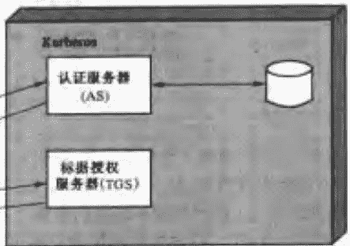  
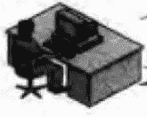  
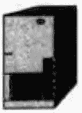  


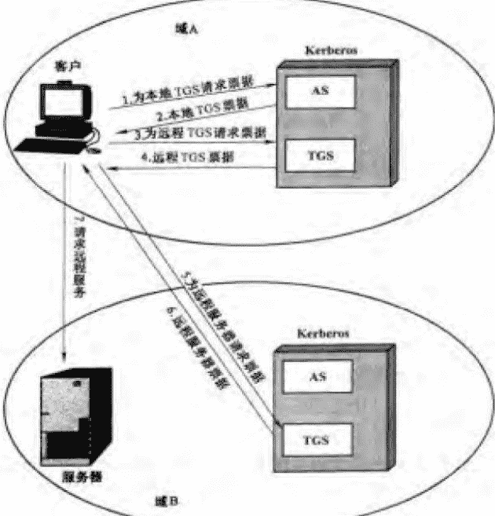  

(1) C → AS: IDc || IDtgs || TS1  
(2) AS → C: EKc [Kc,tgs || IDtgs || TS2 || Lifetime2 || Tickettgs]  
(3) C → TGS: IDtgsrem || Tickettgs || Authenticatorc  
(4) TGS → C: EKc,tgs [Kc,tgsrem || IDtgsrem || TS4 || Tickettgsrem]  
(5) C → TGSrem: IDtgsrem || Tickettgsrem || Authenticatorc  
(6) TGSrem → C: EKc,tgsrem [Kc,vrem || IDtgsrem || TS6 || Ticketvrem]  
(7) C → Vrem: Ticketvrem || Authenticatorc  


### （a）认证服务器交换：获取票据授权票据

(1) C → AS: Options ∥ ID_c ∥ Realm_c ∥ ID_TGS ∥ Times ∥ Nonce_1  

(2) AS → C: Realm_c ∥ ID_c ∥ Ticket_TGS ∥ E_Kc[ K_c,TGS ∥ Times ∥ Nonce_1 ∥ Realm_TGS ∥ ID_TGS ]  

Ticket_TGS = E_KTGS[ Flags ∥ K_c,TGS ∥ Realm_c ∥ ID_c ∥ AD_c ∥ Times ]  

### （b）服务授权票据交换：获取服务授权票据

(3) C → TGS: Options ∥ ID_v ∥ Times ∥ Nonce_2 ∥ Ticket_TGS ∥ Authenticator_c  

(4) TGS → C: Realm_c ∥ ID_c ∥ Ticket_v ∥ E_Kc,TGS[K_c,v ∥ Times ∥ Nonce_2 ∥ Realm_v ∥ ID_v]  

Ticket_v = E_Kv[ Flags ∥ K_c,v ∥ Realm_c ∥ ID_c ∥ AD_c ∥ Times ]  

Ticket_v = E_Kv[ Flags ∥ K_c,v ∥ Realm_c ∥ ID_c ∥ AD_c ∥ Times ]  

Authenticator_c = E_Kc,v[ ID_c ∥ Realm_c ∥ TS_1 ]  

### （c）客户/服务器认证交换：获取服务

(5) C → V: Options ∥ Ticket_v ∥ Authenticator_c  

(6) V → C: E_Kc,v[ TS_2 ∥ Subkey ∥ Seq# ]  

Ticket_v = E_Kv[ Flags ∥ K_c,v ∥ Realm_c ∥ ID_c ∥ AD_c ∥ Times ]  

Authenticator_c = E_Kc,v[ ID_c ∥ Realm_c ∥ TS_2 ∥ Subkey ∥ Seq# ]  


## 密码学

学：学科，应用数学，数学在信息保护中的应用  
码：编码，信息从一种形式到另一种形式的转变  
密：秘密，目的是使信息处于秘密的状态  


信息载体：奴隶的头，剃光，  
信息传递：长出头发的奴隶  

## 大约 4000 年以前，古埃及贵族

在书写墓碑上的铭文时，  
使用了变形的而不是普通的象形文字，  
揭开了有文字记载的密码史。  


公元前 1 世纪，著名的恺撒密码（古罗马统帅恺撒：约公元前 100～44）  
被用于高卢战争中，  
这是一种简单易行的单字母替代密码。  

$$e=\left(\begin{array}{c}ABCDEFGHIJKLMNOPQRSTUVWXYZ\\DEFGHIJKLMNOPQRSTUVWXYZABC\end{array}\right)$$  

$$c=E_e(m)=WKL VF LSKHU LVFHU WDLQO BQRWV HFXUH.$$  

$$m=THISCIPHERISCERTAINLYNOTSECURE$$  


公元前 5 世纪，古斯巴达人  
用一条带子缠绕在一根木棍上，  
沿木棍纵轴方向写好明文，  
解下来的带子上就只有杂乱无章的密文字符。  

解密者只需找到相同直径的木棍，  
再把带子缠上去，沿木棍纵轴方向即可读出有意义的明文。  

这种叫做“天书”的器械堪称人类历史上最早使用的密码器械。  

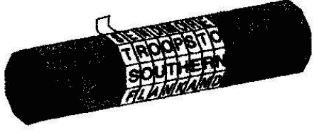  
## 密码学简史

16 世纪中期，意大利的卡尔达诺  
发明了卡尔达诺漏格板，  
覆盖在密文上，可从漏格中读出明文，  
这是较早的一种分置式密码。  

情书  

I   L   O   V   E   Y   O   U  
I   H   A   V   E   Y   O   U  
D   E   E   P   U   N   D   E   R  
M   Y   S   K   I   N   M   Y  
L   O   V   E   L   A   S   T   S  
F   O   R   E   V   E   R   I   N  
H   Y   P   E   R   S   P   A   C   E  

密钥  

追杀令：YOU KILL AT ONCE  

| I   | L   | O   | V   | E   | Y   | O   | U   |
|-----|-----|-----|-----|-----|-----|-----|-----|
| I   | H   | A   | V   | E   | Y   | O   | U   |
| D   | E   | E   | P   | U   | N   | D   | E   |
| M   | Y   | S   | K   | I   | N   | M   | Y   |
| L   | O   | V   | E   | L   | A   | S   | T   |
| F   | O   | R   | E   | V   | E   | R   | I   |
| H   | Y   | P   | E   | R   | S   | P   | A   |
| C   | E   |     |     |     |     |     |     |


16 世纪晚期，  
法国的维吉尼亚 Vigenere  
提出著名的维吉尼亚方阵密表、维吉尼亚密码，  
这是一种多表加密的替代密码，  
可使阿尔·金迪和菲利普斯的频度分析法失效。  

  


19 世纪，  
英国的巴贝奇、普鲁士的卡西斯基 Kasıski  
发展了更复杂的频度分析法，  
可破解维吉尼亚密码  

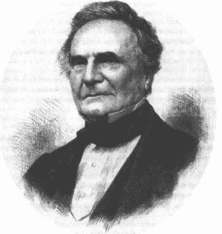  


1883 年，荷兰密码学家 A.Kerckhoffs 密码设计规则《军事密码学》：  

- ☝ 密码系统应该是计算安全的；  
- ☝ 密钥由通信双方事先约定好，并根据一定协议进行更换；  
- ☝ 密码系统应该易于使用； ☝ 密码系统应该精确而有效；  
- ☝ 除了密钥，密码系统的所有细节都为对手所知。  

Kerckhoffs 原则在今天看来仍然具有十分重要的现实意义。  


兵书《武经总要》

中国历史上第一部有关密码的记述

介绍了一个小型却名副其实的密码本。


刘邦打下天下之后，害怕韩信造反，所以打算把他杀了。又怕他带的士兵太多，所以问了一下韩信目前带了多少兵？

韩信感觉气氛诡异，因此回答：

兵不知数，三三数之剩二，五五数之剩三，七七数之剩二

这个回答让刘邦不知所措，连军师张良一下子也算不出，想到一个数136, 0128（一百多万），不敢轻举妄动。

韩信所带的兵，人数可以少到23人，当然也可能是千万人，通解为23+105t，105=[3, 5, 7] **中国剩余定理**

成也萧何，败也萧何。吕后用萧何诱杀韩信


一战前，密码研究还只限于一个小领域，没有得到各国应有的重视。

第一次世界大战是世界密码史上的第一个转折点。

随着战争的爆发，各国逐渐认识到密码在战争中发挥的巨大作用，积极给予大力扶持，使密码很快成为一个庞大的学科领域。

第一次世界大战进行到关键时刻，英国破译密码的专门机构“40号房间”利用缴获的德国密码本破译了著名的“齐默尔曼电报”，促使美国放弃中立参战，改变了战争进程。


| Plain | a | b | c | d | e | f | g | h | i | j | k | l | m | n | o | p | q | r | s | t | u | v | w | x | y | z |
|---|---|---|---|---|---|---|---|---|---|---|---|---|---|---|---|---|---|---|---|---|---|---|---|---|---|---|---|
| 1 | B | C | D | E | F | G | H | I | J | K | L | M | N | O | P | Q | R | S | T | U | V | W | X | Y | Z | A |
| 2 | C | D | E | F | G | H | I | J | K | L | M | N | O | P | Q | R | S | T | U | V | W | X | Y | Z | A | B |
| 3 | D | E | F | G | H | I | J | K | L | M | N | O | P | Q | R | S | T | U | V | W | X | Y | Z | A | B | C |
| ... | ... | ... | ... | ... | ... | ... | ... | ... | ... | ... | ... | ... | ... | ... | ... | ... | ... | ... | ... | ... | ... | ... | ... | ... | ... | ... | ... |
| 26 | Z | A | B | C | D | E | F | G | H | I | J | K | L | M | N | O | P | Q | R | S | T | U | V | W | X | Y | Z |
## 维吉尼亚方阵密码表

用关键词 WHITE 来加密 divert troops to east ridge

加密第一个字母 d，找出其对应的关键词中的字母是 W，在维吉尼亚方阵中找出以 W 开始的行是 22 行，找到 d 开始列和以 W 开始行的交界处，发现是字母 Z，因此明文中的字母 d 就被替换为密文中的 Z。

| 关键词 | W H I T E W H I T E W H I T E W H I T E W H I |
|---|---|
| 明文 | d i v e r t t r o o p s t o e a s t r i d g e |
| 密文 | Z P O X V P A Z H S L Z B H I W Z B K M Z N M |


转轮密码机ENIGMA，由Arthur Scherbius（阿图尔·舍尔比乌斯）于1919年发明，面板前有灯泡和插接板；4轮ENIGMA在1944年装备德国海军。它用3（最多为8）个正规轮和（至多为2）个反射轮（Griechenwalzen β，γ），这使得英国从1942年2月到12月都没能解读德国潜艇的信号。


1944年6月4日，德国U-505潜艇受到美海军特遣大队反潜深炸弹攻击，受伤浮起后，美军冲入无线电室，缴获了密码机和大量明、密报，并秘密将U-505潜艇拖回美国。德军误认为U-505潜艇沉没海底而未换密码。

在欧战结束前的11个月里，依靠破译的密码，美军和同盟国军队共击沉德国潜艇300多艘，平均每天一艘，同时大大减少了自己船只的损失，对战争的胜利产生了重大影响。


✔美军成功地破译了日本的通讯密码，从而导致日本在中途岛海战中失利，既报了珍珠港的一箭之仇，又使太平洋战场的局面得到彻底扭转。

✔二战期间，美军破译日本海军密码多达75种，由于密码被破译，日本总吨数约三之二的商船被美国潜艇击沉，给日本军队带来了严重的战争后果。


“山本五十六于1943年4月13日下午5时55分到所罗门岛视察”的日程

用称为“紫密”的日本“九七式”密码机加密，播给第一基地部队等。

美军截获，通过破译JN25密码的专用IBM设备破译出。

尼米兹上将经研究决定出击：

4月13日7时25分出动18架战斗机将山本座机击落

偷袭珍珠港的元凶日本舰队总司令山本五十六死亡

5月21日日本才广播这一消息。


✓二战结束后，一位深知战时密码破译价值的美国官员说，密码破译使第二次世界大战缩短了几年。这种说法虽有些夸张，但重要情报的破译确实影响了战争的进程，挽救了成千上万的生命。

✓第二次世界大战促进了密码的飞速发展。由于密码对于战争的胜负具有越来越重要的影响，各国不惜花大量的人力物力进行密码的研究和破译。密码的编制结构更加科学，编制方法愈加复杂，各种密码的保密性出现了飞跃性的提高。在此期间，许多国家开始使用密码机进行加密，密码告别人工加密，走向机械加密的开始。


✓ 1948年以前的密码技术可以说是一种艺术，而不是一种科学，那时的密码专家是凭直觉和信念来进行密码设计和分析的，而不是靠推理证明。

✓ 1948年，C. E. Shannon(1916-2002)在贝尔系统技术杂志上发表论文《通信的数学理论》，创立了著名的新理论——信息论，标志着密码术到密码学的转变。


- Claude Shannon was born on April 30, 1916 in the town of Gaylord, Michigan.
- By the 1980's, Shannon began having problems with his memory and he was later diagnosed with Alzheimer's disease.
- In his final years he was “good-natured as usual” and enjoyed daily visits with his wife, Betsy. Even as his body failed and he passed away in February

- A Mathematical Theory of Communication
  Bell Syst. Tech. J., 27:379–423, 1948

- Communication Theory
  Bell Syst. Tech. J., 28:656–715, 1949


为了表彰Shannon的伟大功绩，2000年10月6日IEEE Information Society 的25名成员在Shannon的儿童时代的老家Michigan的Gaylord举行了Shannon塑像的落成典礼。塑像底座正面刻文如下：

Claude Elwood Shannon

Father of Information Theory

Electrical engineer,Mathematician,and native son of Gaylord. His creation of information theory, the mathematical theory of communication, in the 1940s and 1950s inspired the revolutionary advances in digital communications and information storage that have shaped the modern world.


This statue was donated by the Information Theory Society of the Institute of Electrical and Electronics Engineers, whose members follow gratefully in his footsteps.
Dedicated October 6, 2000
Eugene Daub, Sculptor

“在我看来，两三百年之后，当人们回过头来看我们的时候，他们可能不会记得谁曾是美国的总统。他们也不会记得谁曾是影星或摇滚歌星。但是仍然会知晓Shannon的名字。学校里仍然会教授信息论。” （Dr. Richard Blahut, Oct. 6, 2000, Gaylord, Michigan）


20世纪70年代中期，密码学界发生了两件跨时代的大事：

- 1、Diffie和Hellman发表的题为“密码学新方向”文章，提出了“公钥密码”新体制，冲破了传统“单钥密码”体制的束缚。

传统密码体制主要功能是信息的保密，双钥（公钥）密码体制不但赋予了通信的保密性，而且还提供了消息的认证性，新的双钥密码体制无需事先交换秘密钥匙，可通过不安全信道安全地传递信息，大大简化了密钥分配的工作量。双钥密码体制适应了通信网的需要，为保密学技术应用于商业领域开辟了广阔的天地。

- 2、美国国家标准局NBS于1977年公布实施美国数据加密标准DES，保密学史上第一次公开加密算法，并广泛应用于商用数据加密。

这两件引人注意的大事揭开了保密学的神秘面纱，标志着保密学的理论与技术的划时代的革命性变革，为保密学的研究真正走向社会化作出了巨大贡献，同时也为保密学开辟了广泛的应用前景。从此，掀起了现代密码学研究的高潮。


- ✓自从人类有了战争，就有了密码。
- ✓自古以来，通信安全保密在国家的军事和安全部门一直受到十分广泛的关注。
- ✓从原始的手工作业到采用机械设备、电器机械设备，进而发展到今天的以使用电子计算机及微电子技术为标志的电子时代。


✓历史上的战争，特别是两次世界大战，对于保密学的理论与技术的发展起了巨大的推动作用。

✓在通信安全、保密、密码分析上的优势，被认为是赢得历史上许多主要军事冲突（包括二次世界大战）胜利的关键因素之一。

- ✓ 我们正在步入一个崭新的信息社会，信息在社会中的地位和作用越来越重要。
- 信息就是生命 “9.11”
- 信息就是时间 “137670348315732568089372384837 mod 13”
- 信息就是财富 “炒股”
- ✓ 每个人的生活都与信息的产生、存储、处理和传递密切相关
- “谁掌握了信息，控制了网络，谁就将拥有整个世界！”
- ✓ 信息的安全与保密问题成了人人都关心的事情，使密码学脱去神秘的面纱，成为大家感兴趣并为更多人服务的科学。

- ✓信息空间中的侦察与反侦察、截获和反截获、破译和反破译、破坏和反破坏的斗争愈演愈烈：
- ✓军事上的电子对抗：1991年初海湾战争——空前大规模的电子战

信息空间中的信息大战正在悄悄而积极地酝酿中，小规模的信息战一直在不断地出现、发展和扩大。信息战是信息化社会发展的必然产物。

- ✓商业上的情报战 随着Internet、Intranet、Extranet，特别是电子商务的发展而步入了新的阶段。近年来，在网络上所进行的各种犯罪活动出现了逐年上升的趋势，由此所造成的经济损失是十分巨大的。

- ✓全球计算机病毒已达8万多种，每天要产生5-10种新病毒。
- ✓曾肆虐全球、具有里程碑意义的红色代码和尼姆达病毒，改写了病毒的形态和病毒的传播历史，步入了混合型病毒时代。
- ✓1999年4月26日，受CIH病毒的侵害，我国有36万多台计算机受到破坏，经济损失达12亿元。
- ✓2003年1月24-26日轰动世界的Slammer病毒，利用SQL漏洞发起攻击数小时后已使南韩网络不堪重负，亚洲、北美的Web网站和Internet业务提供商不能正常工作，星期六使美国最大的自动柜员机(ATM)网络中断，直到午后很久，所有的13000台ATM都不能使用。

- ✓ 2003年下半年出现“冲击波”病毒，受感染的主机超过40万台，并曾一度使加拿大航空系统瘫痪。
- ✓ Slammer病毒和“冲击波”病毒都是攻击型混合病毒。


✓进入信息时代，信息安全保密已经进入任何一个国家的国家安全议程。 ——————美国前副总统戈尔

✓美国最近20年，特别是9.11事件后，信息安全政策有了非常大的变化：从提出“计算机安全”到提出“信息保障”；从讲“适度安全”到讲“完善安全”；从讲“互联的程度”到“与因特网隔离”的过程。

✓9.11事件是“永远改变美国如何看待其全球角色和怎样思考安全问题方式的变革性事件”   ——布什总统国家安全顾问莱斯国务卿


- ✓ 在信息战场上能否控制和取胜，是赢得政治、外交、军事和经济斗争胜利的先决条件。
- ✓ 因此，信息系统的安全保密问题已成为影响社会稳定和国家安危的战略性问题。


大量信息用数据形式**存放**在计算机系统里，信息的**传输**则通过公共信道。这些计算机系统和公共信道是**不设防**的，是很脆弱的，容易受到**攻击**和**破坏**。信息的丢失**不容易被发现**，而后果是极其严重的。

- Internet一方面成为人们离不开的**信息工具**，同时它也成为公开的**攻击对象**目标。
- Internet的**全球性、开放性、无缝连通性、共享性、动态性发展**，任何人都可以**自由接入**Internet。
- **恶意**会采用各种攻击手段进行破坏活动：
  - 全天在试图**穿透别人的系统、窃取重要情报**、
  - **拷毁别人的信箱、倾泻信息垃圾**、
  - **散布破坏性信息、施放病毒**、
  - **进行网络欺诈、发动黑客战**等。
- 给国家、单位和个人的**信息安全**带来极大的**威胁**。

安全威胁：是指某个人、物体、事件或概念对某一资源的保密性、完整性、可用性或合法使用所造成的危险。某种攻击就是某种威胁的具体实现。

- 故意的（如黑客渗透）和被动威胁：只对信息进行监听（如搭线窃听），而不对其进行修改。主动威胁：对信息进行故意的修改（如改动某金融会话过程中货币的数量）

被动攻击比主动攻击更容易以更少的花费付诸工程实现

- 偶然的（如信息被发往错误的地址）。


| 威胁 | 描述 |
|---|---|
| 授权侵犯 * | 一个被授权使用系统用于一特定目的的人，却将此系统用作其它非授权的目的 |
| 旁路控制 | 攻击者发现系统的安全缺陷或安全脆弱性 |
| 业务拒绝 * | 对信息或其它资源的合法访问被无条件地拒绝 |
| 窃听 | 信息从被监视的通信过程中泄露出去 |
| 电磁/射频截获 | 信息从电子或机电设备所发出的无线频率或其它电磁场辐射中被提取出来 |
| 非法使用 | 资源被某个非授权的人或者以非授权的方式使用 |
| 人员不慎 | 一个授权的人为了钱或利益，或由于粗心，将信息泄露给一个非授权的人 |
| 信息泄露 | 信息被泄露或暴露给某个非授权的人或实体 |
| 完整性侵犯 * | 数据的一致性通过对数据进行非授权的增生、修改或破坏而受到损害 |
| 篡改/修改 * | 某一通信数据在传输的过程中被改变、删除或替代 |
| 假冒 * | 一个实体（人或系统）假装成另一个不同的实体 |
| 媒体废弃 | 信息被从废弃的磁的或打印过的媒体中获得 |

| 威胁类型 | 定义 |
|---|---|
| 物理侵入 | 一个侵入者通过绕过物理控制而获得对系统的访问 |
| 重放* | 所截获的某次合法通信数据拷贝，出于非法的目的而被重新发送 |
| 业务否认* | 参与某次通信交换的一方，事后错误地否认曾经发生过此次交换 |
| 资源耗尽 | 某一资源（如访问接口）被故意超负荷地使用，导致对其它用户的服务被中断 |
| 业务欺骗 | 某一伪系统或系统部件欺骗合法的用户或系统自愿地放弃敏感信息 |
| 窃取 | 某一安全枚关的物品，如令牌或身份卡被偷盗 |
| 业务流分析* | 通过对通信业务流模式进行观察，而造成信息泄露给非授权的实体 |
| 陷阱门 | 将某一“特征”设立于某个系统或系统部件中，使得在提供特定的输入数据时，允许安全策略被违反 |
| 特洛伊木马 | 含有一个察觉不出或无害程序段的软件，当它被运行时，会损害用户的安全 |


**(1) 信息泄露：** 信息被泄露或透露给某个非授权的人或实体。  
窃听、搭线，或其它更加错综复杂的信息探测攻击

**(2) 完整性破坏：** 数据的一致性通过非授权的增删、修改或破坏而受到损坏。

**(3) 业务拒绝：** 对信息或其它资源的合法访问被无条件地阻止。  
攻击者通过对系统进行非法的、根本无法成功的访问尝试而产生过量的负荷，从而导致系统的资源在合法用户看来是不可使用的。系统在物理上或逻辑上受到破坏而中断业务。

**(4) 非法使用：** 某一资源被某个非授权的人，或以某一非授权的方式使用。侵入某个计算机系统的攻击者会利用此系统作为盗用电信业务的基点，或者作为侵入其它系统的出发点。


- 1. **认证业务**：提供某个实体（人或系统）的身份的保证。
- 2. **访问控制业务**：保护资源以防止对它的非法使用和操纵。
- 3. **保密业务**：保护信息不被泄露或暴露给非授权的实体。
- 4. **数据完整性业务**：保护数据以防止未经授权的增删、修改或替代。
- 5. **不可否认业务**：防止参与某次通信交换的一方事后否认本次交换曾经发生过。

| 安全业务 | 非安全业务 |
|---|---|
| 认证 | 带照片的身份证、知道母亲的乳名、持有由安全机关颁发的身份证等 |
| 访问控制 | 锁与钥匙、主密钥系统、检查站的卫兵等 |
| 保密 | 密封的信件、不透明的信封、看不到的墨迹等 |
| 完整性 | 不能擦掉的墨水、信用卡上的全息照相 |
| 不可否认 | 公证签名、经过核实或登记的邮件 |


| 安全威胁 | 安全业务 |
|---|---|
| 假冒攻击 | 认证业务 |
| 授权侵犯 | 访问控制业务 |
| 窃听攻击 | 保密业务 |
| 完整性侵犯 | 完整性业务 |
| 业务否认 | 不可否认业务 |
| 业务拒绝 | 认证业务，访问控制业务，完整性业务 |


- 加密(Encryption)
- 数字签名(Digital signature)
- 访问控制(Access control)
- 数据完整性技术(Data integrity)
- 认证交换(Authentication exchange)
- 数据流填充(Traffic padding)
- 路由控制(Routing control)
- 防否认技术(Notarization)


| 机制 | 服务 | 认证鉴别 | 保密性 | 完整性 | 不可否认 |
|---|---|---|---|---|---|
| | | 对等实体 | 数据源 | 存取控制 | 有连接 | 无连接 | 选择字段 | 数据流 | 可恢复连接 | 无连接连接 | 选择字段连接 | 无连接连接 | 选择字段不连接 | 来源不可否认 | 交付不可否认 |
| 加密 | Y | Y | . | Y | Y | Y | Y | Y | Y | Y | Y | Y | Y | . | . |
| 数字签名 | Y | Y | . | . | . | . | . | . | . | . | Y | Y | Y | Y | |
| 访问控制 | . | . | Y | . | . | . | . | . | . | . | . | . | . | . | |
| 数据完整性 | . | . | . | . | . | . | . | . | Y | Y | Y | Y | Y | Y | |
| 认证交换 | Y | . | . | . | . | . | . | . | . | . | . | . | . | . | |
| 数据流填充 | . | . | . | . | . | . | Y | . | . | . | . | . | . | . | |
| 路由控制 | . | . | . | Y | Y | Y | . | . | . | . | . | . | . | . | |
| 制止否认 | . | . | . | . | . | . | . | . | . | . | . | Y | Y | | |

密码技术不仅可以保证信息的机密性，而且可以保证信息的完整性，防止信息被篡改、伪造和假冒。


- ✓ 密码学 Cryptology：研究信息系统安全保密的科学涵盖密码编码/设计+密码分析。

- ✓ 密码编码学 Cryptography：用各种不同的加密算法对信息进行加密，实现隐蔽信息的目的，以保证其安全性。

- ✓ 密码分析学 Cryptanalysis：相对密码编码而言，研究分析破译密码、从密文推演出明文、密钥或解密算法的学问，包含有密码攻击、发现漏洞、系统安全性证明等内容。

密码编码和密码分析两者相互对立，有互相促进地向前发展。采用密码方法可以隐蔽和保护需要保密的消息，使未受权者不能提取信息。


- - **代码 Code**：利用某个字典，将英语中的词或短语变换为另一种词或短语，从而达到**隐藏**信息内容的目的。
- - **编码 Encode**：非隐藏目的的变换，只是为**方便随后的处理**而已。
- - **密码 Cipher**：把消息当作字符流进行变换，而不参照其任何含义


明文（Plaintext）：被隐蔽消息。

密文（ciphertext）：密码将明文变换成的另一种隐蔽的形式。

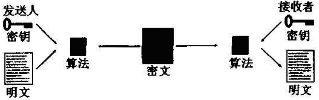


加密（Encryption）：将明文变换成另一种隐蔽的形式的变换过程。

解密（Decryption）：加密逆过程，由密文恢复出原明文的过程。

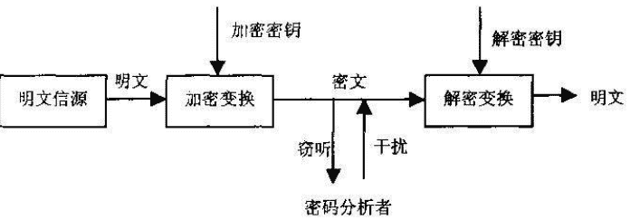


- ✓ **加密密钥（Encryption Key）**：加密算法的操作通常都是在一组密钥（Key）控制下进行的，称作~。
- ✓ **解密密钥（Decryption key）**：解密算法的操作通常都是在一组密钥（Key）控制下进行的，称作~。

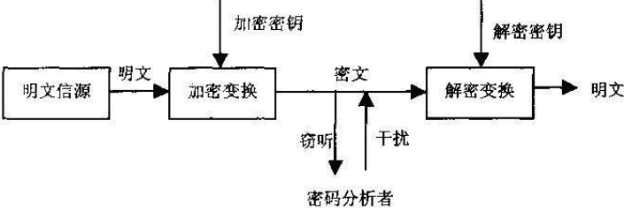


- - **密码分析（Cryptanalysis）**：截收者虽然不知道系统所用的密钥，但通过分析可能从截获的密文中推断出原来的明文或密钥，这一过程称作密码分析。
- - **密码分析员（Cryptanalyst）**：从事密码分析工作的人称作密码分析员。

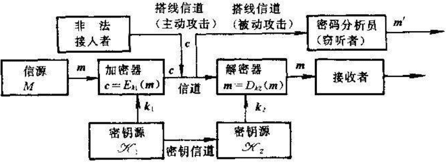


✓ 接收者（Receiver）：传送消息的预定对象，称作~。

✓ 截收者（Eavesdropper）：在信息传输和处理系统中，除了意定的接收者外，还有非受权者，他们通过各种办法（如搭线窃听、电磁窃听、声音窃听等）来窃取机密信息，称其为~。

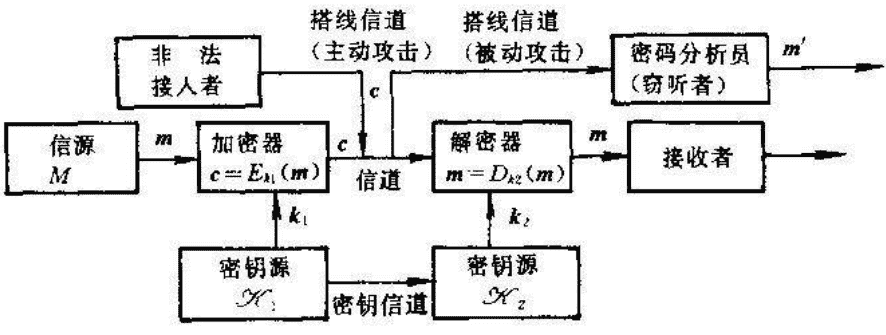


✓ 被动攻击(Passive Attack)：对一个保密系统采取**截获密文**进行分析的攻击称作~。

✓ 主动攻击(Active Attack)：非法入侵者(Tamper)、攻击者(Attacker)或黑客(Hacker)主动向系统窜扰，采用**删除、增添、重放、伪造**等**篡改手段**向系统注入假消息、达到利己害人的目的。

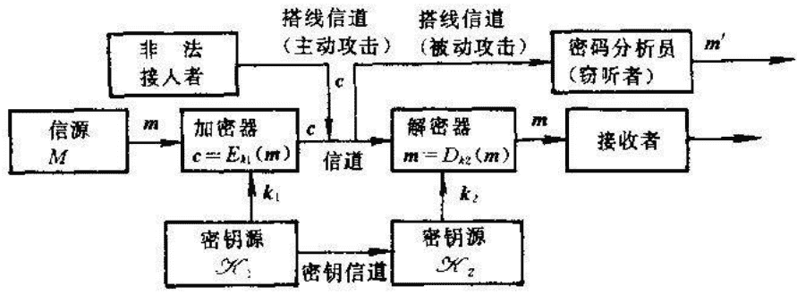


- 传统密码体制 (Conventional Cryptosystem)
- 单钥密码体制 (One-key Cryptosystem)
- 对称密码体制 (Symmetric Cryptosystem)

所用的加密密钥和解密密钥相同，或实质上等同，即从一个易于得出另一个。

- 公钥密码体制 (Public-key Cryptosystem)
- 双钥密码体制 (Two-key Cryptosystem)
- 非对称密码体制 (Asymmetric Cryptosystem)

加密密钥和解密密钥不相同，从一个难以推出另一个。

双钥体制/公钥体制(Public key system) (Diffie和Hellman,1976)，每个用户都有一对选定的密钥(公钥k₁；私钥k₂)，公开的密钥k₁可以像电话号码一样进行注册公布。

**主要特点：** 加密和解密能力分开。

**可以实现：**

- 多个用户加密的消息只能由一个用户解读，用于公共网络中实现**保密**通信。
- 只能由一个用户加密消息而使多个用户可以解读，可用于认证系统中对消息进行数字**签字**。
- 无需事先分配密钥。

## 密码体制分类（小结）

历史出现顺序：传统密码体制 — 公钥密码体制

使用密钥数量：单钥密码体制 — 双钥密码体制

（明文加密单位）

流密码 — 分组密码

密钥使用形式：对称密码体制 — 非对称密码体制

不严格的分类：古典密码 — 现代密码

## 古典密码学

- **古典密码学**：计算机出现以前已得到应用、已发明的密码学理论（20世纪40年代之前，特别是1935—1940年期间）的密码编码和密码分析技术。
- **古典**：相对于现代密码系统来说不是很好的系统（用现在的标准衡量）。
- **现代密码算法**：远比以前的复杂，主要是为了防止一些以前看来是不可思议的攻击。

## 密码学应用例子

## 协议 14.2 SRA 智力扑克游戏的一个公平发牌协议

假定：

Alice 和 Bob 商定了一个具有式(14.3.1)中性质的交换密码，并且每人选定了各自的秘密加密密钥；他们还商定了一副有三张牌 _M_<sub>1</sub>, _M_<sub>2</sub>, _M_<sub>3</sub> 的扑克。

目标：

他们得到人手一张的公平发牌，满足公平性质(i) ~ (iv)。

1. Alice 将三张牌加密为 _C<sub>i</sub>_ = _E<sub>A</sub>_(_M<sub>i</sub>_), _i_ = 1,2,3；以随机的顺序将它们发给 Bob；(* 以随机的顺序将牌发送给 Bob 等于洗牌 *)
2. Bob 随机选一条密文，记为 _C_，将 _C_ 加密为 _CC_ = _E<sub>B</sub>_(_C_)；再随机选另一密文，记为 _C'_；将 _CC_ 和 _C'_ 发送给 Alice；(* _CC_ 确定了 Bob 手中的牌；_C'_ 确定了 Alice 手中的牌；另一张牌丢弃 *)
3. Alice 解密 _CC_ 和 _C'_；_C'_ 解密后是她手中的牌；_CC_ 的解密，记为 _C''_，返回给 Bob；
4. Bob 解密 _C''_，从而得到他手中的牌。(* 现在他们可以玩智力扑克游戏了 *)

## 第二讲 古典密码学

- 概念和意义
- 内容及分类
- 单表代换密码
- 多表代换密码
- 置换密码

## 概念和意义

## 古典密码学

古典：相对于现代密码系统来说不是很好的系统，用现在的标准衡量，古典密码看来是很失败的。

现代密码算法：远比以前的复杂，防止攻击。

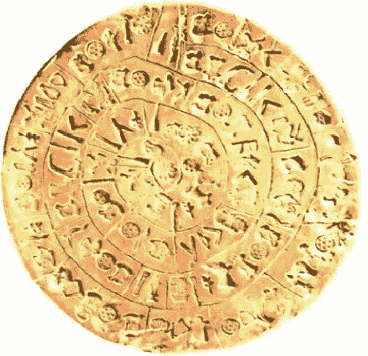

> Phaistos圆盘，直径约160mm的Creran-Minoan粘土圆盘，始于公元前17世纪。表面有明显字间空格的字母，至今还没有破解。J.Friedrichs：“如果没有进一步的线索，短的报文段不会提示其含义。”

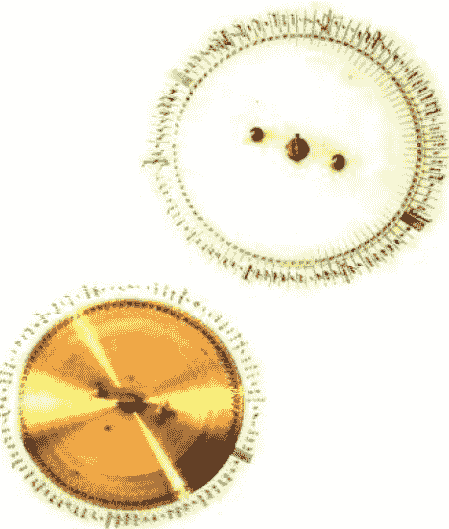

双密码盘，估计始于18或19世纪。外圆圆盘上有类似词汇表的明文，明文中有字母、元音字母和常用单词。密文是由两位的十进制数组成的。

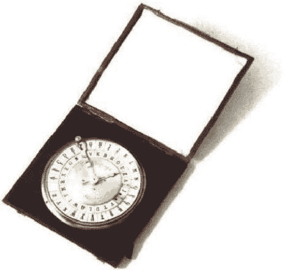

惠斯通(Wheatstone)“密码”，一种钟表形式的设备，首次露面是在1867年巴黎世纪展览会上。这是一个单表加密密码设备。顺时针旋转的指针每次指向下一个明文字母，圆盘也随着混合的密文字母旋转。

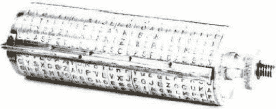

美国陆军圆柱形密码设备M-94，共有25个直径为35mm的铝盘，外缘上刻有字母。它的设计思想可追溯到Jefferson(杰斐逊)和Bazeries(巴泽里埃斯)于1922年在W.Friedman(威廉·弗里德曼)的建议下投入使用，主要针对低级的军事通信，1924年以前被广泛使用。

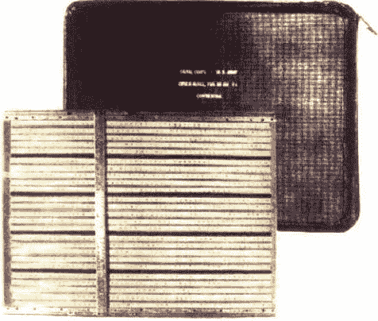

二战中美国陆军和海军使用的条形密码设备M-138-T4，根据1914年Parker Hill的提议而设计。25个可选的纸条按预先编排的顺序编号、使用，加密强度相当于M-94。

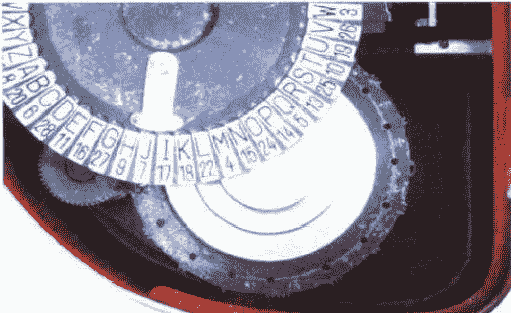

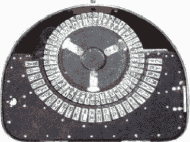

Kryha密码机大约在1926年由Alexander von Kryha发明。这是一个多表加密设备，密钥长度为442，周期固定。一个有数量不等的齿的轮子引导密文轮不规则地运动。尽管它有弱点，但这台乘法密码机在许多国家很抢手。

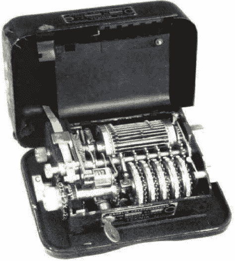

哈格林(Hagelin)密码机C-36，由Aktiebolager Cryptoteknid Stocholm于1936年制造。通过BEAUFORT(博福特)加密步骤完成自反加密，始哈格林的一个发明。密钥的不同长度，即17、19、21、23、25个齿，导致产生不规则运动，密钥周期的长度为3900225。对于纯机械的密码机来说，这已是非常不简单了。

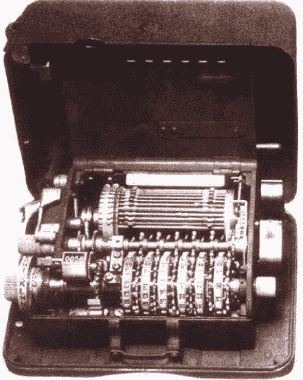

M-209是哈格林对C-36改进后的产品，根据哈格林的许可，由Smith-Corona负责为美国陆军生产。它增加了一个有26个齿的密钥轮，从而使密钥周期达到了101 405 950。手柄转动时，字母轮带动拨针和凸片，使鼓状筒上的横杆移位；这些横杆的作用像齿轮上的齿那样，使轮子转动，将密文字母大引导把手后面的卷纸上。

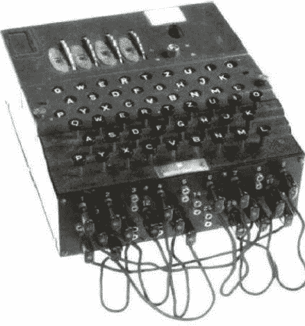

转轮密码机ENNIGMA，由Arthur Scherbius(阿图尔.舍尔比乌斯)于1919年发明。面板前有灯泡和插接板：4轮ENIGMA在1942年装备德国海军。它用3(最多为8)个正规轮和1(至多为2)个反射轮(Griechenulzen β,γ)，这使得英国从1942年2月到12月都没能解读德国潜艇的信号。

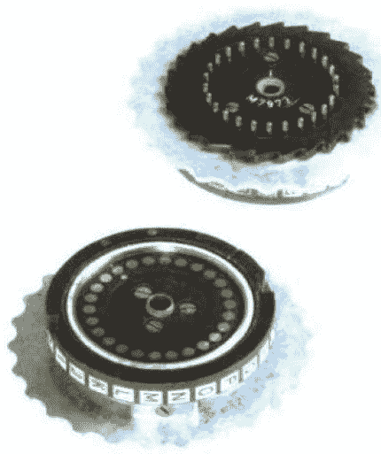

**ENIGMA转轮：**内部线路有26个电路连接。

上图：1轮，可以看见设置轮。

下图：细轮，由两个缺口。

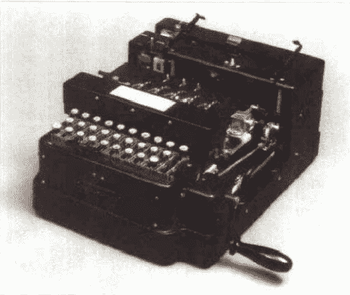

英国的TYPEX打字密码机，是德国ENIGMA的改进型密码机，它增加了两个轮（操作中不动），使得破译更加困难。它在英国通信中使用广泛，且在破译密钥后帮助破解德国信号。面板上显示TYPEX为III型，序列号为NO.376。

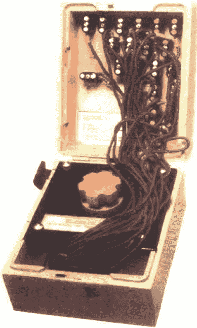

Uhr盒用来替换德国防军ENIGMA机插接板的机器，用非互反代替。可以选择40个不同位置转动把手，轻易改变代替。尽管安全性有所增强，但没有广泛应用。


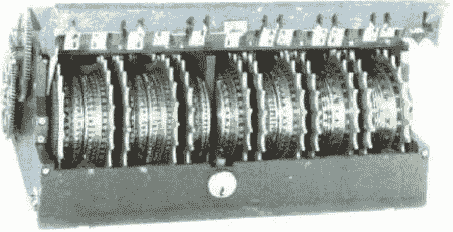

在线密码电传机Lorenz SZ42，大约在1943年由Lorenz A.G制造。一种用于Baudot信号的密码机，英国人称为"tunny"，用于战略级陆军司令部。12个密钥轮有不同的齿，（从左到右）是43、47、51、53、59、37、61、41、31、29、26、23。这些密钥轮和不规则间距的齿产生较大的密钥周期。五对轮子控制5比特代码的五个Vernam代换，另两个轮仅用于控制不规则运动。SZ 40/SZ 42加密因为德国人的加密错误而被英国人破译，此后英国人一直使用电子COLOSSUS机器解密德国信号。

起源于俄罗斯的一次性乱数本，差不多只有手掌那么大小，数字的排列具有俄罗斯特色。

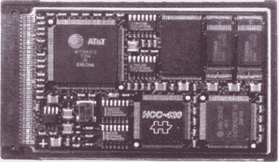

密码板，1996年由Crypto AG, Zug（瑞士）制造，用于独立式或网络计算机，提供访问保护、信息保密、信息完整性和病毒保护功能。这个高度可靠的硬件具有很长的平均无故障时间，可以在断电时存储。

## 内容及分类

## 经典密码

- 代换密码
  - 单字母代换
  - 单码代换
  - 流密码
  - 多字母代换
  - 多码代换
  - 分组密码
- 置换密码

- 单表代换
- 多表代换

- 棋盘密码
- 移位代换密码
- 乘数/采样密码
- 仿射密码
- 多项式代换密码
- 密钥短语密码

- 非周期多表代换密码
- 一次一密密码
- 周期多表代换密码

- 滚动密钥密码
- 弗纳姆密码
- 维吉尼亚密码
- 博福特密码
- 转轮密码

- Playfair密码
- 希尔(Hill)密码（矩阵变换密码）

置换矩阵

栅栏法

## 古典密码

## 代换密码

## 置换密码

## 代换密码 (Substitution Cipher)

本质：以一个元素代换另一个元素

元素中包含单个字符：单字母代换密码、单码代换密码、流密码
（以单个字母作为代换的对象）

元素中包含多个字符：多字母代换密码、多码代换密码、分组密码
（以多个字母作为代换的对象）

区别：一次代换处理的字符数目

## 经典密码

代换密码

置换密码

- 单字母代换
- 单码代换
- 流密码

- 多字母代换
- 多码代换
- 分组密码

## 代换密码(Substitution Cipher)

## 单字母代换：以一个字母代换另一个字母

使用一个固定的代换：单表代换密码

使用一个以上的代换：多表代换密码

区别：使用代换的数目

## 古典密码

- 代换密码
- 置换密码

- 单字母代换
- 单码代换
- 流密码
- 多字母代换
- 多码代换
- 分组密码

- 单表代换
- 多表代换

## 代换密码(Substitution Cipher)

## 单表代换：对所有明文字母都使用一个固定的代换

f: \( Z_q \rightarrow Z_q \)

明文 \( m = m_0m_1 \cdots \)

密文 \( c = E_k(m) = c_0c_1 \cdots = f(m_0)f(m_1) \cdots \)

1. 棋盘密码
2. 移位代换密码： 凯撒密码
3. 乘数/采样密码
4. 仿射密码
5. 多项式代换密码
6. 密钥短语密码

## 代换密码 (Substitution Cipher)

## 单表代换 — 棋盘密码

公元前两世纪  希腊人

26 个字母排列在 5×5 的方格里

每个字母对应一数（行和列）填在同一格

|   | 1 | 2 | 3 | 4 | 5 |
|---|---|---|---|---|---|
| 1 | a | b | c | d | e |
| 2 | f | g | h | i/j | k |
| 3 | l | m | n | o | p |
| 4 | q | r | s | t | u |
| 5 | v | w | x | y | z |

明文
secure message transmission is of extreme importance in information based society

密文

|   |   |   |   |   |   |   |   |   |   |
|---|---|---|---|---|---|---|---|---|---|
| 43 | 15 | 13 | 45 | 42 | 15 | 32 | 15 | 43 | 43 |
| 11 | 22 | 15 | 44 | 42 | 11 | 33 | 43 | 32 | 24 |
| 43 | 43 | 24 | 34 | 33 | 24 | 43 | 34 | 21 | 15 |
| 53 | 44 | 42 | 15 | 32 | 15 | 24 | 32 | 35 | 34 |
| 42 | 44 | 11 | 33 | 13 | 15 | 24 | 33 | 24 | 33 |
| 21 | 34 | 42 | 32 | 11 | 44 | 24 | 34 | 33 | 12 |
| 11 | 43 | 15 | 14 | 43 | 34 | 13 | 24 | 15 | 44 |

## 代换密码 (Substitution Cipher)

## 单表代换——乘数密码 (Multiplicative Cipher)

$E_k(i)=ik\equiv j\pmod q,\quad 0\le j<q$

$D(j)=E_{k^{-1}}(j)=jk^{-1}\equiv i\pmod q$

## 采样密码 (Decimation Cipher)

$q=26,\quad k=9$

明文密文字母对应表

| 明文 | a | b | c | d | e | f | g | h | i | j | k | l | m | n | o | p | q | r | s | t | u | v | w | x | y | z |
|---|---|---|---|---|---|---|---|---|---|---|---|---|---|---|---|---|---|---|---|---|---|---|---|---|---|---|
| 密文 | A | J | S | B | K | T | C | L | U | D | M | V | E | N | W | F | O | X | G | P | Y | H | Q | Z | I | R |

明文  $m=$ multiplicative cipher

密文  $c=$ EYVPUFVUSAPUHK SUFLKX

## 代换密码 (Substitution Cipher)

## 单表代换—仿射密码 (Affine Cipher)

$E_k(i)=ik_1+k_0\equiv j\pmod q\quad k_1,k_0\in Z_q$

$D_k(j)=(j-k_0)k_1^{-1}\equiv i\pmod q$

## 单表代换—多项式代换密码 (Polynomial Substitute Cipher)

$E_k(x)=k_rx^r+k_{r-1}x^{r-1}+\cdots+k_1x+k_0\pmod q$

$k_r,\cdots,k_0\in Z_q,\ x\in Z_q$

移位密码、乘法密码、仿射密码是多项式密码的特例！

## 代换密码 (Substitution Cipher)

## 单表代换——密钥短语密码 (Key Word/Phrase Cipher)

构造字母代换表
选英文短语
去掉重复字母
将它依次写在明文字母表之下
再将字母表中未在短语中出现过的字母依次写于此短语之后

HAPPY NEW YEAR
HAPYNEWR

| 明文 | a | b | c | d | e | f | g | h | i | j | k | l | m | n | o | p | q | r | s | t | u | v | w | x | y | z |
|---|---|---|---|---|---|---|---|---|---|---|---|---|---|---|---|---|---|---|---|---|---|---|---|---|---|---|---|
| 密文 | H | A | P | Y | N | E | W | R | B | C | D | F | G | I | J | K | L | M | O | Q | S | T | U | V | X | Z |

用不同的密钥字可得到不同的代换表，易于记忆而又有多种可能选择的密码。


## 古典密码

## 置换密码

## 代换密码

## 单字母代换

## 单码代换

## 流密码

## 多字母代换

## 多码代换

## 分组密码

## 单表代换

## 多表代换

## 棋盘密码

## 移位代换密码

## 密码

## 仿射密码

## 多项式代换密码

## 密钥短语密码

## 凯撒

## 乘数/采样密码

## 代换密码 (Substitution Cipher)

多表代换：以一系列代换表依次对明文字母进行代换

明文字符表 $\mathcal{Z}_r$

代换序列 $\pi=(\pi_1,\pi_2,\cdots)$

明文字母序列 $m=m_1,m_2,\cdots$

密文字母序列 $c=E_k(m)=\pi(m)=\pi_1(m_1)\pi_2(m_2)\cdots$

使得针对单表代换密码的频率分析方法失效！

## 经典密码

- 转换密码
  - 单字母代换
  - 单码代换
  - 流密码
  - 多字母代换
  - 多码代换
  - 分组密码
- 置换密码
- 单表代换
  - 棋盘密码
  - 移位代换密码
  - 密码
  - 仿射密码
  - 多项式代换密码
- 多表代换
  - 非周期多表代换密码
  - 周期多表代换密码
- 单表代换
- 多表代换

乘数/采样密码

凯撒

## 代换密码(Substitution Cipher)

## 多表代换：以一系列代换表依次对明文字母进行代换

## 非周期多表代换密码

代换序列 $\pi = (\pi_1, \pi_2, \cdots)$ 为非周期的无限序列

对每个明文字母都采用不同的代换表（或密钥）进行加密

## 一次一密钥密码（One-time Pad Cipher）

理论上惟一不可破的密码 对于明文的特点可实现完全隐蔽

需要的密钥量和明文消息长度相同而难以广泛使用

## 周期多表代换密码

减少实际应用中的密钥量

代换表个数有限，重复地使用

代换序列 $\pi = \pi_1 \pi_2 \cdots \pi_d \pi_1 \pi_2 \cdots \pi_d \cdots$

$c = E_k(m) = \pi(m) = \pi_1(m_1) \pi_2(m_2) \cdots \pi_d(m) \pi_1(m_{d+1}) \cdots \pi_d(m_{2d})$

## 代换密码 (Substitution Cipher)

多表代换：以一系列代换表依次对明文字母进行代换

## 周期多表代换密码

d的长度为1：单表代换密码

d的长度和明文一样长：滚动密钥密码

密钥不重复：一次一密钥密码

密钥取自：书、报告

起始位置：书名、章节号、标题

## 代换密码(Substitution Cipher)

## 多表代换—弗纳姆Vernam密码

1917 年  
G. W. Vernam  
美国电报电话公司  
字母表字母数 q=2 时的滚动密钥密码  
将英文字母编成 5 bit 二元数字 五单元波多电码(Baudot Code)  
选择随机二元数字流作为密钥 $k = k_1, k_2, \cdots, k_i, \cdots \quad k_i \in [0, 1]$  
明文字母变换成二元码后也表示成二元数字流 $m = m_1, m_2, \cdots, m_i, \cdots \quad m_i \in [0, 1]$  
$k$ 和 $m$ 都分别记录在穿孔纸带上  
加密运算就是将 $k$ 和 $m$ 的相应位逐位相加 $c_i \equiv m_i \oplus k_i \mod 2 \quad i = 1, 2, \cdots$  
译码时用同样的密钥纸带对密文数字同步地逐位模 2 相加 $m_i = c_i \oplus k_i \mod 2 \quad i = 1, 2, \cdots$

## 代换密码(Substitution Cipher)

## 多表代换—维吉尼亚Vigenere密码

以移位代换为基础的周期代换密码

法国密码学家 Blaise de Vigenere1586年发明

$d$ 个移位代换表 $\pi=\pi_1,\pi_2,\cdots,\pi_d$

由 $d$ 个字母序列给定的密钥 $k=(k_1, k_2, \cdots, k_d) \in \mathbb{Z}_q^d$

$k_i(i=1, \cdots, d)$ 确定明文第 $i+td$ 个字母($t$ 为正整数)的移位次数

$c_{i+td} = E_{k_i}(m_{i+td}) \equiv m_{i+td} + k_i \, \text{mod} \, q$

多表移位代换密码——用d个凯撒代换表周期地对明文字母加密

也可使用d个一般的字母代换表

## 代换密码 (Substitution Cipher)

## 多表代换——维吉尼亚 Vigenere 密码

$M=data\ security$

$data\ security$

$k=best$

$c=E_k(M)=$

`EELT  TIUN  SMLR`

维吉尼亚密码表

| 明文 | a | b | c | d | e | f | g | h | i | j | k | l | m | n | o | p | q | r | s | t | u | v | w | x | y | z |
|---|---|---|---|---|---|---|---|---|---|---|---|---|---|---|---|---|---|---|---|---|---|---|---|---|---|---|
| a | A | B | C | D | E | F | G | H | I | J | K | L | M | N | O | P | Q | R | S | T | U | V | W | X | Y | Z |
| b | B | C | D | E | F | G | H | I | J | K | L | M | N | O | P | Q | R | S | T | U | V | W | X | Y | Z | A |
| c | C | D | E | F | G | H | I | J | K | L | M | N | O | P | Q | R | S | T | U | V | W | X | Y | Z | A | B |
| … | … | … | … | … | … | … | … | … | … | … | … | … | … | … | … | … | … | … | … | … | … | … | … | … | … | … |
| z | Z | A | B | C | D | E | F | G | H | I | J | K | L | M | N | O | P | Q | R | S | T | U | V | W | X | Y | |

## 代换密码 (Substitution Cipher)

## 多表代换——博福特 Beaufort 密码

和维吉尼亚密码类似

按 mod q 减法运算的一种周期代换密码

$c_{i+d}=\pi_k(m_{i+d})=k_i-m_{i+d}\pmod q$

密文字母表为英文字母表逆序排列进行循环右移 $k_i+1$ 次而成

## 代换密码 (Substitution Cipher)

多字母代换：每次对多个字母进行代换

- 使用一个固定的代换：单表代换密码
- 使用一个以上的代换：多表代换密码

优点：将字母的自然频度隐蔽或均匀化，抵抗统计分析

## 代换密码 (Substitution Cipher)

## 多字母代换——Playfair密码

① 若密钥和明文在同一行，则密文分别紧靠 $m_1,m_2$ 左端的字母其中的另一列最靠最后一列的右方。

② 若 $m_1$ 和 $m_2$ 在同一列，则密文 $c_1$ 和 $c_2$ 分别是紧靠 $m_1,m_2$ 下方的字母；第一行有做最后一行的下方。

③ 若 $m_1,m_2$ 不在同一行，也不在同一列，则 $c_1$ 和 $c_2$ 是由 $m_1$ 和 $m_2$ 确定的矩形的其他两个角的字母，并且 $c_1$ 和 $m_1$、$c_2$ 和 $m_2$ 同行。

④ 若 $m_1=m_2$ 则插入字母 x 以重复字母之间。

⑤ 若明文字母数为奇数，将字母 Q 加在明文的末端。

| F | I | V | E | S |
|---|---|---|---|---|
| I | A | K | B | C |
| D | G | H | K | L |
| M | N | O | P | Q |
| U | W | X | Y | Z |

明文  
M=Playfair cipher was actually invented by wheatstone  

pl ay fa ir ci ph er wa sa ct ua lq  
iv in ve nt ed by wh ea ts to ne  

密文 QK BW TT VA AS OK VB QK IC  
QA WT QZ KZ AW ES MA FK KE  
ZG IB CF RM PI  


## 代换密码 (Substitution Cipher)

## 多字母代换——希尔 Hill 密码

**加密算法**
将 $l$ 个明文字母通过线性变换转换为 $k$ 个密文字母

**解密算法**
作一次逆变换

**密钥**　　**变换矩阵**

$M=m_1m_2\cdots m_l$

$E_K(M)=c_1c_2\cdots c_l$

$c_1=k_{11}m_1+k_{12}m_2+\cdots+k_{1l}m_l$

$c_2=k_{21}m_1+k_{22}m_2+\cdots+k_{2l}m_l$

$\vdots$

$c_l=k_{l1}m_1+k_{l2}m_2+\cdots+k_{ll}m_l$

$M=\begin{pmatrix}m_1\\m_2\\\vdots\\m_l\end{pmatrix},\quad C=\begin{pmatrix}c_1\\c_2\\\vdots\\c_l\end{pmatrix}$

$C=KM\pmod n$

$K=(k_{ij})_{l\times l}$

$M=K^{-1}C\pmod n$

## 置换密码 (Permutation Cipher)

## 希尔 Hill 密码


## 矩阵变换密码

置换矩阵


## 置换密码

对明文 L 长字母组中的字母位置进行重新排列，而每个字母本身并不改变

明文 $m=m_1,m_2,\cdots,m_L$

置换矩阵所决定置换为 $\pi$

加密变换 $c=(c_1,c_2,\cdots,c_L)=E_\pi(m)=m_{\pi(1)}m_{\pi(2)}\cdots m_{\pi(L)}$

解密变换 $d_\pi(c)=(c_{\pi^{-1}(1)},\cdots,c_{\pi^{-1}(L)})=(m_1,\cdots,m_L)$

the samples |t poss|ble t|ransp|ositi|on cip|hersx

$E_\pi=\begin{pmatrix}0&1&2&3&4\\1&4&3&0&2\end{pmatrix}$　　$D_\pi=\begin{pmatrix}0&1&2&3&4\\3&0&4&2&1\end{pmatrix}$

STIEH EMSLP STSOP EITLB SRPNA TOIS JPCN SHYRE

位置0上的字被放在位置1上
…
位置1上的字被放置在位置0上

## 密码分析 (Cryptanalysis)

**密码编码学：** 保持明文（或密钥，或明文和密钥）的秘密以防止偷听者（也叫对手、攻击者、截取者、入侵者、敌手或称为敌人）知晓。

**密码分析学：**

在“**不知道解密密钥、通信者所采用的加密体制的细节**”条件下，

利用密码体制的弱点，对密文进行分析，

试图获取机密信息——推断出原来的明文或密钥

- 密码分析在外交、军事、公安、商业等方面都具有重要作用，也是研究历史、考古、古语言学和古东理学的重要手段之一。
- 密码设计和密码分析是共生的、又是互逆的，
  - 两者密切相关，但追求的目标相反。
  - 两者解决问题的途径有很大差别。

密码分析过程通常包括： 分析(统计截获报文材料)、 假设、推断和证实等步骤。

成功的分析除了依靠数学、工程背景、语言学等知识外， 还要靠经验、统计、测试、眼力、直觉判断能力 有时还靠点运气。

## 破译(Break)/攻击(Attack)密码的方法：

- 穷举破译法(Exhaustive Attack Method)
  - 强力法(Brute-force Method)
- 分析法：确定性、统计性

## 穷举破译法

对截收的密报，依次用各种可能的密钥试译，直到得到有意义的明文；或在不变密钥下，对所有可能的明文加密直到得到与截获密报一致为止。

此法又称为完全试凑法 (Complete trial-and-error Method)。

只要有足够多的计算时间和存储容量，原则上总是可以成功的。

实际中，任何一种能保障安全要求的实用密码都会设计得使这一方法在实际上是不可行的。

实际上是不可行的

DES的密钥长度：56比特(2⁵⁶)，使用了20多年

90年代末为破译DES而专门设计的DES破译机

只用几个小时便可搜索所有可能密钥。

AES的密钥长度：128比特(2¹²⁸)

假设专用破译机能在1秒内搜索到DES的密钥，

将其用于128比特密钥长度的AES，

耗费的时间是149,0000亿年。

而到目前为止，宇宙的年龄也就只有200亿年。

实际上是不可行的

宇宙的直径： 100亿(10^10)光年即10^26米  
（一光年=10^16米）

质子的直径：约10^-15米

宇宙质子数：约为10^(3(26+15))=10^123  
约为2^408

RSA整数分解：数量级为2^1024

## 分析法

- **确定性分析法**

利用一个或几个已知量(比如，已知密文或明文-密文对)，用数学关系式表示出所求未知量(如密钥等)。已知量和未知量的关系视加密和解密算法而定，寻求这种关系是确定性分析法的关键步骤。例如，以 n 级线性移位寄存器序列作为密钥流的流密码，就可在已知 2n bit 密文下，通过求解线性方程组破译。

- **统计分析法**

利用明文的已知统计规律进行破译的方法。密码破译者对截收的密文进行统计分析，总结出其间的统计规律，并与明文的统计规律进行对照比较，从中提取出明文和密文之间的对应或变换信息。

## 频率分析

通过分析计算密文字符出现的频率来破译密码

现实消息中字母、字母组合的出现有频率规律

经过代换变换，频率规律没有改变

16世纪晚期，英国的菲利普斯利用频度分析法成功破解苏格兰女王玛丽的密码信，信中策划暗杀英国女王伊丽莎白，这次解密将玛丽送上了断头台。

## 卡西斯基(Kasiski)分析试验

如果两个相同的明文字母序列间的距离正好是密钥长度的倍数，将会产生相同的密文序列。

研究密文序列时，若发现重复出现的字母序列，则它们间的距离很可能是密钥长度的倍数；猜测密钥长度。

寻找重复出现的字母序列并求其长度的过程称为Kasiski试验

密码分析之所以能够破译密码，最根本的是依赖于明文中的多余度。

香农 1949年用他开创的信息论理论第一次透彻地阐明的密码分析的基本问题。

## 密码可能经受的不同水平的攻击

1. 惟密文攻击 (Ciphertext Only Attacks)
2. 已知明文攻击 (Know Plaintext Attacks)
3. 选择明文攻击 (Chosen Plaintext Attacks)
   自适应选择明文攻击 (Adaptive Chosen Plaintext Attacks)
4. 选择密文攻击 (Chosen Ciphertext Attack)

## 惟密文攻击：

**掌握：** 一些消息的密文，这些消息都用同一加密算法加密。

**任务：** 恢复尽可能多的明文，或者最好是能推算出加密消息的密钥来，以便可采用相同的密钥解出其他被加密的消息。

## 已知明文攻击

掌握：不仅可得到一些消息的密文，而且也知道这些消息的明文。

任务：推算出加密消息的密钥来，或者导出解密算法，可对用同一密钥加密的任何新的消息进行解密 。

## 自适应选择明文攻击

选择明文攻击的特殊情况掌握：可得到一些消息的密文和相应的明文可选择被加密的明文，而且能基于以前加密的结果修正这个选择。

- 选择明文攻击：选择一大块被加密的明文。
- 自适应选择明文攻击：先选取较小的明文块，然后再基于第一块的结果选择另一明文块，以此类推。

**任务：** 推出用来加密消息的密钥，或者导出解密算法，可对用同一密钥加密的任何新的消息进行解密


## 密码分析 (Cryptanalysis)

## 选择密文攻击

**掌握：** 能选择不同的被加密的密文可得到对应的解密的明文。

例如密码分析者得到一个防窃改的解密机

**任务：** 推出用来加密消息的密钥

## 密码分析(Cryptanalysis)

## 密码可能经受的不同水平的攻击

- (1) 惟密文攻击(Ciphertext Only Attacks)
- (2) 已知明文攻击(Know Plaintext Attacks)
- (3) 选择明文攻击(Chosen Plaintext Attacks)
- 自适应选择明文攻击(Adaptive Chosen Plaintext Attacks)
- (4) 选择密文攻击(Chosen Ciphertext Attack)

从攻击者的角度来看，这几类攻击的强度依次增大，唯密文攻击最弱，最不可能/容易成功。

从设计者的角度来看，能抵抗越靠后的攻击，安全强度越高！

## 密码分析 (Cryptanalysis)

一个保密系统是否被“攻破”，并无严格的标准。

一个密码理论上被攻破是指：

存在一个针对该密码的捷径攻击，
其复杂度低于最佳强力攻击的复杂度。

一种方法攻击512比特密钥密码的复杂度为 2^400

另一种攻击256比特密钥密码的复杂度为 2^300，

攻击512比特密钥的密码比
攻击256比特密钥的密码更为不现实，

但前者可以认为是被成功破译了，而后者却不能认为是被破译了。

## 典型密码系统

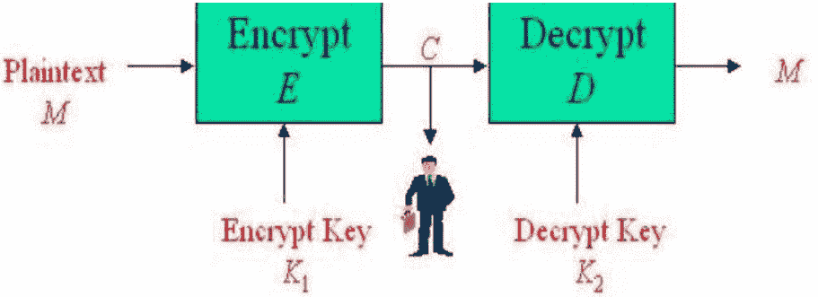

## Goals of Cryptography

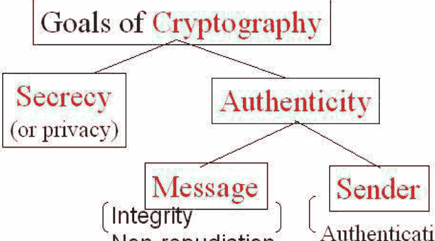

We shall see that **secrecy** and **authenticity** are <u>independent</u> attributes of a cryptographic system.

## The Concept of Symmetric and Asymmetric Public Key Ciphers

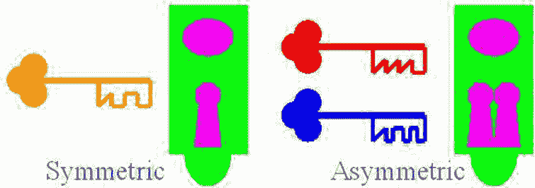

Symmetric

Asymmetric

The same key
used to encrypt
as well as decrypt

Separate keys
used to encrypt
as and decrypt

## Symmetric Encryption

- 以置换（Permutation）及替代（Substitution）为基本运算方式，运算速度快，适用于大量资料的加解密。

- (1) Block Cipher  
  Ex: DES, Triple DES, IDEA, AES  
  Operation mode: ECB, CBC, CFB, OFB  
  Padding mode: PKCS #5, SSL 3 Padding

- (2) Stream Cipher  
  Ex: RC4

- (3) Password Based Encryption(PBE)  
  Ex: PKCS #5

## Symmetric Encryption

- 以换位（Permutation）及取代（Substitution）为基本运算方式，运算速度快，适用于大量资料的加解密。

- (1) Block Cipher  
  Ex: DES, Triple DES, IDEA, AES  
  Operation mode: ECB, CBC, CFB, OFB  
  Padding mode: PKCS #5, SSL 3 Padding

- (2) Stream Cipher  
  Ex: RC4

- (3) Password Based Encryption(PBE)  
  Ex: PKCS #5

## Asymmetric Encryption

- 基于数学难题设计的，运算速度慢，但无需考虑密钥分配，适用于较少量资料的加解密，如保护对称加密算法中的密钥，或者保护使用者的个人信息。

Ex: RSA，ElGamal

PS 1：一般 Asymmetric encryption 的私钥称为 Private key，而 Symmetric encryption 的密钥则称为 Secret key。

PS 2：Asymmetric encryption 与 Digital Signature 均使用一组 Public key 和 Private key，如果使用者拥有一个包含 Public key 的 Certification，这个 Public key 就可以用作身份确认（Authentication）。

## 功能：

保护信息机密  
简化密钥分配及管理问题  
可达到不可否认的功能

## 缺点：

运算复杂，速度缓慢

混合型密码系统：利用公开密钥系统解决密钥分配问题，再利用秘密密钥系统，对明文加解密。

## 理论安全与实际安全（1/2）

- ➢ 理论安全（Theoretical Security or Perfect Security）

假设加密方法中密钥大小为 k bits，对 n bits 大小的明文加密，若破解密码得到明文的几率=直接猜对明文的几率，则称此加密方法是理论安全的。（注：达到理论安全的必要条件是 k>=n）

- • 实际安全（Practical Security or Computational Security）

如果加密方法无法达到理论安全，但破解此系统所需的计算量与时间无法在合理的范围内达成，则此方法称为实际安全。

## 理论安全与实际安全（2/2）

- **理论工作函数（Work Characteristic，W(n)）**
  - 破解某一密码方法，在理论上所需的最少代价。

- **历史理论工作函数（Historical Work Characteristic，Wh(n)）**
  - 破解某一密码方法，现在已知所需的最少代价。

- 某一密码方法被宣称为安全，是指其历史理论工作函数无法在合理范围内达成。换言之，某一密码方法目前为安全并不保证未来仍为安全。

## 对称密钥密码

## 密码系统的模型

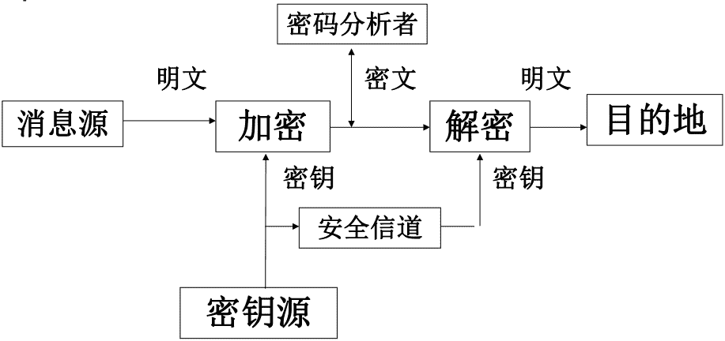

① 对称密码算法有时又叫传统密码算法，加密密钥能够从解密密钥中推算出来，反过来也成立。在大多数对称算法中，加密解密密钥是相同的。

② 它要求发送者和接收者在安全通信之前，商定一个密钥。对称算法的安全性依赖于密钥，泄漏密钥就意味着任何人都能对消息进行加密解密。

③ 对称算法的加密和解密表示为：
加密：\( E_k(M)=C \)
解密：\( D_k(C)=M \)

## 单钥体制(cont.)

单钥体制中，加密密钥和解密密钥是相同的（可互推算），系统的保密性取决于**密钥**的安全性。有两大课题：

- ①如何产生满足保密要求的密钥？
- ②如何将密钥安全可靠地分配给通信对方？

解决方案：包括密钥产生、分配、存储、销毁等多方面的问题，统称**密钥管理**。

发送方与接收方用同一个随机对称密钥进行加密数据和解密数据。对称密钥在使用过一次后就被抛弃。

- 优点：速度比较快。
- 缺点：
  - （1）不适用于数字签名；
  - （2）密钥每用一次都被抛弃，需要重复的生成密钥，这样对密钥的管理压力会很大。

所有古典密码都属于对称密码

## 流密码模型

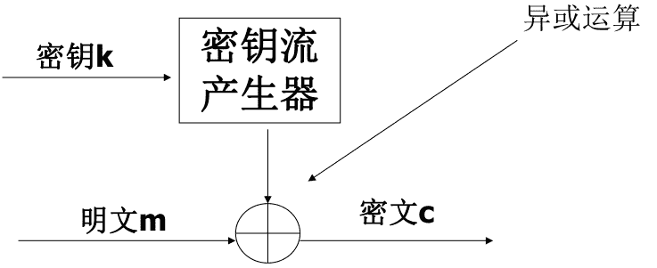

密钥 k

密钥流产生器

异或运算

明文 m

密文 c

流密码体制模型

## 分组密码概述

分组密码是将明文消息编码表示后的数字（简称明文数字）序列，划分成长度为 \( n \) 的组（可看成长度为 \( n \) 的矢量），每组分别在密钥的控制下变换成等长的输出数字（简称密文数字）序列，

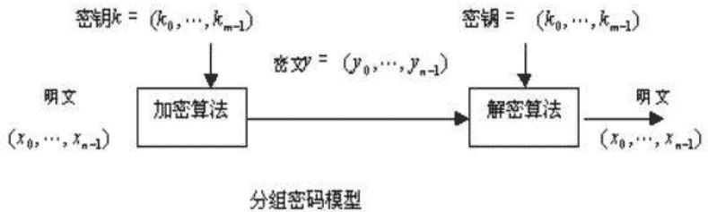

## 两个基本设计方法

Shannon称之为理想密码系统中，密文的所有统计特性都与所使用的密钥独立。

- **扩散（Diffusion）**:明文的统计结构被扩散消失到密文中，，使得明文和密文之间的统计关系尽量复杂。

- **混乱(confusion)**: 使得密文的统计特性与密钥的取值之间的关系尽量复杂。从而使统计分析攻击不能凑效。


## 分组密码：软件实现的设计原则

- ① 使用子块和简单的运算；
- ② 密码运算在子块上进行，要求子块的长度能自然地适应软件编程，如8、16、32比特等；
- ③ 应尽量避免按比特置换，在子块上所进行的密码运算尽量采用易于软件实现的运算；
- ④ 最好是用处理器的基本运算，如加法、乘法、移位等；

## 数据加密标准（Data Encryption Standard，DES）

## 分组密码：硬件实现的设计原则

- ① 加密和解密的相似性，即加密和解密过程的不同应仅仅在密钥使用方式上，以便采用同样的器件来实现加密和解密，以节省费用和体积。
- ② 尽量采用标准的组件结构，以便能适应于在超大规模集成电路中实现。

## 背景

- 发明人：美国IBM公司 W. Tuchman 和 C. Meyer，1971-1972年研制成功；
- 基础：1967年美国Horst Feistel提出的理论；
- 产生：美国国家标准局（NBS）1973年5月到1974年8月两次发布通告，公开征求用于电子计算机的加密算法。经评选从一大批算法中采纳了IBM的LUCIFER方案。
- 标准化：DES算法1975年3月公开发表，1977年1月15日由美国国家标准局颁布为数据加密标准（Data Encryption Standard），于1977年7月15日生效。

美国国家安全局（NSA，National Security Agency）参与了美国国家标准局制定数据加密标准的过程。NBS接受了NSA的某些建议，对算法做了修改，并将密钥长度从LUCIFER方案中的128位压缩到56位。

- 1979年，美国银行协会批准使用DES。
- 1980年，DES成为美国标准化协会（ANSI）标准。
- 1984年2月，ISO成立的数据加密技术委员会（SC20）在DES基础上制定数据加密的国际标准工作。

## 分组密码（Feistel密码结构）

- 是密码设计的一个主要原则，而不是一个特殊的密码。
- 一般分为64位一组，一组分左右部分，进行一般为16轮的迭代运算，每次迭代完后交换左右位置，可以自己进行设计的有：
  - 分组大小
  - 密钥长度
  - 轮次数
  - 子密钥生成
  - 轮函数

## Feistel结构定义

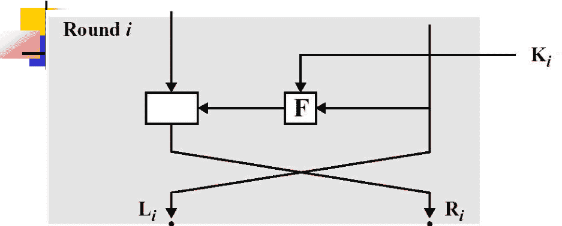

- 加密：\(L_i = R_{i-1}\)；\(R_i = L_{i-1} \oplus F(R_{i-1}, K_i)\)
- 解密：\(R_{i-1} = L_i\)

\(L_{i-1} = R_i \oplus F(R_{i-1}, K_i) = R_i \oplus F(L_i, K_i)\)

## Feistel网络的特点

明文分组分为 \(L_0, R_0\)。数据的这两部分通过 \(n\) 次循环处理后，再结合起来生成密文分组。

第 \(i\) 次循环都以上一循环产生的 \(L_{i-1}\) 和 \(R_{i-1}\) 和 \(K\) 产生的子密钥 \(K_i\) 作为输入。一般来说，子密钥 \(K_i\) 与 \(K\) 不同，相互之间也不同，它是用子密钥生成算法从密钥生成的。

## Feistel 密码设计原则

- 分组大小：increasing size improves security, but slows cipher.
- 密钥长度：increasing size improves security, makes exhaustive key searching harder, but may slow cipher.
- 轮次数：increasing number improves security, but slows cipher.
- 子密钥生成：greater complexity can make analysis harder, but slows cipher.
- 轮函数：greater complexity can make analysis harder, but slows cipher.
- 快速软件加密/解密：are more recent concerns for practical use and testing.

## Feistel网络的特点

- 解密过程与加密过程基本相同。规则如下：

  用密文作为算法的输入，但以相反顺序使用子密钥 \(K_i\)，意味着加密和解密不需要用两种不同的方法。

## DES加密算法的一般描述

## DES概述

- ① 分组加密算法：明文和密文为64位分组长度；
- ② 对称算法：加密和解密除密钥编排不同外，使用同一算法。
- ③ 密钥长度：56位，但每个第8位为奇偶校验位，可忽略。
- ④ 密钥可为任意的56位数，但存在弱密钥，容易避开。
- ⑤ 采用混乱和扩散的组合，每个组合先替代后置换，共16轮。
- ⑥ 只使用了标准的算术和逻辑运算，易于实现。

## DES加密过程

输入64比特明文数据 → 初始置换IP → 在密钥控制下16轮迭代 → 交换左右32比特 → 初始逆置换IP⁻¹ → 输出64比特密文数据

## DES中的各种置换、扩展和替代

## 初始置换IP和初始逆置换IP-1

| 初始置换 IP | 初始逆置换 IP⁻¹ |
|---|---|
| 58 50 42 34 26 18 10 2 | 40 8 48 16 56 24 64 32 |
| 60 52 44 36 28 20 12 4 | 39 7 47 15 55 23 63 31 |
| 62 54 46 38 30 22 14 6 | 38 6 46 14 54 22 62 30 |
| 64 56 48 40 32 24 16 8 | 37 5 45 13 53 21 61 29 |
| 57 49 41 33 25 17 9 1 | 36 4 44 12 52 20 60 28 |
| 59 51 43 35 27 19 11 3 | 35 3 43 11 51 19 59 27 |
| 61 53 45 37 29 21 13 5 | 34 2 42 10 50 18 58 26 |
| 63 55 47 39 31 23 15 7 | 33 1 41 9 49 17 57 25 |

## DES的一轮迭代

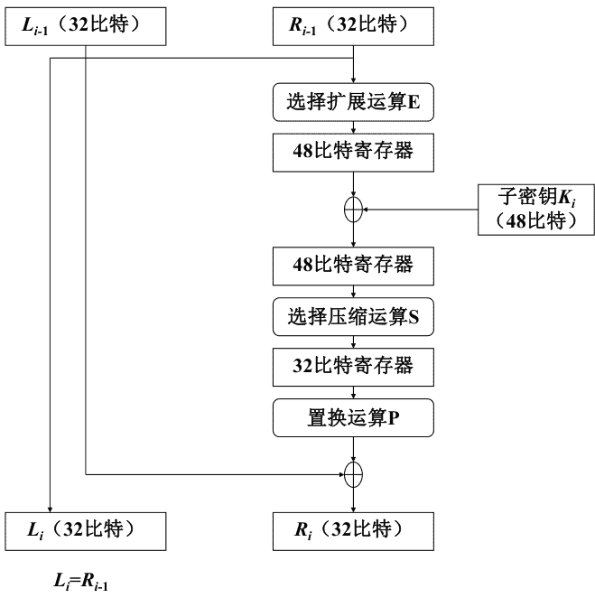

## 扩展置换 E-盒——32位扩展到48位

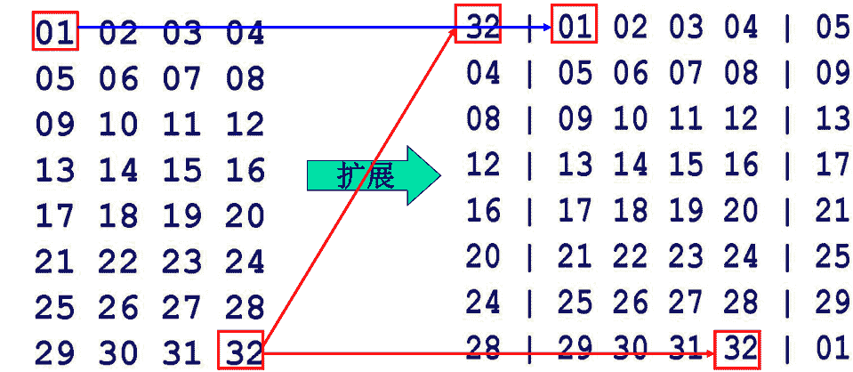

## 压缩替代S-盒——48位压缩到32位

48比特寄存器 → 6比特 → 共8个S盒 → 4比特 → 32比特寄存器

选择压缩运算 S

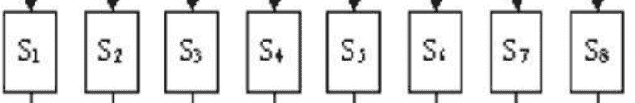

## S-盒的构造

行：\(b_6b_1 = 11_2 = 3\)  
列：\(b_2b_3b_4b_5 = 1001_2 = 9\)  
值：\(14 = 1100\)

| 行\列 | 0 | 1 | 2 | 3 | 4 | 5 | 6 | 7 | 8 | 9 | 10 | 11 | 12 | 13 | 14 | 15 |
|---|---|---|---|---|---|---|---|---|---|---|---|---|---|---|---|---|
| 0 | 12 | 1 | 10 | 15 | 9 | 2 | 6 | 8 | 0 | 13 | 3 | 4 | 14 | 7 | 5 | 11 |
| 1 | 10 | 15 | 4 | 2 | 7 | 12 | 9 | 5 | 6 | 1 | 13 | 14 | 0 | 11 | 3 | 8 |
| 2 | 9 | 14 | 15 | 5 | 2 | 8 | 12 | 3 | 7 | 0 | 4 | 10 | 1 | 13 | 11 | 6 |
| 3 | 4 | 3 | 2 | 12 | 9 | 5 | 15 | 10 | 11 | 14 | 1 | 7 | 6 | 0 | 8 | 13 |

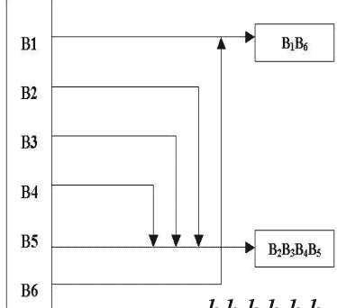


## 置换$p$-盒的构造

| 16 | 07 | 20 | 21 | 29 | 12 | 28 | 17 |
|---|---|---|---|---|---|---|---|
| 01 | 15 | 23 | 26 | 05 | 18 | 31 | 10 |
| 02 | 08 | 24 | 14 | 32 | 27 | 03 | 09 |
| 19 | 13 | 30 | 06 | 22 | 11 | 04 | 25 |

## p-盒的构造准则

P置换的目的是提供：雪崩效应

（明文或密钥的一点小的变动都引起密文的较大变化）

## DES中的子密钥的生成

PC-1
57 49 41 33 25 17 9
1 58 50 42 34 26 18
10 2 59 51 43 35 27
19 11 3 60 52 44 36
63 55 47 39 31 23 15
7 62 54 46 38 30 22
14 6 61 53 45 37 29
21 13 5 28 20 12 4

64 位密钥

置换选择 1

C₀（28 位）

D₀（28 位）

循环左移

循环左移

C₁（28 位）

D₁（28 位）

循环左移

循环左移

Cᵢ（28 位）

Dᵢ（28 位）

密钥表的计算逻辑
循环左移：
1 1 9 1
2 1 10 2
3 2 11 2
4 2 12 2
5 2 13 2
6 2 14 2
7 2 15 2
8 2 16 1
共16轮，
每轮移位
如红色

置换选择 2
（56 位）

k₁
（48 位）

置换选择 2
（56 位）

kᵢ
（48 位）

PC-2
14 17 11 24 1 5
3 28 15 6 21 10
23 19 12 4 26 8
16 7 27 20 13 2
41 52 31 37 47 55
30 40 51 45 33 48
44 49 39 56 34 53
46 42 50 36 29 32

## 从密钥K计算子密钥：

实际上，K是长度为64的位串，其中56位是密钥，8位是奇偶校验位（为了检错），在密钥编排的计算中，这些校验位可略去。

+ (1). 给定64位的密钥K，放弃奇偶校验位（8，16，…，64）并根据固定置换PC⁻¹，来排列K中剩下的位。我们写 PC⁻¹(K)=C₀D₀。

其中 C₀ 占PC⁻¹(K)的前28位组成；D₀ 占后28位组成。

## (2)对1<=i<=16，计算

Ci=LS<sub>i</sub>(Ci-1)  
Di=LS<sub>i</sub>(Di-1)

LS<sub>i</sub>表示循环左移2或1个位置，取决于i的值。i=1,2,9和16 时移1个位置，否则移2位置。  
Ki=PC-2(CiDi)，PC-2为固定置。

注：一共16轮，每一轮使用K中48位组成一个48比特密钥。可算出16个表，第i个表中的元素可对应上第i轮密钥使用K中第几比特，如：  
第7轮的表7：K<sub>7</sub>取K中的比特情况：

| 52 | 57 | 11 | 1 | 26 | 59 | 10 | 34 | 44 | 51 | 25 | 19 |
|---|---|---|---|---|---|---|---|---|---|---|---|
| 9 | 41 | 3 | 2 | 50 | 35 | 36 | 43 | 42 | 33 | 60 | 18 |
| 28 | 7 | 14 | 29 | 47 | 46 | 22 | 5 | 15 | 63 | 61 | 39 |
| 4 | 31 | 13 | 38 | 53 | 62 | 55 | 20 | 23 | 37 | 30 | 6 |

+ DES加密的一个例子
  - 取16进制明文X：02468aceeca86420
  - 密钥K为：0f1571c947d9e859
  - 计算出第一轮后 L1和R1的值

+ K1: 1e03 Of 03 080d 2930
+ L1: 3cf0 3c0f
+ R1: bad2 2845

## 密钥置换算法的构造准则

设计目标：子密钥的统计独立性和灵活性

+ 实现简单；
+ 速度快；
+ 不存在简单关系(即给定两个有某种关系的种子密钥，能预测它们轮子密钥之间的关系)；
+ 种子密钥的所有比特对每个子密钥比特的影响大致相同；

## 密钥置换算法的构造准则（续）

+ 从一些子密钥比特获得其他的子密钥比特在计算上是难的；
+ 没有弱密钥；
+ F函数（S-Box）设计原理未知
+ 密钥长度的争论
+ DES的破译

## S-盒的构造准则

+ S盒的每一行是整数0，…，15的一个置换；
+ 没有一个S盒是它输入变量的线性函数；
+ 改变S盒的一个输入位至少要引起两位的输出改变；
+ 对任何一个S盒和任何一个输入X，S（X）和S(X⊕001100)至少有两个比特不同（这里X是长度为6的比特串）；
+ 对任何一个S盒，对任何一个输入对e,f属于{0,1}，S(X)≠S(X⊕11ef00)；
+ 对任何一个S盒，如果固定一个输入比特，来看一个固定输出比特的值，这个输出比特为0的输入数目将接近于这个输出比特为1的输入数目；

## S-盒的构造要求

+ S-盒是许多密码算法的唯一非线性部件,因此,它的密码强度决定了整个算法的安全强度；
+ 提供了密码算法所必须的混乱作用；
+ 如何全面准确地度量S-盒的密码强度和设计有效的S-盒是分组密码设计和分析中的难题；
+ 非线性度、差分均匀性、严格雪崩准则、可逆性、没有陷门；

说明：陷门是在某个系统或某个文件中设置的"机关"，使得在提供特定的输入数据时，允许违反安全策略。例如，一个登录处理子系统允许处理一个特定的用户识别码，以绕过通常的口令检查。

## DES密钥长度

+ 关于DES算法的另一个最有争议的问题就是担心实际56比特的密钥长度不足以抵御穷举式攻击，因为密钥量只有 \( 2^{56} \approx 10^{17} \) 个。

+ 早在1977年，Diffie和Hellman已建议制造一个每秒能测试100万个密钥的VLSI芯片。每秒测试100万个密钥的机器大约需要一天就可以搜索整个密钥空间。他们估计制造这样的机器大约需要2000万美元（昂贵）；所以，当时DES被认为是一种十分强壮的加密方法。

## DES密钥长度

+ 在CRYPTO'93上，Session和Wiener给出了一个非常详细的密钥搜索机器的设计方案，这个机器基于并行运算的密钥搜索芯片，所以16次加密能同时完成。花费10万美元，平均用1.5天左右就可找到DES密钥。

+ 美国克罗拉多州的程序员Verser从1997年2月18日起，用了96天时间，在Internet上数万名志愿者的协同工作下，成功地找到了DES的密钥，赢得了悬赏的1万美元

## DES密钥长度

+ 1998年7月电子前沿基金会（EFF）使用一台25万美元的电脑在56小时内破译了56比特密钥的DES；
+ 1999年1月RSA数据安全会议期间，电子前沿基金会用22小时15分钟就宣告破解了一个DES的密钥；
+ 所以现在再对要求“强壮”加密的场合已经不再适用了。

## 破译DES

+ 1990年，以色列密码学家Eli Biham和Adi Shamir提出了差分密码分析法，可对DES进行选择明文攻击。

+ 线性密码分析比差分密码分析更有效，为了分析DES而提出来的。分析线性部件，容易；非线性部件才是密码分析的主要障碍，因此差分分析和线性分析，集中在非线性部件S盒。

## 整除性

定义：（整除、倍数、因数）设a，b为整数，若存在整数c，使b=ac，则称a可整除b，记作a|b。b叫做a的倍数，a叫做b的因数。若不存在这样的整数c，则称a不能整除b，记作a∤b。

* 如果b|g，b|h,对于任何整数m和n，则满足b|(mg+nh)。

## 互素

+ • 定义：

素数：又叫质数，除了1和本身，不能被其他数整除的数。

公因子：a, b 为整数，整除a的数组成组成集合A，整除b的数组成集合B，C=A∩B，C中的元素称为a和b 的公因子。

(a, b) 表示a和b的最大公因子(gcd, Great Common Divisor)， (a, b) =1表示a与b互素。

eg GCD(8,15) = 1

## Euclid 算法

## 又叫 “辗转相除法”

简单的描述就是，记gcd(a,b)表示非负整数a,b的最大公因数，那么： gcd(a,b) =max[k,其中k|a,且k|b] = gcd(b,a%b) ,假设a>b


## 欧几里得算法

A systematic method to find the gcd of two positive integers

Lemma: If $c,d\in\mathbb{Z}$ and $c=dq+r$, where $q,r\in\mathbb{Z}$, then $(c,d)=(d,r)$.

<proof>:

+   (1) $r=c-dq$; if $e\mid c$ and $e\mid d$, then $e\mid r$.
+   (2) $c=dq+r$; if $e\mid d$ and $e\mid r$, then $e\mid c$.
+   $\Rightarrow (c,d)=(d,r)$

## 欧几里得算法

Thm : The Euclidean Algorithm
Let \( r_0 = a, r_1 = b \) be integers \( \geq a \geq b > 0 \). If the division algorithm is successively applied to obtain \( r_j = r_{j-1}q_{j-1} + r_{j-2} \), with \( 0 < r_{j-2} < r_{j-1} \), for \( j=0,1, \dots, n-2 \) and \( r_{n+1} = 0 \), then \( (a, b) = r_n \), the last nonzero mainder.

<proof>: Since
\( r_0 = r_1q_1 + r_2 \quad 0 \leq r_2 < r_1 \)
\( r_1 = r_2q_2 + r_3 \quad 0 \leq r_3 < r_2 \)
\( \vdots \)
\( r_{j-2} = r_{j-1}q_{j-1} + r_j \quad 0 \leq r_j < r_{j-1} \)
\( \vdots \)
\( r_{n-2} = r_{n-1}q_{n-1} + r_n \quad 0 \leq r_n < r_{n-1} \)
\( r_{n-1} = r_nq_n \)

## 同余及模运算

## 1. a与b模m同余

已知：m：模数，a, b 为整数，m≠0 且 if and only if a mod m=b，即 a与 b 的差是m的整数倍。a ≡ b(mod m)

例：时钟 14 mod 12 = 2 ; -18 (mod 7)=? 即 (-18+(3*7))mod 7=3

## 2. 模运算性质：

令a₁和a₂为整数，OP代表操作符十、一、×，则 （a₁ OP a₂ ）mod n=[ （a₁ mod n ） OP （a₂ mod n ） ] mod n 其中，a mod n 表示a被n整除时的余数。

+   • 反复平方乘
+   例如：
+   5^20 =95, 367, 431, 640, 625 =25 mod35

原理？
20=10100
（0, 1, 10, 101, 1010, 10100）=（0, 1, 2, 5, 10, 20）
1=0*2+1;
2=1*2;
5=2*2+1;
10=5*2;
20=10*2;

5¹ = (5⁰)² × 5¹ = 5 mod 35

5² = (5¹)² = 5² = 25 mod 35

5⁵ = (5²)² × 5¹ = 25² × 5 = 3125 = 10 mod 35

5¹⁰ = (5⁵)² = 10² = 100 = 30 mod 35

5²⁰ = (5¹⁰)² = 30² = 900 = 25 mod 35

## 同余（Congruence）的数学定义及性质

+   - **Def:** Let \(m\in Z^+\) and \(a,b\in Z\), we say \(a\) is congruence to \(b\) modulo \(m\) if \((a-b)=km,\ k\in Z\), or \(m\mid(a-b)\), then \(a\equiv b\pmod m\).
+   - **Thm:** If \(a,b\in Z\), then \(a\equiv b\pmod m\) iff \(\exists k\in Z\), \(a=b+km\).
+   - **Thm: Properties:** Let \(m\in Z^+\) and \(a,b,c\in Z\), then
+     1. \(a\equiv a\pmod m\) [reflexive]
+     2. If \(a\equiv b\pmod m\), then \(b\equiv a\pmod m\) [symmetric]
+     3. If \(a\equiv b\pmod m\) and \(b\equiv c\pmod m\), then \(a\equiv c\pmod m\) [Transitive]

## ■ 完全剩余系 Complete Set of Residues

Zn={0, 1, 2, ..., n-1}

定义：由同余概念，所有整数在模n中分成n类，以n整除余数为1的数为一类，为2的数为一类，以此类推，将每一类中取一个数作为代表形成的集合。

## ■ 既约剩余系Reduced Set of Residues Zn*：

定义：在模n的完全剩余系中，若将所有与n互素的数形成的集合

例如：n=10

完全剩余系？ {0, 1, 2, 3, 4, 5, 6, 7, 8, 9}

既约剩余系？ {1, 3, 7, 9}

## 乘法逆元：

在模n的既约剩余系中取一整数a，则必存在另一整数b(也属于此既约剩余系)，使得 ab =1 mod n，且此解唯一。此时，称b为a在模n的乘法逆元，b可表示为a-1。

## ■ 求乘法逆元：

已知 a、n，且（a，n）=1，如何求 a⁻¹，使得 a × a⁻¹ =1 mod n？

## 1.利用欧几里得算法

欧几里得算法（Euclidean Algorithm，也叫辗转相除法），用于求 gcd。

## 2.利用欧拉函数φ(n)（Euler Totient Function）

φ(n)为小于n，且与n互素的所有整数的个数。即φ(n)为模n的既约剩余系中所有元素的个数。

143=30*4+23
30=23*1+7
23=7*3+2
7=2*3+1
2=1*2

1=7-2*3
=7-(23-7*3)*3
=7*10-23*3

# gcd (143, 30) =?

=(30-23)*10-23*3
=30*10-23*13
=30*10-(143-30*4)*13
=30*62-143*13

143*(-13) ≡ 1(mod 30)，143的乘法逆元为17

## 普通最小二乘法(Ordinary Least Squares, OLS)

普通最小二乘法（Ordinary Least Squares，OLS）是一种用于估计线性回归模型参数的经典方法。其核心思想是通过最小化观测值与模型预测值之间的残差平方和来寻找最优参数，从而使模型对训练数据的拟合误差达到最小。

给定一个线性回归模型 y = Xβ + ε，其中 y 为 n 维观测向量，X 为 n×p 设计矩阵，β 为 p 维待估计参数向量，ε 为 n 维随机误差向量。OLS 的估计目标是：

min_β ||y - Xβ||_2²

该优化问题具有唯一闭式解，当 X 列满秩时，参数估计值为：

β̂ = (XᵀX)⁻¹ Xᵀy

OLS 具有良好的统计性质。在高斯-马尔可夫假设下，它是线性无偏估计中方差最小的估计量（BLUE）。但其缺点在于对异常值敏感，且当特征间存在多重共线性时，估计会变得不稳定。

+   - 优点：计算简单，解析解存在；
+   - 优点：统计理论基础完善；
+   - 缺点：对异常值敏感；
+   - 缺点：多重共线性时不稳定。

| 方法 | 计算复杂度 | 适用场景 |
|------|------------|----------|
| OLS | O(n·p²) | 特征较少且独立时适用 |
| Ridge | O(n·p²) | 存在多重共线性时适用 |

> “在回归分析中，OLS 是最基本也是最重要的估计方法之一。” —— 统计学习基础

```python
import numpy as np
X = np.array([[1, 2], [1, 4], [1, 7]])
y = np.array([3, 5, 8])
beta = np.linalg.inv(X.T @ X) @ X.T @ y
```


## 概念：群、环、域

+   - 群
+   - 环
+   - 域


## 群、环和域

(A1) 加法的封闭性：如果说 a 和 b 属于 S，则 a+b 属于 S；

(A2) 加法的结合律：对 S 中的任意元素 a, b, c，a+(b+c)=(a+b)+c；

(A3) 加法单位元：R 中存在一个元素 o，使得对于 S 中的任意元素 a，有 a+o=o+a=a；

(A4) 加法逆元：对于 S 中的任意元素 a，S 中一定存在一个元素 -a，使得 a+(-a)=(-a)+a=0；

## 群(Group)的定义

设 G 是一个非空集合，并在 G 内定义了一种代数运算“·”，若满足：

A1: 封闭性。对任意 \(a, b \in G\) 恒有 \(a \circ b \in G\)

A2: 结合律。对任意 \(a, b, c \in G\)，恒有 \((a \circ b) \circ c = a \circ (b \circ c)\)

A3: G 中存在一恒等元 e，对任意 \(a \in G\)，使 \(a \circ e = e \circ a = a\)

A4: 对任意 \(a \in G\)，存在 a 的逆元 \(a^{-1} \in G\)，使 \(a \circ a^{-1} = a^{-1} \circ a = e\)

[A1->A4]: 群

若加法，恒等元用 0 表示；若为乘法，恒等元 1 称为单位元

群可以记作 {G, ·}

(A5) 交换律：对于 G 中的任意元素 a 和 b，有

a∘b=b∘a

[A1->A5]: 可交换群

## 循环群

- 若由群 G 的一个生成元素 g 的幂次构成 G 群，即 G={e，g，g²，...，gⁿ}，则称 G 为循环群。元素 g 称为 G 的生成元素。e=g⁰
- n 阶循环群中，g 生成了群 G，或者说 g 是群 G 的生成元。记做 G=<g>。

## 环(Ring)的定义

非空集合 R 中，若定义了两种代数运算加和乘，且满足：

(M1) **乘法的封闭性**：如果 a 和 b 属于 R，则 ab 属于 R；

(M2) **乘法的结合率**：对于 R 中的任意元素 a，b，c，有
　　a（bc）=（ab）c；

(M3) **分配律**：对于 R 中的任意元素 a，b，c，有
　　a（b+c）=ab+ac 和（a+b）c=ac+bc

[A1-M3]: 环

(M4) **乘法交换律**：对于 R 中的任意元素 a 和 b，ab=ba

[A1-M4]: 可交换环

## 域(Field)的定义

（M5）乘法单位元：对于 F 中的任意元素 a，F 中存在一个元素 1，使得 a1=1a=a

（M6）无零因子：对于 F 中的元素 a,b，若 ab=0，则有 a=0 或 b=0

[A1-M6]: 整环

（M7）乘法逆元：如果 a 属于 F，且 a 不为 0，则 F 中存在一个元素 a⁻¹，使得 aa⁻¹=(a⁻¹)a=1

[A1-M7]: 域

## GF(7) Multiplication Example

| × | 0 | 1 | 2 | 3 | 4 | 5 | 6 |
|---|---|---|---|---|---|---|---|
| 0 | 0 | 0 | 0 | 0 | 0 | 0 | 0 |
| 1 | 0 | 1 | 2 | 3 | 4 | 5 | 6 |
| 2 | 0 | 2 | 4 | 6 | 1 | 3 | 5 |
| 3 | 0 | 3 | 6 | 2 | 5 | 1 | 4 |
| 4 | 0 | 4 | 1 | 5 | 2 | 6 | 3 |
| 5 | 0 | 5 | 3 | 1 | 6 | 4 | 2 |
| 6 | 0 | 6 | 5 | 4 | 3 | 2 | 1 |

## 多项式运算 Polynomial Arithmetic

- 多项式  
  \( f(x)=f_nx^n+f_{n-1}x^{n-1}+\dots+f_1x+f_0 \)  
  其中 \( f_i \in F_p \quad i=0,1,\dots,n \)，该多项式称为域 \( \mathbb{Z}_p \) 上的多项式

- 多项式次数 \( \deg f(x) \)  
  系数不为零的 \( x \) 的最高次数称为多项式 \( f(x) \) 的次数

- 首一多项式  
  最高次数的系数为 1 的多项式

## 普通多项式

- eg  
  let \( f(x) = x^3 + x^2 + 2 \) and \( g(x) = x^2 - x + 1 \)  
  \( f(x) + g(x) = ? \)  
  \( x^3 + 2x^2 - x + 3 \)  
  \( f(x) - g(x) = ? \)  
  \( x^3 + x + 1 \)  
  \( f(x) * g(x) = ? \)  
  \( x^5 + 3x^2 - 2x + 2 \)

## 系数在$\mathbb{Z}_p$多项式

例如模 2，则所有系数 0 or 1

– eg. let \( f(x)=x^3+x^2 \) and \( g(x)=x^2+x+1 \)

\( f(x)+g(x)=? \)

\( x^3+x+1 \)

\( f(x)\times g(x)=? \)

\( x^5+x^2 \)

## 有限域GF(2ⁿ)

- polynomials with coefficients modulo 2
- whose degree is less than n

- GF(2ⁿ)域：又称伽罗华域。

\( f(x)=a_{n-1}x^{n-1}+a_{n-2}x^{n-2}+...+a_1x+a_0 = \sum_{i=0}^{n-1} a_i x^i \)

\( a_i \) 在集合\(\{0,1,\dots,p-1\}\)共有\( p^n \)不同的多项式？

- 如\( p=3 \ n=2 \)时，共\( 3^2=9 \)多项式  
  0   x   2x  
  1   x+1  2x+1  
  2   x+2  2x+2

- 如\( p=2 \ n=3 \)时，共\( 2^3=8 \)多项式  
  0   x+1   \( x^2 + x \)  
  1   \( x^2 \)   \( x^2+x+1 \)  
  x   \( x^2+1 \)

- GF(2³) 中 (x²+1) is 101₂；(x²+x+1) is 111₂

# 加法

- (x²+1) + (x²+x+1) = x
- 101 XOR 111 = 010₂

# 乘法

- (x+1).(x²+1) = x.(x²+1) + 1.(x²+1)
  = x³+x+x²+1 = x³+x²+x+1
- 011.101 = (101)<<1 XOR (101)<<0 =
  1010 XOR 101 = 1111₂

# 除法 (get q(x) & r(x)) is

- (x³+x²+x+1) mod (x³+x+1) = 1.(x³+x+1) + (x²) = x²
- 1111 mod 1011 = 1111 XOR 1011 = 0100₂

■ 如果乘法运算的结果是次数大于 n−1 的多项式，那么必须将其除以某个次数为 n 的既约多项式 m(x) 并取余式。既约多项式即只有 1 和其本身的两个约数。

## Example GF(2³)

**Table 4.6 Polynomial Arithmetic Modulo (x³ + x + 1)**

**(a) Addition**

| + | 0 | 1 | x | x + 1 | x² | x² + 1 | x² + x | x² + x + 1 |
|---|---|---|---|---|---|---|---|---|
| 0 | 0 | 1 | x | x + 1 | x² | x² + 1 | x² + x | x² + x + 1 |
| 1 | 1 | 0 | x + 1 | x | x² + 1 | x² | x² + x + 1 | x² + x |
| x | x | x + 1 | 0 | 1 | x² + x | x² + x + 1 | x² | x² + 1 |
| x + 1 | x + 1 | x | 1 | 0 | x² + x + 1 | x² + x | x² + 1 | x² |
| x² | x² | x² + 1 | x² + x | x² + x + 1 | 0 | 1 | x² | x + 1 |
| x² + 1 | x² + 1 | x² | x² + x + 1 | x² + x | 1 | 0 | x + 1 | x |
| x² + x | x² + x | x² + x + 1 | x² | x² + 1 | x | x + 1 | 0 | 1 |
| x² + x + 1 | x² + x + 1 | x² + x | x² + 1 | x² | x + 1 | x | 1 | 0 |

**(b) Multiplication**

| × | 0 | 1 | x | x + 1 | x² | x² + 1 | x² + x | x² + x + 1 |
|---|---|---|---|---|---|---|---|---|
| 0 | 0 | 0 | 0 | 0 | 0 | 0 | 0 | 0 |
| 1 | 0 | 1 | x | x + 1 | x² | x² + 1 | x² + x | x² + x + 1 |
| x | 0 | x | x² | x² + x | x² + 1 | 1 | x² + x + 1 | x² + 1 |
| x + 1 | 0 | x + 1 | x² + x | x² + 1 | x² + x + 1 | x² | 1 | x |
| x² | 0 | x² | x² + 1 | x² + x + 1 | x² + x | x | x² + 1 | 1 |
| x² + 1 | 0 | x² + 1 | 1 | x² | x² + x + 1 | x + 1 | x² + x | x² + x |
| x² + x | 0 | x² + x | x² + x + 1 | 1 | x² + 1 | x + 1 | x | x² |
| x² + x + 1 | 0 | x² + x + 1 | x² + 1 | x | 1 | x² + x | x² | x + 1 |


| GF(2⁸) | α 的多项式表示 | D₇D₆D₅D₄D₃D₂D₁D₀ | 推导过程 |
|--------|----------------|------------------|----------|
| 0      | 0              | 00000000         |          |
| α⁰     | α⁰             | 00000001         |          |
| α¹     | α¹             | 00000010         |          |
| α²     | α²             | 00000100         |          |
| α³     | α³             | 00001000         |          |
| α⁴     | α⁴             | 00010000         |          |
| α⁵     | α⁵             | 00100000         |          |
| α⁶     | α⁶             | 01000000         |          |

| 幂次 | 多项式表示 | 二进制表示 | 乘法运算 |
|---|---|---|---|
| α⁷ | α⁷ | 10000000 | |
| α⁸ | α⁴+α³+α²+1 | 00011101 | P(x)=α⁸+α⁷+α³+α²+1 |
| α⁹ | α⁵+α⁴+α³+α | 00111010 | α⁸·α=(α⁵+α⁴+α³+1)α=α⁶+α⁵+α³+α |
| α¹⁰ | α⁷+α⁵+α⁴+α² | 01110100 | α⁹·α=(α⁶+α⁵+α³+α)α=α⁷+α⁶+α⁴+α² |
| α¹¹ | α⁷+α⁵+α³+α² | 11101000 | α¹⁰·α=(α⁷+α⁵+α⁴+α²)α=α⁸+α⁶+α⁵+α³ |
| α¹² | α⁷+α⁶+α³+α²+1 | 11001101 | α¹¹·α=(α⁷+α⁶+α⁵+α³)α=α⁷+α⁶+α⁵+α²+1 |
| α¹³ | α⁷+α²+α+1 | 10000111 | α¹²·α=(α⁷+α⁶+α³+α²+1)α=α⁸+α⁷+α⁴+α³+α=α⁴+α³+α²+1+α⁷+α⁶+α⁴+α³+α=α⁷+α⁶+α+1 |

# 思考

在域GF(2⁸)内计算(1)3*7；(2)129*5 的数值，已知既约多项式

m(x)=x⁸+x⁴+x³+x²+1

答案：(1)9；

(2)191

3*7=((x+1)*(x²+x+1)=x*x²+x*x+x+x²+x+1=x³+3+1 (模2运算中x+x=0 and x²+x²=0)
所以3*7=9

在乘积得出来的多项式次数大于7时，我们需要对多项式在GF(2)上关于h(x)求余数，也就是
129*5=(x⁷+1)*(x²+2+1)=x⁹+x⁷+x⁵*2+1
将上面的函数加上x^h(x)可以消去x⁹，（其实就是手工除法过程，只是现在在每一次商总是0或1），所以
129*5=x⁹+x⁷+x²+1+x⁹+x⁵+x⁴+x⁴+x³+x=x⁷+x⁵+x⁴+x³+x²+x+1
=0010111111=191

# 有限域 GF(2⁸) 上的运算

+   - 求 GF(2⁸) 上 ⌊95⌋⁻¹

# AES背景-ii

+   - 1998年8月12日，在首届AES会议上指定了15个候选算法。
+   - 1999年3月22日第二次AES会议上，将候选名单减少为5个，这5个算法是RC6， Rijndael， SERPENT， Twofish和MARS。
+   - 2000年4月13日，第三次AES会议上，对这5个候选算法的各种分析结果进行了讨论。
+   - 2000年10月2日， NIST宣布了获胜者—Rijndael算法， 2001年11月出版了最终标准FIPS PUB197。

+   - AES算法的轮变换中没有Feistel结构，轮变换是由三个不同的可逆一致变换组成，称之为层。
+     - 线性混合层：确保多轮之上的高度扩散。
+     - 非线性层：具有最优最差-情形非线性的S-盒的并行应用。
+     - 密钥加层：轮密钥简单地异或到中间状态上。
+     - Rijndael（发音为 "Rhine dale"）作为AES算法。

# Rijndael简介

+   - 不属于Feistel结构
+   - 加密、解密相似但不对称
+   - 支持128/192/256三种分组长度
+   - 支持128/192/256(/32=Nk)密钥长度
+   - 有较好的数理论作为基础
+   - 结构简单、速度快

# Rijndael Round的构成

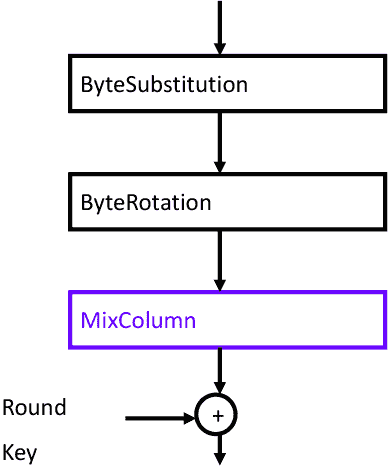

一般的轮变换

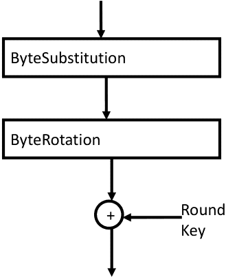

最后一轮的轮变换

# AES参数

| Key Length (Nk words) | Block Size (Nb words) | Number of Rounds (Nr) |
|---|---|---|
| 4 | 4 | 10 |
| 6 | 4 | 12 |
| 8 | 4 | 14 |

Nb=分组长度（bits）÷ 32  
Nk=密钥长度（bits）÷32

# AES 算法加密部分的实现

明文分组和密钥的组织排列方式

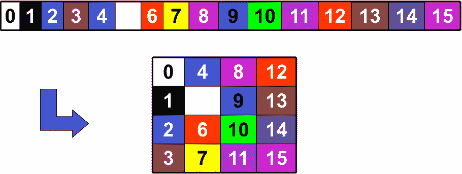

Fig 1. 以明文分组为128bits为例组成的阵列

# Fig 2. 以明文分组（或密钥）为128bits、192bits、256bits为例组成的序列

| 0 | 4 | 8 | 12 |
|---|---|---|---|
| 1 | 5 | 9 | 13 |
| 2 | 6 | 10 | 14 |
| 3 | 7 | 11 | 15 |

| 0 | 4 | 8 | 12 | 16 | 20 |
|---|---|---|---|---|---|
| 1 | 5 | 9 | 13 | 17 | 21 |
| 2 | 6 | 10 | 14 | 18 | 22 |
| 3 | 7 | 11 | 15 | 19 | 23 |

| 0 | 4 | 8 | 12 | 16 | 20 | 24 | 28 |
|---|---|---|---|---|---|---|---|
| 1 | 5 | 9 | 13 | 17 | 21 | 25 | 29 |
| 2 | 6 | 10 | 14 | 18 | 22 | 26 | 30 |
| 3 | 7 | 11 | 15 | 19 | 23 | 27 | 31 |

# 状态、密钥

+   - 状态/密钥的矩阵表示

| S₀₀ | S₀₁ | S₀₂ | S₀₃ |
|---|---|---|---|
| S₀₄ | S₀₅ | S₀₆ | S₀₇ |
| S₀₈ | S₀₉ | S₁₀ | S₁₁ |
| S₁₂ | S₁₃ | S₁₄ | S₁₅ |

| K₀₀ | k₀₁ | k₀₂ | k₀₃ |
|---|---|---|---|
| K₁₀ | k₁₁ | k₁₂ | k₁₃ |
| K₂₀ | k₂₁ | k₂₂ | k₂₃ |
| K₃₀ | k₃₁ | k₃₂ | k₃₃ |


## (1) 字节代替（Substitute Bytes）变换

- 字节代替是一个非线性的字节代替，独立地在每个状态字节上进行运算。代替表（S-盒）是可逆的，是一个16×16的矩阵。

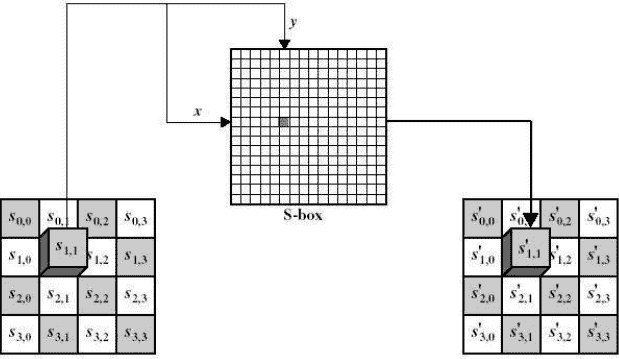

(a) Substitute byte transformation

**Fig 6. ByteSubstitution**

该变换可以用一个256字节的表来实现

|   |   |   |   |
| --- | --- | --- | --- |
| A₀,₀ | A₀,₁ | A₀,₂ | A₀,₃ |
| A₁,₀ | A₁,₁ | A₁,₂ | A₁,₃ |
| A₂,₀ | A₂,₁ | **A₂,₂** | A₂,₃ |
| A₃,₀ | A₃,₁ | A₃,₂ | A₃,₃ |

|   |   |   |   |
| --- | --- | --- | --- |
| B₀,₀ | B₀,₁ | B₀,₂ | B₀,₃ |
| B₁,₀ | B₁,₁ | B₁,₂ | B₁,₃ |
| B₂,₀ | B₂,₁ | **B₂,₂** | B₂,₃ |
| B₃,₀ | B₃,₁ | B₃,₂ | B₃,₃ |

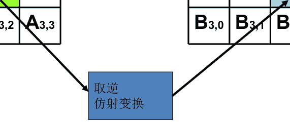

取逆

仿射变换

**Table 5.4  AES S-Boxes**

(a) S-box

| x\y | 0 | 1 | 2 | 3 | 4 | 5 | 6 | 7 | 8 | 9 | A | B | C | D | E | F |
| --- | --- | --- | --- | --- | --- | --- | --- | --- | --- | --- | --- | --- | --- | --- | --- | --- |
| 0 | 63 | 7C | 77 | 7B | F2 | 6B | 6F | C5 | 30 | 01 | 67 | 2B | FE | D7 | AB | 76 |
| 1 | CA | 82 | C9 | 7D | FA | 59 | 47 | F0 | AD | D4 | A2 | AF | 9C | A4 | 72 | C0 |
| 2 | B7 | FD | 93 | 26 | 36 | 3F | F7 | CC | 34 | A5 | E5 | F1 | 71 | D8 | 31 | 15 |
| 3 | 04 | C7 | 23 | C3 | 18 | 96 | 05 | 9A | 07 | 12 | 80 | E2 | EB | 27 | B2 | 75 |
| 4 | 09 | 83 | 2C | 1A | 1B | 6E | 5A | A0 | 52 | 3B | D6 | B3 | 29 | E3 | 2F | 84 |
| 5 | 53 | D1 | 00 | ED | 20 | FC | B1 | 5B | 6A | CB | BE | 39 | 4A | 4C | 58 | CF |
| 6 | D0 | EF | AA | FB | 43 | 4D | 33 | 85 | 45 | F9 | 02 | 7F | 50 | 3C | 9F | A8 |
| 7 | 51 | A3 | 40 | 8F | 92 | 9D | 38 | F5 | BC | B6 | DA | 21 | 10 | FF | F3 | D2 |
| 8 | CD | 0C | 13 | EC | 5F | 97 | 44 | 17 | C4 | A7 | 7E | 3D | 64 | 5D | 19 | 73 |
| 9 | 60 | 81 | 4F | DC | 22 | 2A | 90 | 88 | 46 | EE | B8 | 14 | DE | 5E | 0B | DB |
| A | E0 | 32 | 3A | 0A | 49 | 06 | 24 | 5C | C2 | D3 | AC | 62 | 91 | 95 | E4 | 79 |
| B | E7 | C8 | 37 | 6D | 8D | D5 | 4E | A9 | 6C | 56 | F4 | EA | 65 | 7A | AE | 08 |
| C | BA | 78 | 25 | 2E | 1C | A6 | B4 | C6 | E8 | DD | 74 | 1F | 4B | BD | 8B | 8A |
| D | 70 | 3E | B5 | 66 | 48 | 03 | F6 | 0E | 61 | 35 | 57 | B9 | 86 | C1 | 1D | 9E |
| E | E1 | F8 | 98 | 11 | 69 | D9 | 8E | 94 | 9B | 1E | 87 | E9 | CE | 55 | 28 | DF |
| F | 8C | A1 | 89 | 0D | BF | E6 | 42 | 68 | 41 | 99 | 2D | 0F | B0 | 54 | BB | 16 |

- 每轮包括4个函数：
  - 字节代替
  - 行移位
  - 列混淆
  - 密钥加

# example

|   |   |   |   |
| --- | --- | --- | --- |
| EA | 04 | 65 | 85 |
| 83 | 45 | 5D | 96 |
| 5C | 33 | 98 | B0 |
| F0 | 2D | AD | C5 |

→

|   |   |   |   |
| --- | --- | --- | --- |
| 87 | F2 | 4D | 97 |
| EC | 6E | 4C | 90 |
| 4A | C3 | 46 | E7 |
| 8C | D8 | 95 | A6 |

## 行移位（Shift Row）变换

## 简单的置换

|   |   |   |   |
| --- | --- | --- | --- |
| s₀,₀ | s₀,₁ | s₀,₂ | s₀,₃ |
| s₁,₀ | s₁,₁ | s₁,₂ | s₁,₃ |
| s₂,₀ | s₂,₁ | s₂,₂ | s₂,₃ |
| s₃,₀ | s₃,₁ | s₃,₂ | s₃,₃ |

|   |   |   |   |
| --- | --- | --- | --- |
| s₀,₀ | s₀,₁ | s₀,₂ | s₀,₃ |
| s₁,₁ | s₁,₂ | s₁,₃ | s₁,₀ |
| s₂,₂ | s₂,₃ | s₂,₀ | s₂,₁ |
| s₃,₃ | s₃,₀ | s₃,₁ | s₃,₂ |

(a) Shift row transformation

|   |   |   |   |
| --- | --- | --- | --- |
| 0 | 4 | 8 | 12 |
| 1 | 5 | 9 | 13 |
| 2 | 6 | 10 | 14 |
| 3 | 7 | 11 | 15 |

循环左移1字节

循环左移2字节

循环左移3字节

|   |   |   |   |
| --- | --- | --- | --- |
| 0 | 4 | 8 | 12 |
| 5 | 9 | 13 | 1 |
| 10 | 14 | 2 | 6 |
| 15 | 3 | 7 | 11 |

# example

|   |   |   |   |
| --- | --- | --- | --- |
| 87 | F2 | 4D | 97 |
| EC | 6E | 4C | 90 |
| 4A | C3 | 46 | E7 |
| 8C | D8 | 95 | A6 |

→

|   |   |   |   |
| --- | --- | --- | --- |
| 87 | F2 | 4D | 97 |
| 6E | 4C | 90 | EC |
| 46 | E7 | 4A | C3 |
| A6 | 8C | D8 | 95 |

## 列混合（Mix Column）变换

- 该操作将状态的列看作有限域 GF(2^8) 上的 4 维向量，并被有限域 GF(2^8) 上的一个固定可逆方阵 A 乘。

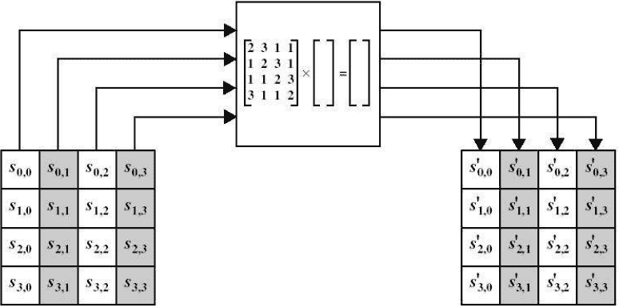

$$
\begin{bmatrix}
02 & 03 & 01 & 01 \\
01 & 02 & 03 & 01 \\
01 & 01 & 02 & 03 \\
03 & 01 & 01 & 02
\end{bmatrix}
\begin{bmatrix}
s_{0,0} & s_{0,1} & s_{0,2} & s_{0,3} \\
s_{1,0} & s_{1,1} & s_{1,2} & s_{1,3} \\
s_{2,0} & s_{2,1} & s_{2,2} & s_{2,3} \\
s_{3,0} & s_{3,1} & s_{3,2} & s_{3,3}
\end{bmatrix}
=
\begin{bmatrix}
s'_{0,0} & s'_{0,1} & s'_{0,2} & s'_{0,3} \\
s'_{1,0} & s'_{1,1} & s'_{1,2} & s'_{1,3} \\
s'_{2,0} & s'_{2,1} & s'_{2,2} & s'_{2,3} \\
s'_{3,0} & s'_{3,1} & s'_{3,2} & s'_{3,3}
\end{bmatrix}
$$

$$
s'_{0,j}=(2\bullet s_{0,j})\oplus(3\bullet s_{1,j})\oplus s_{2,j}\oplus s_{3,j}
$$

$$
s'_{1,j}=s_{0,j}\oplus(2\bullet s_{1,j})\oplus(3\bullet s_{2,j})\oplus s_{3,j}
$$

$$
s'_{2,j}=s_{0,j}\oplus s_{1,j}\oplus(2\bullet s_{2,j})\oplus(3\bullet s_{3,j})
$$

$$
s'_{3,j}=(3\bullet s_{0,j})\oplus s_{1,j}\oplus s_{2,j}\oplus(2\bullet s_{3,j})
$$


## 轮密钥加（Add Round Key）

## 一个简单地按位异或的操作

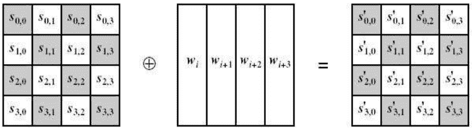

(b) Add Round Key Transformation

# example

| 87 | F2 | 4D | 97 |
|---|---|---|---|
| 6E | 4C | 90 | EC |
| 46 | E7 | 4A | C3 |
| A6 | 8C | D8 | 95 |


| 47 | 40 | A3 | 4C |
|---|---|---|---|
| 37 | D4 | 70 | 9F |
| 94 | E4 | 3A | 42 |
| ED | A5 | A6 | BC |

| A₀,₀ | A₀,₁ | A₀,₂ | A₀,₃ |
|------|------|------|------|
| A₁,₀ | A₁,₁ | A₁,₂ | A₁,₃ |
| A₂,₀ | A₂,₁ | A₂,₂ | A₂,₃ |
| A₃,₀ | A₃,₁ | A₃,₂ | A₃,₃ |

| K₀,₀ | K₀,₁ | K₀,₂ | K₀,₃ |
|------|------|------|------|
| K₁,₀ | K₁,₁ | K₁,₂ | K₁,₃ |
| K₂,₀ | K₂,₁ | K₂,₂ | K₂,₃ |
| K₃,₀ | K₃,₁ | K₃,₂ | K₃,₃ |

| B₀,₀ | B₀,₁ | B₀,₂ | B₀,₃ |
|------|------|------|------|
| B₁,₀ | B₁,₁ | B₁,₂ | B₁,₃ |
| B₂,₀ | B₂,₁ | B₂,₂ | B₂,₃ |
| B₃,₀ | B₃,₁ | B₃,₂ | B₃,₃ |

**A₃,₃ + K₃,₃ = B₃,₃ (mod 2)**

## AES 算法的设计原理

- GF（2⁸）中乘法使用的多项式是8次不可约多项式列表中的第一个多项式。
- ByteSubstitution（称为S盒）在设计时考虑到抵抗差分密码分析、线性密码分析的要求，应满足以下条件：1. 可逆性；2. 输入比特的线性组合与输出比特的组合之间的最大非平凡相关性的极小化；3. 异或差分表中最大非平凡值的极小化；4. GF（2⁸）中代数表示的复杂性；5. 描述的简单性。

满足前3条准则的S盒的构造方法已被给出，AES的作者从众多候选构造中选择将x映射到它的逆的S盒。该映射过于简单，为了抵抗插入攻击，加入仿射变换：

$$b(x)=(x^7+x^6+x^2+x)+a(x)(x^7+x^6+x^5+x^4+1)$$

$$\mod\ x^8+1$$

模数多项式$x^8+1$选择为可能是最简单的模数多项式。

可以找到其它的S盒满足以上准则。

- MixColumn变换符合以下准则：1. 可逆性；2. GF(2)中的线性性；3. 适当的扩散性能；4. 8位处理器上实现速度快；5. 对称性；6. 描述的简单性。选择模数多项式x4+1可满足准则2、5、6。准则1、3、4要求系数的值要小，故选00、01、02、03。

- ByteRotation符合以下准则：1. 4个位移量互不相同且C0=0；2. 能抵抗差分截断攻击；3. 能抗Square攻击；4. 简单。从满足准则2和准则3出发，AES的作者选取了最简单的组合。

## AES的密钥调度

轮密钥是通过密钥调度算法从密钥中产生，包括两个组成部分：密钥扩展和轮密钥选取。基本原理如下：

- 所有轮密钥比特的总数等于分组长度乘轮数加1。（如128比特的分组长度和10轮迭代，共需要1408比特的密钥）
- 将密码密钥扩展成一个扩展密钥。
- 轮密钥按下述方式从扩展密钥中选取：第一个轮密钥由开始Nb个字组成，第二个轮密钥由接下来的Nb个字组成，如此继续下去。

# 密钥扩展的伪代码

```
KeyExpansion(byte key[4 * Nk], word w[Nb * (Nr + 1)], Nk)
begin
    i = 0
    while (i < Nk)
        w[i] = word[key[4*i], key[4*i+1], key[4*i+2], key[4*i+3]]
        i = i + 1
    end while

    i = Nk
    while (i < Nb * (Nr + 1))
        word temp = w[i - 1]
        if (i mod Nk = 0)
            temp = SubWord(RotWord(temp)) xor Rcon[i / Nk]
        else if (Nk = 8 and i mod Nk = 4)
            temp = SubWord(temp)
        end if
        w[i] = w[i − Nk] xor temp
        i = i + 1
    end while
end
```

Note that Nk=4, 6, and 8 do not all have to be implemented; they are all included in the conditional statement above for conciseness. Specific implementation requirements for the Cipher Key are presented in Sec. 6.1.

# 伪代码之二

```
KeyExpansion (byte key[16], word w[44])
{
    word temp
    for (i = 0; i < 4; i++)
        w[i] = (key[4*i], key[4*i + 1], key[4*i + 2], key[4*i + 3]);
    for (i = 4; i < 44; i++)
    {
        temp = w[i − 1];
        if (i mod 4 = 0)    temp = SubWord (RotWord (temp)) ⊕ Rcon[i/4];
        w[i] = w[i−4] ⊕ temp
    }
}
```

# AES的密钥扩展

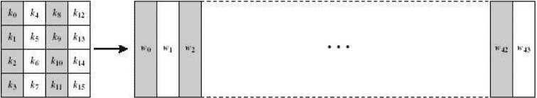

(b) Key and expanded key

## G变换

- Rotword执行字节循环左移  
  [b0,b1,b2,b3] [b1,b2,b3,b0]

- Subword执行使用S-盒实行字节替换

- 前两步的结果XOR与轮常数Rcon[j]

| j   | 1   | 2   | 3   | 4   | 5   | 6   | 7   | 8   | 9   | 10   |
|-----|-----|-----|-----|-----|-----|-----|-----|-----|-----|------|
| RC[j] | 01  | 02  | 04  | 08  | 10  | 20  | 40  | 80  | 1B  | 36   |

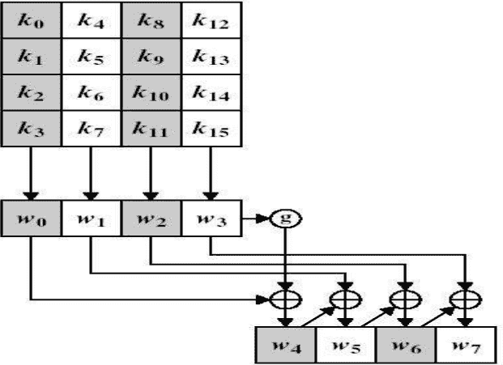

# Figure 5.6 AES Key Expansion

## 分组密码的工作模式

## 多重DES

C = E<sub>K2</sub>(E<sub>K1</sub>(P))   P = D<sub>K1</sub>(D<sub>K2</sub>(C))

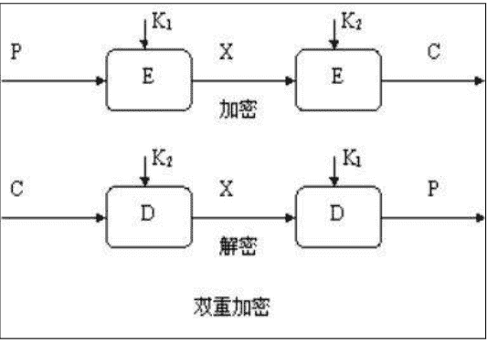

## 中间相遇(meet-in-the-middle)攻击

C = E<sub>K2</sub>(E<sub>K1</sub>(P)) X = E<sub>K1</sub>(P) = D<sub>K2</sub>(C)

- 给定明文密文对(P, C)
- 1. 对所有2<sup>56</sup>个密钥，加密P，对结果排序
- 2. 对所有2<sup>56</sup>个密钥，解密C，对结果排序
- 3. 逐个比较，找出K<sub>1</sub>, K<sub>2</sub>使得E<sub>K1</sub>(P) = D<sub>K2</sub>(C)


+ 攻击用的代价{加密或解密所用运算次数} ≤ 2 × 2^56：
+ E_K2 (E_K1 (P))
+ 需要大量的存储器存放X: 2^56 × 64=10^17字节: (从64比特分组到一个64分组的置换)

C=E_{K1}(D_{K2}(E_{K1}(P)))
P=D_{K1}(E_{K2}( D_{K1}(C)))

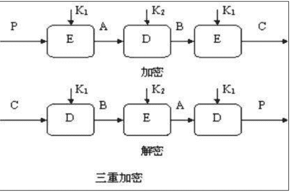

## 电码本模式 ECB (electronic codebook mode)

## 密文分组链接模式 CBC (cipher block chaining)

## 密文反馈模式 CFB (cipher feedback)

## 输出反馈模式 OFB (output feedback)

## 计数器模式 CTR (counter)

## XTS-AES模式

# 电码本ECB模式

ECB(electronic codebook)模式是最简单的运行模式，它一次对一个64比特长的明文分组加密，而且每次的加密密钥都相同。当密钥取定时，对明文的每一个分组，都有一个唯一的密文与之对应。最后一个分组如果不够64比特，则需要填充。

因此形象地说，可以认为有一个非常大的电码本，对任意一个可能的明文分组，电码本中都有一项对应于它的密文。

# ECB的特点

- 简单和有效
- 可以并行实现
- 不能隐藏明文的模式信息

相同明文生成相同密文，同样信息多次出现造成泄漏。

- 对明文的主动攻击是可能的

信息块可被替换、重排、删除、重放。

- 误差传递：密文块损坏仅对应明文块损坏
- 适合于传输短信息

# 电码本ECB模式

$C_i=E_K(P_i)\Leftrightarrow P_i=D_K(C_i)$

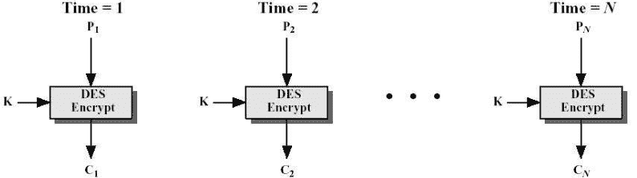

(a) Encryption


(b) Decryption

# 2. 密文分组链接(CBC)模式


# 2. 密文分组链接(CBC)模式


# CBC的特点

- 没有已知的并行实现算法
- 能隐藏明文的模式信息
- 需要共同的初始化向量IV
- 相同明文生成不同密文
- 对明文的主动攻击是不容易的，信息块不容易被替换、重排、删除、重放
- 误差传递：密文块损坏影响两个明文块
- 安全性好于ECB
- 适合于传输长度大于64位的报文，还可以进行用户鉴别，是大多数系统的标准如SSL、IPSec

# 3. 密文反馈（CFB）模式

如上所述，DES是分组长为64比特的分组密码，但利用CFB（cipher feedback）模式或OFB模式可将DES转换为流密码。流密码不需要对消息填充，而且运行是实时的。因此如果传送字母流，可使用流密码对每个字母直接加密并传送。

# 无线通讯使用流密码

# CFB加密模式示意图

IV(移位寄存器Si初始值)

64-j比特 | j比特

K

DES 加密

选j比特 | 丢弃64-j比特

c1

P₁

64-j比特 | j比特

K

DES 加密

选j比特 | 丢弃64-j比特

c2

P₂

Cm-1

64-j比特 | j比特

K

DES 加密

选j比特 | 丢弃64-j比特

Cm

Pm

加密：Ci = Pi （Ek(Si)的高j位）  
Si+1=(Si<<j) | Ci

# CFB的特点

- 分组密码fi 流密码
- 没有已知的并行实现算法
- 隐藏了明文模式
- 需要共同的移位寄存器初始值IV
- 对于不同的消息，IV必须唯一
- 误差传递：一个单元损坏影响多个单元

# 4 输出反馈OFB

- OFB: 分组密码 流密码
- 假定：Si 为移位寄存器，传输单位为 jbit

# OFB模式加密示意图

IV(移位寄存器)

64-j比特 | j比特

K

DES 加密

选j比特 | 丢弃64-j比特

c1

P1

64-j比特 | j比特

K

DES 加密

选j比特 | 丢弃64-j比特

c2

P2

Cm-1

64-j比特 | j比特

K

DES 加密

选j比特 | 丢弃64-j比特

Cm

Pm

加密： Ci = Pi （EK(Si）的高j位）
Si+1=(Si<<j) | （EK(Si）的高j位）

# OFB模式解密示意图


# OFB的特点

- 分组密码fi 流密码
- 没有已知的并行实现算法
- 隐藏了明文模式
- 需要共同的移位寄存器初始值IV
- 对于不同的消息， IV必须唯一
- 误差传递： 一个单元损坏只影响对应单元
- 对明文的主动攻击是可能的，信息块可被替换、重排、删除、重放
- 安全性较CFB差

# 计数器模式

- CTR应用于ATM网络安全与IPsec中。
- 计数器使用与明文分组规模相同的长度；
- 对于不同的消息，计数器的值不同（模2b，其中b为分组的大小）；
- 计数器先被初始化一个值，随着消息块的增加计数器值加1；
- 解密使用相同值的计数器序列；

# 计数器模式加/解密示意图


# CTR模式的特点

- 硬件效率：并行实现算法，吞吐量仅受并行数量的限制；
- 软件效率：每个时钟周期的多指令并行特征；
- 预处理：用来准备用于XOR函数的加密盒的输出。
- 随机访问：密文的第i个明文组能够用一种随机访问的方式处理。
- 可证明安全性：
- 简单性

# XTS-AES模式特点

- XTS-AES加密模式的特点是：
  1. disk block（如一个扇区）分成多个 cipher block（如AES-128的128bit）；
  2. 各cipher block之间独立（没有CBC那样的dependency）；
  3. cipher block的加密输入包含了index信息（扇区号和块号）；
  4. XTS-AES是可以随机访问的，其加密解密也是可以并行化的，因为各块之间是没有依赖关系的（类似于ECB或Counter模式），这也是TrueCrypt一直强调的可以实现Parallelization。

## 伪随机数产生和流密码

## Pseudo Random Number Generator


- To Generate a sequence which is long period, average distributed and non-predicted
- The sources of input must be independent and non-predicted

## 串流加密器

- 明文之位元串(Bit Stream)與亂數產生器(Pseudo Random Number Generator)經過適當地運算(例如\(\oplus\))而得到的密文
- 可視為一個位元之塊狀加密器(Block Cipher)
- 一種具記憶性元件(Memory Device)，即前後之擬亂序列可互相影響

## 串流加密系统方块图

密文位元串

明文位元串

加密器

解密器

明文位元串

擬亂序列

擬亂序列

副數產生器

金匙

## 亂數產生器


## 亂數產生器

- 有下列幾種：
  - 線性反饋移位暫存器(Linear Feedback Shift Register，LFSR)
  - 線性同餘產生器(Linear Congruence Generator，LCG)
  - 非線性亂數產生器
  - 截切亂數產生器
  - 利用數學方法之亂數產生器

## 線性反饋移位暫存器(LFSR)


## LFSR之架構圖

a<sub>n</sub> = \(\sum_{j=1}^L -a_{n-j}c_j\) (L: 暫存器之數目)

- 移位暫存器愈長愈能使安全性提高
- 理論上 $L=n$ 位元之 LFSR 最多可以產生 $(2^n-1)$ 位元長度之擾亂序列，此 $2^n-1$ 稱為 LFSR 之最大長度

## EX1

初值：(1,0,0) → 輸出  
(0,1,1) → 0  
(1,0,1) → 1  
(1,1,0) → 1  
(0,1,1) → 0  

註：\( C_x \) 在 \( GF(2) \) 中為可分解之多項式  

\( C_x = x^3 + x^2 + x \)  


## EX2

初值：(1 , 0 ,1) → 輸出  
(0 ,1 ,0) → 1  
(0 ,0 ,1) → 0  
(1 ,0 ,0) → 1  
(1 ,1 ,0) → 0  
(1 ,1 ,1) → 0  
(0 ,1 ,1) → 1  
(1 ,0 ,1) → 1  

C_x=x^3+x^2+1  


## 利用許多 LFSR 做 XOR 之運算而得到更大之週期


輸出週期為 \( \text{lcm}(2^{n_1} - 1, 2^{n_2} - 1) \)

我們可在n位元LFSR之情況下，利用2n個輸出位元找出它的起始狀態及回授條件

[k_1 k_2 k_3 c_0] = [k_4] [1 0 1] [c_0] = [0]  
[k_2 k_3 k_4 c_1] = [k_5] . [0 1 0] [c_1] = [0]  
[k_3 k_4 k_5 c_2] = [k_6] [1 0 0] [c_2] = [1]

可以得到c_0=1，c_1=0，c_2=1，所以回授多項式C(x)=x^3+x^2+1

12

## 非線性亂數產生器


## 線性同餘產生器(LCG)

\( x_i = ax_{i-1} + b \, (\text{mod } m) \)

\( x_0 \) 為初值，\( a \)，\( b \) 及 \( m \) 為秘密金匙。給定一個初值後，便依此公式依序產生隨機亂數。依數論原理，只要適當地選擇 \( a \)，\( b \) 及 \( m \) 便可以得到不重覆的整數共 \( m \) 個。

## 截切亂數產生器

利用一般LFSR或LCG產生之擬亂序列，從中截取幾段，然後依序送出做為輸出。例如：\( x_i=5x_{i-1}+3 \, (\text{mod } 16) \) 且 \( x_0=1 \)，則結果為 \(\{1, 8, 11, 10, 5, 12, 15, 14, 9, 10, 0, 3, 2, 13, 4, 7, 6, 1, 8\}\)。  
我們可以從中截取數段如底下畫線者，便得輸出為 \(\{8, 11, 10, 12, 15, 14, 10, 0, 3, 13, 4, 7\}\)。

## 利用數學方法之亂數產生器

## 分解因數法：
給定一初值\(x_0, x_0 < N\)，令輸出 \(x_{i+1} \equiv x_i^e \pmod N\)，其中 \((e, N)\) 為RSA 系統之公開金匙。

## 離散對數法：
\(x_i^t \equiv x_{i+1} \pmod p\)，其中 \(t\) 為常數，滿足 \(t\) 與 \(p-1\) 互質。

## 二次剩餘法：

找兩個大質數p及q，滿足 \( p \equiv q \equiv 3 \pmod{4} \)，再令 \( n = p \times q \) 稱為 Blum Integer。再找另一個整數 \( r \) 滿足 \( (r, n) = 1 \)，計算 \( x_0 = r^2 \pmod{n} \)。令 \( x_0 \) 為初值，再依下列公式依序求出輸出 \( x_{i+1} = x_i^2 \pmod{n} \)。

只要知道 \( x_0 \) 便可依下例公式求出 \( x_i \)，\( x_i = x_0^{(2^i) \mod [(p-1)(q-1)]} \pmod{n} \)

## 質數法：

首先是找到一個大質數p(最好是強質數，詳見本書第七章)，由1除p得到一長串之純小數，然後令小數點後第一個非0之數字開始為輸出。由於p為質數，所以其最大週期T可以等於p-1。

- 请庚亚峰扫描图7.1 图7.2 图7.3 图7.4
  图7.5 图7.6

## 数论入门

## 完全剩余系 Complete Set of Residues

$Z_n=\{0, 1, 2, ..., n-1\}$

定义：由同余概念，所有整数在模$n$中分成$n$类，以$n$整除余数为1的数为一类，为2的数为一类，以此类推，将每一类中取一个数作为代表形成的集合。

**素数：**又叫质数，除了1和本身，不能被其他数整除的数

**公因子：**$a,b$为整数，整除$a$的数组成集合$A$，整除$b$的数组成集合$B$，$C=A\cap B$，$C$中的元素称为$a$和$b$的公因子。

$(a,b)$表示$a$和$b$的最大公因子（gcd, Great Common Divisor），  
$(a,b)=1$表示$a$与$b$互素

**既约剩余系 Reduced Set of Residues $Z_n^*$：**在模$n$的完全剩余系中，若将所有与$n$互素的数形成的集合

如：$n=10$

　　完全剩余系？  
　　既约剩余系？

- n=10  
- 完全剩余系{0, 1, 2, 3, 4, 5, 6, 7, 8, 9}  
- 既约剩余系{1, 3, 7, 9}

乘法逆元： 在模n的既约剩余系中取一整数a，则必存在另一整数b(也属于此既约剩余系)，使得 ab =1 mod n, 且此解唯一。此时， 称b为a在模n的乘法逆元， b可表示为a⁻¹

### 求乘法逆元： 已知a, n, 且 （a, n）=1，  
如何求a⁻¹， 使得 a× a⁻¹ =1 mod n?

## 1.利用欧几里得算法

欧几里得算法（Euclidean Algorithm,也叫辗转相除法）， 用于求gcd

## 2.利用欧拉函数φ(n)（Euler Totient Function）

φ(n)为小于n, 且与n互素的所有整数的个数。即  
φ(n)为模n的既约剩余系中所有元素的个数

## 欧拉定理（Euler’s Theorem）

- 若 \((a,n)=1\)，则 \(a^{\phi(n)}=1\pmod n\)

利用欧拉定理求乘法反元素 \(a^{-1}\)

若 \(\phi(n)\) 已知，则由欧拉定理可知 \(a*a^{\phi(n)-1}=1\pmod n\)

\(a^{-1}=a^{\phi(n)-1}\)

\(a^{-1}=3\)

假设 \(a=3,n=8\)，利用欧拉定理，求 \(a^{-1}\)

## 欧拉定理的证明

- Thm:Let s={r<sub>1</sub>,...,r<sub>φ(n)</sub>} be a reduced residue system modulo n, if (a,n)=1, a∈Z<sup>+</sup>, then the set s'={ar<sub>1</sub>,ar<sub>2</sub>,...,ar<sub>φ(n)</sub>} is also a reduced residue system modulo n.

\(\prod_{i=1}^{\phi(n)}(ar_i) \mod n = \prod_{i=1}^{\phi(n)}(r_i) \mod n\)

\((a^{\phi(n)} \mod n)(\prod_{i=1}^{\phi(n)}(r_i) \mod n) = \prod_{i=1}^{\phi(n)}(r_i) \mod n\)

\(a^{\phi(n)} \mod n = 1\)


## 费马定理 （Fermat’s Theorem）

- Thm：If \( p \) is prime and \( (a, p) = 1 \)  
  then \( a^{p-1} = 1 \mod p \).  
  where \( (a, p) = 1 \)

## 单变量线性同余 （Linear Congruence in One Variable）

- 定义：已给整数 \( a, b \) 及 \( n > 0 \)，\( ax = b \mod n \)，其中 \( x \) 为变量。

问题：上式是否有解，如果有解，解是什么？

定理：令 \( a, b, n \) 为整数，且 \( a > 0 \)，\( (a, n) = d \)

1. 若 \( d \) 不能整除 \( b \)，则 \( ax = b \mod n \) 无解  
2. 若 \( d \) 能整除 \( b \)，记作 \( d \mid b \)，则 \( ax = b \mod n \) 有 \( d \) 个解

- \( ax = b \mod n \) 的求解过程：

1. 利用欧几里德算法求出 \( d = (a, n) \)  
   若 \( d \) 不能整除 \( b \)，则无解。
2. 若 \( d \) 能整除 \( b \)，则令：  
   \( a' = \frac{a}{d}, b' = \frac{b}{d}, n' = \frac{n}{d} \)  
   因为 \( (a', n') = 1 \)，\( a'x' = b' \mod n' \) 有唯一解，  
   假设此解为 \( x_0 \)  
   利用欧几里德算法求出 \( a' \) 模 \( n' \) 的乘法逆元  
   \( (a')^{-1} \)，\( x' = (a')^{-1}b' \mod n' \)  
   \( x_0 = x' \mod n \)  
   令 \( x = x_0 + (n/d)t \mod n \)，\( t = 1, 2, \ldots, d-1 \)，即可求出剩下的 \( d-1 \) 个解

- 求解 \( 9x = 12 \mod 15 \)

1. 求出 \( d = (a, n) = (9, 15) = 3 \)  
   3 能整除 12，因此 \( x \) 有解，且有 3 个解

2. \( a' = \frac{a}{d} = 3, b' = \frac{b}{d} = 4, n' = \frac{n}{d} = 5 \)  
   \( 3x' = 4 \mod 5 \)  
   \( 3 \times 2 = 1 \mod 5 \)  
   \( 3^{-1} = 2 \mod 5 \)  
   \( x' = (2 \times 4) \mod 5 = 3 \)  
   \( x_0 = x' \mod n = 3 \mod 15 = 3 \)  
   \( x_1 = x_0 + (\frac{n}{d}) \times t_1 = 3 + (\frac{15}{3}) \times 1 = 8 \)  
   \( x_2 = x_0 + (\frac{n}{d}) \times t_2 = 3 + (\frac{15}{3}) \times 2 = 13 \)

## Chinese Remainder Theorem （中国剩余定理）

- 韩信点兵问题：「今有物不知其数，三三数之剩二，五五数之剩三，七七数之剩二，问物几何？」～（孙武 孙子算经）

也就是求正整数 \( x \)，使得  
\( x \equiv 2 \pmod{3} \)  
\( x \equiv 3 \pmod{5} \)  
\( x \equiv 2 \pmod{7} \)  

两个问题？  
1. \( x \) 是否存在？  
2. 如何求 \( x \)？

- 回答(1)：中国剩余定理  
  令 \( n_1, n_2, \ldots, n_t \) 为两两互素的正整数，  
  令 \( N = n_1 n_2 \ldots n_t \)  
  则以下同余系统中，\( x \equiv a_1 \pmod{n_1}, \quad x \equiv a_2 \pmod{n_2}, \quad \ldots, \quad x \equiv a_t \pmod{n_t} \)，\( x \) 会在 \([0, N-1]\) 中有唯一解  

  证明：  
  由于 \( n_1, n_2, \ldots, n_t \) 为两两互素的正整数，故对所有 \( i = 1, 2, \ldots, t \)，\( (n_i, N/n_i) = 1 \)。因此，存在 \( y_i \)，使得 \( (N/n_i)y_i \equiv 1 \pmod{n_i} \)。  

  若我们令  
  \[ x = \left(\frac{N}{n_1}\right)y_1a_1 + \left(\frac{N}{n_2}\right)y_2a_2 + \ldots + \left(\frac{N}{n_t}\right)y_ta_t \pmod{N} \]  

  则 \( x \) 是上述同余系统的解，因为对于所有 \( i \)，\( 1 \leq i \leq t \)，  
  \[ x \pmod{n_i} = \left(\frac{N}{n_i}\right)y_ia_i \pmod{n_i} = a_i \]

- 回答(2)：  
  \( N = 3 \times 5 \times 7 = 105 \)，  
  \( N/n_1 = 105/3 = 35 \)，  
  \( N/n_2 = 105/5 = 21 \)  
  \( N/n_3 = 105/7 = 15 \)  
  \( 35y_1 = 1 \mod 3 \)，\( y_1 = 2 \)  
  \( 21y_2 = 1 \mod 5 \)，\( y_2 = 1 \)  
  \( 15y_3 = 1 \mod 7 \)，\( y_3 = 1 \)  
  \( x = 35 \times 2 \times 2 + 21 \times 1 \times 3 + 15 \times 1 \times 2 = 23 \mod 105 \)

> 「三人同行七十稀  
> 五树梅花廿一枝  
> 七子团圆正半月  
> 除百零五便得知。」  
> ——（程大位《算法统宗》(1593)）

## Ex：Use CRT to solve the system

\( x = 1 \mod 3 \)  
\( x = 2 \mod 5 \)  
\( x = 3 \mod 7 \)

## 大素数产生

- 素数生成过程：  
  随机选择一个奇数 \( n \)（如通过伪随机数发生器）  
  随机选择 \( a \)，使 \( a < n \)  
  进行素性测试（例如用 Miller-Rabin 算法），若 \( n \) 没有通过测试，抛弃 \( n \)，转到  
  如果通过了足够次数的测试，认为 \( n \) 是素数。

- 素数理论：在 \( N \) 附近，每 \( \ln(N) \) 个整数中有一个素数

## 离散对数：

离散对数问题可以描述为：给定一个质数 \( p \)，和有限域 \( Z_p \) 上的一个本原元 \( a \)，对 \( Z_p \) 上整数 \( b \)，寻找唯一的整数 \( c \)，使得 \( a^c \equiv b \pmod{p} \)。

一般的，如果仔细选择 \( p \)，则认为该问题是难解的，且目前还没有找到计算离散对数问题的多项式时间算法。

为了抵抗已知的攻击，\( p \) 至少应该是 150 位的十进制整数，且 \( p-1 \) 至少有一个大的素数因子。

此章内容需要板书，提前 rehearsal

## 公钥密码

## 问题的提出

## （1）密钥管理量的困难

传统密钥管理：两两分别用一对密钥时，则 \( n \) 个用户需要 \( C(n,2) = n(n-1)/2 \) 个密钥，当用户量增大时，密钥空间急剧增大。如：

\( n = 100 \) 时，\( C(100,2) = 4,995 \)  
\( n = 5000 \) 时，\( C(5000,2) = 12,497,500 \)

## （2）数字签名的问题

传统加密算法无法实现抗抵赖的需求。

## （3）密钥必须经过安全的信道分配

- 从最初一直到现代，几乎所有密码系统都建立在基本的**替代和置换**工具的基础上。  
- 在用了数千年的本质上可以手算完成的算法之后，常规的密码学随着**转轮加密/解密机**的发展才出现了一个重大进步。  
- 机电式变码旋转软件使得极其复杂的密码系统被研制出来。有了计算机后，更加复杂的系统被设计出来。  
- 但是不管是转轮机还是后来的 DES（数据加密标准），虽然代表了重要的进展，却仍然依赖于替代和置换这样的基本工具。

# 公钥密码学历史上唯一的一次真正的革命

## 公钥密码的应用

- 加密/解密  
- 数字签名  
- 密钥交换

## 公钥密码系统的 加密 原理

- 每个通信实体有一对密钥（公钥，私钥）。**公钥公开**，用于**加密**和验证签名，**私钥保密**，用**解密**和签名。

✓ 任何人向 B 发送信息都可以使用同一个密钥（B 的公钥）加密；  
✓ 没有其他人可以得到 B 的私钥，所以只有 B 可以解密；

## 公钥密码体制的 加密


Figure 9.2 Public-Key Cryptosystem: Secrecy

## 公钥密码体制的 加密 功能

A 向 B 发消息 \( X \)：  
--> B 的公钥为：\( KU_b \)；私钥为：\( KR_b \)

--> 加密：\( Y = E_{KUb}(X) \)

--> 解密：\( X = D_{KR_b}(Y) \)

## 公钥密码系统的 签名/认证 原理


- A 向 B 发送消息，用 A 的私钥加密（签名）  
- B 收到密文后，用 A 的公钥解密（验证）


## 公钥密码体制的认证

A向B发送消息X，

- A的公钥为KU<sub>a</sub>，私钥为KR<sub>a</sub>；
- “加密”：Y = E<sub>KRa</sub>(X)（数字签名）
- “解密”：X = D<sub>KUa</sub>(Y)（验证签名）

注意：签名不能保证消息的保密性

## 具有保密与认证的公钥体制

## 鉴别与保密

$A \to B: Z = E_{KU_b}(E_{KR_a}(X))$

$B: E_{KU_a}(E_{KR_b}(Z)) = X$

## 机器学习

机器学习是人工智能的重要研究领域，旨在通过计算手段利用经验改善系统性能。

机器学习涉及概率论、统计学、逼近论、凸分析、算法复杂度理论等多门学科。

根据学习方式的不同，机器学习可分为监督学习、无监督学习、半监督学习和强化学习等。

监督学习通过已有标注数据训练模型，常用算法包括线性回归、决策树、支持向量机等。

## 公钥密钥的应用范围

- ① 加密/解密：
- ② 数字签名(身份鉴别)
- ③ 密钥交换

公钥密钥遭受穷举攻击，密码越长越好；但为了加解密，密钥又要足够短；因此公钥密码仅限于密钥管理和签名中。

| 算法 | 加/解密 | 数字签名 | 密钥交换 |
|---|---|---|---|
| RSA | 是 | 是 | 是 |
| Diffie-Hellman | 否 | 否 | 是 |
| DSS | 否 | 是 | 否 |

## 公钥密码的要求

- **涉及到各方**：发送方、接收方、攻击者
- **涉及到数据**：公钥、私钥、明文、密文
- **公钥算法的条件**：
  - 产生一对密钥是**计算可行的**
  - 已知公钥和明文，产生密文是**计算可行的**
  - 接收方利用私钥来解密密文是**计算可行的**
  - 对于攻击者，利用公钥来推断私钥是**计算不可行的**
  - 已知公钥和密文，恢复明文是**计算不可行的**
  - （可选）加密和解密的**顺序可交换**

## 满足上述条件找到单向陷门函数函数

- 满足下列条件的函数$f$：
  1. 给定$x$，计算$y=f(x)$是容易的；
  2. 给定$y$，计算$x$使$y=f(x)$是困难的；
  3. 存在$z$，已知$z$时，对给定的任何$y$，若相应的$x$存在，则计算$x$使$y=f(x)$是容易的；

所谓计算$x=f^{-1}(y)$困难是指计算上相当复杂，已无实际意义。

> 寻找合适的单向陷门函数是公钥密码体制应用的关键

## 单向陷门函数说明

- 仅满足(1)、(2)两条的称为单向函数；第(3)条称为陷门性，z称为陷门信息；
- 当用陷门函数f作为加密函数时，可将f公开，这相当于公开加密密钥，此时加密密钥便称为公开密钥，记为Pk；
- f函数的设计者将z保密，用作解密密钥，此时z称为秘密钥匙，记为Sk。由于设计者拥有Sk，他自然可以解出$x=f^{-1}(y)$；
- 单向陷门函数的第(2)条性质表明窃听者由截获的密文$y=f(x)$推测x是不可行的；

## 人物介绍

1976年，美国斯坦福大学教授赫尔曼(E.Hellman)和他的研究助理迪菲(W.Diffie)，以及博士生默克勒(R.C.Merkle)（简称为DHM）首先创立并发表了所谓的“公钥密码体制”（public key cryptography），即加密、解密用两个不同的键，加密用公钥（public key），即可以公开，不必保密，任何人都可以用；解密用私钥（private key），此钥必须严加管理，不能泄漏。更为称绝的是，他们还发明了所谓的数字签名（digital signatures）技术，即用私钥签名，再用公钥验证。

当然，DHM只是提出了一种关于公钥密码体制与数字签名的思想，而没有真正实现。不过，他们确实是实现了一种体现公钥密码体制思想、基于离散对数问题的、在不安全的通道上进行密钥形成与交换的新技术。

## RSA算法

- 由MIT的 Rivest, Shamir & Adleman 在 1977 提出；
- 最著名的且被广泛应用的公钥加密体制；
- 明文、密文是0到n-1之间的整数，通常n的大小为1024位或309位十进制数。

## RSA算法的实现

实现的步骤如下：Bob为实现者

- (1) Bob寻找出两个大素数p和q；
- (2) Bob计算出n=pq 和 $\Phi(n)=(p-1)(q-1)$；
- (3) Bob选择一个随机数e ($0<e<\Phi(n)$)，满足$(e, \Phi(n))=1$；
- (4) Bob使用辗转相除法计算$d=e^{-1}(\bmod \Phi(n))$，即$ed=1(\bmod(p-1)(q-1))$；
- (5) Bob在目录中（e,n）作为公钥；
- (6) (d,n)或者d作为私钥。

密码分析者攻击RSA体制的关键点在于：如何分解n。若分解成功使n=pq，则可以算出$\phi(n)=(p-1)(q-1)$，然后由公开的e，解出秘密的d。

## RSA Example

- 1. Select primes: $p=17$ & $q=11$
- 2. Compute $n=pq=17\times11=187$
- 3. Compute $\varnothing(n)=(p-1)(q-1)=16\times10=160$
- 4. Select $e$: $\gcd(e,160)=1$; choose $e=7$
- 5. Determine $d$: $de=1\mod160$ and $d<160$
  Value is $d=23$ since $23\times7=161=1\times160+1$
- 6. Publish public key $KU=\{7,187\}$
- 7. Keep secret private key $KR=\{23,187\}$

## RSA Example cont

sample RSA encryption/decryption is:

given message M = 88 (nb. 88<187)

- 8. encryption:

C = M^e mod N = 88^7 mod 187 = 11

- 9. decryption:

M = C^d mod N = 11^23 mod 187 = 88

## 算法的证明

## 加密算法：

假设 M 是明文（M<n），那么密文就是 C = M<sup>e</sup>mod n。

## 解密算法：

假设 C 是密文，那么明文就是 M = C<sup>d</sup> mod n。

证明：

(1) 由于 C<sup>d</sup> = M<sup>e*d</sup> = M<sup>k*Φ(n)+1</sup> (mod n)，

如果 M 和 n 是互素的，

显然直接由欧拉定理我们就能得到：

C<sup>d</sup> = M<sup>k*Φ(n)</sup>*M<sup>1</sup> = M (mod n) = M。

ed≡1(mod(p-1)(q-1))

(2) 如果 M 和 n 不互素，

由于 n 是两个素数 p 和 q 的乘积且 M<n，
e*d = 1(mod Φ(n)) = 1(mod (p-1)(q-1)) ， 可以得到：
e*d = 1(mod (p-1)) 且 e*d = 1(mod (q-1))。
则 e*d 可以写成： e*d = k*(p-1)+1, e*d = h*(q-1)+1 （k、 h为整数）

由费马小定理：

M^e*d = M^k*(p-1)+1 = M(mod p) 和 M^e*d = M^h*(q-1)+1 = M(mod q)。

所以我们有：
C^d = M^e*d = M (mod p*q) = M (mod n) = M

Fermat定理：

若P为素数， a是正整数且不能被p整除，则a^p-1=1 mod p.

Euler定理：

对于任意互素的a和n， 有a^Φ(n)≡1 mod n.
*欧拉定理及定理的证明必须掌握*


## RSA 的安全性

三种攻击 RSA 的方法：

1. 强力穷举密钥：

   尝试所有可能的密钥。因此，e 和 d 的位数越大，算法就越安全。然而，在密钥产生和加密解密中使用的计算都非常复杂，所以密钥越大，系统运行越慢。

2. 时间攻击：

   依赖解密算法的运行时间，利用 CPU 处理某些特殊的模乘比较慢的规律来确定每一位指数。

3. 数学攻击：实质上是对两个素数乘积的分解。

   RSA 的安全性是基于大整数素因子分解的困难性，而大整数因子分解问题是数学上的著名难题，至今没有有效的方法予以解决，因此可以确保 RSA 算法的安全性。现在，人们已能分解 100 多个十进制位的大素数。因此，模数 n 必须选大一些，因具体适用情况而定。目前，人们已能分解 140 多个十进制位的大素数，这就要求使用更长的密钥，速度更慢。

## RSA 算法的安全性分析

1. 密码分析者攻击 RSA 体制的关键点在于**如何分解 n**。
2. 若分解成功，得到 n = pq，则可以算出 φ(n) = (p-1)(q-1)，然后由公开的 e 解出秘密的 d。
3. 若使 RSA 安全，**p 与 q 必须为足够大的素数**，使分析者没有办法在多项式时间内将 n 分解出来。

素数：只能被 1 和它本身整除的自然数；否则为合数。

每个合数都可以唯一地分解为素数因子：

6 = 2 · 3

999999 = 3·3·3·7·11·13·37

27641 = 131·211

从 2 开始试验每一个小于等于 √27641 的素数。

| 整数 n 的十进制位数 | 因子分解的运算次数 | 所需计算时间（每微秒一次） |
| --- | --- | --- |
| 50 | 1.4×10^10 | 3.9小时 |
| 75 | 9.0×10^12 | 104天 |
| 100 | 2.3×10^15 | 74年 |
| 200 | 1.2×10^23 | 3.8×10^9年 |
| 300 | 1.5×10^29 | 4.0×10^15年 |
| 500 | 1.3×10^39 | 4.2×10^25年 |

- 建议选择 p 和 q 大约是 100 位的十进制素数；
- 模 n 的长度要求至少是 512 比特；
- EDI 标准使用的 RSA 算法中规定 n 的长度为 512 至 1024 比特位之间，但必须是 128 的倍数；
- 国际数字签名标准 ISO/IEC 9796 中规定 n 的长度为 512 比特位。

为了抵抗现有的整数分解算法，对 RSA 模 n 的素因子 p 和 q 还有如下要求：

1. |p-q| 很大，通常 p 和 q 的长度相同；
2. p-1 和 q-1 分别含有大素因子 p1 和 q1；
3. p1-1 和 q1-1 分别含有大素因子 p2 和 q2；
4. p+1 和 q+1 分别含有大素因子 p3 和 q3。

为了提高加密速度，通常取 e 为特定的小整数：

- 如 EDI 国际标准中规定 \( e = 2^{16} + 1 \)
- ISO/IEC 9796 中甚至允许取 \( e = 3 \)，这时加密速度一般比解密速度快 10 倍以上。

## RSA 的速度

- ① 由于进行的都是大数计算，使得 RSA 最快的情况也比 DES 慢上 100 倍，无论是软件还是硬件实现。
- ② 速度一直是 RSA 的缺陷。一般来说只用于少量数据加密。

## RSA 的缺点

- ① 产生密钥很麻烦，受到素数产生技术的限制，因而难以做到一次一密。
- ② 分组长度太大。
- ③ 为保证安全性，n 至少也要 600 bits 以上，使运算代价很高，尤其是速度较慢，较对称密码算法慢几个数量级；且随着大数分解技术的发展，这个长度还在增加，不利于数据格式的标准化。
- ④ 目前，SET（Secure Electronic Transaction）协议中要求 CA 采用 2048 比特长的密钥，其他实体使用 1024 比特的密钥。

## RSA 算法应用

- ① RSA 为公用网络上信息的加密和鉴别提供了一种基本的方法。它通常是先生成一对 RSA 密钥，其中之一是保密密钥，由用户保存；另一个为公开密钥，可对外公开，甚至可在网络服务器中注册。人们用公钥加密文件发送给个人，个人就可以用私钥解密接收。为提高保密强度，RSA 密钥至少为 500 位长，一般推荐使用 1024 位。
- ② RSA 系统是公钥系统中最具有典型意义的方法，大多数使用公钥密码进行加密和数字签名的产品和标准使用的都是 RSA 算法。
- ③ 单钥密码加密速度快，人们用它来加密较长的文件，然后用 RSA 来给文件密钥加密，极好地解决了单钥密码的密钥分发问题。

## 第五讲 公钥密码

## 问题的提出

## （1）密钥管理量的困难

传统密钥管理：两两分别用一对密钥时，则 n 个用户需要 C(n,2) = n(n-1)/2 个密钥，当用户量增大时，密钥空间急剧增大。如：

- n = 100 时，C(100,2) = 4,950
- n = 5000 时，C(5000,2) = 12,497,500

## （2）数字签名的问题

传统加密算法无法实现抗抵赖的需求。

## （3）密钥必须经过安全的信道分配

## 5.1 公钥密码学

## 5.1.1 公钥密码机制

- 公开密钥算法是非对称算法，即密钥分为公钥和私钥，因此称双密钥体制。
- 双钥体制的公钥可以公开，因此也称公钥算法。
- 基于数学函数而不是替代和置换，密码学历史上唯一的一次真正的革命。
- 公钥密码学是 1976 年由 Diffie 和 Hellman 在其《密码学新方向》一文中提出的。公钥算法的出现，给密码学的发展开辟了新的方向。公钥算法虽然已经历了 20 多年的发展，但仍具有强劲的发展势头，在鉴别系统和密钥交换等安全技术领域起着关键的作用。

从最初一直到现代，几乎所有密码系统都建立在基本的替代和置换工具的基础上。在用了数千年的本质上可以手算完成的算法之后，常规的密码学随着转轮加密/解密机的发展才出现了一个重大进步。机电式转轮密码机使得极其复杂的密码系统被研制出来。有了计算机后，更加复杂的系统被设计出来。但是不管是转轮机还是后来的 DES（数据加密标准），虽然代表了重要的进展，却仍然依赖于替代和置换这样的基本工具。

## 密码学历史上唯一的一次真正的革命

## 5.1.2 公钥密码的应用

- 加密/解密
- 数字签名
- 密钥交换


## 公钥密码系统的加密原理

- 每个通信实体有一对密钥（公钥，私钥）。公钥公开，用于加密和验证签名；私钥保密，用于解密和签名。


任何人向 B 发送信息都可以使用同一个密钥（B 的公钥）加密。

没有其他人可以得到 B 的私钥，所以只有 B 可以解密。

## 公钥密码体制的加密功能

- A 向 B 发消息 X，
- B 的公钥为 \(KU_b\)，私钥为 \(KR_b\)
- 加密 \(Y = E_{KU_b}(X)\)
- 解密 \(X = D_{KR_b}(Y)\)


## 公钥密码体制的加密

Figure 9.2 Public-Key Cryptosystem: Secrecy


## 公钥密码系统的签名/认证原理


- A 向 B 发送消息，用 A 的私钥加密（签名）
- B 收到密文后，用 A 的公钥解密（验证）

## 公钥密码体制的认证

- A 向 B 发送消息 X
- A 的公钥为 \(KU_a\)，私钥为 \(KR_a\)
- “加密”：\(Y = E_{KR_a}(X)\)（数字签名）
- “解密”：\(X = D_{KU_a}(Y)\)
- 注意：不能保证消息的保密性


## 公钥密码体制的认证


Figure 9.3 Public-Key Cryptosystem: Authentication

## 具有保密与认证的公钥体制

Source A Destination B

Message Source X Encryption Algorithm Y Encryption Algorithm Z Decryption Algorithm Y Decryption Algorithm X Message Dest.

KR_a Key Pair Source KU_a KU_b Key Pair Source KR_b

Figure 9.4 Public-Key Cryptosystem: Secrecy and Authentication

## 对称密码

一般要求：

1. 加密解密用相同的密钥
2. 收发双方必须共享密钥

安全性要求：

1. 密钥必须保密
2. 没有密钥，解密不可行
3. 知道算法和若干密文不足以确定密钥

## 公钥密码

一般要求：

1. 加密解密算法相同，但使用不同的密钥
2. 发送方拥有加密或解密密钥，而接收方拥有另一个密钥

安全性要求：

1. 两个密钥之一必须保密
2. 无解密密钥，解密不可行
3. 知道算法和其中一个密钥以及若干密文不能确定另一个密钥

## 对公钥密码算法的误解

- 公开密钥算法比对称密钥密码算法更安全？
  - 任何一种算法都依赖于密钥长度、破译密码的工作量，从抗分析角度，没有一方更优越
- 公开密钥算法使对称密钥成为过时了的技术？
  - 公开密钥很慢，只能用在密钥管理和数字签名，对称密钥密码算法将长期存在
- 使用公开密钥加密，密钥分配变得非常简单？
  - 事实上的密钥分配既不简单，也不有效

## 公钥密码的应用范围

- 加密/解密：
- 数字签名（身份鉴别）
- 密钥交换

公钥密码遭受穷举攻击，密钥越长越好；但为了加解密，密钥又要足够短；因此公钥密码仅限于密钥管理和签名中

| 算法 | 加/解密 | 数字签名 | 密钥交换 |
|---|---|---|---|
| RSA | 是 | 是 | 是 |
| Diffie-Hellman | 否 | 否 | 是 |
| DSS | 否 | 是 | 否 |

## 5.1.3 公钥密码的要求

- 涉及到各方：发送方、接收方、攻击者
- 涉及到数据：公钥、私钥、明文、密文
- 公钥算法的条件：
  - 产生一对密钥是**计算可行的**
  - 已知公钥和明文，产生密文是**计算可行的**
  - 接收方利用私钥来解密密文是计算可行的
  - 对于攻击者，利用公钥来推断私钥是**计算不可行的**
  - 已知公钥和密文，恢复明文是**计算不可行的**
  - （可选）加密和解密的顺序可交换

## 满足上述条件找到单向陷门函数

满足下列条件的函数 \(f\)：

1. 给定 \(x\)，计算 \(y=f(x)\) 是容易的
2. 给定 \(y\)，计算 \(x\) 使 \(y=f(x)\) 是困难的
3. 存在 \(z\)，已知 \(z\) 时，对给定的任何 \(y\)，若相应的 \(x\) 存在，则计算 \(x\) 使 \(y=f(x)\) 是容易的

所谓计算 \(x = f^{-1}(Y)\) 困难是指计算上相当复杂，已无实际意义。

寻找合适的单向陷门函数是公钥密码体制应用的关键。

## 单向陷门函数说明

仅满足(1)、(2)两条的称为单向函数；第(3)条称为陷门性，\(z\) 称为陷门信息。

当用陷门函数 \(f\) 作为加密函数时，可将 \(f\) 公开，这相当于公开加密密钥，此时加密密钥便称为公开钥，记为 \(P_k\)。

\(f\) 函数的设计者将 \(z\) 保密，用作解密密钥，此时 \(z\) 称为秘密钥匙，记为 \(S_k\)。由于设计者拥有 \(S_k\)，他自然可以解出 \(x = f^{-1}(y)\)。

单向陷门函数的第(2)条性质表明窃听者由截获的密文 \(y=f(x)\) 推测 \(x\) 是不可行的。

## 经典例子

- 背包算法
- RSA算法
- Diffie-Hellman密钥交换算法
- 椭圆曲线密码算法ECC

## 5.2 背包问题

描述：

- 在1978年，Merkle与Hellman提出来的。
- 大致的思想是这样的：
- 现在有一堆重量不同的物品，从中任意选取n个物品放入一背包里；公开背包里物品的总重量和这一堆物品；但是所选的物品种类是不公开的。
- 但是，大多数一次背包体制均被破译了，因此现在很少有人使用它。
- 是第一个公钥密码系统


- 背包问题描述：给定重量分别为 \(a_1, a_2, \dots, a_n\) 的 \(n\) 个物品，装入一个背包中，要求重量等于一个给定值：

- 0-1背包问题：
  - 给定一个正整数 \(S\) 和一个背包向量 \(A=(a_1, \dots, a_n)\)，其中 \(a_i\) 是正整数，求满足方程 \(S = \sum a_i x_i\) 的二进制向量 \(X=(x_1, \dots, x_n)\)。

## 易解的背包问题——超递增背包

- 满足下列条件的背包：
  \( a_i > \sum a_j \ (j = 1, \dots, i-1) \)
- 这样的背包也被称为简单背包
- 求解：
  - 从最大的 \(a_i\) 开始，如果 \(S\) 大于这个数，则减去 \(a_i\)，记 \(x_i\) 为 1，否则记 \(x_i\) 为 0
  - 如此下去，直到最小的 \(a_i\)
- 例如背包序列 {2, 3, 6, 13, 27, 52}
  - 求解 70 的背包
    - 结果为 {2, 3, 13, 52}
    - 所以，密文 70 对应的明文为 110101

## 背包密码的具体过程

1. 产生一个超递增背包问题
2. 将超递增背包问题转化为普通背包问题
3. 公钥是普通背包问题
4. 私钥是超递增背包问题与转换因子

做法：明文为X，密文为S。

## 产生公钥

做法：

选择一个整数 \( m > \sum a_i \ (i = 1, \dots, n) \)；

然后选择一个与 \( m \) 互素的整数 \( w \)，并计算
\( a_i' = wa_i \ (\text{mod } m) \ (i = 1, \dots, n) \)；

这里的 \( a_i' \) 是伪随机分布的；

这样得到的背包是非超递增背包。

## Example——从私钥计算公钥

- 私钥 {2,3,6,13,27,52}
- w=31，m=105
  - 2*31 mod 105=62
  - 3*31 mod 105=93
  - 6*31 mod 105=81
  - 13*31 mod 105=88
  - 27*31 mod 105=102
  - 52*31 mod 105=37
- 公钥 {62,93,81,88,102,37}


## Example——加密

- 消息=011000 110101 101110
- 明文：0 1 1 0 0 0
- 背包：62 93 81 88 102 37
- 密文：93+81=174
- 011000 对应于93+81=174
- 110101对应于62+93+88+37=280
- 101110对应于62+81+88+102=333


## Example——解密

- 解密者知道 {2,3,6,13,27,52}, w=31, m=105
- 计算 \(w \cdot w^{-1} \equiv 1 \pmod{m}\)，得 \(w^{-1}=61\)
- 174*61 mod 105=9=3+6，对应于 011000
- 280*61 mod 105=70=2+3+13+52，对应于110101
- 333*61 mod 105=48=2+6+13+27，对应于101110
- 因此，消息=011000 110101 101110

## 基于背包问题的公钥密码系统

## ——MH公钥算法

- **加密**
  - 将明文分为长度为 \(n\) 的块 \(X=(x_1, \dots, x_n)\)
  - 然后用公钥 \(A'=(a_1', \dots, a_n')\)，将明文变为密文
    \(S=E(X)=\sum a_i' x_i\)
- **解密**
  - 先计算 \(S'=w^{-1}S \bmod m\)
  - 再求解简单背包问题
    \(S'=\sum a_i x_i\)


## 公开密钥算法

公钥算法的种类很多，具有代表性的三种密码：

- 基于整数分解难题（IFP）的算法体制
- 基于离散对数难题（DLP）算法体制
- 基于椭圆曲线离散对数难题（ECDLP）的算法体制

## 经典例子

- 背包算法
- RSA算法
- Diffie-Hellman密钥交换算法
- 椭圆曲线密码算法ECC

## 5.3 RSA算法

- 由MIT的 Rivest, Shamir & Adleman 在 1977 提出
- 最著名的且被广泛应用的公钥加密体制
- 明文、密文是0到n-1之间的整数，通常n的大小为1024位或309位十进制数

- **费马小定理**：若 $p$ 是素数，$a$ 是正整数且不能被 $p$ 整除，则：$a^{p-1}=1(\bmod\ p)$。或者另一种形式：$a^p=a(\bmod\ p)$，这种形式不要求 $a$ 与 $p$ 互素。
- **欧拉定理**：对任意互素的 $a$ 和 $n$，有 $a^{\Phi(n)}=1(\bmod\ n)$。其中，$\Phi(n)$ 是欧拉函数，即小于 $n$ 且与 $n$ 互素的正整数的个数。
- **大整数分解问题**：将两个整数乘起来是简单的，但是将一个整数分解为几个整数的乘积是困难的，尤其是当这个数比较大的时候。迄今为止没有有效的算法来解决这个问题，甚至我们连这个问题的计算复杂度量级是多少都不知道。


## Euler 函数

- 所有模m和r同余的整数组成剩余类[r]
- 剩余类[r]中的每一个数和m互素的充要条件是r和m互素
- 和m互素的同余类数目用φ(m)表示，称m的**Euler函数**
- 当m是素数时，小于m的所有整数均与m互素，因此φ(m)=m-1
- 对n=pq，p和q是素数，φ(n)=φ(p)φ(q)=(p-1)(q-1)

## Euler 函数举例

设p=3, q=5, 那么

φ（15）= φ（3）* φ（5）=（3-1）*（5-1）=8

这8个模15的剩余类是：

{1, 2, 4, 7, 8, 11, 13, 14}

## 欧拉函数

证明：对于质数p,q，满足φ(n)=(p-1)(q-1)

考虑模为n的数集Zn = {0, 1,2,....,pq -1}而不和n互质的集合由下面三个集合的并构成：

1) 能够被p整除的集合 {p,2p,3p,....,(q-1)p} 共计q-1个
2) 能够被q整除的集合 {q,2q,3q,....,(p-1)q} 共计p-1个
3) {0}

很显然，1、2集合中没有共同的元素，因此φ(n)中元素个数 = pq -1 - (p-1) - （q-1) = (p-1)(q-1)

## 欧拉定理

对于互质的整数a和n， 有a^φ(n) ≡ 1( mod n )

证明： 自阅

## 费马定理

a是不能被质数p整除的正整数， 则有a^(p-1) ≡ 1( mod p )

证明： φ(p) = p-1， 代入欧拉定理即可证明。

## RSA算法的实现

实现的步骤如下：Bob为实现者

- (1) Bob寻找出两个大素数p和q
- (2) Bob计算出n=pq和φ(n)=(p-1)(q-1)
- (3) Bob选择一个随机数e（0<e<φ(n)），满足(e, φ(n))=1
- (4) Bob使用辗转相除法计算d=e⁻¹(mod φ(n))，即ed≡1(mod(p-1)(q-1))
- (5) Bob在目录中（e,n）作为公钥。
- (6) （d,n）或者d作为私钥。

密码分析者攻击RSA体制的关键点在于如何分解n。若分解成功使n=pq，则可以算出φ(n)=(p-1)(q-1)，然后由公开的e，解出秘密的d


## RSA算法编制

- 参数T={N}；
- 私钥SK=d；
- 公钥PK=e；

设：明文M，密文C，那么：

用公钥作业：Mᵉ mod N = C

用私钥作业：Cᵈ mod N = M


## RSA Example cont

- sample RSA encryption/decryption is:
- given message M = 88 (nb. 88<187)
- encryption:
  - C = 88⁷ mod 187 = 11
- decryption:
  - M = 11²³ mod 187 = 88


## 加密算法：

假设 M 是明文（M<n），那么密文就是 C = M^e mod n。

## 解密算法：

假设 C 是密文，那么明文就是 M = C^d mod n。

## 证明：

（1）由于 C^d = M^{e*d} = M^{k*φ(n)+1} (mod n)。

如果 M 和 n 是互素的，显然直接由欧拉定理我们就能得到：

C^d = M^{k*φ(n)+1} = M (mod n) = M。

ed≡1(mod(p-1)(q-1))


2）如果 M 和 n 不互素，由于 n 是两个素数 p 和 q 的乘积且 M<n，e*d = 1(mod Φ(n)) = 1(mod (p-1)(q-1))，可以得到：

e*d = 1(mod (p-1)) 且 e*d = 1(mod (q-1))。

则 e*d 可以写成： e*d = k*(p-1)+1, e*d = h*(q-1)+1

由费马小定理：

M^(e*d) = M^(k*(p-1)+1) = M (mod p) 和 M^(e*d) = M^(h*(q-1)+1) = M (mod q)。

所以我们有：

C^d = M^(e*d) = M (mod p*q) = M (mod n) = M


## RSA 的安全性

- 三种攻击 RSA的方法：
  - 1，强力穷举密钥:尝试所有可能的密钥。因此，e 和d 的位数越大，算法就越安全。然而，在密钥产生和加密解密中使用的计算都非常复杂，所以密钥越大，系统运行越慢。
  - 2，时间攻击：依赖解密算法的运行时间，利用CPU处理某些特殊的模乘比较慢的规律来确定每一位指数

## RSA 的安全性

- 3，数学攻击：实质上是对两个素数乘积的分解。

RSA的安全性是基于大整数素因子分解的困难性，而大整数因子分解问题是数学上的著名难题，至今没有有效的方法予以解决，因此可以确保RSA算法的安全性。现在，人们已能分解多个十进制位的大素数。因此，模数n 必须选大一些，因具体适用情况而定。目前，人们已能分解140多个十进制位的大素数，这就要求使用更长的密钥，速度更慢。

## RSA算法的安全性分析

- 密码分析者攻击RSA体制的关键点在于如何分解n
- 若分解成功使n=pq，则可以算出φ(n)＝(p-1)(q-1)，然后由公开的e，解出秘密的d
- 若使RSA安全，p与q必为足够大的素数，使分析者没有办法在多项式时间内将n分解出来


素数：只能被1和它本身整除的自然数；否则为合数。

每个合数都可以唯一地分解出素数因子

6 = 2 · 3

999999 = 3·3·7·11·13·37

27641 = 131·121

从2 开始试验每一个小于等于√27641的素数。

| 整数n的十进制位数 | 因子分解的运算次数 | 所需计算时间（每微秒一次） |
|-------------------|--------------------|----------------------------|
| 50                | 1.4x10¹⁰           | 3.9小时                    |
| 75                | 9.0x10¹²           | 104天                      |
| 100               | 2.3x10¹⁵           | 74年                       |
| 200               | 1.2x10²³           | 3.8x10⁹年                  |
| 300               | 1.5x10²⁹           | 4.0x10¹⁵年                 |
| 500               | 1.3x10³⁹           | 4.2x10²⁵年                 |


## RSA算法的安全性分析

为了抵抗现有的整数分解算法，对RSA模n的素因子p和q还有如下要求：

- (1) |p-q|很大，通常p和q的长度相同；
- (2) p-1 和 q-1 分别含有大素因子 p1 和 q1
- (3) p1-1 和 q1-1 分别含有大素因子 p2 和 q2
- (4) p+1 和 q+1 分别含有大素因子 p3 和 q3

## RSA算法应用

- RSA为公用网络上信息的加密和鉴别提供了一种基本的方法。它通常是先生成一对RSA密钥，其中之一是保密密钥，由用户保存；另一个为公开密钥，可对外公开，甚至可在网络服务器中注册，人们用公钥加密文件发送给个人，个人就可以用私钥解密接收。为提高保密强度，RSA密钥至少为500位长，一般推荐使用1024位。
- RSA系统是公钥系统的最具有典型意义的方法，大多数使用公钥密码进行加密和数字签名的产品和标准使用的都是RSA算法。
- 单钥密码加密速度快，人们用它来加密较长的文件，然后用RSA来给文件密钥加密，极好地解决了单钥密码的密钥分发问题。

## 大素数产生

- 素数生成过程：
  - ① 随机选择一个奇数n（如通过伪随机数发生器）
  - ② 随机选择a，使a<n
  - ③ 进行素性测试（例如用Miller-Rabin算法），若n没有通过测试，抛弃n，转到①
  - ④ 如果通过了足够次数的测试，认为n是素数。
- 素数理论：在N附近，每ln(N)个整数中有一个素数。

## 补充

- 反复平方乘
  例如：5^20 = 95,367,431,640,625 = 25 mod 35；

  原理：如20 = 10100₂
  （0，1，10，101，1010，10100）=（0，1，2，5，10，20）
  1 = 0 × 2 + 1；
  2 = 1 × 2；
  5 = 2 × 2 + 1；
  10 = 5 × 2；
  20 = 10 × 2。

$5^1=(5^0)^2\times5^1=5\mod35$

$5^2=(5^1)^2=5^2=25\mod35$

$5^5=(5^2)^2\times5^1=25^2\times5=3125=10\mod35$

$5^{10}=(5^5)^2=10^2=100=30\mod35$

$5^{20}=(5^{10})^2=30^2=900=25\mod35$


## 人物说明

- **Euler Leonhard (1707-1783)**

  欧拉，莱昂哈德：（1707-1783）瑞士数学家、物理学家，尤其他对微积分的开创性贡献，以及他的复数、对数、三角函数和月球运动等理论而闻名于世。

- **Fermat, Pierre de (1601-1665)**

  费马，皮埃尔·德：（1601-1665）法国数学家，他有系统地阐述了现代数理论和概率论。

- **Euclid**

  欧几里得（约公元前3世纪的古希腊数学家），他把逻辑学中的演绎原理应用到几何学中，藉以由定义明确的公理导出语句。

下面是一个使用离散对数的例子：

Alice和Bob首先商议好p的值，本例假设为p=2579，则本原元为a=2。

假设Alice要发送**消息**x=1299给Bob，则

- 1. Bob选择随机数r=765作为自己的**私钥**，计算 \(q_1 = 2^r \bmod p = 2^{765} \bmod 2579 = 949\)，作为**公钥**给Alice；
- 2. Alice选择随机数k=853，计算 \(y = 2^k \bmod p = 2^{853} \bmod 2579 = 435\)，作为**公钥**给Bob；
- 3. Alice计算**密文** \(e = x * q_1^k \bmod p = 1299 * 949^{853} \bmod 2579 = 2396\)，并传递给Bob；
- 4. Bob接收到密文后，计算 \(x = e * (y^r)^{-1} \bmod p = 2396 * (435^{765})^{-1} \bmod 2579 = 1299\)，从而得到原文。


## Diffie-Hellman密钥交换

- 允许两个用户可以安全地交换一个秘密信息，用于后续的通讯过程
- 算法的安全性依赖于计算离散对数的难度

素数p的原始根定义：如果a是素数p的原始根，则数

\[a\bmod p,\ a^2\bmod p,\ \cdots,\ a^{p-1}\bmod p\]

是不同的并且包含1到p-1的整数的某种排列。

对任意的整数b，我们可以找到唯一的幂满足

\[b=a^i\bmod p\quad 0\leq i\leq(p-1)\]

指数i称为b的以a为底（或基）的模p离散对数。记为\(\log_{a,p}(b)\)。


## Diffie-Hellman密钥交换协议描述

- Alice和Bob协商好一个大素数 \(p\)，和大的整数 \(g\)，\(1<g<p\)，\(g\) 最好是 \(F_p\) 中的本原元（原始根），即 \(F_p^*=\langle g\rangle\)
- \(p\) 和 \(g\) 无须保密，可为网络上的所有用户共享


当Alice和Bob要进行保密通信时，他们可以按如下步骤来做：

- (1) Alice选取大的随机数x，并计算 \(X = g^x \pmod{P}\)
- (2) Bob选取大的随机数x'，并计算 \(X' = g^{x'} \pmod{P}\)
- (3) Alice将X传送给Bob；Bob将X'传送给Alice
- (4) Alice计算 \(K = (X')^x \pmod{P}\)；Bob计算 \(K' = (X)^{x'} \pmod{P}\)，

易见，\(K = K' = g^{xx'} \pmod{P}\)

- 由(4)知，Alice和Bob已获得了相同的秘密值K
- 双方以K作为加解密密钥以传统对称密钥算法进行保密通信

User A

User B


Diffie-Hellman Key Exchange

## 交换示例

为了计算简单，使用很小的数字。设P=47，a=3是47的一个原元。A选择秘密密钥 \(X_A=8\)，B选择秘密密钥 \(X_B=10\)，各自计算其公开密钥。

## (1) 双方各自计算

用户A计算：\(Y_A = 3^8 \bmod 47 = 6561 \bmod 47 = 28 \bmod 47\)

用户B计算：\(Y_B = 3^{10} \bmod 47 = 59049 \bmod 47 = 17 \bmod 47\)

## (2) 交换 \(Y_A\) 和 \(Y_B\)

## (3) 交换密钥后，A、B分别计算共享的秘密会话密钥 \(K_A\)、\(K_B\)：

用户A计算：\(K_A = Y_B^{X_A} \bmod 47 = 17^8 \bmod 47 = 4 \bmod 47\)

用户B计算：\(K_B = Y_A^{X_B} \bmod 47 = 28^{10} \bmod 47 = 4 \bmod 47\)

A和B双方独立地决定采用4作为会话密钥。

## Diffie-Hellman安全性

- 离散对数的计算：
  - `y=g^x mod p`
  - 已知 `g,x,p`，计算 `y` 是容易的
  - 已知 `y,g,p`，计算 `x` 是困难的


## Diffie-Hellman密钥交换的攻击

- replay攻击


- 中间人攻击图示


- 中间人攻击
  - 1. 双方选择素数 p 以及 p 的一个原根 a（假定 O 知道）
  - 2. A 选择 \(X_a<p\)，计算 \(Y_a=a^{X_a} \bmod p\)，A→B: \(Y_a\)
  - 3. O 截获 \(Y_a\)，选 \(X_o\)，计算 \(Y_o=a^{X_o} \bmod p\)，冒充 A→B: \(Y_o\)
  - 4. B 选择 \(X_b<p\)，计算 \(Y_b=a^{X_b} \bmod p\)，B→A: \(Y_b\)
  - 5. O 截获 \(Y_b\)，冒充 B→A: \(Y_o\)
  - 6. A 计算：\((Y_o)^{X_a} = (a^{X_o})^{X_a} = a^{X_o X_a} \bmod p\)
  - 7. B 计算：\((Y_o)^{X_b} = (a^{X_o})^{X_b} = a^{X_o X_b} \bmod p\)
  - 8. O 计算：\((Y_a)^{X_o} = a^{X_a X_o} \bmod p\)，\((Y_b)^{X_o} = a^{X_b X_o} \bmod p\)

- O无法计算出 \(a^{X_a X_b} \bmod p\)
- O必须始终实时截获并冒充转发，否则会被发现


## 防范措施

- 1. 使用共享的对称密钥加密 DH 交换；
- 2. 使用公钥加密 DH 交换；
- 3. 使用私钥签名 DH 交换；

## 经典例子

- Diffie-Hellman密钥交换算法
- 背包算法
- RSA算法
- 椭圆曲线密码算法ECC


## 5.5 椭圆曲线密码介绍

## Elliptic Curve Cryptography

- 多数公钥密码（RSA, D-H）使用非常大的数或多项式
- 给密钥和信息的存储和处理带来很大的运算量
- 椭圆曲线是一个代替，可以用更小的尺寸得到同样的安全性
- 1985年，Neal Koblitz和Victor Miller分别独立地提出了椭圆曲线密码体制
- ANSI、IEEE、ISO和NIST都制定了ECC标准草案


- 在2005年2月16日，NSA宣布决定采用椭圆曲线密码的战略作为美国政府标准的一部分，用来保护敏感但不保密的信息。NSA推荐了一组被称为Suite B的算法，包括用来密钥交换的Menezes-Qu-Vanstone椭圆曲线和Diffie-Hellman椭圆曲线，用来数字签名的椭圆曲线数字签名算法。这一组中也包括AES和SHA。

- 1985年Miller, Koblitz 独立提出

  \[y^2+axy+by=x^3+cx^2+dx+e\]

- 曲线上的点连同**无穷远点O**的集合（定义见下面）

- 运算定义：
  - 若曲线三点在一条直线上，则其和为 O
  - O用作加法的单位：O = -O；P+O = P
  - 一条竖直线交曲线于两点 P₁、P₂，则P₁+P₂+O=O，于是 P₁=-P₂
  - 如果两个点Q和R的x坐标不同，则画一连线，得到第三点P₁，则Q+R+P₁=O，即Q+R=-P₁
  - 2倍，一个点Q的两倍是，找到它的切线与曲线的另一个交点S，于是Q+Q=2Q=-S


$Q=\angle BAP\to \pi/2 \ \Longrightarrow\ AP\to L_2$

可设想 $L_1$ 上有一点 $P_\infty$，它为 $L_2$ 和 $L_1$ 的交点，称之为无穷远点。

直线 $L_1$ 上的无穷远点只能有一个。

（因为过 $A$ 点只能有一条平行于 $L_1$ 的直线 $L_2$，而两直线的交点只能有一个。）

## 结论

- 1°. 平面上一组相互平行的直线，有公共的无穷远点。
  - （为与无穷远点相区别，把原来平面上的点叫做平常点）
- 2°. 平面上任何相交的两直线 $L_1,L_2$ 有不同的无穷远点。

原因：若否，则 $L_1$ 和 $L_2$ 有公共的无穷远点 $P_\infty$，则过两相异点 $A$ 和 $P_\infty$ 有相异两直线，与公理相矛盾。


## 有限域上椭圆曲线

- 有限域上椭圆曲线

  \[y^2=x^3+ax+b\pmod p\]

  $p$是奇素数，且$4a^3+27b^2\ne0\pmod p$

  - 针对所有的$0\le x<p$，可以求出有效的$y$，得到曲线上的点$(x,y)$，其中$x,y<p$。记为$E_p(a,b)$
  - $E_p(a,b)$中也包括$O$

- 加法公式：

  - $P+O=P$
  - 如果$P=(x,y)$，则$P+(x,-y)=O$，$(x,-y)$点是$P$的负点，记为$-P$。而且$(x,-y)$也在$E_p(a,b)$中
  - 如果$P=(x_1,y_1)$，$Q=(x_2,y_2)$，则$P+Q=(x_3,y_3)$为

    $x_3=\lambda^2-x_1-x_2\pmod p$

    $y_3=\lambda(x_1-x_3)-y_1\pmod p$

    其中，如果$P\ne Q$，则$\lambda=(y_2-y_1)/(x_2-x_1)$

    如果$P=Q$，则$\lambda=(3x_1^2+a)/(2y_1)$


## 椭圆曲线用于加密

- 找到一个难题：
  - 考虑等式Q=kP，其中Q、P属于$E_p(a,b)$， k<p
  - 已知k和P，计算Q，是容易的
  - 已知Q和P，计算k，是困难的
- 选择$E_p(a,b)$的元素G,使得G的阶n是一个大素数
  - G的阶是指满足nG=O的最小n值
- 秘密选择整数r，计算P=rG，然后
  - 公开(p,a,b,G,P)， P为公钥
  - 保密r
- 加密M：先把消息M变换成为$E_p(a,b)$中一个点$P_m$
  - 然后，选择随机数k，计算密文$C_m=\{kG，P_m+kP\}$
  - 如果k使得kG或者kP为O，则要重新选择k。
- 解密$C_m$：$(P_m+kP)-r(kG)=P_m+krG-rkG=P_m$
- 加密信息有扩张

## 椭圆曲线密码的安全性

- 难点：从P和kP获得k
- 对椭圆曲线研究的时间短
- 椭圆曲线要求密钥长度短,速度快
- 对比： ECC RSA

\*Pollard rho分析方法

| Key size | MIPS-Yrs |
|---|---|
| 150 | 3.8×10^10 |
| 205 | 7.1×10^18 |
| 234 | 1.6×10^28 |

| RSA密钥长度 | MIPS-Yrs |
|---|---|
| 512 | 3×10^4 |
| 768 | 2×10^8 |
| 1024 | 3×10^11 |
| 1280 | 1×10^14 |
| 1536 | 3×10^16 |
| 2048 | 3×10^20 |

## ECC和RSA性能比较

| ECC密钥长度m | RSA密钥长度 | MIPS-年 |
|---|---|---|
| 160 | 1024 | 10^12 |
| 320 | 5120 | 10^36 |
| 600 | 21000 | 10^78 |
| 1200 | 120000 | 10^168 |


- 与经典的RSA，DSA等公钥密码体制相比，椭圆曲线密码体制有以下优点：
  - 1. 安全性高。有研究表明160位的椭圆密钥与1024位的RSA密钥安全性相同。
  - 2. 处理速度快。在私钥的加密解密速度上，ECC算法比RSA、DSA速度更快。
  - 3. 存储空间占用小。
  - 4. 带宽要求低。


## DES和RSA性能比较(同等强度)

| DES密钥长度(bit) | RSA密钥长度(bit) |
|---|---|
| 56 | 384 |
| 64 | 512 |
| 112 | 1792 |
| 128 | 2304 |

## 公开密钥密码总结

- 公钥算法加密解密速度慢
- 误区：
  - ①公开密钥密码算法更安全
  - ②公开密钥密码使对称密钥密码过时了
  - ③公钥的分发是简单和一目了然的

## 5.6 公开密钥密码的应用

## 秘密性

- 因为公钥密码不需要共享密钥。
- 任何人都可以使用对方公钥，所以不能确定Alice的真正身份。无法实现抗抵赖的需求


## 2.数字签名和不可否认

- 用私钥对数据加密，不可否认。


## 3.秘密性和不可否认

- 通信双方是Alice Bob。
- {{[M]Alice}Bob 先签名再加密
- {{[M}Bob]Alice 先加密再签名
- [C]A:使用Alice私钥解密
- {M}A:使用Alice的公钥加密消息
- 思考：“宝藏在**”先签名再加密&先加密再签名的区别？


- 用RSA给别人发送一则信息，首先要用私钥加密签名，然后再用对方的公钥加密信息和签名，把消息发送给对方。如果先加密后签名，那么签名在传播途中被人为地篡改，我们可以做个形象的比喻，本来鲍勃要发送给对方一则信息给艾丽丝，可是途中却被伊芙拦截，把签名稍加修改就成了自己发出去的一则信息了，那么鲍勃就不知道这是谁发出的信息了。

## Hash函数及消息认证码

## 网络通信的攻击威胁

- 伪装：从一个假冒信息源向网络中插入消息
- 内容篡改：消息内容被插入、删除、变换、修改
- 顺序修改：插入、删除或重组消息序列
- 否认：接受者否认收到消息；发送者否认发送过消息

## 信息安全的需求

- 保密性（Confidentiality）
- 完整性（Integrity）
  - 数据完整性，未被未授权篡改或者损坏
  - 系统完整性，系统未被非授权操纵，按既定的功能运行
- 鉴别（Authenticity）
  - 实体身份的鉴别，适用于用户、进程、系统、信息等
- 不可否认性（Non-repudiation）
  - 防止源点或终点的抵赖
- ......

## 定义

- **消息鉴别**（Message Authentication）：
  是一个证实收到的消息来自可信的源点且未被篡改的过程。
- **散列函数**（Hash Functions）：
  一个散列函数以一个变长的报文作为输入，并产生一个定长的散列码，有时也称报文摘要，作为输出。

## 消息鉴别与散列函数

Message Authentication and Hash Functions

## 鉴别的结构

任何消息认证或数字签名机制可以看到两个层次：

- 底层必须有某种函数产生一个认证标识：一个用于认证一个报文的值
- 高层认证协议以底层函数为原语，使接收者完成报文的鉴别

## 鉴别的目的

- 信源识别：验证信息的发送者是真正的，而不是冒充的
- 验证信息的完整性，在传送或存储过程中未被篡改、重放或延迟等

## 鉴别模型


## 鉴别系统的组成

- 鉴别编码器和鉴别译码器可抽象为鉴别函数

一个安全的鉴别系统，需满足

(1) 指定的接收者能够检验和证实消息的合法性、真实性和完整性
(2) 消息的发送者和接收者不能抵赖
(3) 除了合法的消息发送者，其它人不能伪造合法的消息

## 鉴别函数分类

- **消息加密**：整个消息的密文作为认证标识
- **消息鉴别码（MAC）**：公开函数+密钥产生一个固定长度的值作为认证标识
- **散列函数**：一个公开函数将任意长度的消息映射到一个固定长度的哈希值，作为认证标识

## 鉴别函数分类（1）消息加密

## 对称加密—保密和鉴别

A与B共享密钥k

A：\( E_k(M) \rightarrow B \)

B：\( D_k(M) \)，查看M是否为有意义的明文

- 提供保密
  - 仅 A 和 B 共享 k
- 提供一定程度的鉴别
  - 仅来自 A
  - 传输中不会被更改
  - 需要某种结构和冗余
- 不提供签名
  - 接收人可以伪造报文
  - 发送人可以伪造报文

## 公钥加密—保密性


- 提供保密
  - 仅 B 有 KR_b 能解密
- 不提供鉴别
  - 任何一方均可以使用 KU_b 加密报文而假称它是发自 A 的

## 公钥加密—鉴别和签名


- 提供鉴别和签名
  - 仅 A 有 $KR_a$ 可进行加密
  - 传输中不会被更改
  - 需要某种结构或冗余
  - 任何一方均能使用 $KU_a$ 验证签名

## 公钥加密—保密、鉴别和签名


- \( KR_a \) 提供鉴别和签名
- \( KU_b \) 可提供保密性

## （2）消息鉴别码 MAC

- 使用一个密钥生成一个固定大小的小数据块，并加入到消息中，称 **MAC**，或密码校验和（**cryptographic checksum**）
  1. 接收者可以确信消息 M 未被改变
  2. 接收者可以确信消息来自所声称的发送者
  3. 如果消息中包含顺序码（如 HDLC，X.25，TCP），则接收者可以保证消息的正常顺序
- MAC 函数类似于加密函数，但不需要可逆性。因此在数学上比加密算法被攻克的弱点要少

## MAC消息认证码


## 消息鉴别


MAC = Cₖ(M); k 为 A 和 B 共享的密钥，M 为明文

A → B: M || Cₖ(M)

- 提供鉴别
  - 仅 A 和 B 共享密钥 k

## 消息鉴别与保密，鉴别与明文连接


A → B : E k2 [M || C k1 (M )]

- 提供鉴别
  - 仅 A 和 B 共享密钥 k1
- 提供保密
  - 仅 A 和 B 共享密钥 k2

## 消息鉴别与保密，鉴别与密文连接


(c) Message authentication and confidentiality; authentication tied to ciphertext

A → B : E k₂[M || C k₁( E k₂ ( M ))]

- 提供鉴别
  - 仅 A 和 B 共享密钥 k₁
- 提供保密
  - 仅 A 和 B 共享密钥 k₂

## 消息鉴别 vs 常规加密

- 保密性与真实性是两个不同的概念
- 根本上,信息加密提供的是保密性而非真实性
- 加密代价大(公钥算法代价更大)
- 鉴别函数与保密函数的分离能提供功能上的灵活性
- 某些信息只需要真实性,不需要保密性
  - 广播的信息难以使用加密(信息量大)
  - 网络管理信息等只需要真实性
  - 政府/权威部门的公告

## 散列函数

- H(M): 输入为任意长度的消息M; 输出为一个固定长度的散列值，称为消息摘要（Message Digest）
- H(M)是消息M的所有位的函数并提供错误检测能力：消息中的任何一位或多位的变化都将导致该散列值的变化
- H(M)又称为：哈希函数、数字指纹（Digital fingerprint）、压缩（Compression）函数、数据鉴别码（Data authentication code）等


## Message Digest

- 目標：確保資料之完整性(Integrity)
- 特色：
  - (1) 不具有金鑰之密碼元件
  - (2) 任意長度資料之輸入，固定長度摘要輸出
  - (3) 找出兩個不同之輸入，使輸出相同在計算上很難
- 常用系統：
  - MD5 (RFC 1321)
  - SHA-1 (FIPS 180-1)

## Structure of Message Digest


## Message Authentication Using a One-way Hash Function (1)


Using conventional encryption

10

## 散列函数基本用法(1)


A → B：E_k [M || H (M )]

- 提供鉴别
  - 加密保护 H（M）

- 提供保密
  - 仅 A 和 B 共享密钥 k

## 散列函数基本用法(2)


A → B:M || E<sub>k</sub>[H(M)]

- 提供鉴别

- 加密保护 H (M)

## Message Authentication Using a One-way Hash Function (2)


Using public-key encryption (Digital Signature)

## 散列函数基本用法(3)


- 提供鉴别和数字签名
  - 加密保护H(M)
  - 仅A能生成E<sub>KR<sub>a</sub></sub>[H(M)]

## 散列函数基本用法(4)


A → B:Eₖ[M || E_KRa[H(M)]]

- 提供鉴别和数字签名

- 提供保密

- 仅 A 和 B 共享密钥 k

## Message Authentication Using a One-way Hash Function (3)


## 散列函数基本用法(5)


A → B: M || H(M || S)]

- 提供鉴别

- 仅A和B共享消息S

## 散列函数基本用法(6)


A → B: E<sub>k</sub>[M || H (M || S)]]

- 提供鉴别
  - 仅 A 和 B 共享 S

- 提供保密
  - 仅 A 和 B 共享密钥 k

## 特发文件

## 数字摘要

## 数字签名

## 合在一起

哈希运算

私钥加密

发送

互联网

黑客

接收

公钥解密

哈希运算

两者相同吗？

相同

很好，OK!

不同

糟了，有人篡改!


## 散列函数的要求

- H能用于任意大小的分组

- H能产生定长的输出

- 对任何给定的x，H(x)要相对易于计算，使得硬件和软件实现成为实际可能

- 对任何给定的码h，寻找x使得H(x)=h在计算上是不可行的，即单向性

- 对任何给定的分组x，寻找不等于x的y，使得H(x)=H(y)在计算上是不可行的，即弱抗冲突性

- 寻找对任何的(x,y)对使得H(x)=H(y)在计算上是不可行的，即强抗冲突性

## Hash function 的攻击方法-生日攻击

## 题目描述

- 密码学中有种很有意思的攻击方式叫做生日攻击。其原理是基于这样一个神奇的结论：如果一个房间里有23个人，那么其中两个人生日相同的概率超过50%，当人数上升到40人时，这一概率提高到了89%以上。注意生日相同指的是两个人的出生月份和日期相同，不考虑年份。这个结论听上去很神奇，因为一年有365天，但是，事实上你可以通过概率知识验证这个结论。

## Hash Function的攻擊法

- 生日攻擊法 \( (Prob(h(M)=h(M'))>1/2) \)
  - 對任意的 \( y \rightarrow Prob(h(x)=h(y))=1/n \)
    \(\rightarrow Prob(h(x) \neq h(y))=1-1/n \)
  - 對 \( k \) 個任意輸入值 \( y \)，\( Prob(h(x)=h(y))=(1-1/n)^k \)
    - 至少有一個 \( y \) 滿足 \( h(x) = h(y) \) 的機率為 \( 1-(1-1/n)^k \approx k/n \)，當 \( k > n/2 \) 時，機率值將超過 \( 1/2 \)。
  - Birthday Paradox對使用 Rabin 赫序函數的數位簽名攻擊，只需要 \( 2^{32} \) 次的運算。

## Hash Function的攻擊法

## ExamIpe

- \(k\)個人的生日排列總數是\(365^k\)

- \(k\)個人有不同生日的排列數目為\(N=P_k^{365}\)

- \(k\)個人有不同生日的機率是\(Q(365, k)=N/365^k\)

- \(k\)個人中至少找到二人同天生日的機率為\(P(365, k)=1-Q(365, k)\)

- \(P(365, 23) = 0.5073\)

计算机率的方法是，首先找出 \(\bar{p}(n)\) 表示 \(n\) 个人中，每个人的生日日期都不同的概率。

\(\bar{p}(n) = 1 \cdot \left(1 - \frac{1}{365}\right) \cdot \left(1 - \frac{2}{365}\right) \cdots \left(1 - \frac{n-1}{365}\right) = \frac{365}{365} \cdot \frac{364}{365} \cdot \frac{363}{365} \cdot \frac{362}{365} \cdots \frac{365-n+1}{365}\)

上式等于 \(\frac{365!}{365^n(365-n)!}\)

\(p(n)\) 表示 \(n\) 个人中 2 人生日相同的概率

\(p(n) = 1 - \bar{p}(n) = 1 - \frac{365!}{365^n(365-n)!}\)

## 生曰攻击

- 假定使用64位的散列码,是否安全?

## Hash Function的攻擊法

## 中途相遇攻擊法

1. M：數位簽名的明文 → h(M)=G。

2. Q：意圖偽造簽名的明文 → Q₁, Q₂ ..., Q_{N-2} (每塊64位元)。

3. hᵢ = E_{Qᵢ}[h_{i-1}], 1 ≤ i ≤ N-2。

4. 任意產生2³²個不同的X，並計算 E_χ[h_{N-2}]。任意產生2³²個不同的Y，並計算 D_γ[G]，D是相對應E的解密函數。

5. 生日攻擊法 → Prob(E_χ[h_{N-2}] = D_γ[G]) 很大。

6. 重新形成一個新的明文：Q₁, Q₂, ..., Q_{N-2}, X, Y。其赫序函數值將是G。

## Hash vs MAC

- MAC需要对全部数据进行加密
- MAC速度慢
- Hash是一种直接产生鉴别码的方法


## 常用Hash算法

- SHA-1
- MD5
- RIPEMD-160
- HMAC

## MD5

- MD5即Message-Digest Algorithm 5，用于确保信息传输完整一致。是计算机广泛使用的散列算法之一（又译摘要算法、哈希算法），主流编程语言普遍已有MD5实现。

- 将数据（如汉字）运算为另一固定长度值，是散列算法的基础原理，MD5的前身有MD2、MD3和MD4。

- MD5一度被广泛应用于安全领域。但是由于MD5的弱点被不断发现以及计算机能力不断的提升，现在已经可以构造两个具有相同MD5的信息，使本算法不再适合当前的安全环境。目前，MD5计算广泛应用于错误检查。例如在一些BitTorrent下载中，软件通过计算MD5和检验下载到的碎片的完整性。

- MD5还广泛用于加密和解密技术上。

例如在UNIX系统中用户的密码就是以MD5（或其它类似算法）经加密后存储在文件系统中。

## MD5算法描述 - step 1

在MD5算法中，首先需要对信息进行填充，使其字节长度对512求余的结果等于448。因此，信息的字节长度（Bits Length）将被扩展至N*512+448，即N*64+56个字节（Bytes），N为一个正整数。填充的方法如下，在信息的后面填充一个1和无数个0，直到满足上面的条件时才停止用0对信息的填充。然后，在这个结果后面附加一个以64位二进制表示的填充前信息长度。经过这两步的处理，现在的信息字节长度=N*512+448+64=(N+1)*512，即长度恰好是512的整数倍。这样做的原因是为满足后面处理中对信息长度的要求。

## Padding of Message Digest

Any length message  
1-512 bits Padding  
64 bits length  

Total length : multiple of 512 bits

## MD5描述一step 2

- 初始化MD缓存

- MD为128bit，用于存放散列函数的中间及最终结果

- MD可表示为4个32bit的寄存器(A,B,C,D)，初始化如下

A = 01 23 45 67 (0x67452301)  
B = 89 AB CD EF (0xEFCDAB89)  
C = FE DC BA 98 (0x98BADCFE)  
D = 76 54 32 10 (0x10325476)

## One way hash of MD5

H<sub>i-1</sub> (128 bits)

M<sub>i</sub> (512 bits)

A  
B  
C  
D  
Round 1  
P×16  

A  
B  
C  
D  
Round 2  
G×16  

A  
B  
C  
D  
Round 3  
H×16  

A  
B  
C  
D  
Round 4  
I×16  

H<sub>i</sub> (128 bits)

## Elementary MD5 Operation

初值  
A=01234567  
B=89ABCDEF  
C=FEDCBA98  
D=76543210  

F(B, C, D)=(B∧C)∨(¬B∧D)  
G(B, C, D)=(B∧C)∨(B∧¬D)  
H(B, C, D)=B⊕C⊕D  
I(B, C, D)=C⊕(B∨¬D)  
分别使用於FF, GG, III及II  

512 bits \( M_i \) 分成16個32 bits \( M_{ik} \)  
(k有指定之順序)  

\( T_i \) 為64個常數值(\( 2^{32} \times |sin i| \))  

S 指定左旋之位元數  

## MD5的安全性

- Berson表明，对单循环MD5，使用不同的密码分析可能在合理的时间内找出能够产生相同摘要的两个报文，这个结果被证明对四个循环中的任意一个循环也成立，但作者没有能够提出如何攻击包含全部4个循环MD5的攻击  
- Boer和Bosselaers显示了即使缓存ABCD不同，MD5对单个512bit分组的执行将得到相同的输出(伪冲突)  
- Dobbertin的攻击技术：使MD5的压缩函数产生冲突，即寻找$x、y，x\ne y，但H(x)=H(y)$  
- MD5被认为是易受攻击的，逐渐被SHA-1和RIPEMD-160替代  

## One way hash of SHA-1

H<sub>i-1</sub>(160 bits)

M<sub>i</sub> (512 bits)

Round 0

Round 79

H<sub>i</sub>(160 bits)

## Elementary SHA-1 Operation

$f_t = (B \wedge C) \vee (\neg B \wedge D) \quad 0 \le t \le 19$  
$= B \oplus C \oplus D \quad 20 \le t \le 39$  
$= (B \wedge C) \vee (B \wedge D) \vee (C \wedge D) \quad 40 \le t \le 59$  
$= B \oplus C \oplus D \quad 60 \le t \le 79$  

$W_t = M_t, \quad 0 \le t \le 15$  
$(W_{t-3} \oplus W_{t-8} \oplus W_{t-14} \oplus W_{t-16}) <<< 1, \quad 16 \le t \le 79$  

$K_t = 5A827999 \quad 0 \le t \le 19$  
$= 6ED9EBA1 \quad 20 \le t \le 39$  
$= 8F1BBCDC \quad 40 \le t \le 59$  
$= CA62C1D6 \quad 60 \le t \le 79$  

## Comparison of MD5 & SHA-1

| 差異處 | MD5 | SHA-1 |
|---|---|---|
| 摘要長度 | 128 bits | 160 bits |
| 運算步驟 | 64 | 80 |
| 基本邏輯函數個數 | 4 | 4 |
| 常數個數 | 64 | 4 |

## 数字签名

1. Introduction  
2. ElGamal 数字签名方案  
3. Schnorr数字签名方案  
4. DSS（DSA）

## 消息认证码 （MAC）

MAC=C<sub>k</sub>(M); k为A和B共享的密钥， M为明文  
A → B:M || C<sub>k</sub>(M)

- 提供鉴别  
  - 仅A和B共享密钥k  

## 消息认证码的局限性

- 用于保护通信双方免受第三方攻击  
- 无法防止通信双方的相互攻击  
  - 信宿方伪造报文（转账额度增加）  
  - 信源方否认已发送的报文（股票交易争端）  
- 引入数字签名，是笔迹签名的模拟  

## 数字签名的性质

## 传统签名的基本特点

- 能与被签的文件在物理上不可分割  
- 签名者不能否认自己的签名  
- 签名不能被伪造  
- 容易被验证  

## 数字签名是传统签名的数字化

- 签名能与所签文件（消息）“绑定”  
- 签名使用发送方独有的信息，以防止伪造和否认  
- 产生数字签名比较容易  
- 容易被识别及验证  
- 签名的伪造在计算上是不可行的，无论是从给定的数字签名伪造消息，还是从给定的消息伪造数字签名。  
- 可以保存数字签名的副本  

## 数字签名的功能特征

- 必须能够验证作者及其签名的日期时间  
- 必须能够认证签名时刻的消息内容  
- 签名必须能够由第三方验证，以解决争议  

## 数字签名分类

## 签名方式

- 直接数字签名direct digital signature  
- 仲裁数字签名arbitrated digital signature  

## 安全性

- 无条件安全的数字签名  
- 计算上安全的数字签名  

## 可签名次数

- 一次性的数字签名  
- 多次性的数字签名  


## 直接数字签名

(2) \(A \to B: M \| E_{KRa}[H(M)]\)

提供鉴别及数字签名

- \(H(M)\) 受到密码算法的保护；
- 只有 A 能够生成 \(E_{KRa}[H(M)]\)

(2’) \(A \to B: E_K[M \| E_{KRa}[H(M)]]\)

提供保密性、鉴别和数字签名。

## 直接数字签名的缺点

- 验证模式依赖于发送方的保密密钥
  - 发送方要抵赖发送某一消息时，可能会声称其私有密钥丢失或被窃，从而他人伪造了他的签名
  - 通常需要采用与私有密钥安全性相关的行政管理控制手段来制止或至少是削弱这种情况，但威胁在某种程度上依然存在
    - 改进的方式例如可以要求被签名的信息包含一个时间戳（日期与时间），并要求将已暴露的密钥报告给一个授权中心
- X 的某些私有密钥确实在时间 \(T\) 被窃取，敌方可以伪造 X 的签名并加盖一个早于或等于时间 \(T\) 的时间戳

## 数字签名算法

- 普通数字签名算法
  - RSA
  - ElGamal
  - Schnorr
  - DSS/DSA
- 不可否认的数字签名算法
- 群签名算法
- 盲签名算法

## RSA签名方案


(a) RSA Approach

## 签名与加密

- 签名提供真实性（authentication）
- 加密提供保密性（confidentiality）
- “签名+加密”提供“真实性+保密性”
- 两种实现方式：\(A \to B\)
  1. 先签名，后加密：\(E_{KUB}\{M \| Sig_A(M)\}\)
  2. 先加密，后签名：\(\{E_{KUB}(M) \| Sig_A(E_{KUB}(M))\}\)
- 方式②的问题：
  - 发生争议时，B 需要向仲裁者提供自己的私钥
  - 安全漏洞：攻击者 E 截获消息，把 \(Sig_A(E_{KUB}(M))\) 换成 \(Sig_E(E_{KUB}(M))\)，让 B 以为该消息来自 E
  - 保存信息多：除了 \(M, Sig_A(E_{KUB}(M))\)，还要保存 \(E_{KUB}(M)\)（\(K_{UB}\) 可能过期）

## ElGamal签名方案

**签名方案**

- 公钥：\(p\) 为素数，\(g<p\)，\(g\) 是 \(p\) 的原根，\(y=g^x \pmod p\)
- 私钥：\(x<p-1\)
- 签名：\(k\) 随机选取，\(k \in [1,p-1]\) 且 \(k\) 与 \(p-1\) 互素，
  \(a = g^k \bmod p\)
  \(b\) 满足 \(M = (xa+kb) \bmod (p-1)\)
  即有：\(b = (M-xa)k^{-1} \bmod (p-1)\)
- 验证：如果 \(y^a a^b \pmod p = g^M \pmod p\)，则签名有效

（原根的性质，Fermat 定理）

## 例子

- \(p=19\)
- \(g=10\)
- \(x=16\)
- \(k=5\)
- \(M=14\)

\(a=?\)

\(b=?\)

验证 \(v_1=?\)  \(v_2=?\)

## 课堂练习

- \(p=19\)
- \(g=3\)
- \(x=13\)
- \(k=7\)
- \(M=14\)

\(a=?\)

\(b=?\)

验证 \(v_1=?\)  \(v_2=?\)

## Schnorr数字签名（自阅）

- 基于离散对数
- 生成签名过程的消息计算量最小化。主要工作可以在处理器空闲时完成。

## DSS数字签名

- DSS 是由美国国家标准化研究院和国家安全局共同开发的。由于它是由美国政府颁布实施的，主要用于与美国政府做生意的公司，其他公司则较少使用，它只是一个签名系统，而且美国政府不提倡使用任何削弱政府窃听能力的加密软件，认为这才符合美国的国家利益。
- 公布于1994年5月19日的联邦记录上，并于1994年12月1日采纳为标准DSS。DSS 为 ElGamal 签名方案的改进。DSS（Digital Signature Standard）

## DSS签名方案


(b) DSS Approach

算法自阅

## DSS签名和验证


\(s = f_1(H(M), k, x, r, q) = (k^{-1}(H(M)+xr)) \bmod q\)

\(r = f_2(k, p, q, g) = (g^k \bmod p) \bmod q\)

## (a) Signing


\(w = f_3(s', q) = (s')^{-1} \bmod q\)

\(v = f_4(y, q, g, H(M'), w, r') = ((g^{H(M')w \bmod q} \cdot y^{r'w \bmod q}) \bmod p) \bmod q\)

## (b) Verifying

## 数字签名算法（DSA）

## 全局公开密钥分量

- \(p\)：素数，其中 \(2^{L-1}<p<2^L\)，\(512 \leq L < 1024\)，且 \(L\) 为64的倍数
- \(q\)：\((p-1)\) 的素因子，其中 \(2^{159}<q<2^{160}\)，即比特长度为160
- \(g = h^{(p-1)/q} \bmod p\)，其中 \(1<h<(p-1)\)，以便 \(h^{(p-1)/q} \bmod p > 1\)


**用户私有密钥**

- \(x\)：随机或伪随机整数，其中 \(0<x<q\)


**用户公开密钥**

- \(y = g^x \bmod p\)


**用户每个报文的秘密数**

- \(k\)：随机或伪随机整数，其中 \(0<k<q\)

## 签名

\(r = (g^k \bmod p) \bmod q\)

\(s = [k^{-1}(H(M)+xr)] \bmod q\)

签名 \((r,s)\)

## 验证

\(w = (s')^{-1} \bmod q\)

\(u_1 = [H(M')w] \bmod q\)

\(u_2 = (r')w \bmod q\)

\(v = [(g^{u_1} y^{u_2}) \bmod p] \bmod q\)

检验：\(v = r'\)

## DSA分析

- 基于离散对数的难度，对手通过 \(r\) 恢复 \(k\)，或通过 \(s\) 恢复 \(x\) 都很难
- 签名产生的计算任务仅是计算 \(g^k \bmod p\)
- 另一个需要完成的工作只是确定逆元 \(k^{-1}\)

## 第13章 密钥管理和分发

## 大纲

- 一、密钥管理和分发的要点
- 二、秘密密钥分发技术
- 三、公钥分发技术
- 四、X.509认证服务
- 五、公钥基础设施

## 密钥管理和分发的要点

- 给安全传输数据的参与者分发密钥，提供分发密钥的方法或协议
- 分发的密钥包括主密钥和会话密钥
- 密钥管理方法因所使用的密码体制（对称密码体制和公钥密码体制）而异
- 公钥证书保证公钥的安全性
- X.509公钥证书的格式
- 公钥基础设施 PKI：创建、管理、存储、分发和撤销公钥证书

## 所有的密钥都有生存期

- 密钥的生存周期：授权使用该密钥的周期。
- 原因：
  1. 拥有大量的密文有助于密码分析；一个密钥使用得太多了，会给攻击者增大收集密文的机会；
  2. 假定一个密钥受到危及，或用一个特定密钥的加密/解密过程被分析，则限定密钥的使用期限就相当于限制密钥攻陷所需的数据量。

## 对称加密的对称密钥分发

- A 选择一个密钥后以物理的方式传给 B
- 第三方选择密钥后物理地传递给 A 和 B
- 如果 A 和 B 先前或者最近使用过一个密钥，则一方可以用旧密钥将新密钥加密后发送给另一方
- 如果 A 和 B 到第三方 C 有加密连接，则 C 可以在加密连接上传送密钥给 A、B


## 对称加密的对称密钥分发

一个有n个用户的系统，需实现两两之间通信

|   | 对称密钥配置 |
|---|---|
| 用户1 | K1-2,K1-3,...,K1-n |
| 用户2 | K2-1, K2-3,...,K2-n |
| ... |   |
| 用户n | Kn-1, Kn-2,...,Kn-n-1 |

n个用户，需要n(n-1)/2个共享密钥

- 主密钥（Primary Key）
  又称用户密钥(User key)，是由用户选定或由系统分配给用户的，可在较长时间（相对于会话密钥）内由一对用户（终端与密钥分发中心KDC）所专用的密钥。
- 会话密钥（Session Key）
  即两个通信终端用户在一次通话或交换数据时使用的密钥。当它用于加密文件时，称为文件密钥(File key)，当它用于加密数据时，称为数据加密密钥(Data Encrypting Key)。

## Yahalom协议

这个协议中Alice和Bob两人各与KDC共享一个秘密密钥

A、B分别为Alice和Bob的名字；RA, RB为随机数


通过该协议，Alice、Bob互相信任是正在同对方谈话，而不是跟第三方

2022-11-3

## Needham-Schroeder改进协议（1）


要求各方时钟同步

如果发方时钟超前B方时钟，可能导致重放攻击

- Clock: 本地时钟
- △t₁：本地时钟与KDC时钟误差估计值
- △t₂：网络延迟时间

2022-11-3

## Transparent Key Control

1. Host sends packet requesting connection
2. Front end buffers packet; asks KDC for session key
3. KDC distributes session key to both front ends
4. Buffered packet transmitted

- FEP = front end processor
- KDC = key distribution center


## Decentralized Key Distribution

- 用户必须信任KDC
- KDC能解密用户间通信的内容
- Decentralized key distribution
- 适合于小型网络环境


## 基于公开密钥体制的对称密钥分发

- 简单的密钥分发Simple secret key distribution
- 具有保密和身份认证能力的分发Secret key distribution with confidentiality and authentication
- 混合方案Hybrid scheme

## Simple secret key distribution

- Merkle的建议:[Merkle 79]


1. A生成{KUa,KRa}, A→B: (IDA,KUa)
2. B生成随机密钥Ks, B→A: EKUa(Ks)
3. A解密EKUa(Ks)得到Ks: DKRa(EKUa(Ks))
4. A丢弃{KUa,KRa}, B丢弃KUa

- 通讯前不需存在密钥,通讯后也不存在密钥
- 能抵抗偷听,不能抵抗主动攻击(中间人攻击)

## Merkle协议的中间人攻击

1. A生成{KUa,KRa}, A→B: (ID<sub>A</sub>,KUa)
2. E截获,生成{KUe,KRe}冒充A→B: (ID<sub>A</sub>,KUe)
3. B生成随机密钥Ks, B→A: E<sub>KUe</sub>(Ks)
4. E截获,解密后再用E<sub>KUa</sub>加密Ks→A: E<sub>KUa</sub>(Ks)
5. A丢弃{KUa,KRa},B丢弃KUa

- E获得了Ks,故以后只需进行窃听.
- A,B并不知晓它们被攻击了

## 三、公钥分发技术

## 选择方案

- ☐ 公开发布
- ☐ 公开可访问的目录
- ☐ 公开授权
- ☐ 公开证书

## 公开发布公钥

- 具体方式：
  - 通过亲自交换
  - 通过广播给通信各方
- 缺点：伪造公钥，并公开发布，在受害者发现有人假冒并通知其他用户之前，假冒者可以读取本该发送给受害者的信息

## 公开可访问的公钥目录

- 管理员建立一个可信的目录，其中每个目录项包括各用户的名称和可信公钥
- 通信方通过管理员来注册公钥
- 通信方可以用新的密钥代替当前的密钥
- 用户直接从目录中获取公钥

缺点：攻击管理员的私钥，或者修改目录内容

## 公钥授权

- 通过在线可信服务器获取指定用户的公钥
- 在线可信服务器对公钥进行签名后再传送
- 参与方可验证接收到的签名的真实性

- 缺点：
  - 可信服务器必须在线
  - 可信服务器可能会成为瓶颈
  - 必须建立预定的通信方与可信服务器的通信链接

## 利用公钥管理机构的公钥分发


建立、维护动态的公钥目录表

SK_AU：公钥管理机构自己的密钥，仅公钥管理机构自己知道；每个用户都可靠地知道公钥管理机构的公钥。

## 离线服务器和证书的使用

- 公钥证书
  - X.509证书
- PKI
  - 一种安全体系和框架

## 证书使用

## 双向验证：

1. B产生另一个随机数，Rb；
2. B 构造一条消息，Mm=(Tb,Rb,Ia,Ra,d)，其中Ta是B的时间标记，Ia是A的身份证明，d为任意的一条数据信息；为确保安全，可用A的公开密钥对数据加密。 Ra是A在第一步产生的随机数；
3. B将(Cb,Db(Mm))发送给A，其中Cb为B的证书，Db为B的私钥；
4. A确认Cb并得到B的公钥；
5. B将Db(Mm)发送给A； Db为B的私钥
6. A用Eb解密Db(Mm)，以确认B的签名和消息的完整性；
7. A检查Mm中的Ia；
8. A检查Mm中Tb以证实消息是刚发来的；
9. A检查Mm中的Rb以确保不是消息重放。（可选项）

## 公钥证书

- 目的：使一个实体的公钥可用于其他实体，并能验证公钥的真实性和有效性。
- 是一个由数据部分和签名部分组成的数据结构
  - 数据部分：包括明文数据，最少包括一个公钥和一个参与方的标识符
  - 签名部分：证书颁发机构CA (Certification Authority)对数据部分的数字签名，以保证公钥的真实性
- 用户通过公钥证书来互相交换自己的公钥，而无须与公钥管理机构联系
- 公钥证书能以明文的形式进行存储和分配

## Exchange of public-key certificates


- 泄漏私钥等价于丢失证书
- 证书的时间作为有效期

## X.509证书

目前应用最广泛的证书格式是国际电信联盟ITU(International telecommunication Union)提出的X.509版本3格式。

X.509标准最早于1988年颁发，此后又于1993年和1995年进行了两次修改

Internet工程任务组(IETF)针对X.509在Internet环境的应用，颁发了一个作为X.509子集的RFC2459。从而使得X.509在Internet环境中得到广泛应用。


## X.509证书格式和签名

- 序列号
- 颁发者唯一识别名
- 有效期
- 主体唯一识别名
- 主体公钥
- 密钥/证书用途
- 扩展域
- CA签名
- CA私钥
- 数字摘要
- 数字签名

如果用户数量极多，则仅一个CA负责为用户签署证书就有点不现实，通常应有多个CA，每个CA为一部分用户发行、签署证书。

例如：设用户A已从证书发放机构X₁处获取了公钥证书，用户B已从X₂处获取了证书。如果A不知X₂的公钥，则他虽然能读取B的证书，但却无法验证用户B证书中X₂的签名，因此B的证书对A来说是没有用处的。然而，如果两个CA：X₁和CA：X₂彼此间已经安全地交换了公钥，则A可通过以下过程获取B的公钥：

Y《X》表示证书发放机构Y向用户X发放的证书，Y{}表示Y对{}的哈希值签名

(1) A从目录中获取由X₁签署的X₂的证书X₁《X₂》，因A知道X₁的公开密钥，所以能验证X₂的证书，并从中得到X₂的公开密钥。

(2) A再从目录中获取由X₂签署的B的证书X₂《B》，并由X₂的公开密钥对此加以验证，然后从中得到B的公开密钥。

以上过程中，A是通过一个证书链来获取B的公开密钥的，证书链可表示为

X₁《X₂》X₂《B》

类似地，B能通过相反的证书链获取A的公开密钥，表示为

X₂《X₁》X₁《A》

以上证书链中只涉及两个证书，同样有N个证书的证书链可表示为

X₁《X₂》X₂《X₃》Xₙ《B》

X.509建议将所有CA以层次结构组织起来，如图所示


X.509的层次结构

## PKI：公钥管理与公钥基础设施

为管理公开密钥（生成、认证、存储、安装），须建立一套公钥基础设施（PKI-Public Key Infrastructure）。PKI的基本组成元素是证书颁发机构（CA-Certificate Authority），PKI主要完成功能：

- ①为用户生成一对密钥（公开密钥，私有密钥），并通过一定的途径分发给用户；
- ②CA为用户签发数字证书，形成用户的公开密钥信息，并通过一定的途径分发给用户；
- ③对用户证书的有效性进行验证；
- ④对用户的数字证书进行管理。这些管理包括有效证书的公布、撤销证书的公布（有时也称证书黑名单表的维护）、证书归档等。

## PKI/CA

- PKI概论
- PKI/CA的理论基础
- PKI/CA体系架构
- PKI/CA标准与协议
- 国内外发展现状和前景
- PKI/CA的应用


一个典型、完整、有效的PKI应用系统至少应具有以下部分：

- 端实体
- CA
- RA
- CRL发布机构
- 证书存取库

管理任务：

1. 用户注册；
2. 初始化；
3. 认证；
4. 密钥对恢复及更新；
5. 证书撤销请求；
6. 支持交叉认证。

## 美国——联邦桥


## 中国的PKI建设(1)

## 区域型

- 上海CA中心（SHECA）；北京CA（BJCA）；天津CA中心；福建CA中心，湖北CA（简称HBECA）；海南电子商务认证中心（HNECA）；广东省电子商务认证中心

## 行业型

- 金融、电信和外经贸等行业建立的相关证书机构
- 国内十三家商业银行联合建设中国金融认证中心(CFCA)
- 中国电信组建的CTCA
- 由国家外经贸部建立的中国国际电子商务中心（CIECC）

## 国家根CA

- 国家密码管理局

## 中国的PKI建设(2)

- 获证机构和发证数量，逐年增加
  - 至2005年底，15家CA，发证总量236万
  - 至2006年底，21家CA，累计发证546万
  - 至2007年底，26家CA，初步统计发证约740多万
    - 上海CA累计发证突破90万（2007年7月）
    - CFCA累计发证突破100万（2006年7月）
    - 山东CA已发放证书40多万张（2006年1月）
    - ......

## PKI/CA

- [ ] PKI概论
- [x] PKI/CA的理论基础
- [ ] PKI/CA体系架构
- [ ] PKI/CA标准与协议
- [ ] 国内外发展现状和前景
- [ ] PKI/CA的应用


## 目录服务

- 目的是建立全局/局部统一的命令方案，它从技术的角度定义了人的身份和网络对象的关系；
- 目录服务是规范网络行为和管理网络的一种重要手段；
- X.500一套已经被国际标准化组织（ISO）接受的目录服务系统标准；
- LDAP（轻量级目录访问协议）最早被看作是X.500目录访问协议中的那些易描述、易执行的功能子集

## 各种实例（1）

- 中国各大银行已大规模地推广基于个人数字证书的网上银行身份认证，防止银行账号被窃和网银欺诈
- 25家银行采用数字证书，根据央行05年10月26日颁布的《电子支付指引》，凡使用数字证书等安全认证方式的网银用户，将不会存在每日、每笔网上支付金额的限制
- 每个香港公民一人一个智能身份证，每个智能身份证上配发一个全球通用的由香港邮政局颁发的个人数字证书
- 美国军方采用基于PKI技术的网络身份证/工作证

## 手机话费及明充值
便捷生活更轻松

拨打 96169 申请
拨打 96533 充值

您现在的位置：电子银行 > 无驱USBKey

## 无驱USBKey

我行联手北京数字认证中心于06年7月推出更方便、安全的无驱UsbKey，无驱UsbKey是主要应用于北京银行个人网上银行和企业网上银行的新型移动数字证书介质。

## 无驱USBKey优势：

1. **安全性强**：无驱UsbKey通过采用具有密码算法的硬件载体，使用户的密钥和证书固化在UsbKey内，可以防止盗取者通过技术手段导出用户密钥，是目前国内外市场上安全级别最高的产品。用户只要安全保管好自己的UsbKey，即可确保网上账户的安全！

2. **操作简便**：只要插入UsbKey到计算机，操作系统可自动辨认硬件设备，用户无需安装驱动程序。


## 香港邮政电子证书 - 你的「电子身份证」

电子证书可被视为「电子身份证」，用作核证持有人的网上身分。它可确保数据在电子传送过程中的完整性和保密性，以及保障在有关电子交易完成后，双方必须确认曾进行交易。

根据电子交易条例，香港邮政作为认可核证机关（“核证机关”），负责使用稳当系统发出、撤回及利用公开储存库公布已认可之数码证书作为在网上进行稳妥的身分辨识。该等认可证书名为“证书”或“电子核证证书”并符合以下所有说明之纪录：

- 由核证机关为证明数码签署之目的而发出该数码签署用意为确认持有某特定配对密码匙者身分或其他主要特徵；
- 识别发出纪录之核证机关；
- 指名或识别获发给纪录者；
- 包含该获发给纪录者之公开密码匙；并
- 经发出纪录核证机关之负责人员签署。

## 申请电子证书

## 电子证书应用

## 网上购物坊

## 相关网址

- 网上申请 - 电子证书(个人)
- 证书资料确认
- 首次申请 - 电子证书(伺服器) - 提交 Certificate Signing Request (CSR)
- 更新证书 - 电子证书(伺服器) - 提交 Certificate Signing Request (CSR)


## X.509数字证书分类

从证书的应用来看，数字证书可分为：

- 个人证书
- 服务器证书
- 网关证书
- WAP证书
- …

## PKI/CA

- [ ] PKI概论
- [ ] PKI/CA的理论基础
- [x] PKI/CA体系架构
- [ ] PKI/CA标准与协议
- [ ] 国内外发展现状和前景
- [ ] PKI/CA的应用


## 1. PKI的体系构成


## PKI的构成

- 策略批准机构（PAA）
- 策略控制机构（PCA）
- 认证机构（CA）
- 在线证书申请（ORA）


## 典型的PKI体系结构

- **策略批准机构（PAA）**：在整个PKI体系中处于核心位置。创建整个PKI系统的方针、策略，批准本PAA下属的PCA的策略，为下属PCA签发公钥证书。
- **策略控制机构（PCA）**：制定下属CA的具体策略，可以是上级PAA策略的扩充或细化。
- **认证机构（CA）**：具备有限的策略制定功能，按照上级PCA制定的策略，担任具体的用户公钥证书的签发、生成和发布及CRL生成及发布职能。
- **在线证书申请（ORA）**：进行证书申请者的身份认证，向CA提交证书申请，验证接收CA签发的证书，并将证书发放给申请者。

## PKI的构成

## 1. 证书颁发机构

CA认证中心充当可信的第三方，通过对一个包含身份信息和相应公钥的数据结构进行数字签名来捆绑用户的公钥和身份，这个数据结构被称为公钥证书（简称证书）。证书机构主要负责对用户的密钥或证书发放、更新、废止、认证等管理工作。

CA分为两类：**公共CA**通过Internet运作，向大众提供认证服务；这类CA不仅对最终用户进行认证，而且还对组织认证。**私有CA**通常在一个公司的内部或者其他的封闭的网络内部建立，为它们的网络提供更强的认证和访问控制。

## 2. 注册机构（RA）

由于一个PKI区域的最终实体数量的增加，RA可以充当CA和它的最终用户之间的中间实体，辅助CA来完成日复一日的证书处理功能。

RA通常提供下列功能：

1. 接收和验证新注册人的注册信息；
2. 代表最终用户生成密钥；
3. 接收和授权密钥备份和恢复请求；
4. 接收和授权证书撤销请求；
5. 按需分发或恢复硬件设备。


## 3. 证书目录

- 证书生成后必须存储。CA通常使用一个证书目录，或者中央存储点。作为PKI的一个重要的组成部分，证书目录**提供证书管理和分发的单一点**。
- 证书库必须使用某种稳定可靠的、规模可扩充的在线资料库，以便用户能找到安全通信需要的证书信息或证书撤销信息。实现证书库的方式有多种，包括X.500、轻量级目录访问协议LDAP、Web服务器、FTP服务器、域名解析服务器DNS、数据库服务器等。具体使用哪种根据实际需要而定，但真正大型的企业级PKI一般使用X.500目录服务和轻量级目录访问协议LDAP。

## 4. 密钥恢复服务器

- 在任何可操作的PKI环境中，在密钥或证书在生命周期内都会有部分用户可能会丢失他们的私钥。CA必须撤销相应的公钥证书。或生成新的密钥对产生相应的公钥证书。结果，在此事件之前的所有加密数据都是不可恢复的。都会对PKI的实体造成沉重的负担。
- 解决办法是提供一个密钥备份和恢复服务器。其目的是为CA提供在创建私钥时备份私钥和在以后恢复私钥的一种简单方式。

## PKI的构成

## 5. 管理协议

**有助于**一个PKI内的最终用户之间的在线通信和管理。管理协议应该支持下列功能：

- **注册**：用户首次将自己告知CA的过程。
- **初始化**：在最终用户系统安全运转前，安装那些与存储在基础设施的其他地方的密钥有适当关系的密钥信息。
- **认证**：CA为用户的公钥颁发证书的过程，将证书返回给最终用户系统或将证书公布在证书库中。
- **密钥恢复**：最终用户客户端的密钥信息可以通过CA或者密钥备份系统来备份。

## 5. 管理协议

- **密钥更新**：所有的密钥对必须定期更新。在这个过程中，将替换密钥对同时并颁发新的证书。
- **撤销**：当一个授权用户通知CA出现了一个需要撤销证书的异常情形时才激活该过程。
- **交叉认证**：两个CA交换用于建立一个交叉证书的信息。一个交叉证书是一个CA颁发给另一个CA的证书，该证书中含有用于颁发证书的CA签名密钥。

在线协议并不是惟一实现这些功能的方式，也可以使用脱机方式。

## 6. 操作协议（Operational Protocol）

操作协议是允许在目录、最终用户和可信主体之间传输证书和撤销的状态信息的协议。X.509标准规定了如何构建传输的数据。下面的协议是常用的协议：HTTP、FTP、e-mail和LDAP。各种PKI构成部分之间交互作用的方式如图所示。

## SSL设计目标

在Browser和Web Server之间提供敏感信息传输通道

- Social Security Number (SSN)
- Credit Card, etc
- 提供访问控制
  - Open
  - Closed

SSL被设计用来使用TCP提供一个可靠的端到端安全服务，为两个通讯个体之间提供保密性和完整性（身

## SSL历史

- Netscape公司于1994开发
  - SSLv2 released in 1995
  - SSL v3 also released in 1995 due to bugs in v2
- 1996年IETF成立
  - Transport Layer Security (TLS) committee
  - TLSv1 was based upon SSLv3
- Netscape、Microsoft都支持TLSv1

## SSL功能

- SSL提供四个基本功能
- Authentication
- Encryption
- Integrity
- Key Exchange

SSL链路上的数据完整性和SSL链路上的数据保密性

## SSL功能

采用两种加密技术

- 非对称加密
- 认证
- 交换加密密钥
- 对称加密：加密传输数据

## SSL的结构

SSL是独立于各种协议的

- 常用于HTTP协议，但也可用于别的协议，如NNTP，TELNET等


## SSL记录协议

- 建立在可靠的传输协议（如TCP）基础上
- 提供连接安全性
  - 保密性，使用了对称加密算法
  - 完整性，使用HMAC算法
- 用来封装高层的协议

## SSL Handshake

## SSL握手协议

- 客户和服务器之间相互鉴别
- 协商加密算法和密钥
- 提供连接安全性
- 身份鉴别，至少对一方实现鉴别，也可以是双向鉴别
- 协商得到的共享密钥是安全的，中间人不能知道
- 协商过程是可靠的

## SSL基本概念

- 连接
- 会话


## 连接

- 连接是能提供合适服务类型的传输（在OSI分层模型中的定义）
- 对SSL，这样的连接是对等关系
- 连接是暂时的，每个连接都和一个会话相关


## 会话

- SSL会话是指在客户机和服务器之间的关联
- 会话由握手协议创建
- 会话定义了一组可以被多个连接共用的密码安全参数
- 对于每个连接，可以利用会话来避免对新的安全参数进行代价昂贵的协商

## 连接 VS 会话

- 在任意一对的双方之间，也许会有多个安全连接
- 理论上，双方可以存在多个同时会话，但在实践中并未用到这个特性

## 会话状态参数

| 参数 | 英文 | 描述 |
| --- | --- | --- |
| 会话标识符 | Session identifier | 由服务器选择的任意字节顺序，用来确定活动或可恢复的会话状态 |
| 对等实体证书 | Peer certificate | 对等实体的 X509.v3 证书。该状态的元素可为空 |
| 压缩方法 | Compression method | 压缩数据的算法先于加密算法 |
| 加密规格 | Cipher spec | 指定批量数据加密算法和用于 MAC 计算的哈希算法。同时指定密码属性，如 hash_size |
| 主控密钥 | Master secret | 由客户机和服务器共享的 48 位密码 |
| 是否可恢复 | Is resumable | 用来确定会话是否可用于初始化新连接的标志 |

## 连接状态参数

| 参数 | 英文 | 描述 |
| --- | --- | --- |
| 服务器和客户机的随机数 | Server and client random | 每个连接中，服务器和客户机选择的字节序列 |
| 服务器写 MAC 密码 | Server write MAC secret | 用于对服务器发送数据进行 MAC 操作的密钥 |
| 客户机写 MAC 密码 | Client write MAC secret | 用于对客户机发送数据进行 MAC 操作的密钥 |
| 服务器写密钥 | Server write key | 用于服务器对数据加密和客户对数据解密的对称加密密钥 |
| 客户机写密钥 | Client write key | 用于客户对数据加密和服务器对数据解密的对称加密密钥 |
| 初始化向量 | Initialization vectors | 当使用 CBC 模式的分组密文时，为每个密钥维护的初始化向量。该字段首先被 SSL 握手协议初始化，然后每个记录最终的密文块被保留下来作为下一个记录的 IV |
| 序列号 | Sequence number | 每一方为每个连接的传输和接收报文维持着单独的序号。当一方发送和接收修改密文规约报文时，相应的序号被设置为 0。最大 64 比特。 |

## SSL握手协议报文格式

| 1 byte | 3 bytes | >=0 bytes |
| --- | --- | --- |
| Type | Length | Content |

| 消息 | 参数 | 描述 |
| --- | --- | --- |
| hello_request | Null | 服务器发出此信息给客户端启动握手协议 |
| client_hello | 版本，随机数，会话id，密码参数，压缩方法 | 客户端发出client_hello启动SSL会话，该信息标识密码和压缩方法列表，服务器响应 |
| server_hello | X.509 v3证书链 | 服务器发出的向客户端验证自己的消息 |
| certificate | 参数，签名 | 密钥交换 |
| server_key_exchange | 类型，CAs | 服务器要求客户端认证 |
| certificate_request | Null | 指示服务器的Hello消息发送完毕 |
| server_done | 签名 | 对客户证书进行验证 |
| certificate_verify | 参数，签名 | 密钥交换 |
| client_key_exchange | Hash值 | 验证密钥交换和鉴别过程是成功的 |
| finished | | |

## Client

## Server

```text
Client Hello
Version, Random #
Session ID, Cipher_Suite
Compression_methods

Server Hello
Version, Random #
Session ID, Cipher_Suite
Compression_methods

Server Certificate

Server Key Exchange
Certificate Request

Server Hello done

Client Certificate
Client Key Exchange
(pre_master_secret)
Certificate Verify

Change Cipher Spec
Finished

Change Cipher Spec
Finished

Application Data

Pre_Master_Secret

Master_Secret

Client_Write_Key

Server_Write_Key

Server Certificate

Master_Secret

Client_Write_Key

Server_Write_Key
```

## Cipher Suite Alternatives

## Data Encryption:

- RC2-40
- RC4-128
- DES
- DES 40
- 3DES
- IDEA
- Fortezza

## Key Exchange:

- RSA
- Fixed Diffie-Hellman
- Ephemeral Diffie-Hellman
- Anonymous Diffie-Hellman
- Fortezza

## Message Digest:

- MD5
- SHA

## Data Compression:

- PKZip
- WinZip
- gzip
- StuffIt

## 二 服务器鉴别和密钥交换


- 1. *The Server Certificate message is composed of*
  - a. **The server Identifier information**
  - b. **A Digital Certificate of the server information encrypted with the CA's Private Key.**
    - This contains the server's Public Key


- 1. *The Client Certificate Request message is composed of*
  - a. **The Certificate type to indicate the type of public key**
  - b. **The Certificate Authority is a list of distinguished names of Certificate Authorities acceptable to the Server**


- 1. *This Server Done message has no parameters.*

## 三 客户机验证和密钥交换


## The Client Certificate message is composed of

- a. The server Identifier information
- b. A Digital Certificate of the client information encrypted with the CA's Private Key

同时：
- 1) The Client Authenticates the Server with the CA.

客户利用服务器传过来的信息验证服务器的合法性，服务器的合法性包括：证书是否过期，发行服务器证书的 CA 是否可靠，发行者证书的公钥能否正确解开服务器证书的“发行者的数字签名”，服务器证书上的域名是否和服务器的实际域名相匹配。如果合法性验证没有通过，通讯将断开；如果合法性验证通过，将继续进行第四步。

- 2) Generates a session key (pseudo-random number) to use as a Pre-Master Key then
- 3) Encrypts the session key with the server's public key.


## 安全验证服务架证书

**Server's Certificate**

- Server's public key
- Certificate's serial number
- Certificate's validity period
- Server's DN
- Issuer's DN
- Issuer's digital signature

**Client's list of trusted CAs**

**Issuing CA's Certificate**

- Issuer's DN
- Issuer's public key
- Issuer's digital signature

+ 1. Is today's date within validity period?
+ 2. Is issuing CA a trusted CA?
+ 3. Does issuing CA's public key validate issuer's digital signature?
+ 4. Does the domain name specified in the server's DN match the server's actual domain name?

## 证书验证过程

John Doe's Certificate
John Doe's public key
Certificate's serial number
Certificate's validity period
John Doe's DN
Issuer's DN
Issuer's digital signature

Does user's public key validate user's digital signature?

Random data
John Doe's digital signature

Is today's date within validity period?

Is issuing CA a trusted CA?

Does issuing CA's public key validate issuer's digital signature?

Is user's certificate listed in LDAP entry for user?

Directory Server

Server's list of trusted CAs
Issuing CA's Certificate
Issuer's DN
Issuer's public key
Issuer's digital signature

## 三 客户机验证和密钥交换

1. The **client key exchange** message is composed of

+ a. The encrypted session key which will **serve as a pre-master secret key** encrypted with the server’s public key.

+ 1. Both the client and the server use the pre-master secret key to compute three identical sets of secret key pairs

+ a. The first pair (i.e. DES) is used to encrypt outgoing traffic from the client to the server and to decrypt incoming traffic to the server while

+ b. The second pair (i.e. HMAC) is used to encrypt outgoing traffic to the server, and to decrypt incoming traffic to the

## 密钥交换结果

SSL Client

SSL Server

Encryption MAC IV

Encryption MAC IV

| C > | S > |
|---|---|
| C > | C |
| 🔑 → | ← 🔑 |
| 🔑 → | ← 🔑 |
| 🔑 → | ← 🔑 |

| C > | S > |
|---|---|
| C > | C |
| 🔑 → | ← 🔑 |
| 🔑 → | ← 🔑 |
| 🔑 → | ← 🔑 |

## 各种密钥

pre_master_secret + client random + server random MD algorithms → Master secret

pre_master_secret → master secret(48byte)

Client write MAC secret Client write secret Client write IV

Server write MAC secret Server write secret Server write IV

master_secret + client random + server random → MD algorithms → symmetric key

## 主密钥的创建

+ - 共享主密钥(Master Secret)由客户机和服务器共享，是通过安全密钥交换生成的临时48字节值
+ - Master Secret 分两个步骤生成：
  - 交换 pre_master_secret
  - 双方计算master_secret
+ - pre_master_secret 交换方法：
  - RSA
  - Diffie-Hellman

## 主密钥的创建

```
Master_secret =
MD5(pre_master_secret || SHA('A' || pre_master_secret || ClientHello.random || ServerHello.random)) ||
MD5(pre_master_secret || SHA('BB' || pre_master_secret || ClientHello.random || ServerHello.random)) ||
MD5(pre_master_secret || SHA('CCC' || pre_master_secret || ClientHello.random || ServerHello.random))
```

ClientHello.random 和 ServerHello.random 是在初始化 hello 消息中的两个临时交换值

## 密码参数的生成

pre_master_secret → master secret

Client write MAC secret  
Client write secret  
Client write IV

Server write MAC secret  
Server write secret  
Server write IV

## 密码参数的生成

```
key_block = MD5(master_secret || SHA('A'||master_secret||
ServerHello.random||ClientHello.random))||
MD5(master_secret || SHA('BB'||master_secret||
ServerHello.random||ClientHello.random))||
MD5(master_secret || SHA('CCC'||master_secret||
ServerHello.random||ClientHello.random))|......
```

## 密钥说明

| 中文名称 | 英文名称 | 说明 |
|---|---|---|
| 服务器和客户端的随机数 | Server and client random | 每个连接中，服务器和客户端机选择的字节序列 |
| 服务器写 MAC 密码 | Server write MAC secret | 用于对服务器发送数据进行 MAC 操作的密钥 |
| 客户机写 MAC 密码 | Client write MAC secret | 用于对客户机发送数据进行 MAC 操作的密钥 |
| 服务器写密钥 | Serve write key | 用于服务器对数据加密和客户对数据解密的对称加密密钥 |
| 客户机写密钥 | Client write key | 用于客户对数据加密和服务器对数据解密的对称加密密钥 |
| 初始化向量 | Initialization vectors | 当使用 CBC 模式的分组密文时，为每个密钥维护的初始化向量。该字段首先被 SSL 握手协议初始化，然后每个记录最终的密文块被保留下来作为下一个记录的 IV |
| 序列号 | Sequence number | 每一方为每个连接的传输和接收报文维护着单独的序号。当一方发送和接收修改密码规范报文时，相应的序号被设置为 0。最大 64 比特。 |


## 四 完成

Client Finish

1. The Client Finish message is composed of

+   a. The client authenticates the server with a message encrypted with the newly generated shared keys.

+   b. This validates to the server that a secure connection has been created.

Server Finish

1. The Server Finish message is composed of

+   a. The server authenticates the client with a message encrypted with the newly generated shared keys.

+   b. This validates to the client that a secure connection has been created.

Note: the Server and client can now begin to use their six shared keys for bulk data encryption

## 重用一个SSL会话

- 客户和服务器在交换hello消息中，客户要求重用已有的SSL会话，服务器同意使用cache中的会话 \* session id
- 跳过第二第三阶段，直接把SSL会话中的参数传递给SSL记录层

## SSL实现

- **OpenSSL**, 最新0.9.7a, 实现了SSLv2,SSLv3, TLSv1.0
    - Openssl —— a command line tool.
    - ssl(3) —— the OpenSSL SSL/TLS library.
    - crypto(3)—— the OpenSSL Crypto library.
    - URL: http://www.openssl.org

- **SSLeay**
    - http://www2.psy.uq.edu.au/~ftp/Crypto/

- **Internet**号码分配当局已经为具备SSL功能的应用分配了固定的端口号，
    - 例如带SSL的HTTP(https)被分配以端口号443
    - 带SSL的SMTP(ssmtp)被分配以端口号465
    - 带SSL的NNTP(snntp)被分配以端口号563

## SSL记录协议操作

## Application Data

abcdefghi

Fragment/Combine

## Record Protocol Units

abc

def

ghi

Compress

## Compressed Unit

MAC

Encrypt

## Encrypted

Transmit

## TCP Packet

≤ 2¹⁴ 字节

1. 分片

## Application Data

abcdefghi

Fragment/Combine

## Record Protocol Units

abc

def

ghi

Compress

## Compressed Unit

Encrypt

## MAC

## Encrypted

Transmit

## TCP Packet

无损压缩
不会增加1024字节
以上长度的内容
没有默认压缩算法

2. 压缩

## hash(MAC_write_seret||pad_2||

## hash(MAC_write_secret||pad_1||seq_num||SSLCompressed.type||SSLCompressed.length||SSLCompressed.fragment)

其中：

MAC_write_secret

hash

pad_1

pad_2

seq_num

SSLCompressed.type

SSLCompressed.length

SSLCompressed.fragment

: 共享的保密密钥

: 密码散列函数（MD5或SHA-1）

: 0x36重复48次(MD5); 或40次(SHA-1)

: 0x5C重复48次(MD5); 或40次(SHA-1)

: 该消息的序列号

: 更高层协议用于处理本分段

: 压缩分段的长度

: 压缩的分段(无压缩时为明文段)

## 3. MAC计算

可供选择的加密算法：

| Block Cipher | IDEA | 128 | RC-40 | 40 |
|---|---:|---:|---:|---:|
| RC2-40 | 40 |  | RC4-128 | 128 |
| DES-40 | 40 |  |  |  |
| DES | 56 |  |  |  |
| 3DES | 168 |  |  |  |
| Fortezza | 80 |  |  |  |

加密内容：原始数据 + **MAC**

若采用 **CBC** 模式，加密算法由 **Cipher spec** 指定

需要指定初始化向量 **IV**

数据长度不超过 $2^{14}+2048$ 字节

如果是流密码算法，则不需要 **padding**

## 4. 加密

- ContentType; —— 8位，上层协议类型
- Major version; Minnor version—— 16位，主次版本
- 压缩长度： 16位— 加密后数据的长度，不超过2¹⁴+2048字节
- EncryptedData fragment; —— 密文数据

## 5. 封装

## SSL记录协议提供的服务

- **机密性**：握手协议定义了共享的、可用于对SSL有效载荷进行常规加密的密钥及初始/后续的IV
- **完整性**：握手协议还定义了共享的、可用于生成报文MAC的密钥
- 记录协议层封装了高层协议的数据，协议数据采用SSL握手协议中协商好的加密算法及MAC算法来保护。记录协议传送的数据包括一个序列号，这样就可以检测消息的丢失、改动或重放。

## SSL Change Cipher Spec Protocol

## SSL修改密码规格协议

- 由单个报文组成，报文值为1的单个字节
- 使得挂起状态被复制到当前状态，改变了这个连接将要使用的密文族

Change Cipher Spec Protocol 1 1 byte

## SSL Alert Protocol

## SSL握手过程中的RSA运算

- 服务器认证过程中，客户端使用服务器公钥加密premaster key，只有正确的私钥能够解密，这就确保了服务器证书关联的公钥/私钥对确实是与建立通信，否则的话服务器不能解密premaster secret不能产生建立会话需要的对称密钥，会话将会被终止。
- 客户端认证过程中，客户端使用私钥加密随机数据，做一个数字签名，只有正确私钥的签名，才能够被证书中的公钥验证，否则的话，会话终止。

## SSL性能分析

- SSL的应用降低了与HTTPS服务器和浏览器相互作用的速度。这主要是由于在浏览器和服务器之间用来初始化SSL会话和连接的状态信息需要用公钥加密和解密方案。

- 在开始连接到HTTPS服务器和收到第一个HTML页时，用户经历了一个额外的几秒钟的停顿。因为SSL被设计成缓存以后的会话中的主秘密。这个耽误只影响浏览器和服务器之间的第一次SSL连接。

- 在SSL会话或多个利用共享的主秘密的SSL会话建立后，传送大量数据时，SSL的开销就显得微不足道。

## IP安全

## 目录

+   1. TCP/IP协议

+   2. IPSec的结构

+   3. 安全关联(SA)和安全策略(SP)

+   4. 认证头AH

+   5. 封装安全载荷 ESP

+   6. ISAKMP和Internet密钥交换模式

## TCP/IP协议栈

| 层次 | 协议 |
|---|---|
| 应用层 | SMTP、HTTP、TELNET、DNS、SNMP |
| 传输层 | TCP、UDP |
| 网络层 | ICMP、IP、IGMP |
| 网络接口层 | ARP、RARP |


## 用户数据经过协议栈的封装过程

- 网络层——IP 安全性(IPSec)
- 传输层——SSL / TLS
- 应用层——S/MIME, PGP, PEM, SET, Kerberos, SHTTP,SSH

## 传输层安全

- 优点
  - 不会强制要求每个应用都在安全方面作出相应改进
- 缺点
  - 由于要取得用户背景，通常假定只有一名用户使用系统，与应用级安全类似，只能在端系统实现
  - 应用程序仍需要修改，才能要求传输层提供安全服务

## 网络层安全

- 优点
  - 密钥协商的开销被大大削减了
  - 需要改动的应用程序要少得多
  - 能很容易构建VPN
- 缺点
  - 很难解决“抗抵赖”之类的问题

## 网络层安全

| 应用层 | SMTP | HTTP | TELNET | DNS | SNMP |
|---|---|---|---|---|---|
| 传输层 | \multicolumn{4}{c}{TCP} | UDP |
| 网络层 | \multicolumn{5}{c}{IP/ IPSec} |

## 传输层安全

## IPV4数据报

| 4位版本号 | 4位报头长度 | 8位服务类型（TOS） | 16位总长度（以8位组为单位） |
|---|---|---|---|
| 16位标识 | | 3位标志 | 13位分段移位 |
| 8位生存期 | 8位协议 | 16位报头校验和 | |
| 32位源IP地址 | | | |
| 32位目的IP地址 | | | |
| 选项 | 填充 | | |

## IP协议

- **IP是TCP/IP协议族中至关重要的组成部分，但它提供的是一种不可靠、无连接的数据传输服务。**
- 不可靠（**unreliable**）：不能保证一个**IP数据报**成功地到达其目的地。错误处理办法：扔掉该数据报，向其发送者传送一个**ICMP消息**。
- 无连接（**connectionless**）：**IP**并不维护关于连续发送的数据报的任何状态信息。每个数据报单独处理，在传送过程中可能出现错序。

## IPv4的缺陷

- 缺乏对通信双方身份真实性的鉴别能力
- 缺乏对传输数据的完整性和机密性保护的机制
- 由于IP地址可软件配置以及基于源IP地址的鉴别机制，IP层存在业务流被监听和捕获、IP地址欺骗、信息泄露和数据项篡改等攻击

- IP的安全对于IPv4中是一项可选支持的服务，在IPv6中是一项必须支持的服务

## IPSec

- 网络层安全性
- 需求：身份鉴别、数据完整性和保密性
- 好处：对于应用层透明
- 弥补IPv4在协议设计时缺乏安全性考虑的不足

## IPSec的历史

- **1994年** IETF专门成立IP安全协议工作组，来制定和推动一套称为Ipsec的IP安全协议标准。
- **1995年8月** 公布了一系列关于IPSec的建议标准
- **1996年**，IETF公布下一代IP的标准IPv6，把鉴别和加密作为必要的特征，IPSec成为其必要的组成部分
- **1999年底**，IETF安全工作组完成了IPSec的扩展，在IPSec协议中加上ISAKMP（Internet Security Association and Key Management Protocol）协议，密钥分配协议IKE、Oakley。ISAKMP/IKE/Oakley支持自动建立加密、鉴别信道，以及密钥的自动安全分发和更新。
- 幸运的是，IPv4也可以实现这些安全特性。

## IPSec的应用

- IPSec为在LAN、WAN和Internet上的通讯提供安全性
  - 分支办公机构通过Internet互连。（Secure VPN）
  - 通过Internet的远程访问。
  - 与合作伙伴建立extranet与intranet的互连。
  - 增强电子商务安全性
- IPSec的主要特征是可以支持IP层所有流量的加密和/或鉴别。因此可以增强所有分布式应用的安全性

## IPSec的应用方式

- 端到端（end-end):主机到主机的安全通信
- 端到路由（end-router):主机到路由设备之间的安全通信
- 路由到路由（router-router):路由设备之间的安全通信，常用于在两个网络之间建立虚拟私有网（VPN）。

## 目录

1. TCP/IP协议
2. IPsec的结构
3. 安全关联(SA)和安全策略(SP)
4. 认证头AH
5. 封装安全载荷 ESP
6. ISAKMP和Internet密钥交换模式

**IPsec** 能提供的安全服务集包括访问控制、无连接的完整性、数据源认证、拒绝重发包（部分序列完整性形式）、保密性和有限传输流保密性。因为这些服务均在 IP 层提供，所以任何高层协议均能使用它们，例如 TCP、UDP、ICMP、BGP 等等。

通过两大传输安全协议，头部认证（AH）和封装安全负载（ESP），以及密钥管理程序和协议的使用来完成的。

- 两个通信协议：AH，ESP
- 两种操作模式：传输模式，隧道模式
- 一个密钥交换管理协议：IKE
- 两个数据库：安全策略数据库SPD，安全关联数据库SAD

## IPSec的体系结构

解释域（DOI）用来组合相关协议

## IPSec的内容

- 协议部分，分为
  - AH: Authentication Header验证包头
  - ESP: Encapsulating Security Payload封装安全负载

- 密钥管理(Key Management)
  - SA(Security Association)
  - Interne 安全连接和密钥管理协议（ISAKMP）是IPsec体系结构中的一种主要协议。该协议结合认证、密钥管理和安全连接等概念来建立政府、商家和因特网上的私有通信所需要的安全。

| | AH | ESP(仅加密) | ESP(加密+鉴别) |
|---|---|---|---|
| 访问控制 | √ | √ | √ |
| 无连接完整性 | √ | | √ |
| 数据源鉴别 | √ | | √ |
| 拒绝重放分组 | √ | √ | √ |
| 机密性 | | √ | √ |
| 有限通信量的机密性 | | √ | √ |

## SA(Security Association)

- 基本概念
  - 是发送者和接收者两个IPSec系统之间的一个简单的单向逻辑连接.
  - 因为SA是单个方向的，一个双向通信需要两个SA
- SA与IPSec系统中实现的两个数据库有关
  - 安全策略数据库(SPD)；安全关联数据库(SAD)
- 每个SA通过三个参数来标识
  - SPI(Security Parameters Index)
  - 目标地址IP
  - 安全协议标识

## IPSec的实现

## 说明

- IPSec在IPv6中是强制的，在IPv4中是可选的，这两种情况下都是采用在主IP报头后面接续扩展报头的方法实现的。
- AH(Authentication Header)是鉴别的扩展报头ESP header(Encapsulating Security Payload)是实现加密和鉴别(可选)的扩展报头

## 安全关联—SA


## 安全关联—SA

- 通过像IKE这样的密钥管理协议在通信对等方之间协商而生成
- 当一个SA协商完成后，两个对等方都在其安全关联数据库(SAD)中存储该SA参数
- SA具有一定的生存期，当过期时，要么中止该SA，要么用新的SA替换
- 终止的SA将从SAD中删除

| SPI |
|---|
| 源/目的 IP |
| 协议 |

| 序列号计数器 |
|---|
| 序列号溢出 |
| 抗重放窗口 |
| AH 认证密钥 |
| ESP 认证密钥 |
| ESP 加密算法 |
| 操作模式 |
| PMTU |
| SA 生存期 |

- 安全参数索引
- 32位整数，唯一标识SA
- 1－255被IANA保留将来使用
- 0被保留用于本地实现

- 输出处理SA的目的IP地址
- 输入处理SA的源IP地址

- 32位整数，刚开始通常为0
- 每次用SA来保护一个包时增1
- 用于生成AH或ESP头中的序列号域
- 在溢出之前，SA会重新进行协商

> 用于外出包处理
> 标识序列号计数器的溢出时，一个SA是否仍可以用来处理其余的包

使用一个32位计数器和位图确定一个输入的AH或ESP数据包是否是一个重放包

SA1
SA2
SA3
......
SAn

SPI
源/目的 IP
协议

序列号计数器
序列号溢出
抗重放窗口
AH 认证密钥
ESP 认证密钥
ESP 加密算法
操作模式
PMTU
SA 生存期

ESP认证密码算法和所需要的密钥

- ESP加密算法，密钥，初始化向量(IV)和IV模式
- IV模式：ECB，CBC，CFB，OFB

- 传输模式
- 隧道模式
- 通配模式：暗示可用于传输隧道模式

- 路径最大传输单元
- 是可测量和可变化的
- 它是IP数据报经过一个特定的从源主机到目的主机的网络路由而无需分段的IP数据包的最大长度

- 包含一个时间间隔
- 外加一个当该SA过期时是被替代还是终止
- 采用软和硬的存活时间：软存活时间用于在SA会到期之前通知内核，便于在硬存活时间到期之前内核能及时协商新的SA

## SA数据属性

| 分类 | 值 | 描述 |
|---|---|---|
| SA Life Type | 1 | 秒 千字节 |
| SA Life Duration | 2 | 0 保留 1 隧道 2 传输 |
| Group Description | 3 | |
| Encapsulation Mode | 4 | |
| Authentication Algorithm | 5 | Reserved 0 HMAC-MD5 1 HMAC-SHA 2 DES-MAC 3 KPDK 4 HMAC-SHA2-256 5 HMAC-SHA2-384 6 HMAC-SHA2-512 7 HMAC-RIPEMD 8 |
| Key Length | 6 | |
| Key Rounds | 7 | |
| Compress Dictionary Size | 8 | |
| Compress Private Algorithm | 9 | |

## 安全策略—SP

- SP：指定用于到达或源自特定主机\/网络的数据流的策略
- SPD：包含策略条目的有序列表
- 通过使用一个或多个选择符来确定每个条目

## 安全策略—SP选择符

| 选择符字段 |
|---|
| 目的 IP 地址 |
| 源 IP 地址 |
| 传输层协议 |
| 系统名 |
| 用户 ID |
| 上层端口 |
| 标志 |
| SA 指针 |

- 32位IPv4或128位IPv6地址
- 可以是：主机地址、广播地址、单播地址、任意播地址、多播组地址地址范围，地址加子网掩码通配符号等

- 指定传输协议（只要传输协议能访问）
- 许多情况下，只要使用了 ESP，传输协议便无法访问，此时需使用通配符


## 安全策略—SP选择符

| 字段 |
|---|
| 目的 IP 地址 |
| 源 IP 地址 |
| 传输层协议 |
| 系统名 |
| 用户 ID |
| 上层端口 |
| 标志 |
| SA 指针 |

- 完整的 DNS 名
- 或 e-mail 地址

## 安全策略—SP选择符

| 选择字段 |
|---|
| 目的 IP 地址 |
| 源 IP 地址 |
| 传输层协议 |
| 系统名 |
| 用户 ID |
| 上层端口 |
| 标志 |
| SA 指针 |

- 完整的 DNS 用户名
  - 如 `jbin@infosec.pku.edu.cn`
- 或 `X.500 DN`

## 安全策略—SP选择符

| 目的 IP 地址 |
|---|
| 源 IP 地址 |
| 传输层协议 |
| 系统名 |
| 用户 ID |
| 上层端口 |
| 标志 |
| SA 指针 |

- 应用端口
- 如无法访问，则使用通配符

## 安全策略—SP

| 安全策略字段 |
|---|
| 目的 IP 地址 |
| 源 IP 地址 |
| 传输层协议 |
| 系统名 |
| 用户 ID |
| 上层端口 |
| 标志 |
| SA 指针 |

- 采取的动作：
  - Discard
  - Bypass IPSec
  - Apply IPSec

## 安全策略—SP

| 字段 |
|---|
| 目的 IP 地址 |
| 源 IP 地址 |
| 传输层协议 |
| 系统名 |
| 用户 ID |
| 上层端口 |
| 标志 |
| SA 指针 |

- 包括：
  - 指向一个 SA 或 SA 集的指针
  - 应用的 IPsec 协议
  - 运用的密码算法
  - 生成 ICV 的算法

## 输入数据报处理

## 输出数据报处理

## 认证头 AH

## AH

- 为IP包提供**数据完整性和鉴别功能**
- 利用MAC码实现鉴别，双方必须共享一个密钥
- 鉴别算法由SA指定
  - 鉴别的范围：整个包
- 两种鉴别模式：
  - 传输模式：不改变IP地址，插入一个AH
  - 隧道模式：生成一个新的IP头，把AH和原来的整个IP包放到新IP包的载荷数据中

## AH

提供的服务包括

- 数据源认证
- 无连接的完整性
- 可选的抗重放服务
- 不提供保密性

## AH头格式

| Bit: | 0 | 8 | 16 | 31 |
|---|---|---|---|---|
| Next Header | Payload Length | RESERVED | |
| Security Parameters Index (SPI) | | | |
| Sequence Number | | | |
| Authentication Data (variable) | | | |

## AH头说明一 Next Header

## 8 比特，指出 AH 后的下一载荷的类型

Assigned Internet Protocol Numbers

| Decimal | Keyword | Protocol | References |
|---|---|---|---|
| 0 | | Reserved | [JBP] |
| 1 | ICMP | Internet Control Message | [RFC792, JBP] |
| 2 | IGMP | Internet Group Management | [RFC1112, JBP] |
| 4 | IP | IP in IP (encapsulation) | [JBP] |
| 6 | TCP | Transmission Control | [RFC793, JBP] |
| 17 | UDP | User Datagram | [RFC768, JBP] |
| 50 | SIPP-ESP | SIPP Encap Security Payload | [Steve Deering] |
| 51 | SIPP-AH | SIPP Authentication Header | [Steve Deering] |

## AH头说明—Payload Length

## 包含以32比特为单位的AH的长度减 2

## AH头说明—SPI

- 32bit
- 用于和目的IP地址、IPSec协议(ESP/AH)共同

## AH头说明—Sequence Number

- SA建立时，发送方和接收方SN初始化为0
- 通信双方每使用一个特定的SA发送一个数据报则将它们增1，用于抵抗重放攻击
- AH规范强制发送者必须发送SN给接收者，而接收者可以选择不使用抗重放特性，这时它不理会该SN
- 若接收者启用抗重放特性，则使用滑动接收窗口机制检测重放包。具体的滑动窗口因IPSec的实现而异
- 无论窗口大小，包的序列号最大2**32-1，达到时重新协商新的SA

## AH头说明 — Authentication Data

- 该变长域包含数据报的认证数据，称为完整性校验值（ICV）
- 生成ICV的算法由SA指定，具体视IPSec的具体实现而定
- 为保证互操作性，AH强制所有的IPSec必须实现两个MAC：
  - HMAC-MD5，HMAC-SHA-1

## AH处理过程

- **AH定位**
  - 在**IP头**之后，在上层协议数据之前
- **鉴别算法**
  - 计算**ICV**或者**MAC**
- 对于发出去的包(**Outbound Packet**)的处理，构造 **AH**
  - 查找**SA**；一产生序列号；
  - 计算**ICV(Integrity Check Value)**：内容包括：**IP头**中部分域、**AH**自身、上层协议数据
  - 分片

- 对于接收到的包(Inbound Packet )的处理
  - 分片装配
  - 查找SA
  - 依据：目标IP地址、AH协议、SPI
  - 检查序列号(可选，针对重放攻击)
  - 使用一个滑动窗口来检查序列号的重放
  - ICV检查

## 窗口与重放攻击检测：

## ICV/MAC计算

- ICV计算应支持：HMAC-MD5-96、HMAC-SHA-1-96，仅用96位。
- MAC计算所有变化的字段填0后参与运算
- 源和目的地址都是受保护的，可防地址欺骗

| 4位版本号 | 4位报头长度 | 8位服务类型（TOS） | 16位总长度（以8位组为单位） |
|---|---|---|---|
| 16位标识 | | 3位标志 | 13位分段移位 |
| 8位生存期 | 8位协议 | 16位报头校验和 | |
| 32位源IP地址 | | | |
| 32位目的IP地址 | | | |
| 选项 | 填充 | | |


## AH输出—输入处理流程


## AH使用模式

- 传输模式
- 通道模式

## AH两种模式示意图IPv4


## AH两种模式示意图IPv6

IPv6  
orig IP  
hdr  
extension headers  
(if present)  
TCP  
Data  

authenticated except for mutable fields  

IPv6  
orig IP  
hdr  
hop-by-hop, dest,  
routing, fragment  
AH  
dest  
TCP  
Data  

(b) Transport Mode  

authenticated except for mutable fields in  
new IP header and its extension headers  

IPv6  
new IP  
hdr  
ext  
headers  
AH  
orig IP  
hdr  
ext  
headers  
TCP  
Data  

(c) Tunnel Mode  

## AH传输模式的特点

- 保护端到端通信
- 通信的终点必须是IPSec终点
- 因为认证头协议保护了IP数据包括IP头的不可变的部分（如IP地址），认证头协议不允许网络地址转换（NAT：Network Address Translation）。
- 当改变后“散列信息认证代码”就不再有效了。


IPv4 数据包结构：原始 IP 头部、TCP、Data；加入 AH 后，新 IP 头部、AH、原始 IP 头部、TCP、Data。其中认证范围为新 IP 头部中除可变字段外的字段，以及 TCP 和 Data。

IPv6 数据包结构：原始 IP 头部、扩展头部（如存在）、TCP、Data；加入 AH 后，新 IP 头部、扩展头部、AH、原始 IP 头部、扩展头部、TCP、Data。其中认证范围为新 IP 头部及其扩展头部中除可变字段外的字段，以及 TCP 和 Data。

## AH认证

## IPv4 Header

| 可变域 | 不变域 |
|---|---|
| Type of service | Version |
| Flags | IHL |
| Fragment offset | Total Length |
| TTL | Identification |
| Header checksum | Protocol |
| Options | Source address |
| | Destination address |
| | Data |

## IPv6 Header

| 可变域 | 不变域 |
|---|---|
| Priority | Version |
| Flow label | Payload Length |
| Hop limit | Next header |
| | Source address |
| | Destination address |


## 目录

1. TCP/IP协议  
2. IPSec的结构  
3. 安全关联(SA)和安全策略(SP)  
4. 认证头AH  
5. 封装安全载荷 ESP  
6. ISAKMP和Internet密钥交换模式  

## 封装安全载荷 ESP

## ESP

## 提供的服务包括

- 数据保密性  
- 有限的数据流保密性  
- 数据源认证（认证是可选的）  
- 无连接的完整性  
- 抗重放服务  

## IPSec ESP格式

Bit: 0 16 24 31  

Security Parameters Index (SPI)  
Sequence Number  
初始化向量(IV)  
Payload Data (variable)  
Padding (0 – 255 bytes)  
Pad Length  
Next Header  
Authentication Data (variable)  

## 加密和鉴别算法

## 加密算法

—3DES、RC5、IDEA、3IDEA、CAST、Blowfish  

## 鉴别算法

—ICV计算应支持：HMAC-MD5-96、HMAC-SHA-1-96，仅用96位  

## 传输方式的加密


## ESP的传输模式


(a) Transport mode  

## 隧道方式的加密


Encrypted tunnels carrying IP traffic  

Internet  
Corporate Network  
Corporate Network  
Corporate Network  
Corporate Network  

## ESP隧道模式


## ESP 外出处理


## ESP 进入处理


## ESP输出—输入处理流程

## SA组合

- 特定的通信量需要同时调用AH和ESP服务  
- 特定的通信量需要主机之间和防火墙之间的服务  
- 传输邻接：同一分组应用多种协议，不形成隧道  
- 循环嵌套：通过隧道实现多级安全协议的应用  

## 机密与鉴别组合使用

## 带有鉴别选项的ESP


## 机密与鉴别组合使用

传输邻接使用两个捆绑的传输SA  

内部是ESP SA（没有鉴别选项），外部是AH SA  

| 原始IP 首部 | AH | ESP 首部 | TCP | Data | ESP 尾部 |
|---|---|---|---|---|---|
| | | | | | |

## ESP、AH对比

1. AH没有ESP的加密特性  
2. AH的authentication是对整个数据包做出的，包括IP头部分，因为IP头部分包含很多变量，比如type of service（TOS），flags，fragment offset，TTL以及header checksum。所以这些值在进行authentication前要全部清零。否则hash会mismatch导致丢包。  

相反，ESP是对部分数据包做authentication，不包括IP头部分。  

## Internet安全关联密钥管理协议（ISAKMP）

## IKE

- IKE是一个混合协议，使用到三个不同协议的相关部分：  
  - ISAKMP  
  - Oakley密钥确定协议  
  - SKEME  

- IKE实际定义了一个密钥交换，而ISAKMP仅仅提供了一个可由任意密钥交换协议使用的通用密钥交换框架  

ESP、AH用来对IP报文进行封装、加/解密、验证以达到保护IP报文的目的，而IKE和ISAKMP/Oakley/SKEME则是通信双方用来协商封装形式、加/解密算法及其密钥、密钥的生命期、验证算法的。  

## IPSec和IKE小结

- IPSec在网络层上提供安全服务：定义了两个协议 AH和ESP  
- IKE提供了密钥交换功能：利用ISAKMP提供的框架、以及Oakley和SKEME的密钥交换协议的优点  
- 通过SA把两部分连接起来  
- 已经发展成为Internet标准  


## IPSec和IKE小结

- IPSec太复杂
  - 协议复杂性，导致很难达到真正的安全性
  - 管理和配置复杂，使得安全性下降
- 实现上的兼容性
- 攻击：DOS，网络层之下的协议、之上的协议的弱点还在进一步完善

## ISAKMP

- **ISAKMP**定义协商、建立、修改和删除SA的过程和包格式（RFC2408）
- **ISAKMP**被设计为与密钥交换协议无关的协议，即不受任何具体的密钥交换协议、密码算法、密钥生成技术或认证机制
- 通信双方通过**ISAKMP**向对方提供自己支持的功能从而协商共同的安全属性
- **ISAKMP**消息可通过TCP和UDP传输：*Port 500*

## ISAKMP头格式


## ISAKMP头格式- Initiator cookie

- **8bit串**，由ISAKMP交换的发起者生成
- 会话过程中保持不变，用于验证
- 生成的方法可不同，建议采用 **MD5**、**SHA-1** 或其它支持的杂凑函数利用通信方源地址、目的地址、**UDP/TCP** 源端口、目的端口、生成时间等生成
- 必须保证唯一

## ISAKMP头格式- Flag

使用8bit中的低3位

- 1—加密比特
- 2—提交比特
- 3—仅认证比特

## ISAKMP载荷格式


## Internet密钥交换

- 交换阶段
- 交换模式
- 生成密钥信息
- *Oakley*群
- 模式配置
- 混合认证

## Internet 密钥两阶段协商

- 阶段1协商 ISAKMP通信双方建立一个ISAKMP SA，即用于保护双方后面的协商通信的一个协定
- 阶段2协商 然后用这个ISAKMP SA为保护其它协议(如AH和ESP)建立SA的协商

## 第15章 用户认证

## 中行网银工作原理

- 动态口令牌（E-Token）是一种内置电源、密码生成芯片和显示屏、根据专门的算法每隔一定时间自动更新动态口令的专用硬件。
- 动态口令牌的使用十分简单，无需安装驱动，用户只要根据网上银行系统的提示，输入动态口令牌当前显示的动态口令即可。


中国银行在柜台发售这种装置时，与网银用户绑定建立一对一对应关系，使用唯一的128位种子将其初始化；其内部芯片每分钟都会使用一种算法，组合该种子与当前时间，生成一个随机的数字，称为动态口令或一次性密码，每60秒随机更新一次。

下次认证时则更换使用另一个口令，使得不法分子难以仿冒合法用户的身份，用户也不需要去记忆密码。

- 而在我行网银认证服务器则采取和这个动态密码器同一种算法产生该随机数字，保证动态密码器和我行网银服务器的单一认证，就像每个客户都有了世界上独一无二的身份认证，保证客户使用网银的安全性。
- 对于失去时间同步的令牌，目前可以通过增大偏移量的技术（前后10分钟）来进行远程同步，确保其能够继续使用，降低对应用的影响，但对于超出默认（共20分钟）的时间同步令牌，将无法继续使用或进行远程同步，必须返厂或送回服务器端另行处理。

## 主要内容

- 用户认证的基本概念
- 基于对称加密的用户认证机制
- Kerberos认证服务


## 用户认证

- **定义：** 证实客户的真实身份与其所声称的身份是否相符的过程。
- **依据：**
  - Something the user know（所知）
    - 密码、口令等
  - Something the user possesses（拥有）
    - 身份证、护照、密钥盘等
  - Something the user is (or How he behaves)
    - 指纹、笔迹、声音、虹膜、DNA等

## 认证的两种情形

- **实体鉴别（用户认证）**：某一实体确信与之打交道的实体正是所需要的实体。只是简单地鉴别实体本身的身份，不会和实体想要进行何种活动相联系。
- 防止假冒

- **数据鉴别（消息认证）**：为了确定被鉴别的实体与一些特定数据项有着静态的不可分割的联系。
- 与**完整性**有关的数据源发鉴别必须确保自从数据项离开它的信源没有被修改。

## 消息认证方法：

1. 加密：给数据项附加一个鉴别项，然后加密该结果
2. 消息认证码
3. 基于hash函数的消息认证


## 用户认证与消息认证的差别

- 用户认证一般都是实时的，消息认证一般不提供时间性。
- 用户只证实实体的身份，消息认证要认证消息的合法和完整。


## 用户认证分类（2）

- 单向认证和双向认证。
  - 单向认证是指通信双方中只有一方向另一方进行认证。
  - 双向认证是指通信双方相互进行认证。


## 双向认证协议

- 最常用的协议。该协议使得通信各方互相认证鉴别各自的身份，然后交换会话密钥。
- 基于用户认证的密钥交换核心问题有两个：
  - 保密性
  - 实效性
  - （1）为了防止伪装和防止暴露会话密钥，基本鉴别和会话密码信息必须以保密形式通信，这就要求预先存在保密或公开密钥供实现加密使用。
  - （2）第二个问题也很重要，因为涉及防止消息重放攻击。

- 两种更为一般的方法是
  1）时间戳： A接受一个新消息仅当该消息包含一个时间戳，该时间戳在A看来，是足够接近A所知道的当前时间；这种方法要求不同参与者之间的时钟需要同步
  2） 盘问/应答方式Challenge/Response： A期望从B获得一个新消息，首先发给B一个临时值(challenge)，并要求后续从B收到的消息response 包含正确的这个临时值。

## 防止重放：（1）时间戳

- 在网络环境中，特别是在分布式网络环境中，时钟同步并不容易做到
- 一旦时钟同步失败
  - 要么协议不能正常服务，影响可用性，造成拒绝服务(DOS)
  - 要么放大时钟窗口，造成攻击的机会
- 时间窗大小的选择应根据消息的时效性来确定

## （2）询问/应答方式
(Challenge/Response)

- **A期望从B获得一个消息**
  - 首先发给B一个随机值（challenge）
  - B收到这个值之后，对它作某种变换，并送回去
  - A收到B的response，希望包含这个随机值
- **在有的协议中，这个challenge也称为nonce**
  - 可能明文传输，也可能密文传输
  - 这个条件可以是知道某个口令，也可能是其他的事情
  - 变换例子：用密钥加密，说明B知道这个密钥；简单运算，比如增一，说明B知道这个随机值
- **询问/应答方法不适应非连接性的应用，因为它要求在传输开始之前先有握手的额外开销，这就抵消了无连接通信的主要特点。**

## 双向认证

- 传统加密方法
  - Needham/Schroeder Protocol [1978]
  - Denning Protocol [1982]
  - KEHN92


## Denning Protocol [1982] 改进：

1、A → KDC： ID<sub>A</sub>||ID<sub>B</sub>
2、KDC → A： E<sub>K<sub>a</sub></sub>[K<sub>s</sub>||ID<sub>B</sub>||T||E<sub>K<sub>b</sub></sub>[K<sub>s</sub>||ID<sub>A</sub>||T]]
3、A → B： E<sub>K<sub>b</sub></sub>[K<sub>s</sub>||ID<sub>A</sub>||T]
4、B → A： E<sub>K<sub>s</sub></sub>[N<sub>1</sub>]
5、A → B： E<sub>K<sub>s</sub></sub>[f(N<sub>1</sub>)]

| Clock - T | < Δ_t<sub>1</sub> + Δ_t<sub>2</sub> |
|---|---|
| 其中： Δ_t<sub>1</sub> 是KDC时钟与本地时钟（A或B）之间差异的估计值； Δ_t<sub>2</sub> 是预期的网络延迟时间。 | |

Denning Protocol 比 Needham/Schroeder Protocol在安全性方面增强了一步。然而，又提出新的问题：即必须依靠各时钟均可通过网络同步。

如果发送者的时钟比接收者的时钟要快，攻击者就可以从发送者窃听消息，并在以后当时间戳对接收者来说成为当前时重放给接收者。这种重放将会得到意想不到的后果。（称为抑制重放攻击）。

一种克服抑制重放攻击的方法是强制各方定期检查自己的时钟是否与KDC的时钟同步。

另一种避免同步开销的方法是采用临时数据手协议。

# Kerberos引言

- **Kerberos**：MIT的Athena计划的一部分。
- **Greek Kerberos**：希腊神话故事中一种三个头的狗，还有一个蛇形尾巴。是地狱之门的守卫。
- **Modern Kerberos**：意指有三个组成部分的网络之门的保卫者。“三头”包括：
  - 认证(authentication)
  - 簿记(accounting)
  - 审计(audit)

- Kerberos是由美国麻省理工学院提出的基于可信赖的第三方的认证系统。Kerberos提供了一种在开放式网络环境下进行身份认证的方法，它使网络上的用户可以相互证明自己的身份。Kerberos采用对称密钥体制对信息进行加密。其基本思想是：能正确对信息进行解密的用户就是合法用户。用户在对应服务器进行访问之前，必须先从第三方（Kerberos服务器）获取该应用服务器的访问许可证（ticket）。

- 用户只需输入一次身份验证信息就可以凭借此验证获得的票据(ticket-granting ticket)访问多个服务，即SSO(Single Sign On)。由于在每个Client和Service之间建立了共享密钥，使得该协议具有相当的安全性。


| Identity Store | Authentication Broker / KDC | Client | Service |
|---|---|---|---|
| Ticket Request | Service Request | | |

# 问题

- 在一个开放的分布式网络环境中，用户通过工作站访问服务器上提供的服务。
  - 服务器应能够限制非授权用户的访问并能够认证对服务的请求。
  - 工作站不能够被网络服务所信任其能够正确地认定用户，即工作站存在三种威胁。
    - 一个工作站上一个用户可能冒充另一个用户操作；
    - 一个用户可能改变一个工作站的网络地址，从而冒充另一台工作站工作；
    - 一个用户可能窃听他人的信息交换，并用回放攻击获得对一个服务器的访问权或中断服务器的运行。

# 信息系统资源保护的动机

- 单用户单机系统。用户资源和文件受到物理上的安全保护；
- 多用户分时系统。操作系统提供基于用户标识的访问控制策略，并用 logon 过程来标识用户。
- **Client/Server** 网络结构。由一组工作站和一组分布式或中心式服务器组成。

# ## C/S环境下三种可能的安全方案

- 相信每一个单独的客户工作站可以保证对其用户的识别，并依赖于每一个服务器强制实施一个基于用户标识的安全策略。

- 要求客户端系统将它们自己向服务器作身份认证，但相信客户端系统负责对其用户的识别。

- 要求每一个用户对每一个服务证明其标识身份，同样要求服务器向客户端证明其标识身份。

# Kerberos要解决的问题

- 所有上述问题可以归结为一个非授权用户能够获得其无权访问的服务或数据。
- 不是为每一个服务器构造一个身份认证协议，Kerberos提供一个中心认证服务器，提供用户到服务器和服务器到用户的认证服务。
- Kerberos采用传统加密算法（无公钥体制）。
- Kerberos Version4和Version5（RFC1510）。

# Kerberos系统应满足的要求

- **安全**。网络窃听者不能获得必要信息以假冒其它用户；Kerberos应足够强壮以至于潜在的敌人无法找到它的弱点连接。
- **可靠**。Kerberos应高度可靠，并且应借助于一个分布式服务器体系结构，使得一个系统能够备份另一个系统。
- **透明**。理想情况下，用户除了要求输入口令以外应感觉不到认证的发生。
- **可伸缩**。系统应能够支持大量的客户和服务器。

# Kerberos Version4

- 引入一个信任的第三方认证服务，采用一个基于Needham & Schroeder协议。
- 采用DES，精心设计协议，提供认证服务。


# ## 一个简单的认证对话

- 引入认证服务器(AS)，它知道所有用户的口令并将它们存储在一个中央数据库中。另外，AS与每一个服务器共有一个唯一的保密密钥。这些密钥已经通过物理上或以更安全的手段分发。

# ## Kerberos协议中一些概念

- **Principal(安全个体)**
  - 被鉴别的个体，有一个名字(name)和口令(password)
- **KDC(Key distribution center)**
  - 是一个网络服务，提供ticket和临时的会话密钥
- **Ticket**
  - 一个记录，客户可以用它来向服务器证明自己的身份，其中包括客户的标识、会话密钥、时间戳，以及其他一些信息。Ticket中的大多数信息都被加密，密钥为服务器的密钥
- **Authenticator**
  - 一个记录，其中包含一些最近产生的信息，产生这些信息需要用到客户和服务器之间共享的会话密钥
- **Credentials**
  - 一个ticket加上一个秘密的会话密钥


# ## 更安全的认证对话

- 两个主要问题
  - 希望用户输入口令的次数最少。
  - 口令以明文传送会被窃听。
- 解决办法
  - 票据重用（ticket reusable）
  - 票据许可服务器（ticket-granting server，TGS）


## 改进后的假想的对话：

用户登录的每次对话：
(1) C → AS：ID_C || ID_TGS
(2) AS → C：E_{K_C}[Ticket_{tgs}]

每种服务类型一次：
(3) C → TGS：ID_C || ID_V || Ticket_{tgs}
(4) TGS → C：Ticket_V

每种服务会话一次：
(5) C → V：ID_C || Ticket_V

Ticket_{tgs} = E_{K_{tgs}}[ID_C||AD_C||ID_{tgs}||TS_1||Lifetime_1]
Ticket_V = E_{K_V}[ID_C||AD_C||ID_V||TS_2||Lifetime_2]


## Kerberos处理过程概要


## Rationale for the Elements of the Kerberos Version 4 Protocol

## (a) Authentication Service Exchange

- Message(1) Client 请求 ticket-granting ticket
  - ID_C：告诉AS client端的用户标识；
  - ID_tgs：告诉AS用户请求访问TGS；
  - TS_1：让AS验证client端的时钟是与AS的时钟同步的；
- Message(2) AS返回ticket-granting ticket
  - E_{K_C}：基于用户口令的加密，使得AS和client可以验证口令，并保护Message(2)。
  - K_{c,tgs}：session key的副本，由AS产生，client可用于在AS与client之间信息的安全交换，而不必共用一个永久的key。
  - ID_tgs：确认这个ticket是为TGS制作的。
  - TS_2：告诉client该ticket签发的时间。
  - Lifetime_2：告诉client该ticket的有效期；
  - Ticket_tgs：client用来访问TGS的ticket。

## (b) Ticket-granting Service Exchange

- Message(3) client 请求 service-granting ticket
  - IDv：告诉TGS用户要访问服务器V；
  - Ticket_tgs：向TGS证实该用户已被AS认证；
  - Authenticator：由client生成，用于验证ticket；
- Message(4) TGS返回service-granting ticket
  - E_{K_{c,tgs}}：仅由C和TGS共享的密钥；用以保护Message(4)；
  - K_{c,tgs}：session key的副本，由TGS生成，供client和server之间信息的安全交换，而无须共用一个永久密钥。
  - IDv：确认该ticket是为server V签发的；
  - TS_4：告诉client该ticket签发的时间；
  - Ticket_V：client用以访问服务器V的ticket；
  - Ticket_tgs：可重用，从而用户不必重新输入口令；
  - E_{K_tgs}：ticket只有AS和TGS才知道的密钥加密，以预防篡改；
  - K_{c,tgs}：TGS可用的session key副本，用于解密authenticator，从而鉴别ticket；
  - IDc：指明该ticket的正确主人；

## 客户/服务器鉴别交换

- Message(5) client 请求服务
  - Ticket_v：向服务器证实该用户已被AS认证；
  - Authenticator：由客户生成，用于验证ticket有效；
- Message(6) 客户对服务器的可选认证
  - E_{K_{c,v}}：使C确认报文来自V；
  - TS5+1：使C确信这不是报文重放；
  - Ticket_V：client用以访问服务器V的ticket；
  - E_{K_v}：用只有AS和TGS才知道的密钥加密的票据，以预防篡改；
  - K_{c,v}：用户的会话密钥副本；
  - IDc：票据的合法用户；
  - ADc：防止非法使用；
  - IDv：使服务器确信解密正确；


Figure 11.1 Overview of Kerberos.

## Kerberos管辖范围与多重服务

- 一个完整的Kerberos环境包括一个Kerberos服务器，一组工作站，和一组应用服务器，满足下列要求：
  - Kerberos服务器必须在其数据库中拥有所有参与用户的ID(UID)和口令散列表。所有用户均在Kerberos服务器上注册。
  - Kerberos服务器必须与每一个服务之间共享一个保密密钥。所有服务器均在Kerberos服务器上注册。
- 这样的环境被视为一个领域(realm)。
  - 每一个辖区的Kerberos服务器与其它辖区内的Kerberos服务器之间共享一个保密密钥。两个Kerberos服务器互相注册。


## 获得另一领域中的认证服务

- 分三步骤：
  1. 获得本地TGS的访问权；
  2. 请求一张远程TGS的票据许可证据；
  3. 向远程TGS申请其领域内的服务许可证据


## 细节描述：

1. C → AS：ID_C || ID_tgs || TS_1
2. AS → C：E_{K_C}[K_{C,tgs} || ID_tgs || TS_2 || Lifetime_2 || Ticket_tgs]
3. C → TGS：ID_{tgsrem} || Ticket_tgs || Authenticator_c
4. TGS → C：E_{K_{c,tgs}}[K_{c,tgsrem} || ID_{tgsrem} || TS_4 || Ticket_{tgsrem}]
5. C → TGS_rem：ID_{vrem} || Ticket_{tgsrem} || Authenticator_c
6. TGS → C：E_{K_{c,tgsrem}}[K_{c,vrem} || ID_{vrem} || TS_6 || Ticket_{vrem}]
7. C → V_rem：Ticket_{vrem} || Authenticator_c


## Kerberos Version 5

- 改进version 4 的环境缺陷
  - 加密系统依赖性，需DES
  - Internet协议依赖性，需IP地址
  - 消息字节次序（不明确字节顺序）
  - Ticket的时效性（可能太短）
  - 认证转发，用户的认证不能转发给其它主机或用户。
  - 域间认证。V5中，域间关系更少。

## Kerberos References

- MIT Kerberos Web Site:
  - http://web.mit.edu/kerberos/www
- USC/ISI Kerberos Page:
- Password-to-Key Transformation
- Propagating Cipher Block Chaining Mode

## Kerberos协议模型的分析

- 可以证明Kerberos协议模型功能的正确性
- 发现Kerberos协议模型依赖于安全的时间服务

## 功能特性分析

- 可信第三方
  - 所需的共享密钥分配和管理变得十分简单
  - AS担负鉴别工作，减轻应用服务器的负担
  - 安全相关数据的集中管理和保护，从而使攻击者的入侵很难成功
- Ticket
  - AS的鉴别结果和会话密钥安全地传送给应用服务器
  - 在生存期内可重用，减少鉴别开销，提高方便性
- Ticket发放服务
  - 降低用户口令的使用频度，更好地保护口令
  - 减轻AS的负担，提高鉴别系统的效率
- 时间戳
  - 防止对Ticket和Authenticator的重放攻击
- 以共享秘密（密钥）为鉴别依据

## 局限性分析

- 时间依赖性
  - 实现较好的时钟同步往往是很困难的
  - 攻击者误导系统时间并进行重放攻击有可乘之机
  - 基于安全的时间服务？
- 猜测口令攻击
  - 脆弱口令容易受到攻击
  - 协议模型未对口令提供额外的保护，


## 局限性分析

- **域间鉴别**
  - 多跳域间鉴别涉及很多因素，实现过程复杂不明确
  - 存在“信任瀑布”问题
- **篡改登录程序**
  - 鉴别系统本身的程序完整性很难保证
- **密钥存储问题**
  - 口令及会话密钥无法安全存放于典型的计算机系统中

## Kerberos Version 5协议模型

- Kerberos协议模型的改进模型
  - 消除认证协议对安全时间服务的依赖性
  - 更好地防止重放攻击
  - 提高口令猜测的复杂度
  - 简化域间认证
  - 使用混合加密算法
  - 使用nonce

## Kerberos鉴别协议小结

- **特点**
  - 基于口令的鉴别协议
  - 利用对称密码技术建立起来的鉴别协议
  - 可伸缩性——可适用于分布式网络环境
  - 环境特点
    - User-to-server authentication

## RSA 攻击1

- N=133，e=17，d=89，x=2
- 求N的一个因子

## RSA 攻击3

- N=133, Φ(N)=108
- 求 p, q

## RSA 攻击4

- e=3, N₁=7, N₂=9, N₃=11,
- c₁=1, c₂=5, c₃=3
- 求明文m

