# 应用密码学研究生课程讲义 v0.3

丹·博内和维克多·肖普

版本0.3，2016年12月

## 前言

密码学是保护计算系统中信息的不可或缺的工具。它被广泛应用于全球数十亿人的日常生活中。它用于保护静态数据和动态数据。密码系统是标准协议的重要组成部分，尤其是传输层安全（TLS）协议，使得将强加密纳入各种应用程序相对容易。

尽管非常有用，密码学也非常脆弱。即使是最安全的密码系统，也可能因为一个特定的规范或编程错误而完全失去安全性。任何数量的单元测试都无法发现密码系统中的安全漏洞。

相反，为了证明一个密码系统是安全的，我们依赖于数学建模和证明来展示该系统满足其所具备的安全属性。我们通常需要引入一些合理的假设来支持我们的安全论证。

这本书的内容正是构建实用的密码系统，并在合理的假设下证明其安全性。本书涵盖了密码学中许多不同任务的构建。对于每个任务，我们定义了一个明确的安全目标，并提出了实现所需目标的构建方法。为了分析这些构建，我们开发了一个统一的密码证明框架。掌握了这个框架的读者将能够将其应用于本书未涵盖的新构建。

在整本书中，我们提供了许多案例研究，以了解部署系统的运作方式。我们描述了需要避免的常见错误，以及对现实世界系统的攻击，以说明密码学中严谨性的重要性。每章结束时，我们都会提供一个有趣的应用程序，以一种意想不到的方式应用本章的思想。

### 预期读者和如何使用本书

本书旨在自成体系。附录中提供了一些基本事实的补充材料，涵盖了概率论和代数学的基础知识。

这本书分为三个部分。第一部分介绍了对称加密，解释了当两个参与方，爱丽丝和鲍勃，拥有一个对攻击者未知的共享密钥时，如何安全地交换信息。第二部分介绍了公钥加密和数字签名的概念，允许爱丽丝和鲍勃做同样的事情，但不需要共享秘密密钥。第三部分涉及密码协议，例如用户身份验证、密钥交换和安全计算的协议。

一个初学者可以通过阅读本书来了解密码系统的工作原理和为什么它们是安全的。本书中的每个安全定理都后面跟着一个证明思路，以高层次解释为什么该方案是安全的。在第一次阅读时，可以跳过详细的证明过程而不会丢失连贯性。初学者也可以跳过探索某些定义细微差别的数学细节部分。

高级读者可以通过阅读详细的证明来学习如何进行密码学证明。每章末尾都有许多练习，探索章节中涵盖的额外内容。一些练习是复习所学内容，但许多练习扩展了材料并讨论了章节中未涵盖的主题。

## 书籍的状态

目前的草稿只包含第一部分和第二部分的前半部分。第二部分和第三部分的其余章节即将推出。我们希望您喜欢这篇写作。请给我们发送评论，并告诉我们是否发现了错别字或错误。

> 引用：尽管目前的草稿基本上已经完成，但我们仍未包含此书基于的许多作品的引用和参考文献。这些内容即将推出，并将在每章末尾的注释部分中呈现。

丹·博内和维克多·舒普
2016年12月

## 目录

-   1. 引言
   1.1 历史密码
   1.2 本书中使用的术语

-   I. 密钥密码学

-   2. 加密
   2.1 引言
   2.2 香农密码和完美安全性
       2.2.1 香农密码的定义
       2.2.2 完美安全性
       2.2.3 坏消息
   2.3 计算密码和语义安全
       2.3.1 计算密码的定义
       2.3.2 语义安全的定义
       2.3.3 与较弱的安全概念的关联
       2.3.4 语义安全的后果
       2.3.5 位猜测：语义安全的替代特征
   2.4 数学细节
       2.4.1 可忽略的、超多项式和多项式有界函数
       2.4.2 计算密码：形式上的规定
       2.4.3 高效的对手和攻击游戏
       2.4.4 语义安全：形式上的规定
   2.5 一个有趣的应用：匿名路由
   2.6 注释
   2.7 练习

-   3. 流密码
   3.1 伪随机生成器
       3.1.1 伪随机生成器的定义
       3.1.2 数学细节
   3.2 流密码：使用PRG进行加密
   3.3 流密码的限制：对一次性密码攻击
       3.3.1 两次性密码是不安全的
       3.3.2 一次性密码是可塑的
   3.4 组合PRGs
       3.4.1 并行构建
       3.4.2 顺序构建：Blum-Micali方法
       3.4.3 数学细节
   3.5 下一个比特测试
   3.6 案例研究：Salsa和ChaCha PRGs
   3.7 案例研究：线性生成器
       3.7.1 一个示例密码分析：线性同余生成器
       3.7.2 子集和生成器
   3.8 案例研究：DVD加密系统的密码分析
   3.9 案例研究：RC4流密码的密码分析
       3.9.1 RC4的安全性
   3.10 在实践中生成随机比特
   3.11 更广泛的视角：计算不可区分性
       3.11.1 数学细节
   3.12 一个有趣的应用：硬币翻转和承诺
   3.13 笔记
   3.14 练习

-   4. 块密码
   4.1 块密码：基本定义和属性
       4.1.1 安全性的一些影响
       4.1.2 随机置换的高效实现
       4.1.3 强安全的块密码
       4.1.4 直接使用块密码进行加密
       4.1.5 数学细节
   4.2 实际构建块密码
       4.2.1 案例研究：DES
       4.2.2 DES的穷举搜索：DES挑战
       4.2.3 加强密码抵御穷举搜索：3ℰ构造
       4.2.4 案例研究：AES
   4.3 对块密码的复杂攻击
       4.3.1 算法攻击
       4.3.2 侧信道攻击
       4.3.3 AES的故障注入攻击
       4.3.4 量子穷举搜索攻击
   4.4 伪随机函数：基本定义和性质
       4.4.1 定义
       4.4.2 随机函数的高效实现
       4.4.3 什么时候安全的分组密码是安全的伪随机函数？
       4.4.4 从伪随机函数构建伪随机生成器
       4.4.5 数学细节
   4.5 从伪随机函数构建分组密码
   4.6 树构造：从伪随机生成器到伪随机函数
       4.6.1 可变长度树构造
   4.7 理想密码模型
       4.7.1 正式定义
       4.7.2 理想密码模型中的穷举搜索
       4.7.3 Even-Mansour分组密码和 εX构造
       4.7.4 Even-Mansour和 εX定理的证明
   4.8 有趣的应用：比较信息而不泄露
   4.9 注释
   4.10 练习

-   5. 选择明文攻击
   5.1 引言
   5.2 防御多密钥攻击
   5.3 防御选择明文攻击的语义安全
   5.4 构建CPA安全密码
       5.4.1 通用混合构造
       5.4.2 随机计数器模式
       5.4.3 CBC模式
       5.4.4 案例研究：TLS 1.0中的CBC填充
       5.4.5 具体参数和计数器与CBC模式的比较
   5.5 基于随机数的加密
       5.5.1 基于随机数的通用混合加密
       5.5.2 基于随机数的计数器模式
       5.5.3 基于随机数的CBC模式
   5.6 有趣的应用：可撤销的广播加密
   5.7 注释
   5.8 练习

-   6. 消息完整性
   6.1 消息认证码的定义
       6.1.1 数学细节
   6.2 MAC验证查询对攻击者没有帮助
   6.3 从伪随机函数构造MAC
   6.4 长消息的前缀自由伪随机函数
       6.4.1 CBC前缀自由安全伪随机函数
       6.4.2 级联前缀自由安全伪随机函数
       6.4.3 扩展攻击：CBC和级联不安全的MAC
   6.5 从前缀自由安全伪随机函数到完全安全伪随机函数（方法1）：加密伪随机函数
       6.5.1 ECBC和NMAC：可变长度输入的MAC
   6.6 从前缀自由安全伪随机函数到完全安全伪随机函数（方法2）：前缀自由编码
       6.6.1 前缀自由编码
   6.7 从前缀自由安全伪随机函数到完全安全伪随机函数（方法3）：CMAC
   6.8 将块级PRF转换为位级PRF
   6.9 案例研究：ANSI CBC-MAC
   6.10 案例研究：CMAC
   6.11 PMAC：并行MAC
   6.12 一个有趣的应用：在加密数据上进行搜索

-   7. 通过通用哈希实现消息完整性
   7.1 通用哈希函数（UHF）
       7.1.1 多查询UHF
       7.1.2 数学细节
   7.2 构建UHF
       7.2.1 构建1：使用多项式的UHF
       7.2.2 构建2：CBC和级联是计算UHF
       7.2.3 构建3：从小PRF生成并行UHF
   7.3 PRF（UHF）组合：使用UHF构建MAC
       7.3.1 使用PRF（UHF）组合：ECBC和NMAC安全
       7.3.2 使用多项式UHF组合的PRF(UHF)
       7.3.3 使用PRF(UHF)组合：PMAC0安全性
   7.4 Carter-Wegman MAC
       7.4.1 使用多项式UHF的Carter-Wegman
   7.5 基于随机数的MAC
       7.5.1 安全的基于随机数的MAC
   7.6 无条件安全的一次性MAC
       7.6.1 两两不可预测函数
       7.6.2 构建不可预测函数
       7.6.3 从PUFs到无条件安全的一次性MAC
   7.7 一个有趣的应用：时序攻击
   7.8 注释
   7.9 练习

-   8. 通过碰撞抗性哈希实现消息完整性
   8.1 碰撞抗性哈希的定义
       8.1.1 数学细节
   8.2 为大消息构建MAC
   8.3 碰撞抗性哈希函数的生日攻击
   8.4 Merkle-Damg°ard范例
       8.4.1 Joux的攻击
   8.5 案例研究：SHA3，SHAKE256和SHAKE512
   8.9 Merkle树：使用碰撞抵抗性证明数据库成员资格
   8.10 密钥派生和随机预言机模型
       8.10.1 密钥派生问题
       8.10.2 随机神谕：一个有用的启发式
       8.10.3 随机神谕：安全的操作模式
       8.10.4 剩余哈希引理
       8.10.5 案例研究：HKDF
   8.11 无碰撞安全性
       8.11.1 第二原像抗性
       8.11.2 随机化哈希函数：目标碰撞抗性
       8.11.3 从第二原像抗性到碰撞抗性
       8.11.4 使用目标碰撞抵抗
   8.12 一个有趣的应用：高效的承诺方案
   8.13 另一个有趣的应用：工作证明
   8.14 注释
   8.15 练习

-   9. 鉴别加密
   9.1 鉴别加密：定义
   9.2 鉴别加密的影响
       9.2.1 选择密文攻击：一个激励性的例子
       9.2.2 选择密文攻击：定义
       9.2.3 鉴别加密意味着选择密文安全
   9.3 加密作为一个抽象接口
   9.4 通用组合的鉴别加密密码
       9.4.1 先加密再进行消息认证
       9.4.2 先进行消息认证再加密通常不安全：对SSL的填充预言攻击
       9.4.3 更多的填充预言攻击
       9.4.4 安全的先进行消息认证再加密实例
       9.4.5 先加密再进行消息认证还是先进行消息认证再加密？
   9.5 基于Nonce的带关联数据的认证加密
   9.6 另一种变体：带关联数据的CCA安全密码
   9.7 案例研究：Galois计数模式（GCM）
   9.8 案例研究：TLS 1.3记录协议
   9.9 案例研究：SSH中的非原子解密攻击
   9.10 案例研究：802.11b WEP，一个严重破损的系统
   9.11 案例研究：IPsec
   9.12 一个有趣的应用：私人信息检索
   9.13 注释
   9.14 练习

## II 公钥密码学

-   10. 公钥工具
   10.1 一个玩具问题：匿名密钥交换
   10.2 单向陷门函数
       10.2.1 使用单向陷门函数方案的密钥交换
       10.2.2 数学细节
   10.3 基于RSA的陷门置换方案
       10.3.1 基于RSA假设的密钥交换
       10.3.2 数学细节
   10.4 Diffie-Hellman 密钥交换
       10.4.1 密钥交换协议
       10.4.2 Diffie-Hellman 密钥交换的安全性
   10.5 离散对数和相关假设
       10.5.1 随机自约化
       10.5.2 数学细节
   10.6 基于数论原理的抗碰撞哈希函数
       10.6.1 基于DL的抗碰撞性
       10.6.2 基于RSA的抗碰撞性
   10.7 对匿名Diffie-Hellman协议的攻击
   10.8 Merkle谜题：使用分组密码的密钥交换的部分解决方案
   10.9 有趣的应用：Pedersen承诺
   10.10 笔记
   10.11 练习

-   11. 公钥加密
   11.1 另外两个示例应用
       11.1.1 共享加密文件
       11.1.2 密钥托管
   11.2 基本定义
       11.2.1 数学细节
   11.3 语义安全的影响
       11.3.1 随机加密的需求
       11.3.2 选择明文攻击下的语义安全

## 12 选择密文安全的公钥加密
### 12.1 基本定义
### 12.2 理解CCA安全
### 12.2.1 CCA安全与密文可塑性
### 12.2.2 CCA安全与认证
### 12.2.3 CCA安全性和密钥托管
### 12.2.4 加密作为抽象接口
### 12.3 从陷门函数方案到CCA安全的加密
### 12.3.1 用RSA实例化$\mathcal{E}_{TDF}$
### 12.4 CCA安全的ElGamal加密
### 12.4.1 基本ElGamal加密的CCA安全性
### 12.5 无随机神谕的基于DDH的CCA安全性
### 12.6 通过通用转换的CCA安全性
### 12.6.1 通用实例化
### 12.6.2 使用ElGamal的具体实例化
### 12.7 具有关联数据的CCA安全公钥加密
### 12.8 案例研究：PKCS1，OAEP，OAEP+和SAEP
### 12.8.1 填充方案
### 12.8.2 PKCS1填充
### 12.8.3 Bleichenbacher对RSA-PKCS1加密方案的攻击
### 12.8.4 最优非对称加密填充（OAEP）
### 12.8.5 OAEP+ 和 SAEP+
### 12.9 有趣的应用：密封竞标拍卖
### 12.10 笔记
### 12.11 练习
## 13 数字签名
### 13.1 数字签名的定义
### 13.1.1 安全签名
### 13.1.2 数学细节
### 13.2 用碰撞抗性哈希扩展消息空间
### 13.2.1 使用TCR函数扩展消息空间
### 13.3 陷门置换的签名：全域哈希
### 13.3.1 基于RSA陷门置换的签名
### 13.4 全域哈希的安全性分析
### 13.4.1 重复单向函数：一个有用的引理
### 13.4.2 定理13.3和13.4的证明
### 13.5 基于RSA的签名方案及更严格的安全性证明
### 13.6 案例研究：PKCS1签名
### 13.6.1 Bleichenbacher对PKCS1签名的攻击
### 13.7 签名加密：将签名和加密结合起来
### 13.7.1 安全的签名加密
### 13.7.2 签名加密作为一个抽象接口
### 13.7.3 构造：先加密后签名和先签名后加密
### 13.7.4 基于Diffie-Hellman密钥交换的构造
### 13.7.5 附加的理想属性
### 13.8 证书和公钥基础设施 535
### 13.8.1 应对恶意或疏忽的证书机构 538
### 13.8.2 证书吊销 541
### 13.9 案例研究：数字签名的法律方面 543
### 13.10 一个有趣的应用：私人信息检索 544
### 13.11 注释 544
### 13.12 练习 544
## 14 从单向函数中快速生成签名 550
### 14.1 Lamport签名 550
### 14.1.1 一个通用的Lamport框架 552
### 14.1.2 优化的Lamport 554
### 14.2 HORS签名：随机预言机模型中的Lamport 555
### 14.2.1 Merkle-HORS：减小公钥大小 558
### 14.3 比较一次性签名 558
### 14.4 一次性签名的应用 560
### 14.4.1 从一次性签名生成在线 /离线签名 560
### 14.4.2 使用一次性签名验证流数据 561
### 14.5 Merkle无状态签名： 561
从一次性签名生成多次签名 561
### 14.5.1 从一个 q次签名扩展签名数量 563
### 14.5.2 完整的Merkle无状态签名系统 565
### 14.5.3 有状态的Merkle签名 570
### 14.5.4 比较Merkle构造 571
### 14.6 注释 572
### 14.7 练习 572
## 15 数论假设的分析 574
### 15.1 因子分解和RSA假设的合理性如何？ 574
### 15.1.1 二次剩余假设 574
### 15.2 DL和CDH假设有多合理？ 574
### 15.2.1 Baby step giant step算法 575
### 15.2.2 Pohlig-Hellman算法 575
### 15.2.3 信息泄漏 578
### 15.3 ℤₚ中的离散对数* 578
### 15.3.1 数域筛选法 578
### 15.3.2 ℤₚ中的离散对数记录* 579
### 15.4 Decision Diffie-Hellman有多合理？ 580
### 15.5 数论问题的量子攻击 580
### 15.6 侧信道和故障攻击 580
### 15.7 注释 580
### 15.8 章节总结 580
### 15.9 练习 580
## 16 椭圆曲线密码学和配对 582
### 16.1 椭圆曲线上的点群 582
### 16.2 配对 582
### 16.3 从配对中的签名方案 582
### 16.4 从配对中的高级加密方案 582
### 16.4.1 基于身份的加密 582
### 16.4.2 基于属性的加密 582
## 17 基于格的密码学 583
### 17.1 整数格 583
### 17.2 格上的难题 583
### 17.2.1 SIS问题 583
### 17.2.2 学习与错误（LWE）问题 583
### 17.3 格问题的签名 583
### 17.4 使用格的公钥加密 583
### 17.5 完全同态加密 583
## III 协议 584
## 18 身份验证协议 586
### 18.1 交互式协议：一般概念 588
### 18.1.1 数学细节 589
### 18.2 ID协议：定义 589
### 18.3 密码协议：防御直接攻击 590
### 18.3.1 弱密码和字典攻击 592
### 18.3.2 防止字典攻击：盐、胡椒和缓慢哈希 594
### 18.3.3 更多密码管理问题 597
### 18.3.4 案例研究：UNIX和Windows密码 598
### 18.4 一次性密码：防御窃听 599
### 18.4.1 SecurID系统 601
### 18.4.2 S/key系统 602
### 18.5 挑战-响应：抵御主动攻击 603
### 18.5.1 挑战-响应协议 605
### 18.5.2 并发攻击与顺序攻击 607
### 18.6 注释 607
### 18.7 练习 608
## 19 从身份验证协议中生成签名 611
### 19.1 Schnorr的身份验证协议 611
### 19.2 诚实验证者零知识和抵御窃听 616
### 19.3 Guillou-Quisquater身份验证协议 618
### 19.4 从身份验证协议到签名 620
### 19.4.1 Σ-协议 620
### 19.4.2 签名构造 621
### 19.4.3 Schnorr签名方案 624
### 19.4.4 GQ签名方案 626
### 19.5 抵御主动攻击：OR证明 627
### 19.6 随机数误用抵抗 631
### 19.7 Okamoto的身份验证协议 632
### 19.8 案例研究：数字签名标准（DSA） 635
### 19.8.1 比较签名方案 635
### 19.9 注释 635
### 19.10 章节总结 635
### 19.11 练习 635
## 20 认证密钥交换 636
### 20.1 身份识别和AKE 638
### 20.2 基于加密的协议 639
### 20.2.1 不安全的变体 641
### 20.2.2 总结 647
### 20.3 前向保密性和短暂加密协议 647
### 20.3.1 不安全的变体 649
### 20.4 正式定义 653
### 20.5 协议 EBKE的安全性 657
### 20.6 协议 EEBKE的安全性 658
### 20.7 显式密钥确认 659
### 20.8 身份保护 660
### 20.8.1 不安全的变体 662
### 20.9 单向认证密钥交换 663
### 20.9.1 协议 EBKE和 EEBKE的单向认证变体 664
### 20.9.2 现实世界的安全性：网络钓鱼攻击 665
### 20.10 非交互式密钥交换 667
### 20.11 零往返密钥交换 667
### 20.12 密码认证密钥交换 667
### 20.12.1 协议 PAKE0 668
### 20.12.2 协议 PAKE1 669
### 20.12.3 协议 PAKE2 671
### 20.12.4 协议 PAKE+2 673
### 20.12.5 显式密钥确认 675
### 20.12.6 通用保护防止服务器被攻破 675
### 20.12.7 再次钓鱼 675
### 20.13 案例研究 676
### 20.13.1 SSL 676
### 20.13.2 IKE2 676
### 20.14 一个有趣的应用：建立Tor通道 676
### 20.15 注释 676
### 20.16 章节总结 676
### 20.17 练习 676

## 21 在线可信第三方的密钥建立

- 21.1 一个带有在线TTP的密钥交换协议
- 21.2 不安全的协议变种 Online TTP
- 21.3 协议 OnlineTTP 的安全证明
- 21.4 案例研究：Kerberos V5
- 21.5 离线TTP vs. 在线TTP
- 21.6 一个有趣的应用：时间空间权衡
- 21.7 注释
- 21.8 练习

## 22 两方和多方安全计算

- 22.1 Yao的两方协议
- 22.2 多方安全计算

## 附录IV

## A 基本数论

- A.1 循环群
- A.2 素数取模算术
  - A.2.1 基本概念
  - A.2.2 $\mathbb{Z}_p^*$ 的结构
  - A.2.3 平方剩余
  - A.2.4 在 $\mathbb{Z}_p$ 中的计算
  - A.2.5 总结：素数取模算术
- A.3 合数取模算术

## B 基本概率论

- B.1 生日悖论
  - B.1.1 更多碰撞界限
  - B.1.2 一个简单的区分器

## C 基本复杂性理论

## D 概率算法

# 第一部分

# 对称密钥密码学

# 第2章 加密

粗略地说，加密是两个参与方在存在窃听者的情况下如何秘密通信的问题。本章的主要目标是制定一个有意义且有用的定义，以及在实际实现中迈出一些第一步。

## 2.1 引言

假设艾丽斯和鲍勃共享一个秘密密钥 $k$，艾丽斯希望在网络上向鲍勃传输一条消息 $m$，同时在窃听对手存在的情况下保持 $m$的机密性。本章开始了解决这个问题的基本技术的发展。除了在网络上传输消息，这些相同的技术还允许艾丽斯将文件存储在磁盘上，以便没有访问磁盘权限的其他人无法读取该文件，但艾丽斯自己可以在以后的时间读取该文件。

我们应该强调，虽然我们开发的解决这个基本问题的技术很重要和有趣，但它们本身并不能解决所有与“安全通信”相关的问题。

- 这些技术只能在艾丽斯使用同一个密钥传输单个消息的情况下提供保密性。如果艾丽斯想要使用相同的密钥秘密传输多个消息，则必须使用第5章中开发的方法。
- 这些技术不能提供任何消息完整性的保证：如果攻击者在艾丽斯和鲍勃之间传输密文时有能力修改比特位，那么鲍勃可能不会意识到这一点，并接受与艾丽斯发送的消息不同的消息。我们将在第6章讨论提供消息完整性的技术。
- 这些技术不能提供艾丽斯和鲍勃在首次共享秘密密钥的机制。也许他们能够在某个时间点使用一些安全网络（或面对面的会议）来实现这一点，而在稍后的时间点，当艾丽斯和鲍勃必须通过不安全的网络进行通信时，消息被发送。然而，通过适当的基础设施，也有一些协议可以让艾丽斯和鲍勃即使在不安全的网络上交换秘密密钥：这些协议在第20章和第21章中进行了讨论。

## 2.2 香农密码和完美安全性

### 2.2.1 香农密码的定义

使用共享密钥加密消息的基本机制称为密码（或加密方案）。在本节中，我们介绍了一个稍微简化的密码概念，我们称之为香农密码。

一个香农密码是一对函数 $\mathcal{E} = (E, D)$。

- 函数 $E$（加密函数）以密钥 $k$ 和消息 $m$（也称为明文）作为输入，并生成密文 $c$ 作为输出。也就是说，
  $c = E(k, m)$,
  我们说 $c$ 是在 $k$ 下 $m$ 的加密。

- 函数 $D$（解密函数）以密钥 $k$ 和密文 $c$ 作为输入，并生成消息 $m$。也就是说，
  $m = D(k, c)$,
  我们说 $m$ 是在 $k$ 下 $c$ 的解密。

- 我们要求解密“撤销”加密；也就是说，密码必须满足以下正确性属性：对于所有的密钥 $k$ 和所有的消息 $m$，我们有
  $D(k, E(k, m)) = m$.

稍微正式一点，让我们假设 $\mathcal{K}$ 是所有密钥的集合（密钥空间），$\mathcal{M}$ 是所有消息的集合（消息空间），$\mathcal{C}$ 是所有密文的集合（密文空间）。利用这个符号，我们可以写成：
$E : \mathcal{K} \times \mathcal{M} \rightarrow \mathcal{C}$,
$D : \mathcal{K} \times \mathcal{C} \rightarrow \mathcal{M}$.
此外，我们将说 $\mathcal{E}$ 是在 $(\mathcal{K}, \mathcal{M}, \mathcal{C})$ 上定义的。

假设艾丽斯和鲍勃想要使用这样的密码，以便艾丽斯可以向鲍勃发送消息。这个想法是，艾丽斯和鲍勃必须事先达成一致，选择一个密钥 $k \in \mathcal{K}$。假设这一点已经完成，那么当艾丽斯想要向鲍勃发送消息 $m \in \mathcal{M}$ 时，她使用密钥 $k$ 对 $m$ 进行加密，得到密文 $c = E(k, m) \in \mathcal{C}$，然后通过某种通信网络将 $c$ 发送给鲍勃。在接收到 $c$ 后，鲍勃使用密钥 $k$ 对 $c$ 进行解密，正确性属性确保 $D(k, c)$ 与艾丽斯的原始消息 $m$ 相同。为了使这个过程正常工作，我们必须假设 $c$ 在从艾丽斯到鲍勃的传输过程中没有被篡改。当然，直观上的目标是，窃听者在传输过程中可能获取 $c$，但不能对艾丽斯的消息 $m$ 了解太多——这个直观的概念是我们下面要探讨的安全性的形式化定义所捕捉的。

在实践中，密钥、消息和密文通常是字节序列。密钥通常是固定长度的；例如，16字节（即128位）的密钥非常常见。消息和密文可以是固定长度的字节序列，也可以是可变长度的字节序列。例如，一个消息可以是1GB的视频文件，10MB的音乐文件，1KB的电子邮件，甚至是一个单独的位来编码电子选举中的“是”或“否”投票。

密钥、消息和密文也可以是其他类型的数学对象，例如整数，或者整数的元组（可能位于某个指定的区间），或者其他更复杂的数学对象（多项式、矩阵或群元素）。无论这些数学对象有多么复杂，实际上，它们在某个时刻必须被表示为字节序列，以便存储在计算机中并在计算机之间传输。

为了简化，我们在密码的数学处理中假设 $\mathcal{K}$, $\mathcal{M}$, 和 $\mathcal{C}$ 是有限大小的集合。虽然这简化了理论，但这意味着如果一个现实世界的系统允许不受限制长度的消息，我们将（有些人为地）对合法消息长度施加一个（较大的）上限。

为了运用上述术语，我们再次审视第1章中讨论的一些示例密码。

**例2.1.** 一次性密码本是一个Shannon密码 $\mathcal{E}=(E,D)$，其中密钥、消息和密文都是相同长度的位串；也就是说，$\mathcal{E}$ 定义在 $(\mathcal{K},\mathcal{M},\mathcal{C})$ 上，其中
$$\mathcal{K} := \mathcal{M} := \mathcal{C} := \{0,1\}^L,$$
对于某个固定参数 $L$。对于密钥 $k \in \{0,1\}^L$ 和消息 $m \in \{0,1\}^L$，加密函数定义如下：
$$E(k, m) := k \oplus m,$$
对于密钥 $k \in \{0,1\}^L$ 和密文 $c \in \{0,1\}^L$，解密函数定义如下：
$$D(k, c) := k \oplus c.$$
这里，“$\oplus$”表示按位异或，或者换句话说，按位模2加法，并满足以下代数定律：对于所有的位向量 $x, y, z \in \{0,1\}^L$，我们有
$$x \oplus y = y \oplus x, \quad x \oplus (y \oplus z) = (x \oplus y) \oplus z, \quad x \oplus 0^L = x, \quad \text{and} \quad x \oplus x = 0^L.$$
这些性质立即从模2加法的相应性质得出。

使用这些属性，很容易检查正确性属性对于 $\mathcal{E}$ 成立：对于所有 $k, m \in \{0,1\}^L$，我们有
$$D(k, E(k, m)) = D(k, k \oplus m) = k \oplus (k \oplus m) = (k \oplus k) \oplus m = 0^L \oplus m = m.$$
在这种情况下，加密和解密函数恰好相同，但是当然，并非所有的密码都具有这个属性。$\square$

**例2.2.** 可变长度一次性密码是一个Shannon密码 $\mathcal{E}=(E,D)$，其中密钥是一些固定长度 $L$ 的位字符串，而消息和密文是可变长度的位字符串，最多长度为 $L$。因此，$\mathcal{E}$ 在 $(\mathcal{K},\mathcal{M},\mathcal{C})$ 上被定义，其中
$$\mathcal{K} := \{0,1\}^L \quad \text{和} \quad \mathcal{M} := \mathcal{C} := \{0,1\}^{\le L}.$$
对于一些参数 $L$。在这里，$\{0,1\}^{\le L}$ 表示长度最多为 $L$（包括空字符串）的所有比特串的集合。对于密钥 $k \in \{0,1\}^L$ 和消息 $m \in \{0,1\}^{\le L}$ 长度为 $\ell$ 的情况下，加密函数定义如下：
$$E(k, m) := k[0..\ell-1] \oplus m,$$
对于密钥 $k \in \{0, 1\}^L$ 和密文 $c \in \{0, 1\}^{\leq L}$ 长度为 $\ell$ 的情况下，解密函数定义如下：
$$D(k, c) := k[0..\ell-1] \oplus c.$$
在这里，$k[0..\ell-1]$ 表示将 $k$ 截断为其前 $\ell$ 位。读者可以验证 $\mathcal{E}$ 的正确性属性。$\square$

**例2.3.** 替代密码是一个Shannon密码 $\mathcal{E}= (E, D)$ 的以下形式。让 $\Sigma$ 是一个有限的符号字母表（例如，字母 A-Z，加上一个空格符号）。消息空间 $\mathcal{M}$ 和密文空间 $\mathcal{C}$ 都是来自 $\Sigma$ 的一些固定长度 $L$ 的符号序列：
$$\mathcal{M} := \mathcal{C} := \Sigma^L.$$
密钥空间 $\mathcal{K}$ 由 $\Sigma$ 上的所有排列组成；也就是说，每个 $k \in \mathcal{K}$ 是一个从 $\Sigma$ 到自身的一一函数。请注意，$\mathcal{K}$ 是一个非常大的集合；实际上，$|\mathcal{K}| = |\Sigma|!$（对于 $|\Sigma|= 27$, $|\mathcal{K}| \approx 1.09 \cdot 10^{28}$）。使用密钥 $k \in \mathcal{K}$（$\Sigma$ 上的一个排列）对消息 $m \in \Sigma^L$ 进行加密的定义如下
$$E(k, m) := ( k(m[0]), k(m[1]), \ldots, k(m[L-1]) ),$$
其中 $m[i]$ 表示 $m$ 的第 $i$ 个条目（从零开始计数），$k(m[i])$ 表示将置换 $k$ 应用于符号 $m[i]$。因此，要加密 $m$ 在 $k$ 下，我们只需将置换 $k$ 逐个应用于序列 $m$。在密钥 $k \in \mathcal{K}$ 下，对密文 $c \in \Sigma^L$ 的解密定义如下：
$$D(k, c) := ( k^{-1}(c[0]), k^{-1}(c[1]), \ldots, k^{-1}(c[L-1]) ).$$
在这里，$k^{-1}$ 是 $k$ 的逆排列，解密 $c$ 在 $k$ 下，我们只需逐个应用 $k^{-1}$ 的组件到序列 $c$ 上。正确性属性很容易验证：对于消息 $m \in \Sigma^L$ 和密钥 $k \in \mathcal{K}$，我们有
$$\begin{aligned}
D(k, E(k, m)) &= D(k, (k(m[0]), k(m[1]), \ldots, k(m[L-1])) ) \\
&= (k^{-1}(k(m[0])), k^{-1}(k(m[1])), \ldots, k^{-1}(k(m[L-1]))) \\
&= (m[0], m[1], \ldots, m[L-1]) = m.
\end{aligned}
\quad \square$$

**例2.4 (加法一次性密码本)。** 我们还可以定义一个“加法模 $n$”的变种的一次性密码本。这是一个密码 $\mathcal{E}= (E, D)$，定义在 $(\mathcal{K}, \mathcal{M}, \mathcal{C})$ 上，其中 $\mathcal{K}: = \mathcal{M}: = \mathcal{C}: =\{0, \ldots, n-1\}$，其中 $n$ 是一个正整数。加密和解密的定义如下：
$$E(k, m) := m + k \mod n, \quad D(k, c) := c - k \mod n.$$
读者可以轻松验证 $\mathcal{E}$ 的正确性属性。$\square$

### 2.2.2 完美安全性

到目前为止，我们只定义了Shannon密码的基本语法和正确性要求。接下来，我们要解决一个问题：什么是“安全”的密码？直观地说，答案是一个安全的密码是指在看到其加密后，加密的消息仍然“很隐秘”。然而，将这个直观的答案转化为既有数学意义又有实际相关性的答案是一个真正的挑战。实际上，尽管密码已经被使用了几个世纪，它直到最近几十年，才出现了数学上可接受的安全定义。

在本节中，我们将发展数学概念的完美安全性——这是安全性的“黄金标准”（至少在我们只关心加密单个消息而不关心完整性时）。我们还将看到，实现这种安全级别是可能的；事实上，我们将证明一次性密码本满足这个定义。然而，一次性密码本在实际中并不实用，因为密钥必须与消息一样长：如果爱丽丝想将1GB的文件发送给鲍勃，他们必须已经共享1GB的密钥！不幸的是，这是无法避免的：我们还将证明任何完全安全的密码必须具有至少与其消息空间一样大的密钥空间。这个事实为我们开发一个安全定义提供了动力，这个定义虽然较弱，但从实际角度来看是可接受的，并且允许使用短密钥加密长消息。

如果爱丽丝用密钥 $k$ 加密一条消息 $m$，并且一个窃听的对手获得了密文 $c$，爱丽丝只有希望保持 $m$ 的机会，如果密钥 $k$ 很难猜测，并且这意味着，至少密钥 $k$ 应该从一个大的密钥空间中随机选择。说 $m$ “很好隐藏”至少意味着很难完全确定 $m$ 从 $c$ 中，没有 $k$ 的知识；然而，这还不够。即使对手可能不知道 $k$，我们假设他确实知道加密算法和 $k$ 的分布。事实上，我们将假设当一条消息被加密时，密钥 $k$ 总是随机选择的，均匀地从密钥空间中选择。对手也可能对加密的消息有一些了解——因为某些情况，他可能知道可能的消息集合很小，并且他可能知道每个可能的消息的可能性。例如，假设他知道消息 $m$ 要么是 $m_0$ = “黎明时攻击” 或 $m_1$ = “黄昏时攻击”，并且根据对手可用的情报，爱丽丝选择这两个消息的可能性相等。这样，在没有看到密文 $c$ 的情况下，对手只有50%的机会猜到爱丽丝发送了哪条消息。但我们假设对手确实知道密文 $c$。即使有这个知识，两条消息都可能存在；也就是说，可能存在密钥 $k_0$ 和 $k_1$，使得 $E(k_0, m_0) = c$ 和 $E(k_1, m_1) = c$，所以他不能确定 $m = m_0$ 还是 $m = m_1$。

然而，他仍然可以猜测。也许这是密码的一个特性，有800个密钥 $k_0$，使得 $E(k_0, m_0) = c$，以及600个密钥 $k_1$，使得 $E(k_1, m_1) = c$。如果是这种情况，对手的最佳猜测将是 $m = m_0$。事实上，这个猜测正确的概率等于 $800/(800 + 600) \approx 57\%$，比他没有密文知识时的50%机会要好。我们对完美安全性的正式定义明确排除了密文知识增加猜测加密消息的概率，或者确定消息的任何属性的可能性。

不再废话，我们正式定义完美安全性。在这个定义中，我们将考虑一个概率实验，其中密钥从密钥空间均匀地选择。我们用 $\mathbf{k}$ 表示这个随机密钥的随机变量。对于一个消息 $m$，$E(\mathbf{k}, m)$ 是另一个随机变量，表示将加密函数应用于我们的随机密钥和消息 $m$。因此，每个消息 $m$ 引起一个不同的随机变量 $E(\mathbf{k}, m)$。

**定义2.1 (完美安全性)。** 设 $\mathcal{E} = (E, D)$ 是在 $(\mathcal{K}, \mathcal{M}, \mathcal{C})$ 上定义的Shannon密码。考虑一个概率实验，其中随机变量 $\mathbf{k}$ 在 $\mathcal{K}$ 上均匀分布。如果对于所有的 $m_0, m_1 \in \mathcal{M}$ 和所有的 $c \in \mathcal{C}$，我们有
$$\Pr[E(\mathbf{k}, m_0) = c] = \Pr[E(\mathbf{k}, m_1) = c],$$
那么我们称 $\mathcal{E}$ 为完全安全的$Shannon$密码。

有许多等价的完美安全性表述，我们将探讨其中一些。我们在这里陈述其中的一些。

**定理2.1。** 设 $\mathcal{E}= (E, D)$ 是在 $(\mathcal{K}, \mathcal{M}, \mathcal{C})$ 上定义的$Shannon$密码。以下是等价的：
- (i) $\mathcal{E}$ 是完全安全的。
- (ii) 对于每个 $c \in \mathcal{C}$, 存在 $N_c$ (可能取决于 $c$) 使得对于所有 $m \in \mathcal{M}$, 我们有
  $$|\{k \in \mathcal{K} : E(k, m) = c\}| = N_c.$$
- (iii) 如果随机变量 $\mathbf{k}$ 在 $\mathcal{K}$ 上均匀分布，则对于每个随机变量 $E(\mathbf{k}, m)$，对于 $m \in \mathcal{M}$, 具有相同的分布。

**证明。** 首先，让我们将 (ii) 重新表述如下: 对于每个 $c \in \mathcal{C}$, 存在一个数 $P_c$ (取决于 $c$) ，使得对于所有 $m \in \mathcal{M}$, 我有 $\Pr[E(\mathbf{k}, m) = c] = P_c$。这里， $\mathbf{k}$ 是在 $\mathcal{K}$ 上均匀分布的随机变量。注意 $P_c = N_c/|\mathcal{K}|$, 其中 $N_c$ 如 (ii) 的原始陈述中所示。
这个版本的(ii)明显与(iii)相同。

$(i \Rightarrow ii)$。我们假设(i)来证明(ii)。为了证明(ii)，让 $c \in \mathcal{C}$ 是一些固定的密文。选择一些任意的消息 $m_0 \in \mathcal{M}$, 并且让 $P_c := \Pr[E(\mathbf{k}, m_0) = c]$。根据(i)，我们知道对于所有 $m \in \mathcal{M}$, 我有 $\Pr[E(\mathbf{k}, m) = c] = \Pr[E(\mathbf{k}, m_0) = c] = P_c$。这证明了(ii)。
$(ii \Rightarrow iii) \implies (iii \Rightarrow i)$。我们假设 $(ii \Rightarrow iii)$ 来证明 $(iii \Rightarrow i)$。考虑任意固定的 $m_0$, $m_1 \in \mathcal{M}$ 和 $c \in \mathcal{C}$。$(iii)$ 表示 $\Pr[E(\mathbf{k}, m_0) = c] = P_c = \Pr[E(\mathbf{k}, m_1) = c]$，这证明了(i)。$\square$

如约，我们给出了一次性密码 (见例2.1) 是完全安全的证明。

**定理2.2.** 一次性密码是一个完全安全的香农密码。

**证明。** 假设香农密码 $\mathcal{E}= (E, D)$ 是一次性密码，并且定义在 $(\mathcal{K}, \mathcal{M}, \mathcal{C})$ 上，
其中 $\mathcal{K} := \mathcal{M} := \mathcal{C} := \{0, 1\}^L$。对于任意固定的消息 $m \in \{0, 1\}^L$ 和密文 $c \in \{0, 1\}^L$, 存在唯一的密钥 $k \in \{0, 1\}^L$ 满足方程
$$k \oplus m = c,$$
即， $k := m \oplus c$。因此， $\mathcal{E}$ 满足定理2.1中的条件 (ii) (对于每个 $c$, $N_c= 1$)。$\square$

**例2.5.** 再次考虑变长一次性密码本，在例2.2中定义。这不符合我们对完美安全性的定义，因为密文的长度与相应的明文相同。事实上，让我们选择一个任意长度为1的字符串，称之为 $m_0$, 并选择一个任意长度为2的字符串，称之为 $m_1$。此外，假设 $c$ 是一个任意长度为1的字符串，并且 $\mathbf{k}$ 是一个在密钥空间上均匀分布的随机变量。那么我们有
$$\Pr[E(\mathbf{k}, m_0) = c] = 1/2, \quad \Pr[E(\mathbf{k}, m_1) = c] = 0,$$
这直接提供了对定义2.1的反例。$\square$

直观上，变长一次性密码本无法满足我们对完美安全性的定义，因为任何密文都会泄漏相应明文的长度。然而，在某种意义上（我们现在不明确），这是唯一泄漏的信息。也许不清楚这应该被视为密码还是我们对完美安全性定义的问题。一方面，可以想象出消息长度可能变化很大的情况，虽然我们可以始终将短消息“填充”为相同长度，但从实际角度来看，这可能是不可接受的，因为这是对带宽的浪费。另一方面，必须意识到在某些应用中，仅泄漏消息的长度可能是危险的：如果您加密一个问题的“是”或“否”答案，那么明显的ASCII编码的长度就会泄漏一切，所以最好将“否”填充到三个字符。

## 例2.6.
再次考虑例2.3中定义的替代密码。有几种不同的方法可以看出这个密码不是完全安全的。

例如，选择一对消息 $m_0$, $m_1 \in \Sigma^L$ 使得 $m_0$ 的前两个分量相等，但 $m_1$ 的前两个分量不相等；也就是说，
$$m_0[0] = m_0[1] \text{ 且 } m_1[0] \neq m_1[1].$$
然后对于每个密钥 $k$，它是 $\Sigma$ 上的置换，如果 $c = E(k, m_0)$，那么 $c[0] = c[1]$，而如果 $c = E(k, m_1)$，那么 $c[0] \neq c[1]$。特别地，可以得出结论，如果 $k$ 在密钥空间上均匀分布，则 $E(k, m_0)$ 和 $E(k, m_1)$ 的分布将不相同。

即使前一段中描述的弱点可能看起来有些人为。另一种，也许更现实的，对替代密码的攻击类型如下。假设替代密码用于加密电子邮件。正如任何人都知道，电子邮件以一个“标准头部”开始，比如 "From:"。假设密文是 $c \in \Sigma^L$ 被对手截获。

秘密密钥实际上是一个置换 $k$ 在 $\Sigma$ 上。对手知道
$$c[0 \ldots 3] = (k(\text{F}), k(\text{r}), k(\text{o}), k(\text{m})).$$
因此，如果原始消息是 $m \in \Sigma^L$，对手现在可以找到 $m$ 中所有出现 F 的位置，出现 r 的位置，出现 o 的位置和出现 m 的位置。仅基于这些信息，再加上关于消息的特定上下文信息以及关于字母频率的一般信息，对手可能能够推断出关于原始消息的相当多的信息。

## 例2.7.
考虑加法一次性密码，定义在例2.4中。很容易验证这是完全安全的。事实上，它满足定理2.1中的条件(ii)（对于每个 $c$，有 $N_c= 1$）。

下面的两个定理提供了完美安全性的另外两种替代描述。对于第一个定理，假设窃听对手对他获得的密文应用某个谓词 $\phi$。谓词 $\phi$（它是密文空间上的布尔值函数）可以是非常简单的，比如奇偶函数（即密文中1的位数是偶数还是奇数），或者可能是某种更复杂的统计测试。无论谓词 $\phi$ 有多聪明或复杂，完美安全性保证密文上的这个谓词的值不会透露任何关于消息的信息。

## 定理2.3.
令 $\mathcal{E} = (E, D)$ 为一个在 $(\mathcal{K}, \mathcal{M}, \mathcal{C})$ 上定义的Shannon密码。考虑一个概率性实验，其中 $\mathbf{k}$ 是均匀分布在 $\mathcal{K}$ 上的随机变量。那么，如果对于所有谓词 $\phi$ 在 $\mathcal{C}$ 上，对于所有的 $m_0, m_1 \in \mathcal{M}$，我们有
$$\Pr[\phi(E(\mathbf{k}, m_0))] = \Pr[\phi(E(\mathbf{k}, m_1))]$$
则 $\mathcal{E}$ 是完全安全的。

**证明。** 这只是一个简单的计算。一方面，假设 $\mathcal{E}$ 是完全安全的，且给定 $\phi$, $m_0$, 和 $m_1$。 令 $S := \{c \in \mathcal{C} : \phi(c)\}$。那么我们有
$$\Pr[\phi(E(\mathbf{k}, m_0))] = \sum_{c \in S} \Pr[E(\mathbf{k}, m_0) = c] = \sum_{c \in S} \Pr[E(\mathbf{k}, m_1) = c] = \Pr[\phi(E(\mathbf{k}, m_1))]$$
在这里，我们假设 $\mathcal{E}$ 是完全安全的，以建立第二个等式。另一方面，假设 $\mathcal{E}$ 不是完全安全的，因此存在 $m_0, m_1$ 和 $c$，使得
$$\Pr[E(\mathbf{k}, m_0) = c] \neq \Pr[E(\mathbf{k}, m_1) = c]$$
将 $\phi$ 定义为对于这个特定的 $c$ 为真，对于所有其他密文为假的谓词，我们可以看到
$$\Pr[\phi(E(\mathbf{k}, m_0))] = \Pr[E(\mathbf{k}, m_0) = c] \neq \Pr[E(\mathbf{k}, m_1) = c] = \Pr[\phi(E(\mathbf{k}, m_1))]$$
$\square$

下一个定理以另一种方式陈述，即完美安全性保证密文不透露有关消息的任何信息。假设 $\mathbf{m}$ 是分布在消息空间 $\mathcal{M}$ 上的随机变量。我们不假设 $\mathbf{m}$ 在 $\mathcal{M}$ 上均匀分布。现在假设 $\mathbf{k}$ 是均匀分布在密钥空间 $\mathcal{K}$ 上的随机变量，与 $\mathbf{m}$ 独立，并定义 $\mathbf{c} := E(\mathbf{k}, \mathbf{m})$，它是分布在密文空间 $\mathcal{C}$ 上的随机变量。以下定理表明完美安全性保证 $\mathbf{c}$ 和 $\mathbf{m}$ 是独立的随机变量。

表征这种独立性的一种方式是对于每个以非零概率出现的密文 $c \in \mathcal{C}$ 和每个消息 $m \in \mathcal{M}$，我们有
$$\Pr[\mathbf{m} = m \mid \mathbf{c} = c] = \Pr[\mathbf{m} = m]$$
直观地说，这意味着在看到密文之后，我们对消息的了解不会增加。

另一种表征这种独立性的方式是说，对于每个具有非零概率的消息 $m \in \mathcal{M}$ 和每个密文 $c \in \mathcal{C}$，我们有
$$\Pr[\mathbf{c} = c \mid \mathbf{m} = m] = \Pr[\mathbf{c} = c]$$
直观地说，这意味着选择消息对密文的分布没有影响。限制 $\mathbf{m}$ 和 $\mathbf{k}$ 是独立的随机变量是合理的：在使用任何密码时，根据消息选择密钥或根据密钥选择消息都是非常糟糕的想法（参见练习2.16）。

## 定理2.4.
设 $\mathcal{E} = (E, D)$ 是在 $(\mathcal{K}, \mathcal{M}, \mathcal{C})$ 上定义的Shannon密码。考虑一个随机实验，其中 $\mathbf{k}$ 和 $\mathbf{m}$ 是随机变量，满足
- $\mathbf{k}$ 在 $\mathcal{K}$ 上均匀分布，
- $\mathbf{m}$ 分布在 $\mathcal{M}$ 上，
- $\mathbf{k}$ 和 $\mathbf{m}$ 是独立的。

定义随机变量 $\mathbf{c} := E(\mathbf{k}, \mathbf{m})$。然后我们有：
- 如果 $\mathcal{E}$ 是完全安全的，则 $\mathbf{c}$ 和 $\mathbf{m}$ 是独立的；
- 反之，如果 $\mathbf{c}$ 和 $\mathbf{m}$ 是独立的，并且 $\mathcal{M}$ 中的每个消息都以非零概率出现，则 $\mathcal{E}$ 是完全安全的。

**证明.**
我们定义 $\mathcal{M}^*$ 为以非零概率出现的消息集合。我们从一个简单的观察开始。考虑任意固定的 $m \in \mathcal{M}^*$ 和 $c \in \mathcal{C}$。然后我们有
$$\Pr[\mathbf{c} = c \mid \mathbf{m} = m] = \Pr[E(\mathbf{k}, m) = c \mid \mathbf{m} = m],$$
并且由于 $\mathbf{k}$ 和 $\mathbf{m}$ 是独立的，所以 $E(\mathbf{k}, m)$ 和 $\mathbf{m}$ 也是独立的，因此
$$\Pr[E(\mathbf{k}, m) = c \mid \mathbf{m} = m] = \Pr[E(\mathbf{k}, m) = c].$$
将所有这些放在一起，我们有：
$$\Pr[\mathbf{c} = c \mid \mathbf{m} = m] = \Pr[E(\mathbf{k}, m) = c]. \qquad (2.1)$$
我们现在证明第一个蕴含关系。所以假设 $\mathcal{E}$ 是完全安全的。我们想要证明 $\mathbf{c}$ 和 $\mathbf{m}$ 是独立的。为了做到这一点，给定 $m \in \mathcal{M}^*$ 和 $c \in \mathcal{C}$。只需证明
$$\Pr[\mathbf{c} = c \mid \mathbf{m} = m] = \Pr[\mathbf{c} = c].$$
我们有
$$\begin{align*}
\Pr[\mathbf{c} = c] &= \sum_{m' \in \mathcal{M}^*} \Pr[\mathbf{c} = c \mid \mathbf{m} = m'] \Pr[\mathbf{m} = m'] && \text{(通过全概率公式)} \\
&= \sum_{m' \in \mathcal{M}^*} \Pr[E(\mathbf{k}, m') = c] \Pr[\mathbf{m} = m'] && \text{(通过 (2.1))} \\
&= \sum_{m' \in \mathcal{M}^*} \Pr[E(\mathbf{k}, m) = c] \Pr[\mathbf{m} = m'] && \text{(根据完美安全性的定义)} \\
&= \Pr[E(\mathbf{k}, m) = c] \sum_{m' \in \mathcal{M}^*} \Pr[\mathbf{m} = m'] \\
&= \Pr[E(\mathbf{k}, m) = c] && \text{(概率之和为1)} \\
&= \Pr[\mathbf{c} = c \mid \mathbf{m} = m] && \text{(再次根据 (2.1))}
\end{align*}$$
这表明 $\mathbf{c}$ 和 $\mathbf{m}$ 是独立的。这证明了第一个推论。对于第二个推论，我们假设 $\mathbf{c}$ 和 $\mathbf{m}$ 是独立的，并且每个消息都以非零概率出现（所以 $\mathcal{M}^* = \mathcal{M}$)。我们想要证明 $\mathcal{E}$ 是完全安全的，这意味着对于每个 $m_0, m_1 \in \mathcal{M}$ 和每个 $c \in \mathcal{C}$，我们有
$$\Pr[E(\mathbf{k}, m_0) = c] = \Pr[E(\mathbf{k}, m_1) = c]. \qquad (2.2)$$
但是我们有
$$\begin{align*}
\Pr[E(\mathbf{k}, m_0) = c] &= \Pr[\mathbf{c} = c \mid \mathbf{m} = m_0] \quad &(\text{通过 (2.1)})\\
&= \Pr[\mathbf{c} = c] \quad &(\text{由于 }\mathbf{c}\text{ 和 }\mathbf{m}\text{的独立性})\\
&= \Pr[\mathbf{c} = c \mid \mathbf{m} = m_1] \quad &(\text{再次由于 }\mathbf{c}\text{ 和 }\mathbf{m}\text{的独立性})\\
&= \Pr[E(\mathbf{k}, m_1) = c] \quad &(\text{再次通过 (2.1)}).
\end{align*}$$
这表明 $\mathcal{E}$ 是完全安全的。 $\square$

### 2.2.3 坏消息
我们把坏消息留到最后。 下一个定理表明完全安全是一个非常强大的概念，因此没有比一次性密码更好的方法：密钥必须至少与消息一样长。 因此，在实践中几乎不可能使用完全安全的密码：如果爱丽丝想要向鲍勃发送一个1GB的视频文件，那么爱丽丝和鲍勃必须事先达成一致，拥有一个1GB的秘密密钥。

> **定理2.5（香农定理）。** 令 $\mathcal{E} = (E, D)$ 为一个在 $(\mathcal{K}, \mathcal{M}, \mathcal{C})$ 上定义的香农密码。如果 $\mathcal{E}$ 是完全安全的，则 $|\mathcal{K}| \geq |\mathcal{M}|$。

**证明。** 假设 $|\mathcal{K}| < |\mathcal{M}|$。 我们想要证明 $\mathcal{E}$ 不是完全安全的。 为此，我们展示存在消息 $m_0$ 和 $m_1$，以及一个密文 $c$，使得
$$\begin{align*}
&\Pr[E(\mathbf{k}, m_0) = c] > 0, \quad &\text{(2.3)}\\
&\Pr[E(\mathbf{k}, m_1) = c] = 0. \quad &\text{(2.4)}
\end{align*}$$
这里， $\mathbf{k}$ 是一个随机变量，均匀分布在 $\mathcal{K}$ 上。

为了做到这一点，选择任意消息 $m_0 \in \mathcal{M}$，和任意密钥 $k_0 \in \mathcal{K}$。 很明显 (2.3) 成立。

接下来，让
$$S := \{D(k, c) : k \in \mathcal{K}\}.$$
显然，
$$|S| \leq |\mathcal{K}| < |\mathcal{M}|,$$
因此我们可以选择一个消息 $m_1 \in \mathcal{M} \setminus S$.

为了证明(2.4)，我们需要证明不存在一个密钥 $k$ 使得 $E(k, m_1) = c$。 假设相反，对于某个密钥 $k$，有 $E(k, m_1) = c$; 那么根据密码的正确性属性，我们将会得到
$$D(k, c) = D(k, E(k, m_1)) = m_1,$$
这将意味着 $m_1$ 属于 $S$，这是不可能的。 这证明了(2.4)，定理得证。 $\square$

### 2.3 计算密码和语义安全
正如我们在香农定理（定理2.5）中所看到的，实现完美的安全性的唯一方法是拥有与消息一样长的密钥。然而，这是相当不切实际的：我们希望能够使用短密钥（例如，几百位）加密长消息（例如，几兆字节的文档）。绕过香农定理的唯一方法是放宽我们的安全要求。我们将通过考虑不是所有可能的对手，而只考虑计算上可行的对手来实现这一点，也就是说，必须在真实计算机上使用合理的时间和内存进行计算的“现实世界”对手。这将导致一种更弱的安全定义，称为语义安全。此外，我们对安全的定义足够灵活，可以将具有可变长度消息空间的密码算法视为安全，只要它们不泄漏有关加密消息的任何有用信息给对手，除了消息的长度。

另外，由于我们现在关注的是“实际应用”，而不是“数学上可能的”，我们还要求加密和解密函数本身是高效的算法，而不仅仅是任意的函数。

### 2.3.1 计算密码的定义
一个计算密码 $\mathcal{E} = (E, D)$ 是一对高效的算法，$E$ 和 $D$。加密算法 $E$ 接受一个密钥 $k$ 和一个消息 $m$ 作为输入，并生成一个密文 $c$ 作为输出。解密算法 $D$ 接受一个密钥 $k$、一个密文 $c$ 作为输入，并输出一个消息 $m$。密钥位于有限密钥空间 $\mathcal{K}$，消息位于有限消息空间 $\mathcal{M}$，密文位于有限密文空间 $\mathcal{C}$ 。就像对于香农密码一样，我们说 $\mathcal{E}$ 是定义在 $(\mathcal{K}, \mathcal{M}, \mathcal{C})$ 上的。

虽然在本章中对我们的目的来说并不是真正必要的，但我们允许加密函数 $E$ 是一个概率算法（见附录D）。这意味着对于固定的输入 $k$ 和 $m$，$E(k, m)$ 的输出可能是多个值之一。为了强调这种计算的概率性质，我们写作
$$c \stackrel{R}{\leftarrow} E(k, m)$$
用 $E(k, m)$ 表示执行过程并将输出分配给程序变量 $c$。我们在文本中使用这种符号表示每当我们使用概率算法时。同样，我们写
$$k \stackrel{R}{\leftarrow} \mathcal{K}$$
用 $k$ 从密钥空间 $\mathcal{K}$ 中随机、均匀分布地分配给程序变量。我们将使用类似的符号从任何有限集合中均匀采样。

在本章中，我们不会看到任何概率加密算法的示例（我们将在第5章中看到我们的第一个示例）。虽然可以允许解密算法是概率性的，但我们不需要这样做，因此只讨论具有确定性解密算法的密码。然而，偶尔允许解密算法返回一个特殊的拒绝值（与所有消息不同），表示解密过程中发生了某种错误。

由于加密算法是概率性的，对于给定的密钥 $k$ 和消息 $m$，加密算法可能输出多个可能的密文；然而，这些可能的密文都应该解密为 $m$。我们可以更正式地陈述这个正确性要求如下：对于所有的密钥 $k \in \mathcal{K}$ 和消息 $m \in \mathcal{M}$，如果我们执行
$$c \stackrel{R}{\leftarrow} E(k, m), \quad m' \leftarrow D(k, c),$$
那么 $m = m'$ 的概率为1。

从现在开始，每当我们提到一个密码，我们指的是一个计算密码，如上所定义。此外，如果加密算法恰好是确定性的，那么我们可以称之为确定性密码。

观察到任何确定性密码都是Shannon密码；然而，一个计算密码不一定是Shannon密码（如果它具有概率性加密算法），而Shannon密码不一定是计算密码（如果它的加密或解密操作没有高效的实现）。

**例2.8.** 一次性密码本（参见例2.1）和可变长度一次性密码本（参见例2.2）都是确定性密码，因为它们的加密和解密操作可以轻松地实现为高效、确定性的算法。对于替代密码（参见例2.3），只要字母表 $\Sigma$ 不太大，情况也是如此。事实上，在明显的实现中，一个密钥——它是 $\Sigma$ 上的一个排列——将被表示为一个由 $\Sigma$ 索引的数组，因此我们将需要 $O(|\Sigma|)$ 的空间来存储一个密钥。这只对于 $\Sigma$ 的合理大小才是实际可行的。例2.4中讨论的加法一次性密码本也是一个确定性密码，因为加密和解密操作都可以高效地实现（如果 $n$ 很大，可能需要特殊的软件来处理大整数）。

### 2.3.2 语义安全的定义
为了激发语义安全的定义，考虑一个确定性密码 $\mathcal{E}= (E, D)$，定义在 $(\mathcal{K}, \mathcal{M}, \mathcal{C})$ 上。再次考虑定理 2.3中完美安全性的表述。这意味着对于密文空间上的所有谓词 $\phi$ 和所有消息 $m_0, m_1$，我们有
$$\mathrm{Pr}[\phi(E(\mathbf{k}, m_0))] = \mathrm{Pr}[\phi(E(\mathbf{k}, m_1))], \qquad (2.5)$$
其中 $\mathbf{k}$ 是均匀分布在密钥空间 $\mathcal{K}$ 上的随机变量。我们不再坚持这些概率相等，而只要求它们非常接近；也就是说，
$$\left| \mathrm{Pr}[\phi(E(\mathbf{k}, m_0))] - \mathrm{Pr}[\phi(E(\mathbf{k}, m_1))] \right| \leq \epsilon, \qquad (2.6)$$
对于一些非常小的或可忽略的值 $\epsilon$。单独来看，这种放松并没有太大帮助（见练习2.5）。然而，我们只需要要求 (2.6) 对于所有可能由某些高效算法生成的消息 $m_0$ 和 $m_1$ 以及所有可以由某些高效算法计算的谓词 $\phi$ 成立（这些算法可以是概率性的）。例如，假设使用最佳算法生成 $m_0$ 和 $m_1$，以及测试某个谓词 $\phi$，并使用（比如）10,000台计算机并行计算10年来执行这些计算，那么当 $\epsilon= 2^{-100}$ 时， (2.6) 成立。

虽然不是完全安全的，但我们可能愿意说密码是对于所有实际目的而言是安全的。

此外，在定义语义安全性时，我们解决了例2.5中提出的一个问题。在那个例子中，我们看到变长一次性密码本不满足完美安全性的定义。然而，我们希望我们的定义足够灵活，以便像变长一次性密码本这样的密码，除了其长度之外，基本上不泄露有关加密消息的任何信息，也可以被认为是安全的。

现在是细节。为了精确地阐述语义安全性的定义，我们将描述一个在两个参与方之间进行的攻击游戏：挑战者和对手。正如我们将看到的那样，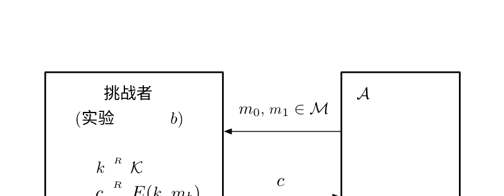

挑战者遵循一个非常简单的、固定的协议。然而，对手A可以遵循任意的（但仍然高效的）协议。挑战者和对手A彼此之间发送消息，根据他们的协议进行通信，在游戏结束时，A输出某个值。

实际上，我们用于定义语义安全性的攻击游戏包括两个备选的“子游戏”或“实验”——在这两个实验中，对手遵循相同的协议；然而，挑战者在这两个实验中的行为略有不同。攻击游戏还定义了一个概率空间，这反过来定义了对手的优势，它衡量了这个概率空间中两个事件的概率之间的差异。

## 攻击游戏2.1（语义安全）

对于给定的密码E=(E, D)，定义在(K, M, C)上，对于给定的对手A，我们定义两个实验，实验0和实验1。对于b=0, 1，我们定义

实验 b:

-   对手计算m0，m1∈M，长度相同，并将它们发送给挑战者。
-   挑战者计算k←K，c←E(k, mb)，并将c发送给对手。
-   对手输出一个位b̂∈{0,1}。

> SSadv[A, ε] := |Pr[W0] ⊕ Pr[W1]|. □

请注意，在上述游戏中，事件W0和W1是相对于由随机选择的k、加密算法（如果有的话）进行的随机选择以及对手进行的随机选择（如果有的话）所确定的概率空间来定义的。值SSadv[A, ε]是0到1之间的一个数。

请参见图2.1，这是攻击游戏2.1的示意图。如图所示，A的“输出”实际上只是对挑战者的最终消息。

## 定义2.2（语义安全）

密码ε是语义安全的，如果对于所有高效的对手 A，值 SSadv[A,ε]是可以忽略的。

作为一个正式的定义，这还不够完整，因为我们还没有定义“相同长度的消息”，“高效的对手”和“可忽略的”是什么意思。我们很快会回到这个问题。

让我们将这个正式定义与之前的讨论联系起来。假设对手 A 在攻击游戏 2.1 中是确定性的。首先，对手以确定性方式计算消息 m0, m1，并在密文 c 上评估谓词，如果为真则输出 1，否则输出 0。语义安全性说(2.6)中的值是可忽略的。在对手 A 是概率性的情况下，我们可以将 A 结构化如下：它从某个适当的集合中生成一个随机值 r，并确定性地计算依赖于 r 的消息 m0(r), m1(r)，并在密文 c 上评估谓词 (r)，该谓词也依赖于 r。在这里，语义安全性说(2.6)中的值，将 m0, m1, φ 替换为 m0(r), m1(r), φ(r)，是可忽略的 - 但现在概率是相对于随机选择的密钥和随机选择的 r 的值。

## 注 2.1

现在让我们谈谈对于敌方攻击游戏 2.1 计算出的消息 m0 和 m1 要求长度相同的要求。

-   首先，消息“长度”的概念是特定于特定消息空间 M的；换句话说，在指定消息空间时，必须指定将长度（非负整数）与任何给定消息相关联的规则。对于大多数具体的消息空间，这是清楚的：例如，对于消息空间 {0,1}≤L（如示例2.2中所示），消息 m ∈ {0,1}≤L的长度就是它作为比特串的长度，即 |m|。然而，为了使我们的定义有些普遍性，我们将长度的概念留作抽象。实际上，一些消息空间可能没有特定的长度概念，在这种情况下，所有消息都可以视为长度为0。
-   其次，要求 m0 和 m1 具有相同的长度意味着对手不能仅仅因为他能有效地区分一个消息长度的加密和另一个消息长度的加密而被认为已经破解了系统。这就是我们的形式定义如何捕捉消息加密允许泄漏消息长度（但没有其他信息）的概念。

我们已经在示例 2.5 中讨论过，在某些应用中，仅仅泄漏消息的长度可能是灾难性的。然而，由于这个问题没有通用解决方案，大多数现实世界中的加密方案（例如 TLS）根本不尝试隐藏消息的长度。这可能导致真实的攻击。例如，Chen 等人[25]表明，加密消息的长度可以揭示用户向云应用程序提供的私人数据的相当多的信息。他们以在线纳税申报系统为例，但其他作品显示了对许多其他系统的此类攻击。 □

## 例子 2.9

让 ε 是一个完全安全的确定性密码。那么很容易看出，对于每个对手 A（高效与否），我们有 SSadv[A,ε] = 0。这几乎立即可以从定理 2.3 得出（唯一的小复杂之处在于我们的对手 A 在攻击游戏 2.1 中可能是概率性的，但这很容易处理）。特别地，ε 是语义安全的。因此，如果 ε 是一次性密码本（见例子 2.1），我们对于所有对手 A 有 SSadv[A,ε] = 0；特别地，一次性密码本是语义安全的。因为语义安全的定义稍微有些不同对于可变长度的消息空间来说是宽容的，而且很容易看出如果 ε 是可变长度的一次性密码本（见示例2.2），那么对于所有的对手 A，SSadv[A, ε] = 0；特别地，可变长度的一次性密码本也是语义安全的。 □

我们需要对“高效”和“可忽略”的术语进行一些解释。 在第2.4节中，我们将填写剩余的细节（它们有些繁琐，而且并不是非常启发人）。直观地说，可忽略意味着在实际上“几乎为零”：想象一个像 2^{-100} 这样的数字 - 如果你在下一年自燃的概率是 2^{-100}，那么你不会担心这种事件发生，就像你不会担心发生概率为0的事件一样。此外，一个高效的对手是在“合理”的时间内运行的对手。

我们介绍另外两个术语：

-   一个值 N 被称为超多项式，如果 1/N 是可忽略的。
-   一个多项式有界的值直观上是一个合理大小的数字 - 特别地，我们可以说任何高效对手的运行时间是一个多项式有界的值。

## 事实2.6

如果 ε 和 ε' 是可以忽略的值，并且 Q 和 Q' 是多项式有界的值，则：

-   (i) ε + ε' 是可以忽略的值，
-   (ii) Q + Q' 和 Q · Q' 是多项式有界的值，以及
-   (iii) Q · ε 是可以忽略的值。

目前，读者可以将这些事实视为公理。 不要纠缠于这些技术问题，我们讨论一个例子，说明了如何使用这个定义来分析使用语义安全密码的更大系统的安全性。

### 2.3.3 与较弱的安全概念的关联

#### 消息恢复攻击

直观地说，在消息恢复攻击中，攻击者会得到一个随机消息的加密，并且能够以比随机猜测更高的概率从密文中恢复出消息，即概率为 1/|M|。 当然，任何合理的安全概念都应该排除这样的攻击，而语义安全确实做到了。

虽然这似乎是显而易见的，但我们给出了一个正式的证明。 我们这样做的一个动机之一是详细说明安全降低的概念，这是用于推理系统安全性的主要技术。 基本上，证明将论证任何能够有效地对 ε 发起消息恢复攻击的对手 A 可以被用来构建一个破坏 ε 的语义安全性的有效对手 B；由于语义安全性意味着不存在这样的 B，我们可以得出结论不存在这样的 A。

为了更详细地阐述这个证明，我们需要一个消息恢复攻击的正式定义。 与之前一样，这是通过给出攻击游戏来完成的，这是一个挑战者和对手之间的协议。

## 攻击游戏2.2（消息恢复）

对于给定的密码 ε=（E, D），定义在（K, M, C）上，对于给定的对手 A，攻击游戏的进行如下：

-   挑战者计算 m ← M, k ← K, c ← E(k, m)，并将 c 发送给对手。
-   对手输出一个消息$\hat{m} \in \mathcal{M}$。

令 $W$ 为事件 $\hat{m} = m$。我们称 $\mathcal{A}$ 在这种情况下赢得了游戏，并定义 $\mathcal{A}$ 相对于 $\mathcal{E}$ 的消息恢复优势为

```
MRadv$[\mathcal{A}, \mathcal{E}] := |\Pr[W] \ominus 1/|\mathcal{M}||$。 □
```

## 定义2.3（抵抗消息恢复的安全性）

密码 $\mathcal{E}$ 对于消息恢复是安全的，如果对于所有高效的对手 $\mathcal{A}$，值 MRadv$[\mathcal{A}, \mathcal{E}]$ 是可以忽略的。

## 定理2.7

设 $\mathcal{E} = (E, D)$ 是定义在 $(\mathcal{K}, \mathcal{M}, \mathcal{C})$ 上的密码。如果 $\mathcal{E}$ 是语义安全的，则 $\mathcal{E}$ 对于消息恢复是安全的。

**证明。** 假设 $\mathcal{E}$ 是语义安全的。我们的目标是证明 $\mathcal{E}$ 对于消息恢复是安全的。

为了证明 $\mathcal{E}$ 对于消息恢复是安全的，我们必须证明每个高效的对手 $\mathcal{A}$ 在攻击游戏2.2中的优势是可以忽略的。为了证明这一点，我们让一个任意但高效的对手 $\mathcal{A}$ 给出，并且我们的目标现在是证明 $\mathcal{A}$ 的消息恢复优势，即 MRadv$[\mathcal{A}, \mathcal{E}]$，是可以忽略的。让 $p$ 表示 $\mathcal{A}$ 赢得消息恢复游戏的概率，即

```
MRadv$[\mathcal{A}, \mathcal{E}] = |p \ominus 1/|\mathcal{M}||$。
```

我们将展示如何构建一个高效的对手 $\mathcal{B}$，其在攻击游戏2.1中的语义安全优势与 $\mathcal{A}$ 的消息恢复优势相关如下：

```
MRadv$[\mathcal{A}, \mathcal{E}] \leq \mathrm{SSadv}[\mathcal{B}, \mathcal{E}]$.  (2.7)
```

由于 $\mathcal{B}$ 是高效的，并且我们假设 $\mathcal{E}$ 是语义安全的，因此(2.7)的右侧是可以忽略的，所以我们得出结论 MRadv$[\mathcal{A}, \mathcal{E}]$ 是可以忽略的。

所以完成证明所需的是展示如何构建一个高效的 $\mathcal{B}$ 来满足(2.7)。思路是将 $\mathcal{A}$ 作为一个“黑盒”——我们不需要完全理解 $\mathcal{A}$ 的内部工作原理。

这是 $\mathcal{B}$ 的工作方式。对手 $\mathcal{B}$ 生成两个随机消息，$m_0$ 和 $m_1$，并将其发送给自己的SS挑战者。这个挑战者发送给 $\mathcal{B}$ 一个密文 $c$，$\mathcal{B}$ 将其转发给 $\mathcal{A}$，就好像它是来自 $\mathcal{A}$ 的 $MR$ 挑战者一样。当 $\mathcal{A}$ 输出一个消息 $\hat{m}$ 时，我们的对手 $\mathcal{B}$ 将 $m_0$ 与 $\hat{m}$ 进行比较，并输出 $\hat{b}=1$ 如果 $m_0=\hat{m}$，否则输出 $\hat{b}=1$。

这完成了 $\mathcal{B}$ 的描述，该描述在图中有所说明 ??。

请注意 $\mathcal{B}$ 的运行时间与 $\mathcal{A}$ 的运行时间基本相同。我们现在分析 $\mathcal{B}$ 的SS优势，并将其与 $\mathcal{A}$ 的MR优势联系起来。

对于 $b=0,1$，让 $p_b$ 是 $\mathcal{B}$ 的SS挑战者加密 $m_b$ 时输出1的概率。根据定义

```
SSadv$[\mathcal{B}, \mathcal{E}] = |p_1 \ominus p_0|$。
```

一方面，当 $c$ 是 $m_0$ 的加密时，概率 $p_0$ 恰好等于 $\mathcal{A}$ 在消息恢复游戏中获胜的概率，所以 $p_0 = p$。

另一方面，当 $c$ 是 $m_1$ 的加密时，对手 $\mathcal{A}$ 的输出与 $m_0$ 无关，所以 $p_1 = 1/|\mathcal{M}|$。由此可得

```
SSadv$[\mathcal{B}, \mathcal{E}] = |p_1 \ominus p_0| = |1/|\mathcal{M}| \ominus p| = \mathrm{MRadv}[\mathcal{A}, \mathcal{E}]$。
```

这证明了(2.7)。实际上，在(2.7)中等式成立，但这对证明并不重要。 □

读者应确保自己理解这个证明的逻辑，因为这种类型的证明将在整本书中反复使用。我们将在
这里回顾证明的重要部分，并提供另一种思考方式。

证明的核心是建立以下事实：对于每个攻击 $\mathcal{E}$ 的高效MR对手 $\mathcal{A}$，如攻击游戏2.2中所示，存在
一个攻击 $\mathcal{E}$ 的高效SS对手 $\mathcal{B}$，如攻击游戏2.1中所示，使得

$$
\text{MRadv}[\mathcal{A}, \mathcal{E}] \leq \text{SSadv}[\mathcal{B}, \mathcal{E}].
\tag{2.8}
$$

我们试图证明如果 $\mathcal{E}$ 在语义上是安全的，则 $\mathcal{E}$ 对消息恢复是安全的。
在上述证明中，我们认为如果 $\mathcal{E}$ 是语义安全的，那么(2.8)的右边必须是可忽略的，因此左边也必
须是可忽略的；由于这对所有高效的 $\mathcal{A}$ 都成立，我们得出结论 $\mathcal{E}$ 对于消息恢复是安全的。

证明定理的另一种方法是证明逆否命题：如果 $\mathcal{E}$ 对于消息恢复不安全，则 $\mathcal{E}$ 对于语义安全也不
安全。因此，让我们假设 $\mathcal{E}$ 对于消息恢复不安全。这意味着存在一个高效的对手 $\mathcal{A}$，其消息恢复
优势是非可忽略的。使用 $\mathcal{A}$，我们构建一个满足(2.8)的高效对手 $\mathcal{B}$。根据假设，$\text{MRadv}[\mathcal{A}, \mathcal{E}]$ 是非
可忽略的，而(2.8)意味着 $\text{SSadv}[\mathcal{B}, \mathcal{E}]$ 也是非可忽略的。

由此我们得出结论，$\mathcal{E}$ 不是语义安全的。

更简洁地说，为了证明语义安全意味着对消息恢复的安全性，我们展示了如何将一个高效的攻
击者，破坏消息恢复的，转化为一个破坏语义安全的高效攻击者。

我们还强调，在证明中构造的攻击者 $\mathcal{B}$ 只是将 $\mathcal{A}$ 作为一个“黑盒”使用。实际上，我们将看到的
几乎所有构造都是这种类型的：$\mathcal{B}$ 基本上只是 $\mathcal{A}$ 的一个包装器，由 $\mathcal{B}$ 的挑战者和 $\mathcal{A}$ 的单个运行实
例之间的一些简单而高效的“接口层”组成。理想情况下，我们希望接口层的计算复杂性不依赖于
$\mathcal{A}$ 的计算复杂性；然而，某种程度的依赖是不可避免的：如果一个攻击游戏允许 $\mathcal{A}$ 向其挑战者发
出多个查询，$\mathcal{A}$ 发出的查询越多，接口层执行的工作就越多，但这个工作只应该取决于这些查询
的数量，而不是 $\mathcal{A}$ 的运行时间。

因此，当它可以被结构化为上述形式时，我们将说对手 $\mathcal{B}$ 是对手 $\mathcal{A}$ 的一个基本包装器。显著的
特性是：

-   如果 $\mathcal{B}$ 是对 $\mathcal{A}$ 的一个基本包装器，并且 $\mathcal{A}$ 是高效的，则 $\mathcal{B}$ 也是高效的。
-   如果 $\mathcal{C}$ 是对 $\mathcal{B}$ 的一个基本包装器，并且 $\mathcal{B}$ 是对 $\mathcal{A}$ 的一个基本包装器，则 $\mathcal{C}$ 是对 $\mathcal{A}$ 的一个基本包装器。

这些概念在第2.4节中被形式化（但是再次强调，它们非常繁琐）。

### 计算消息的各个位

如果加密方案是安全的，不仅应该很难恢复整个消息，而且应该很难计算消息的任何部分信息。

我们在这里不会证明一个完全通用的定理，而是考虑一个具体的例子。
假设 $\mathcal{E} = (E, D)$ 是在 $(\mathcal{K}, \mathcal{M}, \mathcal{C})$ 上定义的密码。其中 $\mathcal{M} = \{0, 1\}^L$。对于 $m$ 属于 $\mathcal{M}$
，我们定义 $parity(m)$ 为1，如果 $m$ 中1的个数是奇数，否则为0。等价地，$parity(m)$ 是 $m$ 的所有单
个位的异或。

我们将证明如果 $\mathcal{E}$是语义安全的，那么对于随机消息$m$的加密 $c$，很难预测奇偶性$(m)$。现在，由于奇偶性$(m)$是一个单个位，任何对手都可以通过随机猜测以1/2的概率正确预测这个值。但是我们想要证明的是，没有高效的对手能够比随机猜测更好地做到这一点。

作为热身，假设存在一个高效的对手 $\mathcal{A}$，可以以概率1预测奇偶性$(m)$。这意味着对于每个消息 $m$，每个密钥 $k$，以及 $m$的每个加密 $c$，当我们给 $\mathcal{A}$密文 $c$时，它输出 $m$的奇偶性。因此，我们可以使用 $\mathcal{A}$来构建一个SS对手 $\mathcal{B}$，其工作如下。我们的对手任意选择两个消息 $m_0$和 $m_1$，但是 $m_0$的奇偶性为0，$m_1$的奇偶性为1。然后，它将这两个消息交给自己的SS挑战者，获得一个密文 $c$，然后将其转发给 $\mathcal{A}$。在收到 $c$后，对手$\mathcal{A}$输出一个位 $\hat{b}$，$\mathcal{B}$将这个相同的位 $\hat{b}$作为自己的输出。很容易看出 $\mathcal{B}$的SS优势恰好为1：当其SS挑战者加密 $m_0$时，它总是输出0，当其SS挑战者加密 $m_1$时，它总是输出1。

这表明如果 $\mathcal{E}$是语义安全的，那么没有有效的对手能够以概率1预测奇偶校验。然而，我们可以说得更多：如果 $\mathcal{E}$是语义安全的，那么没有有效的对手能够以显著优于1/2的概率预测奇偶校验。为了使这一点更加明确，我们提供了一个攻击游戏：

## 攻击游戏2.3 (奇偶校验预测)

对于给定的密码 $\mathcal{E}= (E, D)$，定义在 $(\mathcal{K}, \mathcal{M}, \mathcal{C})$ 上，对于给定的对手 $\mathcal{A}$，攻击游戏的进行如下：

-   挑战者计算 $m \stackrel{R}{\leftarrow} \mathcal{M}$, $k \stackrel{R}{\leftarrow} \mathcal{K}$, $c \leftarrow E(k, m)$，并将 $c$发送给对手。
-   对手输出 $\hat{b} \in \{0, 1\}$。

令 $W$为事件 $\hat{b}= \text{parity}(m)$。我们定义对于 $\mathcal{E}$，$\mathcal{A}$的消息恢复优势为

$$\text{奇偶校验优势}[\mathcal{A}, \mathcal{E}] := \left| \text{Pr}[W] \oplus 1/2 \right|.$$
$\square$

## 定义2.4 (奇偶预测)

如果对于所有高效的对手$\mathcal{A}$，值$\text{Parity }adv[\mathcal{A}, \mathcal{E}]$是可以忽略的，则密码$\mathcal{E}$对奇偶预测是安全的。

## 定理2.8

设$\mathcal{E} = (E, D)$是在$(\mathcal{K}, \mathcal{M}, \mathcal{C})$上定义的密码，且$\mathcal{M} = \{0, 1\}^L$。如果$\mathcal{E}$是语义安全的，则$\mathcal{E}$对奇偶预测是安全的。

**证明。** 与定理2.7的证明类似，我们通过归约给出一个证明。特别地，我们将证明对于每个奇偶预测对手$\mathcal{A}$，该对手攻击$\mathcal{E}$如同攻击游戏2.3，存在一个SS对手$\mathcal{B}$，该对手攻击$\mathcal{E}$如同攻击游戏2.1，其中$\mathcal{B}$是对$\mathcal{A}$的一个基本封装，使得

$$\text{奇偶校验}adv[\mathcal{A}, \mathcal{E}] = \frac{1}{2} \cdot \text{SS}adv[\mathcal{B}, \mathcal{E}].$$

令 $\mathcal{A}$ 为一个奇偶校验预测对手，其以概率 $1/2 + \epsilon$ 预测奇偶校验，因此 $\text{奇偶校验}adv[\mathcal{A}, \mathcal{E}] = |\epsilon|$。

下面是我们构建 SS 对手 $\mathcal{B}$ 的方法。

我们的对手 $\mathcal{B}$生成一个随机消息 $m_0$，并设置 $m_1 = m_0 \oplus (0^{L-1} \| 1)$；也就是说，$m_1$与 $m_0$相同，只是最后一位取反。

我们的对手 B 将消息对 m0， m1 发送给自己的 SS 挑战者，从该挑战者接收一个密文 c，并将 c 转发给 A。 当 A 输出一个比特 b 时，我们的对手 B 如果 b = 奇偶校验(m0) 则输出 1，否则输出 0。
对于 b= 0,1，让 p0 是 B 的 SS 挑战者加密 m0 时输出1的概率，让 p1 是 B 的 SS 挑战者加密 m1 时输出1的概率。根据定义，
SSadv[B,E] = |p1 - p0|。
我们声称 p0 = 1/2 + e 和 p1 = 1/2 - e。 这是因为无论 m0 还是 m1 是否加密， mb 的分布都是均匀的，所以在情况 b=0 时，我们的奇偶校验预测器 A 将以概率 1/2 + e 输出奇偶校验(m0)，而当 b=1 时，我们的奇偶校验预测器 A 将以概率 1/2 - e 输出奇偶校验(m1)，因此以概率 1 - (1/2 + e) = 1/2 - e 输出奇偶校验(m0)。
因此，
SSadv[B,E] = |p1 - p0| = 2|e| = 2 · Parityadv[A,E]。
证明了定理。 □
我们已经证明，如果对手能够有效地预测消息的奇偶性，那么它可以用来破解语义安全。相反，事实证明，如果对手能够破解语义安全，他可以有效地预测消息的某些谓词（见练习3.15）。

## 2.3.4 语义安全的后果

在本节中，我们将在特定的例子中研究语义安全的后果，即电子赌博。例子的具体细节并不那么重要，但是例子说明了人们通常在应用中使用语义安全的假设。

考虑以下极简化版本的轮盘赌，这是一种在庄家和玩家之间进行的游戏。玩家给庄家1美元。他可以下两种类型的赌注之一：

- “高或低”，或者
- “偶数或奇数”。

下注后，庄家选择一个随机数 r ∈ {0, 1, ..., 36}。 如果 r= 0，并且如果

- 他下注“高”和 r > 18,
- 他下注“低”和 r ≤ 18,
- 他下注“偶数”和 r 是偶数,
- 他下注“奇数”和 r 是奇数。

如果玩家赢了，庄家支付他2美元（净赢1美元），如果玩家输了，庄家不支付任何费用（净损失1美元）。显然，庄家在这个游戏中有一点小优势，但并不是微不足道的：玩家赢的概率是18/37 ≈ 48.65%。现在假设这个游戏在互联网上进行。此外，假设由于各种技术原因，庄家在玩家下注之前发布了 r 的加密（也许是为了让某个与庄家共享密钥的监管机构解密）。玩家可以在下注之前自由分析这个加密，当然，通过这样做，玩家可能会增加他赢的机会。然而，如果密码是好的，玩家的机会不应该增加太多。让我们证明这一点，假设 $r$ 使用一个语义安全的密码加密 $\mathcal{E}=(加密函数, 解密函数)$, 定义在(密钥,明文,密文)上，其中明文 = $\{0, 1, ... , 36\}$(在这个例子中，我们将所有的消息视为明文具有相同的长度)。此外，从现在开始，让我们称玩家 $\mathcal{A}$，以强调玩家的对抗性质，并假设 $\mathcal{A}$ 的策略可以建模为一个高效的算法。游戏如图2.2所示。这里，赌注表示“高”，“低”，“偶数”，“奇数”之一。玩家 $\mathcal{A}$ 将赌注发送给庄家，庄家评估函数 $W(r,赌注)$，如果赌注相对于 r 是一个获胜的赌注，则函数的值为1，否则为0。让我们定义 $IRadv[\mathcal{A}] := |Pr[W(r, bet) = 1] - 18/37|$.

我们的目标是证明以下定理。

定理2.9. 如果 $\mathcal{E}$ 是语义安全的，那么对于每个高效的玩家 $\mathcal{A}$，量 $IRadv[\mathcal{A}]$ 是可以忽略的。

正如我们在2.3.3节中所做的那样，我们通过约简来证明这一点。更具体地说，我们将证明对于每个玩家 $\mathcal{A}$，存在一个SS对手 $\mathcal{B}$，其中 $\mathcal{B}$ 是围绕 $\mathcal{A}$ 的一个基本封装，使得 $IRadv[\mathcal{A}] = SSadv[\mathcal{B}, \mathcal{E}]$. (2.9) 因此，如果存在一个具有非可忽略优势的高效玩家 $\mathcal{A}$，我们将得到一个破坏 $\mathcal{E}$ 的语义安全性的高效SS对手 $\mathcal{B}$，这是我们假设是不可能的。因此，没有这样的 $\mathcal{A}$。

为了激励和分析我们的新对手 $\mathcal{B}$，考虑一个“理想化”的互联网轮盘游戏，在这个游戏中，房子不是发布实际值 $r$ 的加密，而是发布一个“虚拟”值，比如0。理想互联网轮盘游戏的逻辑如图2.3所示。然而，请注意，在理想互联网轮盘游戏中，房子仍然使用实际值 $r$ 来确定游戏的结果。设 $p0$ 为 $\mathcal{A}$ 在互联网轮盘游戏中获胜的概率，设 $p1$ 为 $\mathcal{A}$ 在理想互联网轮盘游戏中获胜的概率。

我们的对手 B 被设计成参与攻击游戏2.1，如果 b^ 表示该游戏中 B 的输出，则我们有：

- 如果 B 被放置在实验0中，则 Pr[b^= 1] = p0；
- 如果 B 被放置在实验1中，则 Pr[b^= 1] = p1。

对手 B 的逻辑如图2.4所示。通过构造可以清楚地看出 B 满足上述所声称的属性，因此
```
SSadv[B, E] = |p1 - p0|. (2.10)
```
现在，考虑在理想的互联网轮盘赌中 A 获胜的概率 p1。 无论 A 的策略多么聪明，他以18/37的概率获胜，因为在这个理想的互联网轮盘赌游戏中， bet 的值是由 c 计算得出的，而 c 在统计上是与 r 的值独立的。 也就是说，理想的互联网轮盘赌等同于实际的轮盘赌。因此，
```
IRadv[A] = |p1 - p0|. (2.11)
```
通过结合(2.10)和(2.11)，我们得到(2.9)。

我们用来分析互联网轮盘的方法是我们将会反复看到的方法。基本思想是用一个理想化的版本替换系统组件，然后分析这个新的、理想化的系统版本的行为。

从上面的例子中可以得出的另一个教训是，在对系统的安全性进行推理时，“对手”是取决于我们试图做什么的。在上面的分析中，我们将几个组件拼凑在一起形成了一个新的对手 B：一个组件是原始对手 A，而其他组件则是从系统的其他部分（例如“庄家”的算法）中获取的。在本文中，这将是我们安全性分析中非常典型的情况。直观地说，如果我们想象一下系统的图表，在安全性分析的不同点上，我们会在系统的不同组件周围画一个圆圈，以确定我们在分析的那一点上认为是“对手”。

## 2.3.5 位猜测: 语义安全的替代特征

第2.3.4节的例子是如何使用语义安全的定义来分析使用语义安全密码的更大系统的安全性质的典型例子。然而，还有另一种对语义安全性的表征，当试图证明给定密码满足定义时，通常更方便使用。在这种替代表征中，我们定义了一个新的攻击游戏。攻击者扮演的角色与之前完全相同。然而，不再有两个不同的实验，只有一个实验。在这个比特猜测版本的攻击游戏中，挑战者随机选择 b ∈ {0,1} 并运行攻击游戏2.1的实验；攻击者的目标是以明显优于1/2的概率猜测比特 b。以下是详细信息:

攻击游戏2.4 (语义安全: 位猜测版本)。对于给定的密码 ε = (E, D), 定义在 (K, M, C) 上, 对于给定的对手 A, 攻击游戏运行如下:

- 对手计算 m₀, m₁ ∈ M, 长度相同, 并将它们发送给挑战者。
- 挑战者计算 b ← {0, 1}, k ← K, c ← E(k, m_b), 并将 c 发送给对手。
- 对手输出一个位 b̂ ∈ {0, 1}。

如果 b̂ = b, 我们说 A 赢得了游戏。 □

图2.5说明了攻击游戏2.4。请注意，在这个游戏中, A 赢得游戏的事件是根据随机选择的 b 和 k 的概率空间来定义的, 加密算法的随机选择 (如果有的话) 和对手的随机选择 (如果有的话) 也是如此。

图2.5: 攻击游戏2.4

当然，任何对手都可以通过完全忽略 c 并随机选择 \(\hat{b}\) （或者始终选择 \(\hat{b}\) 为0，或者始终选择为1) 的方式以1/2的概率赢得游戏。我们感兴趣的是对手比随机猜测更好的程度。如果 \(W\) 表示对手赢得攻击游戏的比特猜测版本的事件，则我们对数量 \(|\mathrm{Pr}[W] - 1/2|\) 感兴趣，我们用 \(\mathrm{SSadv}^* [\mathcal{A}, \mathcal{E}]\) 表示。然后我们有：
定理2.10。对于每个密码 \(\mathcal{E}\) 和每个对手 \(\mathcal{A}\)，我们有
\[\mathrm{SSadv}[\mathcal{A}, \mathcal{E}] = 2 \cdot \mathrm{SSadv}^*[\mathcal{A}, \mathcal{E}]. \tag{2.12}\]

证明。这只是一个简单的计算。令 \(p_0\) 为攻击游戏2.1中实验0中对手输出1的概率，令 \(p_1\) 为攻击游戏2.1中实验1中对手输出1的概率。

现在考虑攻击游戏2.4。从现在开始，所有事件和概率都是针对这个游戏的。如果我们在事件 \(b = 0\) 的条件下进行条件概率空间，那么在这个条件概率空间中，挑战者和对手所做的所有其他随机选择的分布方式与攻击游戏2.1中实验0中的相应值完全相同。因此，如果 \(\hat{b}\) 是攻击游戏2.4中对手的输出，我们有
\[\mathrm{Pr}[\hat{b}= 1 \mid b= 0] = p_0.\]
通过类似的论证，我们可以看到
\[\mathrm{Pr}[\hat{b}= 1 \mid b= 1] = p_1.\]
所以我们有
\[\begin{align*}
\mathrm{Pr}[\hat{b} = b] &= \mathrm{Pr}[\hat{b} = b \mid b = 0]\,\mathrm{Pr}[b = 0] + \mathrm{Pr}[\hat{b} = b \mid b = 1]\,\mathrm{Pr}[b = 1]\\
&= \mathrm{Pr}[\hat{b} = 0 \mid b = 0] \cdot \frac{1}{2} + \mathrm{Pr}[\hat{b} = 1 \mid b = 1] \cdot \frac{1}{2}\\
&= \frac{1}{2}(1 - \mathrm{Pr}[\hat{b} = 1 \mid b = 0]) + \mathrm{Pr}[\hat{b} = 1 \mid b = 1]\\
&= \frac{1}{2}(1 - p_0 + p_1).
\end{align*}\]
因此，
\[\mathrm{SSadv}^{*}[\mathcal{A}, \mathcal{E}] = |\mathrm{Pr}[\hat{b} = b] - \frac{1}{2}| = \frac{1}{2} |p_1 - p_0| = \frac{1}{2} \cdot \mathrm{SSadv}[\mathcal{A}, \mathcal{E}].\]
这证明了定理。 □

正如方便地将 SSadv[\mathcal{A}, \mathcal{E}] 称为 \mathcal{A} 的“SS优势”，我们将 SSadv^{*}[\mathcal{A}, \mathcal{E}] 称为 \mathcal{A} 的“猜测比特SS优势”。

# 一个概括

事实证明，上述情况是相当普遍的。虽然我们在本章中不需要它，但为了以后参考，我们在这里指出上述情况的一般化。我们将遇到一些情况，其中某些密码系统的某个特定安全属性（称为“X”）可以通过涉及两个实验（实验0和实验1）的攻击游戏来定义，其中对手 \mathcal{A} 的协议在两个实验中是相同的，而挑战者的协议是不同的。对于 b=0, 1，我们定义 W_b 为 \mathcal{A} 在实验 b 中输出1的事件，并且我们定义
Xadv[\mathcal{A}, \mathcal{S}] := |\mathrm{Pr}[W_0] - \mathrm{Pr}[W_1]|
作为 \mathcal{A} 的“X优势”。就像上面一样，我们总是可以定义一个“猜测比特”的攻击版本的游戏，在这个游戏中，挑战者随机选择 b \in \{0, 1\}，然后运行实验 b 作为它的协议。如果 W 是对手输出等于 b 的事件，则我们定义
Xadv^{*}[\mathcal{A}, \mathcal{S}] := |\mathrm{Pr}[W] - 1/2|
作为 \mathcal{A} 的“猜测比特X优势”。使用与定理2.10证明中完全相同的计算，我们有
Xadv[\mathcal{A}, \mathcal{S}] = 2 \cdot Xadv^{*}[\mathcal{A}, \mathcal{S}]. \quad (2.13)

## 2.4 数学细节

到目前为止，我们对于 efficient 和 negligible 这两个术语使用得比较宽泛，没有一个正式的数学定义：

- 我们要求计算密码具有高效的加密和解密算法；
- 对于语义安全的密码，我们要求任何高效的对手在攻击游戏2.1中具有可忽略的优势。

本节的目标是为这些术语提供精确的数学定义。虽然这些定义为密码学作为数学学科的研究提供了一个令人满意的理论框架，但我们应该警告读者：

- 这些定义相当复杂，需要大量的符号；而且
- 这些定义只是粗略地模拟了我们对这些术语的直观理解。

我们强调，读者可以安全地跳过本节，而不会在理解上遭受重大损失。在深入研究正式定义之前，让我们提醒读者我们试图在这些定义中捕捉到什么。

- 首先，当我们谈论一个高效的加密或解密算法时，通常指的是一个能够以非常快的速度运行的算法，以每字节数据10-100个计算机周期的速率进行加密。
- 其次，当我们谈论一个高效的对手时，通常指的是一个能够在一定的时间内（以及其他资源）运行的算法，尽管时间可能很长，但仍然可行。通常，人们假设试图破解密码系统的对手愿意投入比密码系统用户更多的资源。因此，10,000台计算机并行运行10年可以被视为一个决心、有耐心和财务充裕的对手在可行范围内能够计算的上限。然而，在某些情况下，比如第2.3.4节中的互联网轮盘赌示例，对手可能在计算变得无关之前只有非常有限的时间来执行计算。
- 第三，当我们谈论对手的优势可以忽略不计时，我们的意思是他非常小，以至于在实际上可以被视为等于零。正如我们在互联网轮盘的例子中看到的那样，如果没有高效的对手在攻击游戏2.1中有比 $2^{-100}$ 更好的优势，那么没有玩家可以在实践中将他赢得互联网轮盘的几率提高超过 $2^{-100}$。

尽管我们对术语“高效”的直观理解取决于上下文，但我们的正式定义不会做任何区别。事实上，我们将采用计算复杂性理论家将高效算法的概念与（概率性的）多项式时间算法的概念等同起来的习惯。无论好坏，这给了我们一个独立于任何特定计算模型具体细节的正式框架。

## 2.4.1 可忽略的、超多项式和多项式有界函数

我们首先定义了可忽略的、超多项式的和多项式有界的函数的概念。

直观地说，一个可忽略函数 $f : \mathbb{Z}_{\ge 0} \rightarrow \mathbb{R}$ 是指不仅在当 $n \rightarrow \infty$ 时趋近于零，而且比任何多项式的倒数更快地趋近于零。

定义 2.5. 一个函数 $f : \mathbb{Z}_{\ge 1} \rightarrow \mathbb{R}$ 被称为可忽略的，如果对于所有 $c \in \mathbb{R}_{>0}$ 存在一个整数 $n_0 \in \mathbb{Z}_{\ge 1}$，使得对于所有整数 $n \ge n_0$，我们有 $| f(n) | < 1/n^c$。

一个可忽略函数的另一种特征描述，可能更容易处理，如下所示：

定理2.11. 一个函数 $f : \mathbb{Z}_{\ge 1} \rightarrow \mathbb{R}$ 是可忽略的，当且仅当对于所有 $c > 0$，我们有
$$\lim_{n \to \infty} f(n) n^c = 0.$$
证明。练习。 □

例2.10。 一些可忽略函数的示例：
$$2^{-n}, \quad 2^{-\sqrt{n}}, \quad n^{-\log n}.$$
一些不可忽略函数的示例：
$$\frac{1}{1000n^4 + n^2 \log n}, \frac{1}{n^{100}}.$$

一旦我们正式定义了“可忽略”，定义“超多项式”就很容易：

定义2.6。一个函数 $f : \mathbb{Z}_{\ge 1} \to \mathbb{R}$ 被称为超多项式，如果 $1/f$ 是可忽略的。

本质上，一个多项式有界函数 $f : \mathbb{Z}_{\ge 1} \to \mathbb{R}$ 是一个绝对值有界的函数，通过某个多项式进行界定。正式地说：

定义2.7。一个函数 $f : \mathbb{Z}_{\ge 1} \to \mathbb{R}$ 被称为多项式有界，如果存在 $c, d \in \mathbb{R}_{>0}$，使得对于所有整数 $n \geq 0$，我们有 $|f(n)| \leq n^c + d$。

请注意，如果 $f$ 是一个多项式有界函数，那么 $1/f$ 绝对不是一个可以忽略的函数。然而，正如下面的例子所说明的，我们必须小心，不要得出错误的推论。

例子2.11. 定义 $f : \mathbb{Z}_{\ge 1} \to \mathbb{R}$ 使得 $f(n) = 1/n$ 对于所有偶数 $n$，并且 $f(n) = 2^{-n}$ 对于所有奇数 $n$。那么 $f$ 不是可以忽略的，而 $1/f$ 既不是多项式有界的，也不是超多项式的。

## 2.4.2 计算密码：形式上的规定

现在开始正式的部分。我们首先承认一个谎言：当我们说一个计算密码 $\mathcal{E}= (E, D)$ 定义在 $(\mathcal{K}, \mathcal{M}, \mathcal{C})$ 上，其中 $\mathcal{K}$ 是密钥空间，$\mathcal{M}$ 是消息空间，$\mathcal{C}$ 是密文空间，并且这些空间都是有限集合时，我们没有说出全部真相。在数学模型中（尽管在现实世界的系统中并不总是如此），我们将与 $\mathcal{E}$ 相关的密钥、消息和密文空间关联起来，这些空间由索引

- 一个安全参数，它是一个正整数，用 $\lambda$ 表示，以及
- 一个系统参数，它是一个比特串，用 $\Lambda$ 表示。

因此，我们不仅仅有有限集合 $\mathcal{K}$、$\mathcal{M}$ 和 $\mathcal{C}$，还有一族有限集合 $\{\mathcal{K}_{\lambda, \Lambda}\}_{\lambda, \Lambda}, \{\mathcal{M}_{\lambda, \Lambda}\}_{\lambda, \Lambda}, 以及 \{\mathcal{C}_{\lambda, \Lambda}\}_{\lambda, \Lambda}$,
对于这个定义而言，我们将其视为比特串的集合（可以通过某些规范编码函数表示数学对象）。

这个想法是，当密码 $\mathcal{E}$ 被部署时，安全参数 $\lambda$ 被固定为某个值。一般来说，较大的 $\lambda$ 值意味着更高的安全级别（即对抗具有更多计算资源的对手），但也意味着更大的密钥大小，以及更慢的加密和解密速度。因此，安全参数就像一个“旋钮”，我们可以调节安全性和效率之间的权衡。

一旦选择了 $\lambda$，就使用特定于密码的算法生成系统参数 $\Lambda$。这个想法是系统参数 $\Lambda$（连同 $\lambda$）给出了密码的一个固定实例的详细描述，其中 $(\mathcal{K}, \mathcal{M}, \mathcal{C}) = (\mathcal{K}_{\lambda, \Lambda}, \mathcal{M}_{\lambda, \Lambda}, \mathcal{C}_{\lambda, \Lambda})$。

考虑例2.4中讨论的加法一次性密码。这个密码是以模数 $n$ 来描述的。要部署这样的密码，需要生成一个合适的模数 $n$，并将其公开（可能只是“硬编码”到实现密码的软件中）。模数 $n$ 是这个密码的系统参数。安全参数的每个具体值确定了 $n$ 的长度（以位为单位）。$n$ 的值本身由某个可能是随机的算法生成，并且其输出分布可能取决于预期的应用。例如，在某些应用中，我们可能希望坚持 $n$ 是一个素数。 $\square$

在进一步讨论之前，我们定义了高效算法的概念。根据这个定义，我们只考虑以安全参数 $\lambda$ 为输入的算法 $A$，以及其他参数的总长度受到某个固定多项式 $\lambda$ 的限制。基本上，我们想要说的是 $A$ 的运行时间受到多项式 $\lambda$ 的限制，但是如果 $A$ 是概率性的，情况就会变得复杂：

## 定义2.8（高效算法）

假设 $A$ 是一个算法（可能是概率性的），它以安全参数 $\lambda \in \mathbb{Z}^{+}$ 为输入，以及其他参数以位串 $x \in \{0,1\}^{\leq p(\lambda)}$ 的形式编码，其中 $p$ 是一个固定多项式。如果存在一个多项式界函数 $t$ 和一个可忽略函数 $\epsilon$，对于所有的 $\lambda \in \mathbb{Z}^{+}$ 和所有的 $x \in \{0,1\}^{\leq p(\lambda)}$，算法 $A$ 在输入 $(\lambda, x)$ 上运行时间超过 $t(\lambda)$ 的概率至多为 $\epsilon(\lambda)$，则我们称 $A$ 为高效算法。

我们强调上述定义中的概率是相对于 $A$ 的硬币投掷而言的：这个概率的上界必须对所有可能的输入 $x$ 成立$^{1}$。

下面是一个形式化定义，它涵盖了以安全性和系统参数为参数的系统的基本要求，并引入了一些术语。在下面的定义中，我们使用符号 $\text{Supp}(P(\lambda))$ 来表示分布 $P(\lambda)$ 的支持集，即算法 $P$ 在输入 $\lambda$ 上的所有可能输出的集合。

## 定义2.9

系统参数化是一个高效的概率算法 $P$，它在给定安全参数 $\lambda \in \mathbb{Z}^{+}$ 作为输入时，输出一个位串 $\Lambda$，称为系统参数，其长度始终受到 $\lambda$ 的多项式界限。我们还定义了以下术语：

- 一组有限位字符串的集合 $\mathbf{S} = \{S_{\lambda,\Lambda}\}_{\lambda,\Lambda}$ 其中 $\lambda$ 运行于 $\mathbb{Z}^{+}$，$\Lambda$ 运行于 $\text{Supp}(P(\lambda))$，被称为具有系统参数化 $P$ 的空间族，只要每个集合 $S_{\lambda,\Lambda}$ 中的字符串长度都受到某个多项式 $p$ 的限制 $\lambda$。
- 如果存在一个高效的确定性算法，对于输入 $\lambda \in \mathbb{Z}^{+}$，$\Lambda \in \text{Supp}(P(\lambda))$，和 $s \in \{0,1\}^{\leq p(\lambda)}$，能够确定是否 $s \in S_{\lambda,\Lambda}$，则我们称 $\mathbf{S}$ 是高效可识别的。
- 如果存在一个高效的概率算法，对于输入 $\lambda \in \mathbb{Z}^{+}$ 和 $\Lambda \in \text{Supp}(P(\lambda))$，输出一个在 $S_{\lambda,\Lambda}$ 上均匀分布的元素，则我们称 $S$ 是足够可取样的。
- 如果存在一个高效的确定性算法，它在输入 $\lambda \in \mathbb{Z}^{+}$，$\Lambda \in \mathrm{Supp}(P(\lambda))$ 和 $s \in S_{\lambda,\Lambda}$ 时，输出一个非负整数，称为 $s$ 的有效长度函数，则我们说 $S$ 具有一个有效长度函数。

我们现在可以给出一个计算密码的完整、正式的定义：

## 定义2.10（计算密码）

一个计算密码由一对算法 $E$ 和 $D$ 组成，以及三个带有系统参数化 $P$ 的空间族：

$$\mathbf{K} = \{\mathcal{K}_{\lambda,\Lambda}\}_{\lambda,\Lambda}, \quad \mathbf{M} = \{\mathcal{M}_{\lambda,\Lambda}\}_{\lambda,\Lambda}, \quad \text{以及} \quad \mathbf{C} = \{\mathcal{C}_{\lambda,\Lambda}\}_{\lambda,\Lambda},$$

满足以下条件：

1. $\mathbf{K}$，$\mathbf{M}$ 和 $\mathbf{C}$ 可以高效地识别。
2. $\mathbf{K}$ 可以高效地采样。
3. $\mathbf{M}$ 具有有效的长度函数。
4. 算法 $E$ 是一个高效的概率算法，输入为 $\lambda$, $\Lambda$, $k$, $m$, 其中 $\lambda \in \mathbb{Z}^{+}$, $\Lambda \in \mathrm{Supp}(P(\lambda))$, $k \in \mathcal{K}_{\lambda,\ \Lambda}$, $m \in \mathcal{M}_{\lambda,\ \Lambda}$, 总是输出 $\mathcal{C}_{\lambda,\ \Lambda}$ 的一个元素。
5. 算法 $D$ 是一个高效的确定性算法，输入为 $\lambda$, $\Lambda$, $k$, $c$, 其中 $\lambda \in \mathbb{Z}^{+}$, $\Lambda \in \mathrm{Supp}(P(\lambda))$, $k \in \mathcal{K}_{\lambda,\ \Lambda}$, $c \in \mathcal{C}_{\lambda,\ \Lambda}$, 输出为 $\mathcal{M}_{\lambda,\ \Lambda}$ 的一个元素，或者一个特殊的符号拒绝 $\notin \mathcal{M}_{\lambda,\ \Lambda}$。
6. 对于所有的 $\lambda,\ \Lambda,\ k,\ m,\ c$, 其中 $\lambda \in \mathbb{Z}^{+}$, $\Lambda \in \mathrm{Supp}(P(\lambda))$, $k \in \mathcal{K}_{\lambda,\ \Lambda}$, $m \in \mathcal{M}_{\lambda,\Lambda}$, 以及 $c \in \mathrm{Supp}(E(\lambda,\Lambda; k,\ m))$, 我们有 $D(\lambda,\Lambda; k,\ c) = m$。

请注意，在上述定义中，加密和解密算法将 $\lambda$ 和 $\Lambda$ 作为辅助输入。为了与已经介绍的符号表示法保持一致，在第2.3.1节中，我们将其写为 $E(\lambda,\Lambda;\cdots)$ 和 $D(\lambda,\Lambda;\cdots)$。

## 例子2.13

考虑加法一次性密码（见例子2.12）。在我们的形式框架中，安全参数 $\lambda$ 决定模数 $n$ 的位长度 $L(\lambda)$。这是系统参数。系统参数生成算法以输入 $\lambda$ 并生成长度为 $L(\lambda)$ 的模数 $n$。函数 $L(\cdot)$ 应该是多项式有界的。基于这个假设，很明显系统参数生成算法满足其要求。密钥、消息和密文空间的要求也得到满足：

1. 这些空间的元素具有多项式有界的长度：这再次源于我们假设 $L(\cdot)$ 是多项式有界的。
2. 密钥空间可以高效地采样：只需选择 $k \stackrel{\mathrm{R}}{\in} \{0,\ldots, n-1\}$。
3. 密钥、消息和密文空间可以高效地识别：只需测试一个比特串是否是0到 $n$ 之间的整数的二进制编码。
4. 消息空间还具有有效的长度函数：只需输出（比如）0。 $\square$

我们注意到一些密码（例如一次性密码本）可能不需要系统参数。在这种情况下，我们可以假装系统参数是空字符串。我们还注意到一些密码实际上也没有安全参数；事实上，许多行业标准密码只是带有固定密钥大小的现成产品，没有可以调整的安全参数。这只是理论和实践之间的不匹配 - 这就是事实。

这完成了我们对计算密码的正式数学描述，包括所有细节。$^2$ 读者应该希望能够理解，虽然这些形式化可能允许我们进行数学上精确和有意义的陈述，但它们并不是很有启发性，大部分是为了掩盖实际发生的事情。因此，在正文中，我们将继续使用第2.3.1节的简化术语和符号来讨论密码，理解所有陈述都在本节讨论的形式化框架中具有适当和自然的解释。这将是一个重复出现的模式：我们将主要使用简化的术语来讨论各种类型的密码方案，不涉及安全参数和系统参数 - 这些数学细节将在一个单独的章节中讨论，但通常遵循这里建立的相同的一般模式。

## 2.4.3 高效的对手和攻击游戏

在定义语义安全的概念时，我们必须定义我们对一个敌手的意义。由于这个概念将在整个文本中广泛使用，我们在这里提供一个更一般的框架。

对于任何类型的密码方案，安全性将使用攻击游戏来定义，该游戏在敌手 $A$ 和挑战者之间进行：$A$ 遵循任意协议，而挑战者遵循由密码方案和讨论中的安全性概念确定的一些简单的、固定的协议。此外，敌手和挑战者都以一个共同的安全参数 $\lambda$ 作为输入，挑战者通过计算相应的系统参数 $\Lambda$ 来开始游戏，并将其发送给敌手。

为了模拟这些类型的交互，我们引入了一个交互式机器的概念。在这样一台机器 $M$ 启动之前，它总是会得到一个特殊缓冲区中写入的安全参数 $\lambda$，并且其余的内部状态被初始化为一些默认值。机器 $M$ 还有另外两个特殊的缓冲区：一个是传入消息缓冲区，一个是传出消息缓冲区。机器 $M$ 可以被多次调用：每次调用都是在 $M$ 的外部环境将一个字符串写入 $M$ 的传入消息缓冲区时开始；$M$ 读取消息，执行一些计算，更新其内部状态，并在其传出消息缓冲区上写入一个字符串，结束调用，并将传出消息传递给环境。因此，$M$ 通过一个简单的消息传递系统与其环境进行交互。我们假设 $M$ 可以通过在其最后一个传出消息中包含一些信号来指示其已停止，并且 $M$ 将基本上忽略任何进一步尝试调用它的行为。我们将假设与机器 $M$ 之间的消息的长度限制为常数。

这并不是一个真正的限制：我们总是可以通过发送许多较短的消息来模拟发送一个长消息。然而，这种限制简化了一些技术细节。我们从现在开始假设这种限制，对于敌手以及任何其他类型的交互式机器都是如此。

对于给定的环境，我们可以通过计算 $M$ 在所有调用中执行的步骤数量来测量其总运行时间。这个运行时间不仅取决于 $M$ 和其随机选择，还取决于 $M$ 运行的环境。

$^2$ 请注意，第2.2.1节中对Shannon密码的定义保持不变。在第2.3.1节末尾提出的任何确定性计算密码也是Shannon密码的主张需要得到正确解释：对于每个 $\lambda$ 和 $\Lambda$，我们得到一个在 $(K_{\lambda,\Lambda}, M_{\lambda,\Lambda}, C_{\lambda,\Lambda})$ 上定义的Shannon密码。
$^3$ 类似于第30页脚注1中的讨论，我们对于高效交互机器的定义不要求其在所有环境下以概率1停机。这是一个独立的问题，但它将是一个隐含的问题。

## 定义2.11（高效交互机器）

我们称 $M$ 为高效交互机器，如果存在一个多项式边界函数 $t$ 和一个可忽略函数 $\epsilon$，对于所有环境（甚至不是计算边界的环境），$M$ 的总运行时间超过 $t(\lambda)$ 的概率最多为 $\epsilon(\lambda)$。

我们自然地将敌手建模为一个交互式机器。高效敌手只是一个高效交互机器。

我们可以将两个交互式机器连接在一起，比如 $M'$ 和 $M$，创建一个新的交互式机器 $M'' = \langle M', M \rangle$。环境发送给 $M''$ 的消息总是被路由到 $M'$。机器 $M'$ 可以向环境或 $M$ 发送消息，在后一种情况下，$M$ 发送的输出消息被发送到 $M'$。我们假设如果 $M$ 停机，则 $M'$ 不会再向其发送任何消息。参见图??。

因此，当调用 $M''$ 时，它的传入消息被路由到 $M'$，然后 $M'$ 和 $M$ 可能会相互交互多次，然后当 $M'$ 向环境发送消息时，$M''$ 的调用结束。我们称 $M'$ 为“开放”机器（与外部世界进行交互），$M$ 为“封闭”机器（仅与 $M'$ 进行交互）。

自然地，我们可以通过将挑战者和敌手连接在一起来模拟挑战者和敌手的交互，如上所示：挑战者成为开放机器，敌手成为封闭机器。

在我们的安全约简中，我们通常展示如何使用一个破坏某个系统的敌手 $\mathcal{A}$ 来构建一个破坏另一个系统的敌手 $\mathcal{B}$。我们希望的基本属性是，如果 $\mathcal{A}$ 是高效的，那么 $\mathcal{B}$ 也是高效的。然而，我们的约简几乎总是具有非常特殊的形式，其中 $\mathcal{B}$ 是 $\mathcal{A}$ 的包装器，由 $\mathcal{B}$ 的挑战者和 $\mathcal{A}$ 的单个运行实例之间的一些简单且高效的“接口层”组成。

理想情况下，我们希望接口层的计算复杂性不依赖于 $\mathcal{A}$ 的计算复杂性；然而，某种程度的依赖是不可避免的：$\mathcal{A}$ 向其挑战者发出的查询越多，接口层需要执行的工作就越多，但这个工作量只应该取决于这些查询的数量，而不是 $\mathcal{A}$ 的运行时间。为了形式化这一点，我们将 $\mathcal{B}$ 构建为一个组合机器 $\langle M', M \rangle$，其中 $M'$ 表示接口层（“开放”机器），$M$ 表示 $\mathcal{A}$ 的实例（“封闭”机器）。这导致了以下定义。

## 定义2.12（基本包装器）

如果存在一个多项式边界函数 $t$ 和一个可以忽略的函数 $\epsilon$，使得对于所有的 $M$（不一定是计算上有界的），当我们在任意环境中执行组合机器 $\langle M', M \rangle$ 时（同样不一定是计算上有界的），满足以下属性：

在执行过程中的每个点上，如果 $M'$ 和 $M$ 之间的交互次数为 $I$，$M'$ 的总运行时间为 $T$，那么 $T > t(\lambda + I)$ 的概率最多为 $\epsilon(\lambda)$。

如果 $M'$ 是一个高效的接口，$M$ 是任意一台机器，那么我们称 $\langle M', M \rangle$ 是 $M$ 的一个基本包装器。

我们考虑的任何机器都需要满足的要求。

因此，当敌手 $B$ 可以被构造成上述形式时，作为与 $A$ 进行高效接口交互的一个基本包装器。我们的定义是为了很好地协同工作。显著的特性包括：

- 如果 $B$ 是对 $A$ 的一个基本包装器，并且 $A$ 是高效的，则 $B$ 也是高效的。
- 如果 $C$ 是对 $B$ 的一个基本包装器，并且 $B$ 是对 $A$ 的一个基本包装器，则 $C$ 是对 $A$ 的一个基本包装器。

还要注意，在我们的攻击游戏中，挑战者通常满足我们对高效接口的定义。对于这样一个挑战者和任何高效的敌手 $A$，我们可以将他们的整个交互视为一个单一的高效机器。

查询有界敌手。在我们目前看到的攻击游戏中，敌手只进行了固定数量的查询。在本文后面，我们将看到攻击游戏中敌手可以进行多次查询的情况 - 即使对于允许进行的查询数量没有先验限制，如果敌手高效，则查询数量将受到某些多项式边界值 $Q$ 的限制（至少几乎总是如此）。在证明此类攻击游戏的安全性时，在设计从 $A$ 到 $B$ 的基本包装器时，通常方便事先告诉 $B$ 一个上界 $Q$，以便 $A$ 最终将进行多少次查询。为了将此纳入我们的正式框架中，我们可以设置 $A$ 通过向 $B$ 发送一系列 $Q$ 个特殊消息来“信号”此查询限制。如果我们这样做，不仅 $B$ 可以在其逻辑中使用值 $Q$，而且还可以在依赖于 $Q$ 的时间内运行，而不违反定义2.12中的时间约束。这很方便，因为 $B$ 可以初始化可能依赖于 $Q$ 的数据结构的大小。当然，所有这些只是为了绕过否则过于严格的技术限制而进行的合法“黑客”，不应过于认真对待。在我们的任何演示中，我们永远不会明确进行这种“信号”。

## 2.4.4 语义安全：形式上的规定

在定义任何类型的安全性时，我们将攻击游戏中敌手的优势定义为一个函数 $Adv(\lambda)$。这将根据攻击游戏中某些事件的概率来定义：对于每个 $\lambda$ 的值，我们得到一个不同的概率空间，由挑战者的随机选择和敌手的随机选择决定。安全性意味着对于每个高效的敌手，函数 $Adv(\cdot)$ 是可以忽略的。

现在转向密码的语义安全性的具体情况，在攻击游戏2.1中，我们定义了值 $SSadv[\mathcal{A}, \mathcal{E}]$。实际上，这个值是安全参数 $\lambda$ 的一个函数。定义2.3的正确解释是，如果对于所有高效的敌手 $\mathcal{A}$（建模为交互式机器，如上所述），函数 $SSadv[\mathcal{A}, \mathcal{E}](\lambda)$ 在安全参数 $\lambda$ 中被忽略（根据定义2.5）。请注意，挑战者和敌手都会收到 $\lambda$ 作为共同输入。控制从挑战者开始，挑战者将系统参数发送给敌手。然后敌手向挑战者发送查询，其中包含两个明文，挑战者用密文回应。最后，敌手输出一个比特（在我们的正式机器模型中，这个“输出”是发送给挑战者的消息，然后挑战者停止）。$SSadv[\mathcal{A}, \mathcal{E}](\lambda)$ 的值由挑战者（包括系统参数的选择）和敌手的随机选择决定。攻击游戏2.1的完整图示请参见图2.6。

$^1$ 通过不要求概率算法以概率1在指定的时间范围内终止，我们给自己一点“灵活性”，这使我们能够轻松地执行某些类型的随机抽样过程，这些过程没有先验的运行时间限制，但很可能运行太长时间（例如，想象一下抛硬币直到出现“正面”的情况）。另一种方法是限制期望运行时间，但由于技术原因，这种方法在某种程度上存在问题。请注意，这个高效算法的定义并不要求算法在所有输入上以概率1终止。一个以概率 $2^{-\lambda}$ 进入无限循环的算法满足这个定义，即使它不以概率1终止。这些问题是相互独立的。一般来说，我们只考虑在所有输入上以概率1终止的算法：这更自然地可以看作是对算法的输出分布的要求，而不是对其运行时间的要求。

此外，在攻击游戏2.1中，对手呈现的两个消息具有相同的长度的要求意味着在Definition 2.10的第3部分提供的长度函数在这两个消息上的评估结果相同。

根据这个正式的定义，一个密码 ε 被认为是不安全的意味着什么，也许是有用的。 这意味着存在一个对手 𝒜，使得SSadv[𝒜, ε] 是一个在安全参数上的非可忽略函数。 这意味着SSadv[𝒜, ε](λ) ⊕ 1/λ^c对于某个 c>0 和无限多个安全参数 λ 成立。 因此，这并不意味着 𝒜 可以在所有安全参数的值上“破解” ε，而只是在无限多个安全参数的值上。

在正文中，我们主要忽略安全参数、系统参数和类似的内容，但我们始终明白我们的“简写”具有精确的数学解释。 特别是，我们经常提到某些值 v 可以忽略（或多项式有界），这实际上意味着 v 是安全参数的可忽略（或多项式有界）函数。

## 2.5 一个有趣的应用：匿名路由

我们的朋友爱丽丝想要给鲍勃发送一条消息 m，但她不希望鲍勃或其他人知道这条消息 m 是来自爱丽丝的。例如，鲍勃可能在运行一个公开讨论论坛，而爱丽丝希望匿名在论坛上发表评论。匿名发帖让爱丽丝能够讨论健康问题或其他事项，而不需要透露自己的身份。在本节中，我们将假设爱丽丝只想向论坛发布一条单独的消息。

一个选择是爱丽丝选择一个代理人卡罗尔，将消息 m 发送给卡罗尔，并要求卡罗尔将消息转发给鲍勃。显然，这并不能为爱丽丝提供匿名性，因为任何观察网络的人都会看到消息 m 是从爱丽丝发送给卡罗尔，然后从卡罗尔发送给鲍勃。通过追踪网络，任何人都可以看到消息从爱丽丝发出的路径。

一个更好的方法是爱丽丝与卡罗尔建立一个共享密钥 k，并将 c := E(k, m) 发送给卡罗尔，其中 ε = (E, D) 是一个语义安全的密码。卡罗尔解密 c 并将 m 转发给鲍勃。现在，观察网络的人会看到一条消息从爱丽丝发送给卡罗尔，另一条消息从卡罗尔发送给鲍勃。然而，这种方法仍然不能确保爱丽丝的匿名性：如果在某一天卡罗尔收到的唯一消息是来自爱丽丝的消息，并且她发送的唯一消息是发给鲍勃的，那么观察者可以将两者联系起来，仍然可以知道这条消息来自爱丽丝。

我们通过让卡罗尔提供一个混合服务，即一个将来自许多不同方的消息混合在一起的服务 A_1, ..., A_n。对于 i = 1, ..., n，卡罗尔与方 A_i 建立一个秘密密钥 k_i，并且每个方 A_i 将加密消息 c_i = E(k_i, <目的地_i, m_i>) 发送给卡罗尔。卡罗尔收集所有传入的密文，使用正确的密钥解密每个密文，并以某种随机顺序将结果的明文转发到其目的地。现在，观察卡罗尔的流量，可以看到有消息进入和消息离开，但无法确定哪个消息被发送到哪里。卡罗尔发送的消息中有一条是爱丽丝发送的，但观察者无法确定是哪一条。我们称爱丽丝的匿名集大小为 n。剩下的问题是卡罗尔仍然可以确定爱丽丝是在讨论论坛上发布特定消息的人。

为了消除这最后的风险，爱丽丝使用多个混合服务，比如卡罗尔和大卫。她与卡罗尔建立了一个秘密密钥 k_c，并与大卫建立了一个秘密密钥 k_d。为了将她的消息发送给鲍勃，她构建了以下嵌套密文 c_2：

```
c_2 := E(k_c, E(k_d, m))
```

为了完整性，爱丽丝可能希望在密文中嵌入路由信息，以便 c_2 实际上被构造为：
c_2 := E(k_c, <大卫, c_1>) 其中 c_1 := E(k_d, <鲍勃, m>)。
接下来，爱丽丝将 c_2 发送给卡罗尔。卡罗尔解密 c_2 并获得明文 <大卫, c_1>，告诉她将 c_1 发送给大卫。大卫解密 c_1 并获得明文 <鲍勃, m>，告诉他将 m 发送给鲍勃。这个解密嵌套密文的过程，如图 2.7所示，类似于一次一层地剥开洋葱。 因此，这个路由过程通常被称为洋葱路由。

现在，即使卡罗尔观察到所有的网络流量，她也无法确定是谁在鲍勃的论坛上发布了一条特定的消息。对于大卫也是如此。然而，如果卡罗尔和大卫串通一气，他们可以找出来。因此，爱丽丝可能希望通过多个混合节点路由她的消息。只要其中一个混合节点不与其他节点串通一气，爱丽丝的匿名性将得到保护。

一个小的复杂之处在于当爱丽丝与大卫建立她们的共享密钥 k_d 时，她必须在不向大卫透露自己身份的情况下这样做。否则，大卫将知道 c_1 来自爱丽丝，这是我们不希望的。这并不难做到，我们将在本书后面看到如何做到这一点（第20.14节）。

嵌套加密的安全性。 为了保护爱丽丝的匿名性，卡罗尔不能从嵌套密文 c_2 中获得关于 m 的任何信息 kc。否则，卡罗尔有可能利用她从 c_2 中学到的关于 m 的信息将爱丽丝与她在鲍勃的讨论论坛上的帖子联系起来。例如，假设卡罗尔可以从 c_2 中学到 m 的前几个字符，并且后来发现只有一个帖子是以这些字符开头的。卡罗尔可以将整个帖子与爱丽丝联系起来，因为她知道 c2 来自爱丽丝。

对于大卫来说也是一样的：大卫最好不要从嵌套的密文 c2 中获得关于 m 的任何信息。

让我们假设如果 E 是语义安全的，那么没有高效的对手可以从中获得关于 m 的任何信息。c2 和 kc 或 kd 之一。

更一般地，对于一个密码 E=(E, D) 定义在 (K, M, C) 上的密码，我们定义了N层嵌套密码 En=(En, Dn)。

En((k0,..., kn-1), m) = E(kn-1, E(kn-2, ...E(k0, m)...))。

解密按相反顺序应用密钥：Dn((k0,..., kn-1), c) = D(k0, D(k1, ...D(kn-1, c)...))。

我们的目标是要证明，如果 E 是语义安全的，那么即使对手获得除了一个密钥 k0,..., kn-1, En 也是语义安全的。为了明确这一点，我们定义了两个实验，实验0和实验1，其中对于 b=0,1, 实验 b 为：

- 对手给出挑战者 (m0, m1, d), 其中 m0, m1 ∈ M 是等长的消息，且 0 ≤ d < n.
- 挑战者选择 n密钥 k0,..., kn-1 ∈ K 并计算 c = En(k0,..., kn-1, mb)。它将 c 与所有密钥 k0,..., kn-1, 但不包括密钥 kd. 一起发送给对手。
- 对手输出一个位 b̂ ∈ {0, 1}。

这个游戏捕捉到了对手看到所有密钥 k0,..., kn-1, 除了 kd 并试图破解语义安全性。

我们定义对手的优势, NE(n)adv[A, E], 如语义安全性的定义所示：NE(n)adv[A, E] = |Pr[W0] ⊕ Pr[W1]|

其中 Wb 是事件 A 在实验 b 中输出1, 对于 b=0,1。我们说 E 在 n层嵌套中是语义安全的, 如果 NE(n)adv[A, E] 是可以忽略的。

定理2.12. 对于每个常数 n > 0, 如果 E=(E, D) 是语义安全的, 则 E 对于 n层嵌套也是语义安全的。

特别地, 对于每个 n层嵌套的攻击者 A 攻击 E, 存在一个语义安全的攻击者 B 攻击 E, 其中 B 是 A 的基本包装。

NE(n)adv[A, E] = SSadv[B, E].

这个定理的证明是一个很好的安全约简练习。我们将其留给练习2.15。

## 2.6 注释

一次性密码本是由Gilbert Vernam于1917年发明的，尽管有证据表明它在此之前就被发现了[10]。

待添加文献引用。

## 2.7 练习

- 2.1 (乘法一次性密码本)。我们还可以定义一个“模 p 乘法”变种的一次性密码本。这是一个密码 E=(E,D)，定义在(K,M,C)上，其中 K:=M:=C:={1,…,p-1}，其中 p 是一个素数。加密和解密的定义如下：
```
E(k, m) := k·m mod p
D(k, c) := k^{-1}·c mod p.
```
在这里，k^{-1} 表示 k 对于 p 的乘法逆元。验证这个密码的正确性，并证明它是完全安全的。

- 2.2 (一个好的替代密码)。考虑一个变种的替代密码E=(E,D)，它在例子2.3中定义，其中消息的每个符号都使用独立的置换进行加密。也就是说，让 M=C=Σ^L，其中Σ是一个有限符号字母表， L 是一个长度。让密钥空间 K=S^L，其中 S 是所有在Σ上的置换的集合。加密算法 E(k, m) 的定义如下：
```
E(k, m) := ( k[0](m[0]), k[1](m[1]), …, k[L-1](m[L-1]) )
```
证明 E 是完全安全的。

- 2.3 (链式加密)。设 E=(E,D) 是在 (K,M,C) 上定义的完全安全密码。其中 K=M。设 E'=(E',D') 是一个密码，其中加密定义为 E'((k1,k2),m):= (E(k1,E(k2,m))。证明 E' 是完全安全的。

- 2.4 (一个破解的一次性密码)。考虑一种变体的一次性密码，其中消息空间为{0,1}^L，密钥空间 K 被限制为所有具有偶数个1的 L位字符串。给出一个有效的对手，其语义安全优势为1。

- 2.5 (更强的不可能性结果)。这个练习推广了Shannon的定理 (定理 2.5)。让 E 是在 (K,M,C) 上定义的密码。假设 SSadv[A,E] ≤ ε 对于所有的对手 A，甚至包括计算能力无限的对手。证明 |K| ≥ (1-ε) |M|。

- 2.6 (匹配界)。这个练习为前一个练习提供了一种类似的逆向证明。对于 j=0,..., 令 ε=1/2^j。考虑 L位一次性密码变种 E 在 (K,M,C) 上定义 其中 M=C={0,1}^L。密钥空间 K 被限制为所有 L位字符串，其前 L-j 位不全为零，因此 |K|= (1-ε) |M|。证明：
    - (a) 存在一个高效的对手 A，使得 SSadv[A,E] = ε/(1-ε);
    - (b) 对于所有的对手 A，甚至包括计算能力无限的对手，SSadv[A,E] ≤ ε/(1-ε)。

注意：由于部分 (a) 中 A 的优势是非零的，密码 E 不能完全安全。

- 2.7（确定性密码）。在这个练习中，你被要求详细证明示例2.9中所述的声明。即，证明如果 $\mathcal{E}$ 是一个完全安全的确定性密码，则对于每个对手 $\mathcal{A}$， $\text{SSadv}[\mathcal{A}, \mathcal{E}] = 0$ （请记住 $\mathcal{A}$ 可能是概率性的）；还要证明如果 $\mathcal{E}$ 是可变长度一次性密码，则对于所有的对手 $\mathcal{A}$， $\text{SSadv}[\mathcal{A}, \mathcal{E}] = 0$。

- 2.8（轮盘）。在第2.3.4节中，我们认为如果使用语义安全的密码算法对值 $r$ 进行加密，那么玩家在互联网轮盘赌中获胜的几率非常接近真实轮盘赌的几率。然而，我们的“轮盘赌”游戏相当简单。假设我们有一个更复杂的游戏，不同的结果可能导致不同的赢利。规则并不那么重要，但假设规则易于评估（给定一个赌注和数字 $r$），并且每个赌注都会产生 $0, 1, \dots, n$ 美元，其中 $n$ 是多项式有界的。令 $\mu$ 是这个游戏的真实版本（没有加密）中的最佳策略的预期收益。令 $\mu'$ 是互联网版本（有加密）中某个（高效的）玩家的预期收益。证明 $\mu \le \mu' + \epsilon$，其中 $\epsilon$ 是可以忽略的，假设密码是语义安全的。

提示：你可能想要使用以下事实，如果 $\mathbf{X}$ 是一个取值为 $\{0, 1, \dots, n\}$ 的随机变量，则 $\mathbf{X}$ 的期望值等于 $\sum_{i=1}^n \Pr[\mathbf{X} \ge i]$。

- 2.9. 使用第2.4节中的正式定义证明事实2.6。

- 2.10（练习语义安全的定义）。设 $\mathcal{E} = (E, D)$ 是在 $(\mathcal{K}, \mathcal{M}, \mathcal{C})$ 上定义的语义安全密码，其中 $\mathcal{M} = \mathcal{C} = \{0, 1\}^L$。以下哪种加密算法可以产生一个语义安全的方案？要么给出一种攻击，要么通过明确的约简给出一个安全证明。
    - (a) $E'(k, m) = 0 \parallel E(k, m)$
    - (b) $E'(k, m) = E(k, m) \parallel \text{parity}(m)$
    - (c) $E'(k, m) = \text{reverse}(E(k, m))$
    - (d) $E'(k, m) = E(k, \text{reverse}(m))$

在这里，对于一个比特串 $s$， $\text{parity}(s)$ 是1，如果 $s$ 中1的数量是奇数，否则为0；同时， $\text{reverse}(s)$ 是通过颠倒 $s$ 中比特的顺序得到的字符串，例如， $\text{reverse}(1011) = 1101$。

- 2.11（密钥恢复攻击）。设 $\mathcal{E} = (E, D)$ 是在 $(\mathcal{K}, \mathcal{M}, \mathcal{C})$ 上定义的密码。密钥恢复攻击由挑战者和攻击者 $\mathcal{A}$ 之间的以下游戏建模：挑战者在 $\mathcal{K}$ 中选择一个随机密钥 $k$，在 $\mathcal{M}$ 中选择一个随机消息 $m$，计算 $c \xleftarrow{\$} E(k, m)$，并将 $(m, c)$ 发送给 $\mathcal{A}$。作为回应，$\mathcal{A}$ 输出一个猜测的密钥 $\hat{k}$ 在 $\mathcal{K}$ 中。如果 $D(\hat{k}, c) = m$，我们说 $\mathcal{A}$ 赢得了游戏，并定义 $\text{KRadv}[\mathcal{A}, \mathcal{E}]$ 为 $\mathcal{A}$ 赢得游戏的概率。通常情况下，我们说 $\mathcal{E}$ 对于密钥恢复攻击是安全的，如果对于所有高效的攻击者 $\mathcal{A}$，优势 $\text{KRadv}[\mathcal{A}, \mathcal{E}]$ 是可以忽略的。
    - (a) 证明一次性密码本不安全，容易受到密钥恢复攻击。
    - (b) 证明如果 $\mathcal{E}$ 是语义安全的，且 $\epsilon = |\mathcal{K}|/|\mathcal{M}|$ 是可以忽略的，那么 $\mathcal{E}$ 对密钥恢复攻击是安全的。特别地，证明对于每个高效的密钥恢复对手 $\mathcal{A}$，存在一个高效的语义安全对手 $\mathcal{B}$，其中 $\mathcal{B}$ 是对 $\mathcal{A}$ 的基本封装，使得 $\text{KRadv}[\mathcal{A}, \mathcal{E}] \le \text{SSadv}[\mathcal{B}, \mathcal{E}] + \epsilon$

提示：你的语义安全对手 $\mathcal{B}$ 在语义安全实验0中以概率 $\mathrm{KRadv}[\mathcal{A}, \mathcal{E}]$ 输出1，在实验1中以概率至多 $\epsilon$ 输出1。

由此推导出以 $\epsilon$ 和 $\mathrm{KRadv}[\mathcal{A}, \mathcal{E}]$ 为参数的 $\mathrm{SSadv}[\mathcal{B}, \mathcal{E}]$ 的下界，从而得出结论。

    - (c) 从部分 (b) 推导出，如果 $\mathcal{E}$ 是语义安全的且 $|\mathcal{M}|$ 是超多项式的，则 $|\mathcal{K}|$ 不能是多项式有界的。

注意：当 $|\mathcal{M}|$ 是多项式有界的的时候， $|\mathcal{K}|$ 可以是多项式有界的，比如一次性密码本。

- 2.12 (对抗消息恢复的安全性)。在第2.3.3节中，我们发展了对抗消息恢复的安全性概念。构造一个对抗消息恢复安全，但不是语义安全的密码。

- 2.13 (简单情境中的优势计算)。考虑以下两个实验 实验0和实验1：
    - 在实验0中，挑战者抛一枚公平的硬币（正面和反面的概率都是1/2），并将结果发送给对手 $\mathcal{A}$ 。
    - 在实验1中，挑战者总是向对手发送反面。

对手的目标是区分这两个实验：在每个实验结束时，对手输出一个比特0或1，猜测它所在的实验 。对于 $b=0,1$，令 $W_b$ 为在实验 $b$ 中对手输出1的事件。对手试图最大化其区分优势，即数量 $|\Pr[W_0] \oplus \Pr[W_1]| \in [0,1] .$

如果对于所有高效对手来说，优势都是可以忽略的，那么我们称这两个实验是不可区分的。
    - (a) 计算以下每个对手的优势：
        (i) $\mathcal{A}_1$：始终输出1。
        (ii) $\mathcal{A}_2$：忽略挑战者报告的结果，并以均匀概率随机输出0或1。
        (iii) $\mathcal{A}_3$：如果从挑战者接收到HEADS，则输出1，否则输出0。
        (iv) $\mathcal{A}_4$：如果从挑战者接收到HEADS，则输出0，否则输出1。
        (v) 一个 $\mathcal{A}_5$：如果收到HEADS，则输出1。 如果收到TAILS，则随机输出0或1，概率相等。
    - (b) 在区分这两个实验中，最大的优势是多少？请解释原因。

- 2.14 (置换密码)。考虑以下在 $(\mathcal{K}, \mathcal{M}, \mathcal{C})$ 上定义的密码 $(E, D)$ 其中 $\mathcal{C} = \mathcal{M} = \{0,1\}^\ell$ 并且 $\mathcal{K}$ 是集合 $\{0, ..., \ell-1\}$ 的所有 $\ell!$ 置换。对于密钥 $k \in \mathcal{K}$ 和消息 $m \in \mathcal{M}$，定义 $E(k, m)$ 为使用置换 $k$ 对 $m$ 的位进行置换的结果，即 $E(k, m) = m[k(0)]...m[k(\ell-1)]$。通过展示一个实现优势为1的对手，证明该密码不是语义安全的。

- 2.15（嵌套加密）。对于一个密码 ε=(E, D)，定义嵌套密码 ε'=(E', D')为 E'((k_0, k_1), m) = E(k_1, E(k_0, m)) 和 D'((k_0, k_1), c) = D(k_0, D(k_1, c))。

我们的目标是要证明，如果 ε 是语义安全的，那么即使对手获得了 k0或 k1中的一个密钥， ε' 也是语义安全的。
    - (a) 考虑以下语义安全实验，实验 0 和实验 1：在实验 b 中，对于 b=0,1，对手生成两个消息 m_0 和 m_1，并获得 k_1 和 E'((k_0, k_1), m_b)。攻击者输出 b' 在 {0, 1}中，我们定义其优势， NEadv[A, ε'] 如同语义安全的一般定义。证明对于每个嵌套加密攻击者 A 攻击 ε'，存在一个语义安全的攻击者 B 攻击 ε，其中 B 是对 A 的一个基本包装。NEadv[A, ε'] = SSadv[B, ε]。画一个图，右边是 A，中间是 B，左边是 B的挑战者。展示在你的安全性证明中这三个参与方之间的消息流。
    - (b) 重复部分 (a)，但是现在当攻击者得到 k_0(而不是 k_1) 和 E'((k_0, k_1), m_b) 在实验0和1中。用一个图表描述你在安全证明中的消息流动，就像在(a)部分中所做的那样。

这个问题出现在互联网上匿名路由的背景下，如第2.5节所讨论的那样。

- 2.16（自引用加密）。让我们展示一下对自身进行加密可能是危险的。设 ε 是一个在 (K, M, C) 上定义的语义安全密码，其中 K ⊆ M，并且设 k ←^R K。一个密文 c_* := E(k, k)，即使用 k 对 k 进行加密，被称为自引用加密。
    - (a) 构造一个从ε派生出来的密码 ε̃ = (Ẽ, D̃)，使得 ε 在语义上是安全的，但如果对手获得 Ẽ(k, k) ，则变得不安全。你刚刚证明了语义安全并不意味着在加密自己的密钥时是安全的。
    - (b) 构建一个密码 ε̂ = (Ê, D̂)，从 ε 派生出 ε̂，即使对手拥有 ε̂(k, k)，它仍然是语义上的和保持语义安全的（可证明的）。为了证明 Ê 是语义安全的，你应该展示以下内容：对于每个攻击 ε̂ 的对手 A，存在一个攻击 ε 的对手 B，使得 (i) B的运行时间与 A的运行时间大致相同，且 (ii) SSadv[A, ε̂] ≤ SSadv[B, ε]。

- 2.17（压缩和加密）。两个标准委员会提议通过结合压缩（例如在zip和gzip程序中使用的Lempel-Ziv算法）和加密来节省带宽。两个委员计划使用可变长度一次性密码本进行加密。
    - 一个委员会建议在加密之前压缩消息。解释为什么这是一个坏主意。

提示：回想一下，压缩可以显著缩小某些消息的大小，而对其他消息的长度几乎没有影响。
    - 另一个委员会建议在加密之后压缩密文。解释为什么这是一个坏主意。

多年来，在加密和压缩结合时出现了许多问题。CRIME [92]和BREACH [88]攻击是很好的代表性例子。

## 2.18（投票协议）
这个练习基于加法一次密码本（示例2.4）开发了一个简单的投票协议。假设我们有选民和一个计票中心。每个选民将投0或1票，计票中心将统计选票并广播总和$S$。然而，他们将使用一种协议来保证没有任何一方（选民或计票中心）除了$S$之外得到任何其他信息（但我们假设每个方都忠实地遵循协议）。

该协议的工作原理如下。设$N>t$为一个整数。计数中心生成一个$0$的加密：$c_0 \xleftarrow{R} \{0, \ldots, n\} \oplus 1$，并将$c_0$传递给选民1。选民1将他的投票$v_1$添加到$c_0$中，计算出$c_1$：$c_0 + v_1 \mod n$，并将$c_1$传递给选民2。这个过程继续进行，每个选民$i$将$v_i$添加到$c_{i-1}$中，计算出$c_i$: $c_{i-1} + v_i \mod n$，并将$c_i$传递给选民$i+1$，除了选民$t$将$c_t$传递给计数中心。计数中心计算总和为$S$: $c_t \oplus c_0 \mod n$，并向所有选民广播$S$。

- (a) 证明该协议正确计算总和。
- (b) 证明该协议在以下意义上是完全安全的。对于选民$i=1, \ldots, t$，定义$View_i := (S, c_{i-1})$，表示选民$i$的“视图”。我们还定义$View_0 := (c_0, c_t)$，表示计票中心的“视图”。证明对于每个$i=0, \ldots, t$和$S=0, \ldots, t$，以下条件成立：当选票选择$v_1, \ldots, v_t$变化时，满足每个$v_j \in \{0,1\}$和$\sum_{j=1}^{t} v_j = S$的限制条件下，$View_i$的分布保持不变。
- (c) 证明如果两个选民$i, j$串通作弊，他们可以确定第三个选民$k$的投票结果。你可以自由选择指标$i, j, k$。

## 2.19（双向分割密钥）
令$\mathcal{E}=(E, D)$是一个在$(\mathcal{K}, \mathcal{M}, \mathcal{C})$上定义的语义安全密码。其中$\mathcal{K}=\{0,1\}^d$。假设我们希望将解密密文的能力分散给两个参与方，爱丽丝和鲍勃，以便两个参与方都需要解密密文。对于随机的密钥$k$在$\mathcal{K}$中选择一个随机的$r$在$\mathcal{K}$中，并定义$k_a := r$和$k_b := k \oplus r$。现在，如果爱丽丝和鲍勃聚在一起，他们可以通过首先重建密钥$k$为$k_a \oplus k_b$，然后计算$D(k, c)$来解密密文$c$。我们的目标是证明爱丽丝和鲍勃都无法单独解密密文。

- (a) 制定一个安全概念，捕捉到攻击者在拥有鲍勃的密钥$k_b$时打破语义安全性的优势。将这种2-way密钥分割优势表示为2KSadv[$\mathcal{A}$, $\mathcal{E}$]。
- (b) 证明对于每个2-way密钥分割对手$\mathcal{A}$，存在一个语义安全对手$\mathcal{B}$使得2KSadv[$\mathcal{A}$, $\mathcal{E}$] = SSadv[$\mathcal{B}$, $\mathcal{E}$]。

## 2.20（简单的秘密分享）
设$\mathcal{E}=(E, D)$是一个语义安全密码，其密钥空间为$\mathcal{K} = \{0,1\}^L$。一家银行希望将解密密钥$k \in \{0,1\}^L$分成三个份额$p_0, p_1,$和$p_2$以便需要两个份额进行解密。每个份额可以分给不同的银行高管，但是必须有三个中的两个贡献他们的份额才能进行解密。这样，即使其中一个高管生病了，解密也可以继续进行，但至少需要两个高管才能进行解密。

- (a) 为此，银行生成两个随机对 (k0, k'_0) 和 (k1, k'_1)，使得 k0⊕k'_0 = k1⊕k'_1 = k。银行应如何分配份额，以便任何两个份额都能使用 k 进行解密，但没有单个份额能够解密？提示：第一个执行者将获得份额 p0: = (k0, k1)。
- (b) 推广第(a)部分的方案，使得需要3个中的5个份额进行解密。重构密钥只使用密钥份额的异或运算。两个份额不应泄露关于密钥 k 的任何信息。
- (c) 更一般地，我们可以设计一个 t-out-of-w 系统，其中 t < w。每个份额的大小如何随 t 的变化而变化？我们将在第11.6节中看到一种更好的方法来解决这个问题。

## 2.21 (简单阈值解密)
在这个练习中，我们设计了一个系统，让银行将密钥 k 分成三个份额 p0, p1 和 p2，以便解密时需要三个份额中的两个，就像练习2.20中一样。然而，解密是在不在单个位置上重新构建完整密钥的情况下完成的。

我们使用练习2.15中的嵌套加密。选择一个随机密钥 k: = (k0, k1, k2, k3) 在 K^4 中，并将消息 m 加密为：

$$c \leftarrow \left( E(k_1, E(k_0, m)), \; E(k_4, E(k_3, m)) \right)$$

- (a) 构造份额 p0, p1, p2，使得任意两个份额都能解密，但没有单个份额可以解密。提示：第一个份额为 p0: = (k0, k3) 。讨论：假设持有份额 p0 和 p2 的实体可用于解密。要解密密文 c，首先将 c 发送给持有份额 p 的实体进行部分解密 c。然后将结果转发给持有份额 p0 的实体完成解密。这样，解密过程在不在单一位置重构完整密钥 k 的情况下完成。
- (b) 推广第(a)部分的方案，使得需要3个中的5个份额进行解密。解释如何在不在单一位置重构密钥的情况下进行解密。

加密方案可以将密钥分割成份额，以便 t 份额中的 w 份额用于解密，并且解密过程不在单一位置重构密钥，这被称为阈值解密。我们将在第11.6节中看到一种更好的方法来实现这一点。

## 2.22 (偏差校正)
再次考虑语义安全攻击游戏的比特猜测版本（即攻击游戏2.4）。假设一个高效的对手 A 以概率 1/2 + ε 赢得了游戏，其中 ε 是非可忽略的。注意 ε 可以是正数或负数（可忽略性的定义适用于绝对值）。我们的目标是证明存在另一个高效的对手 B，以概率 1/2 + ε' 赢得游戏，其中 ε' 是非可忽略的且为正数。

- (a) 考虑以下攻击者 B，它在攻击游戏2.4中使用 A 作为子例程的两阶段攻击。在第一阶段中，B 扮演 A 的挑战者，但 B 生成自己的隐藏位 b0，自己的密钥 k0，并最终输出 A 的猜测位 b0。注意，在这个阶段中，B 在攻击游戏2.4中的挑战者完全没有参与。在第二阶段中，B 重新启动 A，并让 A 与攻击游戏2.4中的“真实”挑战者进行交互，最终 $A$输出一个猜测位 $\hat{b}_0$。当这种情况发生时，$B$输出 $\hat{b} \oplus \hat{b}_0 \oplus b_0$。请注意，$A$的这次运行与第一次完全独立 - $A$的硬币以及系统参数在这两次运行中是独立生成的。证明 $B$以概率$1/2 + 2\epsilon^2$赢得攻击游戏2.4。
- (b) 有人可能会这样争辩。只需构建一个对手 $B$运行 $A$，当 $A$输出$\hat{b}$时，对手 $B$输出$\hat{b} \oplus 1$。现在，我们不知道 $\epsilon$是正数还是负数。如果它是正数，那么 $A$满足我们的要求。如果它是负数，那么 $B$满足我们的要求。尽管我们不知道这两个对手中的哪一个满足我们的要求，但我们知道其中一个肯定满足，因此存在性得到证明。这个论证有什么问题？解释需要对安全参数的数学细节有所了解（见第2.4节）。
- (c) 你能想出另一个有效的对手 $B'$以至少以概率$1 + |\epsilon|/2$赢得猜比特游戏吗？你的对手 $B'$将比$B$不那么有效。

# 第三章 流密码

在前一章中，我们介绍了完全安全加密和语义安全加密的概念。完全安全的问题在于要实现它，必须使用非常长的密钥。语义安全被引入为一种较弱的安全概念，也许可以允许我们构建使用相对较短密钥的安全密码；然而，我们尚未生产出这样的密码。本章研究一种能够实现这一点的密码类型：流密码。

## 3.1 伪随机生成器
回想一次性密码本。在这里，密钥、消息和密文都是 $L$ 位字符串。然而，我们希望使用一个更短的密钥。因此，想法是使用一个短的、$\ell$ 位的“种子”$s$ 作为加密密钥，其中 $\ell$ 远小于 $L$，并且将这个种子“拉伸”成一个更长的、$L$ 位的字符串，用于掩盖消息（和解开密文）。字符串 $s$ 使用一些高效的确定性算法 $G$ 进行拉伸，将 $\ell$ 位字符串映射为 $L$ 位字符串。因此，这个修改后的一次性密码本的密钥空间为 $\{0,1\}^\ell$，而消息和密文空间为 $\{0,1\}^L$。对于 $s \in \{0,1\}^\ell$ 和 $m, c \in \{0,1\}^L$，加密和解密定义如下：

$$E(s, m) := G(s) \oplus m \quad \text{and} \quad D(s, c) := G(s) \oplus c.$$

这种修改过的一次性密码被称为流密码，函数 $G$ 被称为伪随机生成器。

如果 $\ell < L$，那么根据香农定理，这种流密码无法实现完美的安全性；然而，如果 $G$ satisfies 一个适当的安全属性，那么这种密码是语义安全的。假设 $s$ 是一个随机的 $\ell$ 位字符串，$r$ 是一个随机的 $L$ 位字符串。直观地说，如果一个对手不能有效地区分 $G(s)$ 和 $r$ 之间的区别，那么他就不应该能够区分这种流密码和一次性密码之间的区别；此外，由于后者密码是语义安全的，所以前者也应该是。为了使这种推理严谨，我们需要形式化地定义一个对手不能“有效地区分 $G(s)$ 和 $r$ 之间的区别”的概念。

用于区分伪随机字符串 $G(s)$ 和真正随机字符串的算法被称为统计测试。它以字符串作为输入，并输出0或1。如果在伪随机输入上输出1的概率与在真正随机输入上输出1的概率显著不同，则称此类测试为有效。即使是相对较小的概率差异，比如1%，也被认为是显著的；事实上，即使在1%的差异下，如果我们能够获得几百个独立样本，这些样本要么全部是伪随机的，要么全部是真正的随机的，那么我们就能够以高度的置信度推断我们所看到的是伪随机字符串还是真正的随机字符串。然而，非零但可以忽略的概率差异，比如 $2^{-100}$，是没有帮助的。然而，非零但可以忽略的概率差异，比如 2100，是没有帮助的。

如何设计一个有效的统计测试？ 一种基本的方法是：给定一个 $L$ 位字符串，计算一些统计量，然后看看这个统计量与字符串真正随机时的差异是否很大。例如，一个非常简单且易于计算的统计量是字符串中出现的 1 的个数 $k$。对于一个真正随机的字符串，我们期望 $k \approx L/2$。如果 PRG $G$ 对 0 位或 1 位有一定的偏向，我们可以通过一个统计测试来有效地检测出来，比如，如果 $| k \oplus 0.5L| < 0.01L$，则输出 1，否则输出 0。如果 PRG $G$ 确实对 0 或 1 有一定的偏向，这个统计测试将非常有效。

在前面的例子中，可以通过考虑不仅仅是单个位，而是位对来加强测试。可以将 $L$ 位字符串分成 $\approx L/2$ 位对，并计算出 ${}_{00}$ 对的数量 $k_{00}$，${}_{01}$ 对的数量 $k_{01}$，${}_{10}$ 对的数量 $k_{10}$ 和 ${}_{11}$ 对的数量 $k_{11}$。对于一个真正随机的字符串，预期每个数字都是 $\approx L/2 \cdot 1/4 = L/8$。因此，一个自然的统计测试是测试这些数字与 $L/8$ 之间的距离是否小于某个指定的界限。或者，可以将这些距离的平方相加，并测试这个和是否小于某个指定的界限 - 这是统计学中的经典 $\chi$-平方测试。 显然，这个想法可以推广到任意长度的元组。

还有许多其他简单的统计量可以检查。然而，像这样的简单测试并不倾向于利用算法 $G$ 的更深层次的数学特性，这可能会被恶意对手在设计特定于 $G$ 的统计测试时利用。例如，有些伪随机生成器（PRG）对于前两段的简单测试完全无效，但是在给定足够多的输出位数时却是完全可预测的；也就是说，在给定足够长的前缀 $G(s)$ 后，对手可以计算出 $G(s)$ 的所有剩余位，甚至可能计算出种子本身。

我们对 PRG 的安全性定义了一个概念，即不应该存在有效（且高效可计算）的统计测试。

### 3.1.1 伪随机生成器的定义
伪随机生成器（PRG）是一种高效的确定性算法 $G$，它以种子作为输入，计算出输出。种子来自有限的种子空间，输出属于有限的输出空间。 通常，和是一些预定长度的位串集合（例如，在上面的讨论中，我们有 $= \{0,1\}^{\ell}$ 和 $= \{0,1\}^{L}$）。我们说 $G$ 是在（,）上定义的 PRG。

我们对 PRG 的安全性定义捕捉到了直观的概念，即如果从 $S$ 中随机选择 $s$，并从 $R$ 中随机选择 $r$，则没有高效的对手能够有效地区分 $G(s)$ 和 $r$：这两者在计算上是无法区分的。 这个定义被表述为一种攻击游戏。

攻击游戏 3.1 (PRG)。对于给定的 PRG $G$，定义在 $(S,R)$ 上，并对于给定的对手 $\mathcal{A}$，我们定义两个实验，实验 0 和实验 1。对于 $b=0,1$，我们定义：

实验 $b$：

- 挑战者按以下方式计算 $r \in R$：
  - if $b = 0$: $s \xleftarrow{\text{R}} S$, $r \xleftarrow{} G(s)$;
  - if $b = 1$: $r \xleftarrow{\text{R}} \mathcal{R}$.
  并将 $r$ 发送给对手。
- 给定 $r$，对手计算并输出一个位 $\hat{b} \in \{0, 1\}$。

对于 $b= 0,1$，令 $W_b$为在实验 $b$中 $\mathcal{A}$输出1的事件。 我们定义 $\mathcal{A}$相对于G的优势为
$$\text{PRGadv}[\mathcal{A}, G] := \left|\text{Pr}[W_0] \oplus \text{Pr}[W_1]\right|.$$
攻击游戏如图3.1所示。

定义3.1 (安全PRG)。如果值 $\text{PRGadv}[\mathcal{A}, G]$对于所有高效对手 $\mathcal{A}$都是可以忽略的，则PRG G是安全的。

如2.3.5节所讨论的，攻击游戏3.1可以重新定义为“猜测比特”游戏，在这个游戏中，挑战者随机选择 $b \in \{0,1\}$，然后对手 $\mathcal{A}$进行实验 $b$。 在这个游戏中，我们衡量 $\mathcal{A}$的比特猜测优势。

### 3.1.2 数学细节
就像2.4节中一样，我们在这里提供了更多与PRGs相关的数学细节。就像2.4节一样，初次阅读时可以安全地跳过本节，几乎不会损失理解能力。

首先，我们给出PRG的精确定义，使用了定义2.9中引入的术语。

定义3.2（伪随机生成器）。一个伪随机生成器由一个算法G和两个带有系统参数化P的空间族组成：
S = {S_{λ,Λ}}_{λ,Λ} 和 R = {R_{λ,Λ}}_{λ,Λ},
满足以下条件：

1. S和R可以高效地识别和采样。
2. 算法G是一个高效的确定性算法，对于输入 λ, Λ, s, 其中 λ ∈ Z_{-1}, Λ ∈ Supp(P(λ)), 以及 s ∈ S_{λ,Λ}, 输出一个 R_{λ,Λ}的元素。

接下来，需要正确解释定义3.1。首先，在攻击游戏3.1中，应理解为对于每个安全参数的值 λ, 我们得到一个不同的概率空间，由挑战者和对手的随机选择确定。其次，挑战者在游戏开始时生成系统参数 Λ，并将其发送给对手。第三，优势PRGadv[A, G]是安全参数 λ的函数，安全意味着该函数是可以忽略的函数。

## 3.2 流密码：使用PRG进行加密
设 G为在({0,1}^ℓ, {0,1}^L)上定义的PRG，即 G将一个 ℓ位种子扩展为一个 L位输出。

从 G构造的流密码 E= (E, D)在({0,1}^ℓ, {0,1}^{≤L}, {0,1}^{≤L})上定义, 对于 m, c ∈ {0,1}^{≤L}, 加密和解密定义如下：如果 |m| = v, 则 E(s, m) := G(s)[0..v⊕1] ⊕ m，如果 |c| = v, 则 D(s, c) := G(s)[0..v⊕1] ⊕ c。

读者可以轻松验证，这符合我们对密码的定义（特别是正确性属性得到满足）。请注意，在分析 E的语义安全性时，与消息 m相关联的长度是消息m的自然长度 |m|以位为单位。另外，请注意，如果 v远小于 L，则对于许多实际的PRG，可以比实际计算 G(s)的所有位并截断更快地计算出 G(s)的前 v位。

本节的主要结果如下：

### 定理 3.1
如果 G 是一个安全的 PRG，那么从 G 构造的流密码 E 是一个语义上安全的密码。

特别地，对于每一个攻击 E 的 SS 对手 A，存在一个攻击 G 的 PRG 对手 B，其中 B 是一个围绕 A 的基本包装器。

$$SS 对手 adv[A, E] = 2 · PRG 对手 adv[B, G].$$

证明思路。基本思想是我们可以用真正的随机字符串替换 PRG 的输出，而不会对对手的优势产生显著影响。然而，在进行这种替换之后，对手的优势为零。 □

证明。假设 A 是一个有效的攻击 E 的对手。我们要证明，假设 G 是一个安全的 PRG，那么 SS 对手 adv[A, E] 是可以忽略的。使用比特猜测版本的 SS 攻击游戏更加方便。我们证明：

$$SSadv*[A, E] = PRGadv[B, G]$$

对于一些高效的对手 B。然后(3.2)由定理2.10得出。此外，根据假设 G 是一个安全的PRG，数量 PRGadv[B, G] 必须可以忽略，因此数量 SSadv[A, E] 也可以忽略。

因此，考虑对手 A 在攻击游戏2.1的比特猜测版本中对 E 的攻击。在这个游戏中，A 向挑战者呈现两个相同长度的消息 m0, m1；然后挑战者选择一个随机密钥 s 和一个随机比特 b，并在 s 下加密 mb，得到结果密文 c，并将其提供给 A；最后，A 输出一个比特 b̂。如果 b̂ = b，对手 A 赢得游戏。

让我们称之为 Game 0。在这个游戏中，挑战者的逻辑可以写成如下形式：

在收到 m0, m1 ∈ {0,1}^v 从 A 后，对于某个 v ≤ L, 执行以下操作：
b ← {0,1}
r ← {0,1}^L
c ← r[0..v ⊕ 1] ⊕ mb
将 c 发送给 A。

设 W0 为事件 b̂ = b 在游戏0中发生。根据定义，我们有

$$SSadv*[A, E] = |Pr[W0] ⊕ 1/2|.$$

接下来，我们修改游戏0的挑战者，得到一个新的游戏，称为游戏1，该游戏与游戏0完全相同，只是挑战者使用真正的随机字符串代替伪随机字符串。游戏1中挑战者的逻辑如下：

在收到 m0, m1 ∈ {0,1}^v 从 A 后，对于某个 v ≤ L, 执行以下操作：
b ← {0,1}
r ← {0,1}^L
c ← r[0..v ⊕ 1] ⊕ mb
将 c 发送给 A。

## 图3.2: 定理3.1证明中的游戏0

## 图3.3: 定理3.1证明中的游戏1

像往常一样，$\mathcal{A}$在游戏结束时输出一个比特$\hat{b}$。我们用灰色突出显示了与游戏0的变化。图3.3展示了游戏1。

设 $W_1$ 为在游戏1中 $\hat{b} = b$ 的事件。我们声称

$$\Pr[W_1] = 1/2。$$

这是因为在游戏1中，对手正在攻击变长一次性密码。特别是，很容易看出对手的输出$\hat{b}$和挑战者的隐藏位 $b$是独立的。

最后，我们展示了如何构建一个高效的PRG对手 $\mathcal{B}$，它使用 $\mathcal{A}$作为子程序，如下所示：

$$|\Pr[W_0] \oplus \Pr[W_1]| = \text{PRGadv}[\mathcal{B}, G].$$

这实际上非常简单。我们新对手 $\mathcal{B}$的逻辑如图3.4所示。这里，$\delta$的定义如下：

$$\delta(x, y) := \begin{cases} \text{如果 } x=y, \text{ 则为} 1 \\ \text{如果 } x \neq y, \text{ 则为} 0 \end{cases}$$

此外，标有“PRG挑战者”的方框在攻击游戏3.1中扮演了挑战者的角色，与 $G$相关。

用文字来说，对手 $\mathcal{B}$，它是一个设计用来攻击 $G$（如攻击游戏3.1中的攻击者）的PRG对手，从它的PRG挑战者那里接收到 $r \in \{0,1\}^L$，然后扮演挑战者的角色给 $\mathcal{A}$，如下所示：

在接收到 $m_0, m_1 \in \{0,1\}^v$从 $\mathcal{A}$那里，对于某个 $v \le L$，做如下操作：
$b \xleftarrow{R} \{0, 1\}$
$c = r[0..v-1] \oplus m_b$
将 $c$发送给 $\mathcal{A}$.

最后，当 $\mathcal{A}$ 输出一个比特 $\hat{b}$ 时， $\mathcal{B}$ 输出比特 $\delta \oplus (\hat{b}, b)$ 。
令 $p_0$ 为PRG挑战者在攻击游戏3.1的实验0中输出1的概率，令 $p_1$ 为PRG挑战者在攻击游戏3.1的实验1中输出1的概率。根据定义，$\text{PRGadv}[\mathcal{B}, G] = |p_1 \oplus p_0|$。此外，如果PRG挑战者在实验0中运行，则对手 $\mathcal{A}$ 基本上在玩我们的游戏0，所以 $p_0 = \text{Pr}[W_0]$，如果PRG挑战者在实验1中运行，则 $\mathcal{A}$ 基本上在玩我们的游戏1，所以 $p_1 = \text{Pr}[W_1]$。方程 (3.6) 现在立即得出。

结合(3.4)，(3.5)和(3.6)，得到(3.3)。 $\square$

在上述定理中，我们通过展示如果 $\mathcal{A}$ 是一个高效的SS攻击者攻击 $\mathcal{E}$ ，那么存在一个高效的PRG攻击者 $\mathcal{B}$ 攻击 $G$ ，从而将 $\mathcal{E}$ 的安全性降低到 $G$ 的安全性。

SS攻击者[$\mathcal{A}$, $\mathcal{E}$] $\leq 2 \cdot$ PRG攻击者[$\mathcal{B}$, $G$]。

(实际上，我们证明了等式成立，但这并不重要。) 在证明中，我们论证了如果 $G$ 是安全的，那么PRG攻击者[$\mathcal{B}$, $G$]是可以忽略的，因此根据上述不等式，我们得出结论SS攻击者[$\mathcal{A}$, $\mathcal{E}$]也是可以忽略的。由于这对于所有高效的攻击者 $\mathcal{A}$ 都成立，我们得出结论 $\mathcal{E}$ 是语义安全的。

类似于定理2.7证明后的讨论，证明的结构可以通过证明逆否命题来构建：如果我们假设 $\mathcal{E}$ 是不安全的，那么必然存在一个高效的对手 $\mathcal{A}$ ，使得 $\text{SSadv}[\mathcal{A}, \mathcal{E}]$ 是非可忽略的，并且还有一个高效的对手 $\mathcal{B}$ 使得 $\text{PRGadv}[\mathcal{B}, G]$ 也是非可忽略的。也就是说，如果我们能够破解 $\mathcal{E}$ ，我们也能够破解 $G$ 。虽然逻辑上等价，但这样的证明有一种不同的“感觉”：我们从一个破解 $\mathcal{E}$ 的对手 $\mathcal{A}$ 开始，然后展示如何使用 $\mathcal{A}$ 构造一个新的破解 $G$ 的对手 $\mathcal{B}$。

读者应该注意，上述定理的证明遵循了我们在第2.3.4节对互联网轮盘的分析的基本模式。在这两种情况下，我们都从一个攻击游戏 (图2.2或图3.2) 开始，然后修改它以获得一个新的攻击游戏 (图2.3或图3.3)；在这个新的攻击游戏中，计算对手的优势非常容易。此外，我们使用了一个适当的安全假设来证明对手在原始游戏和修改后游戏中的优势之间的差异是可以忽略的。通过展示一个新的对手 (图2.4或图3.4)，攻击底层的密码原语 (密码或PRG) 并具有与这个差异相等的优势，从而完成了这一点。假设底层的原语是安全的，那么这个差异必须是可以忽略的；或者，可以通过逆否命题来论证：如果这个差异不可忽略，那么新的对手将“破解”底层的密码原语。

这是一个将在本文中重复和详细阐述的模式。读者被敦促研究这两种分析，以确保他或她完全理解正在发生的事情。

## 3.3 流密码的限制：对一次性密码攻击

虽然流密码在语义上是安全的，但它们非常脆弱，如果使用不正确就会完全不安全。

### 3.3.1 两次性密码是不安全的

流密码很适合加密Alice发给Bob的单个消息。然而，Alice可能希望向Bob发送多个消息。为简单起见，假设Alice希望加密两个消息$m_1$和$m_2$。天真的解决方案是使用相同的流密码密钥加密两个消息：

$c_1 = m_1 \oplus G(s)$ 和 $c_2 = m_2 \oplus G(s)$ (3.8)

一瞬间的反思表明，这种构造在非常强的意义上是不安全的。拦截$c_1$和$c_2$的对手可以计算

$c_1 \oplus c_2 = (m_1 \oplus G(s)) \oplus (m_2 \oplus G(s)) = m_1 \oplus m_2$

并获取$m_1$和$m_2$的异或结果。毫不奇怪，英文文本包含足够的冗余，以至于在给定$c_1 \oplus c_2 = m_1 \oplus m_2$的情况下，对手可以清楚地恢复出$m_1$和$m_2$。因此，在看到仅两个足够长的密文后，(3.8)中的构造泄露了明文。

(3.8)中的构造被戏称为两次密码。我们刚刚证明了两次密码是完全不安全的。特别地，流密码密钥不应该用于加密多个消息。在整本书中，我们将看到许多例子，其中一次性密码是足够的。例如，在每条消息中选择一个新的随机密钥，如第5.4.1节所述。然而，在使用单个密钥多次的情况下，永远不应直接使用流密码。我们在第5章中构建多次使用的密码。

在部署的系统中，错误地重用流密码密钥是一个常见的错误。例如，一个名为PPTP的协议使得两个参与方$A$和$B$能够相互发送加密消息。微软在Windows NT中实现的PPTP使用了一个名为RC4的流密码。原始的实现使用与从$B$到$A$的消息相同的RC4密钥来加密从$A$到$B$的消息[95]。因此，通过窃听两个相反方向的加密消息，攻击者可以恢复两个消息的明文。

关于二次密码本的另一个有趣的故事由克莱尔[52]讲述，他详细描述了二战期间俄罗斯间谍如何将消息加密并发送回莫斯科。该系统存在一个关键的缺陷，克莱尔解释道：在二战期间，苏联无法生产足够的一次密码本来满足巨大的需求。

因此，他们将一次密码本使用了两次。所以，他们使用了多个一次密码本两次。认为这不会损害他们的系统。二战期间，美国的反情报机构收集了所有进出国际电报的信息。从1946年开始，它开始与英国合作，积极努力地破解苏联的信息。...苏联犯了一个错误，将一次性密码本用作两次性密码本，随后在接下来的25年里，成功破解了大约2900条信息，其中包含了5000页在1941年至1946年之间发送的数十万条信息（苏联在1946年切换到了不同的系统）。

解密工作被代号为Venona项目。Venona文件因揭露了朱利叶斯和埃塞尔·罗森伯格的身份而最为著名，并提供了他们与苏联间谍团伙的不可争辩的证据。从1995年开始，所有3000条Venona解密的信息都被公开。

### 3.3.2 一次性密码是可塑的

尽管语义安全性确保对手无法读取明文，但它对完整性没有任何保证。在使用流密码时，对手可以更改密文并且解密者永远无法检测到修改。更糟糕的是，让我们展示通过更改密文，攻击者可以控制解密后的明文如何改变。
假设攻击者拦截了一个密文 $c := E(s, m) = m \oplus G(s)$。攻击者将 $c$ 更改为 $c' := c \oplus \Delta$，其中 $\Delta$ 是攻击者选择的值。因此，解密者接收到了修改后的消息
$D(s, c') = c' \oplus G(s) = (c \oplus \Delta) \oplus G(s) = m \oplus \Delta$。
因此，在不知道 $m$ 或者 $s$ 的情况下，攻击者能够使解密后的消息变为 $m \oplus \Delta$，其中 $\Delta$ 是攻击者选择的值。我们称流密码为可塑性密码，因为攻击者可以对明文进行可预测的更改。我们将在第9章构建同时提供隐私和完整性的密码。

一个简单的例子是加密文件系统，其中可塑性可以帮助攻击者。为了使事情具体化，假设鲍勃是一位教授，爱丽丝和莫莉是学生。鲍勃的学生通过电子邮件提交作业，然后鲍勃将这些电子邮件加密存储在磁盘上，使用流密码。电子邮件始终以标准标题开头。简化一下，我们可以假设来自爱丽丝的电子邮件总是以字符 From:Alice开头。现在假设莫莉能够访问鲍勃的磁盘并找到包含她作业的电子邮件的加密。莫莉可以有效地窃取爱丽丝的作业，方法如下。她只需将适当的五个字符的字符串与密文中的位置6到10进行异或运算，以将标题 From:Alice更改为标题 From:Molly。莫莉通过仅对密文进行操作而不知道鲍勃的秘密密钥来进行这个更改。鲍勃永远不会知道标题已经被更改，他会给爱丽丝的作业打分，以为是莫莉的作业，而莫莉将得到学分而不是爱丽丝。

当然，为了使这种攻击有效，莫莉必须以某种方式能够在鲍勃的加密磁盘上找到来自爱丽丝的电子邮件。然而，在某些加密文件系统的实现中，文件元数据（如文件名、修改时间等）并没有被加密。凭借这些元数据，莫莉可能很容易地找到来自爱丽丝的加密电子邮件并进行这种攻击。

## 3.4 组合PRGs

在本节中，我们讨论了两种构造方法，可以利用旧的PRG构建新的PRG。这些构造方法允许增加原始PRG的输出空间的大小，同时保持其安全性。也许比构造方法本身更重要的是证明技术，这被称为混合论证。这种证明技术在现代密码学中被广泛应用。

### 3.4.1 并行构建

设 $G$ 是在 $(S, R)$ 上定义的PRG。假设在某个应用程序中，我们想要多次使用 $G$。我们希望 $G$ 的所有输出在计算上与 $R$ 的随机元素不可区分。如果 $G$ 是一个安全的PRG，并且种子是独立生成的，那么这确实是情况。

我们可以将 $G$ 的许多应用建模为一个新的PRG $G'$。也就是说，我们构建一个新的PRG $G'$，它将 $G$ 应用于 $n$ 个种子，并连接输出。因此，$G'$ 在 $(S^n, R^n)$ 上定义，并且对于 $s_1, \ldots, s_n \in R$，

$$ G'(s_1, \ldots, s_n) := (G(s_1), \ldots, G(s_n)) $$

我们称 G' 为 G 的 n-wise 并行组合。值 n 被称为重复参数，并且我们要求它是一个多项式有界值。

## 定理3.2

如果 G 是一个安全的 PRG，那么 G 的 n-wise 并行组合 G' 也是一个安全的 PRG。

特别是，对于每个以攻击游戏 3.1 中的 G' 为目标的 PRG 对手 A，存在一个以攻击游戏 3.1 中的 G 为目标的 PRG 对手 B，其中 B 是 A 的一个基本包装器。

$$ \text{PRGadv}[\mathcal{A}, G'] = n \cdot \text{PRGadv}[\mathcal{B}, G] $$

作为热身，我们首先证明了这个定理在特殊情况 n=2 下成立。假设 A 是一个有效的 PRG 对手，他在攻击游戏 3.1 中对 G' 有优势 ε。我们想要证明 ε 是可以忽略的，假设 G 是一个安全的 PRG。为了做到这一点，让我们定义 Game 0 为使用 A 和 G' 进行的 Attack Game 3.1 的实验0。这个游戏中的挑战者的工作如下：

$s_1 \stackrel{R}{\leftarrow} S, r_1 = G(s_1)$
$s_2 \stackrel{R}{\leftarrow} S, r_2 = G(s_2)$
将 $(r_1, r_2)$ 发送给 A。

让 p0 表示 A 在这个游戏中输出1的概率。

接下来，我们定义游戏1，这个游戏是在 A 和一个挑战者之间进行的，规则如下：

$r_1 \stackrel{R}{\leftarrow} R$
$s_2 \stackrel{R}{\leftarrow} S, r_2 = G(s_2)$
将 $(r_1, r_2)$ 发送给 A。

注意，游戏1对应于攻击游戏3.1的实验0和实验1都不是；相反，它是一个“混合”实验，对应于实验0和实验1之间的某种情况。

我们所做的只是将游戏0中的伪随机值 r1 替换为真正的随机值（如所示）。直观地说，在 G 是一个安全的伪随机生成器的假设下，攻击者 A 不应该察觉到差异。为了使这个论证准确，让 p1 表示 A 在游戏1中输出1的概率。

我们声称 $\delta_1 = |p_1 \oplus p_0|$ 是可以忽略的，假设 G 是一个安全的 PRG。实际上，我们可以轻松构建一个高效的 PRG 对手 B1，他在攻击 G 在攻击游戏 3.1 中的优势恰好等于 $\delta_1$。对手 B1 的工作如下：

在从挑战者那里收到 $r \in R$ 后，B1 扮演挑战者的角色，如下所示：
$r_1 = r$
$s_2 \stackrel{R}{\leftarrow} S, r_2 = G(s_2)$
将 $(r_1, r_2)$ 发送给 A。
最后，B1 输出 A 输出的任何内容。

观察到当 B1 在其攻击游戏的实验0中时，它完美地模仿了游戏0中挑战者的行为，而在实验1中，它完美地模仿了游戏1中挑战者的行为。因此，p0 等于 B1 在攻击游戏 3.1 的实验0中输出1的概率，而 p1 等于 B1 在攻击游戏 3.1 的实验1中输出1的概率。因此，B1 在攻击 G 的优势恰好是 |p1 ⊕ p0|，正如所声称的。

接下来，我们定义游戏2，该游戏由 A 和一个挑战者之间进行，规则如下：

$r_1 \stackrel{R}{\leftarrow} R$
$r_2 \stackrel{R}{\leftarrow} R$
将 $(r_1, r_2)$ 发送给 A。

我们所做的只是用真正的随机值（如所示）替换了游戏1中的伪随机值 r2。设 p2 为 A 在游戏2中输出1的概率。注意，游戏2对应于攻击游戏3.1的实验1，其中 A 和 G' 参与，因此 p2 等于攻击游戏3.1的实验1中 A 输出1的概率，关于 G'。

通过类似上述的论证，我们可以很容易地看出 $\delta_2 = |p_2 \oplus p_1|$ 是可以忽略的，假设 G 是一个安全的伪随机生成器。实际上，我们可以轻松构造一个高效的伪随机生成器对手 B2，其在攻击游戏3.1中相对于 G 的优势恰好等于 $\delta_2$。对手 B2 的工作方式如下：

在收到来自挑战者的 $r \in R$ 后，B2 扮演挑战者的角色，如下所示：
$r_1 \stackrel{R}{\leftarrow} R$
$r_2 = r$
将 $(r_1, r_2)$ 发送给 A。
最后，B2 输出 A 输出的任何内容。

很明显，p1 等于攻击游戏3.1的实验0中 B2 输出1的概率，而 p2 等于攻击游戏3.1的实验1中 B2 输出1的概率。回想一下，$\epsilon = \text{PRGadv}[\mathcal{A}, G']$，那么根据上面的讨论，我们有 $\epsilon = |p_2 \oplus p_0| = |(p_2 \oplus p_1) + (p_1 \oplus p_0)| \leq |p_1 \oplus p_0| + |p_2 \oplus p_1| = \delta_1 + \delta_2$。

由于两者 $\delta_1$ 和 $\delta_2$ 都可以忽略不计，所以 $\epsilon$ 也可以忽略不计（参见事实2.6）。完成了对 G 的证明，在情况 n=2 下是安全的。在一般情况下给出证明之前，我们先在情况 n=2 下给出另一个证明。虽然我们的第一个证明涉及到两个对手 B1 和 B2，但我们的第二个证明将这两个对手合并为一个单一的 PRG 对手 B，该对手与 G 一起进行攻击游戏3.1，其运行方式如下：在从挑战者那里接收到 R 的情况下，对手 B 选择一个随机的 $\omega \in \{1,2\}$，并将 R 给予对手 B$_\omega$；最后，对手 B 输出对手 B$_\omega$ 输出的任何内容。

设 $W_0$ 为对手 B 在攻击游戏3.1的实验0中输出1的事件，$W_1$ 为对手 B 在攻击游戏3.1的实验1中输出1的事件。在条件 $\omega=1$ 和 $\omega=2$ 下，我们有

$\Pr[W_0] = \Pr[W_0 \mid \omega=1] \Pr[\omega=1] + \Pr[W_0 \mid \omega=2] \Pr[\omega=2] = \frac{1}{2}(\Pr[W_0 \mid \omega=1] + \Pr[W_0 \mid \omega=2]) = \frac{1}{2}(p_0 + p_1)$。

同样地，我们有

$\Pr[W_1] = \Pr[W_1 \mid \omega=1] \Pr[\omega=1] + \Pr[W_1 \mid \omega=2] \Pr[\omega=2] = \frac{1}{2}(\Pr[W_1 \mid \omega=1] + \Pr[W_1 \mid \omega=2]) = \frac{1}{2}(p_1 + p_2)$。

因此，如果 $\delta$ 是 $\mathcal{B}$ 在攻击游戏3.1中相对于 $G$ 的优势，我们有

$$ \delta = |\Pr[W_1] \oplus \Pr[W_0]| = |\frac{1}{2}(p_1 + p_2) \oplus \frac{1}{2}(p_0 + p_1)| = \frac{1}{2}|p_2 \oplus p_0| = \epsilon/2. $$

因此，$\epsilon = 2\delta$，而且由于 $\delta$ 是可以忽略的，所以 $\epsilon$ 也是可以忽略的（见事实2.6）。

现在，最后，我们给出了定理3.2的证明，适用于一般的、多项式有界的 $n$。证明思路。
我们可以尝试将上述第一种策略从2扩展到任意的 $n$。也就是说，我们可以构造一个由挑战者产生的 $n+1$ 个游戏序列，从一个序列 $(G(S_1), \ldots, G(S_n))$ 的伪随机元素开始，逐个替换为 $\mathcal{R}$ 的真随机元素，最终得到一个由真随机元素 $(R_1, \ldots, R_n)$ 组成的序列。直观上，对手不应该注意到这些替换，因为 $G$ 是一个安全的伪随机生成器；然而，要正式证明这一点需要构造 $n$ 个不同的对手，每个对手以稍微不同的方式攻击 $G$。事实证明，当 $n$ 不是绝对常数，而只是多项式有界时，这会导致一些烦人的技术困难；因此，更方便的方法是扩展上述第二种策略，构造一个单一的对手，一次性攻击 $G$。 $\square$

证明。让 $\mathcal{A}$ 成为一个高效的$PRG$对手，与 $G'$ 一起进行攻击游戏3.1。我们首先介绍一系列的 $(n+1)$ 个混合游戏，称为混合0，混合1，...，混合$n$。对于$j=0, 1, \ldots, n$。对于每个 $j$，混合 $j$ 是一个由 $\mathcal{A}$ 和一个准备了一个元组的挑战者之间进行的游戏，其中第一个 $j$ 个元素是真正的随机数，剩下的 $(n-j)$ 个元素是 $G$ 的伪随机输出。挑战者的工作如下：

$r_1 \stackrel{R}{\leftarrow} \mathcal{R}$
$\vdots$
$r_j \stackrel{R}{\leftarrow} \mathcal{R}$
$s_{j+1} \stackrel{R}{\leftarrow} \mathcal{S}, r_{j+1} = G(s_{j+1})$
$\vdots$
$s_n \stackrel{R}{\leftarrow} \mathcal{S}, r_n = G(s_n)$
将 $(r_1, \ldots, r_n)$ 发送给 $\mathcal{A}$。

通常情况下，游戏结束时，$\mathcal{A}$会输出0或1。图3.5展示了挑战者在每个这些$n+1$个游戏中准备的值。让$p_{j}$表示$\mathcal{A}$在混合$j$中输出1的概率。注意，$p_0$也等于攻击游戏3.1实验0中$\mathcal{A}$输出1的概率，而$p_n$等于实验1中$\mathcal{A}$输出1的概率。因此，我们有

$$ \text{PRGadv}[\mathcal{A}, G'] = |p_n \oplus p_0|. \tag{3.9} $$

接下来，我们定义一个PRG攻击者$\mathcal{B}$，它针对$G$玩攻击游戏3.1，并且工作原理如下：

当$\mathcal{B}$从挑战者那里收到$r_* \in \mathcal{R}$时，它扮演挑战者的角色，对$\mathcal{A}$进行如下操作：| 混合 | 第一列 | 第二列 | 第三列 | ... | 第n列 |
|------|--------|--------|--------|-----|-------|
| 混合 0: | G(s1) | G(s2) | G(s3) | ... | G(sn) |
| 混合 1: | r1 | G(s2) | G(s3) | ... | G(sn) |
| 混合 2: | r1 | r2 | G(s3) | ... | G(sn) |
| ... | ... | ... | ... | ... | ... |
| 混合 ⊕ 1: | r1 | r2 | r3 | ... | G(sn) |
| 混合: | r1 | r2 | r3 | ... | r |

图 3.5: 挑战者在混合 0,1,…,n 中准备的值。每个 $r_i$ 是 $\mathcal{R}$ 的一个随机元素，每个 $s_i$ 是 $\mathcal{S}$ 的一个随机元素。

```

ω ← {1,…,n}
r₁ ← ℝ
⋮
r_{ω-1} ← ℝ
r_ω = r
s_{ω+1} ← 𝒮, r_{ω+1} = G(s_{ω+1})
⋮
s_n ← 𝒮, r_n = G(s_n)
发送 (r₁, …, r_n) 到 𝒜.

```

最后，$\mathcal{B}$ 输出与 $\mathcal{A}$ 相同的内容。

令 $W_0$ 为在攻击游戏3.1的实验0中， $\mathcal{B}$ 输出1的事件，令 $W_1$ 为在攻击游戏3.1的实验1中， $\mathcal{B}$ 输出1的事件。关键观察是：在给定 $\omega = j$ 的条件下，对于每个固定的 $j=1,\ldots,n$，$\mathcal{B}$ 的攻击游戏实验0等价于混合 $j \oplus 1$，而 $\mathcal{B}$ 的攻击游戏实验1等价于混合 $j$。

因此，$\Pr[W_0 \mid \omega = j] = p_{j-1}$ 且 $\Pr[W_1 \mid \omega = j] = p_j$。

因此我们有 $\Pr[W_0] = \sum_{j=1}^n \Pr[W_0 \mid \omega = j] \Pr[\omega = j] = \frac{1}{n} \sum_{j=1}^n \Pr[W_0 \mid \omega = j] = \frac{1}{n} \sum_{j=1}^n p_{j-1}$。

同样地，$\Pr[W_1] = \sum_{j=1}^n \Pr[W_1 \mid \omega = j] \Pr[\omega = j] = \frac{1}{n} \sum_{j=1}^n \Pr[W_1 \mid \omega = j] = \frac{1}{n} \sum_{j=1}^n p_j$。

最后，我们有

```
PRGadv[B, G] = |Pr[W_1] - Pr[W_0]|
= \left| \frac{1}{n} \sum_{j=1}^n p_j - \frac{1}{n} \sum_{j=1}^n p_{j-1} \right|
= \frac{1}{n} |p_n - p_0|,
```

将此与(3.9)结合，我们有

```
PRGadv[A, G'] = n·PRGadv[B, G]。
```

由于我们假设 G是一个安全的PRG，因此PRGadv[B, G]是可以忽略的，并且由于 n是多项式有界的，因此PRGadv[A, G']是可以忽略的（参见Fact 2.6）。这证明了定理。
□

定理3.2表明，PRG的安全性在使用次数上最多线性下降。人们可能会问这个界限是否是紧的，也就是说，安全性是否确实会随着使用次数线性下降？ 事实上，答案是“是的”（参见练习3.14）。

### 3.4.2 顺序构建：Blum-Micali方法

我们现在介绍一种顺序构造，由Blum和Micali发明，它使用一个稍微拉伸的PRG，并构建一个任意拉伸量的PRG。

设 G为在(S, R×S)上定义的PRG，其中 S和 R是有限集合。 对于每个多顶式有界的值 n，我们可以构造一个新的PRG G'，定义在(S, R n ×S)上。 对于S中的每个 s₀ ∈ S，我们有

```
G'(s₀) :=
    for i 从 1 到 n做
        (r_i, s_i) ← G(s_{i-1})
    输出 (r_1, ..., r_n, s_n).
```

我们称 G'为 G的 n次顺序组合。参见图3.6对G'的示意描述，当 n= 3时。

我们将在定理3.3中证明，如果 G是一个安全的PRG，则 G'也是安全的。作为这个构造的特殊情况，假设 G是在({0, 1}^ℓ, {0, 1}^{t+ℓ})上定义的PRG，其中ℓ和 t是正整数，即 G将ℓ位字符串扩展到( t +ℓ)位字符串。我们可以自然地将 G的输出空间视为 {0, 1}^t × {0, 1}^ℓ，并应用上述构造，将输出解释为位字符串，从而得到一个将ℓ位字符串扩展到(nt + ℓ)位字符串的PRG G'。

定理3.3. 如果 G是一个安全的PRG，那么 G的n-wise顺序组合 G' of G也是一个安全的PRG。

特别地，对于每一个与 G'相关的PRG对手 A，在攻击游戏3.1中，存在一个与 G相关的PRG对手 B，其中 B是一个围绕 A的基本包装器，这样

PRGadv[A, G'] = n·PRGadv[B, G]。

证明思路。 这个证明是一个类似于定理3.2证明的混合论证。证明的直觉如下：考虑一个与 G₀攻击游戏3.1的 (r₁, …, rₙ, sₙ) 实验0相关的 PRG对手 A。由于 s = s0是随机的，而 G 是一个安全的 PRG，我们可以将 (r₁, s₁) 替换为 R × S 的一个完全随机元素，而 A 在这个新的混合游戏中输出1的概率应该只有微不足道的变化。 . 现在，由于 s₁ 是随机的（再次强调，G 是一个安全的 PRG），我们可以将 (r₂, s₂) 替换为 R × S 的一个完全随机元素，而 A 在这个第二个混合游戏中输出1的概率应该再次只有微不足道的变化。 继续这样进行下去，我们可以逐步将 (r₃, s₃) 替换为 R × S 的随机元素，假设 n 是多项式有界的情况下， A 输出1的概率在进行所有这些变化后应该只有微不足道的变化。然而，在这一点上， A 输出1的概率与他在攻击游戏3.1的实验1中输出1的概率相同，因此，这个概率与 A 在攻击游戏3.1的实验0中输出1的概率非常接近。

这是一个想法；然而，就像在定理3.2的证明中一样，出于技术原因，我们设计了一个攻击 G 的单个PRG对手

证明。设 A 是一个针对 G' 进行攻击游戏3.1的 PRG对手。 我们首先介绍一系列的0，1，...，n + 1混合游戏，称为混合0，混合1，...，混合 n。对于 j = 0, 1, ..., n，我们定义混合 j 为 A 和以下挑战者之间进行的游戏：

```

r₁ ←R R
⋮
rⱼ ←R R
sⱼ ←R S
(rⱼ₊₁, sⱼ₊₁) ← G(sⱼ)
⋮
(rₙ, sₙ) ← G(sₙ₋₁)
将 (r₁, …, rₙ, sₙ) 发送给 A。
```

通常情况下，游戏结束时， A 会输出 0 或 1。请参见图3.7，了解在 n=3 的情况下这些挑战者的原理描述。让 pⱼ 表示在 Hybrid j 中， A 输出1的概率。 注意，p₀ 也等于在实验₀中 A 输出1的概率。

在Attack Game 3.1中，$p_n$等于在实验1中$\mathcal{A}$输出1的概率。因此，我们有$\text{PRG\_adv}[A, G, 3.1] = |p_0 - p_n|$。接下来，我们定义一个PRG攻击者$\mathcal{B}$，它与$G$一起玩Attack Game 3.1，并按照以下方式工作：

当$\mathcal{B}$从挑战者那里收到$(r, s) \in \mathcal{R} \times \mathcal{S}$时，$\mathcal{B}$扮演挑战者的角色，对$\mathcal{A}$进行挑战，具体如下：$\omega \stackrel{\$}{\leftarrow} \{1, \dots, n\}$

+   - $r_1 \stackrel{\$}{\leftarrow} \mathcal{R}$
- $\vdots$
- $r_{\omega-1} \stackrel{\$}{\leftarrow} \mathcal{R}$
- $(r_\omega, s_\omega) \gets (r, s)$
- $(r_{\omega+1}, s_{\omega+1}) \gets G(s_\omega)$
- $\vdots$
- $(r_n, s_n) \gets G(s_{n-1})$
将$(r_1, \dots, r_n, s_n)$发送给$\mathcal{A}$。

最后，$\mathcal{B}$输出与$\mathcal{A}$输出相同。

设$W_0$为在攻击游戏3.1的实验0中，$\mathcal{B}$输出1的事件，$W_1$为在攻击游戏3.1的实验1中，$\mathcal{B}$输出1的事件。关键观察是：
对于每个固定的 $j=1, \dots, n$，条件为 $\omega = j$，$\mathcal{B}$的攻击游戏实验0等价于混合 $j \oplus 1$，而 $\mathcal{B}$的攻击游戏实验1等价于混合 $j$。

因此，$\Pr[W_0 \mid \omega = j] = p_{j-1}$ 且 $\Pr[W_1 \mid \omega = j] = p_j$。证明的剩余部分是一个简单的计算，与上一个段落中的证明相同。$\square$

评估PRG的一个标准是其扩展率：将一个$n$位种子拉伸到$m$位输出的PRG的扩展率为$m/n$；更一般地，如果种子空间为$\mathcal{S}$，输出空间为$\mathcal{R}$，我们将扩展率定义为$\log|\mathcal{R}|/\log|\mathcal{S}|$。顺序组合比并行组合具有更好的扩展率。然而，它的缺点是不能并行化。实际上，我们可以同时获得两全其美：具有高度可并行化构造的大扩展率（见第4.4.4节）。

### 3.4.3 数学细节

Theorems 3.2和3.3的证明中有一些微妙的地方值得讨论。
首先，在这两种构造中，底层PRG $G$可能具有系统参数。也就是说，可能存在一个概率算法，它以安全参数$\lambda$作为输入，并输出一个系统参数$\Lambda$。回想一下，系统参数是完全实例化的公共数据方案（在这种情况下，它可能定义种子和输出空间）。对于并行和顺序构造，可以对所有 G的实例使用相同的系统参数；实际上，对于顺序构造，这是必要的，以确保一轮的输出可以用作下一轮的输入。如果对所有 G的实例使用相同的系统参数，或者使用不同的系统参数，这些安全定理的证明是完全有效的。

其次，我们简要讨论了关于混合论证的一个相当晦涩的问题。为了使事情具体化，我们将注意力集中在定理3.2的证明上（尽管类似的评论也适用于定理3.3的证明，或者任何其他混合论证）。在证明这个定理时，我们最终希望展示，如果存在一个有效的对手 A 能够破解 G'，那么存在一个有效的对手能够破解 G。假设 A 是一个能够破解 G'的有效对手，因此它相对于 G'的优势 ε (λ)（我们在这里明确地将其写成安全参数 λ的函数）是不可忽略的。这意味着存在一个常数 c，使得对于无限多个λ，ε(λ) > 1/λ^c。

现在，在证明定理3.2之前的讨论中，我们考虑了特殊情况 n=2，并且证明存在高效的对手 B1 和 B2，使得对于所有的λ，有 ε(λ) ≤ δ1(λ) + δ2(λ)，其中 δj(λ)是 Bj 相对于 G的优势。由此可知，要么 δ1(λ) > 1/2λ^c无限次出现，要么 δ2(λ) > 1/2λ^c无限次出现。因此，我们可以得出结论，要么 B1 破解 G，要么 B2 破解 G（或者可能两者都破解）。因此，存在一个高效的对手可以破解 G：要么是 B1，要么是 B2，我们不说是哪一个（也不必说）。然而，无论是哪一个，它都是一个固定的对手，对于所有的 λ 都是统一定义的；也就是说，它是一个固定的机器，以 λ 作为输入。

这个论证是完全有效的，并且适用于每个常数 n：我们会构造 n 个对手 B1，...，Bn，并且会证明对于某个 j=1，...，n，对手 Bj 必须具有优势 > 1/nλ^c无限次，从而破解 G。然而，这个论证并不适用于 λ 是 n 的函数的情况，我们现在明确地将其写为λ的函数 n(λ)。问题不在于 1/( n(λ) λ ^c)可能太小（它并不是）。问题非常微妙，因此在我们讨论之前，让我们先回顾一下我们给出的（有效的）证明。对于每个λ，我们定义了一个由 n( λ) + 1 个混合游戏组成的序列，因此对于每个 λ，我们实际上得到了一个不同的游戏序列。事实上，我们不能谈论一个适用于所有λ的单一有限游戏序列，因为 n( λ)→∞。尽管如此，我们明确地构造了一个对于所有 λ 都是统一定义的固定对手 B；也就是说，B 是一个固定的机器，以 λ 作为输入。我们为每个定义的混合游戏序列是一个数学对象，我们对其可计算性不作任何声明——它只是在 B 的分析中使用的一个方便的工具。

希望读者现在至少对于我们试图将常数 n 的论证推广到函数 n(λ)时所遇到的问题有一些线索。首先，甚至不清楚谈论 n(λ)对手 B1，...意味着什么。对于我们的对手 Bn(λ)：我们的对手应该是固定的机器，以 λ 作为输入，而机器本身不应该依赖于 λ。除了这种语言上的混淆之外，我们对于常数情况的证明只表明存在一个“对手”，对于无限多个 λ 的某些值，以某种方式知道在 ( n(λ) + 1)-游戏混合论证中使用的 j = j(λ)的“正确”值 —— 没有单一的、常数的 j 值一定适用于无限多个 λ。如果使用非均匀计算模型，实际上可以理解这种类型的论证，但在本文中我们不采用这种方法。

当我们使用一个混合论证来构造一个单一的对手 B 时，所有这些问题都会迎刃而解，就像我们在定理3.2和3.3的证明中所做的那样。然而，我们再次强调，在我们对 n= 2进行的原始分析中，或者对每个常数 n 的自然扩展中，是完全有效的。在这种情况下，我们构造了一个单一的、固定的 n+ 1个游戏序列，每个个体游戏对所有 λ 均统一定义（就像我们的攻击游戏在安全定义中一样），以及一个有限的对手集合，每个对手都是一个固定的机器。我们再次强调这一点，因为在接下来的部分中，我们经常会构造涉及这种类型的有限游戏序列的证明（实际上，定理3.1的证明就是这种类型的）。在这种情况下，每个游戏都将对所有 λ 统一定义，并且将被标记为游戏0、游戏1等。相比之下，当我们使用非统一序列的游戏进行混合论证时，我们将把这些游戏标记为混合0、混合1等，以避免任何可能的混淆。

### 3.5 下一个比特测试

设 G 是定义在 ({0, 1}^ℓ, {0, 1}^L) 上的 PRG，它将 ℓ 位字符串扩展为 L 位字符串。对于一个对手来说，有很多方法可以区分一个伪随机输出 G 和一个真正的随机比特串。实际上，假设一个高效的对手能够计算出 G 输出的最后一位，给定 G 输出的前 L 个比特位。直观上，这样一个对手的存在意味着 G 是不安全的，因为给定一个真正随机的 L 位比特串的前 L 个比特位，最多只有50%的概率能够猜测出最后一位。事实证明，类似的逆命题也是成立的。

我们将正式定义 PRG 的不可预测性概念，它基本上表示给定 G 输出的前 i 个比特位，很难预测下一个比特位（即第 (i+1) 位）的概率明显优于 1/2（这里，i 是对手选择的索引）。然后，我们将证明不可预测性和安全性是等价的。安全性意味着不可预测性是相当明显的：能够有效地预测伪随机输出字符串中的下一个比特位立即给出了一个有效的统计测试。然而，不可预测性意味着安全性是相当有趣的（并且需要更多的努力来证明）：它表示如果存在任何有效的统计测试，那么实际上存在一种有效的方法来预测伪随机输出字符串中的下一个比特位。

+   攻击游戏3.2 (不可预测的 PRG)。对于给定的 PRG G，定义在 (S, {0, 1}^L) 上，并且给定的对手 A，攻击游戏的进行如下：

- 对手向挑战者发送索引 i，其中 0 ≤ i ≤ L - 1。
- 挑战者计算 s ← S, r ← G(s) 并将 r[0..i-1] 发送给对手。
- 对手输出 g ∈ {0, 1}。

如果 r[i] = g，我们说 A 获胜，并定义 A 的优势 Predadv[A, G] 为 |Pr[A 获胜] - 1/2|。

定义3.3 (不可预测的 PRG)。如果值 Predadv[A, G] 对于所有高效的对手 A 都是可以忽略的，则 PRG G 是不可预测的。

我们首先展示安全性意味着不可预测性。

定理3.4.设 G 是一个定义在 (S, {0, 1}^L) 上的 PRG。如果 G 是安全的，那么 G 是不可预测的。

特别地，对于每个破解 G的不可预测性的攻击者 A，如攻击游戏3.2中所示，存在一个破解 G的安全性的攻击者 B，如攻击游戏3.1中所示，其中 B是 A的一个基本封装。

```
Predadv[A, G] = PRGadv[B, G].
```

证明。假设 A是一个破解 G的可预测性的对手，并且 i表示A选择的索引。此外，假设 A以概率1/2 + ε赢得攻击游戏3.2，因此 Predadv[A, G] = |ε|。我们构建一个攻击者 B来破解 G的安全性，使用 A作为子程序，具体如下：

+   在接收到来自挑战者的 r ∈ {0,1}^L后， B执行以下操作：
- B将 r[0..i-1] 传递给 A，获取 A的输出 g ∈ {0,1};
- 如果 r[i] = g，则输出1，否则输出0。

对于 b=0,1，令 W_b为在攻击游戏3.1的实验 b中 B输出1的事件。在实验0中， r是 G的伪随机输出，W_0发生当且仅当 r[i] = g，因此根据定义

```
Pr[W_0] = 1/2 + ε.
```

在实验1中， r是一个真正的随机比特串，但是，W_1仅当 r[i] = g时才出现；然而，在这种情况下，作为随机变量， r[i]和 g是独立的，因此

```
Pr[W_1] = 1/2。
```

由此可见

```
PRGadv[B, G] = |Pr[W_1] - Pr[W_0]| = |ε| = Predadv[A, G]. □
```

更有趣、更具挑战性的任务是证明不可预测性意味着安全性。在详细证明之前，我们先概述一下高层次的思路。

首先，我们将采用混合论证，这将基本上允许我们论证如果 A是一个能够有效区分伪随机 L比特串和随机L比特串的对手，那么我们可以构造一个能够有效区分的对手 B

```
x1 ... xj xj+1
```

来自

```
x1 ... xj r,
```

其中 j是一个随机选择的索引， x1, ..., xL是伪随机输出，而 r是一个随机位。因此，对手 B可以区分伪随机位 xj+1和随机位 rj+1，给定“侧信息” x1, ..., xj。

我们希望将对手 B的区分优势转化为预测优势。大致的想法是这样的：给定 x1, ..., xj，我们将字符串 x1, ..., xj r提供给B，其中 r是随机选择的位；如果 B输出1，我们对于 xj+1的预测是 r；否则，我们对于 xj+1的预测是 ~r（的补码）。这种预测策略的有效性可以通过以下一般结果来证明，我们称之为区分器/预测器引理。一般设置如下。我们有：

+   • 一个随机变量 X，它对应于“辅助信息” x1, ..., xj，上面的 xj，以及对手 B使用的任何随机硬币；## 引理3.5 (区分器/预测器引理)。

让 \( \mathbf{X} \) 是一个取值为某个集合 \( S \) 的随机变量， \( \mathbf{B} \) 和 \( \mathbf{R} \) 是 \( 0/1 \) 取值的随机变量，其中 \( \mathbf{R} \) 在 \( \{0,1\} \) 上均匀分布，并且与 \( (\mathbf{X}, \mathbf{B}) \) 独立。让 \( d: S \times \{0,1\} \to \{0,1\} \) 是一个任意函数，并且让

\[ \epsilon := \Pr[d(\mathbf{X}, \mathbf{B}) = 1] \oplus \Pr[d(\mathbf{X}, \mathbf{R}) = 1]. \]

定义随机变量 \( \mathbf{B'} \) 如下：

\[ \mathbf{B'} := \begin{cases} \mathbf{R} & \text{如果 } d(\mathbf{X}, \mathbf{R}) = 1, \\ \overline{\mathbf{R}} & \text{否则} \end{cases}. \]

然后

\[ \Pr[\mathbf{B'} = \mathbf{B}] = 1/2 + \epsilon. \]

证明。我们计算 \( \Pr[\mathbf{B'} = \mathbf{B}] \)，在事件 \( \mathbf{B} = \mathbf{R} \) 和 \( \mathbf{B} = \overline{\mathbf{R}} \) 的条件下：

\[ \begin{align*} \Pr[\mathbf{B'} = \mathbf{B}] &= \Pr[\mathbf{B'} = \mathbf{B} \mid \mathbf{B} = \mathbf{R}] \Pr[\mathbf{B} = \mathbf{R}] + \Pr[\mathbf{B'} = \mathbf{B} \mid \mathbf{B} = \overline{\mathbf{R}}] \Pr[\mathbf{B} = \overline{\mathbf{R}}] \\ &= \Pr[d(\mathbf{X}, \mathbf{R}) = 1 \mid \mathbf{B} = \mathbf{R}] \cdot \frac{1}{2} + \Pr[d(\mathbf{X}, \mathbf{R}) = 0 \mid \mathbf{B} = \overline{\mathbf{R}}] \cdot \frac{1}{2} \\ &= \frac{1}{2} \left( \Pr[d(\mathbf{X}, \mathbf{R}) = 1 \mid \mathbf{B} = \mathbf{R}] + (1 - \Pr[d(\mathbf{X}, \mathbf{R}) = 1 \mid \mathbf{B} = \overline{\mathbf{R}}]) \right) \\ &= \frac{1}{2} + \frac{1}{2} (\alpha - \beta), \end{align*} \]

其中

\[ \alpha := \Pr[d(\mathbf{X}, \mathbf{R}) = 1 \mid \mathbf{B} = \mathbf{R}] \text{ and } \beta := \Pr[d(\mathbf{X}, \mathbf{R}) = 1 \mid \mathbf{B} = \overline{\mathbf{R}}]. \]

由独立性，我们有

\[ \alpha = \Pr[d(\mathbf{X}, \mathbf{R}) = 1 \mid \mathbf{B} = \mathbf{R}] = \Pr[d(\mathbf{X}, \mathbf{B}) = 1 \mid \mathbf{B} = \mathbf{R}] = \Pr[d(\mathbf{X}, \mathbf{B}) = 1]. \]

为了看到最后的等式，练习3.25的结果可能会有帮助。因此，我们计算出

\[ \begin{align*} \epsilon &= \Pr[d(\mathbf{X}, \mathbf{B}) = 1] \oplus \Pr[d(\mathbf{X}, \mathbf{R}) = 1] \\ &= \alpha - \left( \Pr[d(\mathbf{X}, \mathbf{R}) = 1 \mid \mathbf{B} = \mathbf{R}] \Pr[\mathbf{B} = \mathbf{R}] + \Pr[d(\mathbf{X}, \mathbf{R}) = 1 \mid \mathbf{B} = \overline{\mathbf{R}}] \Pr[\mathbf{B} = \overline{\mathbf{R}}] \right) \\ &= \alpha - \frac{1}{2} (\alpha + \beta) \\ &= \frac{1}{2} (\alpha - \beta), \end{align*} \]

这证明了引理。 □

## 定理3.6.
设 \( G \) 是一个定义在 \( (S, \{0, 1\}^L) \) 上的PRG。如果 \( G \) 是不可预测的，那么 \( G \) 是安全的。

特别地，对于每个作为攻击游戏3.1中破解 \( G \) 安全性的对手 \( A \)，存在一个作为攻击游戏3.2中破解 \( G \) 不可预测性的对手 \( B \)，其中 \( B \) 是对 \( A \) 的一个基本封装，使得

\[ \text{PRGadv}[A, G] = L \cdot \text{Predadv}[B, G]. \]

证明。假设 \( A \) 攻击 \( G \) 如同攻击游戏3.1。使用 \( A \)，我们构建一个预测器 \( B \)，攻击 \( G \) 如同攻击游戏3.2，并且工作如下：

- 在集合 \( \{1, . . . , L\} \) 中随机选择一个数 \( \omega \)。
- 向挑战者发送字符串 \( L - \omega \)，得到一个字符串 \( x \in \{0, 1\}^{L-\omega} \)。
- 生成 \( \omega \) 个随机比特 \( r_1, . . . , r_\omega \)，并将 \( L \) 比特字符串 \( x \| r_1 \cdots r_\omega \) 给 \( A \)。
- 如果 \( A \) 输出1，则输出 \( r_1 \)；否则，输出 \( r_1 \)。

为了分析 \( B \)，我们考虑 \( L+1 \) 个混合游戏，称为混合0、混合1、...、混合 \( L \)。对于 \( j=0, . . . , L \)，我们定义混合 \( j \) 为在 \( A \) 和生成由 \( L-j \) 伪随机位组成的比特串 \( r \) 之间进行的游戏，后面跟着 \( j \) 真正的随机位；也就是说，挑战者随机选择 \( S \) 中的 \( s \in \{ 0, 1\}^j \)，并将比特串发送给 \( A \)

\[ r := G(s)[0..L-j-1] \| t. \]

像往常一样，\( A \) 在游戏结束时输出0或1，我们定义 \( p_j \) 为 \( A \) 在混合 \( j \) 中输出1的概率。注意，\( p_0 \) 是攻击游戏3.1的实验0中 \( A \) 输出1的概率，而 \( p_L \) 是攻击游戏3.1的实验1中 \( A \) 输出1的概率。让 \( W \) 为 \( B \) 在攻击游戏3.2中获胜的事件（即正确预测下一个比特位）。

然后我们有

\[ \begin{align*} \Pr[W] &= \sum_{j=1}^{L} \Pr[W \mid \omega = j] \Pr[\omega = j] \\ &= (1/L) \sum_{j=1}^{L} \Pr[W \mid \omega = j] \\ &= (1/L) \sum_{j=1}^{L} (1/2 + p_{j-1} - p_j) \quad \text{(根据引理3.5)} \\ &= 1/2 + (1/L)(p_0 - p_L), \end{align*} \]

然后定理得证。 □

## 3.6 案例研究：Salsa和ChaCha PRGs

在实践中有很多构建PRGs和流密码的方法。一种方法是使用在第3.4.2节中讨论的Blum-Micali范例构建PRGs。另一种方法是在第5章中更广泛地讨论，它是从一种更多功能的原始称为计数器模式的伪随机函数构建的。我们从使用后一种方法的构造开始。

Salsa20/12和Salsa20/20是由Dan Bernstein于2005年设计的快速流密码。Salsa20/12是eStream流密码组合中选择的四个Profile 1流密码之一。eStream是一个项目，旨在识别适用于实际使用的快速和安全的流密码。2008年，Bernstein提出了Salsa20/12和Salsa20/20的变体，分别称为ChaCha12和ChaCha20。这些流密码已经被纳入了一些广泛使用的协议，如TLS和SSH。

让我们简要描述一下Salsa和ChaCha流密码系列的PRG。这些PRG接受256位种子和64位随机数作为输入。暂时忽略随机数，并将其设置为0。我们将在本节末尾讨论随机数的目的。Salsa和ChaCha PRG遵循图3.8所示的相同的高级结构，它们使用了两个组件：

- 一个填充函数表示为 \( \text{pad}(s, j, 0) \)，它将一个256位的种子 \( s \) 与一个64位的计数器 \( j \) 组合成一个512位的块。第三个输入，一个64位的随机数，现在总是设置为0。
- 一个固定的公共置换 \( \pi : \{0, 1\}^{512} \to \{0, 1\}^{512} \)。

这些组件用于使用以下算法（图3.8）输出 \( L < 2^{64} \) 个512位长的伪随机块：

```
输入: 种子 s ∈ {0, 1}^{256}
1.   对于 j 从 0 到 L-1
2.        h_j ← pad(s, j, 0) ∈ {0, 1}^{512}
3.        r_j ← π(h_j) ⊕ h_j
4.   输出 ( r_0, ..., r_{L-1} )。
```

最终PRG输出为 \( 512 \cdot L \) 位长。我们注意到，在Salsa和ChaCha中，第3行的XOR操作是一个稍微复杂的操作：512位的操作数 \( h_j \) 和 \( \pi(h_j) \) 被分成16个32位的字，然后按字逐个模 \( 2^{32} \) 相加。

Salsa和ChaCha的设计高度可并行化，并且可以利用多个处理器核心加速加密。此外，它还可以随机访问输出块：输出块编号 \( j \) 可以在不必先计算所有前面的块的情况下计算。基于Blum-Micali范例的生成器没有这些属性。

我们在下一章的练习4.23中分析Salsa和ChaCha设计的安全性，在我们开发更多工具之后。

细节。我们简要描述填充函数 \( \text{pad}(s, j, n) \) 和在ChaCha20中使用的排列 \( \pi \)。填充函数以256位种子 \( s_0, ..., s_7 \in \{0, 1\}^{32} \)，一个64位计数器 \( j_0, j_1 \in \{0, 1\}^{32} \)，和一个64位随机数 \( n_0, n_1 \in \{0, 1\}^{32} \)。它输出一个512位的块，表示为 \( x_0, . . . . . . . . . . . . , x_{15} \in \{0, 1\}^{32} \)。输出按照以下方式排列成一个 \( 4 \times 4 \) 的32位字矩阵：

公式 (3.11)：
\[
4 \times 4 \text{矩阵} = \begin{bmatrix} x_0 & x_1 & x_2 & x_3 \\ x_4 & x_5 & x_6 & x_7 \\ x_8 & x_9 & x_{10} & x_{11} \\ x_{12} & x_{13} & x_{14} & x_{15} \end{bmatrix} \oplus \begin{bmatrix} c_0 & c_1 & c_2 & c_3 \\ s_0 & s_1 & s_2 & s_3 \\ s_4 & s_5 & s_6 & s_7 \\ j_0 & j_1 & n_0 & n_1 \end{bmatrix}
\]
其中 \( c_0, c_1, c_2, c_3 \) 是固定的32位常数。

排列 \( \pi: \{0, 1\}^{512} \to \{0, 1\}^{512} \) 通过迭代一个简单的排列固定次数来构造。输入到 \( \pi \) 的512位输入被视为一个 \( 4 \times 4 \) 的32位字数组，表示为 \( x_0, . . . , x_{15} \)。在ChaCha20中，函数 \( \pi \) 通过重复以下步骤序列十次来实现：

- QuarterRound(\(x_0, x_4, x_8, x_{12}\)), QuarterRound(\(x_1, x_5, x_9, x_{13}\)), QuarterRound(\(x_2, x_6, x_{10}, x_{14}\)),
  QuarterRound(\(x_3, x_7, x_{11}, x_{15}\)), QuarterRound(\(x_0, x_5, x_{10}, x_{15}\)), QuarterRound(\(x_1, x_6, x_{11}, x_{12}\)),
  QuarterRound(\(x_2, x_7, x_8, x_{13}\)), QuarterRound(\(x_3, x_4, x_9, x_{14}\))

其中 \( \text{QuarterRound}(a, b, c, d) \) 被定义为以下以C代码编写的步骤序列：

```
a += b;    d ^= a;    d <<= 16;
c += d;    b ^= c;    b <<= 12;
a += b;    d ^= a;    d <<= 8;
c += d;    b ^= c;    b <<= 7;
```

前四次调用 \( \text{QuarterRound} \) 应用于前四列。接下来的四次调用应用于四个对角线。这完成了我们对ChaCha20的描述，除了我们还需要讨论非ces的使用。

使用非ces。到目前为止，我们讨论的PRGs只接受种子作为输入，而在实践中使用的许多PRGs还接受一个额外的输入，称为非ces。也就是说，PRG是一个函数 \( G: S \times N \to R \)，其中 \( S \) 和 \( R \) 与之前一样，\( N \) 被称为非ces空间。非ces使我们能够从单个种子 \( s \) 生成多个伪随机输出。也就是说，\( G(s, n_0) \) 是一个伪随机输出，\( G(s, n_1) \) 对于 \( n_1 \neq n_0 \) 是另一个。非ces将PRG转变为一个更强大的原语，称为伪随机函数，在下一章中讨论。正如我们将看到的，安全的伪随机函数使得可以使用相同的种子对多个消息进行安全加密。

## 3.7 案例研究：线性生成器

在本节中，我们将看两个由线性函数构建的示例PRG。这两个生成器都遵循了在第3.4.2节中介绍的Blum-Micali范例。我们的第一个示例，称为线性同余生成器，是完全不安全的，我们提供它是为了展示在攻击PRG时出现的一些美妙的数学。我们的第二个示例，称为子集和生成器，在某个特定版本的经典子集和问题难解的情况下，是一个可证明安全的PRG。

### 3.7.1 一个示例密码分析：线性同余生成器

线性同余生成器（LCG）用于统计模拟中生成伪随机值。它们快速、易于实现，并且被广泛部署。LCG的变体用于在早期版本的glibc、Microsoft Visual Basic和Java运行时中生成随机性。

虽然这些生成器可能对于模拟来说足够，但绝不能用于密码应用，因为它们作为PRG是不安全的。特别是，它们是可预测的：给定几个连续的LCG生成器输出，很容易计算出所有后续的输出。在本节中，我们通过展示一个预测算法来描述对LCG生成器的攻击。

基本线性同余生成器由四个公共系统参数指定：一个整数 \( q \)，两个常数 \( a, b \in \{0, \dots, q - 1\} \)，和一个正整数 \( w \leq q \)。常数 \( a \) 被认为与 \( q \) 互质。我们用 \( S_q \) 和 \( R \) 表示集合：\( S_q := \{0, \dots, q - 1\}; \quad R := \{0, \dots, \lfloor (q - 1)/w \rfloor \} \)。这里 \( \lfloor \cdot \rfloor \) 是取整函数：对于实数 \( x \)，\( \lfloor x \rfloor \) 是小于或等于 \( x \) 的最大整数。现在，生成器 \( G_{\text{lcg}} : S_q \to R \times S_q \)，种子为 \( s \in S_q \)，定义如下：\( G_{\text{lcg}}(s) := \left( \lfloor s/w \rfloor, a s + b \mod q \right) \)？

当 \( w \) 是 2 的幂时，即 \( w = 2^t \)，那么操作 \( \lfloor s/w \rfloor \) 简单地会擦除 \( t \) 个最低有效位的 \( s \)。因此，\( G_{\text{lcg}}(s) \) 的左部分是删除 \( t \) 个最低有效位的结果。生成器 \( G_{\text{lcg}} \) 显然是不安全的，因为给定 \( s' := a s + b \mod q \) 很容易恢复 \( s \) 并区分 \( \lfloor s/w \rfloor \) 和随机数。尽管如此，考虑一种不输出最终 \( S_q \) 值的 Blum-Micali 构造的变体：\( G_{\text{lcg}}^{(n)}(s) := \begin{cases} s_0 = s \\ \text{for } i = 1 \text{ 到 } n \text{ 做} \\ \quad r_i = \lfloor s_{i-1}/w \rfloor, \quad s_i = a s_{i-1} + b \mod q \\ \text{输出 } (r_1, \dots, r_n)。 \end{cases} \) 我们将循环的每次迭代称为LCG生成器的单次迭代，并将每次迭代的输出称为单次迭代的输出。\( r_n \) 是单次迭代的输出。

不同的实现使用不同的系统参数 \( q, a, b, w \)。例如，Java 8开发工具包 (JDKv8) 中的Math.random函数使用 \( q= 2^{48} \), \( w= 2^{22} \)，以及十六进制常量 \( a= \text{0x5DEECE66D} \), \( b= \text{0x0B} \)。因此，LCG生成器的每次迭代输出48位状态 \( s_i \) 的前 \( 48 - 22 = 26 \) 位。

这个Java 8生成器使用的参数对于安全应用来说明显太小，因为生成器的第一次迭代的输出除了22位种子 \( s \) 之外都是可见的。攻击者可以通过穷举搜索轻松恢复这22位未知的种子：对于22位的每个可能值，攻击者形成一个候选种子 \( \hat{s} \)。它通过比较从种子 \( \hat{s} \) 计算出的后续输出与从实际生成器观察到的几个后续输出来测试 \( \hat{s} \) 是否是正确的种子。通过尝试所有 \( 2^{22} \) 个候选值（约四百万个），攻击者最终找到正确的种子 \( s \)，并可以预测生成器的所有后续输出。这种攻击在现代处理器上运行时间不到一秒。

即使LCG参数足够大以防止穷举搜索，比如 \( q= 2^{512} \)，生成器 \( G \) 尽管在软件库中广泛可用，但 \( LCG \) 是不安全的，不应用于安全应用程序。对 \( LCG \) 的已知攻击[40]表明，即使生成器每次迭代只输出几个比特，仍然可以从仅有的几个连续输出中预测整个序列。让我们看一个优雅的攻击版本。

密码分析。假设 \( q \) 很大（例如 \( q= 2^{512} \)），且 \( LCG \) 生成器 \( G \) 一样，每次迭代输出大约一半的状态比特。鉴于其大小，无法对种子 \( s \) 进行穷举搜索。然而，我们将展示如何仅通过两个连续迭代的输出快速预测生成器。

更准确地说，假设 \( w < \sqrt{q}/c \) 对于某个固定的 \( c>0 \)，比如 \( c=32 \)。这意味着在每次迭代中，生成器输出的比当前内部状态的位数稍微多一些。假设攻击者获得了生成器的两个连续输出 \( r_i, r_{i+1} \in \mathcal{R} \)。我们展示了如何预测剩余的序列。攻击者知道

\[ r_i = \lfloor s_i / w \rfloor \quad \text{和} \quad r_{i+1} = \lfloor s_{i+1} / w \rfloor = \lfloor (a s_i + b \mod q) / w \rfloor \]

对于某个未知的 \( s_i \in \mathcal{S}_q \)，我们有

\[ r_i \cdot w + e_0 = s_i \quad \text{和} \quad r_{i+1} \cdot w + e_1 = (a s_i + b \mod q), \]

其中 \( e_0 \) 和 \( e_1 \) 是将 \( s_i \) 和 \( s_{i+1} \) 除以 \( w \) 后的余数；特别地，\( 0 \leq e_0, e_1 < w < q/c \)。事实上，\( e_0, e_1 \) 比 \( \sqrt{q} \) 小是攻击的重要因素。接下来，让我们用 \( s \) 代替 \( s_i \)，并通过引入整数变量 \( x \) 来消除 \( \mod q \)，得到

\[ r_i \cdot w + e_0 = s \quad \text{和} \quad r_{i+1} \cdot w + e_1 = a s + b + q x . \]

变量 \( x, s, e_0, e_1 \) 对攻击者来说是未知的，但它知道 \( r_i, r_{i+1}, w, a, b \)。最后，重新排列项，将涉及 \( x \) 和 \( s \) 的项放在左边

\[ s = r_i \cdot w + e_0 \quad \text{和} \quad a s + q x = r_{i+1} w - b + e_1 . \tag{3.12} \]

我们可以将(3.12)以向量形式重新写成

\[ s \cdot \begin{pmatrix} 1 \\ a \end{pmatrix} + x \cdot \begin{pmatrix} 0 \\ q \end{pmatrix} = g + e \quad \text{其中} \quad g := \begin{pmatrix} r_i w \\ r_{i+1} w - b \end{pmatrix} \quad \text{和} \quad e := \begin{pmatrix} e_0 \\ e_1 \end{pmatrix} . \tag{3.13} \]

## 3.7.2 子集和生成器

接下来，我们将展示如何通过简单的线性运算构建一个伪随机生成器。该生成器的安全性假设了某个经过随机化的经典子集和问题的困难性。

模子集问题。设 q 是一个正整数，并设置 S_q := {0, …, q-1}。在 S_q 中选择 n 个整数 a := (a_0, …, a_{n-1})，并定义子集和函数 f_a : {0,1}^n → S_q 为

```
f_a(s) := ∑_{i: s_i=1} a_i mod q.
```

现在，对于一个目标整数 t ∈ S_q，模子集问题定义如下：

给定 (q, a, t) 作为输入，输出一个向量 s ∈ {0,1}^n 使得 f_a(s) = t，如果存在的话。

换句话说，问题是通过找到 t 的一个原像来反转函数，如果存在的话。已知模子集问题是 NP hard。

子集和 PRG. 子集问题自然地引出了以下 PRG: 在设置时间内固定一个整数 q, 并选择随机整数 \vec{a} := (a_0, …, a_{n-1}) in S_q。PRG G_{q,\vec{a}} 接受一个种子 s ∈ {0,1}^n, 并输出一个在 S_q 中的伪随机值。它被定义为

```
G_{q,\vec{a}}(s) := \sum_{i=1}^{n} a_i \cdot s_i \mod q.
```

PRG 将一个 n 位种子扩展为输出的 log_2 q 位。选择一个 n 和 q, 使得 2n = log_2 q, 可以得到一个输出是输入两倍大小的 PRG。我们可以将其插入到 Blum-Micali 构造中进一步扩展输出。

虽然 PRG 比第 3.6 节中的 ChaCha20 等自定义构造要慢得多，但每个输出位的工作是在 S_q 中进行的单个模加法，这可能适用于一些不受时间限制的应用。

Impagliazzo 和 Naor [56] 表明, 攻击 G_{q,\vec{a}} 作为 PRG 与解决某个随机化变体的模子集和问题一样困难。虽然对于解决模子集和问题已经有了相当多的工作, 但当 2n = log_2 q 时, 问题似乎很难, 比如 n > 1000, 这意味着 G_{q,\vec{a}} 作为 PRG 的安全性。

变体. Fischer 和 Stern [37] 以及其他人提出了子集和生成器的以下变体:

```
G_{q,A}(s) := A \cdot s \mod q
```

其中 q 是一个模数, A 是种子在 {0,1}^m 中的随机矩阵。该生成器将一个 m 位种子映射到 log_2 q 位输出。我们在第 17 章进一步讨论了这个生成器。

## 3.8 案例研究: DVD加密系统的密码分析

内容加密系统 (CSS) 是一种用于保护 DVD 光盘上电影的系统。它使用一种称为 CSS 流密码的流密码来加密电影内容。CSS 是在 1980 年代设计的, 当时可出口的加密受到 40 位密钥的限制。因此, CSS 使用 40 位秘密密钥加密电影。虽然使用 40 位密钥的密码非常不安全, 但我们证明 CSS 流密码特别脆弱, 可以在比穷举搜索所有 2^40 个密钥的时间更短的时间内破解。这为密码分析提供了一个有趣的机会。

线性反馈移位寄存器 (LFSR) CSS 流密码是由两个 LFSR 构建的。一个 n 位 LFSR 由一组整数 V := {v_1, …, v_d} 定义, 其中每个 v_i 在范围 {0, …, n-1} 内。V 的元素被称为触发位置。LFSR 按照以下方式给出 PRG (图 3.10):

```
输入: s = (b_{n-1}, ..., b_0) ∈ {0,1}^n 和 s = 0^n
输出: y ∈ {0,1}^ℓ 其中 ℓ > n
对于 i = 1...ℓ 执行
    输出 b_0 // 输出一个位
    b = b_{v_1} ⊕ ... ⊕ b_{v_d} // 计算反馈位
    s = (b, b_{n-1}, ..., b_1) // 将移位寄存器位向右移动
```

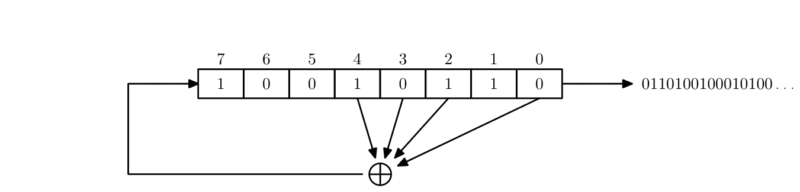

图 3.10: 8 位线性反馈移位寄存器 {4, 3, 2, 0}

LFSR 每个时钟周期输出一位。请注意，如果 LFSR 的初始状态为 s = 0^n，则其输出是退化的，即全部为 0。因此，种子位之一始终设置为 1。

LFSR 可以用少量晶体管实现。因此，从 LFSR 构建的流密码对于低成本的消费电子产品非常有吸引力，如 DVD 播放器、手机和蓝牙设备。

来自 LFSR 的流密码。单个 LFSR 作为 PRG 完全不安全，因为在给定其输出的 n 个连续位的情况下，可以轻松计算出所有后续位。然而，通过使用非线性组件组合多个 LFSR，可以获得一些（弱）作为 PRG 的安全性。eStream 流密码组合中的 Trivium 就是这样构建的。

从 LFSR 构建流密码的一种方法是并行运行多个 LFSR，并使用非线性操作组合它们的输出。下面描述的 CSS 流密码使用整数加法来组合两个 LFSR。用于加密 GSM 手机通信的 A5/1 流密码组合了三个 LFSR 的输出。蓝牙 E0 流密码使用 2 位有限状态机组合了四个 LFSR。所有这些算法都被证明是不安全的，不应该使用：恢复明文所需的时间远远小于对密钥空间进行穷举搜索的时间。

另一种方法是运行单个 LFSR，并通过对其内部状态进行非线性操作来生成输出。用于加密 3GPP 手机通信的雪 3G 密码就是这种方式操作的。

CSS 流密码。CSS 流密码是从图 3.11 中显示的 PRG 构建的。PRG 的工作原理如下：

```
输入：种子 s ∈ {0, 1}^{40}
写入 s = s_1||s_2 其中 s_1 ∈ {0, 1}^{16} 和 s_2 ∈ {0, 1}^{24}
将 1||s_1 加载到一个 17 位 LFSR 中
将 1||s_2 加载到一个 25 位 LFSR 中
c ← 0 // 进位位
重复
    运行两个 LFSR 八个周期以获得 x, y ∈ {0, 1}^8 将 x, y 视为 0...255 范围内的整数
    输出 x + y + c mod 256
    如果 x + y > 255 则 c ← 1 否则 c ← 0 // 进位位
永远
```

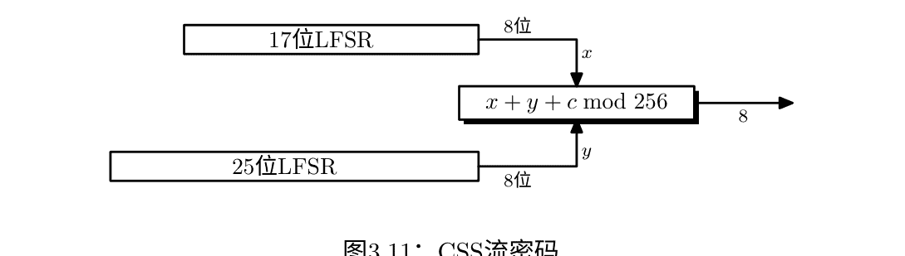

PRG 每次迭代输出一个字节。在 s_1 和 s_2 之前都添加 1，确保 LFSRs 从不初始化为全 0 状态。两个 LFSR 的抽头是固定的。17 位 LFSR 使用抽头 {14, 0}。25 位 LFSR 使用抽头 {12, 4, 3, 0}。

我们介绍的 CSS PRG 是 CSS 的一个小变种，更容易描述，但具有相同的安全性。在真实的 CSS 中，不是在初始种子前添加 1，而是在 17 位 LFSR 的第 9 位和 25 位 LFSR 的第 22 位插入 1。此外，真实的 CSS 会丢弃 17 位 LFSR 输出的第一个字节和 25 位 LFSR 输出的前两个字节。这两个问题都不会影响接下来的分析。

CSS 的不安全性。给定 PRG 的输出，可以通过对种子空间进行穷举搜索，在 2^{40} 的时间量级内恢复秘密种子。我们展示了一种更快的攻击方法，只需要 2^{16} 次猜测。假设我们已经获得 PRG 输出的前 100 个字节 \vec{z} := (z_1, z_2, ...)。该攻击基于以下简单观察：

- 设 (x_1, x_2, x_3) 是 17 位 LFSR 输出的前三个字节。一旦知道了 (z_1, z_2, z_3) 和 (x_1, x_2, x_3)，就可以轻松地获得第二个 LFSR 的初始状态 s_2，只需将一个减去另一个即可。更准确地说，从整数 2^{16}z_3 + 2^{8}z_2 + z_1 中减去整数 2^{16}x_3 + 2^{8}x_2 + x_1。
- 输出 (x_1, x_2, x_3) 由 16 位种子 s_1 确定。

通过这两个观察，攻击者可以通过尝试所有可能的 16 位值来恢复种子 s_1。对于每个对 s_1 的猜测，计算出 17 位 LFSR 的相应输出 (x_1, x_2, x_3)。从 (z_1, z_2, z_3) 中减去 (x_1, x_2, x_3) 以获得第二个 LFSR 的候选种子 s_2。现在，通过运行 PRG 并将结果与给定的序列 \vec{z} 进行比较，确认 (s_1, s_2) 是否是正确的秘密种子 s。如果序列不匹配，请尝试另一个对 s_1 的猜测。一旦攻击者找到了正确的 s_1 值，生成的序列将与给定的 \vec{z} 匹配，这种情况下攻击者找到了秘密种子 s = (s_1, s_2)。

我们刚刚证明了在预期的 2^{15} 次猜测后可以找到整个种子 s。这比朴素的 2^{40} 次穷举搜索攻击要快得多。

## 3.9 案例研究：RC4流密码的密码分析

RC4 流密码是由 Ron Rivest 于 1987 年设计的，历史上被用于保护 Web 流量（在 SSL/TLS 协议中）和无线流量（在 802.11b WEP 协议中）。它被设计用于在内存较少的 8 位处理器上运行。虽然 RC4 仍在使用中，但已经显示 RC4 容易受到一些重大攻击的影响，不应在新项目中使用。我们对 RC4 的讨论是流密码密码分析的一个优雅示例。

RC4 密码的核心是一个 PRG，称为 RC4 PRG。PRG 维护一个内部状态，包括一个由 256 个字节组成的数组 S，以及两个额外的字节 i, j 作为指向 S 的指针。数组 S 包含所有的数字 0...255，每个数字仅出现一次。图 3.12 给出了一个 RC4 状态的示例。

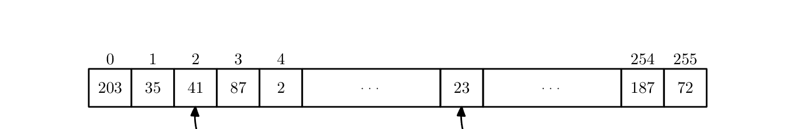

图 3.12: 一个示例 RC4 内部状态

RC4 流密码密钥 s 是 PRG 的种子，并用于将数组 S 初始化为伪随机排列的数字 0...255。使用以下设置算法进行初始化：

```
输入：字节字符串 s
for i = 0 到 255 之间的值: S[i] = i
j = 0
for i = 0 到 255 之间的值
    k = s[i mod |s|] //从种子中提取一个字节
    j = (j + S[i] + k) mod 256
    swap(S[i], S[j])
```

在循环中，索引 i 线性地遍历数组，而索引 j 跳跃。在每次迭代中，索引 i 处的条目与索引 j 处的条目交换。一旦数组 S 被初始化，PRG 就使用以下流生成器生成逐字节的伪随机输出：

```
i = 0, j = 0
重复
    i = (i + 1) mod 256
    j = (j + S[i]) mod 256
    交换(S[i], S[j])
    输出 S[ (S[i] + S[j]) mod 256 ]
永远
```

该过程将持续进行直到必要为止。同样，索引 i 线性地遍历数组而索引 j 跳跃。不断交换 S[i] 和 S[j] 会连续打乱数组 S。

RC4 加密速度。RC4 非常适合软件实现。其他流密码，如 Grain 和 Trivium，设计用于硬件，在软件实现时性能较差。表 3.1 提供了 RC4 和几种其他软件流密码的运行时间。

| 密码     | 速度¹(MB/秒) |
|----------|--------------|
| RC4      | 126          |
| SEAL     | 375          |
| Salsa20  | 408          |
| Sosemanuk| 727          |

表 3.1: 软件流密码速度（速度越快越好）

现代处理器使用 64 位字，使得 RC4 的 8 位设计在这些架构上相对较慢。

### 3.9.1 RC4 的安全性

曾经有一段时间，RC4 被认为是一种安全的流密码，并广泛应用于各种应用中。在一系列攻击中，RC4 密码显示出其输出存在一定的偏差，因此其声誉受损。我们提出了两种攻击方法，可以区分 RC4 的输出和随机字符串。在本节中，我们将使用符号 n 表示数组 S 的大小。 n=256 表示 RC4 的大小。

RC4 初始输出的偏差。 RC4 设置算法将数组 S 初始化为从给定的随机种子生成的 0...255 的排列。暂时假设 RC4 设置算法完美地从所有 256! 个排列中生成均匀排列。

Mantin 和 Shamir [70] 证明，即使假设初始化完美，RC4 的输出也是有偏的。

引理 3.8 (Mantin-Shamir)。假设数组 S 是随机排列的 0...n-1 和 i, j 被设置为 0。那么 RC4 输出的第二个字节等于 0 的概率是 2/n。

证明思路。设 z_2 是 RC4 输出的第二个字节。设 P 是 S[2] = 0 和 S[1] = 2 的事件。关键观察是当事件 P 发生时， z_2 = 0 的概率为 1。见图 3.13。然而，当事件 P 不发生时， z_2 在 0... n-1 上均匀分布，因此等于 0 的概率为 1/n。由于 Pr[P] 约为 1/n, 我们得到（近似地）

```
Pr[z_2 = 0] = Pr[(z_2 = 0) | P] · Pr[P] + Pr[(z_2 = 0) | ¬P] · Pr[¬P]
≈ 1·(1/n) + (1/n)·(1 - 1/n) ≈ 2/n
```

引理表明，RC4 输出的第二个字节为 0 的概率是应该的两倍。这导致了对 RC4 PRG 的简单区分器。给定一个字符串 x ∈ {0...255}^ℓ, 对于 ℓ ≥ 2, 如果 x 的第二个字节为 0，则区分器输出 0，否则输出 1。根据引理 3.8，这个区分器的优势大约为 1/n，对于 RC4 来说是 0.39%。

Mantin-Shamir 区分器显示了 RC4 输出的第二个字节存在偏差。这一结果由 AlFardan 等人[2] 推广，他们通过测量许多随机密钥的偏差，证明了输出的前 256 个字节中存在偏差：每个字节的分布...## 图3.13：引理3.8的证明

字节与均匀分布相差很远。与第二个字节相比，这种偏差不太明显，但是它是不可忽视的，并足以攻击密码。例如，他们表明，给定加密的单个明文在2^{30} random密钥下加密，可以以接近1的概率恢复前128个字节的明文。这种攻击在Web上很容易进行，因为秘密cookie通常嵌入在消息的前几个字节中。每次浏览器连接到受害者Web服务器时，都会重新加密此cookie。使用JavaScript，攻击者可以使用户的浏览器反复重新连接到目标站点，从而获得攻击所需的2^{30}密文，并暴露cookie。

作为回应，RSA实验室发布了一项建议，建议丢弃RC4流生成器输出的前1024个字节，只使用第1025个字节及以后的字节。这样可以消除初始密钥流偏差区分器，但不能消除其他攻击，接下来我们将讨论这些攻击。

## RC4流生成器中的偏差

假设RC4设置算法被修改，以使得前一段的攻击无效。Fluhrer和McGrew [39]对流生成器进行了直接攻击。他们认为，在RC4输出中，字节对(0,0)出现的次数比随机序列应该多。这足以将RC4的输出与随机字符串区分开来。

设ST_{RC4}为RC4的所有可能内部状态的集合。由于数组 S和 i、j的每个可能设置有n!种可能性，因此ST_{RC4}的大小为n!·n^2。对于RC4中使用的n=256，ST_{RC4}的大小是巨大的，大约为10^{511}。

## 引理3.9 (Fluhrer-McGrew)

假设RC4使用随机状态 T初始化。当RC4在状态 T下启动时，第一次输出的两个字节为 (z1, z2)。那么

i = n ⊕ 1 ⟹ Pr[(z1, z2) = (0,0)] = (1/n^2) · (1 + (1/n)(
i = 0,1 ⟹ Pr[(z1, z2) = (0,1)] = (1/n^2) · (1 + (1/n)(

一对连续的输出 (z1, z2) 被称为一个有向图。在一个真正随机的字符串中，所有有向图 (x, y) 的概率都是精确地1/n^2。这个引理表明对于RC4，概率对于(0,0)的偏差大于1/n³比它应该的要多。对于二元组(0,1)也是一样。事实上，Fluhrer-McGrew还发现了几个其他异常的二元组，超出了引理3.9中所述的范围。该引理提出了一个简单的区分器 D来区分RC4的输出和随机字符串。

如果区分器在给定的字符串中找到了比随机字符串中可能出现的(0,0)对更多的情况，它输出1，否则输出0。更准确地说，区分器 D的工作原理如下：

```
输入：字符串 x ∈ {0 . . . n}^ℓ
输出：0或1
设 q为二元组(0,0)在 x中出现的次数
如果 (q/ℓ) = (1/n²) > 1/(2n³) 输出0，否则输出1
```

使用定理B.3，我们可以估计 D的优势作为输入长度的函数 ℓ。特别地，区分器 D实现了以下优势：

$$\ell = 2^{14} \text{字节}: \qquad PRGadv[D, RC4] = 2^{-8}$$
$$\ell = 2^{34} \text{字节}: \qquad PRGadv[D, RC4] = 0.5$$

使用Fluhrer和McGrew提供的所有异常二元组，可以构建一个区分器，仅使用2³⁰·⁶字节的输出，实现优势0.8。

## 关于RC4的相关密钥攻击

Fluhrer，Mantin和Shamir [38]表明，当与相关密钥一起使用时，RC4是不安全的。我们在第9.10节中讨论了这种攻击及其对802.11b WiFi协议的影响，攻击2。

## 3.10 在实践中生成随机比特

在密码学中，随机比特在许多任务中都是必需的，比如生成密钥和其他临时值，称为nonce。在本书中，我们假设所有参与方都可以访问一个良好的随机源，否则许多理想的密码目标是不可能实现的。到目前为止，我们使用了一个伪随机生成器（PRG）将一个短的均匀分布的秘密种子扩展为一个长的伪随机字符串。

虽然PRG是生成随机（或伪随机）比特的重要工具，但它只是故事的一部分。

在实践中，随机比特是使用随机数生成器（RNG）生成的，或者RNG。RNG和PRG一样，输出一系列随机或伪随机比特。然而，RNG还有一个额外的接口，用于不断向RNG的内部状态添加熵，如图3.14所示。这个想法是，每当系统有更多的随机熵可以贡献给RNG时，这个熵就被添加到RNG的内部状态中。每当有人从RNG中读取比特时，这些比特是使用当前的内部状态生成的。

一个例子是Linux RNG，它被实现为一个名为/dev/random的设备。任何人都可以从设备中读取数据以获取随机位。要玩/dev/random，请在UNIX shell中键入cat /dev/random。您将看到一个无尽的随机字符序列。

UNIX RNG从多个硬件源获取熵：

- 键盘事件：键盘按键之间的时间提供熵；
- 鼠标事件：中断时间和报告的鼠标位置都被使用；
- 硬件中断：硬件中断之间的时间是一个很好的熵源；

这些源生成连续的随机流，定期进行异或运算并输入到RNG的内部状态中。请注意，键盘输入不用作熵源；只使用按键时间。这确保用户输入不会通过Linux RNG泄露给系统中的其他用户。

## 图3.14：随机数生成器

高熵随机生成。上述熵源以相对较慢的速度生成随机性。为了以更快的速度生成真正的随机比特，Intel从2012年的Ivy处理器系列开始添加了一个硬件随机数生成器。生成器的输出使用 RdRand 指令读取，该指令旨在提供快速均匀的比特生成器。

为了减少生成器输出中的偏差，原始比特首先通过一个称为“调节器”的函数传递，该函数旨在确保输出是一系列均匀分布的比特，假设提供了足够的熵作为输入。我们在第8.10节中详细讨论了这个问题，其中我们讨论了密钥派生问题。

RdRand生成器不应替代其他熵源，如上述的四个源；它只应作为RNG的一个附加熵源。这样，如果生成器有缺陷，它不会完全损害密码应用程序。

英特尔的方法存在一个困难，随着时间的推移，由于硬件故障，被采样的硬件元素可能停止产生随机性。例如，采样的位可能始终为'0'，导致非常非随机的输出。为了防止这种情况发生，随机数生成器的输出会不断地使用一组固定的统计测试进行测试。如果任何一个测试报告“非随机”，则宣布生成器有缺陷。

## 3.11 更广泛的视角：计算不可区分性

我们对伪随机生成器的安全性的定义 G形式化了直观的想法，即对手不能有效地区分 G(s) 和 r，其中 s是随机选择的种子， r是输出空间的随机元素。

这个想法在其他情境中也可以自然而有用地推广。假设 P₀和 P₁是某个有限集合 ℛ上的概率分布。我们的目标是正式定义对手不能有效地区分 P₀和 P₁的直观概念。通常情况下，这是通过攻击游戏来完成的。对于 b= 0，1，我们用 x ^R P_b表示从概率分布 P_b中随机选择的值分配给 x。

攻击游戏3.3（区分 P₀和 P₁）。对于给定的概率分布 P₀和P₁在有限集合 ℛ上，以及给定的对手 𝒜，我们定义两个实验，实验0和实验1。对于 b= 0, 1，我们定义:

实验b:

- 挑战者计算 x 如下：
  $x \leftarrow P_b$
  并将 x 发送给对手。
- 给定 x，对手计算并输出一个比特位 $\hat{b} \in \{0, 1\}$。

对于 $b=0, 1$，让 $W_b$表示在实验 $b$中 $\mathcal{A}$输出1的事件。我们定义 $\mathcal{A}$相对于 $P_0$和 $P_1$的优势为

$$\text{Distadv}[\mathcal{A}, P_0, P_1] := \left| \Pr[W_0] - \Pr[W_1] \right|. \quad \square$$

定义3.4 (计算不可区分性)。分布 $P_0$和 $P_1$被称为计算不可区分，如果对于所有高效的对手$\mathcal{A}$，值 $\text{Distadv}[\mathcal{A}, P_0, P_1]$ 是可以忽略的。

使用这个定义，我们可以更简单地重新表述安全PRG的定义：在$(S, \mathcal{R})$上定义的PRG $G$是安全的，当且仅当 $P_0$和 $P_1$是计算不可区分的，其中$P_1$是 $\mathcal{R}$上的均匀分布， $P_0$是分布，对于每个 $r \in \mathcal{R}$，它给出了值

$$P_0(r) := \frac{\left| \{s \in S : G(s) = r\} \right|}{|S|}.$$

正如在2.3.5节中讨论的那样，攻击游戏3.3可以重新定义为“猜测比特”游戏，其中挑战者在随机选择 $b \in \{0,1\}$之后，运行实验 $b$与对手 $\mathcal{A}$。在这个游戏中，我们将 $\mathcal{A}$的比特猜测优势 $\text{Distadv}^{*}[\mathcal{A}, P_0, P_1]$ 定义为 $\left| \Pr[b = \hat{b}] - 1/2 \right|$。2.3.5节的一般结果（即(2.13)）在这里也适用：

$$\text{Distadv}[\mathcal{A}, P_0, P_1] = 2 \cdot \text{Distadv}^{*}[\mathcal{A}, P_0, P_1]. \qquad (3.14)$$

通常，为了证明两个分布在计算上无法区分，我们需要做一些其他的计算假设。然而，有时候两个分布非常相似，无论对手拥有多少计算能力，都无法有效区分它们。为了准确地描述这种“相似性”，我们引入了一个有用的工具，称为统计距离：

定义3.5. 假设$P_0$和$P_1$是一个有限集合$\mathcal{R}$上的概率分布。那么它们的统计距离定义为

$$\text{Δ}[P_0, P_1] := \frac{1}{2} \sum_{r \in \mathcal{R}} |P_0(r) - P_1(r)|.$$

例子3.1. 假设$P_0$是集合$\{1, \ldots, m\}$上的均匀分布，而$P_1$是集合$\{1, \ldots, m + \delta\}$上的均匀分布，其中$\delta$属于$\{0, \ldots, m - 1\}$。让我们计算一下$\Delta[ P0, P1]$。我们可以直接应用定义；然而，考虑以下 $P_0$和$P_1$的图表：

统计距离 $P_0$ 和 $P_1$ 之间的统计距离只是图表中区域 $A$ 和 $C$ 的面积的1/2倍。此外，因为概率分布之和为1，我们必须有区域 $B$ 的面积加上区域 $A$ 的面积等于1，即区域 $B$ 的面积加上区域 $C$ 的面积等于1，因此，区域 $A$ 和区域 $C$ 的面积是相同的。因此，

$$\Delta[P_0, P_1] = \text{区域 } A = \text{区域 } C = \delta/m. \square$$

下面的定理使我们能够将计算不可区分性和统计距离的概念联系起来：

## 定理3.10

设 $P_0$ 和 $P_1$ 是定义在有限集合 $\mathcal{R}$ 上的概率分布。那么我们有

$$\max_{\mathcal{R}' \subseteq \mathcal{R}} |P_0[\mathcal{R}'] - P_1[\mathcal{R}']| = \Delta[P_0, P_1],$$

其中最大值是在所有子集 $\mathcal{R}'$ of $\mathcal{R}$ 上取得的.

证明. 假设我们将集合 $\mathcal{R}$ 分成两个不相交的子集: 集合 $\mathcal{R}_0$ 包含那些 $r \in \mathcal{R}$ 使得 $P_0(r) < P_1(r)$ 的元素, 和集合 $\mathcal{R}_1$ 包含那些 $r \in \mathcal{R}$ 使得 $P_0(r) > P_1(r)$ 的元素.

考虑下面的P0和P1分布的粗略图，其中 $\mathcal{R}_0$ 的元素放在 $\mathcal{R}$ 的元素的左边:

现在, 如同例子3.1,

$$\Delta[P_0, P_1] = A\text{的面积} = C\text{的面积}。$$

观察到对于每个子集 $\mathcal{R}'$ of $\mathcal{R}$, 我们有

$$P_0[\mathcal{R}'] - P_1[\mathcal{R}'] = C\text{的面积}' - A\text{的面积}', $$

其中 \( C' \) 是在 \( R' \) 上方的 \( C \) 的子区域，\( A' \) 是在 \( R' \) 上方的 \( A \) 的子区域。由此可得 \( |P_0[R'] - P_1[R']| \) 在 \( R' = R_0 \) 或 \( R' = R_1 \) 时取得最大值，此时等于 \( \Delta[P_0, P_1] \)。□

与计算不可区分性的联系如下：

定理3.11. 设 \( P_0 \) 和 \( P_1 \) 是定义在有限集合 \( R \) 上的概率分布。那么对于每个对手 \( \mathcal{A} \)，我们有 \( \text{Distadv}[\mathcal{A}, P_0, P_1] \leq \Delta[P_0, P_1] \)。

证明.考虑一个试图区分 \( P_0 \) 和 \( P_1 \) 的对手A，就像攻击游戏3.3中的情况一样。首先，我们考虑对手 \( \mathcal{A} \) 是确定性的情况。在这种情况下，对手 \( \mathcal{A} \) 的输出是一个关于挑战者提供给它的值r ∈ R的函数 \( f(r) \)。如果 \( W_0 \) 和 \( W_1 \) 是攻击游戏3.3中定义的事件，则对于 \( b = 0, 1 \)，我们有 \( \Pr[W_b] = P_b[R'] \)。根据前面的定理，我们有 \( \text{Distadv}[\mathcal{A}, P_0, P_1] = |P_0[R'] - P_1[R']| \leq \Delta[P_0, P_1] \)。我们现在考虑 \( \mathcal{A} \) 是概率性的情况。我们可以将 \( \mathcal{A} \) 视为接受一个辅助输入 \( t \)，表示其随机选择。我们将 \( t \) 视为从某个有限集合 \( T \) 中均匀随机选择的值。因此，\( \mathcal{A} \) 的输出是一个关于挑战者提供给它的值（r）和表示其随机选择的值（t）的函数 \( g(r, t) \)。对于给定的 \( t \in T \)，令 \( R'_t := \{ r \in R : g(r, t) = 1 \} \)。然后，对于 \( t \) 的随机选择进行平均，我们有 \( \Pr[W_b] = \frac{1}{|T|} \sum_{t \in T} P_b[R'_t] \)。由此可见 \( \text{Distadv}[\mathcal{A}, P_0, P_1] = |\Pr[W_0] - \Pr[W_1]| = \frac{1}{|T|} \left| \sum_{t \in T} (P_0[R'_t] - P_1[R'_t]) \right| \leq \frac{1}{|T|} \sum_{t \in T} |P_0[R'_t] - P_1[R'_t]| \leq \frac{1}{|T|} \sum_{t \in T} \Delta[P_0, P_1] = \Delta[P_0, P_1] \)。□

根据这个定理，我们可以看到，如果 \( \Delta[P_0, P_1] \) 是可以忽略的，那么 \( P_0 \) 和 \( P_1 \) 是在计算上无法区分的。还定义了两个随机变量之间的统计距离，即它们对应分布之间的统计距离。也就是说，如果 \( X \) 和 \( Y \) 是取值于有限集合 \( R \) 的随机变量，则它们的统计距离为 \( \Delta[X, Y] := \frac{1}{2} \sum_{r \in R} |\Pr[X = r] - \Pr[Y = r]| \)。

在这种情况下，定理3.10表明

$$\max_{R' \subseteq R} |\Pr[X \in R'] - \Pr[Y \in R']| = \Delta[X,Y],$$

其中最大值是在所有子集 R' of R上取得的。

类似地，我们可以根据随机变量而不是分布定义区分优势。使用随机变量的优势在于我们可以更方便地处理彼此相关的分布，如下面的定理所示。

## 定理3.12

如果 S 和 T 是有限集合，X 和 Y 是取值为 S 的随机变量，而 f : S → T 是一个函数，则 $\Delta[f(X), f(Y)] \leq \Delta[X, Y]$。

证明. 我们有

$\Delta[f(X), f(Y)] = |\Pr[f(X) \in T'] - \Pr[f(Y) \in T']|$ 对于某些 T' ⊆ T （根据定理3.10）
$= |\Pr[X \in f^{-1}(T')] - \Pr[Y \in f^{-1}(T')]| \leq \Delta[X, Y]$ （再次根据定理3.10）

## 例3.2

让 X均匀分布在集合 {0, …, m - 1}上，让 Y均匀分布在集合 {0, …, N - 1}上，对于 N > m。我们想要计算 X 和 f(Y)之间的统计距离的上界。我们可以这样做。令 N = qm + r，其中 0 ≤ r < m，以使 q = ⌈N/m⌉。另外，令 Z均匀分布在集合{0, …, qm - 1}上。那么 f(Z)在集合 {0, …, m - 1}上均匀分布，因为 {0, …, m - 1}中的每个元素在 f 下有相同数量的原像（即 q）位于集合{0, …, qm - 1}中。由于统计距离仅取决于随机变量的分布，根据前面的定理，我们有

$\Delta[X, f(Y)] = \Delta[f(Z), f(Y)] \leq \Delta[Z, Y]$, 正如我们在示例3.1中看到的那样， $\Delta[Z, Y] = r/(qm) < 1/q \leq m/N$。 因此， $\Delta[X, f(Y)] < m/N$。 □

## 示例3.3

假设我们想要在给定区间内生成一个伪随机数 {0, …, m - 1}。然而，假设我们可以使用一个输出 L 位字符串的 PRG G。当然，一个 L 位的字符串可以自然地看作是范围在 {0, …, N - 1}内的一个数字，其中 N := 2^L。让我们假设 N > m。

为了在区间 {0, …, m - 1}生成伪随机数，我们可以将G的输出视为区间 {0, …, N - 1}中的一个数，并对m取模。我们将证明，假设G是安全的且m/N可以忽略不计（例如，N > 2^{100} · m），这个过程产生的数在区间 {0, …, m - 1}中与真正的随机数在计算上无法区分。

为此，让P_0表示G的输出在取模m后的分布，让P_1表示区间 {0, …, m - 1}上的均匀分布，让A是试图区分P_0和P_1的攻击者，就像攻击游戏3.3中一样。

让游戏0成为攻击游戏3.3的实验0，在其中 A 被呈现出根据 P0分布的随机样本，并且让 W0 成为 A在这个游戏中输出1的事件。

现在定义游戏1与游戏0相同，只是我们将 G 的输出替换为从区间 {0, . . . , N - 1}中选择的真正随机值。让 W1 成为 A在游戏1中输出1的事件。可以很容易地构造一个高效的对手 B，像攻击游戏3.1中那样攻击 G，这样

```
PRGadv[B, G] = |Pr[W0] - Pr[W1]|
```

思路是 B获取其挑战值，对其进行模 m运算，将该值提供给 A，并输出 A的任何输出。

最后，我们定义 Game 2 为 Attack Game 3.3 的实验1，在其中 A 被呈现一个根据 P1，即在 {0, . . . , m - 1}上的均匀分布的随机样本。令 W2 为 A在 Game 2 中输出1的事件。如果 P 是在 Game 1 中呈现给 A 的值的分布，那么根据定理3.11，我们有 |Pr[ W1] - Pr[W2]| ≤ Δ[P, P1]；此外，根据例子3.3，我们有 Δ[P, P1] ≤ m/N。

将所有内容放在一起，我们可以看到

```
Distadv[A, P0, P1] = |Pr[W0] - Pr[W2]| \leq |Pr[W0] - Pr[W1]| + |Pr[W1] - Pr[W2]| \leq PRGadv[B, G] + \frac{m}{N}
```

根据假设，可以忽略不计。

### 3.11.1 数学细节

通常，我们会填写数学细节，以便从渐近复杂性理论的角度解释本节的定义和结果。

在定义计算不可区分性（定义3.4）时，应考虑两个概率分布族 P0 = {P0,λ}λ 和 P1 = {P1,λ}λ，这两个族是由安全参数 λ索引的。对于每个 λ，分布 P0,λ 和 P1,λ 应该取值于有限位字符串集合 Rλ，其中 Rλ中的字符串长度受到多项式 λ的限制。在攻击游戏3.3中，安全参数 λ是挑战者和对手的输入，在实验 b中，挑战者生成一个样本，按照 Pb,λ的分布。优势应该正确地写为 Distadv[A, P0, P1](λ)，这是一个关于 λ的函数。计算不可区分性意味着这是一个可以忽略的函数。

在某些情况下，引入一个概率生成的系统参数可能是自然的；然而，从技术角度来看，这并不是必要的，因为这样的系统参数可以被纳入分布 P0,λ和 P1,λ中。也可以要求 P0,λ和 P1,λ可以高效地进行采样；然而，为了保持定义的简单性，我们不要求这样做。

统计距离的定义（定义3.5）从非渐近的角度来看是完全合理的，不需要任何修改或详述。定理3.10按照所述成立，对于特定的分布 P0和 P1。定理3.11可以渐近地看作是对于所有的分布族 P0 = {P0,λ}λ 和 P1 = {P1,λ}λ，对于所有的对手（即使是计算上无限制的对手）和所有的 λ，我们有

```
Distadv[A, P0, P1](\lambda) \leq \Delta[P0,\lambda, P1,\lambda]
```

### 3.12 一个有趣的应用：硬币翻转和承诺

爱丽丝和鲍勃要出去约会。爱丽丝想看一部电影，鲍勃想看另一部。他们决定抛一枚随机硬币来选择电影。如果硬币正面朝上，他们将去看爱丽丝的选择；否则，他们将去看鲍勃的选择。

当爱丽丝和鲍勃在近距离时，这很容易：他们中的一个人，比如鲍勃，抛一枚硬币，然后他们都验证结果。当他们相隔很远并且在电话中交谈时，这就更难了。鲍勃可以在他这边抛一枚硬币并告诉爱丽丝结果，但爱丽丝没有理由相信结果。鲍勃可以简单地声称硬币是反面朝上，而爱丽丝没有办法验证这一点。这不是一个好的约会方式。

解决他们问题的简单方法是使用一种称为比特承诺的密码原语。它允许Bob承诺一个比特 b ∈ {0,1}的选择。稍后，Bob可以打开承诺并说服Alice b是他承诺的值。承诺一个比特 b 会产生一个承诺字符串 c，Bob发送给Alice，并且一个打开字符串 s，Bob用于以后打开承诺。如果承诺方案满足以下两个属性，则它是安全的：

- 隐藏：承诺字符串 c 不透露关于承诺比特 b 的任何信息。更准确地说，当承诺比特为0时，c 的分布与承诺比特为1时的分布不可区分。在我们提出的比特承诺方案中，绑定属性基于给定PRG G的安全性。
- 绑定：假设 c 是Bob输出的承诺字符串。如果Bob可以以某个 b ∈ {0,1}的方式打开承诺，则他不能以 b̄ 的方式打开它。这确保了一旦Bob承诺了一个比特 b，他只能以 b 和其他任何值打开它。在我们提出的承诺方案中，绑定属性无条件地成立。

**硬币翻转。** 使用承诺方案，爱丽丝和鲍勃可以生成一个随机比特 b ∈ {0,1}，以便任何一方都不能偏向他们偏好的结果，假设协议成功终止。这种协议被称为硬币翻转协议。得到的比特 b 决定他们去看哪部电影。

爱丽丝和鲍勃使用以下简单的硬币翻转协议：

步骤1：鲍勃选择一个随机比特 b0 ←{0,1}。爱丽丝和鲍勃通过承诺协议执行，爱丽丝获得对 b0 的承诺 c，鲍勃获得一个开放字符串 s。

步骤2：爱丽丝选择一个随机比特 b1 ← {0,1}，并将 b1明文发送给鲍勃。

步骤3：鲍勃通过揭示 b0 和 s 来打开承诺。Alice验证 c 确实是对 b0 的承诺，如果验证失败则中止。

输出：结果位 b := b0 ⊕ b1。

我们认为，如果协议成功终止并且一方诚实地遵循协议那么另一方不能偏向他们偏好的结果。根据隐藏属性，Alice在第1步结束时对 b0 一无所知，因此她对位 b1 的选择与 b0 的值无关。根据绑定属性，Bob只能在第3步中打开承诺 c 以位 b0 他在第1步中选择的。因为他在Alice选择 b1 之前选择了 b0，Bob对 b0 的选择是独立的于 b1。我们得出结论，输出位 b 是两个独立位的异或。因此，如果一方诚实地遵循协议，另一方不能偏向结果位。

这个协议的一个问题是Bob在第2步结束时就知道了生成的位，而Alice在之后才知道。原则上，如果结果不是Bob想要的，他可以中止协议。在第2步结束时，他会尝试重新启动协议，希望下一次运行能顺利进行。更复杂的硬币翻转协议可以避免这个问题，但代价是需要更多的交互轮数（参见，例如，[77]）。

**从安全PRGs进行位承诺。** 现在需要构建一个安全的位承诺方案让Bob承诺他的位 $b_0 \in \{0, 1\}$。我们使用Naor [83]的优雅构造来实现这一点。设 $G: S \to R$ 是一个安全PRG，其中 $|R| \ge |S|^3$ 且 $R = \{0,1\}^n$ 对于某个 $n$。为了承诺位 $b_0$，Alice和Bob进行以下协议：

```
Bob承诺位 $b_0 \in \{0, 1\}$：
步骤1：Alice选择一个随机数 $r \in R$ 并将 $r$ 发送给Bob。
步骤2：Bob选择一个随机数 $s \in S$ 并计算 $c = \text{com}(s, r, b_0)$
其中 $\text{com}(s, r, b_0)$ 是以下函数：
$c = \text{com}(s, r, b_0) := \begin{cases} G(s) & \text{如果 } b_0 = 0, \\ G(s) \oplus r & \text{如果 } b_0 = 1. \end{cases}$
```

Bob将 $c$ 作为承诺字符串输出，并使用 $s$ 作为开放字符串。

当到达开放承诺的时候，Bob向Alice发送 $(b_0, s)$。如果 $c= \text{com}(s, r, b_0)$，则Alice接受开放，否则拒绝。

隐藏属性直接来自于PRG的安全性：因为输出 $G(s)$ 在 $R$ 中是计算上无法区分的随机字符串，所以 $G(s) \oplus r$ 在 $R$ 中也是计算上无法区分的随机字符串。因此，无论 $b_0= 0$ 还是 $b_0 = 1$，承诺字符串 $c$ 在 $R$ 中都是计算上无法区分的随机字符串，符合要求。

只要 $1/|S|$ 可以忽略，绑定属性就无条件成立。只有当存在两个种子 $s_0, s_1 \in S$，使得 $c = G(s_0) = G(s_1) \oplus r$ 时，Bob才能以0和1的方式打开承诺 $c \in R$。这意味着 $G(s_0) \oplus G(s_1) = r$。如果存在种子 $s_0, s_1 \in S$，使得 $G(s_0) \oplus G(s_1) = r$，则称 $r \in R$ 为“坏”。种子对 $(s_0, s_1)$ 的数量为 $|S|^2$，因此坏的 $r$ 的数量最多为 $|S|^2$。由此可知，Alice选择坏的 $r$ 的概率最多为 $|S|^2/|R| < |S|^2/|S|^3 = 1/|S|$，这是可以忽略的。因此，Bob能够以0和1的方式打开承诺 $c$ 的概率是可以忽略的。

### 3.13 笔记

待添加文献引用。

### 3.14 练习

**3.1 (随机消息的语义安全性)。**

可以定义随机消息的语义安全性概念。在这里，将攻击游戏2.1进行修改，使得挑战者从消息空间中随机生成 $m_0, m_1$，而不是由对手选择消息 $m_0, m_1$。否则，优势和安全性的定义保持不变。

(a) 假设 $\mathcal{E}= (\mathcal{E}, D)$ 定义在 $(\mathcal{K}, \mathcal{M}, \mathcal{C})$ 上，其中 $\mathcal{M} = \{0, 1\}^L$。假设$\mathcal{E}$对于随机消息是语义安全的，展示如何构建一个在普通意义上安全的新密码$\mathcal{E}'$。你的新密码应该定义在 ( $\mathcal{K}'$, $\mathcal{M}'$, $\mathcal{C}'$ ) 上，其中$\mathcal{K}' = \mathcal{K}$和 $\mathcal{M}' = \mathcal{M}$。

(b) 给出一个在随机消息上语义安全但在普通意义上不语义安全的密码的例子。

**3.2 (加密链)**

设 $\mathcal{E} = (E, D)$ 是在 $(\mathcal{K}, \mathcal{M}, \mathcal{C})$ 上定义的完全安全密码，其中 $\mathcal{K} = \mathcal{M}$。设 $\mathcal{E}'= (E', D')$ 是一个密码，其中加密定义为 $E'((k_1, k_2), m) := (E(k_1, k_2), E(k_2, m))$。证明 $\mathcal{E}'$ 是完全安全的。

**3.3 (位猜测语义安全的定义)**

这个练习提供了语义安全的另一种表征方式。设 $\mathcal{E}= (E, D)$ 是在 $(\mathcal{K}, \mathcal{M}, \mathcal{C})$ 上定义的密码。假设可以高效地从消息空间 $\mathcal{M}$随机生成消息。我们定义一个攻击游戏，其中包括一个攻击者 $\mathcal{A}$和一个挑战者。攻击者选择一个消息$m \in \mathcal{M}$并将 $m$发送给挑战者。然后挑战者计算：

```
$b \stackrel{R}{\leftarrow} \{0,1\}, k \stackrel{R}{\leftarrow} \mathcal{K}, m_0 \leftarrow m, m_1 \stackrel{R}{\leftarrow} \mathcal{M}, c \stackrel{R}{\leftarrow} E(k, m_b)$
```

然后将密文 $c$发送给 $\mathcal{A}$，然后计算并输出一个位 $\hat{b}$。也就是说，挑战者根据 $b$的不同，加密 $m$或者一个随机消息。我们定义 $\mathcal{A}$的优势为 $|\mathrm{Pr}[b = \hat{b}] - 1/2|$，如果对于所有高效的对手来说，这个优势是可以忽略的，那么我们称 $\mathcal{E}$是真实/随机语义安全的。

证明如果 $\mathcal{E}$在普通意义上是语义安全的，那么它也是真实/随机语义安全的。

**3.4 (与随机不可区分)**

在这个练习中，我们为密码编写了一个安全性概念，称为伪随机密文安全，直观地说，没有高效的对手能够区分所选择的消息的加密和随机密文。

令 $\mathcal{E}= (E, D)$ 定义在 $(\mathcal{K}, \mathcal{M}, \mathcal{C})$ 上。假设可以高效地从密文空间 $\mathcal{C}$随机生成密文。我们定义了一个攻击游戏，其中包括一个对手 $\mathcal{A}$和一个挑战者。对手选择一个消息 $m \in \mathcal{M}$并将 $m$发送给挑战者。然后挑战者计算：

```
$b \stackrel{R}{\leftarrow} \{0,1\}, k \stackrel{R}{\leftarrow} \mathcal{K}, c_0 \stackrel{R}{\leftarrow} E(k, m), c_1 \stackrel{R}{\leftarrow} \mathcal{C}, c \stackrel{R}{\leftarrow} c_b$
```

并将密文 $c$发送给 $\mathcal{A}$，然后 $\mathcal{A}$计算并输出一个比特 $\hat{b}$。我们定义$\mathcal{A}$的优势为 $|\mathrm{Pr}[b = \hat{b}] - 1/2|$，如果这个优势对于所有高效的对手来说都是可以忽略的，则称 $\mathcal{E}$是伪随机密文安全的。

(a) 证明如果一个密码是伪随机密文安全的，则它是语义安全的。

(b) 证明一次性密码本是伪随机密文安全的。

(c) 给出一个语义安全但不是伪随机密文安全的密码的例子。

**3.5 (小种子空间是不安全的)**

假设 $G$是在 $(\mathcal{S}, \mathcal{R})$上定义的PRG，其中 $|\mathcal{R}| - 2|\mathcal{S}|$。让我们证明 $|\mathcal{S}|$必须是超多项式的。为了证明这一点，证明存在一个攻击PRG $G$的对手，其运行时间与 $|\mathcal{S}|$线性相关，并且能够获得至少1/2的优势。

**3.6 (另一个可塑性示例)。**

让我们给出另一个说明流密码可塑性的例子。假设你被告知消息“attack at dawn”的流密码加密结果是`6c73d5240a948c86981bc294814d`（明文字母以8位ASCII编码，给定的密文以十六进制表示）。在相同密钥下，“attack at dusk”这条消息的流密码加密结果将是什么？

**3.7 (练习安全PRG的定义)。**

假设$G(s)$是一个安全的$PRG$，它输出位串在$\{0, 1\}$上。以下哪些派生生成器是安全的？

- (a) $G_1(s_1 \| s_2) := G(s_1) \wedge G(s_2)$，其中$\wedge$表示按位与。
- (b) $G_2(s_1 \| s_2) := G(s_1) \oplus G(s_2)$。
- (c) $G_3(s) := G(s) \oplus 1^n$。
- (d) $G_4(s) := G(s)[0 .. n - 1]$。
- (e) $G_5(s) := (G(s), G(s))$。
- (f) $G_6(s_1 \| s_2) := (s_1, G(s_2))$。

**3.8 (定理3.1的逆命题)。**

在第3.2节中，我们展示了如何从PRG构建流密码。在定理3.1中，我们证明了如果PRG是安全的，那么这种加密方案是语义安全的。证明逆命题：如果这种加密方案是语义安全的，则PRG是安全的。

**3.9 (预测下一个字符)。**

在第3.5节中，我们展示了如果一个人能够有效地区分随机比特串和伪随机比特串，那么他就能够成功地预测伪随机比特串的下一个比特，概率显著大于1/2（其中“下一个比特”的位置是随机选择的）。将这个推广到字母表$\{0, ..., n - 1\}$上的字符串，对于所有的$n \ge 2$，假设$n$是多项式有界的。

提示：首先推广区分器/预测器引理（引理3.5）。

**3.10 (简单的统计距离计算)。**

- (a) 让$X$和$Y$是独立的随机变量，每个都均匀分布在$\mathbb{Z}_p$上，其中$p$是素数。计算$\text{td}[(X, Y), (X, XY)]$。
- (b) 让$X$和$Y$是随机变量，每个都取值在区间$[0, t]$内。证明$|E[X] - E[Y]| \leq t \cdot \text{td}[X, Y]$。

以下三个练习应该一起完成；它们将在后面的章节中使用。

**3.11 (分布比率)。**

这个练习开发了另一种比较两个概率分布的方法，它考虑的是概率的比率，而不是差异。让$X$和$Y$是取值在有限集合$\mathcal{R}$上的两个随机变量，并假设对于所有的$R \in \mathcal{R}$，$Pr[X=r] > 0$。定义
$$\rho[X, Y] := \max_{r \in \mathcal{R}} \{\Pr[Y = r] / \Pr[X = r] : r \in \mathcal{R}\}$$
证明对于每个子集$\mathcal{R}'$ of $\mathcal{R}$，我们有$\Pr[Y \in \mathcal{R}'] \leq \rho[X, Y] \cdot \Pr[X \in \mathcal{R}']$。

**3.12 (Bernoulli不等式的变体)**

以下是一个将在下面的练习中使用的有用事实。通过对 n进行归纳证明以下陈述：对于任意实数 $x_1, \ldots, x_n$ 在区间 $[0, 1]$ 上，我们有

$$\prod_{i=1}^{n}(1 - x_i) \ge 1 - \sum_{i=1}^{n} x_i$$

**3.13 (有替换和无替换的抽样：距离和比率)**

设 $\mathcal{X}$ 是一个大小为 $N$ 的有限集合， $Q \leq N$。定义随机变量 $\mathbf{X}$ 和 $\mathbf{Y}$，其中 $\mathbf{X}$ 均匀分布在 $\mathcal{X}$ 的所有 $Q$ 元素序列上， $\mathbf{Y}$ 均匀分布在 $\mathcal{X}$ 的所有 $Q$ 个不同元素序列上。设 $\Delta[\mathbf{X}, \mathbf{Y}]$ 是 $\mathbf{X}$ 和 $\mathbf{Y}$ 之间的统计距离， $\rho[\mathbf{X}, \mathbf{Y}]$ 如练习 3.11 中所定义。利用前面的练习，证明以下结论：

- (a) $\Delta[\mathbf{X}, \mathbf{Y}] = 1 - \prod_{i=0}^{Q-1} (1 - i/N) \leq \frac{Q^2}{2N}$
- (b) $\rho[\mathbf{X}, \mathbf{Y}] = \frac{1}{\prod_{i=0}^{Q-1} (1 - i/N)} \leq \frac{1}{1 - \frac{Q^2}{2N}}$ (假设 $Q^2 < 2N$).

**3.14 (定理3.2是紧密的)**

让我们证明并行组合定理中的界限，定理3.2是紧密的。考虑以下相当愚蠢的PRG $G_0$，它将“拉伸” $\ell$ 位字符串到 $\ell$ 位字符串，具有 $\ell$ 为偶数：对于 $s \in \{0, 1\}^\ell$，我们定义

```
G_0(s) := 
\text{如果 } s[0 .. \ell/2 - 1] = 0^{\ell/2} 
\text{那么输出 } 0^\ell 
\text{否则输出 } s
```

也就是说，如果 $s$ 的前 $\ell/2$ 位是零，那么 $G_0(s)$ 输出全零字符串，否则，$G_0(s)$ 输出 $s$。

接下来，定义以下攻击 $G_0$ 的PRG对手 $\mathcal{B}_0$：

```
当挑战者给 \mathcal{B}_0 提供 r \in \{0, 1\}^\ell 时，如果 r 的形式是 0^{\ell/2} \| t，其中 t = 0^{\ell/2}, \mathcal{B}_0 输出 1；否则， \mathcal{B}_0 输出 0.
```

现在，让 $G_0'$ 成为 $G_0$ 的 n次并行组合。使用 $\mathcal{B}_0$，我们构建一个攻击 $G_0'$ 的PRG对手 $\mathcal{A}_0$：

```
当挑战者呈现 \mathcal{A}_0 带有字符串序列 (r_1, \ldots, r_n), \mathcal{A}_0 将每个 r_i 呈现给 \mathcal{B}_0，并且如果 \mathcal{B}_0 输出 1，则输出 1；否则， \mathcal{A}_0 输出 0.
```

- (a) 证明 PRG优势 $\mathrm{adv}[\mathcal{B}_0, G_0] = 2^{-\ell/2} - 2^{-\ell}$。
- (b) 证明 PRG优势 $\mathrm{adv}[\mathcal{A}_0, G_0'] = n2^{-\ell/2} - n(n+1)2^{-\ell}$。
- (c) 证明没有攻击 $G_0$ 的对手比 $\mathcal{B}_0$ 有更好的优势 (提示：基于统计距离进行论证)。

(d) 利用部分 (a)-(c)，论证定理 3.2 不能被大幅改进；特别地，证明以下命题不能成立：

> 存在一个常数c < 1，对于每个PRG G，多项式有界的 n，以及高效的对手 A，存在一个高效的对手 B，使得 PRGadv[A, G'] ≤ cn · PRGadv[B, G]，其中 G' 是 G 的 n-wise 并行组合。

### 3.15 (定理2.8的某种逆命题)

设 E= (E, D) 是一个在 (K, M, C) 上定义的语义安全密码。其中 M = {0, 1}。证明对于每个高效的对手 A，当接收到一个随机位 b 的加密时，A 正确预测 b 的概率最多为 1/2 + ε，其中 ε 是可以忽略的。

提示：使用引理3.5。

### 3.16 (前一位预测)

假设 A 是一个有效的下一位预测器。也就是说，假设 A 是一个非常有效的对手，在攻击游戏3.2中具有非零优势。展示如何使用 A 构建一个明确的、有效的前一位预测器 B，该预测器将 A 作为黑盒子。在这里，定义了一个前一位预测游戏，该游戏与攻击游戏3.2相同，只是挑战者将 [i+1 .. L ⊕ 1] 发送给对手。此外，用 A 的下一位预测优势来表示 B 的前一位预测优势。

### 3.17 (基于线性代数的不安全 PRG)

设 A 是一个固定的 m×n 矩阵，其中 m > n，并且所有条目都是二进制的。考虑以下 PRG G: {0,1}^n → {0,1}^m 定义为

```
$G(s) := A \cdot s \pmod{2}$
```

其中 A · s mod 2 表示矩阵-向量乘积，结果向量的所有元素都模 2 取余。证明无论使用什么矩阵 A，这个 PRG 都是不安全的。

### 3.18 (使用 PRG 生成加密密钥)

设 G: S → R 为一个安全的 PRG。设 E= (E, D) 为在 (K, M, C) 上定义的语义安全密码。假设 K = R。构造一个在 (S, M, C) 上定义的新密码 E' = (E', D')，其中 E'(s, m) := E(G(s), m) 且 D'(s, c) := D(G(s), c)。证明 E' 是语义安全的。

### 3.19 (嵌套 PRG 构造)

设 G0: S → R1 和 G1: R1 → R2 是两个安全 PRG。证明 G(s) := G1(G0(s)) 将 S 映射到 R2 是一个安全 PRG。

### 3.20 (自嵌套 PRG 构造)

设 G 是一个将 n 位字符串扩展为 2n 位字符串的 PRG。对于 s ∈ {0,1}^n，将 G(s) = G0(s) || G1(s) 写成 G0(s) 表示 G(s) 的前 n 位，G1(s) 表示 G(s) 的后 n 位。定义一个新的 PRG G'，将 n 位字符串扩展为 4n 位字符串，如下所示：

```
$G'(s) := G(G_0(s)) \parallel G(G_1(s))$
```

证明如果 G 是一个安全 PRG，那么 G' 也是安全的。

提示：你可以给出一个直接的证明；或者，你可以与前面的练习一起使用定理3.2。

注意：这个构造是在第4.6节中讨论的更一般构造的特例。

### 3.21 (坏种子)

证明如果种子在 S 中不是均匀随机的，安全 PRG G: {0,1}^n → R 可能变得不安全。

(a) 考虑PRG $G^{\prime}:\{0,1\}^{n+1} \rightarrow \mathscr{R} \times\{0,1\}$ 定义为 $G^{\prime}\left(s_{0}\left\|s_{1}\right)=\left(G\left(s_{0}\right), s_{1}\right)$。证明 $G^{\prime}$ 是一个安全的PRG，假设 $G$ 是安全的。

(b) 证明如果随机种子 $S^{\prime}\left\|S_{1}\right.$ 被选择为其最后一位始终为0，$G_{0}$ 将变得不安全。

(c) 构建一个安全的PRG $G^{\prime \prime}:\{0,1\}^{n+1} \rightarrow \mathscr{R} \times\{0,1\}$ 如果其种子 $s$ 被选择为使得 $s$ 中的位的奇偶总是0，则变得不安全。

### 3.22 (好意，坏主意)

让我们展示一种加强PRG的自然方法是不安全的。令 $m>n$ 并且令 $G:\{0,1\}^{n} \rightarrow\{0,1\}^{m}$ 是一个PRG。定义一个新的生成器 $G^{\prime}(s):=G(s) \oplus\left(0^{m-n}\left\|s\right)$ 源自 $G$。证明存在一个安全的PRG $G$，使得 $G^{\prime}$ 是不安全的。

提示：使用练习3.21的第（a）部分的构造。

### 3.23 (种子恢复攻击)

设 $G$ 是在 $(\mathcal{S}, \mathcal{R})$ 上定义的PRG，其中 $|\mathcal{S}|/|\mathcal{R}|$ 是可以忽略的，并且假设 $\mathcal{A}$ 是一个给定 $G(s)$ 输出 $s$ 的对手，其非可忽略概率。展示如何使用 $\mathcal{A}$ 构建一个对 $G$ 进行攻击的PRG对手 $\mathcal{B}$，其具有非可忽略的优势。这表明对于一个安全的PRG，从输出中恢复种子是困难的。

### 3.24 (PRG组合器)

假设 $G_{1}$ 和 $G_{2}$ 是在 $(\mathcal{S}, \mathcal{R})$ 上定义的PRG，其中 $\mathcal{R}=\{0,1\}^{L}$。定义一个新的在 $(\mathcal{S} \times \mathcal{S}, \mathcal{R})$ 上定义的PRG $G^{\prime}$，其中 $G^{\prime}\left(s_{1}, s_{2}\right)=G_{1}\left(s_{1}\right) \oplus G_{2}\left(s_{2}\right)$。展示如果 $G_{1}$ 或 $G_{2}$ 是安全的（我们可能不知道哪一个是安全的），那么 $G^{\prime}$ 是安全的。

### 3.25 (引理3.5证明的技术步骤)

这个练习从概率论中发展出一个简单的事实，有助于理解引理3.5的证明。让 $\mathbf{X}$ 和 $\mathbf{Y}$ 是独立的随机变量，取值分别在 $S$ 和 $T$，其中 $\mathbf{Y}$ 在 $T$ 上均匀分布。令 $f:S \rightarrow\{0,1\}$ 和 $g:S \rightarrow T$ 是函数。证明事件 $f(\mathbf{X})=1$ 和 $g(\mathbf{X})=\mathbf{Y}$ 是独立的，后者的概率为 $1 /|T|$。

## 第四章 分组密码

本章继续讨论上一章关于对抗窃听者实现隐私的内容。在这里，我们研究另一种密码算法，称为分组密码。我们还研究了相关概念伪随机函数。

分组密码是实际密码学的“工作马”：它们不仅可以用于构建流密码，还可以用于构建具有更强安全性质的密码（如我们将在第5章中探讨），以及许多其他密码学原语。

### 4.1 块密码：基本定义和属性

从功能上讲，分组密码是一个确定性密码$\mathcal{E} = (E, D)$，其消息空间和密文空间是相同的（有限）集合$\mathcal{X}$。如果$\mathcal{E}$的密钥空间是$\mathcal{K}$，我们称$\mathcal{E}$是在$(\mathcal{K}, \mathcal{X})$上定义的分组密码。我们将$\mathcal{X}$中的元素$x$称为数据块，并将$\mathcal{X}$称为$\mathcal{E}$的数据块空间。

对于每个固定的密钥$k \in \mathcal{K}$，我们可以定义函数$f_k := E(k, \cdot)$；也就是说，$f_k : \mathcal{X} \to \mathcal{X}$将$\mathcal{X}$中的元素$x$映射到$E(k, x) \in \mathcal{X}$。对于任何密码，通常的正确性要求意味着对于每个固定的密钥$k$，函数$f_k$是一对一的，并且由于$\mathcal{X}$是有限的，$f_k$也必须是满射的。因此，$f_k$是$\mathcal{X}$上的置换，而$D(k, \cdot)$是$f_k$的逆置换$f_k^{-1}$。

尽管在语法上，分组密码只是一种特殊类型的密码，但我们对分组密码的安全性要求实际上比语义安全性要强得多：对于随机选择的密钥 $k$，置换 $E(k, \cdot)$ 应该在所有实际目的中“看起来”像是一个随机置换。这是一个我们很快会更加明确的概念。

一个非常重要且流行的分组密码是AES（高级加密标准）。我们将在下面更详细地研究AES的内部设计，但现在我们只给出一个非常高层次的描述。AES密钥是128位字符串（尽管可以使用更长的密钥长度，如192位或256位）。AES数据块是128位字符串。参见图4.1。AES被设计成非常高效：在典型计算机上，加密（或解密）函数的一次评估只需要几百个周期。

对于分组密码的安全性定义为一种“黑盒测试”。直观上，其定义如下：一个高效的对手被给予一个“黑盒”。盒子里面是一个置换$f$ on $\mathcal{X}$的函数，通过两个随机过程之一生成：

- $f := E(k, \cdot)$，其中 $k$是随机选择的密钥，或者
- f是一个真正的随机置换，均匀地选择自 X 上的所有置换。对手无法看到盒子内部，但他可以通过提问来“探测”它：他可以给盒子一个值 x ∈ X，并获得值 y := f(x) ∈ X。我们允许对手提出许多这样的问题，并且我们非常自由地允许他以任何方式选择问题；特别是，每个问题甚至可以以某种巧妙的方式依赖于先前问题的答案。

安全意味着对手不能够确定盒子里是哪种类型的函数——是一个随机密钥的分组密码，还是一个真正的随机置换。换句话说，一个安全的分组密码应该在计算上无法区分一个随机置换。

为了使这个定义更加形式化，让我们引入一些符号：

```
Perms[X]
```

表示 X 上的所有置换的集合。请注意，这是一个非常大的集合：

```
|Perms[X]| = |X|!.
```

对于AES，当 |X| = 2^{128} 时，置换的数量约为

```
Perms[X] ≈ 2^{2^{135}},
```

而由128位AES密钥定义的置换数量最多为 2^{128}。

和往常一样，为了定义安全性，我们引入了一个攻击游戏。就像用来定义PRG的攻击游戏一样，这个攻击游戏包括两个独立的实验。在两个实验中，对手都遵循相同的协议；也就是说，它向挑战者提交一系列查询 x1, x2, ... to the challenger; the challenger responds to query xi with f(xi), where in the first experiment, f := E(k, ·) for randomly chosen k ∈ K, and while in the second experiment, f is randomly selected from Perms[X]; throughout each experiment, the same f is used to answer all queries.

当对手厌倦询问挑战者时，它输出一个比特。

**攻击游戏 4.1 (分组密码)**。对于给定的分组密码 (E, D)，定义在 (K, X) 上，并且对于给定的对手 A，我们定义两个实验，实验0和实验1。对于 b = 0, 1，我们定义：

实验b:

•挑战者按照以下方式选择 f ∈ Perms[X]：

如果 b=0: k ←$ K, f := E(k,·);
如果 b=1: f ←$ Perms[X]。

•对手向挑战者提交一系列查询。

对于 i= 1, 2, ..., 第 i个查询是一个数据块 x_i ∈ X。
挑战者计算 y_i = f(x_i) ∈ X, 并将 y_i 给对手。

•对手计算并输出一个比特 b̂ ∈ {0, 1}。

对于 b=0,1, 令 W_b 为事件，即 A在实验 b中输出1。我们定义 A相对于E的优势为

BCadv[A, E] := |Pr[W_0] - Pr[W_1]|。

最后，我们说 A是一个 Q查询的BC对手，如果 A最多发出 Q个查询。 □

图4.2说明了攻击游戏4.1。

**定义 4.1 (安全的分组密码)**。如果对于所有高效对手 A，值 BCadv[A, E] 是可以忽略的，则分组密码E是安全的。

我们强调，在攻击游戏4.1中，挑战者所做的查询可以是自适应的；也就是说，对手不需要提前选择所有的查询，而是可以以某种聪明的方式构造每个查询，这取决于挑战者之前的响应 (参见练习4.6)。

如2.3.5节所讨论的，攻击游戏4.1可以重新定义为“猜测比特”游戏，在这个游戏中，挑战者随机选择 b ∈ {0, 1}，然后对抗者 A进行实验 b。在这个游戏中，我们将 A的比特猜测优势BCadv*[A, E]定义为 |Pr[b̂ = b] - 1/2|。2.3.5节的一般结果 (即(2.13)) 在这里也适用：

BCadv[A, E] = 2 · BCadv*[A, E]。 (4.1)

#### 4.1.1 安全性的一些影响

设 E = (E, D)是在 (K, X)上定义的分组密码。为了对安全性的定义进行一些练习，我们证明了一些简单的蕴含关系。为了简单起见，我们假设|X|很大 (即超多项式)。

**一个安全的分组密码是不可预测的**

我们证明如果 E在定义4.1的意义下是安全的，那么它必须是不可预测的，这意味着每个高效的对手在以下预测游戏中以可忽略的概率获胜。
在这个游戏中，挑战者选择一个随机密钥 k，对手提交一个查询序列 x_1, ..., x_Q; 对于第 i个查询 x_i，挑战者以 E(k, x_i)回应。这些查询是自适应的，即每个查询可能依赖于先前的回应。最后，对手输出一对值 (x_{Q+1}, y), 其中 x_{Q+1} ∉ {x_1, ..., x_Q}。如果 y = E(k, x_{Q+1}), 对手赢得游戏。

为了证明这个蕴含关系，假设 E是不可预测的，这意味着存在一个高效的对手 A，在上述预测游戏中以非可忽略的概率赢得游戏。然后我们可以使用 $\mathcal{A}$ 来破解 $\mathcal{E}$ 的安全性，根据定义4.1的意义。为此，我们设计了一个对手 $\mathcal{B}$ 来玩攻击游戏4.1，并在上述预测游戏中扮演挑战者的角色。每当 $\mathcal{A}$ 查询 $x_i$ 时，对手 $\mathcal{B}$ 将 $x_i$ 传递给自己的挑战者，获得一个响应 $y_i$，然后将其传递回 $\mathcal{A}$。最后，当 $\mathcal{A}$ 输出 $(x_{Q+1}, y)$ 时，对手 $\mathcal{B}$ 将 $x_{Q+1}$ 提交给自己的挑战者，获得 $y_{Q+1}$，并在 $y = y_{Q+1}$ 时输出1，否则输出0。一方面，如果 $\mathcal{B}$ 的挑战者运行实验0，则 $\mathcal{B}$ 以概率 $p$ 输出1。另一方面，如果 $\mathcal{B}$ 的挑战者运行实验1，则 $\mathcal{B}$ 以可忽略的概率输出1（因为我们假设 $|\mathcal{X}|$ 是超多项式的）。这意味着 $\mathcal{B}$ 在攻击游戏4.1中的优势是 $|p - \epsilon|$，这是非可忽略的。

**不可预测性意味着对抗密钥恢复的安全性**

接下来，我们将证明如果 $\mathcal{E}$ 是不可预测的，则它对抗密钥恢复是安全的，这意味着每个高效的对手在以下密钥恢复游戏中以可忽略的概率获胜。在这个游戏中，对手与挑战者的交互方式与预测游戏完全相同，只是在最后，它输出一个候选密钥 $k' \in \mathcal{K}$，并且如果 $k' = k$，则获胜。

为了证明这个蕴含关系，假设 $\mathcal{E}$ 对密钥恢复不安全，这意味着存在一个高效的对手 $\mathcal{A}$ 以非可忽略的概率赢得密钥恢复游戏 $p_\mathcal{A}$。然后我们可以利用 $\mathcal{A}$ 构建一个高效的对手 $\mathcal{B}$ 以至少概率 $p_\mathcal{A}$ 赢得预测游戏 $p_\mathcal{B}$。对手 $\mathcal{B}$ 简单地运行 $\mathcal{A}$ 的攻击，当 $\mathcal{A}$ 输出 $k'$ 时，对手 $\mathcal{B}$ 选择一个任意的值 $x_{Q+1} \notin \{x_1, ..., x_Q\}$，计算 $y = E(k', x_{Q+1})$，并输出 $(x_{Q+1}, y)$。

很容易看出，如果 $\mathcal{A}$ 赢得了密钥恢复游戏，那么 $\mathcal{B}$ 也会赢得预测游戏。

**密钥空间大小和穷举搜索攻击**

结合上述两个蕴含关系，我们得出结论，如果 $\mathcal{E}$ 是一个安全的分组密码，那么它必须对密钥恢复是安全的。此外，如果 $\mathcal{E}$ 对密钥恢复是安全的，那么 $|\mathcal{K}|$ 必须很大。

有一种方法可以这样看。对手总是可以通过在 $\mathcal{K}$ 中随机选择 $k'$ 来赢得密钥恢复游戏的概率为 $1/|\mathcal{K}|$。如果 $|\mathcal{K}|$ 不是超多项式的，那么 $1/|\mathcal{K}|$ 是非可忽略的。因此，当 $|\mathcal{K}|$ 不是超多项式时，这个简单的猜测密钥的对手以非可忽略的概率赢得密钥恢复游戏。

我们可以使用一种不同的攻击，称为穷举搜索攻击，来以运行时间为代价换取成功概率。在这种攻击中，我们的对手在密钥恢复游戏中进行一些任意的查询 $x_1, ..., x_Q$，获得响应 $y_1, ..., y_Q$。可以争论 - 至少在启发式的情况下，假设 $|\mathcal{X}| \approx |\mathcal{K}|$ 和 $|\mathcal{X}|$ 是超多项式的 - 对于相当小的 $Q$ 值（实际上，$Q = 2$），几乎可以忽略不计的概率只有一个密钥 $k$ 满足

```
$$y_i = E(k, x_i) \quad \text{对于} \quad i = 1, ..., Q.$$
**(4.2)**
```

因此，我们的对手只需尝试所有可能的密钥来找到满足 (4.2) 的密钥。如果只有一个这样的密钥，那么我们的对手找到的密钥将是挑战者选择的密钥，而对手将赢得比赛。因此，我们的对手在密钥恢复游戏中以几乎可以忽略的概率获胜；然而，其运行时间与 $|\mathcal{K}|$ 成线性关系。

这种时间/优势的权衡可以很容易地推广。事实上，考虑一个对手，它随机选择 $t$ 个密钥，并测试每个密钥是否满足 (4.2)。这样一个对手的运行时间与 $t$ 成线性关系，并且它以概率 $\approx t/|\mathcal{K}|$ 赢得密钥恢复游戏。

我们在第4.2.2节中描述了一些现实世界的穷举搜索攻击。我们在第4.7.2节中详细讨论了穷举搜索，在那里，我们特别证明了上述启发式假设，即以很高的概率最多只有一个满足(4.2)的密钥。因此，很明显，如果一个分组密码有任何安全性的机会，它必须具有一个大的密钥空间，仅仅为了避免密钥恢复攻击。

## 4.1.2 随机置换的高效实现

请注意，在攻击游戏4.1的实验1中，挑战者的协议并不是非常高效：他应该选择一个非常大的随机对象。事实上，仅仅写下Perms[X]的一个元素就需要大约|X| log2|X|位。对于AES，当|X|=2^128 时，这意味着大约10^40位！虽然从纯粹的定义角度来看，这不是一个问题，但出于审美和技术原因，拥有一个更高效的实现会更好。我们可以通过使用“懒惰”的f实现来实现这一点。也就是说，挑战者通过跟踪输入/输出对(xi, yi)来表示随机置换f。当挑战者接收到第 i 个查询 xi 时，他会测试是否存在某个j < i使得 xi = xj；如果是这样，他会设置 yi。

```
在收到第 i 个查询 xi ∈ X 来自 A 的时候:
    如果存在某个 j < i 使得 xi = xj
        那么返回 yi = yj
    否则, 从集合 X \ { y1, ..., yi-1 } 中
    随机选择一个 yi, 并将其发送给 A。
```

为了使这个实现尽可能快速，可以使用适当的字典数据结构（哈希表、数字搜索树、平衡树等）来实现“如果存在某个 j < i 使得 xi = xj”的测试。假设可以高效地生成 X 的随机元素，一种实现“yi 从 X \ {y1, ..., y_{i-1}} 中随机选择”的方法如下:

```
重复 Y  直到 Y ∉ {y1, . . . . . . , yi-1}
yi = Y,
```

再次，使用适当的字典数据结构进行测试“Y ∈ {y1, . . . . . . . . . . . . . . . . . ., yi-1}。”当 i < |X|/2 时，循环只会预期运行两次。 一种可视化这个实现的方式是，在实验1中的挑战者是一个“黑盒子”，但盒子里面有一个忠诚的侏儒，他的工作是维护表示随机置换 f 的输入/输出表。参见图4.3。

## 4.1.3 强安全的块密码

请注意，在攻击游戏4.1中，解密算法 D 从未被使用过。实际上，可以通过定义一个攻击游戏来定义更强的安全性，其中对手被允许向挑战者提出两种类型的查询:

- 前向查询：对手发送一个值 xi ∈ X 给挑战者，挑战者发送 yi := f(xi) 给对手;
- 逆向查询：对手发送一个值 yi ∈ X 给挑战者，挑战者发送 xi := f⁻¹(yi) 给对手（在攻击游戏的实验0中，使用算法 D 完成此操作）。然后为此攻击游戏定义相应的优势。

一个分组密码都被称为强安全的，如果对于任何高效的对手，此优势可以忽略不计。我们将留给读者来解决此定义的细节问题（参见练习4.9）。在本文中，我们不会使用此概念，除了在后面的章节中作为一个示例应用（练习9.12）。

## 4.1.4 直接使用块密码进行加密

由于分组密码是一种特殊类型的密码，当然可以考虑直接使用它进行加密。问题是：一个安全的分组密码是否也是语义安全的？

对于这个问题的答案是“是的”，前提是消息空间等于数据块空间。这将由下面的定理4.1暗示。然而，实际块密码的数据块非常短：正如我们提到的，AES的数据块只有128位长。如果我们想要加密更长的消息，一个自然的想法是将长消息分解为一系列数据块，并分别加密每个数据块。将块密码用于加密长消息的方法称为电子密码本模式，简称ECB模式。

更准确地说，假设E=(E,D)是在(K,X)上定义的块密码。对于任何多项式边界ℓ ≥ 1，我们可以定义一个密码E'=(E',D')，在(K, X^≤ℓ, X^≤ℓ)上定义如下。

- 对于k ∈ K 和 m ∈ X^≤ℓ，定义v := |m|，我们定义E'(k,m) := (E(k,m[0]), ..., E(k,m[v-1]))。
- 对于k ∈ K 和 c ∈ X^≤ℓ，定义v := |c|，我们定义D'(k,c) := (D(k,c[0]), ..., D(k,c[v-1]))。

图4.4说明了加密和解密。我们称之为从 𝓔 派生的 ℓ-wise ECB密码。ECB密码与示例2.3和2.6中讨论的替代密码非常相关。主要的区别是，我们不是从所有可能的 𝒳 上随机选择一个排列，而是从更小的排列集合 { E(k,·) : k ∈ 𝒦 } 中选择一个。一个不太重要的区别是，在示例2.3中，我们定义了一个固定长度的替代密码，而不是一个可变长度的消息空间（这实际上只是一个任意选择 - 我们可以定义替代密码具有可变长度的消息空间）。另一个区别是，在示例2.3中，我们建议使用大小为27的字母表，而如果我们使用具有128位块大小的块密码（如AES），则“字母表”要大得多 - 它有 2^{128} 个元素。尽管存在这些差异，但示例2.6中讨论的一些漏洞在这里也适用。例如，攻击者可以轻松区分两个消息 m₀, m₁ ∈ 𝒳² 的加密，其中 m₀ 由两个相等的块组成（即 m₀[0] = m₀[1]），而 m₁ 由两个不相等的块组成（即 m₁[0] ≠ m₁[1]）。仅仅因为这个原因，ECB密码不符合我们对语义安全的定义，以及其作为加密方案的使用被强烈不推荐。

这种能够轻松判断哪些明文块是相同的情况在图4.5中有图形化展示（由B. Preneel提供）。在这里，视觉数据以ECB模式加密，每个数据块编码原始数据中的一小块像素。由于相同的像素块被映射为相同的密文块，原始图片中的一些模式在密文中是可见的。

然而，请注意，一些在示例2.6中讨论的漏洞不直接适用于这里。假设我们正在加密ASCII文本。如果密码的块大小为128位，则每个字符通常被编码为一个字节，16个字符被打包成一个数据块。因此，攻击者将无法轻易地定位个别字符重复的位置，就像示例2.6中的情况一样。

我们用一个证明来结束本节，即如果消息空间限制为不同数据块的序列，则ECB模式实际上是安全的。这包括了加密单个数据块消息的特殊情况。也可以将较长的消息编码为不同数据块的序列。例如，假设我们使用128位数据块的AES加密算法。那么我们可以将每个数据块的32位分配为计数器，并使用剩余的96位作为消息的位。通过这种策略，我们可以将最多 2^{32}·96 位的任何消息编码为不同数据块的序列。当然，这种策略的缺点是密文比明文长33%。

> **定理4.1.** 设 ℰ = (E, D) 为一个分组密码。设 ℓ ≥ 1 为任意多项式边界值，并且设 ℰ' = (E', D') 为从 ℰ 派生的按 ℓ-wise ECB模式进行加密，但消息空间限制为最多 ℓ 个不同数据块的所有序列。如果 ℰ 是一个安全的分组密码，则 ℰ' 是一个语义安全的密码。

特别是，对于每个 SS 攻击者 𝒜 在攻击游戏2.1中与 ℰ' 相关的情况，存在一个 BC 攻击者 ℬ 在攻击游戏4.1中与 ℰ 相关的情况，其中 ℬ 是一个基本的包装器，围绕 𝒜 而建立，且有：
SSadv[𝒜, ℰ'] = 2 · BCadv[ℬ, ℰ]. (4.3)

证明思路。基本思想是，如果一个攻击者得到了一个消息的加密，这是一个不同数据块的序列，那么他所看到的实际上只是一个随机数据块的序列（无重复采样）。 □

证明。如果 ℰ 在 (𝒦, 𝒳) 上定义，让 𝒳_{*}^{≤ℓ} 表示 𝒳 的最多 ℓ 个不同元素的所有序列的集合。
假设 ℰ 是一个安全的分组密码，让 𝒜 是一个高效的攻击者，攻击 ℰ' 如同攻击游戏2.1。我们的目标是证明SSadv[𝒜, ℰ'] 是可以忽略的。使用SS攻击游戏的比特猜测版本更加方便。我们证明：SSadv*[𝒜, ℰ'] = BCadv[ℬ, ℰ] (4.4)
对于某个高效的对手 ℬ。然后根据定理2.10，(4.3)成立。
因此考虑对手 𝒜 在攻击游戏2.1的比特猜测版本中对 ℰ' 的攻击。在这个游戏中， 𝒜 向挑战者展示两个相同长度的消息 m0, m1；然后挑战者选择一个随机密钥 k 和一个随机比特 b，并在 k 下加密 mb，得到结果密文 c，并将其交给 𝒜；最后， 𝒜 输出一个比特值 b̂。如果 b̂ = b，则对手 𝒜 赢得游戏。挑战者在这个游戏中的逻辑可以写成如下形式：

```
在收到 m0, m1 ∈ 𝒳_{*}^{≤ℓ}，其中 v := |m0| = |m1|，执行以下操作：
    b ←ᴿ {0, 1}
    k ←ᴿ 𝒦
    c ← (E(k, mb[0]), ..., E(k, mb[v - 1]))
    将 c 发送给 𝒜.
```

我们将这个游戏称为游戏0。我们将定义另外两个游戏：游戏1 和游戏2。对于 j = 0, 1, 2, 我们定义 Wj 为事件 b̂ = b 在游戏 j 中。根据定义，我们有 SSadv*[𝒜, ℰ'] = |Pr[W0] - 1/2|. (4.5)

游戏1。这与游戏0相同，只是挑战者在 E(k, ·) 的位置上使用一个随机 f ∈ Perms[𝒳]。我们的挑战者现在是这样的：

```
在收到 m0, m1 ∈ 𝒳_{*}^{≤ℓ}，并且 v := |m0| = |m1|，执行以下操作：
    b ←ᴿ {0, 1}
    f ←ᴿ Perms[𝒳]
    c ← (f(mb[0]), ..., f(mb[v - 1]))
    将 c 发送给 𝒜.
```

直观地，ℰ 是一个安全的分组密码，这意味着对手不应该注意到这个转换。为了严格证明这一点，我们展示了如何构建一个BC对手 ℬ，它是一个基本的 𝒜 的封装器，使得 |Pr[W0] - Pr[W1]| = BCadv[ℬ, ℰ]. (4.6)

ℬ 的设计直接来自于游戏0和1的逻辑。对手 ℬ 根据 ℰ 玩攻击游戏4.1，并按照以下方式工作：

令 f 为攻击游戏4.1中 ℬ 的BC挑战者选择的函数。我们让 ℬ 扮演挑战者的角色，对 𝒜 进行如下操作：

```
在接收到 m0, m1 ∈ 𝒳*_{≤ℓ} 从 𝒜 后，进行如下操作：
 b ← {0,1}
 c ← (f(mb[0]), ..., f(mb[v-1]))
 将 c 发送给 𝒜.
```

注意 ℬ 计算值 f(mb[0]), ... 通过查询自己的BC挑战者，计算值 f(mb[v-1])。最后，当 𝒜 输出比特 b̂ 时，输出比特 δ(b̂, b) (参见 (3.7))。很明显，当 ℬ 处于攻击游戏的实验0中时，它以概率 Pr[W0] 输出1，而当 ℬ 处于攻击游戏的实验1中时，它以概率 Pr[W1] 输出1。方程式 (4.6) 现在得到证明。

游戏2。 现在我们将游戏1中的挑战者改写为使用“忠诚的侏儒”实现的随机置换，该实现在第4.1.2节中讨论。每个消息 m0 和 m1 都需要由不同的数据块组成（我们的挑战者不需要验证这一点），因此我们的侏儒的工作非常简单：它甚至不需要查看输入的数据块，因为这些数据块保证是不同的；但是，它仍然必须确保生成的输出块是不同的。

我们可以将我们的挑战者的逻辑表示如下：
```
在接收到 m0, m1 ∈ 𝒳*_{≤ℓ}, 并且 v := |m0| = |m1|, 执行以下操作：
    y0 ← 𝒳, y1 ← 𝒳 \ {y0}, ..., y_{ℓ-1} ← 𝒳 \ {y0, ..., y_{ℓ-2}}
    b ← {0,1}
    c ← (y0, ..., y_{v-1})
    发送 c 给 𝒜.
```

由于我们的小矮人是忠诚的，我们有
Pr[W1] = Pr[W2]. (4.7)

此外，我们声称
Pr[W2] = 1/2. (4.8)

这是因为在游戏2中，对手的输出 b̂ 是其自己的随机选择的函数，加上 y0, ..., y_{ℓ-1}；由于这些值（根据定义）与 b 是独立的，因此 b̂ 和 b 是独立的。方程(4.8)现在得到证明。

结合(4.5), (4.6), (4.7)和(4.8), 得到(4.4), 从而完成了证明。 □

## 4.1.5 数学细节

通常情况下，我们会解释一些在上面被忽略的数学细节。

由于分组密码只是一种特殊类型的密码，关于分组密码的定义在2.4节中已经说过了。通常情况下，需要正确定义4.1。首先，在攻击游戏4.1中，需要理解对于每个安全参数值 λ，我们得到一个由挑战者和对手的随机选择决定的不同概率空间。其次，挑战者在游戏开始时生成一个系统参数 Λ，并将其发送给对手。第三，优势 BCadv[A, E] 是安全参数 λ 的函数，安全意味着这个函数是可以忽略的函数。

## 4.2 实际构建块密码

块密码是密码学中的基本原语，许多其他系统都是基于它构建的。

实际上，几乎所有实际使用的块密码都使用了称为迭代密码范式的相同基本框架。为了构建一个迭代块密码，设计者需要做出两个选择：

- 首先，他选择一个简单的块密码 $\hat{\mathcal{E}} := (\hat{E}, \hat{D})$，它在单独使用时明显不安全。我们称之为轮密码。
- 其次，他选择一个简单的（不一定安全的）PRG $G$，用于将密钥 $k$ 扩展为 $d$ 个密钥 $k_1, \ldots, k_d$，用于 $\hat{\mathcal{E}}$。我们称 $G$ 为密钥扩展函数。

一旦做出这两个选择，迭代分组密码 $\mathcal{E}$ 就完全确定了。加密算法 $E(k, x)$ 的工作原理如下（见图4.6）：

```
算法 $E(k, x)$:
- 步骤1。密钥扩展：使用密钥扩展函数 $G$ 来扩展 $\mathcal{E}$ 的密钥 $k$ 为 $d$ 个密钥 $\hat{\mathcal{E}}$:
  $(k_1, \ldots, k_d) \leftarrow G(k)$
- 步骤2。迭代：对于 $i= 1, \ldots, d$，应用 $\hat{E} (k_i, \cdot)$，即:
  $y \leftarrow \hat{E}(k_d, \hat{E}(k_{d-1}, \ldots, \hat{E}(k_2, \hat{E}(k_1, x))\ldots))$
```

每个 $\hat{E}$ 的应用被称为一个轮，总轮数为 $d$。密钥 $k_1, \ldots, k_d$ 被称为轮密钥。解密算法 $D(k, y)$ 除了轮密钥的应用顺序相反外，与加密算法相同。$D(k, y)$ 的定义如下：

```
$x \leftarrow \hat{D}(k_1, \hat{D}(k_2, \ldots, \hat{D}(k_{d-1}, \hat{D}(k_d, y))\ldots))$
```

表4.1列出了一些常见的分组密码及其参数。我们将在下一节中介绍DES和AES。

| 密钥大小 (位) | 块大小 (位) | 轮数 | 性能数量¹ (MB/秒) |
|---------------|--------------|------|-------------------|
| DES           | 56           | 64   | 16                | 80                |
| 3DES          | 168          | 64   | 48                | 30                |
| AES-128       | 128          | 128  | 10                | 163               |
| AES-256       | 256          | 128  | 14                | 115               |

表4.1：示例分组密码

迭代是否会产生安全的分组密码？没有人知道。然而，启发式证据表明，分组密码的安全性来自于对简单密码的多次迭代。并非所有的轮密码都有效。例如，迭代一个线性函数
```
Ê(k, x) := k · x mod q
```
永远不会得到安全的分组密码，因为 Ê 的迭代只是另一个线性函数。目前还没有办法对哪些轮密码最终会产生安全的分组密码进行分类。
此外，对于候选的轮密码 Ê，没有严格的方法来衡量需要迭代多少次才能成为安全的分组密码。
我们只知道某些函数，如线性函数，永远不会导致安全的分组密码，而简单的非线性函数在几次迭代后似乎会产生安全的分组密码。

密码学家面临的挑战是设计一个快速的轮密码，在几轮内收敛到安全的分组密码。从表4.1可以看出，AES-128使用了一个简单的轮密码，但在只经过十轮后似乎就产生了安全的分组密码。

一句警告。虽然本节解释了几种分组密码的内部工作原理，但并不教授如何设计新的分组密码。事实上，本节的主要观点之一是读者不应该自己设计分组密码，而应始终使用这里描述的标准密码。分组密码的设计并不简单，需要多年的分析才能对特定方案产生信心。此外，读者甚至不应该自己实现分组密码，因为分组密码的实现往往容易受到时间和功耗攻击的影响，如第4.3.2节所讨论的。使用在OpenSSL等密码库中免费提供的标准实现要安全得多。这些实现经过多年的深入分析，并经过加固以抵御攻击。

### 4.2.1 案例研究：DES

数据加密标准（DES）是IBM在国家标准局（现为国家标准技术研究所）的征求意见中开发的，于1975年在联邦公报上公布，并于1977年被采用为“非机密”应用的标准。DES算法单手推动了密码分析领域的发展；每个人都想要破解它。自问世以来，DES已经经历了大量的分析，从而导致了许多用于分析分组密码的新工具的开发。

DES的前身是一种早期的IBM分组密码叫做Lucifer。某些变种的Lucifer使用128位块和128位密钥。然而，国家标准局要求使用更短的块（64位）和更短的密钥（56位）的分组密码。作为回应，IBM团队设计了一个满足这些要求并最终成为DES的分组密码。将DES密钥大小设置为56位受到了广泛批评，并引起了DES故意被美国情报机构压力下制造弱点的猜测。在接下来的章节中，我们将看到将块大小减小到64位也会带来问题。

由于其密钥长度较短，DES算法现在被认为是不安全的，不应该使用。然而，DES的加强版本称为Triple-DES（3DES）在1998年被重新确认为美国标准。NIST已经批准Triple-DES在2030年之前用于政府使用。在2002年，DES被一种新的更高效的分组密码标准AES所取代，AES使用128位（或更长）密钥，并且操作于128位分组上。

#### DES算法

DES算法由16轮简单的轮密码组成。为了描述DES，只需描述DES轮密码和DES密钥扩展函数即可。我们依次描述每个部分。

**Feistel置换。** DES中的一个关键创新，由IBM的Horst Feistel发明，通过任意函数构建置换。设 $f: \mathcal{X} \rightarrow \mathcal{X}$ 为一个函数。我们按照如下方式构建置换 $\pi: \mathcal{X}^2 \rightarrow \mathcal{X}^2$（图4.7）：
$$ \pi(x, y) := (y, x \oplus f(y)) $$
为了证明 $\pi$ 是一对一的，我们构造其逆函数，即：
$$ \pi^{-1}(u, v) = (v \oplus f(u), u) $$
函数 $\pi$ 被称为**Feistel置换**，用于构建DES轮密码。
$n$ 个Feistel置换的组合被称为 $n$ 轮Feistel网络。设计为Feistel网络的分组密码被称为Feistel密码。对于DES，函数 $f$ 接受32位输入，得到的置换 $\pi$ 作用于64位分组。

## 图4.8: DES轮函数 \( F(k, x) \)

请注意，Feistel逆函数 \( \pi^{-1} \) 与 \( \pi \) 几乎相同。因此，相同的硬件可以用于评估 \( \pi \) 和 \( \pi^{-1} \)。这反过来意味着加密和解密电路可以使用相同的硬件。

**DES轮函数 \( F(k, x) \)。** DES加密算法是一个16轮的Feistel网络，每轮使用不同的函数 \( f: \mathcal{X} \rightarrow \mathcal{X} \)。在第 \( i \) 轮中，函数 \( f \) 定义为 \[ f(x) := F(k_i, x) \] 其中 \( k_i \) 是第 \( i \) 轮的48位密钥，\( F \) 是一个称为DES轮函数的固定函数。函数 \( F \) 是DES算法的核心，如图4.8所示。\( F \) 使用了几个辅助函数 \( E \)，\( P \) 和 \( S_1, \ldots, S_8 \)，定义如下：

-   函数 \( E \) 通过重新排列和复制输入位，将32位输入扩展为48位输出。例如，\( E \) 将输入位1映射到输出位2和48；它将输入位2映射到输出位3，依此类推。
-   函数 \( P \)，称为混合置换，通过重新排列输入的位将32位输入映射到32位输出。例如，\( P \) 将输入位1映射到输出位9；输入位2映射到输出位15，依此类推。
-   DES算法的核心是称为 \(S_{1}, \ldots, S_{8}\) 的函数，也称为S盒。每个S盒 \(S_{i}\) 通过查找表将6位输入映射到4位输出。DES标准列出了这8个查找表，每个表包含64个条目。

给定这些函数，DES轮函数 \(F(k, x)\) 的工作原理如下：

```
输入：\(k \in \{0, 1\}^{48}\) 和 \(x \in \{0, 1\}^{32}\)
输出：\(y \in \{0, 1\}^{32}\)
 \(F(k, x):\)
 \(\quad t \quad E(x) \oplus k \quad \in \{0, 1\}^{48}\)
 \(\quad \) 将 \(t\) 分成8组，每组6位： \(t := t_{1} \| \ldots \| t_{8}\)
 \(\quad \) 对于 \(i = 1\) 到 8: \(\quad s_{i} \quad S_{i}(t_{i})\)
 \(\quad s \quad s_{1} \| \ldots \| s_{8} \quad \in \{0, 1\}^{32}\)
 \(\quad y \quad P(s) \quad \in \{0, 1\}^{32}\)
 \(\quad \) 输出 \(y\)
```

除了S盒之外，DES轮密码完全由XOR和位置换组成。

八个S盒是设计中引入非线性的唯一组件。IBM于1994年[26]在公开文献中发现了一种强大的攻击技术“差分密码分析”之后，公布了设计S盒所使用的标准。这份IBM报告明确表明DES的设计者在1973年就已经知道攻击技术，这些技术在很多年后才在公开文献中被知晓。他们设计DES来抵抗这些攻击。下面的引用[26]解释了保持S盒设计标准保密的原因：

> DES的设计利用了某些密码分析技术的知识，其中最重要的是“差分密码分析”技术，这些技术在已发表的文献中并不为人所知。在与NSA的讨论后，决定不公开设计考虑因素，以免泄露差分密码分析技术，这是一种可以用于攻击许多密码的强大技术。这反过来会削弱美国在密码学领域享有的与其他国家相比的竞争优势。

一旦差分密码分析公开，就没有理由再保密DES的设计。由于S盒的重要性，我们列举了一些设计标准，如[26]所述。

-   1.  查找表的大小，将6位映射到4位，是使用1974年技术能够容纳的最大值。
    2.  S盒的任何输出位都不应该接近于输入位的线性函数。也就是说，如果我们选择任意输出位和任意6个输入位的子集，那么使得这个输出位等于这些输入位的异或的输入的比例应该接近于1/2。
    3.  如果我们固定S盒输入的最左边和最右边的位，那么得到的4位到4位的函数是一对一的。特别地，这意味着每个S盒是一个4到1的映射。
    4.  改变输入的一个比特会改变输出的至少两个比特。
    5.  对于每个 \(\delta \in \{0, 1\}^{6}\)，在64对 \(x, y \in \{0, 1\}^{6}\) 中，使得 \(x \oplus y = \delta\)，\(S_{i}(x) \oplus S_{i}(y)\) 的数量不能超过八次。

这些标准旨在在56位密钥大小的限制下使DES尽可能强大。现在已知，如果S盒仅仅是随机选择的，那么DES密码将很可能是不安全的。特别是，在对挑战者进行几百万次查询后，秘密密钥可能会被恢复出来。

除了S盒之外，混合置换 P 也起着重要的作用。它确保S盒不总是在相同的6位组上操作。同样，[26]列出了一些用于选择置换 P 的标准。如果置换 P 仅仅是随机选择的，那么DES的安全性会大大降低。

密钥扩展函数。DES密钥扩展函数 G 以56位密钥 k 作为输入，并输出16个48位的密钥 k1, ..., k16。每个密钥 ki 都是48位长。每个密钥 ki 由56位密钥中选择的48位组成，每个 ki 使用 k 的不同子集。

DES算法。完整的DES算法如图4.9所示。它由16个DES轮密码迭代以及称为IP和FP的初始和最终置换组成。这些置换只是重新排列了64个输入和输出位。置换FP是IP的逆置换。

IP和FP在密码学中没有任何意义，但出于未知原因被包含在内。由于位置换在软件中速度较慢，但在硬件中速度较快，有一种理论认为IP和FP是为了故意减慢DES的软件实现。

## 4.2.2 DES的穷举搜索: DES挑战

回顾一下对块密码 (E, D) (第4.1.1节)的穷举搜索攻击是指以下攻击：对手被给予少量明文块 x1, ..., xQ ∈ X 和它们的加密 y1, ..., yQ 使用块密码密钥 k 在 K 中。对手通过尝试所有可能的密钥 k' ∈ K 找到 k，直到找到将所有给定明文块映射到给定密文块的密钥。如果给出足够的密文块，那么 k 是唯一的密钥，并且对手将找到它。

对于像DES和AES-128这样的分组密码，使用三个分组足以确保在很高的概率下存在一个将给定明文分组映射到给定密文分组的唯一密钥。我们将在第4.7.2节中讨论理想密码和它们的特性，从而了解为什么。目前来说，只需知道给定三个明文/密文分组，攻击者可以使用穷举搜索来找到秘密密钥 k。

1974年，当DES被设计时，人们认为在大小为2⁵⁶的密钥空间上进行穷举搜索攻击是不可行的。随着计算机硬件的改进，人们发现56位密钥是远远不够的。

为了证明对DES进行穷举搜索是可行的，RSA数据安全设置了一系列挑战，称为DES挑战。规则很简单：在预先公布的日期，RSA数据安全发布了三个DES的输入/输出对。第一组找到相应密钥的人将获得一万美元。为了使挑战更有趣，挑战包括n个DES输出y₁，y₂，…，yₙ其中前三个输出y₁，y₂，y₃是对24字节明文消息应用DES的结果：

> 未知消息是：x₁ x₂ x₃

它由三个DES块组成：每个块是8字节，即64位，一个单独的DES块。目标是找到一个DES密钥，使得xᵢ映射到yᵢ，其中i=1,2,3，并使用该密钥解密编码在y₄…yₙ中的秘密消息。

第一个挑战在1997年1月发布。它在96天内被DESCHALL项目解决。该团队利用78,000名志愿者的闲置计算机周期进行分布式互联网搜索。发现秘密密钥的人将获得40%的奖金。一旦解密，编码在y₄…yₙ中的秘密消息是“强密码学使世界变得更安全。”

第二个挑战在1998年1月发布，由distributed.net项目在仅41天内通过类似的互联网搜索解决，但规模更大。

在1998年初，电子前沿基金会（EFF）聘请Paul Kocher构建一台专用机器进行DES穷举密钥搜索。这台名为DeepCrack的机器耗资25万美元，内含约1900个专用DES芯片，分布在六个机柜中。这些芯片并行工作，每个芯片负责搜索一个指定的密钥空间段。当RSA数据安全在1998年7月发布了下一个挑战时，DeepCrack在56小时内解决了，并轻松赢得了一万美元的奖金：虽然不足以支付机器的成本，但足以证明DES的重要性。

最后的挑战在1999年1月发布。使用DeepCrack和distributed.net的联合支持，在22小时内解决了该挑战。这最终证明了DES的安全性问题，一个56位的秘密密钥可以在几小时内恢复。

为了完成这个故事，在2007年，科帕卡班纳团队建立了一个由120个现成的FPGA板组成的集群，总成本约为一万美元。该集群可以在大约12.8天内搜索整个2⁵⁶DES密钥空间[50]。

从所有这些工作中得出的结论是，56位密钥太短了。现在，最小的安全密钥长度是128位。

AES-128是否容易受到穷举搜索的攻击？让我们将DES的结果推广到AES。虽然这些估计 inherently 不精确，但它们可以给出对AES穷举搜索复杂性的一些指示。最小的AES密钥空间大小为2¹²⁸。如果扫描一个大小为2⁵⁶的空间需要22小时，那么扫描一个大小为2¹²⁸的空间将需要时间：

```
(22小时) × 2^(128-56) ≈ 1.18×10²⁰ 年。
```

即使考虑到计算速度和计算资源的十亿倍提升，并且考虑到评估AES比评估DES更快，所需时间远远超出我们的能力。公平地说，对AES进行穷举搜索的暴力攻击永远不会实际可行。然而，利用时间-空间权衡的更复杂的AES-128暴力攻击可能会成为可能，如[13]中所讨论的。

## 4.2.3 加强密码对抗穷举搜索：3ℰ构造

DES密码已经被证明对复杂攻击具有非常强大的抵抗力。尽管经过多年的分析，对DES的最实际的攻击仍然是对整个密钥空间进行穷举搜索。不幸的是，56位密钥空间太小了。

一个自然的问题是，我们是否可以在不改变其内部结构的情况下加强密码对抗穷举搜索。最简单的解决方案是使用独立的密钥多次迭代密码。

令 ℰ= (E, D) 是一个在 (𝒦, 𝒳) 上定义的分组密码。我们定义分组密码 3ℰ= (E3, D3) as
$$E_3( (k_1, k_2, k_3), x ) := E( k_3, E( k_2, E( k_1, x ) ) )$$
$3ℰ$分组密码接受来自 $𝒦^3$的密钥。对于DES $3ℰ$分组密码，称为 **Triple-DES**，使用长度为 $3 \times 56 = 168$ 位的密钥。

**安全性。** 为了分析 $3ℰ$的安全性，我们需要一个称为理想密码模型的框架，在本章末尾介绍。我们在该部分分析了 $3ℰ$的安全性。

**Triple-DES标准。** NIST通过年份2030年批准了Triple-DES供政府使用。严格来说，NIST版本的Triple-DES被定义为
$$E_3( (k_1, k_2, k_3), x ) := E( k_3, D( k_2, E( k_1, x ) ) ).$$
这是因为设置 $k_1 = k_2 = k_3$会将NIST Triple-DES降级为普通的DES，因此可以使用Triple-DES硬件来实现单个DES。这不会影响我们对Triple-DES安全性的讨论。Triple-DES的另一种变体在练习4.5中讨论。

### 该 $2ℰ$ 构造是不安全的

虽然Triple-DES不容易受到穷举搜索的攻击，但其性能比单个DES慢三倍，如表4.1所示。

为什么不使用Double-DES？它的密钥大小为 $2 \times 56 = 112$位，已足够抵御穷举搜索。它的性能比Triple-DES好得多。

不幸的是，双DES比单DES更安全。更一般地，设 ℰ= (E, D) 为一个密钥空间为 $𝒦$的分组密码。我们展示了 $2ℰ= (E_2, D_2)$的构造方式，定义为
$$E_2( (k_1, k_2), x ) := E( k_2, E( k_1, x ) )$$
比 $ℰ$更安全。这种攻击策略被称为中间人攻击。

我们给出了 $Q$个明文块 $x_1, \ldots, x_Q$以及它们的 $2ℰ$加密 $y_i = E_2((k_1, k_2), x_i)$对于 $i= 1, \ldots, Q$。我们展示了如何在与 $|𝒦|$成比例的时间内恢复秘密密钥，即使密钥空间的大小为 $|𝒦|^2$。与穷举搜索一样，只需要少量的明文/密文对足够确保存在一个具有高概率的唯一密钥 $(k_1, k_2)$。十对足够确保块密码 (如双重DES) 的唯一性。

**定理 4.2.** 设 $\mathcal{E} = (E, D)$ 是在 $(\mathcal{K}, \mathcal{X})$ 上定义的分组密码。存在一个算法 $\mathcal{A}_{EX}$，它以 $Q$ 个明文/密文对 $(x_i, y_i) \in \mathcal{X}^2$ 为输入，对于 $i = 1, \ldots, Q$ 输出一个密钥对 $(k_1, k_2) \in \mathcal{K}^2$，使得

$$y_i = E_2\left( (k_1, k_2), x_i \right) \quad \text{对于所有 } i = 1, \ldots, Q.$$ (4.9)

其运行时间主要由 $2Q \cdot |\mathcal{K}|$ 次算法 $E$ 和 $D$ 的评估决定。

**证明.** 令 $\bar{x} := (x_1, \ldots, x_Q)$ 和 $\bar{y} := (y_1, \ldots, y_Q)$。为了简化表示，我们写作

$$\bar{y} = E_2\left( (k_1, k_2), \bar{x} \right) = E(k_2, E(k_1, \bar{x}))$$

以捕捉 (4.9) 中的 $Q$ 关系。我们可以将其写作

$$D(k_2, \bar{y}) = E(k_1, \bar{x})$$ (4.10)

为了找到满足 (4.10) 的一对 $(k_1, k_2)$，算法 $\mathcal{A}_{EX}$ 执行以下操作:

+   1.  步骤 1: 构建一个包含所有对的表 $T$ $(k_1, E(k_1, \bar{x}))$ (对于所有 $k_1 \in \mathcal{K}$)
    2.  步长为2: 对于所有 $k_2 \in \mathcal{K}$ 执行:
        -   $\bar{x} \gets D(k_2, \bar{y})$
        -   表查找: 如果 $T$ 包含一对 $( \cdot, \bar{x})$ 则
        -   令 $(k_1, \bar{x})$ 为该对并输出 $(k_1, k_2)$ 并停止

这种中间相遇攻击在图4.10中描述。根据构造，算法输出的一对 $(k_1, k_2)$ 必须满足 (4.10)，这是必需的。

步骤1需要 $Q \cdot |\mathcal{K}|$ 次 $E$ 的计算。类似地，步骤2需要 $Q \cdot |\mathcal{K}|$ 次 $D$ 的计算。因此， $E$ 和 $D$ 的总计算次数为 $2Q \cdot |\mathcal{K}|$。我们假设插入和查找表 $T$ 中元素的时间小于计算算法 $E$ 和 $D$ 的时间。 $\square$

如上所述，对于相对较小的 $Q$ 值，以极高的概率只会有一个满足(4.9)的密钥对，并且这将是定理4.2中算法 $\mathcal{A}_{EX}$ 的输出。算法 $\mathcal{A}$ 在定理4.2中的运行时间与对 $\mathcal{E}$ 进行穷举搜索的时间大致相同，这表明$2\mathcal{E}$ 不会增强对穷举搜索的抵抗力。然而，该定理仅考虑了 $\mathcal{A}$ 的运行时间。请注意，算法 $\mathcal{A}$ 必须在内存中保留一个大表，这可能会很困难。要攻击双重DES，算法 $\mathcal{A}$ 需要存储一个大小为 $2^{56}$ 的表，其中每个表项包含一个DES密钥和短密文。总体而言，这大约需要$2^{60}$字节或约一百万兆字节的存储空间。虽然不是不可能，但获得足够的存储空间可能会很困难。

或者，攻击者可以在存储空间和运行时间之间进行权衡 - 可以很容易地修改算法 $\mathcal{A}$，使其在任何给定时间只存储表的一个 $\epsilon$ 分数，但代价是增加运行时间的$1/\epsilon$倍。

**对Triple-DES的中间相遇攻击。** 类似的中间相遇攻击也适用于前一节中的$3\mathcal{E}$ 结构。虽然$3\mathcal{E}$ 的密钥空间为 $\mathcal{K}^3$，但中间相遇攻击对$3\mathcal{E}$ 的运行时间约为 $|\mathcal{K}|^2$，并且占用空间为 $|\mathcal{K}|$。在**Triple-DES**的情况下，该攻击需要大约 $|\mathcal{K}|^2 = 2^{112}$次DES评估，这在实践中太长了。因此，**Triple-DES** 抵抗了这种中间相遇攻击，这也是为什么实践中使用**Triple-DES**的原因。

## 4.2.4 案例研究：AES

尽管Triple-DES是一种经过NIST批准的密码算法，但它有一些重要的缺点。首先，Triple-DES比DES慢三倍，在软件实现时性能较差。其次，64位块大小对于一些重要的应用程序（即第6章中的应用程序）来说是有问题的。到了1990年代中期，人们开始意识到需要一个新的联邦块密码标准。

**AES过程。** 1997年，NIST发布了一个名为高级加密标准（AES）的新块密码标准的提案请求。AES块密码需要在128位块上运行，并支持三种密钥长度：128位、192位和256位。1997年9月，NIST收到了15个提案，其中许多是在美国以外开发的。在举行了两次公开会议讨论提案后，NIST在1999年将候选名单缩减到五个。随后进行了一轮激烈的密码分析，最终在2000年4月的AES3会议上，五个最终团队的代表分别做了演讲，阐述为什么他们的标准应该被选为AES。2000年10月，NIST宣布比利时的Rijndael块密码被选为AES密码。AES于2001年11月成为官方标准，当时它以FIPS 197的形式由NIST发布。这一过程结束了五年的标准化DES替代过程。

Rijndael是由比利时密码学家Joan Daemen和Vincent Rijmen [29]设计的。AES与原始的Rijndael密码稍有不同。例如，Rijndael支持大小为128、192或256位的块，而AES只支持128位块。

### AES算法

与许多实际的分组密码一样，AES是一个迭代密码，它多次迭代一个简单的轮密码。迭代次数取决于秘密密钥的大小：

| 密码名称 | 密钥大小(位) | 块大小(位) | 数量轮数 |
|----------|--------------|------------|----------|
| AES-128  | 128          | 128        | 10       |
| AES-192  | 192          | 128        | 12       |
| AES-256  | 256          | 128        | 14       |例如，图4.11显示了AES-128密码的结构，包括十个轮。这里 $\Pi_{AES}$ 是一个对 $\{0,1\}^{128}$ 的固定置换（一对一函数），不依赖于密钥。每轮的最后一步是将当前轮密钥与 $\Pi_{AES}$ 的输出进行异或运算。这个过程重复9次，直到最后一轮使用了稍微修改的置换 $\hat{\Pi}_{AES}$。反转AES算法是通过以相反的方向运行整个结构来完成的。这是可能的，因为每个步骤都很容易逆转。

遵循图4.11所示结构的密码被称为交替密钥密码。它们也被称为迭代Even-Mansour密码。在每一轮中，它们可以在关于排列 $\Pi_{AES}$ 的某些“理想”假设下被证明安全。我们将在本章后面的定理4.14中介绍这个分析。

为了完整描述AES，只需描述排列 $\Pi_{AES}$ 和AES密钥扩展PRG。我们依次描述每个部分。

## AES轮排列

排列 $\Pi_{AES}$ 由一系列对集合 $\{0,1\}^{128}$ 的三个可逆操作组成。输入的128位被组织成一个 $4 \times 4$ 的单元格数组，每个单元格为8位。然后，以下三个可逆操作按顺序在这个 $4 \times 4$ 的数组上执行：

1.  **SubBytes**：让 $S: \{0,1\}^8 \to \{0,1\}^8$ 成为一个固定的排列（一对一函数）。这个排列应用于每个16个单元格，一个单元格一次。排列 $S$ 在AES标准中被指定为一个硬编码的256个条目的表。它被设计成没有固定点，即 $S(x) = x$ 对于所有的 $x \in \{0,1\}^8$，也没有逆固定点，即 $S(x) = \bar{x}$ 其中 $\bar{x}$ 是 $x$ 的按位补码。这些要求是为了击败在第4.3.1节中讨论的某些攻击。

2.  **ShiftRows**：这一步对输入的 $4 \times 4$ 数组的四行进行循环移位：第一行保持不变，第二行循环左移一个字节，第三行循环左移两个字节，第四行循环左移三个字节。在图表中，这一步执行以下变换：
    ```
    $$ \begin{pmatrix} a_0 & a_1 & a_2 & a_3 \\ a_4 & a_5 & a_6 & a_7 \\ a_8 & a_9 & a_{10} & a_{11} \\ a_{12} & a_{13} & a_{14} & a_{15} \end{pmatrix} \Longrightarrow \begin{pmatrix} a_0 & a_1 & a_2 & a_3 \\ a_5 & a_6 & a_7 & a_4 \\ a_{10} & a_{11} & a_8 & a_9 \\ a_{15} & a_{12} & a_{13} & a_{14} \end{pmatrix} $$
    ```

3.  **MixColumns**：在这一步中，4×4的数组被视为一个矩阵，并且这个矩阵与一个固定矩阵相乘，其中算术在有限域GF(2^8)中解释。在GF(2^8)域中，元素被表示为小于八次的GF(2)多项式，其中乘法是在不可约多项式 $x^8 + x^4 + x^3 + x + 1$ 下进行的。具体来说，MixColumns变换的作用是：
    ```
    \begin{pmatrix}
    02 & 03 & 01 & 01 \\
    01 & 02 & 03 & 01 \\
    01 & 01 & 02 & 03 \\
    03 & 01 & 01 & 02
    \end{pmatrix}
    \times
    \begin{pmatrix}
    a_0 & a_1 & a_2 & a_3 \\
    a_5 & a_6 & a_7 & a_4 \\
    a_{10} & a_{11} & a_8 & a_9 \\
    a_{15} & a_{12} & a_{13} & a_{14}
    \end{pmatrix}
    \Longrightarrow
    \begin{pmatrix}
    a'_0 & a'_1 & a'_2 & a'_3 \\
    a'_5 & a'_6 & a'_7 & a'_4 \\
    a'_{10} & a'_{11} & a'_8 & a'_9 \\
    a'_{15} & a'_{12} & a'_{13} & a'_{14}
    \end{pmatrix}
    \quad (4.12)
    ```
    这里的标量01,02,03被解释为GF(2^8)中的元素，使用它们的二进制表示（例如，03表示GF(2^8)中的元素x+1）。这个固定矩阵在GF(2^8)上是可逆的，因此整个变换是可逆的。

在图4.11的AES电路中使用的排列 $\Pi_{AES}$ 是按顺序组合的三个排列SubBytes，ShiftRows和MixColumns。在最后一轮中，AES使用一个稍微不同的函数，我们称之为 $\hat{\Pi}_{AES}$。这个函数与 $\Pi_{AES}$ 相同，只是省略了MixColumns步骤。这样做是为了使AES解密电路看起来与AES加密电路相似。这个省略的安全影响在[34]中讨论。

因为 $\Pi_{AES}$ 中的每一步都很容易逆转，整个排列 $\Pi_{AES}$ 也很容易逆转，用于解密。

### 使用预计算表实现AES

AES的轮函数是由我们称之为 $\Pi_{AES}$ 的排列构建的，它由三个步骤组成：SubBytes，ShiftRows和MixColumns。AES的设计者并不打算在现代处理器上以这种方式实现AES。相反，他们提出了一种 $\Pi_{AES}$ 的实现方式，可以同时执行这三个步骤，使用四个固定查找表，称为 $T_0, T_1, T_2, T_3$。

为了解释这是如何工作的，回想一下 $\Pi_{AES}$ 以一个4×4矩阵 $A=(a_i)_{i=0,...,15}$ 作为输入，并输出一个相同维度的矩阵 $A':=\Pi_{AES}(A)$。让我们用 $S[a]$ 来表示将输入 $a \in \{0,1\}^8$ 应用于SubBytes的结果。类似地，回想一下MixColumns步骤将当前状态乘以一个固定的 $4 \times 4$ 矩阵 $M$。让我们用 $M[i]$ 来表示 $M$ 的第 $i$ 列，用 $A'[i]$ 来表示 $A'$ 的第 $i$ 列。

现在，看一下 (4.12)，我们可以将 $\Pi_{AES}(A)$ 的输出的四列写成：
```
\begin{aligned}
A'[0] &= M[0] \cdot S[a_0] + M[1] \cdot S[a_5] + M[2] \cdot S[a_{10}] + M[3] \cdot S[a_{15}] \\
A'[1] &= M[0] \cdot S[a_1] + M[1] \cdot S[a_6] + M[2] \cdot S[a_{11}] + M[3] \cdot S[a_{12}] \\
A'[2] &= M[0] \cdot S[a_2] + M[1] \cdot S[a_7] + M[2] \cdot S[a_8] + M[3] \cdot S[a_{13}] \\
A'[3] &= M[0] \cdot S[a_3] + M[1] \cdot S[a_4] + M[2] \cdot S[a_9] + M[3] \cdot S[a_{14}]
\end{aligned}
\quad (4.13)
```
其中加法和乘法在GF(2^8)中进行。每一列 $M[i], i=0,1,2,3$, 是一个GF(2^8)上的四字节向量，而数量 $S[a_i]$ 是GF(2^8)上的1字节标量。(4.13)中的每一项都可以使用一个固定的预计算表快速计算。对于 $i=0,1,2,3$，我们定义一个包含256个条目的表 $T_i$ 如下：
```
对于 $a \in \{0,1\}^8$: \quad $T_i[a] := M[i] \cdot S[a] \quad \in {0,1}^{32} \,.$
```
将这些表插入 (4.13) 中可以快速评估 $\Pi_{AES}(A)$：
$$\begin{aligned}
A'[0] &= T_0[a_0] + T_1[a_5] + T_2[a_{10}] + T_3[a_{15}] \\
A'[1] &= T_0[a_1] + T_1[a_6] + T_2[a_{11}] + T_3[a_{12}] \\
A'[2] &= T_0[a_2] + T_1[a_7] + T_2[a_8] + T_3[a_{13}] \\
A'[3] &= T_0[a_3] + T_1[a_4] + T_2[a_9] + T_3[a_{14}] \\
\end{aligned}$$
整个AES电路以这种方式编写，是一系列简单的查表操作。由于每个表 $T_i$ 包含256个条目，每个条目占用四个字节，所有四个表的总大小为4KB。矩阵 $M$ 的循环结构使得将这四个表压缩为仅占用2KB的空间成为可能，对性能影响很小。

(4.13) 的唯一例外是AES的最后一轮，在该轮中省略了MixColumns步骤。为了评估最后一轮，我们需要一个256字节的第五个表 $S$，该表仅实现SubBytes操作。

这种AES的优化是可选的。在存储4KB表的空间受限的环境中，可以选择在代码中实现 $\Pi_{AES}$ 的三个步骤，这需要少于4KB的空间，但速度较慢。因此，AES可以适应受限和非受限环境。

作为一个警告，我们注意到使用这个查找表优化的AES的简单实现很可能容易受到第4.3.2节讨论的缓存时间攻击的影响。

## AES-128密钥扩展方法

回顾图4.11，我们可以看到AES-128的密钥扩展需要生成11个轮密钥 $k_0,\dots,k_{10}$，每个轮密钥都是128位。为了做到这一点，128位AES密钥被分成四个32位的字 $w_{0,0}, w_{0,1}, w_{0,2}, w_{0,3}$，并且这些形成了第一个轮密钥 $k_0$。剩下的十个轮密钥是按顺序生成的：对于 $i=1,\dots,10$, 128位轮密钥 $k_i=(w_{i,0}, w_{i,1}, w_{i,2}, w_{i,3})$ 是由前一轮密钥 $k_{i-1}=(w_{i-1,0}, w_{i-1,1}, w_{i-1,2}, w_{i-1,3})$ 如下所示：
$$\begin{aligned}
w_{i,0} &= w_{i-1,0} \oplus g_i(w_{i-1,3}) \\
w_{i,1} &= w_{i-1,1} \oplus w_{i,0} \\
w_{i,2} &= w_{i-1,2} \oplus w_{i,1} \\
w_{i,3} &= w_{i-1,3} \oplus w_{i,2} \\
\end{aligned}$$
这里的函数 $g_i: \{0,1\}^{32} \to \{0,1\}^{32}$ 是在AES标准中指定的固定函数。它在三个步骤中对其四个字节输入进行操作：（1）对4字节输入执行一个字节的左循环移位，（2）对每个获得的四个字节应用SubBytes，（3）将最左边的字节与一个固定的轮常数 $c_i$ 进行异或。轮常数 $c_1,\dots,c_{10}$ 在AES标准中指定：轮常数编号 $i$ 是作为8位字符串处理的域 $GF(2^8)$ 的元素 $x^{i-1}$。

AES-192和AES-256的密钥扩展过程与AES-128类似。对于AES-192，每次迭代生成六个32位字（总共192位），类似于AES-128，但只使用前四个32位字（总共128位）作为AES轮密钥。对于AES-256，每次迭代生成八个32位字（总共256位），类似于AES-128，但只使用前四个32位字（总共128位）作为AES轮密钥。

AES密钥扩展方法被有意设计为可逆的：给定最后一轮密钥，可以反向推导出完整的AES秘密密钥 $k$。这样做的原因是确保每个AES-128轮密钥本身具有与AES-128秘密密钥相同的熵量。

密钥 $k_0$。如果AES-128密钥扩展不可逆，则最后一轮密钥将不均匀分布在 $\{0, 1\}^{128}$ 中。不幸的是，可逆性也有助于攻击：它在相关密钥攻击和侧信道攻击中被使用，接下来将讨论。

## AES的安全性

AES算法经受住了对其进行的相当复杂的密码分析的尝试。在撰写本文时，已知的最佳攻击方式如下：

- **密钥恢复**：密钥恢复攻击是指对手获得多个明文/密文对，并能够从这些对中恢复出秘密密钥，就像穷举搜索攻击一样。对AES-128的已知最佳密钥恢复攻击需要进行 $2^{126.1}$ 次AES评估[19]。这比穷举搜索快大约四倍，并且需要很长时间。因此，这种攻击对AES-128的安全性几乎没有影响。对AES-192的已知最佳攻击需要进行 $2^{189.74}$ 次AES评估，这仅比穷举搜索快大约四倍。对AES-256的已知最佳攻击需要进行 $2^{254.42}$ 次AES评估，这比穷举搜索快大约三倍。这些攻击都不会对任何AES变种的安全性产生影响。
- **相关密钥攻击**：在 $\ell$-相关密钥攻击中，对手被给予 $\ell$ 个明文/密文对列表：对于 $i=1, \dots, \ell$，列表编号 $i$ 是使用密钥 $k_i$ 生成的。关键是所有 $\ell$ 个密钥 $k_1, \dots, k_\ell$ 必须满足对手选择的某个固定关系。攻击者的目标是恢复其中一个密钥，比如 $k_1$。在良好实现的加密系统中，密钥总是独立随机生成的，不太可能满足所需的关系。因此，相关密钥攻击通常不会影响正确的加密实现。
    AES-256易受到相关密钥攻击的影响，该攻击利用其相对简单的密钥扩展机制[14]。该攻击需要四个相关密钥 $k_1, k_2, k_3, k_4$，其中关系是一个简单的异或关系：它要求某些位的 $k_1 \oplus k_2$, $k_1 \oplus k_3$ 和 $k_2 \oplus k_4$ 被设置为特定值。然后，给定为每个四个密钥生成的明文/密文对列表，攻击者可以在时间 $2^{99.5}$ 内恢复四个密钥。这比对AES-256进行穷举搜索所需的时间要快得多。虽然这种攻击非常有趣，但它不会影响良好实现系统中AES-256的安全性。

## AES的硬件实现

当AES作为联邦加密标准被标准化时，大多数实现都是基于软件的。AES在软件产品中的广泛应用促使所有主要处理器供应商扩展其指令集，以添加对AES的硬件实现的支持。

例如，英特尔为其Xeon和Core系列处理器添加了称为AES-NI（AES新指令）的新指令，以加速和简化在软件中使用AES的过程。

新指令的工作原理如下：

- **AESKEYGENASSIST**：运行密钥扩展过程，从AES密钥生成AES轮密钥。
- **AESENC**：运行AES加密算法的一轮。该指令的调用方式如下：
    ```
    AESENC xmm15, xmm1
    ```
    其中 xmm15 寄存器保存128位数据块， xmm1 寄存器保存该轮的128位轮密钥。生成的128位数据块写入寄存器 xmm15 中。使用适当的轮密钥将此指令运行九次（ xmm1, ..., xmm9 ）以执行AES加密的前九轮。
- **AESENCLAST**：类似于 AESENC 调用AES算法的最后一轮运行。请记住最后一轮函数与其他函数不同：它省略了MixColumns步骤。
- **AESDEC** 和 **AESDECLAST**：运行AES解密算法的一轮，类似于加密指令。

这些AES-NI硬件指令相对于高度优化的软件实现的AES提供了显著的加速。Emilia Kasper在2009年的实验表明，在Intel Core 2处理器上，使用AES-NI指令的AES每字节需要1.35个周期（流水线），而优化的软件实现需要7.59个周期/字节。

在2015年推出的Intel Skylake处理器中，AESENC， AESDEC 和 AESENCLAST 指令每个指令需要四个周期来完成。这些指令完全流水线化，因此每个周期都可以调度一个新指令。换句话说，Intel将 AESENC 的执行划分为四个阶段的流水线。不同阶段的流水线可以同时处理四个AES块。虽然处理单个AES-128块需要（4个周期）×（10轮）= 40个周期（或2.5个周期/字节），但在流水线中处理四个块只需要44个周期（或0.69个周期/字节）。

因此，流水线技术可以将AES的速度提高近四倍。正如我们将在下一章中看到的那样，这在选择我们用来加密长消息的确切方法时起着重要作用：最好选择一种可以利用可用并行性来保持流水线忙碌的加密方法。

除了速度之外，AES的硬件实现提供了更好的安全性，因为它对下一节讨论的侧信道攻击具有抵抗能力。

## 4.3 对块密码的复杂攻击

像AES这样广泛部署的分组密码在标准化之前经历了漫长的选择过程，并且继续受到密码分析的检验。在本节中，我们将概述一些多年来开发的攻击技术。

在4.3.1节中，我们从对密码设计的攻击开始，这可能导致通过观察明文/密文对来泄露密钥。与暴力穷举搜索攻击不同，这些算法攻击依赖于对特定分组密码内部结构的巧妙分析。

在第4.3.2节中，我们考虑了一种非常不同的攻击类型，称为侧信道攻击。在分析任何密码系统时，我们考虑了对密码系统用户进行交互的情况。在这些交互过程中，攻击者收集可能有助于破解系统的信息。在本书中，我们通常假设这些信息仅限于用户的输入/输出行为（例如，明文/密文对）。

然而，这种假设忽略了计算是一个物理过程的事实。正如我们将看到的，在某些情况下，攻击者可以通过测量用户计算的物理特性（例如运行时间或功耗）来破解密码系统。

对密码系统物理实现的另一类攻击是故障注入攻击，这在第4.3.3节中讨论。最后，在第4.3.4节中，我们考虑了另一类算法攻击，攻击者可以利用量子力学的定律来加速计算。

这些巧妙的攻击提出了两个非常重要的观点：

1.  密码学的普通用户应该只使用像AES这样的标准算法，而不是自己设计分组密码。
2.  最好不要自己实现算法，因为很可能导致实现容易受到侧信道攻击的漏洞；相反，最好使用经过验证的在广泛使用的密码库中的实现。

为了进一步强调这些观点，我们鼓励任何第一次了解AES内部工作原理的人都要接受以下有趣的承诺（最初由Jeff Moser提出）：

> 我承诺一旦我看到AES的简单之处，即使它非常有趣，我也不会在生产代码中实现它。这个协议将一直有效，直到我学到所有关于侧信道攻击和对策的知识，对自己实现AES失去兴趣为止。

### 4.3.1 算法攻击

攻击分组密码的设计是一个广阔的领域，有许多复杂的技术：线性密码分析，差分密码分析，滑动攻击，回飞攻击等等。我们参考[99]对已经发展起来的许多优雅思想进行了调查。在这里，我们简要描述了一种称为线性密码分析的技术，它已经成功地用于DES分组密码。这种技术，由Matsui [72, 71]提出，说明了设计高效分组密码的挑战之处。已经证明这种方法对AES无效。

**线性密码分析**。让 $(E, D)$ 是一个数据块和密钥都是位字符串的分组密码。也就是说，$M = C = \{0,1\}^n$ 和 $K = \{0,1\}^h$。

对于一个位字符串 $m \in \{0,1\}^n$ 和一个位位置集合 $S \subseteq \{0,...,n-1\}$，我们使用 $m[S]$ 来表示位于 $S$ 中的位的异或。也就是说，如果 $S = \{i_1, ..., i_\ell\}$，那么 $m[S] := m[i_1] \oplus \cdots \oplus m[i_\ell]$。

如果存在位位置集合 $S_0, S_1 \subseteq \{0,...,n-1\}$ 和 $S_2 \subseteq \{0,...,h-1\}$，使得对于所有的密钥 $k \in K$ 和随机选择的 $m \in M$，我们有
```
\Pr [ m[S_0] \oplus E(k, m)[S_1] = k[S_2] ] = \frac{1}{2} + \epsilon \quad (4.14)
```
对于一些不可忽略 $\epsilon$ 称为偏差的情况。对于一个“理想”的密码，明文和密文的行为类似于独立的字符串，使得关系 $m[S_0] \oplus E(k, m)[S_1] = k[S_2]$ 在(4.14)中的概率恰好为1/2，因此 $\epsilon = 0$。令人惊讶的是，DES分组密码与一个小但非可忽略的偏差存在线性关系。

让我们看看线性关系如何导致攻击。考虑一个密码 $(E, D)$，它具有一个线性关系，如(4.14)中的一些非可忽略 $\epsilon > 0$。我们假设线性关系是明确的，以便攻击者知道关系中使用的集合 $S_0$，$S_1$ 和 $S_2$。假设对于一些未知的秘密密钥 $k \in K$，攻击者获得了许多明文/密文对 $(m_i, c_i)$ 对于 $i=1, ..., t$。我们假设消息 $m_1, ..., m_t$ 从 $M$ 均匀独立地采样，并且 $c_i = E(k, m_i)$ 对于 $i=1, ..., t$。利用这些信息，攻击者可以了解关于秘密密钥 $k$ 的一位信息，即位 $k[S_2] \in \{0,1\}$，假设给出足够多的明文/密文对。下面的引理展示了如何。

## 引理4.3

让 (E, D) 成为一个满足 (4.14) 的分组密码。让 $m_1$, ..., $m_t$ 从消息空间 $\mathcal{M}$ 均匀独立地采样得到，令 $c_i = E (k, m_i)$ $(i = 1, ..., t)$ 。那么

$$
\Pr \left[ k[S_2] = \mathrm{Majority}_{i=1}^{t} (m_i[S_0] \oplus c_i[S_1]) \right] \leq \frac{1}{2} e^{-t\epsilon^2/2}. \tag{4.15}
$$

在这里，Majority对给定的位进行多数投票；例如，对于输入 $(0, 0, 1)$ ，多数是0，对于输入 $(0, 1, 1)$ ，多数是1。引理的证明是通过直接应用Chernoff界限（定理??）完成的。

在(4.15)中的界限表明，一旦已知的明文/密文对数量超过 $4/\epsilon^2$，大多数函数的输出等于 $k[S_2]$ 的概率超过86%。 因此，攻击者可以通过给定的明文/密文对计算 $k[S_2]$ 并获取关于秘密密钥的一位信息。虽然这一位密钥可能看起来不重要，但它是通向更强大攻击的一个垫脚石，可以暴露整个密钥。

## DES的线性密码分析

Matsui证明了DES分组密码的14轮具有至少 $\approx 2^{-21}$ 的线性关系。实际上，获得了两个线性关系：一个是利用DES加密电路的线性性质，另一个是利用DES解密电路的线性性质。对于一个64位明文 $m$，令 $m_L$ 和 $m_R$ 分别为 $m$ 的左32位和右32位。

同样地，对于一个64位的密文 $c$，让 $c_L$ 和 $c_R$ 分别表示 $c$ 的左32位和右32位。然后，DES的14轮有两个线性关系：

$$
m_R[17,18,24] \oplus c_L[7,18,24,29] \oplus c_R[15] = k[S_e] \tag{4.16}
$$

$$
c_R[17,18,24] \oplus m_L[7,18,24,29] \oplus m_R[15] = k[S_d] \tag{4.16}
$$

对于某些位位置 $S_e, S_d \subseteq \{0, ..., 55\}$ 在56位密钥 $k$ 中。当应用于DES的14轮时，这两个关系都有一个偏差为 $\approx 2^{-21}$。

通过将DES的第一轮和最后一轮（第1轮和第16轮）合并到关系中，这些关系被扩展到整个16轮DES。令 $k_1$ 为第一轮密钥，令 $k_{16}$ 为最后一轮密钥。然后根据DES轮函数的定义，我们从（4.16）中得到对整个16轮DES电路的以下关系：

$$
(m_L \oplus F(k_1, m_R))[17,18,24] \oplus c_R[7,18,24,29] \oplus (c_L \oplus F(k_{16}, c_R))[15] = k[S_e'] \tag{4.17}
$$

$$
(c_L \oplus F(k_{16}, c_R))[17,18,24] \oplus m_R[7,18,24,29] \oplus (m_L \oplus F(k_1, m_R))[15] = k[S_d'] \tag{4.18}
$$

对于适当的位位置 $S_e', S_d' \subseteq \{0, ..., 55\}$ 在56位密钥中。 让我们首先关注关系 (4.17)。$F(k_1, m_R)$ 的位17、18、24是单个S盒的结果，因此它们只依赖于 $k_1$ 的六位。同样地，$F(k_{16}, c_R)[15]$ 依赖于 $k_{16}$ 的六位。 因此， (4.17) 的左边只依赖于秘密密钥 $k$ 的12位。让我们用 $k^{(12)}$ 表示这12位。我们知道，当这12位被设置为正确的值时， (4.17) 的左边，在随机明文/密文对上计算，会对位 $k[S_e']$ 表现出约 $2^{-2}$ 的偏差。当密钥的这12位被错误地设置时，假设 (4.17) 中的偏差要小得多。正如我们将看到的，这已经通过实验证实了。

这个观察让攻击者恢复秘密密钥 $k$ 的12位 $k^{(12)}$ 如下。给定一个明文/密文对列表 $L$(例如，$t=2^{43}$)，做如下操作：

- ● 步骤1：对于密钥位 $k^{(12)}$ 的 $2^{12}$ 个候选者，计算(4.17)中的偏差。即，在列表 $L$ 中的所有明文/密文对上计算(4.17)的左边，并将表达式为0的次数记为 $t_0$。 偏差计算公式为 $\epsilon = |(t_0/t) - (1/2)|$。 这样就得到了一个包含 $2^{12}$ 个偏差的向量，每个候选的12位密钥对应一个偏差。
- ● 步骤2：按照偏差从大到小的顺序对 $2^{12}$ 个候选者进行排序。 如果给定的明文/密文对列表 $L$ 足够大，则产生最高偏差的12位候选者最有可能等于 $k^{(12)}$。 这样就恢复了密钥的12位。一旦 $k^{(12)}$ 已知，我们可以使用引理4.3确定位 $k[S_e']$，从而得到总共13位的 $k$。

关系（4.18）可以用来恢复密钥 $k$ 的额外13位，方法完全相同。这使得攻击者获得了26位密钥。剩下的 $56 - 26 = 30$ 位通过穷举搜索恢复。

天真地计算步骤1中的偏差需要 $2^{12} \times t$ 的时间：对于每个 $k$ 的候选（12位），需要在 $L$ 中对所有 $t$ 的明文/密文对评估（4.17）。 以下的洞察将工作量减少到大约 $t$ 的时间。 对于给定的一对（$m, c$），（4.17）的左边可以仅从（$m, c$）的13位计算得出：需要六位 $m$ 来计算 $F（k_1, m_R）[17, 18, 24]$，需要六位 $c$ 来计算 $F（k_{16}, c_R）[15]$，最后需要单个位 $m_L[17, 18, 24] \oplus c_R[7, 18, 24, 29] \oplus c_L[15]$。这13位足以评估任何候选密钥的（4.17）的左边。在这13位上一致的明文/密文对将始终产生相同的值（4.17）。我们将这13位称为明文/密文对的类型。

在计算第一步中的偏差之前，我们建立一个大小为 $2^{13}$ 的表，用于计算每种类型的明文/密文对的数量。对于 $b$ 为 $\{0,1\}^{13}$，表项 $b$ 是类型为 $b$ 的明文/密文对的数量。 构建这个表需要时间 $t$，但一旦表构建完成，计算第一步中的所有偏差只需要时间 $2^{12} \times 2^{13}= 2^{25}$，这远小于 $t$。 因此，第一步中的大部分工作是计算每种类型的明文/密文对的数量。

Matsui证明，在给定 $2^{43}$ 个明文/密文对的情况下，该攻击以85%的概率成功，使用了大约 $2^{43}$ 次DES电路的评估。 Junod的实验结果[61]表明，使用 $2^{43}$ 个明文/密文对，正确的密钥的26位位于第一步的2700个最有可能的候选之中。 换句话说，对于剩下的30位进行穷举搜索，平均需要进行 $2700 \approx 2^{11.4}$ 次才能恢复完整的56位密钥。总体而言，该攻击主要受到对DES电路进行评估的时间的影响，平均为 $2^{30} \times 2^{11.4}= 2^{41.4}$ 次[61]。

课程。DES的线性密码分析是可能的，因为第五个S盒， $S_5$， 恰好被线性函数近似。 $S_5$ 的线性性引入了密码中的线性关系，可以利用 $2^{41}$ 个DES评估来恢复秘密密钥，远少于穷举搜索所需的 $2^{56}$ 个评估。 然而，与穷举搜索不同，这种攻击需要大量的明文/密文对：所需的 $2^{43}$ 对应于64TB的明文数据。 尽管如此，这是一个很好的说明，说明设计安全的分组密码有多么困难，以及为什么只应使用标准化和经过充分研究的密码。

多年来，线性密码分析已经推广，以允许在明文、密文和密钥位之间存在更复杂的非线性关系。这些推广已经用于对抗其他分组密码，如LOKI91和Q。

### 4.3.2 侧信道攻击

侧信道攻击不会攻击密码系统作为数学对象。相反，它们利用了物理实现无意中泄露的信息。

考虑一个观察密码系统在秘密数据上操作的攻击者，比如一个秘密密钥。攻击者可以获得比系统的输入/输出行为更多的信息。两个重要的例子是：

- ● 时间侧信道：在一个易受攻击的实现中，加密一个明文块所需的时间可能取决于秘密密钥的值。测量加密时间的攻击者可以获得关于密钥的信息，如下所示。
- ● 功率侧信道：在一个易受攻击的实现中，硬件在加密一个明文块时使用的功率可能取决于秘密密钥的值。想要从智能卡等设备中提取秘密密钥的攻击者可以测量设备的功耗并获得关于密钥的信息。

许多其他的侧信道已经被用来攻击实现：设备加密时产生的电磁辐射，设备加密时产生的热量[79]，甚至声音[44]。

### 时序攻击

时序攻击对密码实现构成了重大威胁。时序信息可以被远程网络攻击者测量，该攻击者与受害服务器进行交互，并测量服务器对某些请求的响应时间。对于一个易受攻击的实现，响应时间可以泄露有关秘密密钥的信息。时序信息也可以被本地攻击者获取，例如，当一个低权限进程试图从高权限进程中提取秘密密钥时。在这种情况下，攻击者可以对其目标进行非常准确的时序测量。时序攻击已经在本地和远程环境中得到证明。

在本节中，我们描述了一种针对AES的时序攻击，该攻击利用了受害机器上的内存缓存行为。我们将假设攻击者可以准确地测量受害者在使用AES加密一个明文块时的运行时间。我们所提出的攻击利用了机器内存层次结构中的缓存引起的时序变化。

现代处理器使用一种层次结构的缓存来加速对内存的读写。最快的层次称为L1缓存，相对较小（例如64KB）。数据以64字节的块（称为行）加载到L1缓存中。将一行加载到L1缓存中所需的时间比从缓存中读取一行要长得多。

这种缓存引起的时间差异导致了对第116页上介绍的快速基于表的AES实现的关键恢复攻击。忽略这些缓存效应的实现将很容易被时序攻击破解。

回想一下，AES的基于表的实现使用四个表T0，T1，T2，T3，除了最后一轮。最后一轮不包括MixColumns步骤，对这个最后一轮的评估使用一个显式的S表，而不是表T0，T1，T2，T3。假设每次执行AES时，S表都不在L1缓存中。第一次读取表项时，该表的那部分将被加载到L1缓存中。因此，第一次读取将很慢，但后续对相同表项的读取将快得多，因为数据已经被缓存。由于S表仅在AES的最后一轮使用，表的任何部分都不会在最后一轮之前加载到缓存中。

令 $A = (a_i)_{i=0,...,15}$ 表示最后一轮的 $4 \times 4$ 输入，并且令 $(w_i)_{i=0,...,15}$ 表示最后一轮的 $4 \times 4$ 密钥，最终的AES输出计算为 $4 \times 4$ 矩阵：

$$
C = (c_{i,j}) = \begin{pmatrix}
S[a_0] + w_0 & S[a_1] + w_1 & S[a_2] + w_2 & S[a_3] + w_3 \\
S[a_4] + w_4 & S[a_5] + w_5 & S[a_6] + w_6 & S[a_7] + w_7 \\
S[a_8] + w_8 & S[a_9] + w_9 & S[a_{10}] + w_{10} & S[a_{11}] + w_{11} \\
S[a_{12}] + w_{12} & S[a_{13}] + w_{13} & S[a_{14}] + w_{14} & S[a_{15}] + w_{15}
\end{pmatrix}
\tag{4.19}
$$

攻击者得到了这个最终输出 $C$。为了发动攻击，考虑输出矩阵 $C$ 中的两个连续条目，比如说 $c_0 = S[a_0]+w_0$ 和 $c_1 = S[a_1]+w_1$。从一个方程中减去另一个方程，我们可以看到当 $a_0 = a_1$ 时，以下关系成立：

$$
c_0 \oplus c_1 = w_0 \oplus w_1.
$$

因此，当 $\Delta := w_0 \oplus w_1$ 时，我们有 $c_0 \oplus c_1 = \Delta$。此外，当 $a_0 = a_1$ 时，$S$ 表的结构确保 $c_0 \oplus c_1 = \Delta$。关键的洞察是，当 $a_0 = a_1$ 时，读取 $S[a_0]$ 将 $S$ 的 $a_0$ 条目加载到 L1 cache 中，因此通过 $S[a_1]$ 对该条目的第二次访问速度更快。然而，当 $a_0 \neq a_1$ 时，可能两次读取都未命中 L1 cache，因此都很慢。因此，当 $a_0 = a_1$ 时，整个 AES 密码的预期运行时间略小于 $a_0 \neq a_1$ 时的运行时间。

攻击者的计划是在许多随机输入块上运行受害者的AES实现，并测量运行时间。对于每个值为 $\Delta \in \{0,1\}^8$ 的情况，攻击者创建一个包含所有输出密文的列表 $L_{\Delta}$，其中 $c_0 \oplus c_1 = \Delta$。对于每个 $\Delta$ 值，它计算 $L_{\Delta}$ 中所有密文的平均运行时间。通过足够的样本，可以得到最低的平均运行时间，满足 $\Delta = w_0 \oplus w_1$ 的 $\Delta$ 值。因此，时序信息揭示了关于最后一轮密钥的一个线性关系：$w_0 \oplus w_1 = \Delta$。

假设实现按照某个顺序评估(4.19)的项。重复上述定时过程，对于 $C$ 中的不同连续对 $c_i$ 和 $c_{i+1}$，可以揭示最后一轮密钥中每两个连续字节之间的 $GF(2^8)$ 差异。然后，如果最后一轮密钥的第一个字节已知，则可以从已知的差异计算出最后一轮密钥的所有剩余字节。此外，由于AES-128中的密钥扩展是可逆的，因此从最后一轮密钥中重构AES-128秘密密钥是一件简单的事情。

为了完成攻击，攻击者只需尝试所有256个可能的值作为最后一轮密钥的第一个字节。对于每个候选值，攻击者获得一个候选的AES-128密钥。可以通过在一些已知明文/密文对上尝试该密钥来进行测试。一旦找到正确的AES-128密钥，攻击者就获得了所需的密钥。

这种攻击由Bonneau和Mironov [23]提出，实际上非常有效。他们在一台Pentium IV Xeon上的实验成功地恢复了AES秘密密钥，使用了大约 $2^{20}$ 加密算法的时间测量。攻击只需要几分钟的运行时间。我们注意到Pentium IV Xeon使用32字节的缓存行，因此 $S$ 表被分割成八行。

缓解措施。击败AES的时序攻击的最简单方法是使用实现AES的AES-NI指令。这些指令比软件实现更快，并且始终需要相同的时间，与密钥或输入数据无关。

在没有内置AES指令的处理器上，人们被迫使用软件实现。缓存时间攻击的一种方法是使用无表实现的AES。使用一种称为位切片的技术，几个这样的AES实现在软件中提供了合理的性能，并且据说对时序攻击具有抵抗力。

另一种方法是在每次调用AES之前将表 T₀, T₁, T₂, T₃ 和 S 预加载到 L1 缓存中。这可以防止基于缓存的时序攻击，但前提是在AES执行时表不会从 L1 缓存中被驱逐。确保表在现代处理器的 L1 缓存中保持不变是一个非平凡的问题。在AES执行过程中，中断可能会驱逐缓存行。同样，超线程允许多个线程在同一个核心上并发执行。当一个线程将AES表预加载到 L1 缓存中时，另一个同时执行的线程可能会意外地驱逐它们。

另一种方法是将AES执行填充到最大可能的时间，以防止时序攻击，但这对性能有非常大的影响。

总结一下，我们强调以下缓解措施是无效的：在每次AES执行结束时添加随机数量的指令来随机填充运行时间不能防止攻击。攻击者可以通过获取更多样本并平均噪声来克服这个问题。

### 对AES实现的功耗攻击

设备在操作过程中消耗的功率可以泄露有关设备内部工作原理的信息，包括存储在设备上的秘密密钥。让我们看看攻击者如何利用功率测量快速提取物理设备中的秘密密钥。

以信用卡为例，信用卡上嵌入了一个芯片，芯片包含一个秘密的AES密钥。用户将信用卡插入销售终端进行购买。终端提供交易细节，卡片使用嵌入的秘密AES密钥授权交易。关于这个过程的确切细节我们将在后面的章节中介绍。

由于嵌入式芯片必须从终端获取电力（它没有内部电源），终端可以很容易地测量芯片在任何给定时间消耗的电力量。特别地，攻击者可以测量AES算法的功耗。图4.12a显示了一个测试设备在评估AES-128算法时的功耗（x轴表示时间，y轴表示功耗）。每个峰表示一次AES运行，在每个峰内，AES-128的十轮明显可见。

简单功耗分析。假设一个实现包含一个分支指令，其依赖于秘密密钥的某一位。例如，当密钥的最低有效位为'1'时，分支被执行，否则不执行。由于执行分支比不执行分支需要更多的功耗，功耗跟踪将在分支点处显示一个峰值，当密钥位为1时，否则没有峰值。攻击者可以简单地在功耗跟踪中寻找适当位置的峰值，并了解密钥的那一位。通过多个密钥相关的分支指令，可以提取整个秘密密钥。这种方法对某些加密系统的简单实现非常有效（例如RSA，在后面的章节中介绍）。

前一段的攻击称为简单功耗分析（SPA），在AES上不起作用：在加密过程中，秘密AES轮密钥只是简单地异或到密码状态中。XOR指令使用的功耗仅在很小程度上取决于其操作数，因此XOR使用的功耗对秘密密钥没有提供有用的信息。这种对简单功耗分析的抵抗力是AES的一个吸引人的特点。

差分功耗分析。尽管AES对SPA具有抵抗力，但更复杂的功耗分析攻击成功地从简单实现中提取AES秘密密钥。随机选择一个AES密钥k，并使用密钥k加密4000个随机明文。对于我们的测试设备，得到的4000个功耗曲线彼此之间看起来非常不同，表明功耗曲线是输入相关的，输入是随机明文。

接下来，考虑第一轮中第一个S盒的输出。将此输出称为T。我们假设S盒查找所消耗的功率取决于正在查找的索引。也就是说，我们猜测T的值与查找表指令消耗的功率相关。

为了测试这个假设，让我们根据T的最低有效位将4000个迹分成两堆：堆1包含最低有效位为1的迹，堆0包含最低有效位为0的迹。考虑卡片计算第一个S盒输出时每堆迹消耗的功率：

- 堆1（LSB = 1）: 平均功率116.9单位, 标准差10.7
- 堆0（LSB = 0）: 平均功率121.9单位, 标准差9.7

两个功率分布如图4.12b所示。这些分布接近，但明显不同。因此，通过足够的独立样本，我们可以区分一个分布和另一个分布。

为了利用这个观察结果，考虑图4.12c。顶部线显示了在堆1中所有迹线的平均功率迹线。第二行显示了在堆0中所有迹线的平均功率迹线。底部线显示了两个顶部迹线之间的差异，放大了15倍。底部线中的第一个峰值恰好是在卡片计算第一个S-box的输出时。峰值的大小与图4.12b中显示的平均值差异完全对应。这条底部线被称为功率差分。

要攻击目标设备，攻击者必须首先对一个干净的设备进行实验：攻击者将一个选定的秘密密钥加载到设备中，并计算设备的功率差分曲线，如图4.12c所示。接下来，假设攻击者获得一个带有未知嵌入式密钥的设备。他可以按以下方式提取密钥：

首先，测量4000个随机明文的功率曲线
接下来，对于每个候选密钥的第一个字节 $k \in \{0, 1\}^8$ do:
    根据 $T$ 的第一个比特将4000个样本分成两堆
    （这是使用当前对 $k$ 的猜测和4000个已知明文完成的）
    如果得到的功率差分曲线与预先计算的曲线匹配：
        输出 $k$ 作为密钥的第一个字节并停止

图4.12d展示了这种攻击的过程。当使用正确的密钥的第一个字节值（$k = 103$）时，我们得到了正确的功率差分曲线。当使用错误的猜测（$k = 101, 102, 104, 105$）时，功率差分曲线与预期曲线不匹配。
对AES-128密钥的所有16个字节重复此过程可以恢复整个密钥。

缓解措施。一种常见的防御功率分析的方法是使用硬件调整。在执行AES之前，硬件在电容器中绘制固定数量的电力，然后使用电容器中的电力运行整个AES算法。一旦AES完成，电容器中剩余的多余电力被丢弃。AES的下一次应用再次给电容器充电，依此类推。这个概念设计（在实践中需要一些努力才能正确实现）确保设备的功耗与嵌入设备中的秘密密钥无关。

另一种缓解方法承认每次解密算法运行时都会泄漏一些有关秘密密钥的有限信息。目标是在算法的每次调用之后预先重新随机化秘密密钥，以使攻击者无法将从每次执行中学到的信息组合起来。这种方法在一个称为泄漏-抗性密码学的领域中进行研究。

## 4.3.3 AES的故障注入攻击

另一类实现攻击，称为故障注入攻击，试图在运行加密系统时故意引入错误。攻击者可以利用畸形输出来获取有关秘密密钥的信息。注入故障可以通过超频目标硬件、使用激光加热目标硬件或将电磁干扰直接作用于目标芯片[60]来完成。

故障注入攻击已被用于破解AES的易受攻击的实现，通过在加密明文块期间使AES引擎发生故障。由此产生的畸形密文可以揭示有关秘密密钥的信息[60]。故障攻击最容易在公钥系统的背景下描述，我们将在第 ?? 节中详细讨论它们。

我们展示了它们如何导致RSA的某些实现完全破裂。防御故障注入攻击的一种方法是始终检查计算结果。例如，AES引擎可以检查计算的AES密文是否正确解密为给定的输入明文。如果检查失败，硬件输出错误并丢弃计算的密文。不幸的是，这会使AES的性能降低一倍，实际上几乎不会这样做。

## 4.3.4 量子穷举搜索攻击

到目前为止，所有描述的攻击都适用于当今的经典计算机。然而，我们的物理世界受到量子力学的法则支配。理论上，可以构建计算机来利用这些法则在比经典计算机所需时间少得多的时间内解决问题。尽管还没有人成功地构建出量子计算机，但第一台量子计算机建成可能只是时间问题。

量子计算机对密码学有重大影响，因为它们可以用来加速某些攻击甚至完全破解某些系统。再次考虑一个密钥空间为 $\mathcal{K}$ 的分组密码 $(E, D)$。回想一下，在经典穷举搜索中，攻击者会得到一些由某个密钥 $k \in \mathcal{K}$ 创建的明文/密文对，攻击者会尝试所有密钥，直到找到一个将给定的明文映射到给定的密文的密钥。在经典计算机上，这需要与 $|\mathcal{K}|$ 成比例的时间。

量子穷举搜索。令人惊讶的是，在量子计算机上，相同的穷举搜索问题只需要与之成比例的时间 $\sqrt{|\mathcal{K}|}$。对于像AES-128这样的分组密码，这意味着穷举搜索只需要大约 $\sqrt{2^{128}} = 2^{64}$ 步。涉及 $2^{64}$ 步的计算在合理的时间内已经可以使用经典计算机完成，因此可以预期一旦建造了量子计算机，它们也将能够执行这个规模的计算。因此，一旦建造了量子计算机，AES-128将被认为是不安全的。

上述讨论表明，为了抵抗量子穷举搜索攻击，分组密码的密钥空间 $|\mathcal{K}|$ 必须至少有 $2^{256}$ 个密钥，以便量子穷举搜索的时间在 $2^{128}$ 的数量级上。量子计算机的威胁是AES支持256位密钥的原因之一。当然，我们不能保证没有更快的量子算法来破解AES-256分组密码，但至少量子穷举搜索是不可能的。

Grover的算法。量子穷举搜索算法是量子计算中更一般结果的特例，由Lov Grover [49]提出。结果如下所示：假设我们有一个函数 $f : \mathcal{K} \to \{0, 1\}$，定义如下

$$f(k) = \begin{cases} \text{如果 } k = k_0, & \text{则为1} \\ \text{否则为0} \end{cases} \quad (4.20)$$

对于某个 $k_0 \in \mathcal{K}$。目标是仅通过查询 $f$ 在不同的输入上，找到 $k_0$，即仅通过“黑盒”访问 $f$ 来找到 $k_0$。在经典计算机上，很明显最好的算法是尝试所有可能的 $k \in \mathcal{K}$，这在最坏情况下需要 $|\mathcal{K}|$ 次查询 $f$。

Grover算法表明，在量子计算机上可以在 $O(\sqrt{|\mathcal{K}|} \cdot \text{时间}(f))$ 时间内找到 $k_0$，其中 $\text{时间}(f)$ 是评估 $f(x)$ 的时间。这是一个非常普遍的结果，适用于所有函数 $f$。这可以用于加速一般的困难优化问题，并且是量子计算机的“杀手应用”。

要破解像AES-128这样的分组密码，给定一些明文/密文对，我们将定义函数：

$$f_{\text{AES}}(k) = \begin{cases} \text{如果 } \text{AES}(k, m) = c, & \text{则为1} \\ \text{否则为0} \end{cases}$$

其中 $m = (m_0, \ldots, m_Q)$ 和 $c = (c_0, \ldots, c_Q)$ 是给定的密文块。假设给出足够的块，存在一个唯一的密钥 $k_0 \in \mathcal{K}$ 满足 $\text{AES}(k, m) = c$，并且可以在与之成比例的时间 $\sqrt{|\mathcal{K}|}$ 内使用 Grover 算法找到该密钥。

## 4.4 伪随机函数：基本定义和性质

虽然安全的分组密码是许多密码系统的基石，但一个密切相关的概念，称为伪随机函数（或 PRF ），在许多应用中被证明是正确的工具。 PRF 是比分组密码更简单的对象，正如我们将看到的，它们具有广泛的应用范围。 PRF 和分组密码是如此密切相关，以至于我们可以使用安全的分组密码作为安全伪随机函数的替代品（在某些假设下）。 这非常好，因为正如我们在前一节中看到的 ，我们可以使用许多非常实用且可能安全的分组密码。

### 4.4.1 定义

伪随机函数（PRF） $F$ 是一个确定性算法，它有两个输入：一个密钥 $k$ 和一个输入数据块 $x$；它 的输出 $y := F(k, x)$ 被称为输出数据块。通常情况下，有关联的有限空间：密钥空间 $\mathcal{K}$ ，其中 $k$ 存 在；输入空间 $\mathcal{X}$ ，其中 $x$ 存在；输出空间 $\mathcal{Y}$ ，其中 $y$ 存在。 我们说 $F$ 定义在 $(\mathcal{K}, \mathcal{X}, \mathcal{Y})$ 上。

直观地说，我们对伪随机函数的安全性的概念是，对于一个随机选择的密钥 $k$ ，函数 $F(k, \cdot)$ 应 该在所有实际目的中“看起来”像是一个从 $\mathcal{X}$ 到 $\mathcal{Y}$ 的随机函数。为了使这个想法更加精确，让我们 首先引入一些符号：

$Funs[\mathcal{X}, \mathcal{Y}]$

表示 $\mathcal{X}$ 到 $\mathcal{Y}$ 的所有函数 $f$ 的集合。这是一个非常大的集合：

$|Funs[\mathcal{X}, \mathcal{Y}]| = |\mathcal{Y}|^{|\mathcal{X}|}.$

我们还引入了一种攻击游戏：

攻击游戏 $4.2$ (PRF)。对于给定的在 $(\mathcal{K}, \mathcal{X}, \mathcal{Y})$ 上定义的 PRF $F$ ，以及给定的对手 $\mathcal{A}$ ，我们定义两个实验，实验 $0$ 和实验 $1$。对于 $b = 0,1$ ，我们定义：

实验$b$：

- 挑战者按照以下方式选择 $f \in Funs[\mathcal{X}, \mathcal{Y}]$：
  - 如果 $b = 0$: $k \leftarrow \mathcal{K}$, $F(k, \cdot)$;
  - 如果 $b = 1$: $f \leftarrow Funs[\mathcal{X}, \mathcal{Y}]$。
- 对手向挑战者提交一系列查询。
  - 对于 $i = 1, 2, \ldots$, 第 $i$ 个查询是一个输入数据块 $x_i \in \mathcal{X}$。
  - 挑战者计算 $y_i = f(x_i) \in \mathcal{Y}$, 并将 $y_i$ 给对手。
- 对手计算并输出一个比特 $\hat{b} \in \{0,1\}$。

对于 $b= 0,1$，令 $W_b$ 为 $\mathcal{A}$ 在实验 $b$ 中输出 1 的事件。我们定义 $\mathcal{A}$ 相对于F的优势为
$$
\text{PRFadv}[\mathcal{A}, F] := \left| \text{Pr}[W_0] \oplus \text{Pr}[W_1] \right|.\tag{4.21}
$$

最后，我们说 $\mathcal{A}$ 是一个 $Q$ 查询的 **PRF** 对手如果 $\mathcal{A}$ 最多发出 $Q$ 个查询。$\square$

## 定义 4.2 (安全 PRF)。

一个 **PRF** $F$ 是安全的如果对于所有高效的对手 $\mathcal{A}$，值 $\text{PRFadv}[\mathcal{A}, F]$ 是可以忽略的。

再次强调，在攻击游戏4.2中，挑战者所提出的查询允许是自适应的：对手可以根据之前挑战者的响应来设计每个查询（参见练习4.6）。

如第2.3.5节所讨论的，攻击游戏4.2可以重新构造为一个“猜比特”游戏，在这个游戏中，挑战者随机选择 $b \in \{0,1\}$，然后对对手 $\mathcal{A}$ 运行实验 $b$。在这个游戏中，我们将 $\mathcal{A}$ 的比特猜测优势 $\text{PRFadv}^*[\mathcal{A}, F]$ 定义为 $\left| \text{Pr}[b = b] \oplus 1/2 \right|$。第2.3.5节的一般结果（即(2.13)）在这里同样适用：
$$
\text{PRFadv}[\mathcal{A}, F] = 2 \cdot \text{PRFadv}^*[\mathcal{A}, F]. \tag{4.22}
$$

弱安全PRF。对于使用PRF的某些构造，只要PRF满足比定义4.2更弱的安全属性，就足够了。我们称PRF为弱安全的，如果没有高效的对手能够在其查询严重受限的情况下将PRF与随机函数区分开：它只能在域中的随机点上查询函数。限制对手的查询仅限于随机输入，可能更容易构建弱安全PRF。在练习4.2中，我们研究了自然的弱安全PRF构造，但不是完全安全的。

我们通过稍微修改攻击游戏4.2来定义弱安全PRF。让 $F$ 是在 $(\mathcal{K}, \mathcal{X}, \mathcal{Y})$ 上定义的PRF。我们修改了对手 $\mathcal{A}$ 与挑战者的交互方式：每当对手查询函数时，挑战者选择一个随机的 $x \in \mathcal{X}$，并将 $x$ 和 $f(x)$ 都发送给对手。换句话说，对手在 $\mathcal{X}$ 上的随机点上看到函数 $f$ 的评估，并需要决定函数是真正随机还是伪随机。我们定义了对手在这个游戏中的优势，表示为 $\text{wPRFadv}[\mathcal{A}, F]$，如(4.21)所示。

## 定义 4.3 (弱安全PRF)。

如果对于所有高效的攻击者 $\mathcal{A}$，值 $\text{wPRFadv}[\mathcal{A}, \mathbf{F}]$ 是可以忽略的，则 **PRF** $F$ 是弱安全的。

### 4.4.2 随机函数的高效实现

就像在第4.1.2节中一样，我们可以通过一个忠实的小矮人来实现从$\text{Funs}[\mathcal{X}, \mathcal{Y}]$中选择的随机函数，该函数由攻击者在攻击游戏4.2的实验1中使用。就像在块密码情况下一样，挑战者跟踪输入/输出对 $(x_i, y_i)$。当挑战者接收到第 $i$ 个查询 $x_i$ 时，他会测试是否存在某个$j < i$ 使得 $x_i = x_j$; 如果是这样，他会设置 $y_i$ 为$y_j$ (这确保了挑战者实现的函数)；否则，他会从集合Y中随机选择$y_i$; 最后，他将$y_i$发送给攻击者。我们可以将挑战者的实现逻辑写成如下形式：这个挑战者的实现逻辑可以写成如下形式：

在收到第 i 个查询 xi ∈ χ 来自 A 的时候:
如果存在某个 j < i 使得 xi = xj
那么返回 yi = yj
其他 yi ← Y
发送 yi 到 A.

### 4.4.3 什么时候安全的分组密码是安全的伪随机函数?

在本节中，我们提出了一个问题: 什么时候一个安全的分组密码是一个安全的伪随机函数? 在回答这个问题时，我们介绍了一种在密码学中广泛使用的证明技术.
设 ε = (E, D) 是一个在 (κ, χ) 上定义的分组密码, 并且设 N := |χ|. 我们可以自然地将 E 视为一个在 (κ, χ, χ) 上定义的伪随机函数. 现在假设 ε 是一个安全的分组密码; 也就是说, 没有高效的对手能够有效地区分 E 和一个随机置换. 这是否意味着 E 也是一个安全的伪随机函数? 也就是说, 这是否意味着没有高效的对手能够有效地区分 E 和一个随机函数?

这个问题的答案是“是”, 前提是 N 是超多项式的. 在讨论这个问题之前, 让我们先讨论当 N 很小的时候答案是“否”.
考虑一个 PRF 攻击者在攻击游戏 4.2 中与 E 相关. 让 f 是挑战者选择的函数: 在实验0中, f = E(k, ·) 对于随机的 k ∈ κ, 而在实验1中, f 从 FunS[χ, χ] 中随机选择. 假设 N 很小, 以至于一个高效的攻击者可以获取所有 x ∈ χ 的 f(x) 的值. 此外, 我们的攻击者 A 如果看到两个不同的值 x, x' ∈ χ 使得 f(x) = f(x'), 则输出 1, 否则输出 0. 显然, 在实验0中, A 输出 1 的概率为 0, 因为 E(k, ·) 是一个置换. 然而, 在实验1中, A 输出 1 的概率为 1 - N!/N^N ≈ 1/2. 因此, PRFadv[A, E] ≈ 1/2, 所以 E 不是一个安全的 PRF. 上述论证可以使用生日悖论进行改进(见 B.1 节). 对于任何多项式界限 Q, 我们可以定义一个高效的 PRF 攻击者 A, 该攻击者在攻击游戏 4.2 中与 E 相关, 如下所示. 攻击者 A 只需向挑战者提出 Q 个不同的查询, 并在看到两个不同的值 x, x' ∈ χ (从挑战者给出的 Q 个值中选择) 时输出 1. 同样, 在实验0中, A 输出 1 的概率为 0; 然而, 根据定理 B.1, 在实验1中, A 输出 1 的概率至少为 min{Q(Q - 1)/4N, 0.63}. 因此, 通过仅进行 O(N^(1/2)) 次查询, 攻击者可以轻松地看出排列不像随机函数那样行为.

事实证明, “生日攻击” 是任何攻击者能够做到的最好的攻击方式, 当 N 是超多项式时, 这种攻击变得不可行:
定理 4.4 (PRF 切换引理). 设 ε = (E, D) 是在 (κ, χ) 上定义的分组密码, 并且设 N := |χ|. 设 A 是一个最多向其挑战者发出 Q 次查询的攻击者. 那么
|BCadv[A, ε] - PRFadv[A, E]| ≤ Q²/2N.

在证明这个定理之前, 我们推导出以下简单的推论:
推论 4.5. 设 ε = (E, D) 是一个在 (κ, χ) 上定义的分组密码, 假设 N := |χ| 是超多项式的. 那么, 如果 ε 是一个安全的分组密码, 当且仅当 E 是一个安全的伪随机函数.

证明。根据定义，如果 𝒜是一个高效的对手，它对其挑战者的最大查询次数 Q是多项式有界的。因此，根据定理4.4，我们有

|BCadv[𝒜, ℰ] ⊕ PRFadv[𝒜, E]| ≤ Q²/2N

由于 N是超多项式的且 Q是多项式有界的，值 Q²/2N是可以忽略的（参见事实2.6）。因此，当且仅当 PRFadv[𝒜, E] 是可以忽略的时，BCadv[𝒜, ℰ] 也是可以忽略的。 □实际上，定理4.4的证明与分组密码和伪随机函数无关，它实际上是关于随机置换和随机函数的论证。让我们定义一个新的攻击游戏，测试对手区分随机置换和随机函数的能力。

### 攻击游戏4.3 (排列对函数)。

对于给定的有限集合 𝒳和给定的对手 𝒜，我们定义两个实验，实验0和实验1。对于 b= 0,1，我们定义：实验b:

- 挑战者按照以下方式选择 f ∈ Funs[𝒳, 𝒳]:
  - 如果 b= 0: 选择 f ←ᴿ Perms[𝒳];
  - 如果 b= 1: 选择 f ←ᴿ Funs[𝒳, 𝒳]
- 对手向挑战者提交一系列查询。
  - 对于 i= 1, 2, . . . . . .,第 i个查询是一个输入数据块 x_i ∈ 𝒳。挑战者计算 y_i           f(x_i) ∈ 𝒴, 并将      y_i 给对手。
- 对手计算并输出一个比特 𝑏̂ ∈ {0, 1}.

对于 b= 0,1，令 W_b为 𝒜在实验 b中输出1的事件。我们定义 𝒜相对于 𝒳的优势为

PFadv[𝒜, 𝒳] := |Pr[W_0] ⊕ Pr[W_1]|. □

### 定理4.6。

设 𝒳为大小为 N的有限集合。设 𝒜为最多向挑战者提出 Q个查询的对手。那么

PFadv[𝒜, 𝒳] ≤ Q²/2N.

我们首先证明上述定理很容易推出定理4.4：

### 定理4.4的证明。

设 ℰ= (E, D) 是在 (𝒦, 𝒳) 上定义的分组密码。设 𝒜是一个最多向挑战者提出 Q个查询的对手。我们定义游戏0、1和2，由 𝒜和一个挑战者之间进行。对于 j= 0,1,2，我们定义 P_j 为 𝒜在游戏 j中输出1的概率。在每个游戏中，挑战者根据特定的分布选择一个函数 f : 𝒳 → 𝒳, 并对 𝒜提出的每个查询 x ∈ 𝒳用值 f(x) 回应。

- 游戏0：在这个游戏中，挑战者随机选择 f := E(k, ·), 其中 k ∈ 𝒦是随机选择的。
- 游戏1：在这个游戏中，挑战者随机选择 f ∈ Perms[𝒳]。
- 游戏2：在这个游戏中，挑战者随机选择 f ∈ Funs[𝒳, 𝒳]。

观察到根据定义，

$|p_1 \oplus p_0| = \mathrm{BCadv}[\mathcal{A}, \mathcal{E}]$,
$|p_2 \oplus p_0| = \mathrm{PRFadv}[\mathcal{A}, \mathcal{E}]$,

并且根据定理4.6，

$|p_2 \oplus p_1| = \mathrm{PFadv}[\mathcal{A}, \mathcal{X}] \leq Q^2/2N$.

将这些放在一起，我们得到

$|\mathrm{BCadv}[\mathcal{A}, \mathcal{E}] \oplus \mathrm{PRFadv}[\mathcal{A}, \mathcal{E}]| = ||P_1 \oplus P_0| \oplus |P_2 \oplus P_0|| \leq |P_2 \oplus P_1| \leq Q^2/2N,$

证明了定理。 $\square$

因此，我们需要证明定理4.6。在此之前，我们先陈述并证明一个非常简单但非常有用的事实：

## 定理4.7 (差分引理)。

假设$Z$，$W_0$，$W_1$是在某个概率空间上定义的事件。假设只有当$W_0 \wedge \bar{Z}$发生时，$W_1 \wedge \bar{Z}$才会发生。那么我们有：

$|\mathrm{Pr}[W_0] \oplus \mathrm{Pr}[W_1]| \leq \mathrm{Pr}[Z]$。

证明：这是一个简单的计算。我们有：

$|\mathrm{Pr}[W_0] \oplus \mathrm{Pr}[W_1]| = |\mathrm{Pr}[W_0 \wedge Z] + \mathrm{Pr}[W_0 \wedge \bar{Z}] \oplus \mathrm{Pr}[W_1 \wedge Z] \oplus \mathrm{Pr}[W_1 \wedge \bar{Z}]|$
$= |\mathrm{Pr}[W_0 \wedge Z] \oplus \mathrm{Pr}[W_1 \wedge Z]|$
$\leq \mathrm{Pr}[Z]$。

第二个等式是基于假设 $W_0 \wedge \bar{Z} \iff W_1 \wedge \bar{Z}$ 成立的，因此特别地，$\mathrm{Pr}[W_0 \wedge \bar{Z}] = \mathrm{Pr}[W_1 \wedge \bar{Z}]$。最后一个不等式是因为$\mathrm{Pr}[W_0 \wedge Z]$和$\mathrm{Pr}[W_1 \wedge Z]$都是介于0和$\mathrm{Pr}[Z]$之间的数。 $\square$

在我们大多数应用差分引理的情况下，$W_0$将表示给定的事件，即某个对手在与某个挑战者的某个游戏中输出1，而$W_1$将表示相同的对手在与不同挑战者的游戏中输出1的事件。为了应用差分引理，我们定义这两个游戏，使它们都在相同的概率空间上运行。这意味着我们将对手和挑战者所做的随机选择视为两个游戏中相同的，两个游戏之间唯一的区别是挑战者用于计算其对对手查询的响应的规则。

## 定理4.6的证明。

考虑一个对手$\mathcal{A}$，他在攻击游戏4.3中与$\mathcal{X}$相关进行攻击，其中$N := |\mathcal{X}|$，并且假设$\mathcal{A}$对挑战者最多提出$Q$个查询。考虑这个攻击游戏的实验0。使用第4.4.2节讨论的“忠诚的侏儒”思想，我们可以通过跟踪输入/输出对$(x_i, y_i)$来实现实验0；此外，选择初始的“默认”值$z_i$为$y_i$将会很方便，其中值$z_1, \dots, z_Q$从$\mathcal{X}$中随机且独立地选择；如果需要，这些“默认”值将被覆盖以确保挑战者定义一个随机置换。以下是详细信息：

```
z1, ..., zQ <--R X
在收到第 i 个查询 xi后，对于 A 执行以下操作：
    如果存在某个 j < i 使得 xi = xj，则
        yi <-- yj
    否则
        yi <-- zi
        如果 yi ∈ {y1, ..., yi-1}，则 yi <--R X \ {y1, ..., yi-1}  (*)
    将 yi 发送给 A。
```

标记为(*)的行测试了是否需要覆盖默认值 zi 以确保没有输出对于两个不同的输入。

令 $W_0$ 为 A 在这个游戏中输出1的事件，我们称之为游戏0。
现在，通过修改上述挑战者的实现，我们得到一个不同的游戏：

```
z1, ..., zQ <--R X
在收到第 i 个查询 xi后，对于 A 执行以下操作：
    如果存在某个 j < i 使得 xi = xj，则
        yi <-- yj
    否则
        yi <-- zi
    将 yi 发送给 A。
```

我们所做的只是在原始挑战者中删除了标记为(*)的行：我们的“忠诚的小矮人”变成了一个“健忘的小矮人”，只是忘记了进行输出一致性检查。

令 $W_1$ 为在与这个修改后的挑战者玩的游戏中 A 输出1的事件，我们称之为游戏1。

观察到游戏1等价于攻击游戏4.3的实验1；特别地，$\mathrm{Pr}[W_1]$等于 A 在攻击游戏4.3的实验1中输出1的概率。因此，我们有

$\mathrm{PFadv}[\mathcal{A}, \mathcal{X}] = |\mathrm{Pr}[W_0] \oplus \mathrm{Pr}[W_1]|$。

我们现在想要应用差分引理。为了做到这一点，两个游戏被理解为在相同的概率空间上操作。在两个游戏中，敌手和挑战者所做的所有随机选择都是相同的——唯一不同的是挑战者用于计算其响应的规则。特别地，这意味着 A 所做的随机选择以及挑战者选择的值 $z_1, \dots, z_Q$ 不仅具有相同的分布，而且在两个游戏中字面上是相同的值。

定义 $Z$ 为事件 $z_i = z_j$ 对于某些 $i \neq j$。现在假设我们运行游戏0和游戏1，并且事件 $Z$ 不发生。这意味着 $z_i$ 值都是不同的。现在，由于对手在两个游戏中的随机选择是相同的，它在两个游戏中的第一个查询是相同的，因此挑战者的响应在两个游戏中是相同的。对手的第二个查询（它是其随机选择和挑战者的第一个响应的函数）在两个游戏中是相同的。根据 $Z$ 不发生的假设，挑战者的响应在两个游戏中是相同的。继续这个论证，可以看到对手的每个查询和挑战者的每个响应在两个游戏中是相同的，因此对手的输出在两个游戏中是相同的。

因此，如果 $Z$ 不发生并且对手在游戏0中输出1，则对手在游戏1中也输出1。同样，如果 $Z$ 不发生并且对手在游戏1中输出1，则对手在游戏0中也输出1。更简洁地说，我们有 $W_0 \wedge \bar{Z}$ 发生当且仅当 $W_1 \wedge \bar{Z}$ 发生。因此，差异引理适用，我们得到

$$|\mathrm{Pr}[W_0] \oplus \mathrm{Pr}[W_1]| \leq \mathrm{Pr}[Z]$$

仍然需要限制$\mathrm{Pr}[Z]$。然而，这可以从并集限制推出：对于每对$(i, j)$不同的索引，$\mathrm{Pr}[z_i = z_j] = 1/N$，由于这样的对数少于 $Q^2/2$，我们有

$$\mathrm{Pr}[Z] \leq Q^2/2N$$

这证明了定理。 $\square$

虽然还有其他策略可以用来证明前面的定理（参见练习4.24），但我们在上面的证明中使用的遗忘侏儒技术非常有用，我们将在后续中多次看到它。

## 4.4.4 从伪随机函数构建伪随机生成器

从PRF构造PRG很容易。设 $F$ 是在$(\mathcal{K}, \mathcal{X}, \mathcal{Y})$上定义的PRF，设 $\ell \geq 1$ 是一个多项式有界的值，设 $x_1, \ldots, x_\ell$ 是 $\mathcal{X}$ 的任意固定且不同的元素（这要求$|\mathcal{X}| \geq \ell$）。我们定义一个种子空间为 $\mathcal{K}$，输出空间为 $\mathcal{Y}^\ell$的PRG $G$，如下所示：对于 $k \in \mathcal{K}$，

$$G(k) := (F(k, x_1), \ldots, F(k, x_\ell))$$

**定理 4.8.** 如果 $F$ 是一个安全的$PRF$，那么上述描述的$PRG$ $G$ 是一个安全的$PRG$。

特别地，对于每个与 $G$ 相关的$PRG$对手 $\mathcal{A}$，该对手在攻击游戏3.1中参与，存在一个与 $F$ 相关的$PRF$对手 $\mathcal{B}$，在攻击游戏4.2中参与，其中 $\mathcal{B}$ 是一个围绕 $\mathcal{A}$ 的基本包装器，这样

$$\text{PRGadv}[\mathcal{A}, G] = \text{PRFadv}[\mathcal{B}, F]$$

证明. 假设 $\mathcal{A}$ 是一个高效的$PRG$对手，该对手在攻击游戏3.1中参与，与 $G$ 相关。我们描述一个相应的$PRF$对手 $\mathcal{B}$，该对手在攻击游戏4.2中参与，与 $F$ 相关。对手$\mathcal{B}$的工作如下：

$\mathcal{B}$ 在 $x_1$ 时向其挑战者提出查询，$\ldots, x_\ell$，获得响应 $y_1, \ldots, y_\ell$。然后对手 $\mathcal{B}$ 扮演挑战者的角色给 $\mathcal{A}$ 提供值 $(y_1, \ldots, y_\ell)$。然后对手 $\mathcal{B}$ 输出 $\mathcal{A}$ 输出的任何内容。

从构造上显然可知，对于 $b = 0,1$，在攻击游戏 4.2 的实验 $b$ 中，在 $F$ 方面 $\mathcal{B}$ 输出 1 的概率与在攻击游戏 3.1 的实验 $b$ 中，在 $G$ 方面$\mathcal{A}$ 输出 1 的概率完全相等。定理随即立即得证。 $\square$

## 确定性计数器模式

上述构造给我们提供了另一种通过安全分组密码构建语义安全密码的方法。假设$\mathcal{E}=(E, D)$是在$(\mathcal{K}, \mathcal{X})$上定义的分组密码，其中$\mathcal{X}=\{0,1\}^n$。让$N:=|\mathcal{X}|=2^n$。假设$N$是超多项式的，并且$E$是一个安全的分组密码。那么根据定理4.4，加密函数$\mathcal{E}$是一个安全的伪随机函数（在$(\mathcal{K}, \mathcal{X}, \mathcal{X})$上定义）。然后我们可以应用定理4.8对$\mathcal{E}$进行处理，以获得一个安全的伪随机生成器，最后应用定理3.1对该伪随机生成器进行处理，以获得一个语义安全的流密码。

让我们详细考虑这个流密码。这个密码$\mathcal{E}'=(E', D')$有密钥空间$\mathcal{K}$，以及消息和密文空间$\mathcal{X}^{\leq \ell}$，其中$\ell$是一个多项式边界值，特别地，$\ell \leq N$。我们可以定义$x_1,\ldots,x_{\ell}$作为$\mathcal{X}$的任意方便元素；特别地，我们可以定义$x_i$作为$i$的$n$位二进制编码，我们表示为$\langle i \geq 1\rangle_n$。加密和解密对于$\mathcal{E}'$的工作如下。

* 对于 $k \in \mathcal{K}$ 和 $m \in \mathcal{X}^{\leq \ell}$，定义 $v:=|m|$，我们定义
$$E'(k, m):=(E(k, \langle v \oplus 1 \rangle_n) \oplus m[1], \ldots, E(k, \langle v \oplus 1 \rangle_n) \oplus m[v]).$$
* 对于 $k \in \mathcal{K}$ 和 $c \in \mathcal{X}^{\leq \ell}$，定义 $v:=|c|$，我们定义
$$D'(k, c):=(E(k, \langle v \oplus 1 \rangle_n) \oplus c[1], \ldots, E(k, \langle v \oplus 1 \rangle_n) \oplus c[v]).$$

这种分组密码的操作模式被称为确定性计数器模式。

如图4.13所示。请注意，与ECB模式不同，解密算法$D$从未被使用。结合定理4.4、4.8和3.1，我们可以看出密码$\mathcal{E}'$是语义安全的；特别地，对于任何高效的SS攻击者$\mathcal{A}$，都存在一个高效的BC攻击者$\mathcal{B}$，使得

$$\text{SSadv}[\mathcal{A}, \mathcal{E}'] \leq 2 \cdot \text{BCadv}[\mathcal{B}, \mathcal{E}] + \ell^2/N. \quad \text{(4.23)}$$

显然，确定性计数器模式相对于ECB模式的优势在于它在不对消息空间做任何限制的情况下具有语义安全性。唯一的缺点是对于非常长的消息，安全性可能会显著降低，这是因为公式(4.23)中的$\ell^2/N$项。事实上，$\ell^2/2N$非常小是至关重要的。考虑对$\mathcal{E}'$的以下攻击。将$m_0$设置为由$\ell$个零块组成的消息，并将$m_1$设置为由$\ell$个随机块组成的消息。如果攻击游戏2.1中的挑战者使用$E_0$加密$m'$，则密文不会包含任何重复的块。然而，根据生日悖论（见定理B.1），如果挑战者加密$m_1$，则密文将以至少为$\min\{\ell(\ell-1)/4N, 0.63\}$的概率包含重复的块。因此，以这种方式构造$m_0$和$m_1$的对手$\mathcal{A}$，并且仅当密文包含重复的块时输出1，其优势将以$\ell$的平方增长，并且对于$\ell \approx N^{1/2}$来说是非可忽略的。

## 4.4.5 数学细节

通常情况下，我们给出一个更加数学上精确的PRF定义，使用在第2.4节中定义的术语。

**定义4.4（伪随机函数）。** 一个伪随机函数由一个算法$F$和三个带有系统参数化$\lambda$的空间族组成。

$$\mathbf{K} = \{\mathcal{K}_{\lambda,\Lambda}\}_{\lambda,\Lambda},\quad \mathbf{X} = \{\mathcal{X}_{\lambda,\Lambda}\}_{\lambda,\Lambda},\quad \text{以及} \quad \mathbf{Y} = \{\mathcal{Y}_{\lambda,\Lambda}\}_{\lambda,\Lambda},$$

满足以下条件：

1.  $\mathcal{K}, \mathcal{X},$ 和 $\mathcal{Y}$ 可以高效地识别。
2.  $\mathcal{K}$ 和 $\mathcal{Y}$ 可以高效地进行采样。
3.  算法 $F$ 是一个确定性算法，其输入为 $\lambda \in \mathbb{Z}_{\geq 1}$, $\Lambda \in \text{Supp}(P(\lambda))$, $k \in \mathcal{K}_{\lambda,\Lambda}$, 和 $x \in \mathcal{X}_{\lambda,\Lambda}$，在多项式时间内运行，并输出一个 $\mathcal{Y}_{\lambda,\Lambda}$ 的元素。

通常，在定义安全性时，攻击游戏是由安全性和系统参数参数化的，而优势是安全参数的函数。

## 4.5 从伪随机函数构建分组密码

在本节中，我们将展示如何从任何输出空间和输入空间为 $\{0,1\}^n$ 的安全PRF构建一个安全的分组密码，其中 $2^n$ 是超多项式。该构造被称为Luby-Rackoff构造（以其发明者命名）。结果本身主要是理论上的兴趣，因为在实践中使用的分组密码具有更加特定的设计；然而，该结果有时被视为某些实际分组密码设计的正当性（参见第4.2.1节）。让 $F$ 是一个PRF，定义在 $(\mathcal{K}, \mathcal{X}, \mathcal{Y})$ 上，其中 $\mathcal{X} = \{0,1\}^n$。我们描述了一个分组密码 $\mathcal{E} = (E, D)$，其密钥空间为 $\mathcal{K}^3$，数据块空间为 $\mathcal{X}^2$。

给定一个密钥 $(k_1, k_2, k_3) \in \mathcal{K}^3$ 和一个数据块 $(u, v) \in \mathcal{X}^2$，加密算法 $E$ 运行如下：

```
w = u ⊕ F(k1, v)
x = v ⊕ F(k2, w)
y = w ⊕ F(k3, x)
输出 (x, y)
```

给定一个密钥 $(k_1, k_2, k_3) \in \mathcal{K}^3$ 和一个数据块 $(x, y) \in \mathcal{X}^2$，解密算法 $D$ 运行如下：

```
w = y ⊕ F(k3, x)
v = x ⊕ F(k2, w)
u = w ⊕ F(k1, v)
输出 (u, v)
```

请参考图4.14以了解$\mathcal{E}$的示意图。

很容易看出$\mathcal{E}$是一个分组密码。将算法$\mathcal{E}$视为由3个“轮”组成是很有用的。对于$k$属于$\mathcal{K}$的情况，我们定义“轮函数”$\phi_k: \mathcal{X}^2 \to \mathcal{X}^2$ 为 $\phi_k(a, b) := (b \oplus F(k, a), a)$。

很容易看出，对于任意固定的$k$，函数$\phi_k$是$\mathcal{X}^2$上的置换；事实上，如果$\sigma(a, b) := (b, a)$，则

$\phi_k = \sigma \circ (id \times F_k)$。

此外，我们可以看到

$E((k_1, k_2, k_3), \cdot) = \phi_{k_3} \circ \phi_{k_2} \circ \phi_{k_1}$

和

$D((k_1, k_2, k_3), \cdot) = \phi_{k_1}^{-1} \circ \phi_{k_2}^{-1} \circ \phi_{k_3}^{-1} = \sigma \circ \phi_{k_1} \circ \phi_{k_2} \circ \phi_{k_3} \circ \sigma$。

图4.13：确定性计数器模式的加密和解密

图4.14：使用Luby-Rackoff进行加密和解密## 定理4.9
如果 F 是一个安全的 PRF，N := |X| = 2^n 是超多项式的，那么从 F 构建的 Luby-Rackoff 密码 $\mathcal{E} = (E, D)$ 是一个安全的分组密码。

特别地，对于每一个攻击 $\mathcal{E}$ 的 $Q$ 查询 BC 对手 $\mathcal{A}$，如同攻击游戏4.1中的攻击方式，存在一个 PRF 对手 $\mathcal{B}$，与 $F$ 相关的攻击游戏4.2中扮演的角色，其中 $\mathcal{B}$ 是 $\mathcal{A}$ 的一个基本包装器，这样
$$\text{BCAdv}[\mathcal{A}, \mathcal{E}] \leq 3 \cdot \text{PRFAdv}[\mathcal{B}, F] + \frac{Q^2}{N} + \frac{Q^2}{2N^2}.$$

### 证明思路
根据推论4.5和假设 $N$ 是超多项式的，我们只需证明 $E$ 是一个安全的 PRF。因此，我们希望证明如果一个对手在攻击游戏4.2的实验0中与 $E$ 相关，挑战者的响应“看起来”完全像是随机的比特串。我们可以假设对手从不重复查询。此外，由于 $F$ 是一个 PRF，我们可以用真正的随机函数 $f_1, f_2$ 和 $f_3$ 替换 $F(k_1, \cdot), F(k_2, \cdot)$ 和 $F(k_3, \cdot)$，对手几乎察觉不到差异。

现在，给定一个查询 $(u_i, v_i)$，挑战者按照以下方式计算其响应 $(x_i, y_i)$:
$$\begin{aligned}
w_i &= u_i \oplus f_1(v_i) \\
x_i &= v_i \oplus f_2(w_i) \\
y_i &= w_i \oplus f_3(x_i).
\end{aligned}$$

一个粗略、直观的论证如下。假设没有两个 $w_i$ 值相同。那么 $f_2$ 的所有输出都将是随机且独立的。由此，我们可以推断出 $x_i$ 也是随机且独立的。然后，由此可知，除了可以忽略的概率外， $f_3$ 的输入将是不同的。由此，我们可以得出结论， $y_i$ 基本上是随机且独立的。

因此，如果我们能够证明所有的 $w_i$ 都是不同的，那么我们就会处于良好的状态。但是 $w_i$ 是间接从随机函数 $f_1$ 中获得的，因此经过一些小心的处理，可以确实证明 $w_i$ 将是不同的，除了可以忽略的概率。 $\square$

### 证明
假设 $\mathcal{A}$ 是一个对于 $\mathcal{E}$ 的高效 BC 攻击者，并且在攻击游戏4.1中向其挑战者提出了最多 $Q$ 个查询。我们想要证明 BCAdv$[\mathcal{A}, \mathcal{E}]$ 是可以忽略的。为了做到这一点，我们首先证明 PRFAdv$[\mathcal{A}, E]$ 是可以忽略的，然后根据 PRF 切换引理（即定理4.4）和 $N$ 是超多项式的假设，结果将会得出。

为了简化问题，我们用具有以下特性的对手 $\mathcal{A}_0$ 替换 $\mathcal{A}$:
- $\mathcal{A}_0$ 总是向其挑战者提出恰好 $Q$ 个查询；
- $\mathcal{A}_0$ 从不重复相同的查询；
- $\mathcal{A}_0$ 与 $\mathcal{A}$ 一样高效（更准确地说， $\mathcal{A}_0$ 是 $\mathcal{A}$ 的一个基本封装）；
- $\text{PRFAdv}[\mathcal{A}_0, E] = \text{PRFAdv}[\mathcal{A}, E]$。

对手 $\mathcal{A}_0$ 只需运行与 $\mathcal{A}$ 相同的协议，但是它会保留一个查询/响应对的表，以避免重复查询；此外，如果需要，它会对 $\mathcal{A}$ 的执行进行“填充”，以确保恰好进行 $Q$ 次查询。

证明的整体策略如下。首先，我们定义 Game $_0$ 为在攻击游戏4.2的实验$_0$中， $\mathcal{A}_0$ 与挑战者之间进行的游戏，与 $E$ 有关。然后，我们定义了几个更多的游戏：Game 1、Game 2 和 Game 3。这些游戏都是在 $\mathcal{A}_0$ 和不同的挑战者之间进行的；此外，Game 3 中的挑战者等价于攻击游戏4.2的实验1中的挑战者。此外，对于 $j=0,...,3$，我们定义 $W_j$ 为 $\mathcal{A}_0$ 在 Game $j$ 中输出1的事件。我们将证明对于 $j=1,...,3$，值 $|\Pr[W_j] - \Pr[W_{j-1}]|$ 是可以忽略的，由此可得
$$|\Pr[W_3] - \Pr[W_0]| = \text{PRFAdv}[\mathcal{A}_0, E]$$
也是可以忽略的。

### 游戏0
让我们首先对游戏0中的挑战者进行详细描述，这对我们很方便：
```
k1, k2, k3 ←$ R K$
在收到第 $i$ 个查询 $(u_i, v_i) \in X^2$ (对于 $i=1,...,Q$) 时，执行以下操作：
    $w_i = u_i \oplus F(k_1, v_i)$
    $x_i = v_i \oplus F(k_2, w_i)$
    $y_i = w_i \oplus F(k_3, x_i)$
将 $(x_i, y_i)$ 发送给对手。
```
回想一下，对手 $\mathcal{A}_0$ 保证始终进行 $Q$ 个不同的查询 $(u_1, v_1), ..., (u_Q, v_Q)$；也就是说， $(u_i, v_i)$ 值作为一对是不同的，所以对于 $i \neq j$，我们可能有 $u_i = u_j$ 或 $v_i = v_j$，但不能同时出现。

### 游戏1
接下来我们玩“PRF 卡”，用真正的随机函数 $f_1, f_2, f_3$ 替换三个函数 $F(k_1,\cdot), F(k_2,\cdot), F(k_3,\cdot)$。直观上，由于 $F$ 是一个安全的 PRF，攻击者 $\mathcal{A}_0$ 不应该察觉到差异。我们在游戏1中的挑战者的工作如下：
```
选择 $f_1, f_2, f_3$ 从 $\text{Funs}[X, X]$
在收到第 $i$ 个查询 $(u_i, v_i) \in X^2$ (对于 $i=1,...,Q$) 时，执行以下操作：
    $w_i = u_i \oplus f_1(v_i)$
    $x_i = v_i \oplus f_2(w_i)$
    $y_i = w_i \oplus f_3(x_i)$
将 $(x_i, y_i)$ 发送给攻击者。
```
如练习4.26中所讨论的，我们可以将三个 PRF $F(k_1,\cdot), F(k_2,\cdot), F(k_3,\cdot)$ 建模为一个单一的 PRF $F'$，称为 $F$ 的三路并行组合：$F'$ 定义在 $(K^3, \{1,2,3\}\times X, X)$ 上，$F'((k_1,k_2,k_3), (s, x)) := F(k_s, x)$。我们可以轻松构造一个和 $\mathcal{A}'$ 一样高效的攻击者 $\mathcal{B}'$，使得
$$|\Pr[W_1] - \Pr[W_0]| = \text{PRFAdv}[\mathcal{B}', F'].\tag{4.24}$$
攻击者 $\mathcal{B}'$ 只需运行 $\mathcal{A}_0$ 并输出 $\mathcal{A}_0$ 的任何输出；当 $\mathcal{A}_0$ 用一个对 $(u_i, v_i)$ 进行查询时，攻击者 $\mathcal{B}'$ 通过计算来为 $\mathcal{A}_0$ 计算响应 $(x_i, y_i)$
```
$w_i = u_i \oplus f'(1, v_i)$
$x_i = v_i \oplus f'(2, w_i)$
$y_i = w_i \oplus f'(3, x_i)$.
```
在这里，$f'$ 表示攻击者 $\mathcal{B}'$ 在攻击游戏4.26中对 $F'$ 选择的函数。

很明显，在那个攻击游戏的实验0中，$\mathcal{B}'$ 以概率 $\Pr[W_0]$ 输出1，而在实验1中以概率 $\Pr[W_1]$ 输出1，由此可得(4.24)。

根据练习4.26，存在一个和 $\mathcal{B}'$ 一样高效的对手 $\mathcal{B}$，使得 $\text{PRFAdv}[\mathcal{B}', F'] = 3 \cdot \text{PRFAdv}[\mathcal{B}, F]$。\tag{4.25}

### 游戏2
接下来，我们进行了一个纯粹的概念性改变：我们使用在第4.4.2节中讨论的“忠实的小矮人”思想来实现随机函数 $f_2$ 和 $f_3$。这并不是为了提高效率，而是为了为我们后面在游戏3中进行更实质性的修改提供基础（并且容易进行分析）。在这个游戏中，我们的挑战者的工作方式如下：
```
$f_1 \stackrel{R}{\leftarrow} \text{Funs}[\mathcal{X}, \mathcal{X}]$
$X_1, \dots, X_Q \stackrel{R}{\leftarrow} \mathcal{X}$
$Y_1, \dots, Y_Q \stackrel{R}{\leftarrow} \mathcal{X}$
在收到第 $i$ 个查询 $(u_i, v_i) \in \mathcal{X}^2$ (对于 $i=1, \dots, Q$) 时，执行以下操作：
$w_i = u_i \oplus f_1(v_i)$
$x'_i = X_i$; 如果 $w_i = w_j$ 对于某个 $j < i$，则 $x'_i = x'_j$; $x_i = v_i \oplus x'_i$
$y'_i = Y_i$; 如果 $x_i = x_j$ 对于某个 $j < i$，则 $y'_i = y'_j$; $y_i = w_i \oplus y'_i$
将 $(x_i, y_i)$ 发送给对手。
```
这个想法是，值 $x'_i$ 表示 $f_2(w_i)$。默认情况下，$x'_i$ 等于随机值 $X_i$；然而，如果 $w_i$ 与 $w_j$ 对于某个 $j < i$ 相同，则框中的代码会覆盖此默认值。类似地，值 $y'_i$ 表示 $f_3(x_i)$。默认情况下，$y'_i$ 等于随机值 $Y_i$，如果需要，框中的代码会覆盖默认值。

由于第2局的挑战者与第1局完全等价，我们有 $\Pr[W_2] = \Pr[W_1]$。\tag{4.26}

### 游戏3
我们现在采用“健忘的小矮人”技术，这个技术我们在定理4.6的证明中已经见过。其思想是简单地消除第2局挑战者进行的一致性检查。以下是第3局挑战者的逻辑：
```
$f_1 \stackrel{R}{\leftarrow} \text{Funs}[\mathcal{X}, \mathcal{X}]$
$X_1, \dots, X_Q \stackrel{R}{\leftarrow} \mathcal{X}$
$Y_1, \dots, Y_Q \stackrel{R}{\leftarrow} \mathcal{X}$
在收到第 $i$ 个查询 $(u_i, v_i) \in \mathcal{X}^2$ (对于 $i=1, \dots, Q$) 时，执行以下操作：
$w_i = u_i \oplus f_1(v_i)$
$x'_i = X_i$; $x_i = v_i \oplus x'_i$
$y'_i = Y_i$; $y_i = w_i \oplus y'_i$
将 $(x_i, y_i)$ 发送给对手。
```
请注意，这个描述与第2局挑战者的描述完全相同，只是我们在后者中简单地擦除了下划线代码。

为了分析的目的，我们将第2局和第3局视为在相同的基础概率空间上运行。这个概率空间由以下因素确定：
- 对手所做的随机选择，我们用 $Coins$ 表示，以及
- 挑战者所做的随机选择，即，$f_1$，$X_1$, ..., $X_Q$，和 $Y_1$, ..., $Y_Q$。两个游戏之间的区别在于挑战者用于计算其对手的查询的规则。

### 声明1
在第3个游戏中，随机变量 $Coins, f_1, x_1, y_1, ..., x_Q, y_Q$ 是相互独立的。

为了证明这个命题，观察到根据构造，随机变量
$$Coins, f_1, X_1,...,X_Q, Y_1,...,Y_Q$$
是相互独立的。现在对 $Coins$ 和 $f_1$ 的任意固定值进行条件约束。第一个查询 $(u_1, v_1)$ 现在是固定的，因此 $w_1$ 也是固定的；然而，在这个条件概率空间中， $X_1$ 和 $Y_1$ 仍然是均匀且独立分布于 $\mathcal{X}$，因此 $x_1$ 和 $y_1$ 也是均匀且独立分布的。继续这个论证，对于 $x_1, y_1$ 的固定值（除了 $Coins$ 和 $f_1$ 的固定值），观察到现在 $u_2, v_2$ 和 $w_2$ 也是固定的，而且 $x_2$ 和 $y_2$ 是均匀且独立分布的。通过归纳，应该清楚这个命题是成立的。

设 $Z_1$ 为在第三局中存在 $i \neq j$ 的情况下， $w_i = w_j$ 的事件。设 $Z_2$ 为在第三局中存在 $i \neq j$ 的情况下， $x_i = x_j$ 的事件。设 $Z := Z_1 \lor Z_2$。注意，事件 $Z$ 是根据第三局中的变量 $w_i$ 和 $x_i$ 的值来定义的。事实上，变量 $w_i$ 和 $z_i$ 在第二局和第三局中的计算方式可能不同，因此我们明确地根据它们在第三局中的值来定义事件 $Z$。然而，很容易看出如果 $Z$ 不发生，第二局和第三局的进行方式是相同的。特别地：

### 主张2
当且仅当事件 $W_2 \land \lnot Z$ 发生时，事件 $W_3 \land \lnot Z$ 发生。为了证明这个主张，考虑任意固定的变量值
$$Coins, f_1, X_1,...,X_Q, Y_1,...,Y_Q$$
其中 $Z$ 不会出现。只需证明 $\mathcal{A}_0$ 的输出在游戏2和3中相同即可。由于查询 $(u_1, v_1)$ 仅依赖于 $Coins$，我们可以看出变量 $u_1, v_1$ 以及 $w_1, x_1, y_1$ 在两个游戏中具有相同的值。由于查询 $(u_2, v_2)$ 仅依赖于 $Coins$ 和 $(x_1, y_1)$，可以推断变量 $u_2, v_2$ 以及 $w_2$ 在两个游戏中具有相同的值；由于 $Z$ 不会出现，我们可以得出 $w_2 \neq w_1$，因此变量 $x_2$ 在两个游戏中具有相同的值；同样，由于 $Z$ 不会出现，可以推断出 $x_2 \neq x_1$，因此变量 $y_2$ 在两个游戏中具有相同的值。继续这个论证，我们可以看出对于 $i=1,...,Q$，变量 $u_i, v_i, w_i, x_i, y_i$ 在两个游戏中具有相同的值。由于 $\mathcal{A}_0$ 的输出是这些变量和 $Coins$ 的函数，因此输出在两个游戏中是相同的。这证明了该命题。

第2个命题，结合差分引理（即定理4.7）和并集界，可以推出
$$|\Pr[W_3] - \Pr[W_2]| \leq \Pr[Z] \leq \Pr[Z_1] + \Pr[Z_2]. \tag{4.27}$$

由于 $x_1, ..., x_Q$ 互相独立（见命题1），很明显
$$\Pr[Z_2] \leq \frac{Q^2}{2} \cdot \frac{1}{N}, \tag{4.28}$$
因为 $Z_2$ 是少于 $Q^2 /2$ 个事件的并集，每个事件发生的概率为 $1/N$。

现在让我们分析事件 $Z_1$。我们声称
$$\Pr[Z_1] \leq \frac{Q^2}{2} \cdot \frac{1}{N}. \tag{4.29}$$

为了证明这一点，只需在任意固定的 $Coins, x_1, y_1, ..., x_Q, y_Q$ 的条件下证明它即可。如果这些值是固定的，那么 $u_1, v_1, ..., u_Q, v_Q$ 也是固定的。然而，根据独立性（见命题1），在这个条件概率空间中，变量 $f_1$ 仍然在 $\text{Funs}[X, X]$ 上均匀分布。
现在考虑任意固定的索引对 $i, j$，其中 $i \neq j$。首先假设 $v_i = v_j$。由于 $\mathcal{A}_0$ 从不重复查询，我们必须有 $u_i \neq u_j$，并且很容易看出对于任意选择的 $f_1$， $w_i \neq w_j$。接下来假设 $v_i \neq v_j$。那么在这个条件概率空间中， $f_1(v_i)$ 和 $f_1(v_j)$ 在 $X$ 上是均匀且独立分布的，而
$$\Pr[f_1(v_i) \oplus f_1(v_j) = u_i \oplus u_j] = \frac{1}{N}$$
在这个条件概率空间中。

因此，我们已经证明在第3场游戏中，对于所有的索引对 $i, j$，其中 $i \neq j$，
$$\Pr[w_i = w_j] \leq \frac{1}{N}$$
不等式(4.29)来自于联合边界。

作为命题1的另一个结果，我们观察到游戏3与攻击游戏4.2中实验1关于 $E$ 的等价性。结合(4.24), (4.25), (4.26), (4.27), (4.28), 和(4.29)，我们得出结论
$$\text{PRFAdv}[\mathcal{A}_0, E] \leq 3 \cdot \text{PRFAdv}[\mathcal{B}, F] + \frac{Q^2}{N}.$$

最后，对于数据块空间大小为 $N^2$ 的密码 $\mathcal{E}$，应用定理4.4，我们有
$$\text{BCAdv}[\mathcal{A}, \mathcal{E}] \leq 3 \cdot \text{PRFAdv}[\mathcal{B}, F] + \frac{Q^2}{N} + \frac{Q^2}{2N^2}.$$

定理的证明到此结束。 $\square$

## 4.6 树构造：从伪随机生成器到伪随机函数
事实证明，给定一个合适的安全 PRG，可以使用一种称为树构造的技术构建一个安全的 PRF。将这个结果与第4.5节中的 Luby-Rackoff 构造相结合，我们可以看出从任何安全 PRG，我们都可以构建一个安全的分组密码。虽然这个结果在理论上具有一定的意义，但是这种构造并不是非常高效，实际上并没有真正被使用。然而，我们注意到这种构造的一个简单推广在消息认证的实际方案中起着重要的作用；我们将在第6.4.2节中讨论这个问题。我们的出发点是一个在 $(S, S^2)$ 上定义的 PRG $G$；即，种子空间是一个集合 $S$，输出空间是所有种子对的集合 $S^2$。例如， $G$ 可以将 $n$ 位字符串扩展为 $2n$ 位字符串[^1]。方便起见，我们将 $G(s) = (G_0(s), G_1(s))$；即， $G_0(s) \in S$ 表示 $G(s)$ 的第一个分量， $G_1(s)$ 表示 $G(s)$ 的第二个分量。从 $G$，我们将构建一个具有密钥空间 $S$，输入空间 $\{0,1\}^\ell$（其中 $\ell$ 是任意的多项式边界值），输出空间 $S$ 的 PRF $F$。

[^1]: 事实上，我们甚至可以从一个将 $n$ 位字符串扩展到 $(n+1)$ 位字符串的 PRG 开始，然后应用在定理3.3中分析的 $n$ 次顺序构造来获得一个合适的 $G$。

让我们首先定义算法 $G^*$，它以输入 $s \in S$ 和 $x = (a_1, \ldots, a_n) \in \{0,1\}^*$ 为参数，其中 $a_i \in \{0,1\}$ ，对于 $i=1, \ldots, n$，并输出一个元素 $t \in S$，计算如下：
```
$t \leftarrow s$
for $i$ from $1$ to $n$ do
    $t \leftarrow G_{a_i}(t)$
输出 $t$.
```
对于 $s \in \mathcal{S}$ 和 $x \in \{0, 1\}^{\ell}$，我们定义
$$ F(s, x) := G^{*}(s, x). $$
我们将从 $G$ 派生的 PRF $F$ 称为树构造。

有用的是将输入的位 $x \in \{0, 1\}^{\ell}$ 视为通过一个高度为 $\ell$ 且具有 $2^{\ell}$ 个叶子的完全二叉树的路径，我们称之为评估树：位值为0表示向左分支，位值为1表示向右分支。通过这种方式，树中的任何节点都可以用长度最多为 $\ell$ 的位字符串唯一地寻址；长度为 $j \le \ell$ 的字符串在树中寻址级别为 $j$ 的节点：空字符串寻址根节点（位于级别0），长度为1的字符串寻址根节点的子节点（位于级别1），依此类推。评估树中的节点用 $\mathcal{S}$ 的元素标记，使用以下规则：
* 树的根节点标记为 $s$；
* 任何其他节点的标记都是从其父节点的标记 $t$ 派生而来的：如果节点是左子节点，则其标记为 $G_0(t)$，如果节点是右子节点，则其标记为 $G_1(t)$。

然后，$F(s, x)$ 的值就是由 $x$ 寻址的叶子上的标记。参见图4.15。

### 定理 4.10
如果 $G$ 是一个安全 PRG，则使用树构造从 $G$ 获得的 PRF $F$ 是一个安全 PRF。

特别地，对于每个对于 $F$ 玩攻击游戏 $4.2$ 的 PRF 对手 $\mathcal{A}$，并且对其挑战者最多进行 $Q$ 次查询的情况，存在一个对于 $G$ 玩攻击游戏 $3.1$ 的 PRG 对手 $\mathcal{B}$，其中 $\mathcal{B}$ 是对 $\mathcal{A}$ 的一个基本封装，使得
$$ \text{PRFAdv}[\mathcal{A}, F] = \ell Q \cdot \text{PRGAdv}[\mathcal{B}, G]. $$

证明思路。证明的基本思想是一种混合论证。我们构建一个游戏序列，Hybrid 0, … , Hybrid ℓ。这些游戏中，给定的PRF对手攻击F，而挑战者在每个游戏中的行为略有不同。在Hybrid j中，挑战者构建一个评估树，其节点标记如下：

- 0级到 j级的节点被分配随机标签；
- 通过 j+ 1级的节点 ℓ被分配派生标签。

作为对查询 x ∈ {0,1}^ℓ在混合 j中的响应，挑战者向对手发送被 x寻址的叶子的标签。参见图4.16

显然，混合0等同于攻击游戏4.2的实验0，而混合 ℓ等同于实验1。直观地说，在 G是安全PRG的假设下，对手不应该能够区分混合 j和 j+1，其中 j=0,…,ℓ-1。为了使这种直觉变得严谨，我们必须小心一点：评估树非常庞大，为了构建一个有效的攻击 G的PRG对手，我们不能写下整个树（甚至是树的一层）。相反，我们利用PRF对手对其挑战者的最多 Q个查询（这是一个多项式有界值）的事实，那么在评估树的任何一级 j上，这些 Q个查询所追踪的路径最多接触到 j级的 Q个节点（在图4.16中，对于给定的输入，这将是第2级的第一个、第三个和第四个节点）。我们构建的PRG对手将使用忠诚小人的变体来有效地维护所需的随机标签在级 j上。 □

证明。假设 A是一个对于 F进行攻击游戏4.2的高效对手。假设我们做出以下假设：A对挑战者进行的查询次数最多是多项式有界的数量 Q。如上所述，我们定义了 ℓ+1个混合游戏，混合游戏0，…，混合游戏 ℓ，每个游戏都在A和挑战者之间进行。在混合游戏 j中，挑战者的工作如下：

$f \stackrel{\mathrm{R}}{\leftarrow} \text { Funs }\left[\{0,1\}^{j}, S\right]$

当收到查询 $x=\left(a_{1}, \ldots, a_{\ell}\right) \in\{0,1\}^{\ell}$ 来自 $\mathscr{A}$ 时，执行以下操作：

```
$u = \left(a_{1}, \ldots, a_{j}\right), v = \left(a_{j+1}, \ldots, a_{\ell}\right)$
$y = G^{*}(f(u), v)$ 将 $y$ 发送给 $\mathscr{A}$
```

直观地，对于 $u \in\{0,1\}^{j}$，$f(u)$表示节点在级别 $j$ 由$u$寻址的随机标签。 因此，级别 $j$ 的每个节点都被分配一个随机标签，而级别 $j+1$ 到 $\ell$ 的节点被分配派生标签。 请注意，在我们对这个游戏的描述中，我们没有明确地为级别$0$到 $j-1$的节点分配标签，因为这些标签不会影响任何输出。

对于 $j=0, \ldots, \ell$, 令 $p_{j}$ 是 $\mathscr{A}$ 在混合 $j$ 中输出$1$的概率。 由于混合$0$等价于攻击游戏4.2的实验$0$，而混合 $\ell$ 等价于实验$1$，我们有：

$$\operatorname{PRF}^{\text {adv }}[\mathscr{A}, F]=\left|p_{\ell} - p_{0}\right|.\tag{4.30}$$

令 $G^{\prime}$ 表示 $G$ 的 $Q$ 次并行组合，我们在3.4.1节中讨论过。 $G^{\prime}$ 接受输入 $\left(s_{1}, \ldots, s_{Q}\right) \in S^{Q}$ 并输出 $\left(G\left(s_{1}\right), \ldots, G\left(s_{Q}\right)\right) \in\left(S^{2}\right)^{Q}$。 根据定理3.2，如果 $G$ 是一个安全的PRG，那么 $G^{\prime}$ 也是。

我们现在构建一个高效的PRG攻击者 $\mathscr{B}^{\prime}$，攻击 $G^{\prime}$，如下

$$\text { PRG攻击者 }\left[\mathscr{B}^{\prime}, G^{\prime}\right]=\frac{1}{\ell} \cdot\left|p_{\ell} - p_{0}\right|.\tag{4.31}$$

我们首先概述一下 $\mathscr{B}^{\prime}$ 的工作原理。 在与 $G^{\prime}$ 相关的攻击游戏4.2中，挑战者向 $\mathscr{B}^{\prime}$ 呈现一个向量

$$\vec{r}=\left(\left(r_{10}, r_{11}\right), \ldots,\left(r_{Q 0}, r_{Q 1}\right)\right) \in\left(S^{2}\right)^{Q}.\tag{4.32}$$

在攻击游戏的实验$0$中，$\vec{r}=G(\vec{s})$，其中 $\vec{s} \in S^{Q}$，而在实验$1$中，$\vec{r}$ 是从 $\left(S^{2}\right)^{Q}$ 中随机选择的。为了区分这两个实验，$\mathscr{B}^{\prime}$ 通过在 $\{1, \ldots, \ell\}$ 中随机选择一个元素 $\omega \in\{1, \ldots, \ell\}$，扮演挑战者的角色，并使用 $\vec{r}$ 的元素以一致的方式标记评估树的 $\omega$ 级别的节点。 为了做到这一点，$\mathscr{B}^{\prime}$ 维护一个查找表，允许它将每个前缀 $u \in\{0,1\}^{\omega-1}$ 与某个查询 $x \in\{0,1\}^{\ell}$ 的索引 $p$ 关联起来，以便由 $u$ 寻址的节点的子节点由种子对 $\left(r_{p 0}, r_{p 1}\right)$ 标记。最后，当 $\mathscr{A}$ 终止并输出一个比特时，$\mathscr{B}^{\prime}$ 输出相同的比特。从$\mathscr{B}^{\prime}$的构造细节可以看出，对于任意固定的 $j=1, \ldots, \ell$，条件为 $\omega=j$ 时，$\mathscr{B}^{\prime}$ 输出$1$的概率为：

- 当 $\mathscr{B}^{\prime}$ 在其攻击游戏的实验$0$中，$p_{j-1}$，
- 当 $\mathscr{B}^{\prime}$ 在其攻击游戏的实验$1$中时，$p_{j}$，

然后通过常规的望远镜求和计算，我们得到(4.31)。

现在讲解细节。我们将查找表实现为一个关联数组 $Map:\{0,1\}^{*} \rightarrow \mathbb{Z}_{>0}$。

以下是 $\mathscr{B}^{\prime}$ 的逻辑:

在从挑战者接收到(4.32)中的 $\vec{r}$ 后，$\mathscr{B}^{\prime}$ 扮演挑战者的角色，对 $\mathscr{A}$ 进行如下操作:

```
$\omega \stackrel{R}{\leftarrow} \{1, \ldots, \ell\}$
初始化一个空的关联数组 $Map: \{0, 1\}^{*} \to \mathbb{Z}_{>0}$
$ctr \leftarrow 0$
当收到查询 $x=(a_{1}, \ldots, a_{\ell}) \in\{0,1\}^{\ell}$ 来自 $\mathcal{A}$ 时，执行以下操作：
$u = \left(a_{1}, \ldots, a_{\omega-1}\right), v = \left(a_{\omega+1}, \ldots, a_{\ell}\right)$
如果 $u \notin \operatorname{Domain}(Map)$ 那么
$ctr \leftarrow ctr+1, Map[u] \leftarrow ctr$
$p = Map[u], y = G^{*}(r_{p d}, v)$
发送 $y$ 给 $\mathcal{A}$.
```

最后, $\mathcal{B}^{\prime}$ 输出与 $\mathcal{A}$ 相同的内容 .

对于 $b=0,1$, 令 $W_{b}$ 为在攻击游戏4.2的实验 $b$ 中 $\mathcal{B}^{\prime}$ 输出1的事件, 关于 $G^{\prime}$ 我们声称对于任意固定的 $j=1, \ldots, \ell$, 我们有
$$\operatorname{Pr}\left[W_{0} \mid \omega=j\right]=p_{j-1} \quad \text { 且 } \quad \operatorname{Pr}\left[W_{1} \mid \omega=j\right]=p_{j} 。$$

事实上, 对于固定的 $j$, 在条件 $\omega=j$ 下, 我们考虑 $\mathcal{B}^{\prime}$ 如何标记评估树中的节点。 一方面, 当 $\mathcal{B}^{\prime}$ 在其攻击游戏的实验1中时, 它有效地为 $j$ 级别的节点分配随机标签, 并且查找表确保这样做是一致的。 另一方面, 当 $\mathcal{B}^{\prime}$ 在其攻击游戏的实验0中时, 它有效地为 $j$ 级别的节点分配伪随机标签, 这与为这些节点的父节点在 $j$ 级别上分配随机标签是相同的, 同时在 $j$ 级别上分配派生标签; 同样, 查找表确保了一致的标记。

从上述论断中, 方程式 (4.31) 现在可以通过一个熟悉的、望远镜式的求和计算得出：
$$\begin{aligned} \operatorname{PRG}^{adv}\left[\mathcal{B}^{\prime}, G^{\prime}\right] & =\left|\operatorname{Pr}\left[W_{1}\right] - \operatorname{Pr}\left[W_{0}\right]\right| \\ & =\frac{1}{\ell} \cdot\left|\sum_{j=1}^{\ell} \operatorname{Pr}\left[W_{1} \mid \omega=j\right] - \sum_{j=1}^{\ell} \operatorname{Pr}\left[W_{0} \mid \omega=j\right]\right| \\ & =\frac{1}{\ell} \cdot\left|\sum_{j=1}^{\ell} p_{j} - \sum_{j=1}^{\ell} p_{j-1}\right| \\ & =\frac{1}{\ell} \cdot\left|p_{\ell} - p_{0}\right|. \end{aligned}$$

最后, 根据定理3.2, 存在一个高效的PRG对手 $\mathcal{B}$, 使得
$$\operatorname{PRG}^{adv}\left[\mathcal{B}^{\prime}, G^{\prime}\right]=Q \cdot \operatorname{PRG}^{adv}[\mathcal{B}, G] . \tag{4.33}$$

现在, 通过结合方程式 (4.30) 、 (4.31) 和 (4.33) , 定理得出。 $\square$

## 4.6.1 可变长度树构造

自然而然地考虑树构造在变长输入上的工作方式。 再次, 让 $G$ 是在 $(S, S^{2})$ 上定义的PRG, 并且让 $G^{*}$ 如上所定义。 对于任何多项式有界的值 $\ell$, 我们定义PRF $\tilde{F}$, 其密钥空间为 $S$, 输入空间为 $\{0,1\}^{\leq \ell}$, 输出空间为 $S$, 如下所示: 对于 $S$ 中的 $s$ 和 $\{0,1\}^{\leq \ell}$ 中的 $x$, 我们定义

$$\tilde{F}(s, x)=G^{*}(s, x) .$$

不幸的是，$\tilde{F}$不是一个安全的PRF。原因是存在一个简单的扩展攻击。假设$u, v \in \{0,1\}^{\leq \ell}$使得$u$是$v$的一个合适前缀；也就是说，$v = u \parallel w$，其中$w$是一个非空字符串。然后，给定$u$和$v$，以及$y:= \tilde{F}(s, u)$，我们可以轻松地计算$\tilde{F}(s, v)$作为$G^*(y, w)$。当然，对于一个真正的随机函数，我们无法预测它在$v$处的值，只给出它在$u$处的值，因此很容易区分$\tilde{F}(s, \cdot)$和一个随机函数。

尽管$\tilde{F}$ 不是一个安全的PRF，但我们仍然可以对它做一些有趣的事情。我们展示$\tilde{F}$是针对一类受限制的对手（称为无前缀对手）的PRF。

### 定义4.5

让$F$是在$(\mathcal{K}, \mathcal{X}^{\leq \ell}, \mathcal{Y})$上定义的PRF。我们说一个PRF对手$\mathcal{A}$在攻击游戏4.2中相对于$F$是一个无前缀对手，如果它的所有查询都是非空的$\mathcal{X}$长度最多为$\ell$的字符串，其中没有一个是另一个的真前缀。我们用$\operatorname{PRF}^{pf}\text{-adv}[\ \mathcal{A}, F]$来表示$\mathcal{A}$在游戏中获胜的优势。此外，让我们说$F$是一个无前缀安全的PRF，如果对于所有高效的无前缀对手$\mathcal{A}$，$\operatorname{PRF}^{pf}\text{-adv}[\ \mathcal{A}, F]$是可以忽略的。

例如，如果一个前缀自由的对手发出一个查询序列$(a_1, a_2, a_3)$，那么它不能发出$(a_1)$或者$(a_1, a_2)$的查询。

### 定理 4.11

如果$G$是一个安全的PRG，那么从$G$派生的变长树构造$\tilde{F}$是一个前缀自由的安全PRF。

特别地，对于每一个前缀自由的对手$\mathcal{A}$，在攻击游戏4.2中与$\tilde{F}$相关，且最多向挑战者发出$Q$个查询的情况下，存在一个PRG对手$\mathcal{B}$，在攻击游戏3.1中与$G$相关，其中$\mathcal{B}$是$\mathcal{A}$的一个基本封装。

$\operatorname{PRF}^{pf}\text{-adv}[A, \tilde{F}] = \ell Q \cdot \operatorname{PRG}^{adv}[B, G]$.

### 证明

证明的基本思想与定理4.10完全相同。我们在这里概述主要思想，突出与该证明的不同之处。

设$\mathcal{A}$是一个高效的、无前缀的对手，根据$\tilde{F}$进行攻击游戏4.2。假设$\mathcal{A}$对其挑战者最多进行$Q$次查询。此外，假设$\mathcal{A}$不会重复相同的查询是方便的。因此，我们假设$\mathcal{A}$不会进行两个查询，其中一个查询等于另一个查询或是其前缀。攻击游戏4.2中的挑战者不会强制执行这个假设——我们只是假设$\mathcal{A}$遵守规则。

与之前一样，我们将$\tilde{F}(s, \cdot)$的评估视为一个评估树：根节点标记为$s$，所有其他节点的标记都是派生标记。唯一的区别是$\tilde{F}(s, \cdot)$的输入可能指向评估树的内部节点。然而，前缀无重复的限制意味着没有输入可以指向一个被不同输入地址的节点的祖先节点。

我们再次定义混合游戏，混合0，...，混合$\ell$。在这些游戏中，挑战者使用一个与定理4.10证明中完全相同的标记的评估树：在混合$j$中，0到$j$级的节点被分配随机标记，其他级别的节点被分配派生标记。挑战者通过返回树中由$x$寻址的节点的标记来响应查询$x$，该节点不一定是叶子节点。更正式地说，混合$j$中的挑战者工作如下：

> 对于序列$x= (a_1 \ldots a_s)$和$y= (b_1 \ldots b_t)$，如果$s \leq t$且$a_i = b_i$对于$i = 1, \ldots, s$，则我们说$x$是$y$的前缀；此外，如果$s < t$，则我们说$x$是$y$的真前缀。

$f \stackrel{R}{\leftarrow} \text{Funs}[\{0, 1\}^{\le j}, S]$
在收到查询 $x = (a_1, \ldots, a_n) \in \{0, 1\}^{\le \ell}$ 来自 $\mathcal{A}$ 时：
如果 $n < j$ 则
则 $y = f(x)$
否则 $u = (a_1, \ldots, a_j), v = (a_{j+1}, \ldots, a_n), y = G^*(f(u), v)$
将 $y$ 发送给 $\mathcal{A}$。

对于 $j = 0, \ldots, \ell$，定义 $p_j$ 为 $\mathcal{A}$ 在混合 $j$ 中输出1的概率。读者可以很容易地验证，我们有
$$\operatorname{PRF}^{\text{pf}}\text{-adv}[\mathcal{A}, \tilde{F}] = |p_{\ell} - p_0|.$$
接下来，我们定义一个高效的PRG攻击者 $B'$ 来攻击 $G$ 的 $Q$-并行组合 $G'$，使得
$$\operatorname{PRG}^{adv}[B', G'] = \frac{1}{\ell} \cdot |p_{\ell} - p_0|.$$
对手 $B'$ 的运行如下：
在收到来自挑战者的 $r$，如(4.32)中所示后，$B'$ 扮演挑战者的角色，如下所示：$\omega \stackrel{R}{\leftarrow} \{1, \ldots, \ell\}$

```
初始化一个空的关联数组 $Map: \{0, 1\}^* \to \mathbb{Z}_{>0}$
$ctr \leftarrow 0$
在收到查询 $x = (a_1, \ldots, a_n) \in \{0, 1\}^{\le \ell}$ 来自 $\mathcal{A}$ 时：
如果 $n < \omega$，那么
(*) $y \stackrel{R}{\leftarrow} S$
否则
$u = (a_1, \ldots, a_{\omega-1}), v = (a_{\omega+1}, \ldots, a_n)$
如果 $u \notin \text{Domain}(Map)$ then
$ctr \leftarrow ctr + 1, Map[u] \leftarrow ctr$
$p = Map[u], y = G^*(r_{p d}, v)$
发送 $y$ 给 $\mathcal{A}$.
```

最后，$B'$ 输出与 $\mathcal{A}$ 相同的内容。
对于 $b = 0, 1$，让 $W_b$ 表示在攻击游戏4.2的实验 $b$ 中，关于 $G'$ 的输出为1的事件。很容易看出，对于任意固定的 $j = 1, \ldots, \ell$，我们有
$$\Pr[W_0 \mid \omega = j] = p_{j-1} \quad \text{且} \quad \Pr[W_1 \mid \omega = j] = p_j.$$
事实上，对于固定的 $j$，在 $\omega = j$ 的条件下，并考虑 $B'$ 如何标记评估树中的节点。在标记为 (*) 的行处，$B'$ 为评估树中的所有节点在0到 $j-1$ 级上分配随机标签，并且假设 $\mathcal{A}$ 永远不会重复查询保证这些标签是一致的（同一节点在不同时间不会接收到两个不同的标签）。现在，一方面，当 $B'$ 在其攻击游戏的实验1中时，它有效地为级别为 $j$ 的节点分配随机标签，并且查找表确保这样做是一致的。另一方面，当 $B'$ 在其攻击游戏的实验0中时，它有效地为级别为 $j$ 的节点分配伪随机标签，这与为这些节点的父节点分配随机标签相同级别，并在该级别上分配派生标签是一致的；同样，查找表确保了一致的标记。

从上述论断中，方程式现在可以通过一个熟悉的、望远镜式的求和计算得出：
$$\begin{aligned} \operatorname{PRG}^{adv}\left[\mathcal{B}^{\prime}, G^{\prime}\right] & =\left|\operatorname{Pr}\left[W_{1}\right] - \operatorname{Pr}\left[W_{0}\right]\right| \\ & =\frac{1}{\ell} \cdot\left|\sum_{j=1}^{\ell} \operatorname{Pr}\left[W_{1} \mid \omega=j\right] - \sum_{j=1}^{\ell} \operatorname{Pr}\left[W_{0} \mid \omega=j\right]\right| \\ & =\frac{1}{\ell} \cdot\left|\sum_{j=1}^{\ell} p_{j} - \sum_{j=1}^{\ell} p_{j-1}\right| \\ & =\frac{1}{\ell} \cdot\left|p_{\ell} - p_{0}\right|. \end{aligned}$$

最后，根据定理3.2，存在一个高效的PRG对手 $\mathcal{B}$，使得
$$\operatorname{PRG}^{adv}\left[\mathcal{B}^{\prime}, G^{\prime}\right]=Q \cdot \operatorname{PRG}^{adv}[\mathcal{B}, G] . \tag{4.33}$$

现在，通过结合方程式 (4.30)、(4.31) 和 (4.33)，定理得出。 $\square$

## 4.7 理想密码模型

分组密码在各种密码构造中被使用。有时候在标准安全假设下，对于其中一些构造无法证明安全性定理是不可能的或困难的。在这些情况下，有时会采用一种启发式技术——称为理想密码模型。粗略地说，在这个模型中，安全分析是通过将分组密码视为一组随机置换来完成的。如果ε=(E, D)是在(Κ, Χ)上定义的分组密码，则随机置换的集合是{Π_κ}_{κ∈Κ}，其中每个Π_κ是Χ上的真正随机置换，并且Π_κ的集合是相互独立的。这些随机置换太大无法写下，并且不能在实际构造中使用。相反，它们被用来模拟基于真实分组密码的构造，以获得对给定构造的启发式安全论证。我们强调理想密码模型的启发式性质：虽然在这个模型中的安全性证明比没有好，但它并不能排除通过利用特定分组密码的设计进行攻击，即使该密码在定义4.1的意义下是安全的。

### 4.7.1 正式定义

假设我们有一种密码方案 S，其实现使用了一个分组密码 ε=(E, D) 定义在 (Κ, Χ) 上。此外，假设方案 S在各种输入 (κ, a) ∈ Κ × Χ 上评估 E，并在各种输入 (κ, b) ∈ Κ × Χ 上评估 D，但不查看 ε 的内部实现。在这种情况下，我们说 S将 ε用作预言机。

我们希望分析 S的安全性。让我们假设我们感兴趣的任何安全属性，比如“属性 X”，都被建模为一个游戏，该游戏是一个挑战者（特定于属性 X）和任意对手 A之间的对抗。可以预期，在回答某些查询时，挑战者计算与方案 S相关的各种函数，而这些函数可能反过来需要在某些点上评估 E和/或 D。这个游戏定义了一个优势Xadv[A, S]，而与属性 X 相关的安全性意味着对于所有高效的对手 A，这个优势应该是可以忽略的。

如果我们希望在理想密码模型中分析 S，则攻击游戏定义的安全性被修改，以便 ε被一组随机置换 {Π_κ}_{κ∈Κ}有效替代，如上所述，对此，攻击者和挑战者都具有预言访问权限。更准确地说，游戏被修改如下。

- 游戏开始时，挑战者随机选择 Π_κ ∈ Perms[Κ], 对于每个 κ ∈ Κ。
- 除了标准查询外，攻击者 A还可以提交理想密码查询。有两种类型的查询：Π-查询和Π^{-1}-查询。
  - 对于Π-查询，攻击者提交一对 (κ, a) ∈ Κ × Χ，挑战者回应 Π_κ(a)。
  - 对于Π^{-1}-查询，攻击者提交一对 (κ, b) ∈ Κ × Χ，挑战者以 Π_{κ}^{-1}(b) 响应。
- 对手可以进行任意数量的理想密码查询，与标准查询任意交错。
- 在处理标准查询时，挑战者使用 Π_{κ}(a) 代替 E(κ, a) 进行计算，并使用 Π_{κ}^{-1}(b) 代替 D(κ, b)。

对手的优势使用与之前相同的规则定义，但用 X^{ic}adv[A, S] 表示，以强调这是在理想密码模型中的优势。理想密码模型中的安全性意味着对于所有高效对手 A，X^{ic}adv[ A, S] 应该是可以忽略的。

理解理想密码查询的作用是很重要的。本质上，它们模拟了对手进行“离线”评估 E 和 D 的能力。

理想置换模型。一些构造，如下讨论的Even-Mansour，使用置换 π : Χ → Χ，而不是块密码。在安全分析中，可以启发性地将 π 建模为随机置换 Π，所有攻击游戏中的参与方都可以访问 Π 和 Π^{-1}。我们将其称为理想置换模型。可以将其视为理想密码模型的特例，只需定义 Π = Π_{κ_0} 对于某个固定的、公开可用的密钥 κ_0 ∈ Κ。

### 4.7.2 理想密码模型中的穷举搜索

设 (E, D) 是在 (Κ, Χ) 上定义的块密码，k 是 Κ 中的某个随机秘密密钥。假设对手能够拦截使用 k 生成的少量输入/输出对 (x_i, y_i)。

$$y_i = E(k, x_i) \text{ 对于所有 } i=1, \ldots, Q.$$
攻击者现在可以通过在 κ ∈ Κ 中尝试所有可能的密钥 κ 来恢复 k。对于实际使用的分组密码，很可能这个 κ 等于用于生成给定密钥对的秘密密钥 k。通过在密钥空间上进行穷举搜索，使用少量的输入/输出对，可以在时间 O(|Κ|) 内恢复分组密码的秘密密钥。我们在下面的定理4.12中分析了成功发动攻击所需的输入/输出对的数量。

穷举搜索是密钥恢复攻击的最简单示例。由于我们将介绍一些密钥恢复攻击，让我们首先更详细地定义密钥恢复攻击游戏。我们将主要使用密钥恢复游戏来展示攻击的手段。

攻击游戏 4.4 (密钥恢复)。对于给定的分组密码 Ε = (E, D)，定义在 (Κ, Χ) 上，对于给定的对手 A，定义如下游戏：

- 挑战者随机选择一个密钥 k ← Κ。
- A 多次查询挑战者。对于 i=1,2,...，第 i 个查询包含一个消息 x_i ∈ Μ。挑战者根据 x_i 计算 y_i ← E(k, x_i)，并将 y_i 给予 A。
- 最终 A 输出一个候选密钥 k̂ ∈ Κ。
- 如果 κ = k，则我们说 A赢得了游戏。我们用 KRadv[A, Ε] 表示 A赢得游戏的概率。 □

密钥恢复游戏自然地扩展到理想密码模型，其中 E(κ, a) = Π_κ(a) 和 D(κ, b) = Π_κ^{-1}(b)，且 {Π_κ}_{κ∈Κ}是一族独立的随机置换。在这个模型中，除了对 E(k, ·) 的标准查询外，我们允许对手进行任意的 Π- 和 Π^{-1}-查询。我们用 KR^{ic}adv[A, Ε] 表示当 Ε是理想密码时，对手的密钥恢复优势。

值得注意的是，对抗密钥恢复攻击并不意味着在不可区分性意义上的安全性（定义4.1）。最简单的例子是常量分组密码E(k, x) = x，对于它来说密钥恢复是不可能的（对手无法获取关于 k的任何信息），但是这个分组密码很容易与随机置换区分开。

穷举搜索。以下定理限制了在假想密码体制下进行穷举搜索所需的输入/输出对数量。对于实际参数，定理中取Q= 3通常足以确保成功。

## 定理4.12. 设 Ε = (E, D)是定义在 (Κ, Χ)上的分组密码。那么存在一个对手 A_{EX}，以理想密码的模型对Ε进行攻击游戏4.4，进行Q个标准查询和Q|Κ|个理想密码查询。

$$\mathrm{KR}^{\mathrm{ic}}\mathrm{adv}[\mathcal{A}_{\mathrm{EX}}, \mathcal{E}] = 1 - \epsilon \quad \text{其中} \quad \epsilon := \frac{|\mathcal{K}|}{(|\mathcal{X}| - Q)^Q} \tag{4.34}$$

证明。在理想密码模型中，我们将块密码 Ε= (E, D) 建模为 {Π_κ}_{κ∈Κ}上的随机置换族 Χ。在攻击游戏4.4中，挑战者随机选择 k ∈ Κ。对手可以进行标准查询以获取值 E(k, x) = Π_k(x)在他选择的点 x ∈ Χ上的值。对手还可以进行理想密码查询，获取值 Π_κ(a) 和 Π_κ^{-1}(b)对于他选择的点 κ ∈ Κ 和 a, b ∈ Χ上的值。这些理想密码查询对应于 E和 D的“离线”评估。我们的对手 A_{EX}的工作方式如下：

```
令 {x_1, ..., x_Q}为任意不同的消息集合 Χ
对于 i= 1, ..., Q执行以下操作：
    进行标准查询以获取 y_i := E(k, x_i) = Π_k(x_i)
对于每个 κ ∈ Κ执行以下操作：
    对于 i= 1, ..., Q执行以下操作：
        进行理想密码查询以获取 b_i := Π_κ(x_i)
    如果 y_i = b_i对于所有 i= 1, ..., Q则
        输出 κ 并终止
```

令 k为挑战者的秘密密钥。我们证明 A_{EX}以概率至少为1 - ϵ输出 k，其中 ϵ如(4.34)中所定义。由于 A_{EX}尝试所有密钥，这相当于证明给定的(x_i, y_i)对应的密钥不止一个的概率至多为 ϵ。我们将证明对于每个可能的 k选择，这都成立，因此在证明的剩余部分，我们将视 k为固定。我们还将视 x_1, ..., x_Q为固定，因此所有概率都是相对于随机排列 Π_κ for κ ∈ Κ。

对于每个κ ∈ Κ，让W_κ是 y_i = Π_κ(x_i) 对于所有i=1,...,Q的事件。注意，根据定义，W_k以概率1发生。让W是某个κ ≠ k时 W_κ发生的事件。我们希望证明Pr[W] ≤ ϵ。

由于排列Π_κ是独立于排列Π_k选择的，我们知道

$$
\Pr[W_\kappa] = \frac{1}{|\mathcal{X}|} \cdot \frac{1}{|\mathcal{X}| - 1} \cdot \ldots \cdot \frac{1}{|\mathcal{X}| - Q + 1} \leq \left( \frac{1}{|\mathcal{X}| - Q} \right)^Q
$$

由于这对于所有κ ≠ k都成立，结果由并集界定得出。 □

## 安全性的3Ε构造

定理4.2中提出的攻击同样适用于3Ε构造。密钥空间的大小为 |Κ|^3，但可以获得一个“中间会合”密钥恢复算法，其运行时间为 O(|Κ|^2 · Q)。对于Triple-DES，该算法需要超过2^{2.56}次Triple-DES的计算，这远远超出了我们的计算能力。

人们想知道是否存在对3Ε更好的攻击。当Ε是一个理想密码时，我们可以证明区分3Ε和随机置换所需的工作量的下界。

定理4.13. 设Ε = (E, D)是一个在(Κ, Χ)上定义的理想分组密码，并考虑在理想密码模型中对 3Ε构造的攻击。如果A是一个在理想密码变种的攻击游戏4.1中最多进行 Q次查询（包括标准和理想密码查询）的对手，则

$$
\mathrm{BC}^{\mathrm{ic}}\mathrm{adv}[\mathcal{A}, 3\mathcal{E}] \leq C_1 L \frac{Q^2}{|\mathcal{K}|^3} + C_2 \frac{Q^{2/3}}{|\mathcal{K}|^{2/3}|\mathcal{X}|^{1/3}} + C_3 \frac{1}{|\mathcal{K}|},
$$

其中 L:= max(|Κ|/|Χ|, log_2|Χ|)，而 C_1, C_2, C_3是常数（不依赖于 A 或 Ε）。

如果我们假设 |Κ| ≤ |Χ|，就像DES一样，那么定理的陈述更容易理解。在这种情况下，界限可以重新表述为

$$
\mathrm{BC}^{\mathrm{ic}}\mathrm{adv}[\mathcal{A}, 3\mathcal{E}] \leq C \log_2 |\mathcal{X}| \frac{Q^2}{|\mathcal{K}|^3},
$$

对于一个常数 C。忽略对数 |Χ| 项，这意味着对手必须大约进行 |Κ|^{1.5}次查询才能获得显著优势（比如，1/4）。将此与中间人攻击进行比较。为了获得显著优势，对手必须大约进行 |Κ|^2次查询。因此，中间人攻击可能不是最强大的攻击。

总结我们对Triple-DES的讨论，我们注意到3Ε结构并不总是加强密码。例如，如果Ε = (E, D)是这样的，即|Κ|个排列的集合{Ε(k, ·): k ∈ Κ}是一个群，则3Ε不会比E更安全。事实上，在这种情况下π := Ε_3((k_1, k_2, k_3), ·)与Ε(k, ·)是相同的，其中k ∈ Κ。因此，区分3Ε和随机排列与区分Ε和随机排列一样困难。当然，实际使用的分组密码不是群（据我们所知）。

### 4.7.3 偶数-Mansour分组密码和 ΕX构造

令 Χ = {0, 1}^n。令 π: Χ → Χ 为一个置换，令 π^{-1} 为其逆函数。Even和Mansour定义了以下简单的分组密码 Ε_{EM} = (E, D) 定义在 (Χ^2, Χ) 上：

$$E((P_1, P_2), x) := \pi(x \oplus P_1) \oplus P_2 \quad \text{和} \quad D((P_1, P_2), y) := \pi^{-1}(y \oplus P_2) \oplus P_1 \qquad (4.35)$$

我们如何分析这个分组密码的安全性？显然，对于某些 π，这个构造是不安全的，例如当 π 是恒等函数时。对于什么样的 π，Ε_{EM} 是一个安全的分组密码？

我们知道分析 Ε_{EM} 的安全性的唯一方法是将其建模为一个随机置换 Π 在集合 Χ 上（即，在使用固定密钥的理想密码模型中）。我们在定理4.14中证明，在理想密码模型中，对于所有的对手 A：

$$\text{BC}^{\text{ic}}\text{adv}[\mathcal{E}_{\text{EM}}, \mathcal{A}] \leq \frac{2Q_s Q_{\text{ic}}}{|\mathcal{X}|} \qquad (4.36)$$

其中 Q_s 是对手 A 对 Ε_{EM} 的查询次数，Q_{\text{ic}} 是对手 A 对 Π 的查询次数和 Π^{-1}。因此，只要 |Χ| 足够大，Even-Mansour分组密码在理想密码模型中是安全的。练习4.21表明，界限(4.36)是紧密的。

Even-Mansour安全定理（定理4.14）不要求密钥 P_1 和 P_2 是独立的。实际上，如果我们将 P_1 = P_2，使得 Ε_{EM} 的密钥是 Χ 的一个单一元素，那么(4.36)中的界限保持不变。然而，我们注意到，如果 P_1 或 P_2 中的任何一个被省略，构造完全不安全（参见练习4.20）。

**迭代Even-Mansour和AES。** 回顾我们对AES的描述（图4.11），可以观察到Even-Mansour密码与AES的一轮非常相似，其中轮函数 Π_{AES} 扮演 π 的角色。当然，AES的一轮不是一个安全的分组密码：(4.36)中的界限并不意味着安全性，因为 Π_{AES} 不是一个随机置换。

假设在图4.11中将每个 Π_{AES} 的出现替换为不同的置换：每轮AES一个函数。所得到的结构称为迭代Even-Mansour，在理想密码模型中可以进行分析，得到的安全界限比(4.36)中的界限更好。

这些结果为理想密码模型中AES结构提供了理论上的正当性。

**ΕX构造和DESX。** 如果我们将Even-Mansour构造应用于一个完整的块密码 Ε = (E, D) 定义在 (Κ, Χ) 上，我们得到一个新的块密码 ΕX = (EX, DX) 其中

$$EX((k, P_1, P_2), x) := E(k, x \oplus P_1) \oplus P_2, \quad DX((k, P_1, P_2), y) := D(k, y \oplus P_2) \oplus P_1. \qquad (4.37)$$

这个新密码 ΕX 的密钥空间 Κ × Χ^2 可以比底层密码 Ε 的密钥空间大得多。

定理4.14表明，在理想密码模型中，这个更大的密钥空间转化为更好的安全性：对 ΕX 的最大优势要比对 Ε 的最大优势小得多，只要 |Χ| 足够大。

在生成的密码上使用理想密码模型是不切实际的。由于评估DESX只需要一次DES调用，所以DESX分组密码比三重DES分组密码快三倍，这使得DESX看起来是加强DES的首选方式。然而，对于DESX仍然适用非黑盒攻击，如差分和线性密码分析，而它们对于三重DES是无效的。因此，实践中不应使用DESX。

## 4.7.4 Even-Mansour和 𝖤X定理的证明

我们将在理想置换模型下证明𝖤ven-Mansour分组密码（4.35）的安全性，并在理想密码模型下证明𝖤X构造（4.37）的安全性。

我们在下面的一个定理中证明了它们的安全性。使用单密钥分组密码（即 |𝒦|=1）证明了在理想置换模型中Even-Mansour的安全性。使用具有更大密钥空间的分组密码证明了 𝖤X的安全性。注意，填充 𝑃₁和 𝑃₂不需要是独立的，如果我们设置 𝑃₂ = 𝑃₁，则定理仍然成立。

> 定理4.14. 设 𝖤 = (𝐸, 𝐷)是定义在 (𝒦, 𝒳)上的分组密码。设 𝖤X= (𝐸X, 𝐷X)是从 𝖤导出的分组密码，如构造（4.37）中所示，其中 𝑃₁ 和 𝑃₂ 均均匀分布在 𝒳′（ 𝒳的子集）上。如果我们将 𝖤建模为理想密码，并且 𝒜是对于 𝖤X的攻击游戏4.1中的对手，最多进行 𝑄个标准查询（即𝖤X查询）和 𝑄 个理想密码查询（即 Π-或 Π⁻¹-查询），那么我们有
>
> ```
> BC^{ic}adv[𝒜, 𝖤X] ≤ 2𝑄_s 𝑄_{ic} / |𝒦||𝒳′|. □ (4.38)
> ```

为了理解 𝖤X构造的安全性好处，请考虑以下内容：将 𝖤建模为理想密码，对于所有的 𝒜， BC^{ic}adv[ 𝒜, 𝖤] ≤ 𝑄_{ic}/|𝒦|。因此，定理4.14表明，在理想密码模型中，将 𝖤X应用于 𝖤会将最大优势缩小 2𝑄_s/|𝒳′|。

定理4.14中的界限是紧密的：存在一个对手 𝒜，可以实现(4.38)中显示的优势；参见练习4.21。即使选择 𝑃₁和 𝑃₂是独立的，这个 𝒜的优势也不会改变。因此，我们可以选择 𝑃₂ = 𝑃₁。

我们还注意到，在理想密码模型中，证明 𝖤X是一个强安全的分组密码（见第4.1.3节）实际上并不更难，其安全界限与定理4.14中完全相同。

证明思路。基本思想是要证明理想密码查询和标准查询除了在（4.38）中有界的概率之外，彼此之间不会相互作用。事实上，为了使这两种类型的查询相互作用，攻击者必须进行
>
> ```
> (κ = k 且 a = x ⊕ P₁) 或 (κ = k 且 b = y ⊕ P₂)
> ```
>
> 对于一些与标准查询对应的输入/输出对 (x, y) ，以及一些与理想密码查询对应的输入/输出三元组 (κ, a, b) 。实质上，攻击者将不得不同时猜测随机密钥 k以及随机填充 P₁或 P₂之一。

假设没有这样的交互，我们可以有效地实现所有标准查询作为 Π(x ⊕ P₁) ⊕ P₂，使用一个与用于实现理想密码查询的随机排列 Π 独立的随机排列。但是 Π′(x) := Π(x ⊕ P₁) ⊕ P₂只是一个随机排列。

在给出定理4.14的严格证明之前，我们提出一个技术引理，称为域分离引理，它将极大地简化证明，并有助于分析其他构造。

为了激发引理，考虑以下两个实验。在一个实验中，称为“分割实验”，对手可以访问两个随机排列$\Pi_1, \Pi_2$在一个集合$\mathcal{X}$上。对手可以进行一系列查询，每个查询的形式为$(\mu, d, z)$，其中$\mu \in \{1, 2\}$指定要评估的两个排列之一，$d \in \{\pm 1\}$指定要评估的方向，$z \in \mathcal{X}$是排列的输入。对于这样的查询，挑战者回答$z' := \Pi^d_\mu(z)$。另一个实验，称为“合并实验”，与分割实验完全相同，只是只有一个排列$\Pi$，挑战者回答查询$(\mu, d, z)$时，$z' := \Pi^d(z)$，完全忽略索引$\mu$。问题是：在什么条件下对手可以区分这两个实验？

显然，如果对手能够提交查询$(1, +1, a)$和查询$(2, +1, a)$，那么在分割实验中，结果几乎肯定是不同的，而在合并实验中，结果肯定是相同的。还有一种可能的攻击方式：对手可以进行查询$(1, +1, a)$获得$b$，然后提交查询$(2, -1, b)$获得$a'$。在分割实验中，$a$和$a'$几乎肯定是不同的，而在合并实验中，它们肯定是相同的。除了这两个例子，还可以得到另外两个例子，它们颠倒了所有查询的方向。域分离引理基本上会说，除非对手进行了这四种类型的查询，否则他无法区分这两个实验。

当然，域分离引理只在对手在某种程度上受限制以至于他不能自由地选择查询的上下文中有用。事实上，我们只会在安全定理的证明中使用它，其中域分离引理中的“对手”由挑战者和一个更有趣的攻击游戏中的对手组成。

在引理的更一般陈述中，我们用一个置换的置换族$\{\Pi_\mu\}_{\mu\in U}$替换$\Pi_1$和$\Pi_2$，并用一个族$\{\Pi_\nu\}_{\nu\in V}$替换$\Pi$。我们还引入一个函数$f: U \to V$，它指定了在分裂实验中的多个置换如何合并成一个在合并实验中的置换：对于每个$\nu \in V$，所有满足$f(\mu) = \nu$的分裂实验中的置换$\Pi_\mu$都被合并成合并实验中的单个置换$\Pi_\nu$。

在区分游戏的广义版本中，如果对手进行查询$(\mu, d, z)$，那么在分割实验中，挑战者会回应$z' := \Pi^d_\mu(z)$，而在合并实验中，挑战者会回应$z' := \Pi^d_{f(\mu)}(z)$。在分割实验中，我们还会跟踪与对手在分割实验中实际进行的查询相对应的排列的域和值域的子集。也就是说，我们为每个$\mu \in U$ 和 $d \in \{\pm1\}$ 建立起集合$\text{Dom}^{(d)}_\mu$。这样 $a \in \text{Dom}_\mu^{(+1)}$ 当且仅当对手发出形式为$(\mu, +1, a)$的查询或者对手发出形式为$(\mu, -1, b)$的查询并得到$a$时。同样地，$b \in \text{Dom}^{(-1)}_\mu$当且仅当对手发出形式为$(\mu, -1, b)$的查询或对手发出形式为$(\mu, +1, a)$的查询并得到$b$时。我们称$\text{Dom}_\mu^{(+1)}$为 $\Pi_\mu$的采样域，$\text{Dom}_\mu^{(-1)}$为 $\Pi_\mu$的采样范围。

### 攻击游戏4.5 (域分离)
设$U, V, \mathcal{X}$为有限非空集合，$f: U \to V$为一个函数。对于给定的对手$\mathcal{A}$，我们定义两个实验，实验0和实验1。对于$b=0, 1$，我们定义：

**实验b:**

- 对于每个 $\mu \in U$，和每个 $\nu \in V$，挑战者设置 $\Pi_\mu \xleftarrow{R} \text{Perms}[\mathcal{X}]$ 和 $\Pi_\nu \xleftarrow{R} \text{Perms}[\mathcal{X}]$。
- 此外，对于每个 $\mu \in U$和 $d \in \{\pm 1\}$，挑战者设置 $\text{Dom}^{(d)}_\mu \leftarrow \varnothing$。
- 对手向挑战者提交一系列查询。对于 $i=1,2,\ldots$，第 $i$ 个查询是 $(\mu_i, d_i, z_i) \in U \times \{\pm 1\} \times \mathcal{X}$。
    - 如果 $b=0$: 挑战者设置 $z'_i := \Pi_{f(\mu_i)}^{d_i}(z_i)$。
    - 如果 $b=1$: 挑战者设置 $z'_i := \Pi_{\mu_i}^{d_i}(z_i)$; 挑战者还将值 $z_i$添加到集合 $\text{Dom}_{\mu_i}^{(d_i)}$, 并将值 $z'_i$添加到集合 $\text{Dom}_{\mu_i}^{(-d_i)}$。
- 无论哪种情况，挑战者随后将 $z'_i$发送给对手。
- 最后，对手输出一个位 $\hat{b} \in \{0, 1\}$。

对于 $b=0,1$，让 $W_b$ 为 $\mathcal{A}$ 在实验 $b$ 中输出1的事件。 我们将 $\mathcal{A}$的区分优势定义为 $| \Pr[W_0] - \Pr[W_1] |$。 我们还定义域分离失败事件 $Z$为在实验1中，在游戏结束时我们有 $\text{Dom}_{\mu}^{(d)} \cap \text{Dom}_{\mu'}^{(d)} \neq \emptyset$对于某些 $d \in \{\pm 1\}$和某对不同的索引$\mu, \mu' \in U$使得$f(\mu) = f(\mu')$。 最后，我们将域分离失败概率定义为$\Pr[Z]$。 $\square$

实验1是上述游戏的分裂实验，实验0是合并实验。

> 定理4.15 (域分离引理)。 在攻击游戏4.5中，对手的域分离区分优势受到域分离失败概率的限制。

在应用域分离引理时，我们通常会分析一些攻击游戏，其中排列开始时是合并的，然后强制它们分离。 我们可以通过分析具有分割排列的攻击游戏中的域分离失败概率来限制这种变化对攻击结果的影响。

在证明域分离引理之前，看一下它在定理4.14的证明中如何使用可能更有教益。

**定理4.14的证明。**假设$\mathcal{A}$是定理陈述中的对手。 对于$b=0,1$，令$p_b$是在理想密码模型（攻击游戏4.1）中$\mathcal{A}$在实验$b$中输出1的概率。根据定义，我们有
$BC^{ic}adv[\mathcal{A}, \mathcal{E}X] = |p_0 - p_1|$. (4.39)

我们将使用两个游戏序列来证明这个定理，应用域分离引理。

**游戏0。**我们首先描述游戏0，它对应于理想密码模型中块密码攻击游戏的实验0。 回想一下，在这个模型中，我们有一组随机排列，加密函数是基于这组排列实现的。 还要记住，除了标准查询来探测函数 $E_k(\cdot)$，对手还可以探测随机排列。

**初始化:**
- 对于每个 $k \in \mathcal{K}$, 设置 $\Pi_k \stackrel{R}{\leftarrow} \text{Perms}[\mathcal{X}]$
- 选择 $k \stackrel{R}{\leftarrow} \mathcal{K}$, 选择 $P_1, P_2$

**标准 𝖤X查询 (输入 $x$):**
1. $a = x \oplus P_1$
2. $b = \Pi_k(a)$
3. $y = b \oplus P_2$
4. 返回 $y$

**理想密码 Π-查询 (输入 $\kappa, a$):**
1. $b = \Pi_\kappa(a)$
2. 返回 $b$

**理想密码 Π⁻¹-查询 (输入 $\kappa, b$):**
1. $a = \Pi_\kappa^{-1}(b)$
2. 返回 $a$

令 $W_0$ 为事件，在游戏0结束时，$\mathcal{A}$输出1。从构造中可以清楚地看出
$\Pr[W_0] = p_0. (4.40)$

**游戏1。**
在这个游戏中，我们应用了域分离引理。基本思想是，我们将“通过规定”在处理标准查询时使用的随机排列与处理理想密码查询时使用的随机排列是独立的。实际上，每个排列 $\Pi_k$ 被分成两个独立的排列：$\Pi_{\text{std},k}$，用于挑战者响应标准 𝖤X-查询，和$\Pi_{\text{ic},k}$，用于响应理想密码查询。详细说明（与游戏0的变化已突出显示）：

**初始化:**
- 对于每个 $k \in \mathcal{K}$，设置 $\Pi_{\text{std},k} \stackrel{R}{\leftarrow} \text{Perms}[\mathcal{X}]$，以及 $\Pi_{\text{ic},k} \stackrel{R}{\leftarrow} \text{Perms}[\mathcal{X}]$。
- 选择 $P_1, P_2$。

**标准 𝖤X查询 (输入 $x$):**
1. $a = x \oplus P_1$
2. $b := \Pi_{\text{std},k}(a)$ // 将 $b$ 添加到 $\Pi_{\text{std},k}$的采样域，将 $a$ 添加到 $\Pi_{\text{std},k}$的采样范围
3. $y = b \oplus P_2$
4. 返回 $y$

**理想密码 Π-查询 (输入 $\kappa, a$):**
1. $b := \Pi_{\text{ic},\kappa}(a)$ // 将 $b$ 添加到 $\Pi_{\text{ic},\kappa}$的采样域，将 $a$ 添加到 $\Pi_{\text{ic},\kappa}$的采样范围
2. 返回 $b$

**理想密码 Π⁻¹-查询 (输入 $\kappa, b$):**
1. $a := \Pi_{\text{ic},\kappa}^{-1}(b)$ // 将 $b$ 添加到 $\Pi_{\text{ic},\kappa}$的采样域，将 $a$ 添加到 $\Pi_{\text{ic},\kappa}$的采样范围
2. 返回 $a$

令 $W_1$ 为在游戏1结束时 $\mathcal{A}$输出1的事件。令 $Z$ 为在游戏1中存在 $k \in \mathcal{K}$，使得 $\Pi_{\text{ic},k}$ 和 $\Pi_{\text{std},k}$ 的采样域或采样范围重叠的事件。

域分离引理表明
> $$|\mathrm{Pr}[W_0] - \mathrm{Pr}[W_1]| \leq \mathrm{Pr}[Z].$$ (4.41)

在应用域分离引理时，“合并函数”$f$从$\{\text{std},\text{ic}\} \times \mathcal{K}$到$\mathcal{K}$，将对$(\cdot, \kappa)$映射到$\kappa$。观察到挑战者只对$\Pi_k$进行查询，其中$k$是秘密密钥，因此只有在$k = \kappa$时才会发生这种重叠。还要注意，在游戏1中，随机变量$k, P_1$和$P_2$与对手的视图完全独立。

因此，事件$Z$发生的条件是存在一些来自$\Pi$-或$\Pi^{-1}$查询的输入/输出三元组$(\kappa, a, b)$和一些来自$E_X$查询的输入/输出对$(x, y)$，使得我们有
> $$(\kappa = k \text{ 且 } a = x \oplus P_1) \text{ 或者 } (\kappa = k \text{ 且 } b = y \oplus P_2).$$

利用并集边界，我们可以将$\mathrm{Pr}[Z]$限制为$2Q_s Q_{\text{ic}}$个事件的概率之和，每个事件的形式为$k = \kappa$且$a = x \oplus P_1$，或者形式为$k = \kappa$且$b = y \oplus P_2$。由于独立性，由于$\kappa$在大小为$|\mathcal{K}|$的集合上均匀分布，且$P_1$和$P_2$在大小为$|\mathcal{X}'|$的集合上均匀分布，因此每个事件发生的概率最多为$1/(|\mathcal{K}||\mathcal{X}'|)$。因此
> $$\mathrm{Pr}[Z] \leq \frac{2Q_s Q_{\mathrm{ic}}}{|\mathcal{K}||\mathcal{X}'|}.$$ (4.42)

最后，观察到游戏1等同于理想密码模型中的实验1的分组密码攻击游戏：对手所见的$E_X$查询是随机排列$\Pi'(x) := \Pi_{\text{std},k}(x \oplus P_1) \oplus P_2$，而这个排列与$\Pi$-和$\Pi^{-1}$-查询中使用的随机排列是独立的。因此，
> $$\mathrm{Pr}[W_1] = p_1.$$ (4.43)

由(4.39)、(4.40)、(4.41)、(4.42)和(4.43)可得到(4.38)的界限。这完成了定理的证明。 $\square$

最后，我们转向域分离引理的证明，这是使用差分引理和“遗忘小矮人”技术的简单（但繁琐）应用。

**定理4.15的证明。**我们定义了一系列的游戏。

**游戏0。**这个游戏将等同于攻击游戏4.5中的合并实验，但设计得更便于分析。

在这个游戏中，挑战者维护各种集合$\Pi$的配对$(a, b)$。每个集合$\Pi$表示一个可以扩展为将每个$(a, b)$映射到$\mathcal{X}$上的排列的函数。我们称这样的集合$\Pi$为$\mathcal{X}$上的部分置换。定义
> $$\begin{aligned}
\mathrm{Domain}(\Pi) &= \{a \in \mathcal{X}: (a, b) \in \Pi \text{ 对于某个 } b \in \mathcal{X}\}, \\
\mathrm{Range}(\Pi) &= \{b \in \mathcal{X}: (a, b) \in \Pi \text{ 对于某个 } a \in \mathcal{X}\}。
\end{aligned}$$

此外，对于一个$a \in \mathrm{Domain}(\Pi)$，定义$\Pi(a)$为唯一的$b$，使得$(a, b) \in \Pi$。同样，对于$b \in \mathrm{Range}(\Pi)$，定义$\Pi^{-1}(b)$为唯一的一个$a$，使得$(a, b) \in \Pi$。

这里是游戏0中挑战者的逻辑：

**初始化：**
对于每个$\nu \in V$，初始化部分置换$\Pi_\nu \leftarrow \emptyset$

**处理查询 $(\mu, +1, a)$:**
1. 如果 $a \in \text{Domain}(\Pi_{f(\mu)})$ 那么 $b \leftarrow \Pi_{f(\mu)}(a)$，返回 $b$
2. $b \stackrel{R}{\leftarrow} \mathcal{X} \setminus \text{Range}(\Pi_{f(\mu)})$
3. 将 $(a, b)$ 添加到 $\Pi_{f(\mu)}$
4. 返回 $b$

**处理查询 $(\mu, -1, b)$:**
1. 如果 $b \in \text{Range}(\Pi_{f(\mu)})$ 那么 $a \leftarrow \Pi_{f(\mu)}^{-1}(b)$，返回 $a$
2. $a \stackrel{R}{\leftarrow} \mathcal{X} \setminus \text{Domain}(\Pi_{f(\mu)})$
3. 将 $(a, b)$ 添加到 $\Pi_{f(\mu)}$
4. 返回 $a$

这个游戏明显等同于攻击游戏4.5中的合并实验。让 $W_0$ 表示对手在这个游戏中输出1的事件。

**游戏1。**现在我们修改这个游戏，得到一个等价的游戏，但它将有助于应用差分引理进入下一个游戏。对于 $\mu, \mu' \in U$，让我们写 $\mu \sim \mu'$ if $f(\mu) = f(\mu')$。这是 $U$ 上的等价关系，我们用 $[\mu]$ 表示包含 $\mu$ 的等价类。

这是游戏1中挑战者的逻辑：

**初始化：**
对于每个 $\mu \in U$，初始化部分置换 $\Pi_{\mu} \leftarrow \emptyset$

**处理查询 $(\mu, +1, a)$:**
1a. 如果 $a \in \text{Domain}(\Pi_{\mu})$ 那么 $b \leftarrow \Pi_{\mu}(a)$，返回 $b$
* 1b. 如果 $a \in \text{Domain}(\Pi_{\mu'})$ 对于某个 $\mu' \in [\mu]$ 那么 $b \leftarrow \Pi_{\mu'}(a)$，返回 $b$
2a. $b \stackrel{R}{\leftarrow} \mathcal{X} \setminus \text{Range}(\Pi_{\mu})$
* 2b. 如果 $b \in \bigcup_{\mu' \in [\mu]} \text{Range}(\Pi_{\mu'})$ 那么 $b \stackrel{R}{\leftarrow} \mathcal{X} \setminus \bigcup_{\mu' \in [\mu]} \text{Range}(\Pi_{\mu'})$
3. 将 $(a, b)$ 添加到 $\Pi_{\mu}$
4. 返回 $b$

**处理查询 $(\mu, -1, b)$:**
1a. 如果 $b \in \text{Range}(\Pi_{\mu})$ 然后 $a \leftarrow \Pi_{\mu}^{-1}(b)$，返回 $a$
* 1b. 如果 $b \in \text{Range}(\Pi_{\mu'})$ 对于一些 $\mu' \in [\mu]$，返回 $a \leftarrow \Pi_{\mu'}^{-1}(b)$，返回 $a$
2a. $a \stackrel{R}{\leftarrow} \mathcal{X} \setminus \text{Domain}(\Pi_{\mu})$
* 2b. 如果 $a \in \bigcup_{\mu' \in [\mu]} \text{Domain}(\Pi_{\mu'})$，返回 $a \stackrel{R}{\leftarrow} \mathcal{X} \setminus \bigcup_{\mu' \in [\mu]} \text{Domain}(\Pi_{\mu'})$
3. 将 $(a, b)$ 添加到 $\Pi_{\mu}$
4. 返回 $a$

设 $W_1$ 为对手在这个游戏中输出1的事件。
很容易看出，挑战者在这个游戏中的行为等同于Game 0中的行为，因此 $\Pr[W_0] = \Pr[W_1]$。思路是对于每个 $\nu \in f(U) \subseteq V$，Game 0中的部分置换 $\Pi_{\nu}$ 被划分为一组不相交的部分置换 $\{\Pi_{\mu}\}_{\mu \in f^{-1}(\nu)}$，以便
\[ \Pi_{\nu} = \bigcup_{\mu \in f^{-1}(\nu)} \Pi_{\mu}, \]

## 4.8 有趣的应用：比较信息而不泄露

和域(Π μ) ∩ 域(Π μ') = ∅ 以及范围 (Π μ) ∩ 范围(Π μ') = ∅ 对于所有的μ, μ' ∈ f^{-1}(ν) 与 μ = μ'. (4.45)

游戏2. 现在我们只需删除在游戏1中标记为“*”的行。设 W_2 为对手在这个游戏中输出1的事件。

很明显，这个游戏等价于攻击游戏4.5中的分割实验，因此|Pr[W_2] ⊕ Pr[W_1]|等于对手在攻击游戏4.5中的优势。我们希望使用差异引理来限制 |Pr[W_2] ⊕ Pr[W_1]|。为了使这个过程完全严谨，我们将两个游戏建模为在相同的概率空间上运行：我们定义一组表示对手硬币以及挑战者从不同子集 X 中进行的各种随机抽样的随机变量。这些随机变量完全描述了游戏1和游戏2：两个游戏之间唯一的区别是确定性计算规则决定了结果。定义 Z 为在游戏2结束时条件(4.45)不成立的事件。可以验证，除非 Z 成立，否则游戏1和游戏2的进行完全相同，因此根据差异引理，我们有 |Pr[W_2] ⊕ Pr[W_1]| ≤ Pr[Z]。此外，很明显，Pr[Z] 正是攻击游戏4.5中的失败概率。 □

在本节中，我们描述了PRF的一个重要应用，称为子密钥派生。Alice 和Bob共享一个PRF的密钥 k_0。他们希望生成一系列共享密钥 k_1, k_2, ... 以便可以计算第 i 个密钥，而无需计算所有先前的密钥。自然地，他们设置 k_i := F(k, i)，其中 F 是一个安全的PRF，其输入空间为 {1, 2, ..., B}，其中 B 是一个界限。生成的密钥序列与随机密钥不可区分。

作为这个的一个有趣应用，考虑以下问题：Alice正在Squaw valley滑雪胜地度假，想知道她的朋友Bob是否也在那里。如果是的话，他们可以一起滑雪。Alice可以给Bob打电话问他是否在斜坡上，但这会向Bob透露她的位置，而Alice宁愿不这样做。同样，Bob重视他的隐私，不想告诉Alice他在哪里，除非Alice碰巧在附近。

抽象地说，这个问题可以表述如下：爱丽丝有一个数字 a ∈ ℤ_p，鲍勃有一个数字 b ∈ ℤ_p，其中 p 是一个素数。这些数字表示他们在地球上的大致位置。想象一下将地球表面划分为 p 个方块，数字 a 和 b 表示爱丽丝和鲍勃当前所在的方块。如果鲍勃在度假村，那么 a = b，否则 a ≠ b。爱丽丝想要知道 a = b；然而，如果 a = b，爱丽丝不应该是得知 b 的其他任何信息。鲍勃不应该得知 a 的任何信息。

在后面的章节中，我们将看到如何解决这个确切的问题。在这里，我们通过允许爱丽丝和鲍勃与一个名为山姆的服务器进行交互来简化问题，山姆将帮助爱丽丝判断 a = b，但山姆本身不会得知任何信息。关于山姆的唯一假设是它不会与爱丽丝或鲍勃串通，也就是说，它不会泄露爱丽丝或鲍勃发送给它的私密数据。显然，爱丽丝和鲍勃可以将 a 和 b 发送给山姆，然后山姆会告诉爱丽丝 a = b，但这样山姆将会得知 a 和 b 的信息。我们的目标是让山姆什么都不知道，甚至不知道 a = b。

为了描述基本协议，假设Alice和Bob有一个共享的秘密密钥 (k_0, k_1) ∈ ℤ_p^2。此外，Alice和Bob各自与Sam有一个私有通道。比较 a 和 b 的协议如图4.17所示。它始于Bob选择一个随机数 r in ℤ_p 并发送 (r, x_b) 给Sam。

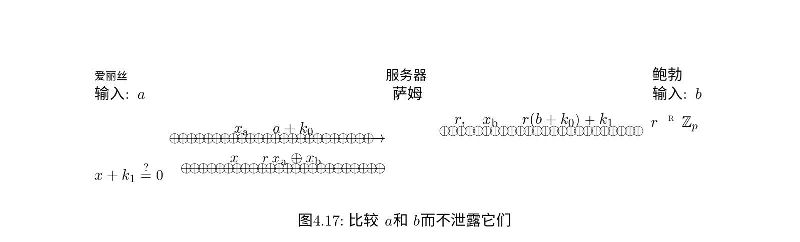

鲍勃可以在任何时候这样做，甚至在爱丽丝启动协议之前。当爱丽丝想要测试相等性时，她将 x_a 发送给Sam。Sam计算 x = r x_a ⊕ x_b 并将其发送给爱丽丝。现在，观察到

$$x + k_1 = r(a \oplus b)$$

这样，当 a = b 时， x + k_1 = 0，否则 x + k_1 很可能是非零的（假设 p 足够大，以便 r = 0 的概率很高）。这让爱丽丝知道了 a = b。这个协议透露了什么？显然，鲍勃什么也不知道。爱丽丝得知了 r(a \oplus b)，但如果 a = b，这个量在 Z_p 中是均匀分布的。因此，当 a = b 时，爱丽丝只获得了 Z_p 中的一个均匀元素，除了 a = b 这个事实之外，没有透露任何信息。山姆看到了 r、 x_a 和 x_b，但这三个值都与 a 和 b 独立： x_a 和 x_b 分别是使用密钥 k_0 和 k_1 进行一次性密码加密的结果。因此，山姆什么也不知道。请注意，关于山姆的唯一隐私假设是它不向爱丽丝或鲍勃透露（ r、 x_b）或 x_a。

问题与一次性密码本类似，共享密钥 (k_0, k_1) 只能用于单个等式测试，否则协议就会变得不安全。如果使用 (k_0, k_1) 来测试是否 a = b，然后再使用相同的密钥 (k_0, k_1) 来测试是否 a' = b'，那么爱丽丝和山姆会得到他们不应该知道的信息。例如，山姆会得到 a ⊕ a' 的信息。此外，爱丽丝可以推断出 (a \oplus b)/(a' \oplus b')，从而揭示了关于 b 和 b' 的信息（例如，如果 a = a' = 0，则爱丽丝会得知 b 和 b' 的比率）。

### 子密钥派生

如果爱丽丝想要重复测试与鲍勃的接近程度，该怎么办？解决方案是在每次协议调用时生成一个新的独立密钥 (k_0, k_1)。我们通过使用安全 PRF 来派生实例特定的子密钥来实现这一点。

令 F 为在 (K, \{1, \ldots, B\}, Z_p^2) 上定义的安全 PRF，假设 Alice 和 Bob 共享一个长期密钥 k ∈ K。Bob 维护一个计数器 cnt_b，初始值为 0。每次 Bob 将他的加密位置 (r, x_b) 发送给 Sam 时，他会增加 cnt_b 并从长期密钥 k 派生子密钥 (k_0, k_1)：

$$(k_0, k_1) \leftarrow F(k, cnt_b)$$
(4.46)

他将 (r, x_b, cnt_b) 发送给 Sam。Bob 可以在任何时候这样做，比如每隔几分钟或每次他移动到新的位置时。

每当 Alice 想要测试与 Bob 的接近程度时，她首先要求 Sam 向她发送 Bob 最新消息中的计数器值。她确保计数器值大于 Sam 之前发送给她的值（以防止恶意的 Sam 或 Bob 欺骗 Alice 重复使用旧的计数器值）。然后，Alice 使用 (4.46) 自己计算 (k_0, k_1)，并使用这些密钥在图 4.17 中与 Sam 执行协议。

因为 $F$ 是一个安全的PRF，派生子密钥的序列与随机独立采样的密钥不可区分。这确保了重复的协议除了相等性之外不泄露任何关于被测试值的信息。通过使用PRF，Alice能够快速计算最新值为 $cnt_b$ 的 $(k_0, k_1)$。

## 4.9 注释

待添加文献引用。

## 4.10 练习

4.1 (练习安全PRF的定义)。假设 $F$ 是在 $(K, \mathcal{X}, \mathcal{Y})$ 上定义的安全PRF，其中 $K = \mathcal{X} = \mathcal{Y} = \{0,1\}^n$。

- (a) 证明 $F_1(k, x) = F(k, x) \parallel 0$ 不是一个安全的PRF。
- (b) 证明 $F_2(k, (x, y)) := F(k, x) \oplus F(k, y)$ 是不安全的。
- (c) 证明 $F_3(k, x) := F(k, x) \oplus x$ 是一个安全的PRF。
- (d) 证明 $F_4((k_1, k_2), x) := F(k_1, x) \oplus F(k_2, x)$ 是一个安全的PRF。
- (e) 证明 $F_5(k, x) := F(k, x) \parallel F(k, x \oplus 1^n)$ 是不安全的。
- (f) 证明 $F_6(k, x) := F(F(k, 0^n), x)$ 是一个安全的PRF。
- (g) 证明 $F_7(k, x) := F(F(k, 0^n), x) \parallel F(k, x)$ 是不安全的。
- (h) 证明 $F_8(k, x) := F(k, x) \parallel F(k, F(k, x))$ 是不安全的。

4.2 (弱PRF)。设 $F$ 是在 $(K, \mathcal{X}, \mathcal{Y})$ 上定义的PRF，其中 $\mathcal{Y} := \{0,1\}^n$ 且 $|\mathcal{X}|$ 是超多项式。定义 $F_2(k, (x,y)) := F(k,x) \oplus F(k,y)$。

我们在练习4.1的(b)部分中证明了 $F_2$ 不是一个安全的PRF。

- (a) 证明 $F_2$ 是一个弱安全的PRF (如定义4.3所述)，假设 $F$ 是弱安全的。特别地，对于任何在 $\mathcal{X}$ 上随机查询函数的 $Q$ 查询弱PRF攻击者 $\mathcal{A}$，存在一个攻击 $F$ 的弱PRF攻击者 $\mathcal{B}$，其中 $\mathcal{B}$ 是对 $\mathcal{A}$ 的一个基本封装。

  $$\text{wPRFadv}[\mathcal{A}, F_2] \leq \text{wPRFadv}[\mathcal{B}, F] + (Q/|\mathcal{X}|)^4.$$

- (b) 假设 $F$ 是一个安全的PRF。即使我们修改了弱PRF攻击游戏，并允许对手 $\mathcal{A}$ 在除了 $Q$ 个随机点之外的一个选择点上查询 $F_2$，也要证明 $F_2$ 是弱安全的。在这个意义上安全的PRF对于第7.4节中讨论的一种流行的数据完整性机制来说是足够的。
- (c) 如果我们修改了弱PRF攻击游戏，并允许对手 $\mathcal{A}$ 在除了 $Q$ 个随机点之外的两个选择点上查询 $F_2$，则 $F_2$ 不再安全。

4.3 (格式保留加密)

假设我们有一个在域 X上操作的分组密码 (E, D)。我们希望有一个在较小域 X' ⊆ X上操作的分组密码 (E', D')。定义如下: (E', D'):

```
E'(k, x) := y  E(k, x)
当 y ∈ X'时 : y  E(k, y)
输出 y
```

D'(k, y)的定义类似，应用 D(k, ·)直到结果落在 X'中。 显然，(E', D')在 X'上是定义的。

(a) 当 t := |X|/|X'|时，期望中需要多少次 E的评估来评估 E'(k, x)作为 t的函数？你的答案表明，当 t很小（例如， t ≤2）时，评估 E'(k, x)可以高效完成。

(b) 证明如果(E, D)是一个具有域 X的安全分组密码，则(E', D')是一个具有域 X'的安全分组密码。尝试通过对|X|⊕|X'|进行归纳证明安全性。

讨论: 这个练习是在加密的16位信用卡号码的背景下使用的，其中密文也必须是一个16位数。这种类型的加密被称为格式保留加密，其域大小恰好为10^16。这个练习表明，构造一个域大小为2^54的分组密码 (E, D) 足够了，这是大于10^16的最小2的幂。然后可以使用练习中的过程将域缩小到大小为10^16。

4.4 (截断PRF)

让 F 是一个范围为 Y = {0, 1}^n的PRF。对于一些 ℓ < n考虑具有范围 Y' = {0, 1}^ℓ的PRF F'，定义为： F' (k, x) = F(k, x)[0..ℓ-1]。也就是说，我们将 F(k, x) 的输出截断到前 ℓ位。证明如果 F是一个安全的PRF，那么 F'也是安全的。

4.5 (双密钥三重DES)

考虑以下只使用两个密钥的3E构造的变体：对于密钥空间为 K的分组密码 (E, D)，定义3E'为 E ( (K1, K2), M ) := E (K1, E (K2, E (K1, M) ) )。证明这个分组密码可以通过中间相遇攻击来破解，使用 O (|K|) 次E和 D的计算，并使用 O (|K|) 次加密查询到分组密码挑战者。这种方法的进一步攻击在[74, 68]中讨论。

4.6 (自适应与非自适应安全性)

这个练习发展了一个论证，表明一个伪随机函数对于每个以非自适应方式进行查询的对手可能是安全的（即一次性查询），但对于自适应对手（即攻击游戏4.2中允许的类型）是不安全的。为了更加准确，我们将攻击游戏4.2的非自适应版本定义如下。

对手一次性提交查询 (X1, ..., XQ) 给挑战者，挑战者回应 (Y1, ..., YQ)，其中Yi: = F(Xi)。攻击游戏的其余部分与之前相同：在实验0中， K R K且F R F (K, ·)，而在实验1中， F R Funs [X, Y]。对于非自适应对手的安全性意味着所有高效对手只有可以忽略的优势；优势通常定义为： |Pr[W0]-Pr[W1]|，其中 Wb是对手在实验 b中输出1的事件。

假设 F是在(K, X, X)上定义的安全PRF，其中 N := |X|是超多项式的。我们继续“破坏” F，构建一个新的PRF F̃如下所示。让 x'是 X的某个固定元素。对于 x = x'定义 F̃(k, x) := F(k, x')，并且对于所有其他的 x定义 F̃(k, x) := F(k, x)。

(a) 证明 $ \tilde{F} $ 不是对自适应对手安全的PRF。

(b) 证明 $ \tilde{F} $ 是对非自适应对手安全的PRF。

(c) 证明类似的构造对于分组密码也是可能的：给定一个在 $ (\mathcal{K}, \mathcal{X}) $ 上定义的安全分组密码 $ (E, D) $，其中 $ |\mathcal{X}| $ 是超多项式的，构建一个新的“破坏”的分组密码 $ (\tilde{E}, \tilde{D}) $，它对于非自适应对手是安全的，但对于自适应对手是不安全的。

4.7 (PRF安全定义)。这个练习为PRF的PRF安全性提供了一种替代的描述，PRF $ F $ 定义在 $ (\mathcal{K}, \mathcal{X}, \mathcal{Y}) $ 上。像往常一样，我们需要定义一个攻击游戏在一个对手 $ \mathcal{A} $ 和一个挑战者之间。起初，挑战者生成

$ b \stackrel{R}{\leftarrow} \{0, 1\}, \ k \stackrel{R}{\leftarrow} \mathcal{K}, \ y_1 \stackrel{R}{\leftarrow} \mathcal{Y} $

然后 $ \mathcal{A} $ 向挑战者提出一系列查询。有两种类型的查询：

- 函数查询：在一个函数查询中，$ \mathcal{A} $ 向挑战者提交一个 $ x \in \mathcal{X} $，挑战者用 $ F(k, x) $ 回应。对手可以进行任意（多项式边界）数量的函数查询。
- 测试查询：在一个测试查询中，$ \mathcal{A} $ 向挑战者提交一个 $ x_0 \in \mathcal{X} $，挑战者用 $ y_1 \in \mathcal{Y} $ 回应。对手只能在游戏开始时进行一次测试查询（在测试查询之前和之后可以进行任意数量的函数查询）。

在游戏结束时，$ \mathcal{A} $ 输出一个比特 $ \hat{b} \in \{0,1\} $。通常，我们定义 $ \mathcal{A} $ 在上述攻击游戏中的优势为 $ |\Pr[b = \hat{b}] - 1/2| $。我们说 $ F $ 是 Alt-PRF 安全的，如果这个优势对于所有高效的对手来说是可以忽略的。证明 $ F $ 是一个安全的PRF，当且仅当 $ F $ 是 Alt-PRF 安全的。

讨论：这个特征说明了安全PRF在点 $ x_0 $ 在 $ \mathcal{X} $ 上的值看起来像是 $ \mathcal{Y} $ 的一个随机元素，即使在看到 $ \mathcal{X} $ 的许多其他点上的PRF值之后也是如此。

4.8 (可变密钥PRF)。让 $ F $ 是在 $ (\{0,1\}^n, \{0,1\}^n, \mathcal{Y}) $ 上定义的PRF。

- (a) 如果对于所有的 $ k $、$ x $ 和 $ c $，我们说 $ F $ 是XOR可塑的，那么 $ F(k, x \oplus c) = F(k, x) \oplus c $。
- (b) 如果对于所有的 $ k $、$ x $ 和 $ c $，我们说 $ F $ 是密钥XOR可塑的，那么 $ F(k \oplus c, x) = F(k, x) \oplus c $。

显然，XOR可塑的PRF不能是安全的：可塑性使得攻击者能够区分PRF和随机函数。证明对于密钥XOR可塑的PRF也是如此。备注：与此相反，我们注意到存在安全的PRF，其中 $ F(k_1 \oplus k_2, x) = F(k_1, x) \oplus F(k_2, x) $。参见练习11.1，其中左边的异或被替换为加法，右边的异或被替换为乘法。

4.9 (强安全的分组密码)。在4.1.3节中，我们概述了强安全的分组密码的概念。

- (a) 将强安全的分组密码的完整定义写成挑战者和对手之间的游戏。
- (b) 考虑以下密码 $ \mathcal{E}' = (E', D') $ 构建于定义在 $ (\mathcal{K}, \{0, 1\}^n) $ 上的分组密码 $ (E, D) $。

$ E'(k, m) := D(k, t \oplus E(k, m)) $ 和 $ D'(k, c) := E(k, t \oplus D(k, c)) $

其中 $ t \in \{0, 1\}^n $ 是一个固定常数。对于 $ t $ 的哪些值，这个密码 $ \mathcal{E}' $ 是语义安全的？在假设底层分组密码是强安全的情况下，证明语义安全。

4.10 (中间人攻击)。

让我们研究使用四个不同密钥迭代四次的 $ 4\mathcal{E} $ 构造的安全性：$ E_4((k_1, k_2, k_3, k_4), m) = E(k_4, E(k_3, E(k_2, E(k_1, m)))) $ (其中 $ (E, D) $ 是一个具有密钥空间 $ \mathcal{K} $ 的分组密码)。
(a) 证明 $ 4\mathcal{E} $ 存在一种中间人攻击，可以在时间 $ |\mathcal{K}|^2 $ 和内存空间 $ |\mathcal{K}|^2 $ 内恢复秘密密钥。
(b) 证明存在一种中间相遇攻击方法，可以在时间复杂度为 $ |\mathcal{K}|^2 $ 的情况下恢复秘密密钥，但只使用内存空间 $ |\mathcal{K}| $。如果遇到困难，请参考[32]。

4.11 (可调整的分组密码)。

可调整的分组密码是一种分组密码，其加密和解密算法接受额外的输入 $ t $，称为“调整参数”，该参数来自于“调整空间” $ \mathcal{T} $。与往常一样，密钥来自于密钥空间 $ \mathcal{K} $，数据块来自于数据块空间 $ \mathcal{X} $。加密和解密函数的操作如下：对于 $ k \in \mathcal{K} $，$ x \in \mathcal{X} $，$ t \in \mathcal{T} $，我们有 $ y = E(k, x, t) \in \mathcal{X} $ 和 $ x = D(k, y, t) $。因此，对于每个 $ k \in \mathcal{K} $ 和 $ t \in \mathcal{T} $，$ E(k, \cdot, t) $ 定义了一个在 $ \mathcal{X} $ 上的置换，$ D(k, \cdot, t) $ 定义了逆置换。与密钥不同，调整参数通常是公开已知的，甚至可能是对抗性选择的。

安全性由一个包含两个实验的游戏来定义。在两个实验中，挑战者定义了一个置换的族 $ \{\Pi_t\}_{t \in \mathcal{T}} $，其中每个 $ \Pi_t $ 都是 $ \mathcal{X} $ 上的置换。在实验0中，挑战者设置 $ k \xleftarrow{R} \mathcal{K} $，并且对于所有的 $ t \in \mathcal{T} $，有 $ \Pi_t := E(k, \cdot, t) $。

在实验1中，挑战者设置对于所有的 $ t \in \mathcal{T} $，有 $ \Pi_t \xleftarrow{R} \text{Perm}(\mathcal{X}) $。

然后，两个实验都以相同的方式进行。对手发出一系列查询。每个查询都是两种类型之一：

- 正向查询：对手发送 $ (x, t) \in \mathcal{X} \times \mathcal{T} $，挑战者回复 $ y := \Pi_t(x) $;
- 逆向查询：对手发送 $ (y, t) \in \mathcal{X} \times \mathcal{T} $，挑战者回复 $ x := \Pi_t^{-1}(y) $。

在游戏结束时，对手输出一个比特。如果 $ p_b $ 是对手在实验 $ b $ 中输出1的概率，则对手的优势定义为 $ |p_0 - p_1| $。我们说，$ (E, D) $ 是一个安全的可调整块密码，如果每个高效的对手都有可忽略的优势。

这个安全定义推广了强安全块密码的概念 (见第4.1.3节和练习4.9)。在可调整块密码的应用中，这个强安全概念更加合适 (例如，见练习9.17)。

(a) 证明构造 $ \tilde{E}(k, m, t) := E(E(k, t), m) $ 的安全性，其中 $ (E, D) $ 是在 $ (\mathcal{K}, \mathcal{K}) $ 上定义的强安全块密码。
(b) 证明存在一种攻击方式可以实现对部分(a)构造的优势 $ 1/2 $ 并且使 $ Q \approx \sqrt{|\mathcal{K}|} $ 查询。
提示：除了 $ Q \approx \sqrt{|\mathcal{K}|} $ 查询，你的对手还应该进行额外的 $ \approx \sqrt{|\mathcal{K}|} $ 密码 $ (E, D) $ 的“离线”评估。

## (c) 证明构造的安全性

```
E'((k0, k1), m, t) := {p ← F(k0, t); 输出 p ⊕ E(k1, m ⊕ p) ,
```

其中 (E, D) 是一个强安全的分组密码，F 是一个安全的伪随机函数。在练习7.10中，我们将看到这个构造的更高效变体。

提示：利用 (E, D) 是一个强安全的分组密码的假设，将挑战者中的 E(k1,·)替换为真正的随机置换 Π；然后，利用域分离引理（见定理4.15）将 Π 替换为一族独立的置换 {Π_t}_{t∈T}，并分析相应的域分离失败概率。

讨论：可调整的分组密码用于磁盘扇区加密，其中加密不能扩展数据：密文大小需要与输入大小相同。扇区号用作调整参数，以确保即使两个扇区包含相同的数据，结果加密的扇区也是不同的。部分 (c) 中的构造通常比部分 (a) 更高效，因为后者在每次评估时使用不同的分组密码密钥，这可能会产生额外的成本。请参阅练习7.10中的进一步讨论。

## 4.12 (PRF组合器)

我们希望使用两个PRF F1和F2构建一个PRF F，以便如果将来的某个时刻 F1或 F2被破解（但不是同时），F仍然是安全的。换句话说，我们希望从 F1和 F2构建 F，以便如果 F1或 F2是安全的，F也是安全的。

假设 F1和 F2都有输出空间 {0,1}^n，并且都有一个共同的输入空间。定义

```
F( (k1, k2), x ) := F1(k1, x) ⊕ F2(k2, x).
```

证明如果 F1或 F2是安全的，那么 F是安全的。

## 4.13 (分组密码组合器)

继续练习4.12，我们想要从两个分组密码E1=( E1, D1)和E2=( E2, D2)构建一个分组密码E=(E, D)，以便如果在将来的某个时间 E1或 E2被破解（但不是同时），E仍然是安全的。假设 E1和 E2都定义在 (K, X) 上。定义 E为：

```
E( (k1, k2), x ) := E1(k1, E2(k2, x)) 和 D( (k1, k2), y ) := D2(k2, D1(k1, y)).
```

- (a) 证明如果 E1或 E2是安全的，则 E是安全的。
- (b) 证明这不是一个安全的PRF组合器。即， F( (k1, k2), x ) := F1 (k1, F2(k2, x)) 即使 F1或 F2中的一个是安全的，F也不一定是一个安全的PRF。

## 4.14 (密钥泄漏)

假设 F是在(K, X, Y)上定义的安全PRF，其中 K = X = Y = {0,1}^n。

构建一个新的PRF F1，定义在 ( K1, X, Y) 上，具有以下属性：PRF F1是安全的；然而，如果对手了解密钥的最后一位，则PRF不再安全。这表明即使泄漏了秘密密钥的一个单一位，也会完全破坏PRF的安全性质。

对于所有的 x=0^n，将 F1( k1, x) 设置为与F(k, x)相同。定义F1( k1, 0^n) 使得 F1是一个安全的PRF，但如果对手知道密钥 k1的最后一位，则很容易区分它与随机函数。

(b) 构建一个新的PRF $F_2$，定义在$(\mathcal{K} \times \mathcal{K}, \mathcal{X}, \mathcal{Y})$上，即使攻击者获得密钥的任意单个位，也能保持安全。你的函数 $F_2$ 只能调用 $F$ 一次。

## 4.15 (Luby-Rackoff的变种)

让 $F$ 是在$(\mathcal{K}, \mathcal{X}, \mathcal{X})$上定义的安全PRF。

- (a) 证明两轮Luby-Rackoff不是安全的分组密码。
- (b) 证明三轮Luby-Rackoff不是强安全的分组密码。

## 4.16 (不安全的树构造)

在从PRG构建PRF的树构造中(第4.6节)，秘密密钥用于树的根部，输入用于跟踪树的路径。证明相反的构造不是安全的PRF。也就是说，使用输入作为根部，使用密钥来跟踪树的路径不是安全的PRF。

## 4.17 (截断树构造)

假设我们在第4.6节的树构造中仅保留三层树，因此只有八个叶子节点，如图4.15所示。使用七个混合序列直接证明，在输出所有八个叶子节点的值的情况下，得到的是一个在$(\mathcal{S}, \mathcal{S}^8)$上定义的安全PRG，假设底层PRG是安全的。

## 4.18 (增强树构造)

假设我们有一个在$(\mathcal{K} \times \mathcal{S}, \mathcal{S}^2)$上定义的PRG $G$。
写作 $G(k, s) = (G_0(k, s), G_1(k, s))$。让我们定义具有键空间 $\mathcal{K}^n \times \mathcal{S}$ 和输入空间 $\{0,1\}^n$ 的PRF $G^*$ 如下：

```
$G^*((k_0, \ldots, k_{n-1}, s), x \in \{0,1\}^n) :=$
$\quad t \gets s$
$\quad \text{for } i \text{ 从 } 0 \text{ 到 } n-1 \text{ 循环}$
$\quad\quad b \gets x[i]$
$\quad\quad t \gets G_b(k_i, t)$
$\quad \text{输出 } t.$
```

- (a) 给出一个安全的PRG示例 $G$，其中 $G^*$ 作为PRF是不安全的。
- (b) 证明如果对于每个多项式有界的 $Q$，以下PRG是安全的：
$G'(k, s_0, \ldots, s_{Q-1}) := (G(k, s_0), \ldots, G(k, s_{Q-1}))$。

## 4.19 (合成器和并行PRF)

对于定义在$(\mathcal{S}, \mathcal{R})$上的安全PRG $G$，我们证明了 $G^n(s_1, \ldots, s_n) := (G(s_1), \ldots, G(s_n))$ 是一个安全的PRG，其输入为$(\mathcal{S}^n, \mathcal{R}^n)$。证明要求选择种子的组件 $s_1, \ldots, s_n$ 在 $\mathcal{S}^n$ 上均匀且独立地选择。一个安全的合成器是一个PRG，即使 $s_1, \ldots, s_n$ 彼此之间不独立，也能满足这一条件。
具体来说，合成器是一个高效的函数 $S: \mathcal{X}^2 \to \mathcal{X}$。如果合成器被称为n路安全的话
$S^n(x_1, y_1, \ldots, x_n, y_n) := ( S(x_i, y_j) )_{i,j=1,\ldots,n} \in \mathcal{X}^{(n^2)}$
是一个安全的PRG定义在 $(\mathcal{X}^{2n}, \mathcal{X}^{(n^2)})$ 上。这里 $S$ 在不独立于彼此的输入上进行评估，但 $S^n$ 是一个安全的PRG。

- (a) 并非每个安全的PRG都是安全的合成器。设 $G$ 是一个安全的PRG在 $(\mathcal{S}, \mathcal{R})$ 上。证明 $S(x, y) := (G(x), y)$ 是一个安全的PRG定义在 $(\mathcal{S}^2, \mathcal{R} \times \mathcal{S})$ 上，但是是一个不安全的2-way合成器。

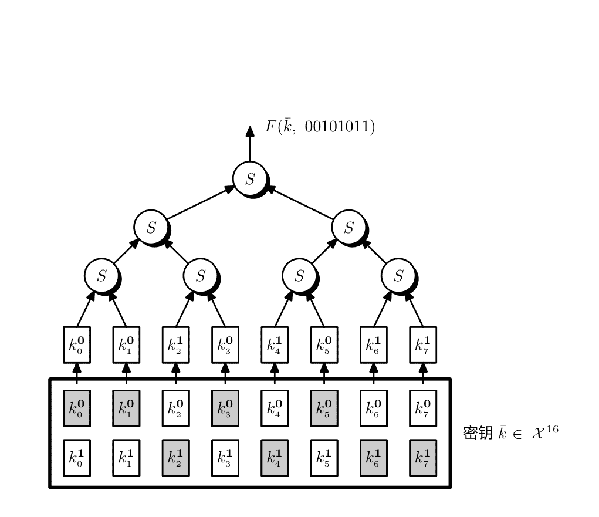

图4.18：从合成器S构建的PRF。在{0,1}^n中的PRF输入用于选择n密钥k∈X^{2n}中的组件。所选的组件，如图中阴影方块所示，如图所示使用。

- (b) 一个安全的合成器可以让我们构建一个可以在并行计算机上快速评估的大域PRF。证明如果S：X₂→X是一个Q-安全的合成器，对于多项式-有界Q，那么图4.18中的PRF是一个在(X^{2n}, {0,1}^n, X)上定义的安全PRF。为了简单起见，假设n是₂的幂。观察到PRF可以在并行计算机上仅用log²n步骤进行评估。

## 4.20 (Even-Mansour的不安全变体)

在第4.7.3节中，我们讨论了由置换π：X→X构建的Even-Mansour分组密码(E, D)，其中X = {0,1}^n。回想一下E((P₀, P₁), m) := π(m⊕P₀)⊕P₁。

- (a) 证明 E₁(P₀, m) := π(m⊕P₀) 不是一个安全的分组密码。
- (b) 证明 E₂(P₁, m) := π(m)⊕P₁ 不是一个安全的分组密码。

## 4.21 (生日攻击对Even-Mansour)

让我们证明Even-Mansour安全定理（定理4.14）中的界限是紧密的。对于X := {0,1}^n, 回想一下，由置换π：X→X构建的Even-Mansour分组密码(E, D)定义为：E((k₀, k₁), m) := π(m⊕k₀)⊕k₁。我们展示了如何在大约2^{n/2}的时间内破解这个分组密码。

- (a) 证明对于所有的a, m, m'∈X和k := (k₀, k₁)∈X², 当a = m⊕k₀时，我们有 E(k, m)⊕E(k, m⊕m') = π(a)⊕π(a⊕m')
- (b) 利用部分(a)构建一个对称密码安全游戏中以接近1的优势获胜的对手A，该游戏在理想密码模型中进行。取q:=2^{n/2}和一些非零

δ ∈ 𝒳，对手 𝒜 在 2q 个随机点 mi, mi ⊕ δ ∈ 𝒳 处查询密码，并在 2q 个随机点 ai, ai ⊕ δ ∈ 𝒳 处查询排列 π，其中 i = 1, …, q。

## 4.22 (Eve^n-Mansour密码的变种)

考虑以下密码 (E, D) 在 (𝒦, ℳ, 𝒳) 上的定义，该密码是由置换 π: 𝒳! 𝒳 构建的：

E(k, x) := (k ∥ 0^m) ⊕ π(k ∥ x) (4.47)

D(k, c) 的定义类似。证明如果我们将 π 建模为理想置换 Π，那么对于每个攻击 (E, D) 的分组密码对手 𝒜，我们有
BC^{ic}adv[𝒜, E] ≤ (2Q_{ic})/|𝒦|. (4.48)
这里 Q_{ic} 是 𝒜 对 Π- 和 Π^{-1}-oracles 的查询次数。

## 4.23 (Salsa和ChaCha的分析)

在这个练习中，我们在理想置换模型中分析 Salsa 和 ChaCha 流密码。设 π: 𝒳 → 𝒳 是一个置换，其中 𝒳 = {0,1}^{n+m}。设 𝒦 := {0,1}^n 并定义 PRF F，它定义在 (𝒦, {0,1}^m, 𝒳) 上，如下

F(k, x) := (k ∥ x) ⊕ π(k ∥ x). (4.49)

这个 PRF 是 Salsa 和 ChaCha 流密码背后的 PRF 的抽象。使用练习 4.22 来证明，如果我们将 π 建模为理想置换 Π，那么对于每个攻击 F 的 PRF 对手 𝒜，我们有
PRF^{ic}adv[𝒜, F] ≤ (2Q_{ic})/|𝒦| + (Q_F^2)/(2|𝒳|) (4.50)
其中 Q_F 是 𝒜 对一个 F(k, ·) 询问器的查询次数，Q_{ic} 是 𝒜 对 Π- 和 Π^{-1}-询问器的查询次数。在 Salsa 和 ChaCha 中，Q_F 最多为 |𝒳|^{1/4}，因此 Q_F^2 / (2|𝒳|) 是“可以忽略的。”
讨论：Salsa 和 ChaCha 流密码中使用的具体置换 π 并不完全是理想的置换。例如，π(0^{n+m}) = 0^{n+m}。因此，你的分析适用于一般框架，但不特别适用于 Salsa 和 ChaCha。

## 4.24 (定理4.6的替代证明)

让 X 和 Y 是在练习 3.13 中定义的随机变量。考虑一个在攻击游戏 4.3 中最多进行 Q 次查询的对手 𝒜。证明 PFadv[𝒜, 𝒳] ≤ Δ[X, Y] ≤ Q^2 / 2N。

## 4.25 (单边切换引理)

继续上一个练习，可以使用练习 3.13 的第 (b) 部分得到定理 4.6 的“单边”版本，这在某些情况下很有用。考虑一个在攻击游戏 4.3 中最多进行 Q 次查询的对手 𝒜。让 W0 和 W1 在该游戏中定义：W0 是在探测随机排列时 𝒜 输出 1 的事件，W1 是在探测随机函数时 𝒜 输出 1 的事件。假设 Q^2 < N。证明 Pr[W0] ≤ ρ[X, Y] · Pr[W1] ≤ 2 Pr[W1]。

## 4.26 (PRF的并行组合)

就像我们可以并行地组合 PRG 一样，在保持安全性的同时，我们也可以并行地组合 PRF，同时保持安全性（参见第 3.4.1 节）。

假设我们有一个PRF F, 定义在 (K, X, Y) 上。我们希望模拟这样的情况，即对手被给予黑盒 (其中 n ⊕1 是多项式边界)：盒子要么包含 F(k1, ·), ..., F(kn, ·)，其中 ki 是随机 (且独立) 的密钥，要么包含 f1, ..., fn, 其中 fi 是 Fun[X, Y] 的随机元素，对手不应该能够区分它们的区别。

一种方便的建模方法是考虑 F 的 N 个并行组合，其中 F' 是一个密钥空间为 K 的 PRF，输入空间为 {1, ..., n} × X, 输出空间为 Y。给定一个密钥 k' = (k1, ..., kn), 和一个输入 x' = (s, x), 其中 s 属于 {1, ..., n}, x 属于 X, 我们定义 F'(k', x') := F(ks, x)。

证明如果 F 是一个安全的 PRF，那么 F' 也是安全的。特别地，证明对于每个 PRF 对手 A，存在一个 PRF 对手 B，其中 B 是对 A 的一个基本封装，使得 PRF 优势[A, F'] = n · PRF 优势[B, F]。

## 4.27 (对PRF的普适攻击者)

让 F 是在 (K, X, Y) 上定义的 PRF, 其中 |K| < |X|。让 Q < |K|。证明存在一个 PRF 对手 A，其运行时间与 Q 成正比，向 PRF 挑战者查询一次，并具有优势

```
PRF优势[A, F] ⊕ Q/|K| ⊕ Q/|X|。
```

## 4.28 (分布式PRF)

让 F 是在 (K, X, Y) 上定义的安全 PRF, 其中 Y := {0, 1}^n。在练习4.1的第(d)部分中，我们证明了如果 F 是安全的，则也是如此

```
F'((k1, k2), x) := F(k1, x) ⊕ F(k2, x)。
```

这个 F' 具有一个有用的特性：PRF 密钥 (k1, k2) 可以分成两个份额，k1 和 k2。如果 Alice 得到一个份额，Bob 得到另一个份额，那么 Alice 和 Bob 都需要一起评估 PRF，任何一方都无法单独评估 PRF。此外，PRF 可以进行分布式评估，也就是说，在不重建密钥 (k1, k2) 的情况下，可以在一个点 x0 上评估 PRF，Alice 只需发送 F(k1, x0) 给 Bob。

- (a) 为了证明 Alice 无法单独评估 F'，证明即使对手得到 k1，F' 仍然是一个安全的 PRF。论证对于 k2 也是一样的。
- (b) 构建一个 PRF，其中密钥可以分成三个份额 s1, s2, s3，以便任意两个份额可以分布式评估 PRF，但没有单个份额足以评估 PRF。提示：考虑 PRF F''
((k1, k2, k3), x) := F(k1, x) ⊕ F(k2, x) ⊕ F(k3, x) 并展示如何从密钥 k1, k2, k3 构造出共享 s1, s2, s3。确保证明当对手只给出一个共享 i ∈ {1,2,3} 时，F'' 是一个安全的 PRF。
- (c) 将部分(b)的构造推广到构造一个支持三五分共享的 PRF F''': 任意三个共享可以分布式地用于评估 PRF，但不能使用两个共享。
提示：F''' 的密钥空间是 K^10。

# 第5章

# 选择明文攻击

本章重点讨论在存在窃听者的情况下安全加密多个消息的问题，窃听者甚至可能影响某些消息的选择以获取其他消息的信息。这引导我们对抗选择明文攻击的语义安全概念。

## 5.1 引言

在第2章中，我们关注了加密单个消息的问题。现在我们考虑加密多个消息的问题。为了更具体地说明问题，假设Alice想要使用密码来加密她在某个文件服务器上的文件，同时将密码的秘密密钥安全地存储在她的USB存储设备上。

一种可能的方法是Alice使用不同的密钥加密每个单独的文件。这意味着对于每个文件，她在文件服务器上存储该文件的加密版本，以及在她的存储设备上存储相应的秘密密钥。正如我们将在5.2节中详细探讨的那样，只要她使用语义安全的密码，这种方法将为Alice提供合理的安全性。

现在，尽管一个文件可能有几兆字节长，但任何实际密码的密钥只有几个字节长。然而，如果爱丽丝有成千上万个文件需要加密，她必须在存储器上存储成千上万个密钥，而这个存储器可能没有足够的空间来存储所有这些密钥。

正如我们所见，上述方法虽然安全，但空间利用效率不高，因为每个文件都需要一个密钥。面对这个问题，爱丽丝可能决定用同一个密钥加密她的所有文件。虽然更高效，但这种方法可能不安全。事实上，如果爱丽丝使用的密码只提供语义安全性（如定义2.3中所述），这可能不会为爱丽丝提供任何有意义的安全保证，并且很可能使她面临现实攻击的风险。

例如，假设爱丽丝使用流密码 $\mathcal{E}$ 在第3.2节中讨论过。这里，爱丽丝的密钥是PRG $G$的种子 $s$，并将文件 $m$视为一个位串，爱丽丝通过计算密文 $c := m \oplus \text{流}$ 来加密 $m$，其中 $\text{流}$ 是“密钥流” $G(s)$ 的前 $|m|$位。但是，如果爱丽丝使用相同的种子 $s$ 来加密许多文件，攻击者可以轻易发动攻击。例如，如果攻击者知道某个文件的某些位，他可以直接计算出相应位的密钥流，从而获取任何文件的相应位。攻击者如何知道给定文件的某些位？嗯，某些文件，如电子邮件消息，包含标准的头部信息（参见示例2.6），因此如果攻击者知道给定密文是电子邮件的加密结果，他可以获取与这些位在密钥流中位置相对应的位。

标准头。 为了发动更具破坏力的攻击，对手可能尝试更加狡猾的方式：他可以简单地向爱丽丝发送一封大型电子邮件，比如一兆字节的长度；假设爱丽丝的软件会自动将这封电子邮件的加密存储在她的服务器上，当对手窥视她的文件服务器时，他可以恢复相应的一兆字节密钥流块，并且现在他可以解密存储在爱丽丝服务器上的任何一兆字节文件！这封电子邮件甚至可能被爱丽丝的垃圾邮件过滤器捕获，实际上从未被爱丽丝看到，尽管她的加密软件可能会很认真地将这封电子邮件和其他所有内容一起加密。这种攻击类型被称为选择明文攻击，因为对手在对系统进行攻击时强迫爱丽丝给他选择的一个或多个明文的加密。

显然，上述流密码对于这项工作是不足够的。实际上，流密码以及任何其他确定性密码都不应该用于使用相同密钥加密多个文件。为什么呢？任何用于使用相同密钥加密多个文件的确定性密码都会遭受固有的弱点：对手总是能够判断两个文件是否相同。确实，对于确定性密码，如果使用相同的密钥加密相同的消息，结果的密文将始终相同（反之亦然，对于任何密码，如果使用相同的密钥加密两个不同的消息，结果的密文必须不同）。虽然这种攻击类型肯定不像上面讨论的那些攻击那样引人注目，对手几乎可以随意阅读爱丽丝的文件，但它仍然是一个严重的漏洞。例如，尽管第4.1.4节中关于ECB模式的讨论技术上是关于加密由许多数据块组成的单个消息，但同样适用于使用相同密钥加密许多单块消息的问题。

事实上，Alice可以使用密码来安全加密她的所有文件，只需一个短密钥，但她需要使用更适合这个任务的密码。特别是，由于任何确定性密码的上述固有弱点，她将需要使用一种概率密码，即使用概率加密算法的密码，以便相同密钥下的相同明文的不同加密（通常）会产生不同的加密结果。对于她的任务，她将需要一个比语义安全性更强的密码。适当的安全概念称为选择明文攻击下的语义安全性。在第5.3节和后续章节中，我们正式定义了这个概念，研究了一些基于语义安全密码、PRF和分组密码的构造，并研究了一些“真实世界”系统的案例研究。

尽管上述讨论是通过“文件加密”问题的例子来激发本章的主题，但也可以通过考虑“安全网络通信”问题来激发这些主题。在这种情况下，人们考虑的是Alice和Bob共享一个秘密密钥（或密钥），而Alice希望在一个不安全的网络上秘密传输多个消息给Bob。现在，如果Alice可以方便地将所有消息连接成一个长消息，那么她可以使用流密码来加密所有消息，并完成任务。然而，出于各种技术原因，这可能是不可行的：如果她希望能够以任意顺序和任意时间传输消息，那么她面临的问题与“文件加密”问题非常相似。同样，如果Alice和Bob想要使用一个单独的、短的密钥，那么对于这个任务来说，合适的工具是一个对选择明文攻击具有语义安全性的密码。

我们再次强调，就像第2章一样，本章涵盖的技术不提供任何数据完整性，也不解决两个参与者如何共享秘密密钥的问题。这些问题将在接下来的章节中讨论。

## 5.2 防御多密钥攻击

再次考虑本章引言中讨论的“文件加密”问题。假设爱丽丝选择使用一个语义安全的密码算法，分别使用独立生成的密钥对她的每个文件进行加密。语义安全是否意味着在这种“多密钥”设置中存在相应的安全性质？

对于这个问题的答案是“是的”。我们首先陈述在多密钥设置中对应于语义安全的自然安全性质。

攻击游戏 5.1 （多密钥语义安全）。对于给定的密码算法 $\mathcal{E}= (E, D)$，定义在 $(\mathcal{K}, \mathcal{M}, \mathcal{C})$ 上，对于给定的对手 $\mathcal{A}$，我们定义两个实验，实验0和实验1。对于 $b= 0,1$，我们定义实验 $b$：

- 对手向挑战者提交一系列查询。
- 对手输出一个位 $\hat{b} \in \{0, 1\}$。

对于 $b= 0,1$，令 $W_b$ 为事件，即 $\mathcal{A}$ 在实验 $b$ 中输出1。我们定义 $\mathcal{A}$ 相对于 $\mathcal{E}$ 的优势为

> $\text{MSSadv}[\mathcal{A}, \mathcal{E}] := |\Pr[W_0] \oplus \Pr[W_1]|.$

我们强调，在上述攻击游戏中，对手的查询是自适应选择的，即对于每个 $i= 1,2,\ldots$，消息对 $(m_{i0}, m_{i1})$ 可能以某种方式由对手计算得出，该方式在一定程度上取决于之前由挑战者输出的加密 $c_1, \ldots, c_{i-1}$。

定义 5.1 （多密钥语义安全）。如果对于所有高效的对手 $\mathcal{A}$，密码 $\mathcal{E}$ 被称为多密钥语义安全，则值 $\text{MSSadv}[\mathcal{A}, \mathcal{E}]$ 是可以忽略的。

如第 2.3.5 节所讨论的，攻击游戏 5.1 可以重新定义为“猜位”游戏，在这个游戏中，挑战者随机选择 $b \in \{0,1\}$，然后对手 $\mathcal{A}$ 运行实验 $b$。在这个游戏中，我们将 $\mathcal{A}$ 的位猜测优势 $\text{MSSadv}^*[\mathcal{A}, \mathcal{E}]$ 定义为 $|\Pr[\hat{b}=b]-1/2|$，通常情况下（根据（2.13）），我们有

> $\text{MSSadv}[\mathcal{A}, \mathcal{E}] = 2\cdot\text{MSSadv}^*[\mathcal{A}, \mathcal{E}]$    (5.1)

正如下一个定理所示，语义安全性意味着多密钥语义安全性。

定理 5.1. 如果一个密码 $\mathcal{E}$ 是语义安全的，那么它也是多密钥语义安全的。

特别地，对于每一个攻击 $\mathcal{E}$ 的 MSS 对手 $\mathcal{A}$，该对手在攻击游戏 5.1 中进行攻击，并且对其挑战者最多进行 $Q$ 次查询，存在一个攻击 $\mathcal{E}$ 的 SS 对手 $\mathcal{B}$，该对手在攻击游戏 2.1 中进行攻击，其中 $\mathcal{B}$ 是对 $\mathcal{A}$ 的一个基本封装。

> $\text{MSSadv}[\mathcal{A}, \mathcal{E}] = Q \cdot \text{SSadv}[\mathcal{B}, \mathcal{E}]$。

证明思路。该证明是一个直接的混合论证，这是我们在定理 3.2 和 3.3 的证明中介绍的一种证明技巧（如果需要，读者可以回顾那些证明）。在 MSS 攻击游戏的实验 0 中，挑战者加密 $m_{10}, m_{20}, \dots$。直观上，由于密钥 $k_1$ 仅用于加密第一个消息，并且 $\mathcal{E}$ 是语义安全的，如果我们修改挑战者以便加密 $m_{11}$ 而不是 $m_{10}$，对手不应该表现出明显的不同。同样地，我们可以修改挑战者以便加密 $m_{21}$ 而不是 $m_{20}$，对手不应该察觉到差异。如果我们继续这样做，对挑战者进行 $Q$ 次修改，我们最终进入 MSS 游戏的实验 1，对手不应该察觉到差异。□

证明。假设 $\mathcal{E} = (E, D)$ 定义在 $(\mathcal{K}, \mathcal{M}, \mathcal{C})$ 上。让 $\mathcal{A}$ 成为一个对于 $\mathcal{E}$ 进行攻击游戏 5.1 的 MSS 对手，并且在该游戏中对其挑战者最多进行 $Q$ 次查询。

首先，我们介绍 $Q+1$ 个混合游戏，混合 0，...，混合 $Q$，在挑战者和 $\mathcal{A}$ 之间进行。对于 $j=0, 1, \dots, Q$，当 $\mathcal{A}$ 进行第 $i$ 次查询 $(m_{i0}, m_{i1})$ 时，混合 $j$ 中的挑战者计算其响应 $c_i$ 如下：

- $k_i \stackrel{R}{\leftarrow} \mathcal{K}$
- 如果 $i > j$，那么 $c_i \stackrel{R}{\leftarrow} E(k_i, m_{i0})$ 否则 $c_i \stackrel{R}{\leftarrow} E(k_i, m_{i1})$

换句话说，混合 $j$ 中的挑战者加密

\[m_{11}, \dots, m_{j1}, \quad m_{(j+1)0}, \dots, m_{Q0},\]

为每个加密生成不同的密钥。

对于 $j=0, 1, \dots, Q$，让 $p_j$ 表示在混合 $j$ 中 $\mathcal{A}$ 输出 1 的概率。观察到 $p_0$ 等于在攻击游戏 5.1 的实验 0 中 $\mathcal{A}$ 输出 1 的概率关于 $\mathcal{E}$，而 $p_Q$ 等于在攻击游戏 5.1 的实验 1 中 $\mathcal{A}$ 输出 1 的概率关于 $\mathcal{E}$。因此，我们有

> $\text{MSSadv}[\mathcal{A}, \mathcal{E}] = |p_Q - p_0|.$    (5.2)

接下来，我们设计了一个与 $\mathcal{E}$ 相关的 SS 对手 $\mathcal{B}$，参与攻击游戏 2.1，具体如下：

- 首先，$\mathcal{B}$ 在集合 $\{1, \dots, Q\}$ 中随机选择一个数 $\omega$。
- 然后，$\mathcal{B}$ 扮演挑战者的角色，当 $\mathcal{A}$ 进行第 $i$ 次查询 $(m_{i0}, m_{i1})$ 时，$\mathcal{B}$ 根据以下方式计算其响应 $c_i$：
    - 如果 $i > \omega$，则选择 $k_i \stackrel{R}{\leftarrow} \mathcal{K}$，计算 $c_i \stackrel{R}{\leftarrow} E(k_i, m_{i0})$。
    - 否则，如果 $i = \omega$，则 $\mathcal{B}$ 将 $(m_{i0}, m_{i1})$ 提交给自己的挑战者，$c_i$ 被设置为挑战者的响应。
    - 否则，$// i < \omega$，选择 $k_i \stackrel{R}{\leftarrow} \mathcal{K}$，计算 $c_i \stackrel{R}{\leftarrow} E(k_i, m_{i1})$。

最后，$\mathcal{B}$ 输出与 $\mathcal{A}$ 输出相同。

换句话说，对手 $\mathcal{B}$ 加密

\[m_{11}, \dots, m_{(\omega-1)1},\]

为此生成自己的密钥，将 $(m_{\omega0}, m_{\omega1})$ 提交给自己的加密预言机，并加密

\[m_{(\omega+1)0}, \ldots, m_{Q0},\]

同样，生成自己的密钥。

我们声称

> $\text{MSSadv}[\mathcal{A}, \mathcal{E}] = Q \cdot \mathrm{SSadv}[\mathcal{B}, \mathcal{E}]$。    (5.3)

为了证明这个命题，对于 $b=0,1$，令 $W_b$ 为 $\mathcal{B}$ 在其攻击游戏的实验 $b$ 中输出 1 的事件。如果 $\omega$ 表示 $\mathcal{B}$ 选择的随机数，则关键观察是对于 $j=1, \ldots, Q$，我们有：

> $\mathrm{Pr}[W_0 \mid \omega = j] = p_{j-1}$ 且 $\mathrm{Pr}[W_1 \mid \omega = j] = p_j$。

通过这个观察，结合 (5.2)，通过常规的望远镜求和计算，得到方程 (5.3)。

$\mathrm{SSAdv}[\mathcal{B}, \mathcal{E}] = |\mathrm{Pr}[W_1] \oplus \mathrm{Pr}[W_0]|$
$= \frac{1}{Q} \cdot \left| \sum_{j=1}^Q \mathrm{Pr}[W_1 \mid \omega = j] \oplus \sum_{j=1}^Q \mathrm{Pr}[W_0 \mid \omega = j] \right|$
$= \frac{1}{Q} \cdot |p_Q \oplus p_0|$
$= \frac{1}{Q} \cdot \mathrm{MSSAdv}[\mathcal{A}, \mathcal{E}]$,

并且这个命题，因此定理得到证明。 $\square$

现在让我们回到本章引言中讨论的“文件加密”问题。这个定理的意思是，如果 Alice 使用独立的密钥用一个语义安全的密码算法加密她的每个文件，那么一个看到存储在文件服务器上的密文的对手将不会对 Alice 的文件了解到任何信息（除了可能一些关于文件长度的信息）。请注意，即使对手在确定某些文件的内容方面起到了积极的作用（例如，通过给 Alice 发送电子邮件，如引言中所讨论的），这个定理仍然成立。

## 5.3 防御选择明文攻击的语义安全

现在我们考虑艾丽丝在本章引言中面临的问题，她希望使用一个单一且尽可能短的秘密密钥来加密她系统上的所有文件。对于这个任务，正确的安全概念是选择明文攻击下的语义安全，简称为 CPA 安全。

攻击游戏 5.2 ($CPA$ 安全)。对于给定的密码 $\mathcal{E} = (E, D)$，定义在 $(\mathcal{K}, \mathcal{M}, \mathcal{C})$ 上，并且对于给定的对手 $\mathcal{A}$，我们定义两个实验，实验 0 和实验 1。对于 $b=0, 1$，我们定义实验 $b$:

- 挑战者选择 $k \xleftarrow{R} \mathcal{K}$。
- 对手向挑战者提交一系列查询。
    - 对于 $i = 1, 2, \dots$，第 $i$ 个查询是一对消息 $m_{i0}, m_{i1} \in \mathcal{M}$，长度相同。
    - 挑战者计算 $c_i \leftarrow E(k, m_{ib})$，并将 $c_i$ 发送给对手。
- 对手输出一个位 $\hat{b} \in \{0, 1\}$。

对于 $b = 0,1$，令 $W_b$ 为事件，即 $\mathcal{A}$ 在实验 $b$ 中输出 1。我们定义 $\mathcal{A}$ 相对于 $\mathcal{E}$ 的优势为 $\text{CPAadv}[\mathcal{A}, \mathcal{E}] := |\Pr[W_0] \oplus \Pr[W_1]|$。 □

CPA 攻击游戏和 MSS 攻击游戏 5.1 之间唯一的区别在于，在 CPA 游戏中，所有加密都使用相同的密钥，而在 MSS 攻击游戏中，每个加密都选择了不同的密钥。特别是在 CPA 游戏中，对手的查询可以自适应选择，就像在 MSS 游戏中一样。

### 定义 5.2 (CPA 安全性)

密码 $\mathcal{E}$ 被称为选择明文攻击下的语义安全，或者简称为 CPA 安全，如果对于所有高效的对手 $\mathcal{A}$，值 $\text{CPAadv}[\mathcal{A}, \mathcal{E}]$ 是可以忽略的。

如同第 2.3.5 节中所述，攻击游戏 5.2 可以被重新定义为一个“猜比特”游戏，在这个游戏中，挑战者随机选择 $b \in \{0, 1\}$，然后对手 $\mathcal{A}$ 运行实验 $b$；我们定义 $\mathcal{A}$ 的比特猜测优势为 $\text{CPAadv}^*[\mathcal{A}, \mathcal{E}] :=|\Pr[\hat{b} = b] \oplus 1/2|$，通常情况下（根据 (2.13) ），我们有 $\text{CPAadv}[\mathcal{A}, \mathcal{E}] = 2\cdot\text{CPAadv}^*[\mathcal{A}, \mathcal{E}]$。

再次，我们回到本章介绍的“文件加密”问题。
这个定义的意思是，如果 Alice 使用一个单一的密钥对每个文件进行加密，使用一个 CPA 安全的密码算法，那么在文件服务器上看到的密文，对手将无法获得关于 Alice 的文件的任何信息（除了可能一些关于文件长度的信息）。
再次注意，即使对手在确定某些文件的内容方面扮演了主动角色，这个定义仍然成立。

### 例子 5.1

为了对这个定义进行一些练习，让我们展示没有确定性密码算法能够满足 CPA 安全的定义。假设 $\mathcal{E} = (E, D)$ 是一个确定性密码算法。
我们构建一个 CPA 对手 $\mathcal{A}$ 如下。让 $m, m'$ 是 $\mathcal{E}$ 的消息空间中的任意两个不同的消息。对手 $\mathcal{A}$ 向挑战者提出两个查询：第一个是 $(m, m')$，第二个是 $(m, m)$。假设 $c_1$ 是挑战者对第一个查询的回应，$c_2$ 是挑战者对第二个查询的回应。对手 $\mathcal{A}$ 输出 1 如果 $c_1 = c_2$，否则输出 0。

让我们计算 $\text{CPAadv}[\mathcal{A}, \mathcal{E}]$。一方面，在攻击游戏 5.2 的实验 0 中，挑战者对两个查询的响应中加密了 $m$，因此 $c_1 = c_2$；因此，在这个实验中，$\mathcal{A}$ 以概率 1 输出 1（这正是我们使用 $\mathcal{E}$ 是确定性的假设的地方）。另一方面，在实验 1 中，挑战者对 $m'$ 和 $m$ 进行加密，因此 $c_1 \neq c_2$；因此，在这个实验中，$\mathcal{A}$ 以概率 0 输出 1。由此可得，$\text{CPAadv}[\mathcal{A}, \mathcal{E}] = 1$。

这个例子中的攻击可以推广到表明，CPA 安全的密码学算法不仅必须是概率性的，而且两个相同消息的加密结果相同的概率必须非常低 — 参见练习 5.11。 □

## 5.4 构建 CPA 安全密码

在本节中，我们描述了一些构建抗选择明文攻击的语义安全密码的方法。正如我们在例 5.1 中已经讨论过的，任何这样的密码必须是概率性的。我们从 5.4.1 节开始，使用一个通用的构造方法将任何语义安全密码与伪随机函数（PRF）结合起来。PRF 用于生成“一次性”密钥。接下来，在 5.4.2 节中，我们开发了一个概率变体的计数器模式密码，该密码在 4.4.4 节中进行了讨论。虽然这个方案可以基于任何 PRF，但在实践中，PRF 通常是用块密码实现的。最后，在 5.4.3 节中，我们介绍了一种密码，它是使用一种叫做密码块链（CBC）模式的方法从块密码构建的。

这两个最后的构造，计数器模式和 CBC 模式，被称为分组密码的工作模式。我们已经在 4.1.4 节中看到的另一种工作模式是电子密码本模式（ECB）。然而，由于这种工作模式提供的安全性不足，它很少被使用。还有其他提供 CPA 安全性的工作模式，在练习中我们会介绍。

### 5.4.1 通用混合构造

在本节中，我们将展示如何将任何语义安全的密码 $\mathcal{E} = (E, D)$ 转换为具有 CPA 安全性的密码 $\mathcal{E}'$，使用适当的 PRF $F$。

基本思想是这样的。对于 $\mathcal{E}'$ 的密钥是 $F$ 的密钥 $k'$。要加密单个消息 $m$，选择一个随机输入 $x$ 用于 $F$，并通过计算 $k$ 来派生 $\mathcal{E}$ 的密钥。然后使用这个密钥 $k$ 加密 $m$：$c := E(k, m)$。密文是 $c' := (x, c)$。注意我们需要将 $x$ 作为 $c'$ 的一部分，以便我们可以解密：解密算法首先通过计算 $k$ 来派生密钥 $k$。$F(k', x)$，然后通过计算 $m$ 来恢复 $m$。

为了使所有这些工作正常进行，$F$ 的输出空间必须与 $\mathcal{E}$ 的密钥空间匹配。此外，$F$ 的输入空间必须是超多项式的，以便意外生成相同的 $x$ 值的几率可以忽略不计。

现在让我们来详细讨论。设 $\mathcal{E} = (E, D)$ 是一个密码，定义在 $(\mathcal{K}, \mathcal{M}, \mathcal{C})$ 上。设 $F$ 是一个定义在 $(\mathcal{K}', \mathcal{X}, \mathcal{K})$ 上的 PRF；也就是说，$F$ 的输出空间应该等于 $\mathcal{E}$ 的密钥空间。我们定义一个新的密码 $\mathcal{E}' = (E', D')$，定义在 $(\mathcal{K}', \mathcal{M}, \mathcal{X} \times \mathcal{C})$ 上，如下所示：

- 对于 $k' \in \mathcal{K}'$ 和 $m \in \mathcal{M}$，我们定义 $E'(k', m) := x \stackrel{R}{\leftarrow} \mathcal{X}, k \leftarrow F(k', x), c \leftarrow E(k, m)$ 输出 $(x, c)$;
- 对于 $k' \in \mathcal{K}'$ 并且 $c' = (x, c) \in \mathcal{X} \times \mathcal{C}$，我们定义 $D'(k', c') := k \leftarrow F(k', x), m \leftarrow D(k, c)$ 输出 $m$。

很容易验证 $\mathcal{E}'$ 确实是一个密码，也是我们的第一个概率密码的例子。

例子 5.2。在证明 $\mathcal{E}'$ 的 CPA 安全性之前，让我们先看看构造过程。假设 $\mathcal{E}$ 是一次性密码本，即 $E(k, m) := k \oplus m$ 其中 $\mathcal{K} = \mathcal{M} = \mathcal{C} = \{0,1\}^L$。将通用的混合构造应用于一次性密码本，得到以下流行密码 $\mathcal{E}_0 = (E_0, D_0)$：

- 对于 $k' \in \mathcal{K}'$ 和 $m \in \mathcal{M}$，定义

$$E_0(k', m) := x \stackrel{\text{R}}{\leftarrow} \mathcal{X}, \text{输出} \ (x, F(k', x) \oplus m)$$

- 对于 $k' \in \mathcal{K}'$ 和 $c' = (x, c) \in \mathcal{X} \times \mathcal{C}$, 定义

$$D_0(k', c') := \text{输出} \ F(k', x) \oplus c$$

该密码的 CPA 安全性来自于通用混合构造的 CPA 安全性 $\mathcal{E}'$。该定理在下面的定理 5.2 中得到证明。 $\square$

### 定理 5.2

如果 $F$ 是一个安全的 PRF，$\mathcal{E}$ 是一个语义安全的密码，且 $N := |\mathcal{X}|$ 是超多项式的，那么上述描述的密码 $\mathcal{E}'$ 是一个 CPA 安全的密码。

特别是，对于每个攻击 $\mathcal{E}'$ 的 CPA 对手 $\mathcal{A}$，就像攻击游戏 5.2 中的比特猜测版本一样，并且对其挑战者最多进行 $Q$ 次查询，存在一个 PRF 对手 $\mathcal{B}_F$，就像攻击游戏 4.2 中的 $F$ 一样，以及一个 SS 对手 $\mathcal{B}_{\mathcal{E}}$，就像攻击游戏 2.1 中的比特猜测版本一样，其中 $\mathcal{B}_F$ 和 $\mathcal{B}_{\mathcal{E}}$ 都是围绕 $\mathcal{A}$ 的基本包装器。

$$\text{CPAadv}^*[\mathcal{A}, \mathcal{E}'] \le \frac{Q^2}{2N} + \text{PRFadv}[\mathcal{B}_F, F] + Q \cdot \text{SSadv}^*[\mathcal{B}_{\mathcal{E}}, \mathcal{E}] \qquad (5.6)$$

证明思路。 首先，利用 $F$ 是 PRF 的假设，我们可以有效地将 $F$ 替换为真正的随机函数。其次，利用 $N$ 是超多项式的假设，我们可以证明除了可以忽略的概率外，没有两个 $\mathcal{X}$ 值是相同的。但在这种情况下，挑战者的密钥现在都是独立生成的，因此挑战者实际上扮演的角色与攻击游戏 5.1 中的挑战者相同。然后，根据定理 5.1，结果就会得出。 $\square$

证明。假设 $\mathcal{A}$ 是一个高效的 CPA 对手，攻击 $\mathcal{E}'$，就像攻击游戏 5.2 中一样。假设 $\mathcal{A}$ 对其挑战者最多进行 $Q$ 次查询。我们的目标是证明 $\text{CPAadv}^*[\mathcal{A}, \mathcal{E}']$ 是可以忽略的，假设 $F$ 是安全的 PRF， $N$ 是超多项式的， $\mathcal{E}$ 是语义安全的。

使用比特猜测版本的 CPA 和语义安全攻击游戏非常方便。我们证明：

$$\text{CPAadv}^*[\mathcal{A}, \mathcal{E}'] \le \frac{Q^2}{2N} + \text{PRFadv}[\mathcal{B}_F, F] + Q \cdot \text{SSadv}^*[\mathcal{B}_{\mathcal{E}}, \mathcal{E}] \qquad (5.6)$$

对于高效的对手 $\mathcal{B}_F$ 和 $\mathcal{B}_{\mathcal{E}}$。然后，(5.5) 可以从 (5.6) 和定理 2.10 推导出来。证明的基本策略如下。 首先，我们定义 Game 0 为在比特猜测攻击游戏 5.2 中，$\mathcal{A}$ 和挑战者之间进行的游戏，与 $\mathcal{E}'$ 有关。然后，我们定义几个更多的游戏：Game 1，Game 2 和 Game 3。这些游戏中的每一个都是在 $\mathcal{A}$ 和不同的挑战者之间进行的；而且，正如我们将看到的，Game 3 等价于与 $\mathcal{E}$ 有关的比特猜测攻击游戏 5.1。在这些游戏中， $b$ 表示挑战者选择的随机比特，而 $\hat{b}$ 表示 $\mathcal{A}$ 输出的比特。此外，对于 $j=0,\dots,3$，我们定义 $W_j$ 为在 Game $j$ 中 $\hat{b}=b$ 的事件。我们将证明对于 $j=1,\dots,3$，值 $|\text{Pr}[W_j] \oplus \text{Pr}[W_{j-1}]|$ 是可以忽略的；而且，根据 $\mathcal{E}$ 是语义安全的假设和定理 5.1，可以得出 $|\text{Pr}[W_3] \oplus 1/2|$ 是可以忽略的；由此可得，$\text{CPAadv}^*[\mathcal{A}, \mathcal{E}'] := |\text{Pr}[W_0] \oplus 1/2|$ 是可以忽略的。

游戏 0。让我们首先对游戏 0 中的挑战者进行详细描述，这对我们很方便：## 游戏 0.

```
b \stackrel{R}{\leftarrow} \{0, 1\}
k \stackrel{R}{\leftarrow} \mathcal{K}
对于 i \leftarrow 1 到 Q 执行
    x_i \stackrel{R}{\leftarrow} \mathcal{X}
    对于 j \leftarrow 从 0 到 \ell - 1 做
        x'_{ij} \leftarrow x_i + j \mod N
        y_{ij} \leftarrow F(k, x'_{ij})
在收到第 i 个查询 (m_{i0}, m_{i1}) 后，计算 v_i := |m_{i0}| = |m_{i1}|:
    按照以下方式计算 c_i \in \mathcal{Y}^{v_i}:
        对于 j \leftarrow 从 0 到 v_i - 1 做: c_i[j] \leftarrow y_{ij} \oplus m_{ib}[j]
将 (x_i, c_i) 发送给对手。
```

通过构造，我们有
$$ \text{CPAadv}^*[\mathcal{A}, \mathcal{E}] = |\Pr[W_0] \oplus 1/2|, \tag{5.7} $$

## 游戏 1.

```
b \stackrel{R}{\leftarrow} \{0, 1\}
f \stackrel{R}{\leftarrow} \text{Funs}[\mathcal{X}, \mathcal{Y}]
对于 i \leftarrow 1 到 Q 执行
    x_i \stackrel{R}{\leftarrow} \mathcal{X}
    对于 j \leftarrow 从 0 到 \ell - 1 做
        x'_{ij} \leftarrow x_i + j \mod N
        y_{ij} \leftarrow f(x'_{ij})
在收到第 i 个查询 (m_{i0}, m_{i1}) 后，计算 v_i := |m_{i0}| = |m_{i1}|:
    按照以下方式计算 c_i \in \mathcal{Y}^{v_i}:
        对于 j \leftarrow 从 0 到 v_i - 1 做: c_i[j] \leftarrow y_{ij} \oplus m_{ib}[j]
将 (x_i, c_i) 发送给对手。
```

我们声称
$$ |Pr[W_1] \oplus Pr[W_0]| = \text{PRFadv}[\mathcal{B}, F], \tag{5.8} $$
其中 $\mathcal{B}$ 是一个高效的对手；此外，由于我们假设 $F$ 是一个安全的PRF，所以 $\text{PRFadv}[\mathcal{B}, F]$ 必须是可以忽略的。

$\mathcal{B}$ 的设计自然地受到游戏0和游戏1的句法形式的启发。如果 $f \in \text{Funs}[\mathcal{X}, \mathcal{Y}]$ 表示其挑战者在针对 $F$ 的攻击游戏4.2中选择的函数，那么对手 $\mathcal{B}$ 的运行方式如下：

作为 $\mathcal{A}$ 的挑战者，当收到第 $i$ 个查询 $(m_{i0}, m_{i1})$ 时，对手 $\mathcal{B}$ 将 $x_i$ 提交给自己的挑战者以获得 $f(x_i)$ 的值。具体来说，$\mathcal{B}$ 运行如下：

```
b \stackrel{R}{\leftarrow} \{0, 1\}
k \stackrel{R}{\leftarrow} \mathcal{K}
对于 i \leftarrow 1 到 Q 执行
    x_i \stackrel{R}{\leftarrow} \mathcal{X}
    ki \leftarrow f(x_i).
```

在这里，$\mathcal{B}$ 通过向自己的挑战者查询 $x_i$ 来获得 $f(x_i)$ 的值。接下来，对手 $\mathcal{B}$ 扮演挑战者的角色，对 $\mathcal{A}$ 进行挑战；具体来说，当 $\mathcal{A}$ 进行第 $i$ 次查询 $(m_{i0}, m_{i1})$ 时，对手 $\mathcal{B}$ 计算
$$ c_i \stackrel{R}{\leftarrow} E(k_i, m_{ib}) $$
并将 $(x_i, c_i)$ 发送给 $\mathcal{A}$。

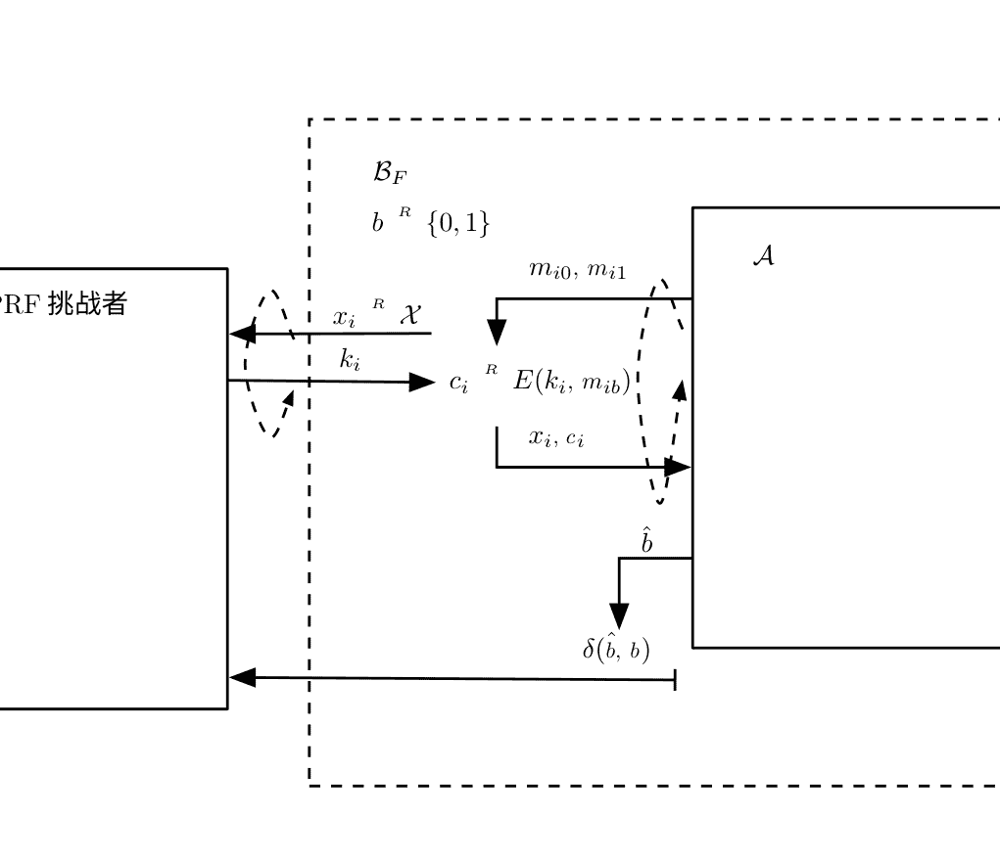

图5.1：定理5.2 证明中的对手 $\mathcal{B}_F$

最终，$\mathcal{A}$ 停止并输出一个比特 $\hat{b}$，此时对手 $\mathcal{B}$ 停止并输出 1 如果 $\hat{b} = b$，并输出 0 否则。

请参见图5.1，了解对手 $\mathcal{B}_F$ 的图片。通常情况下，$\delta(x, y)$ 定义为如果 $x = y$，则为 1，否则为 0。

## 游戏2.

接下来，我们使用我们的“忠诚的侏儒”思想（见第4.4.2节）来实现随机函数 $f$。我们的“侏儒”必须跟踪 $f$ 的输入，并检测是否使用了相同的输入两次。在下面的逻辑中，我们的侏儒将一个真正随机的密钥作为“默认”值用于 $k_i$，但如果需要的话，会覆盖这个默认值，如标有 $(*)$ 的行所示：

```
b \stackrel{R}{\leftarrow} \{0,1\}
for i \leftarrow 1 到 Q 执行
    x_i \stackrel{R}{\leftarrow} \mathcal{X}
    k_i \stackrel{R}{\leftarrow} \mathcal{K}
(*) 如果存在某个 j < i 使得 x_i = x_j，则 k_i \leftarrow k_j
在收到第 i 个查询 (m_{i0}, m_{i1}) \in M^2 时
    c_i \stackrel{R}{\leftarrow} E(k_i, m_{ib})
    send (x_i, c_i) 给对手。
```

由于这是对随机函数 $f$ 的忠实现，我们有
$$ \Pr[W_2] = \Pr[W_1]. \tag{5.9} $$

## 游戏3.

接下来，我们的侏儒“健忘”，只是在前一个游戏中删除标有（*）的行：

```
b \stackrel{R}{\leftarrow} \{0, 1\}
for i \leftarrow 1 到 Q 执行
    x_i \stackrel{R}{\leftarrow} \mathcal{X}
    k_i \stackrel{R}{\leftarrow} \mathcal{K}
    在收到第 i 个查询 (m_{i0}, m_{i1}) \in M^2 时
        c_i \stackrel{R}{\leftarrow} E(k_i, m_{ib})
        send (x_i, c_i) 给对手。
```

为了分析数量 $|\Pr[W_3] \oplus \Pr[W_2]|$，我们使用差分引理（定理4.7）。为此，我们将游戏2和游戏3视为在相同的概率空间上运行：对手和挑战者所做的随机选择在两个游戏中是相同的 - 唯一不同的是挑战者用于计算其响应的规则。特别地，在两个游戏中，变量 $x_i$ 是相同的。定义 $Z$ 为事件 $x_i = x_j$ 对于某些 $i \neq j$。显然，除非 $Z$ 发生，游戏2和游戏3的进行是相同的；特别地，只有当 $W_3 \wedge \neg Z$ 发生时，$W_2 \wedge \neg Z$ 才会发生。

应用差分引理，我们因此有
$$ |\Pr[W_3] \oplus \Pr[W_2]| \leq \Pr[Z]. \tag{5.10} $$
此外，很容易看出
$$ \Pr[Z] \leq \frac{Q^2}{2^N}, \tag{5.11} $$
因为 $Z$ 是少于 $Q^2/2$ 个事件的并集，每个事件发生的概率都是 $1/N$。

观察到在第3个游戏中，使用独立的加密密钥 $k_i$ 来加密每个消息。接下来，我们打出我们的“语义安全牌”，声称
$$ |\Pr[W_3] \oplus 1/2| = \text{MSSadv}^*[\bar{\mathcal{B}}_E, E], \tag{5.12} $$
其中 $\bar{\mathcal{B}}_E$ 是一个高效的对手，在攻击游戏5.1中以比特猜测的方式与 $E$ 相关，最多向其挑战者提出 $Q$ 个查询。

$\bar{\mathcal{B}}_E$ 的设计自然地受到游戏3的句法形式的启发。它的工作原理如下：

作为 $\mathcal{A}$ 的挑战者，当收到第 $i$ 个查询 $(m_{i0}, m_{i1})$ 时，对手 $\bar{\mathcal{B}}_E$ 将 $(m_{i0}, m_{i1})$ 提交给自己的挑战者，获得一个密文 $c_i \in \mathcal{C}$；然后 $\bar{\mathcal{B}}_E$ 从 $\mathcal{X}$ 中随机选择一个 $x_i$，并以对后者的查询作为应发送 $(x_i, c_i)$ 给 $\mathcal{A}$。

当 $\mathcal{A}$ 最终输出一个位 $\hat{b}$ 时，$\bar{\mathcal{B}}_E$ 输出相同的位。

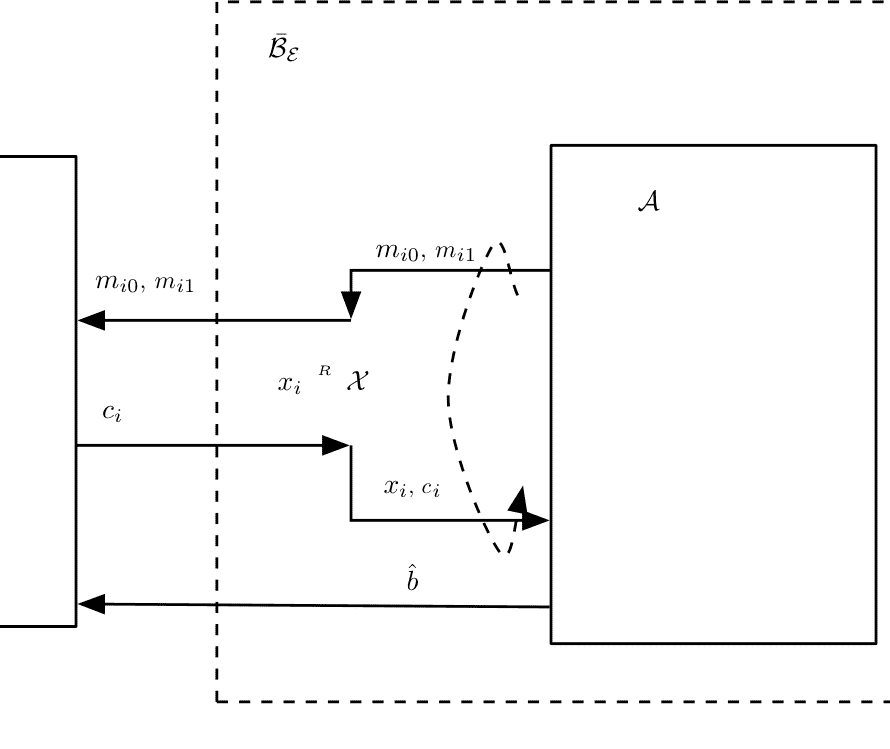

图5.2: 定理5.2证明中的对手 $\mathcal{B}_{\mathcal{E}}$

从构造（和 (2.13) ）可以明显看出，(5.12)成立。此外，根据定理5.1和(5.1)，我们有
$$ \text{MSSadv}^*[\bar{\mathcal{B}}_E, E] = Q \cdot \text{SSadv}^*[\mathcal{B}_E, E], \tag{5.13} $$
其中 $\mathcal{B}_E$ 是一个高效的对手，在攻击游戏2.1的比特猜测版本中扮演角色，与 $E$ 相关。

将(5.7)到(5.13)放在一起，我们得到(5.6)。此外，可以验证 $\mathcal{B}_F$ 和 $\mathcal{B}_{\mathcal{E}}$ 的运行时间与 $\mathcal{A}$ 的运行时间大致相同；实际上，它们只是 $\mathcal{A}$ 的基本包装器，并且(5.5)成立，无论 $\mathcal{A}$ 是否高效。 $\square$

虽然上述证明有点长，但我们希望读者同意这实际上是相当自然的，所有步骤都相当容易理解。此外，这个证明说明了在设计一个安全证明作为一系列游戏时，通常会使用多个安全假设。

**备注 5.2.** 我们简要提到了在定理 5.2中的混合构造 $\mathcal{E}'$ 是CPA安全的，即使在构造中使用的PRF $F$ 只是弱安全的（如定义 4.3中所述）。为了证明定理 5.2在这个较弱的假设下，观察到在游戏 0 和游戏 1 中，挑战者只在 $\mathcal{X}$ 中的随机点上评估PRF。因此，即使 $F$ 只是弱安全的，区分游戏 0 和游戏 1 的对手优势是可以忽略的。 $\square$

## 5.4.2 随机计数器模式

我们可以直接利用安全的PRF构建一个CPA安全的密码。假设 $F$ 是在 $(\mathcal{K}, \mathcal{X}, \mathcal{Y})$ 上定义的PRF。我们将假设 $\mathcal{X} = \{0, \dots, N - 1\}$，并且 $\mathcal{Y} = \{0, 1\}^n$。对于任何多项式边界 $\ell \geq 1$，我们定义一个密码 $\mathcal{E} = (E, D)$，密钥空间 $\mathcal{K}$，消息空间 $\mathcal{Y}^{\leq \ell}$，密文空间 $\mathcal{X} \times \mathcal{Y}^{\leq \ell}$，如下所示：

- 对于 $k \in \mathcal{K}$ 和 $m \in \mathcal{Y}^{\leq \ell}$，其中 $v := |m|$，我们定义
```
E(k, m) :=
    x \stackrel{R}{\leftarrow} \mathcal{X}
    按照以下方式计算 c \in \mathcal{Y}^v:
        对于 j 从 0 到 v-1 进行循环
            c[j] \leftarrow F(k, x + j \mod N) \oplus m[j]
    输出 (x, c);
```
- 对于 $k \in \mathcal{K}$ 和 $c' = (x, c) \in \mathcal{X} \times \mathcal{Y}^{\leq \ell}$, 其中 $v := |c|$，我们定义
```
D(k, c') :=
    计算 m \in \mathcal{Y}^v 如下:
        对于 j 从 0 到 v-1 进行
            m[j] \leftarrow F(k, x + j \mod N) \oplus c[j]
    输出 m.
```

这种密码与使用 $F$ 构建PRG得到的流密码非常相似使用第4.4.4节中的构造方法。不同之处在于，我们不是使用固定的输入序列来派生密钥流，而是使用一个随机的起始点，然后递增以获得连续的输入到 $F$。 密文的 $x$ 分量通常称为初始值，或者简称为IV。
在实践中， $F$ 通常使用块密码的加密函数来实现，$\mathcal{X} = \mathcal{Y} = \{0,1\}^n$, 其中我们自然地将 $n$ 位字符串视为范围在 $0,...,2^n-1$ 的数字。 恰好在这种构造中，块密码的解密函数根本不需要。参见图5.3以了解此模式的示例。

很容易验证 $E$ 确实是一个（概率性）密码。 此外，请注意消息空间 $of$ $E$ 的长度可变，并且为了定义使用攻击游戏5.2的CPA安全性，消息 $m \in \mathcal{Y}^{\leq \ell}$ 的长度是其自然长度 $|m|$。

## 定理5.3.

如果 $F$ 是一个安全的PRF，$N$ 是超多项式的，那么对于任何多项式有界的 $\ell \geq 1$，上述描述的密码 $E$ 是一个CPA安全的密码。

特别地，对于每个攻击 $E$ 的CPA对手 $\mathcal{A}$, 其在攻击游戏5.2中，最多向其挑战者提出 $Q$ 个查询，存在一个攻击 $F$ 的PRF对手 $\mathcal{B}$, 其在攻击游戏4.2中，$\mathcal{B}$ 是 $\mathcal{A}$ 的一个基本封装，使得
$$ \text{CPAadv}[\mathcal{A}, \mathcal{E}] \leq \frac{4Q^2 \ell}{N} + 2 \cdot \text{PRFadv}[\mathcal{B}, F]. \tag{5.14} $$

**证明思路。** 假设我们从一个对于 $E$ 的CPA攻击游戏开始的对手。 首先，利用 $F$ 是PRF的假设，我们可以有效地用一个真正的随机函数 $f$ 替换 $F$。其次，利用 $N$ 是超多项式的假设，以及每个IV都是随机选择的事实，我们可以认为除了可以忽略的概率外，挑战者从不在同一点上评估 $f$ 两次。 但在这种情况下，挑战者有效地使用独立的一次性密码本对每个消息进行加密，因此我们可以得出结论，对手在原始CPA攻击游戏中的优势是可以忽略的。

**证明。** 假设 $\mathcal{A}$ 是一个在攻击游戏5.2中对 $\mathcal{E}$ 进行挑战的有效对手，并且在该游戏中对其挑战者最多进行了 $Q$ 次查询。. 我们希望证明 $\text{CPAadv}[\mathcal{A}, \mathcal{E}]$ 是可以忽略的，假设 $F$ 是一个安全的PRF，而 $N$ 是超多项式的。

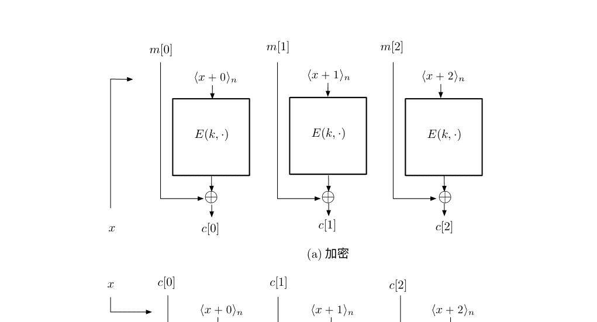

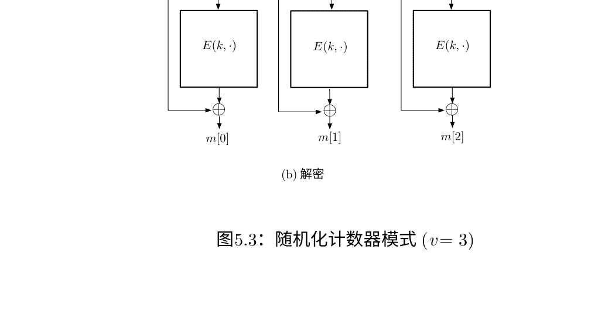

图5.3：随机化计数器模式 (v=3)

使用比特猜测版本的CPA攻击游戏很方便，我们证明：
$$ \text{CPAadv}^*[\mathcal{A}, \mathcal{E}] \leq \frac{2Q^2\ell}{N} + \text{PRFadv}[\mathcal{B}, F] $$
对于一个高效的对手 $\mathcal{B}$。然后(5.14)可以从(5.4)推导出来。证明的基本策略如下。首先，我们定义Game 0为在比特猜测版本的攻击游戏5.2中，$\mathcal{A}$和挑战者之间进行的游戏，与$\mathcal{E}$相关。然后，我们定义几个更多的游戏：Game 1, Game 2和Game 3。这些游戏中的每一个都是在$\mathcal{A}$和不同的挑战者之间进行的。在这些游戏中，$b$表示挑战者选择的随机比特，而$\hat{b}$表示$\mathcal{A}$输出的比特。此外，对于$j=0,\ldots,3$，我们定义$W_j$为事件，即$\hat{b}=b$在Game $j$中。我们将证明对于$j=1,\ldots,3$，值$|Pr[W_j] \oplus Pr[W_{j-1}]|$是可以忽略的；此外，很明显有$Pr[W_3] = 1/2$，由此可以得出$\text{CPAadv}^*[\mathcal{A}, \mathcal{E}] := |Pr[W_0] \oplus 1/2|$是可以忽略的。

## 游戏 0.

```
b \stackrel{R}{\leftarrow} \{0,1\}
k \stackrel{R}{\leftarrow} \mathcal{K}
对于 i \leftarrow 1 到 Q 执行
    x_i \stackrel{R}{\leftarrow} \mathcal{X}
    对于 j \leftarrow 从 0 到 \ell - 1 做
        x'_{ij} \leftarrow x_i + j \mod N
        y_{ij} \leftarrow F(k, x'_{ij})
在收到第 i 个查询 (m_{i0}, m_{i1}) 后，计算 v_i := |m_{i0}| = |m_{i1}|:
    按照以下方式计算 c_i \in \mathcal{Y}^{v_i}:
        对于 j \leftarrow 从 0 到 v_i - 1 做: c_i[j] \leftarrow y_{ij} \oplus m_{ib}[j]
将 (x_i, c_i) 发送给对手。
```

根据构造，我们有
$$ \text{CPAadv}^*[\mathcal{A}, \mathcal{E}] = |Pr[W_0] \oplus 1/2|. $$

## 游戏 1.

接下来，我们使用“PRF卡”，将 $F(k, \cdot)$ 替换为一个真正的随机函数 $f \in \text{Funs}[\mathcal{X}, \mathcal{Y}]$。在这个游戏中，挑战者的形式如下：

```
b \stackrel{R}{\leftarrow} \{0,1\}
f \stackrel{R}{\leftarrow} \text{Funs}[\mathcal{X}, \mathcal{Y}]
对于 i \leftarrow 1 到 Q 执行
    x_i \stackrel{R}{\leftarrow} \mathcal{X}
    对于 j \leftarrow 从 0 到 \ell - 1 做
        x'_{ij} \leftarrow x_i + j \mod N
        y_{ij} \leftarrow f(x'_{ij})
在收到第 i 个查询 (m_{i0}, m_{i1}) 后，计算 v_i := |m_{i0}| = |m_{i1}|:
    按照以下方式计算 c_i \in \mathcal{Y}^{v_i}:
        对于 j \leftarrow 从 0 到 v_i - 1 做: c_i[j] \leftarrow y_{ij} \oplus m_{ib}[j]
将 (x_i, c_i) 发送给对手。
```

我们声称
$$ |Pr[W_1] \oplus Pr[W_0]| = \text{PRFadv}[\mathcal{B}, F], $$
其中 $\mathcal{B}$ 是一个高效的对手；此外，由于我们假设 $F$ 是一个安全的PRF，所以 $\text{PRFadv}[\mathcal{B}, F]$ 必须是可以忽略的。这在现在应该是一个常规的论证，我们将其细节留给读者。

## 游戏2.

接下来，我们使用我们的“忠诚的侏儒”思想来实现随机函数 $f$。在描述我们在这个游戏中的挑战者的逻辑时，我们使用标准的字典序对索引对 $(i, j)$ 进行排序；也就是说，当且仅当 $i' < i$ 或者 $i' = i$ 且 $j' < j$ 时，$(i', j')<(i, j)$。

在以下逻辑中，我们的“侏儒”使用一个真正的随机值作为每个 $y_{ij}$ 的“默认”值，但如果需要的话，会覆盖这个默认值，如标记为 (*) 的行所示：

```
b \stackrel{R}{\leftarrow} \{0, 1\}
for i \leftarrow 1 到 Q 执行
    x_i \stackrel{R}{\leftarrow} \mathcal{X}
    对于 j \leftarrow 从 0 到 \ell - 1 做
        x'_{ij} \leftarrow x_i + j \mod N
        y_{ij} \stackrel{R}{\leftarrow} \mathcal{Y}
        (*)       如果 x'_{ij} = x'_{i'j'}, 对于某个 (i', j') < (i, j), 那么 y_{ij} \leftarrow y_{i'j'}
        在收到第 i 个查询 (m_{i0}, m_{i1}) 后，计算 v_i := |m_{i0}| = |m_{i1}|:
            按照以下方式计算 c_i \in \mathcal{Y}^{v_i}:
                对于 j \leftarrow 从 0 到 v_i - 1 做: c_i[j] \leftarrow y_{ij} \oplus m_{ib}[j]
            将 (x_i, c_i) 发送给对手。
```

由于这是对随机函数 $f$ 的忠实现，我们有
$$ Pr[W_2] = Pr[W_1]. \tag{5.18} $$

## 游戏3.

现在我们让我们的侏儒“健忘”，在前一个游戏中删除标记为 (*) 的行：

```
b \stackrel{R}{\leftarrow} \{0, 1\}
for i \leftarrow 1 到 Q 执行
    x_i \stackrel{R}{\leftarrow} \mathcal{X}
    对于 j \leftarrow 从 0 到 \ell - 1 做
        x'_{ij} \leftarrow x_i + j \mod N
        y_{ij} \stackrel{R}{\leftarrow} \mathcal{Y}
    在收到第 i 个查询 (m_{i0}, m_{i1}) 后，计算 v_i := |m_{i0}| = |m_{i1}|:
        按照以下方式计算 c_i \in \mathcal{Y}^{v_i}:
            对于 j \leftarrow 从 0 到 v_i - 1 做: c_i[j] \leftarrow y_{ij} \oplus m_{ib}[j]
        将 (x_i, c_i) 发送给对手。
```

为了分析数量 $|Pr[W_3] \oplus Pr[W_2]|$，我们使用差分引理 (定理4.7)。为此，我们将游戏2和游戏3视为在相同的概率空间上操作：对手和挑战者所做的随机选择在两个游戏中是相同的 - 唯一不同的是挑战者用于计算其响应的规则。特别地，变量 $x'_{ij}$ 在两个游戏中是相同的。定义 $Z$ 为事件 $x'_{ij} = x'_{i'j'}$ 对于某个 $(i, j) \neq (i', j')$。显然，除非 $Z$ 发生，游戏2和游戏3的进行是相同的；特别地，只有当 $W_2 \wedge Z$ 发生时，$W_3 \wedge Z$ 才会发生。应用差分引理，我们有
$$ |Pr[W_3] \oplus Pr[W_2]| \leq Pr[Z]. \tag{5.19} $$
我们声称
$$ Pr[Z] \leq \frac{2Q^2 \ell}{N}. \tag{5.20} $$
为了证明这个命题，我们可以假设 $N > 2\ell$ (这通常是成立的，因为我们假设 $\ell$ 是多项式有界的，而 $N$ 是超多项式的)。观察到 $Z$ 发生当且仅当
$$ \{x_i, ..., x_i + \ell - 1\} \cap \{x_{i'}, ..., x_{i'} + \ell - 1\} \neq \emptyset $$对于某对指标 $i$ 和 $i'$，其中 $i \neq i'$ (并且算术运算是模 $N$ 进行的)。考虑任意固定的这样的一对指标。在给定 $x_i$ 的任意固定值的条件下，$x_{i'}$ 的值在 $\{0, \dots, N-1\}$ 上均匀分布，并且区间重叠当且仅当
$$
x_{i'} \in \{x_i + j : -\ell + 1 \le j \le \ell - 1\},
$$
这种情况发生的概率为 $(2\ell - 1)/N$。不等式 (5.20) 现在成立。

最后，观察到在游戏 3 中，$y_{ij}$ 的值在 $\mathcal{Y}$ 上均匀且独立分布，因此挑战者基本上使用独立的一次性密码本进行加密。特别地，很容易看出在这个游戏中，对手的输出与 $b$ 无关。因此，
$$\Pr[W_3] = 1/2.$$ \hfill (5.21)

将 (5.16) 到 (5.21) 组合起来，我们得到 (5.15)，从而定理得证。 $\square$

备注 5.3. 也可以将随机计数器模式视为第 5.4.1 节中通用混合构造的特例。参见练习 5.5。 $\square$

## 案例研究：AES计数模式

IPsec协议使用特定的AES计数模式变体，如RFC 3686中所规定。
回想一下，AES使用128位块。与其为每个消息选择一个随机的128位IV，
RFC 3686选择IV的方法如下：

- 最高位的32位在生成密钥时随机选择，并在密钥的生命周期内保持不变。使用相同的32位值加密使用此密钥的所有消息。
- 接下来的64位在 $\{0, 1\}^{64}$ 中随机选择。
- 最低位的32位设置为数字 1。

这个得到的128位IV被用作计数器的初始值。加密消息时，每个消息块的最低位32位递增一次。因此，最大可加密的消息长度为 $2^{32}$ 个AES块或 $2^{36}$ 字节。

通过选择这个初始化向量，解密者可以知道IV的32个最高有效位和32个最低有效位。因此，只需要发送IV的64位与密文一起。
定理5.3的证明可以适应这种选择IV的方法来保证安全性。
这种方法相对于随机选择128位IV的微小优势在于生成的密文会稍短一些。随机IV会强制加密者将所有的128位都包含在密文中。使用RFC 3686的方法只需要64位，从而将密文缩小8个字节。

## 5.4.3 CBC模式

历史上一个重要的加密方法是在密码块链接（CBC）模式下使用分组密码。这种方法在较旧版本的TLS协议（例如TLS 1.0）中使用。与下一节讨论的计数器模式加密相比，它是较差的。

假设 $\mathcal{E}= (E, D)$ 是一个在 $(\mathcal{K}, \mathcal{X})$ 上定义的分组密码，其中 $\mathcal{X} = \{0, 1\}^n$。令 $N := |\mathcal{X}| = 2^n$。对于任何多项式有界的 $\ell \ge 1$，我们定义一个密码 $\mathcal{E}'= (E', D')$，其密钥空间为 $\mathcal{K}$，消息空间为 $\mathcal{X}^{\le \ell}$，密文空间为 $\mathcal{X}^{\le \ell+1} \setminus \mathcal{X}^0$；也就是说，密文空间包含了最多 $\ell + 1$ 个数据块的所有非空序列。加密和解密的定义如下：

+ 对于 \( k \in \mathcal{K} \) 和 \( m \in \mathcal{X}^{\leq \ell} \)，其中 \( v := |m| \)，我们定义
\[
E'(k, m) :=
\]
按照以下方式计算 \( c \in \mathcal{X}^{v+1} \):
\[
c[0] \xleftarrow{\$} \mathcal{X}
\]
对于 \( j \) 从0到 \( v - 1 \) 进行循环
\[
\quad c[j+1] = E(k, c[j] \oplus m[j])
\]
输出 \( c \);

+ 对于 \( k \in \mathcal{K} \) 和 \( c \in \mathcal{X}^{\leq \ell+1} \setminus \mathcal{X}^0 \)，令 \( v := |c| - 1 \)，我们定义
\[
D'(k, c) :=
\]
按照以下方式计算 \( m \in \mathcal{X}^v \):
对于 \( j \) 从0到 \( v - 1 \) 进行
\[
\quad m[j] = D(k, c[j+1]) \oplus c[j]
\]
输出 \( m \).

请参见图5.4，了解 \(|m| = 3\) 时的加密和解密算法示例。
在这里，密文的第一个分量 \(c[0]\) 也被称为初始值或IV。请注意，与第5.4.2节中的计数器模式构造不同，在CBC模式中，我们必须使用块密码，因为我们实际上需要使用块密码的解密算法。

很容易验证 \(E'\) 确实是一个（概率性）密码。另外，注意消息空间 of \(\mathcal{E}\) 是可变长度的，并且为了定义使用攻击游戏5.2的CPA安全性，消息 \( m \in \mathcal{X}^{\leq \ell} \) 的长度是其自然长度 \(|m|\)。

**定理5.4.** 如果 \(\mathcal{E} = (E, D)\) 是在 \((\mathcal{K}, \mathcal{X})\) 上定义的安全分组密码，且 \(N := |\mathcal{X}|\) 是超多项式的，那么对于任何多项式有界的 \(\ell \ge 1\)，上述描述的密码 \(\mathcal{E}'\) 是一个\(CPA\)安全密码。

特别地，对于每个以位猜测版本的攻击游戏5.2中攻击 \(\mathcal{E}'\) 的\(CPA\)对手 \(\mathcal{A}\)，并且最多向其挑战者提出 \(Q\) 个查询，存在\(BC\)对手 \(\mathcal{B}\) 以攻击游戏4.1中攻击 \(\mathcal{E}\) 的方式攻击，其中 \(\mathcal{B}\) 是 \(\mathcal{A}\) 的一个基本封装。
\[ \mathrm{CPA}_{\mathrm{adv}}[\mathcal{A}, \mathcal{E}'] \leq \frac{2 Q^2 \ell^2}{N} + 2 \cdot \mathrm{BC}_{\mathrm{adv}}[\mathcal{B}, \mathcal{E}]. \tag{5.22} \]

证明思路。证明的基本思路与定理5.3非常相似。我们从一个对于 \(\mathcal{E}'\) 的CPA攻击游戏中开始，对手扮演对手的角色。. 然后我们用一个真正的随机函数 \(f\) 替换 \(E\)。然后我们论证，除了可以忽略的概率外，挑战者从不在相同的点上评估 \(f\) 两次。但是，对手所看到的只是一堆随机位，因此对于被加密的消息一无所知。 □

证明。假设 \(\mathcal{A}\) 是一个有效的CPA对手，攻击 \(\mathcal{E}'\)，就像攻击游戏5.2中的那样。假设在游戏中，\(\mathcal{A}\) 向挑战者提出了最多 \(Q\) 个查询。我们想要证明，假设 \(\mathcal{E}\) 是一个安全的分组密码， \(N\) 是超多项式的情况下， \(CPA_{\mathrm{adv}}^*[\mathcal{A}, \mathcal{E}']\) 是可以忽略的。在这些假设下，根据推论4.5，加密函数 \(E\) 是一个在 \((\mathcal{K}, \mathcal{X}, \mathcal{X})\) 上定义的安全\(PRF\)。
使用比特猜测版本的CPA攻击游戏很方便，我们证明：
\[ \mathrm{CPA}_{\mathrm{adv}}^*[\mathcal{A}, \mathcal{E}'] \leq \frac{Q^2 \ell^2}{N} + \mathrm{BC}_{\mathrm{adv}}[\mathcal{B}, \mathcal{E}] \tag{5.23} \]
对于一个高效的对手 \(\mathcal{B}\). 然后 (5.22) 由 (5.4) 推导出来。

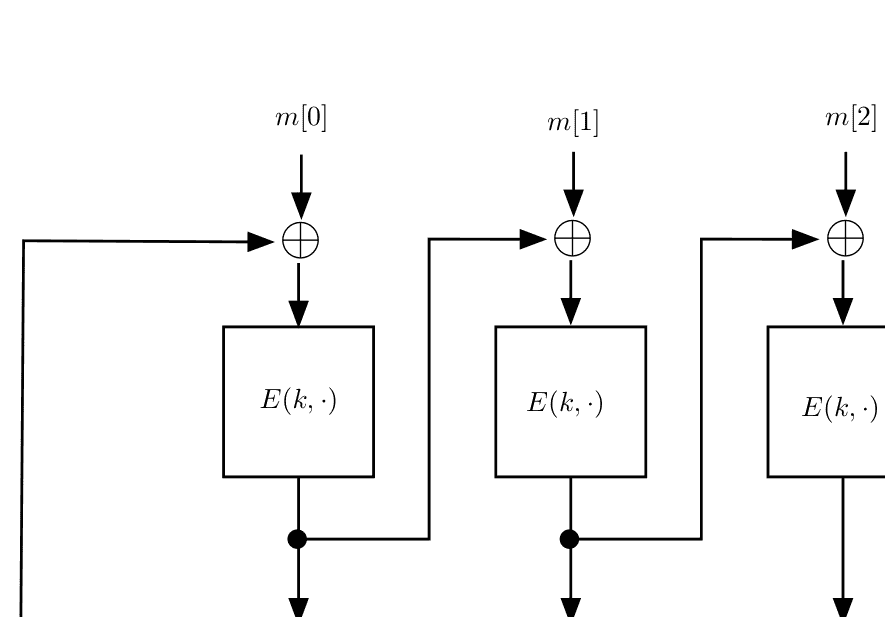

### (a) 加密

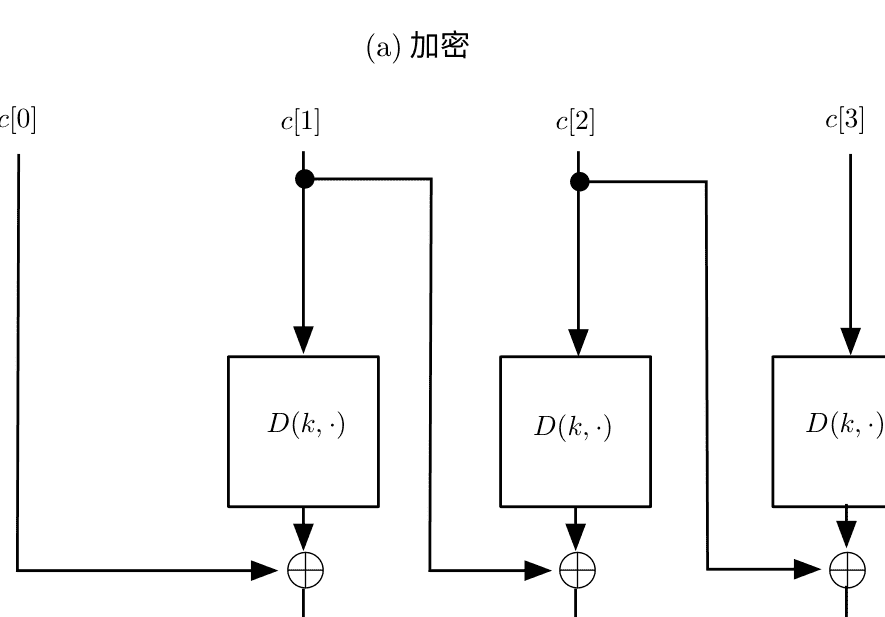

### (b) 解密

图5.4: CBC模式的加密和解密 $\ell = 3$

通常，我们定义一系列游戏：Game 0，Game 1，Game 2，Game 3。这些游戏中的每一个都是在 A 和挑战者之间进行的。Game 0 中的挑战者是与 E' 相关的比特猜测攻击游戏 5.2 中的那个。在这些游戏中，b 表示挑战者选择的随机比特，而 b̂ 表示 A 输出的比特。此外，对于 j=0, …, 3，我们定义 W_j 为在游戏 j 中 b̂=b 的事件。我们将证明对于 j=1, …, 3，值 |Pr[W_j] - Pr[W_{j-1}]| 是可以忽略的；此外，很明显有 Pr[W_3] = 1/2，由此可得 |Pr[W_0] - 1/2| 是可以忽略的。

我们开始吧！

### 游戏 0
我们可以这样描述游戏 0 中的挑战者：
```
b ←_R {0, 1}, k ←_R K
在收到第 i 个查询 (m_{i0}, m_{i1}) 后，计算 v_i := |m_{i0}| = |m_{i1}|:
按照以下方式计算 c_i ∈ X^{v_i+1}:
c_i[0] ←_R X
for j 从 0 到 v_i - 1 进行
    x_{ij} ← c_i[j] ⊕ m_{ib}[j]
    c_i[j+1] ← E(k, x_{ij})
将 c_i 发送给对手。
```
通过构造，我们有
CPAadv'[A, E'] = |Pr[W_0] - 1/2|. (5.24)

### 游戏 1
现在我们玩“PRF卡”，用真正的随机函数 $f \in \mathrm{Funs}[\mathcal{X}, \mathcal{X}]$ 替换 $E(k, ·)$。在这个游戏中，我们的挑战者如下所示：
```
b ←_R {0, 1}, f ←_R Funs[X, X]
在收到第 i 个查询 (m_{i0}, m_{i1}) 后，计算 v_i := |m_{i0}| = |m_{i1}|:
按照以下方式计算 c_i ∈ X^{v_i+1}:
c_i[0] ←_R X
for j 从 0 到 v_i - 1 进行
    x_{ij} ← c_i[j] ⊕ m_{ib}[j]
    c_i[j+1] ← f(x_{ij})
将 c_i 发送给对手。
```
我们声称
|Pr[W_1] - Pr[W_0]| = PRFadv[B, E], (5.25)
其中 B 是一个高效的对手；此外，由于我们假设 E 是一个安全的分组密码，并且 N 是超多项式的，因此 PRFadv[B, E] 必定是可以忽略的。这个论证希望（到现在为止）是一个常规的论证，我们将其细节留给读者。

### 游戏 2
在这个过程中，下一步应该是熟悉的：我们使用一个忠实的侏儒来实现 f。我们通过引入随机变量 $y_{ij}$ 来实现这一点，它表示 $c_i[j]$ 的“默认”值，如果需要，在标记为（*）的行中会被覆盖：

$b\xleftarrow{R} \{0,1\}$

设置 $y_{ij} \xleftarrow{R} \mathcal{X}$，对于 $i=1, \ldots, Q$ 和 $j=0, \ldots, \ell$

在收到第 $i$ 个查询 $(m_{i0}, m_{i1})$ 后，计算 $v_i := |m_{i0}| = |m_{i1}|$：

按照以下方式计算 $c_i \in \mathcal{X}^{v_i+1}$：

```
c_i[0] = y_{i0}
对于 j 从0到 v_i - 1 进行
    x_{ij} = c_i[j] ⊕ m_{ib}[j]
    c_i[j+1] = y_{i(j+1)}    (*)
如果对于某个 (i', j') < (i, j)，有 x_{ij} = x_{i'j'}，则 c_i[j+1] ← c_{i'}[j'+1] 发送给对手。    (*)
```

我们明显有
$\Pr[W_2] = \Pr[W_1]$。

### 游戏3
现在我们让小人忘记，删除标记为(*)的行中的检查：
$b\xleftarrow{R} \{0,1\}$

设置 $y_{ij} \xleftarrow{R} \mathcal{X}$，对于 $i=1, \ldots, Q$ 和 $j=0, \ldots, \ell$

在收到第 $i$ 个查询 $(m_{i0}, m_{i1})$ 后，计算 $v_i := |m_{i0}| = |m_{i1}|$：

按照以下方式计算 $c_i \in \mathcal{X}^{v_i+1}$：

```
c_i[0] = y_{i0}
对于 j 从0到 v_i - 1 进行
    x_{ij} = c_i[j] ⊕ m_{ib}[j]
    c_i[j+1] = y_{i(j+1)}    (删除*)
发送给对手。
```

为了分析数量 $|\Pr[W_3] - \Pr[W_2]|$，我们使用差分引理 (定理4.7)。为此，我们将游戏2和游戏3视为在相同的概率空间上操作：对手和挑战者所做的随机选择在两个游戏中是相同的 - 唯一不同的是挑战者用于计算其响应的规则。

我们定义 $Z$ 为在第3场比赛中 $x_{ij} = x_{i'j'}$ 的事件。注意，事件 $Z$ 是根据第3场比赛中的 $x_{ij}$ 值来定义的。事实上，$x_{ij}$ 的值在第2场和第3场比赛中可能不是以相同的方式计算的，因此我们明确地根据第3场比赛中的值来定义了事件 $Z$。

然而，很明显，除非 $Z$ 发生，否则第2场和第3场比赛将完全相同；特别地，只有当 $W_2 \wedge \overline{Z}$ 发生时，$W_3 \wedge \overline{Z}$ 才会发生。应用差分引理，我们因此有
$|\Pr[W_3] - \Pr[W_2]| \leq \Pr[Z]$。

我们声称
$\Pr[Z] \leq \dfrac{Q^2 \ell^2}{2N}$ (5.28)

为了证明这一点，让 $Coins$ 表示 $\mathcal{A}$ 所做的随机选择。观察到在第3场比赛中，数值
$Coins$、$b$、$y_{ij} \ (i=1, \ldots Q, j=0, \ldots, \ell)$
独立分布。

考虑任意固定的索引 $i = 1, \ldots, Q$。让我们在任意固定的 $Coins$，$b$，和 $y_{i'j'}$ 为 $i' = 1, \ldots, i-1$ 和 $j = 0, \ldots, \ell$ 的值上进行条件概率。在这个条件概率空间中，

$m_{i0}, m_{i1}, 和 v_{i}$的值是完全确定的，以及 $v_{i'}$和 $x_{i',j}$为 $i' = 1, \ldots, i-1$ 和 $j = 0, \ldots, v_{i'} - 1$; 然而， $y_{i0}, \ldots$的值仍然是均匀和独立分布的。 ，$y_{i\ell}$在 $\mathcal{X}$上。 此外，由于 $x_{ij} = y_{ij} \oplus m_{i\mathsf{b}[j]}$ for $j = 0, \ldots, v_{i} - 1$，这些 $x_{ij}$值也是均匀和独立分布在 $\mathcal{X}$上。 因此，对于任意固定的索引 $j = 0, \ldots, v_{i} - 1$，和任意固定的索引 $i'$和 $j'$，其中 $(i', j') < (i, j)$，在这个条件概率空间中， $x_{ij} = x_{i'j'}$的概率是 $1/N$。 不等式 (5.28) 现在可以通过简单的计算得出。

最后，我们声称
$$\Pr[W_3] = 1/2. \tag{5.29}$$
这是因为
$$Coins, \quad b, \quad y_{ij} \ (i = 1, \ldots Q, j = 0, \ldots, \ell)$$
是独立分布的，并且对手的输出 $\hat{b}$是一个函数
$$\text{硬币} \ , \quad y_{ij} \ (i = 1, \ldots Q, j = 0, \ldots, \ell).$$
由此可见，$\hat{b}$和 $b$是独立的，因此(5.29)立即得出。

将(5.24)到(5.29)整合起来，我们有
$$\mathsf{CPA}\mathsf{adv}^*[\mathcal{A}, \mathcal{E}'] \leq \frac{Q^2\ell^2}{2N} + \mathsf{PRF}\mathsf{adv}[\mathcal{B}, E].$$
根据定理4.4，我们有
$$|\mathsf{BC}\mathsf{adv}[\mathcal{B}, \mathcal{E}] - \mathsf{PRF}\mathsf{adv}[\mathcal{B}, E]| \leq \frac{Q^2\ell^2}{2N},$$
并且(5.23)得出，从而证明了定理。 $\square$

### 5.4.4 案例研究：TLS 1.0中的CBC填充
令 $\mathcal{E} = (E, D)$ 是一个具有域 $\mathcal{X}$的分组密码。 我们对使用 $\mathcal{E}$的CBC模式加密的描述假设要加密的消息是 $\mathcal{X}^{\leq t}$的元素。 当域为 $\mathcal{X} = \{0,1\}^{128}$时，这意味着要加密的消息的长度必须是16字节的倍数。 由于实际上消息的长度不一定是16的倍数，我们需要一种方法来扩展CBC以处理长度不一定是分组大小的消息。

假设我们希望使用AES在CBC模式下加密一个 $v$字节的消息 $m$，其中 $v$不一定是16的倍数。首先想到的是以某种方式填充消息 $m$使其字节长度是16的倍数。 显然，填充函数需要是可逆的，以便在解密过程中可以去除填充。

TLS 1.0协议为在CBC模式下使用AES加密一个 $v$字节的消息定义了以下填充函数：让 $p := 16 - (v \text{ mod } 16)$，然后将 $p$字节附加到消息 $m$中，其中每个字节的内容为值 $p - 1$。例如，考虑以下两种情况：

- 如果 $m$的长度为29字节，则 $p= 3$，填充由三个字节“222”组成，使得填充后的消息长度为32字节，正好是两个AES块。
- 如果 $m$的长度是块大小的倍数，例如32字节，则 $p= 16$，填充由16个字节组成。填充后的消息长度为48字节，正好是三个AES块。

当消息的长度是块大小的倍数时，我们在末尾添加一个完整的虚拟块可能看起来很奇怪。这是为了使解密过程能够正确地移除填充。实际上，应该清楚地看到，对于所有输入消息长度，这种填充方法是可逆的。

易证明，每个可逆填充方案都可以构建一个从安全块密码生成CPA安全密码的CBC模式加密。

在CBC模式中，可以使用一种称为“密文窃取”的方法来避免填充，只要明文长度超过一个块。CBC的密文窃取变体是练习5.16的主题。当加密长度小于一个块的消息时，例如单字节消息，仍然需要填充。

## 5.4.5具体参数和计数器模式与CBC模式的比较

我们用计数器模式和CBC模式构建进行比较来结束本节。我们假设计数器模式使用将n位块映射为n位块的PRF实现，而CBC模式使用n位块密码实现。在每种情况下，消息空间由最多n位数据块的序列组成。根据本节证明的安全定理，我们有以下界限：

> $$\text{CPAadv}[A, E_{ctr}] \leq \frac{4Q^2 \ell}{2^n} + 2 \cdot \text{PRFadv}[B_F, F],$$
$$\text{CPAadv}[A, E_{cbc}] \leq \frac{2Q^2 \ell^2}{2^n} + 2 \cdot \text{BCadv}[B_E, E].$$

在这里，A是任何最多向其挑战者查询Q次的CPA对手，ℓ是任何一个消息的最大长度（以数据块为单位）。为了讨论的目的，让我们简单地忽略PRFadv[B_F, F]和BCadv[B_E, E]这些术语。

我们可以立即看到计数器模式具有定量的安全优势。为了使事情更具体，假设块大小为n=128，每个消息为1MB（2^23位）因此ℓ=2^16块。如果我们希望将对手的优势保持在2^{-32}以下，则对于计数器模式，我们可以加密多达Q=2^{39.5}个消息，而对于CBC，我们只能加密多达2^{32}个消息。一旦使用给定密钥加密了Q个消息，就必须生成一个新的密钥并用于后续消息。因此，与CBC相比，计数器模式可以使用单个密钥安全地加密更多的消息。计数器模式还具有其他几个优点：

-   并行性和流水线。计数器模式下的加密和解密很容易并行化，而CBC模式下的加密是固有的顺序执行（CBC模式下的解密可以并行化）。支持并行性的模式在底层硬件可以并行执行多条指令的情况下可以显著提高性能，这在现代处理器中经常出现。更重要的是，考虑一个支持流水线的单个块密码轮的硬件实现，就像Intel的AES-128实现（第118页）。流水线使得多个加密指令可以同时执行。像计数器模式这样的并行模式可以保持流水线繁忙，而CBC加密中的流水线由于该模式的顺序性而大部分闲置。因此，在Intel的Haswell处理器上，计数器模式加密比CBC模式加密快大约七倍，假设明文数据已经加载到L1缓存中。

-   较短的密文长度。对于非常短的消息，计数器模式的密文比CBC模式的密文要短得多。例如，考虑一个字节的明文（在加密SSH中的单个按键时自然出现）。计数器模式的密文只需要一个块加上一个字节：一个块用于随机IV加上一个字节用于加密的明文。相比之下，CBC模式的密文是两个完整的块。这导致每个CBC密文多出15个冗余字节，假设使用128位块。

-   仅加密。CBC模式同时使用块密码的加密算法 $E$ 和解密算法 $D$，而计数器模式只使用加密算法 $E$。这可以减少实现代码的大小。

> > 注5.4。随机计数器模式和CBC模式都需要一个随机的初始向量（IV）。一些加密库实际上将其留给更高级的应用程序来提供IV。如果更高级的应用程序没有努力确保IV足够随机，这可能会导致问题。例如，对于计数器模式，IV必须足够分散，以确保相应的间隔不重叠。事实上，这个属性也是足够的。相比之下，对于CBC模式，需要更多的要求：IV必须是不可预测的-参见练习5.12。

将提供IV的责任留给更高级的应用程序实际上是一种基于nonce的加密的例子，我们将在下一节5.5中详细探讨。

## 5.5 基于随机数的加密

到目前为止，我们所见过的所有CPA安全加密方案都存在着密文扩展问题：密文比明文更长。例如，在5.4.1节中的通用混合构造中，生成的密文为$(x, c)$，其中$x$属于某个PRF的输入空间，$c$加密了实际的消息；在5.4.2节中的计数器模式构造中，生成的密文基本上是相同形式的$(x, c)$；类似地，在5.4.3节中的CBC模式构造中，IV也作为密文的一部分。

对于非常长的消息，扩展并不太严重。例如，使用AES和计数器模式或CBC模式，1MB的消息导致的密文只比明文长16个字节，这可能是一个完全可以接受的扩展率。然而，对于16个字节或更少的消息，密文至少是明文长度的两倍长。

坏消息是，对于任何CPA安全的加密方案，某些密文扩展是不可避免的（参见练习5.10）。好消息是，在某些情况下，可以不进行任何密文扩展。例如，假设艾丽丝和鲍勃完全同步，艾丽丝首先发送一个加密 $m_1$，然后发送一个加密 $m_2$，以此类推，而鲍勃首先解密 $m_1$的加密，然后解密 $m_2$的加密，以此类推。为了具体起见，假设艾丽丝和鲍勃正在使用第5.4.1节中的通用混合构造。回想一下，消息$m_i$的加密是 $(x_i, c_i)$，其中 $c_i := E(k_i, m_i)$ 且 $k_i := F(x_i)$。确保安全性所需的基本属性只是它们是不同的。当艾丽丝和鲍勃完全同步时（即，艾丽丝发送的密文按顺序到达鲍勃），他们只需在PRF $F$的输入空间中达成一致的固定序列$x_1, x_2, ...$。例如，$x_i$可以简单地是 $i$的二进制编码。

这种加密方案的操作模式实际上不符合我们的定义框架。从历史上看，有两种方法可以修改框架以允许这种类型的操作。一种方法是允许有状态的加密方案，其中加密和解密算法都保持一些随着算法的每次应用而演变的内部状态。在前一段的例子中，状态只是一个随着算法的每次应用而递增的计数器。

这种方法要求加密器和解密器完全同步，这限制了它的适用性，我们将不再讨论它。这种方法要求加密器和解密器完全同步，这限制了它的适用性，我们将不再讨论它。

第二种更流行的方法被称为基于一次性密码。与维护内部状态不同，加密和解密算法都需要额外的输入 $\mathfrak{n}$，称为一次性密码。基于一次性密码的加密语法如下

```
$$ c = E(k, m, \mathfrak{n}), $$
```

其中 $c \in \mathcal{C}$ 是密文， $k \in \mathcal{K}$ 是密钥， $m \in \mathcal{M}$ 是消息，而 $\mathfrak{n} \in \mathfrak{N}$ 是随机数。此外，加密算法 $E$ 需要是确定性的。同样，解密语法变为

```
$$ m = D(k, c, \mathfrak{n}). $$
```

意图是使用特定的随机数加密的消息应该使用相同的随机数解密 - 这取决于使用加密方案的应用程序来强制执行。更正式地说，正确性要求是

```
$$ D(k, E(k, m, \mathfrak{n}), \mathfrak{n}) = m $$
```

对于所有 $k \in \mathcal{K}$, $m \in \mathcal{M}$, 和 $\mathfrak{n} \in \mathfrak{N}$。我们称这样的基于随机数的密码 $\mathcal{E} = (E, D)$ 定义在 $(\mathcal{K}, \mathcal{M}, \mathcal{C}, \mathfrak{N})$ 上。

直观地说，如果随机数加密方案不泄露任何有用的信息给窃听者，假设在加密过程中没有重复使用随机数 - 再次强调，这取决于使用方案的应用程序来强制执行。请注意，对于随机数的使用要求非常弱，远远不如要求它们是不可预测的，更不用说是随机选择的。

我们可以通过稍微调整原始的定义来很容易地形式化这个安全概念，即CPA安全性。

### 攻击游戏 5.3 (基于随机数的CPA安全性)

对于给定的密码 $\mathcal{E} = (E, D)$，定义在 $(\mathcal{K}, \mathcal{M}, \mathcal{C}, \mathfrak{N})$ 上，并且对于给定的对手 $\mathcal{A}$，我们定义两个实验，实验0和实验1。对于 $b = 0, 1$，我们定义实验 $b$：

-   挑战者选择 $k \stackrel{R}{\leftarrow} \mathcal{K}$。
-   对手向挑战者提交一系列查询。对于 $i = 1, 2, \ldots$。第 $i$ 个查询是一对相同长度的消息 $m_{i0}, m_{i1} \in \mathcal{M}$，以及一个随机数 $\mathfrak{n}_i \in \mathfrak{N} \setminus \{\mathfrak{n}_1, \ldots, \mathfrak{n}_{i-1}\}$。挑战者计算 $c_i = E(k, m_{ib}, \mathfrak{n}_i)$，并将 $c_i$ 发送给对手。
-   对手输出一个位 $\hat{b} \in \{0, 1\}$。

对于 $b=0,1$，令 $W_b$ 为事件，即 $\mathcal{A}$ 在实验 $b$ 中输出1。我们定义 $\mathcal{A}$ 相对于 $\mathcal{E}$ 的优势为

```
$$ \text{nCPAadv}[\mathcal{A}, \mathcal{E}] := |\text{Pr}[W_0] \oplus \text{Pr}[W_1]|. \quad \square $$
```

请注意，在上述游戏中，nonce完全受对手控制，只受唯一性约束。

定义5.3（基于nonce的CPA安全性）。一个基于nonce的密码 $\mathcal{E}$ 被称为选择明文攻击语义安全，或者简称为CPA安全，如果对于所有高效的对手 $\mathcal{A}$，值 $\text{nCPAadv}[\mathcal{A}, \mathcal{E}]$ 是可以忽略的。

和以往一样，在第2.3.5节中，攻击游戏5.3可以重新构造为“猜位”游戏，我们有

$$ \text{nCPAadv}[\mathcal{A}, \mathcal{E}] = 2 \cdot \text{nCPAadv}^*[\mathcal{A}, \mathcal{E}], (5.30)$$

其中 $\text{nCPAadv}^*[\mathcal{A}, \mathcal{E}] := |\text{Pr}[\hat{b} = b] \oplus 1/2|$在攻击游戏 5.3 的一个版本中，挑战者仅随机选择 $b$。

## 5.5.1 基于随机数的通用混合加密

让我们将第 5.4.1 节中的通用混合构造重新构建为基于一次性密码的加密方案。与该节中一样，$E$ 是一个密码算法，我们现在坚持它是确定性的，定义在 $(\mathcal{K}, \mathcal{M}, \mathcal{C})$ 上，而 $F$ 是一个定义在 $(\mathcal{K}', \mathcal{X}, \mathcal{K})$ 上的伪随机函数。我们定义基于一次性密码的密码算法 $\mathcal{E}'$，它定义在 $(\mathcal{K}', \mathcal{M}, \mathcal{C}, \mathcal{X})$ 上，如下所示：

-   对于 $k' \in \mathcal{K}'$, $m \in \mathcal{M}$, 和 $x \in \mathcal{X}$, 我们定义 $E'(k', m, x) := E(k, m)$, 其中 $k := F(k', x)$;
-   对于 $k' \in \mathcal{K}'$, $c \in \mathcal{C}$, $x \in \mathcal{X}$, 我们定义 $D'(k', c, x) := D(k, c)$, 其中 $k := F(k', x)$。

我们所做的一切只是将值 $x \in \mathcal{X}$ 视为一次性数字；否则，该方案与第5.4.1节中定义的完全相同。

人们可以很容易地验证 $\mathcal{E}'$的正确性要求。此外，人们可以很容易地改编定理5.2的证明，证明以下内容：

> 定理5.5. 如果 $F$ 是一个安全的PRF，$E$ 是一个语义安全的密码，那么上述描述的密码 $\mathcal{E}'$是一个CPA安全的密码。

特别地，对于每个攻击 $\mathcal{E}'$的 $\text{nCPA}$ 对手 $\mathcal{A}$，就像在攻击游戏5.3的比特猜测版本中一样，并且对其挑战者最多进行 $Q$ 次查询，存在一个 PRF 对手 $\mathcal{B}_F$，就像在攻击游戏4.2中一样攻击 $F$，并且存在一个 SS 对手 $\mathcal{B}_E$，就像在攻击游戏2.1的比特猜测版本中一样攻击 $E$，其中 $\mathcal{B}_F$ 和 $\mathcal{B}_E$ 都是对 $\mathcal{A}$ 的基本封装器。

$$ \text{nCPAadv}[\mathcal{A}, \mathcal{E}'] \leq 2 \cdot \text{PRFadv}[\mathcal{B}_F, F] + Q \cdot \text{SSAdv}[\mathcal{B}_E, E]. (5.31)$$

我们将证明留给读者作为练习。注意，术语 $Q^2 / N$ in (5.5)，表示在输入到 $F$ 上发生碰撞的概率，在(5.31)中缺失，仅仅是因为根据定义，不会发生碰撞。

## 5.5.2 基于随机数的计数器模式

接下来，我们将将计数器模式密码从第5.4.2节重新转换为基于随机数的加密设置。让我们首先尝试一下，简单地将构造中的值 $x \in \mathcal{X}$ 视为随机数。不幸的是，这个方案无法满足基于随机数的CPA安全性的定义。问题是，攻击者可以选择两个不同的随机数 $x_1, x_2 \in \mathcal{X}$，使得区间 $\{x_1, ..., x_1 + \ell \oplus 1\}$和$\{x_2, ..., x_2 + \ell \oplus 1\}$重叠（再次，算术运算是模 $N$进行的）。在这种情况下，安全性证明将会崩溃；事实上，很容易发动一次相当毁灭性的攻击，正如在第5.1节中讨论的那样，因为攻击者基本上可以强制加密器重复使用一些“密钥流”的位。

幸运的是，修复很容易。让我们假设 $\ell$可以整除 $N$（实际上，$\ell$和 $N$都将是2的幂次，所以这不是一个问题）。然后我们将 $\{0, ..., N/\ell \oplus 1\}$作为随机数空间，并将随机数 $\mathfrak{N}$转换为PRF输入 $x := \mathfrak{N} \cdot \ell$。很容易看出，对于任意两个不同的随机数 $\mathfrak{N}_1$和$\mathfrak{N}_2$，对于 $x_1 := \mathfrak{N}_1 \cdot \ell$和 $x_2 := \mathfrak{N}_2 \cdot \ell$，区间 $\{x_1, ..., x_1 + \ell \oplus 1\}$和$\{x_2, ..., x_2 + \ell \oplus 1\}$不重叠。

通过 $E$以这种方式修改，我们可以轻松地调整定理5.3的证明来证明以下内容：

> 定理5.6.如果 $F$是一个安全的PRF，那么上述描述的基于nonce的密码 $\mathcal{E}$是CPA安全的。

特别地，对于每个攻击 $\mathcal{E}$的$\text{nCPA}$对手 $\mathcal{A}$，如攻击游戏5.3中的对手，存在一个攻击 $F$的PRF对手 $\mathcal{B}$，如攻击游戏4.2中的对手 $\mathcal{B}$，其中$\mathcal{B}$是一个围绕 $\mathcal{A}$的基本封装器，使得

> $$ \text{nCPAadv}[\mathcal{A}, \mathcal{E}] \leq 2 \cdot \text{PRFadv}[\mathcal{B}, F]. (5.32)$$

我们再次将证明留给读者作为练习。

## 5.5.3 基于随机数的CBC模式

最后，我们考虑如何将第5.4.3节中的CBC模式加密方案重新构建为基于nonce的加密方案。作为第一次尝试，一个简单的方法是将IV $c[0]$视为一个nonce。不幸的是，这并不能产生一个CPA安全的基于随机数的加密方案。在nCPA攻击游戏中，对手可以进行两次查询:

-   $(m_{10}, m_{11}, \mathfrak{N}_1)$
-   $(m_{20}, m_{21}, \mathfrak{N}_2)$
其中 $m_{10} = \mathfrak{N}_1 = \mathfrak{N}_2 = m_{20}$, $m_{11} = m_{21}$.

在这里，所有的消息都是单个块的消息。在攻击游戏的实验0中，得到的密文将是相同的，而在实验1中，它们将是不同的。因此，我们可以完全区分这两个实验。

同样，修复方法非常简单。这个想法是通过将随机数映射到伪随机初始化向量（IV）来实现的，通过将它们通过PRF传递。因此，让我们假设我们有一个在 $(\mathcal{K}', \mathfrak{N}, \mathcal{X})$ 上定义的PRF $F$。在这里，密钥空间 $\mathcal{K}'$和输入空间 $\mathfrak{N}$ of $F$可以是任意集合，但底层分组密码 $\mathcal{E}= (E, D)$的输出空间 $\mathcal{X}$ of $F$必须与之匹配。在基于随机数的CBC方案 $\mathcal{E}'$中，密钥空间是 $\mathcal{K} \times \mathcal{K}'$，在加密和解密算法中，初始向量IV是由随机数 $\mathfrak{N}$和密钥 $k'$计算得到的 $c[0] := F(k', \mathfrak{N})$。

通过这些修改，我们现在可以证明以下定理5.4的变体:

> 定理5.7. 如果 $\mathcal{E} = (E, D)$是一个在$(\mathcal{K}, \mathcal{X})$上定义的安全分组密码，且 $N := |\mathcal{X}|$是超多项式的， $F$是在 $(\mathcal{K}', \mathfrak{N}, \mathcal{X})$上定义的安全伪随机函数，那么对于任何多项式界限 $\ell \oplus 1$，上述基于随机数的密码 $\mathcal{E}'$是CPA安全的。

特别是，对于每个攻击 $\mathcal{E}'$ 的比特猜测版本的攻击游戏 5.3 中的 $\text{nCPA}$ 对手 $\mathcal{A}$，并且对其挑战者最多进行 $Q$ 次查询，存在攻击 $\mathcal{E}$ 的 $\text{BC}$ 对手 $\mathcal{B}$ 和攻击游戏 4.1 中的 $\text{PRF}$ 对手 $\mathcal{B}_F$，以及攻击 $\mathcal{E}$ 的攻击游戏 4.2 中的 $\text{PRF}$ 对手 $\mathcal{B}_{F'}$，其中 $\mathcal{B}$ 和 $\mathcal{B}_{F'}$ 是围绕 $\mathcal{A}$ 的基本包装器

$$ \text{nCPAadv}[\mathcal{A}, \mathcal{E}'] \leq \frac{2Q^2\ell^2}{N} + 2 \cdot \text{PRFadv}[\mathcal{B}_F, F] + 2 \cdot \text{BCadv}[\mathcal{B}, \mathcal{E}]. \tag{5.33}$$

再次，我们将证明留给读者作为练习。请注意，在上述构造中，我们可以使用底层分组密码 $\mathcal{E}$ 作为 PRF $F$；但是，使用独立的密钥 $k$ 和 $k'$ 是必要的（参见练习 5.14）。

## 5.6 有趣的应用：可撤销的广播加密

电影制片厂花费了很多精力制作大片，并将这些电影（在 DVD 上）卖给数百万购买用于在家观看的顾客。顾客应该能够在没有网络连接的无状态独立电影播放器上观看电影。

制片厂担心盗版问题，不希望将受版权保护的数字内容明文发送给数百万用户。一个简单的解决方案可以如下工作。每个授权制造商都被给予一个设备密钥 $k_d \in \mathcal{K}$，并将此密钥嵌入其销售的每个设备中。如果有一百个授权设备制造商，则有一百个设备密钥 $k_d^{(1)}, \ldots, k_d^{(100)}$。

加密电影 $m$ 的方案如下：

$$
c_m := \left\{
\begin{array}{l}
k \xleftarrow{\$} \mathcal{K} \\
\text{对于 } i=1, \ldots, 100: \quad c_i \xleftarrow{\$} E(k_d^{(i)}, k) \\
c \xleftarrow{\$} E'(k, m) \\
\text{输出 } (c_1, \ldots, c_{100}, c)
\end{array}
\right.
$$

其中 $(E, D)$ 是一个 CPA 安全的密码系统，而 $(E', D')$ 是具有密钥空间 $\mathcal{K}$ 的语义安全密码系统。我们在练习 5.4 中分析了这个构造，证明了它是 CPA 安全的。我们将 $(c_1, \ldots, c_{100})$ 称为密文头部，将 $c$ 称为密文主体。

现在，每个授权设备都可以使用其嵌入式设备密钥解密电影。首先，在头部解密相应的密文，然后使用获得的密钥 $k$ 解密主体。这种机制构成了用于加密 DVD 的内容加密系统 (CSS) 的基础。我们之前在第 3.8 节中遇到过 CSS。

这个方案的问题在于，一旦一个设备被攻破，其设备密钥 $k_d$ 被提取并公开，那么任何人都可以使用这个 $k_d$ 来解密以前发布的所有电影。没有办法撤销 $k_d$ 而不破坏许多已经在市场上的消费者设备。事实上，这正是 CSS 被破解的方式：从授权播放器中提取设备密钥，然后在一个名为 DeCSS 的系统中用于解密加密的 DVD。

CSS 的教训是全球不可撤销的设备密钥是一个坏主意。一旦一个密钥泄露，所有的安全性都丧失了。当 DVD 格式更新为一种名为蓝光的新格式时，行业有机会重新设计加密方案。在新的方案中，称为高级访问内容系统 (AACS)，每个设备都会获得一个随机的设备密钥，该密钥是唯一的。该系统旨在支持数十亿个设备，每个设备都有自己的密钥。系统的目标是双重的。首先，每个授权设备都应能解密每个蓝光光盘。其次，当一个设备密钥被提取和发布时，应该有可能吊销该密钥，以便该设备密钥不能用于解密未来的蓝光光盘，但不影响其他任何设备。

图5.5：$n=8$ 个设备的密钥树；阴影节点是嵌入在设备3中的密钥。

以便吊销该密钥，以便该设备密钥不能用于解密未来的蓝光光盘，但不影响场上的其他设备。

可撤销的广播系统。假设系统中有 $n$ 个设备，为了简单起见，让我们假设 $n$ 是2的幂。我们将这些 $n$ 个设备视为完全二叉树的叶子节点，如图5.5所示。树中的每个内部节点都被分配了一个随机密钥，密钥空间为 $\mathcal{K}$。嵌入在设备编号为 $i \in \{1, ..., n\}$ 的密钥集合是从叶子节点编号为 $i$ 到根节点的路径上的密钥集合。这样，每个设备都被赋予了恰好 $\log_2 n$ 个密钥在 $\mathcal{K}$ 中。

当系统首次启动时，还没有设备密钥被撤销，所有内容都使用根节点的密钥（图5.5中的密钥编号为15）进行加密。更准确地说，我们将电影 $m$ 加密为：

$$
c_{\mathrm{m}} := \left\{\begin{array}{l} k \stackrel{\mathrm{R}}{\leftarrow} \mathcal{K}, c_{1} \stackrel{\mathrm{R}}{\leftarrow} E\left(k_{\text {root }}, k\right), c \stackrel{\mathrm{R}}{\leftarrow} E^{\prime}(k, m), \ \text { 输出 }\left(c_{1}, c\right) \end{array}\right.
$$

因为所有设备都有根密钥 $k_{\text{root}}$，所以所有设备都可以解密。

吊销设备。现在，假设设备编号 $i$ 受到攻击，并且存储在其上的所有密钥都被发布。然后，从叶子 $i$ 到根的路径上与兄弟节点相关联的密钥将用于加密所有未来内容。例如，在图5.5中吊销设备编号为3时，所有未来内容将使用三个密钥 $k_4$， $k_9$， $k_{14}$ 进行加密。

$$
c_{\mathrm{m}}:=\left\{\begin{array}{l}k\stackrel{\mathrm{R}}{\leftarrow}\mathcal{K}, c_{1}\stackrel{\mathrm{R}}{\leftarrow}E(k_{4},k),c_{2}\stackrel{\mathrm{R}}{\leftarrow}E(k_{9},k),c_{3}\stackrel{\mathrm{R}}{\leftarrow}E(k_{14},k), c\stackrel{\mathrm{R}}{\leftarrow}E^{\prime}(k,m), \text{输出}(c_{1},c_{2},c_{3},c)\end{array}\right\} \quad (5.34)
$$

再次，$(c_1, c_2, c_3)$ 是密文头部，而 $c$ 是密文主体。观察到设备号码 3 无法解密 $c_{\mathrm{m}}$，因为它无法解密头部中的任何密文。
然而，其他设备可以轻松使用其拥有的密钥进行解密。例如，设备号码 6 可以使用 $k_{14}$ 来解密 $c_3$。
实际上，将加密方案更改为像 (5.34) 中的加密方式会撤销设备号码 3，而不会影响其他任何设备。这样做的代价是，密文头部现在包含 $\log_2 n$ 个块，而不是设备被撤销之前的单个块。

更一般地，假设有 $r$ 个设备被损坏并需要撤销。让 $S \subseteq \{1, ..., n\}$ 为非损坏设备的集合，使得 $|S| = n - r$。新内容将使用树中的密钥进行加密，以便 $S$ 中的设备可以解密，但 $S$ 之外的所有设备都无法解密。使这成为可能的密钥集合由以下定义确定：

定义5.4. 让 $T$ 是一个具有 $n$ 个叶子的完全二叉树，其中 $n$ 是2的幂。让 $S \subseteq \{1, \ldots, n\}$ 是一组叶子。我们说一组节点 $W \subseteq \{1, \ldots, 2n - 1\}$ 覆盖集合 $S$，如果 $S$ 中的每个叶子都是 $W$ 中某个节点的后代，并且 $S$ 之外的叶子不是。我们使用 $\text{cover}(S)$ 来表示覆盖 $S$ 的最小节点集合。

图5.6给出了一组叶子的覆盖的示例 $\{1, 2, 4, 5, 6\}$。该图捕捉了一个设置，其中设备3、7和8被吊销。显然，如果我们使用 $\text{cover}(S)$ 中的密钥来加密电影 $m$，则 $S$ 中的设备可以解密，但 $S$ 之外的设备不能。特别地，我们按以下方式加密 $m$：

$$
c_m := \left\{\begin{array}{l}
 k \xleftarrow{R} \mathcal{K} \\
 \text{对于 } u \in \text{cover }(S) : c_u \xleftarrow{R} E(k_u, k) \\
 c \xleftarrow{R} E'(k, m) \\
 \text{输出 } ( \{c_u\}_{u \in \text{cover }(S)}, c)
\end{array}\right. \qquad (5.35)
$$

吊销的设备越多，$c_m$ 的头部越大。下面的定理展示了在最坏情况下头部有多大。证明是一个归纳论证，还建议了一个高效的递归算法来计算最优覆盖。

## 定理5.8. 设 $T$ 是一棵具有 $n$ 个叶子的完全二叉树，其中 $n$ 是2的幂。对于每个 $1 \le r \le n$，以及每个集合 $S$ of $n$ 个叶子，我们有

$$
|\text{cover }(S)| \le r \cdot \log_2(n/r)
$$

证明。我们通过对 $\log_2 n$ 进行归纳来证明定理。对于 $n=1$，定理是显然成立的。现在，假设对于具有 $n/2$ 个叶子的树，定理成立，并且让我们证明对于具有 $n$ 个叶子的树 $T$，定理也成立。树 $T$ 由一个根节点和两个不相交的子树 $T_1$ 和 $T_2$ 组成，每个子树都有 $n/2$ 个叶子。让我们将集合 $S \subseteq \{1, \ldots, n\}$ 分成两部分：$S = S_1 \cup S_2$，其中 $S_1$ 包含在 $\{1, \ldots, n/2\}$ 中，$S_2$ 包含在 $\{n/2 + 1, \ldots, n\}$ 中。也就是说，$S_1$ 是 $T_1$ 中的叶子元素，$S_2$ 是 $T_2$ 中的叶子元素。令 $r_1 := (n/2) - |S_1|$ 和 $r_2 := (n/2) - |S_2|$。显然，$r = r_1 + r_2$。

首先，假设 $r_1$ 和 $r_2$ 都大于零。根据归纳假设，我们知道对于 $i = 1, 2$，我们有 $|\text{cover}(S_i)| \le r_i \log_2(n/(2r_i))$。因此，

$$
\begin{aligned}
|\text{cover}(S)| &= |\text{cover}(S_1)| + |\text{cover}(S_2)| \\
&\le r_1 \log_2(n/(2r_1)) + r_2 \log_2(n/(2r_2)) \\
&= r \log_2(n/r) + \left(r \log_2(r) - r_1 \log_2(2r_1) - r_2 \log_2(2r_2)\right) \\
&\le r \log_2(n/r).
\end{aligned}
$$

这就是我们在归纳步骤中需要证明的内容。最后一个不等式是由一个关于对数的简单事实得出的，即对于所有的数字 $r_1 \ge 1$ 和 $r_2 \ge 1$，我们有

$$
(r_1 + r_2) \log_2(r_1 + r_2) \le r_1 \log_2(2r_1) + r_2 \log_2(2r_2)。
$$

其次，如果 $r_1 = 0$，则 $r_2 = r \ge 1$，归纳步骤可以得出：

$$
|\text{cover}(S)| = 1 + |\text{cover}(S_2)| \le 1 + r \log_2(n/2r) = 1 + r \log_2(n/r) - r \le r \log_2(n/r)。
$$

按要求。类似地，当案例 $r_2=0$ 时。这完成了归纳步骤和证明。$\square$ 定理5.8表明，$r$ 设备可以被吊销，但代价是增加密文头的大小为 $O(r \log n)$ 个块。对于适度的 $r$ 值，这并不太大。然而，这——一般

图5.6: 三个阴影节点是 {1, 2, 4, 5, 6} 的最小覆盖。

这种方法可以改进[82, 51, 48]。 使用这种方法的最佳系统在每个设备中嵌入 $O(\log n)$ 个密钥，与此处相同，但头部大小仅为 $O(r)$ 个块。 AACS系统使用了子集树差异方法[82]，其最坏情况下的头部大小为 $2r - 1$ 个块，但存储每个设备有 $\log_2 n$ 个密钥。

虽然AACS的设计比CSS好得多，但它也受到了攻击。 特别是，撤销AACS密钥的过程非常复杂，可能需要几个月的时间。 有一段时间，黑客似乎能够比行业更快地从未撤销的播放器中提取新的设备密钥。

## 5.7 注释

待添加文献引用。

## 5.8 练习

- 5.1 (双重加密)。设 $\mathcal{E} = (E, D)$ 为一个密码。考虑密码 $\mathcal{E}_2 = (E_2, D_2)$ ，其中 $E_2(K, M) = E(K, E(K, M))$ 。人们会期望，如果使用 $E$ 对消息进行一次加密是安全的，那么像 $E_2$ 这样进行两次加密也不会更不安全。然而，这并不总是正确的。
   - (a) 证明存在一个语义安全的密码 $\mathcal{E}$ ，但 $\mathcal{E}_2$ 不是语义安全的。
   - (b) 证明对于每个CPA安全密码 $\mathcal{E}$ ，密码 $\mathcal{E}_2$ 也是CPA安全的。也就是说，证明对于每个攻击 $\mathcal{E}_2$ 的CPA对手 $\mathcal{A}$ ，存在一个攻击 $\mathcal{E}$ 的CPA对手 $\mathcal{B}$ ，其优势和运行时间大致相同。

- 5.2 (多密钥CPA安全性)。将CPA安全性的定义推广到多密钥设置中，类似于定义5.1。在这个攻击游戏中，对手可以获取多个密钥下的多个消息的加密。游戏开始时，对手输出一个数字 $Q$ 表示它想要攻击的密钥数量。挑战者选择 $Q$ 个随机密钥。在每个后续的加密查询中，对手提交一对消息，并指定它想要在哪个 $Q$ 个密钥下进行加密；挑战者根据是否运行实验0或1，回复指定密钥下的第一个或第二个消息的加密。详细说明这个攻击游戏的所有细节，并使用混合论证证明（单密钥）CPA安全性意味着多密钥CPA安全性。你应该证明安全性在 $Q$ 中线性下降。也就是说，任何攻击者 $\mathcal{A}$ 破解多密钥的优势

方案的CPA安全性最多为 $Q \cdot \epsilon$，其中 $\epsilon$ 是攻击者 $\mathcal{B}$（它是对方案的（单密钥）CPA安全性进行攻击的一个基本封装）的优势。

- 5.3 (CPA安全性的另一种定义)。这个练习为密码 $\mathcal{E}= (E, D)$ 提供了一种替代的CPA安全性特征，它定义在 $(\mathcal{K}, \mathcal{M}, \mathcal{C})$ 上。像往常一样，我们需要在攻击者 $\mathcal{A}$和挑战者之间定义一个攻击游戏。起初，挑战者生成 $b \xleftarrow{R} \{0, 1\}, k \xleftarrow{R} \mathcal{K}$。
然后，$\mathcal{A}$向挑战者提出一系列查询。有两种类型的查询：
  - 加密：在一个加密查询中，$\mathcal{A}$向挑战者提交一个消息 $m \in \mathcal{M}$，挑战者用一个密文 $c \xleftarrow{R} E (k, m)$ 回应。攻击者可以进行任意（多项式边界）数量的加密查询。
  - 测试：在一个测试查询中，$\mathcal{A}$向挑战者提交一对消息 $m_0, m_1 \in \mathcal{M}$，挑战者用密钥 $k$ 对其进行加密，返回密文 $c \xleftarrow{R} E(k, m_b)$。攻击者只允许进行一次测试查询（在测试查询之前和之后可以进行任意次数的加密查询）。
游戏结束时，$\mathcal{A}$输出一个比特 $\hat{b} \in \{0,1\}$。
通常情况下，我们定义 $\mathcal{A}$在上述攻击游戏中的优势为 $|\Pr[\hat{b}= b] - 1/2|$。如果对于所有高效的攻击者，该优势可以忽略不计，则称 $\mathcal{E}$是Alt-CPA安全的。
证明当且仅当 $\mathcal{E}$是CPA安全的时候，$\mathcal{E}$是Alt-CPA安全的。

- 5.4 (混合CPA构造)。设 $(\mathcal{E}_0, D_0)$是在 $(\mathcal{K}_0, \mathcal{M}, \mathcal{C}_0)$上定义的语义安全密码，$(\mathcal{E}_1, D_1)$是在 $(\mathcal{K}, \mathcal{K}_0, \mathcal{C}_1)$上定义的CPA安全密码。
   - (a) 将以下混合密码 $(\mathcal{E}, D)$ 定义为：
     - $E(k, m) := \{k_0 \xleftarrow{R} \mathcal{K}_0, c_1 \xleftarrow{R} E_1(k, k_0), c_0 \xleftarrow{R} E_0(k_0, m), \text{输出} ( c_1, c_0) \}$
     - $D(k, (c_1, c_0)) := \{k_0 \gets D_1(k, c_1), m \gets D_0(k_0, c_0), \text{输出} m \}$
     这里 $c_1$被称为密文头部， $c_0$被称为密文主体。证明 $(\mathcal{E}, D)$ 是CPA安全的。
   - (b) 假设 $m$是一些大型的受版权保护的内容。$(\mathcal{E}, D)$ 的一个好处是内容所有者可以将长密文主体 $c_0$公开，供任何人随意下载。假设Alice和Bob都花时间下载 $c_0$。稍后，Alice拥有密钥 $k_a$，支付访问内容时，内容所有者可以通过发送给她短的密文头 $c_a \xleftarrow{R} E_1(k_a, k_0)$来快速授予她访问权限。同样，当Bob拥有密钥 $k_b$时，支付访问时，内容所有者通过发送给他短的头部 $c_b \xleftarrow{R} E_1(k_b, k_0)$来授予他访问权限。现在，窃听者可以看到 $\mathcal{E}'((k_a, k_b), m) := (c_a, c_b, c_0)$。将你在(a)部分的证明推广，以证明该密码系统也是CPA安全的。

- 5.5 (随机计数器模式安全性的简单证明)。如5.3备注中所述，我们可以将随机计数器模式视为第5.4.1节中通用混合构造的特例。为此，让 $F$是在 $(\mathcal{K}, \mathcal{X}, \mathcal{Y})$ 上定义的PRF，其中 $\mathcal{X} = \{0, ..., N-1\}$ 和 $\mathcal{Y} = \{0,1\}^n$, 其中 $N$ 是超多项式。对于多项式边界 $\ell \ge 1$, 考虑以下定义的PRF $F'$在 $(\mathcal{K}, \mathcal{X}, \mathcal{Y}^\ell)$ 上：
  $$
  F'(k, x) := ( F(k, x), F(k, (x+1) \mod N), ..., F(k, (x+\ell -1) \mod N) ).
  $$
   - (a) 证明 $F'$ 是一个弱安全的PRF, 如定义4.3中所述。
   - (b) 利用(a)部分和备注5.2, 给出一个简短的证明, 证明随机计数器模式是CPA安全的。

- 5.6 (来自分组密码的CPA安全性)。设 $\mathcal{E} = (E, D)$ 是在 $(\mathcal{K}, \mathcal{M} \times \mathcal{R})$ 上定义的分组密码。考虑密码 $\mathcal{E}' = (E', D')$, 其中
  $$
  \begin{aligned}
  E'(k, m) &:= \{ r \xleftarrow{R} \mathcal{R}, c \gets E(k, (m, r)), \text{输出} c \} \\
  D'(k, c) &:= \{ (m, r') \gets D(k, c), \text{输出} m \}
  \end{aligned}
  $$
  这个密码是在 $(\mathcal{K}, \mathcal{M}, \mathcal{M} \times \mathcal{R})$ 上定义的。证明如果 $\mathcal{E}$ 是一个安全的分组密码, 并且 $1/|\mathcal{R}|$ 是可以忽略的, 那么 $\mathcal{E}'$ 是CPA安全的。

- 5.7 (伪随机密文安全性)。在练习3.4中, 我们提出了一种称为伪随机密文安全性的安全概念。 这个概念自然地扩展到多个密文。对于一个在 $(\mathcal{K}, \mathcal{M}, \mathcal{C})$ 上定义的密码 $\mathcal{E} = (E, D)$, 我们定义两个实验: 在实验0中, 挑战者首先随机选择一个密钥 $k \xleftarrow{R} \mathcal{K}$, 然后对手提交一系列查询, 其中第 $i$ 个查询是一个消息 $m_i \in \mathcal{M}$, 挑战者用 $E(k, m_i)$回应。实验1与实验0相同, 只是挑战者用随机、独立的元素回应对手的查询 $\mathcal{C}$。 我们说 $\mathcal{E}$ 是伪随机多密文安全的, 如果没有高效的对手能够以非可忽略的优势区分这两个实验。
   - (a) 考虑第5.4.2节中基于PRF $F$的计数器模式构造, 该构造定义在 $(\mathcal{K}, \mathcal{X}, \mathcal{Y})$ 上, 但具有固定长度的明文空间 $\mathcal{Y}^\ell$和相应的固定长度的密文空间 $\mathcal{X} \times \mathcal{Y}^\ell$。 在假设 $F$是安全的PRF, $|\mathcal{X}|$ 是超多项式, 并且 $\ell$ 是多项式有界的情况下, 证明该密码是伪随机多密文安全的。
   - (b) 考虑第5.4.3节中基于分组密码 $\mathcal{E} = (E, D)$ 的CBC构造, 该构造定义在 $(\mathcal{K}, \mathcal{X})$ 上, 但具有固定长度的明文空间 $\mathcal{X}^\ell$和相应的固定长度的密文空间 $\mathcal{X}^{\ell+1}$。 在假设 $\mathcal{E}$ 是安全的分组密码, $|\mathcal{X}|$ 是超多项式, 并且 $\ell$ 是多项式有界的情况下, 证明该密码是伪随机多密文安全的。
   - (c) 证明伪随机多密文安全密码也是CPA安全的。
   - (d) 给出一个CPA安全的密码的例子, 但不是伪随机多密文安全的。

- 5.8 (确定性CPA和SIV)。我们已经知道, 任何CPA安全的密码必须是概率性的, 因为对于确定性密码, 攻击者总是可以看到同一消息是否被加密两次。 我们可以定义一种放松的CPA安全概念, 即攻击者只能看到这一点。 这可以通过对攻击游戏5.2中的攻击者施加以下限制来轻松实现: 对于所有的索引 $i, j$, 我们坚持要求如果且仅当 $m_{i0} = m_{j0}$时, $m_{i1} = m_{j1}$。 我们说一个密码是确定性CPA安全的, 如果每个高效的攻击者的优势都可以忽略不计。在这个受限的CPA攻击游戏中。在这个练习中，我们开发了一种构建确定性CPA安全密码的通用方法。令 $\mathcal{E}=(E, D)$ 是一个在 $(\mathcal{K}, \mathcal{M}, \mathcal{C})$ 上定义的CPA安全密码。我们用 $E(k, m; r)$ 表示运行算法 $E(k, m)$ 时的随机性 $r$（例如，如果 $\mathcal{E}$ 实现计数器模式或CBC加密，则 $r$ 是算法 $E$ 使用的随机IV）。令 $F$ 是在 $(\mathcal{K}', \mathcal{M}, \mathcal{R})$ 上定义的安全PRF。定义确定性密码 $\mathcal{E}'=(E', D')$, 在 $(\mathcal{K} \times \mathcal{K}', \mathcal{M}, \mathcal{C})$ 上定义如下：
  $$
  \begin{aligned}
  E'((k, k'), m) &:= E(k, m; F(k', m)), \\
  D'((k, k'), c) &:= D(k, c).
  \end{aligned}
  $$
  证明 $\mathcal{E}'$ 是确定性CPA安全的。这个构造被称为合成IV（或SIV）构造。

- 5.9（基于随机数的加密和随机数重用鲁棒性）。在前面的练习中，我们看到如何将一个概率CPA安全的密码转换为满足一种稍微较弱的安全性概念（称为确定性CPA安全）的确定性密码。
   - (a) 展示如何修改该构造，以便我们可以将任何概率CPA安全的密码转换为基于随机数的CPA安全密码。
   - (b) 展示如何结合这两种方法，得到一个基于随机数的CPA安全密码，但如果我们放弃对随机数的唯一性要求，则仍满足确定性CPA安全的定义。讨论：这是一种更一般的安全性属性，称为随机数重用鲁棒性：如果随机数是唯一的，则该方案提供完全安全性，即使它们不是唯一的，仍提供较弱但仍有用的安全保证。

- 5.10（密文扩展与安全性）。令 $\mathcal{E}=(E, D)$ 为一个加密方案，消息和密文都是位串。
   - (a) 假设对于所有的密钥和所有的消息 $m$，$m$的加密长度与 $m$完全相同。证明在选择明文攻击下，$(\mathcal{E}, D)$不能达到语义安全。
   - (b) 假设对于所有的密钥和所有的消息 $m$，$m$的加密长度恰好比 $m$的长度长 $\ell$ 位。展示一个攻击者可以使用 $2^{\ell/2}$个查询和优势 $\approx 1/2$来赢得CPA安全游戏。你可以假设消息空间包含超过 $\approx 2^{\ell/2}$个消息。

- 5.11（重复的密文）。令 $\mathcal{E}=(E, D)$ 为定义在 $(\mathcal{K}, \mathcal{M}, \mathcal{C})$ 上的密码。假设 $\mathcal{M}$ 中至少有两个消息，所有消息具有相同的长度，并且我们可以高效地随机生成 $\mathcal{M}$ 中的消息。证明如果 $\mathcal{E}$ 是CPA安全的，则对于一个对手来说，让加密器生成相同的密文是不可行的。具体的攻击游戏如下。挑战者随机选择 $k \in \mathcal{K}$，并且对手提出一系列查询；第 $i$ 个查询是一个消息 $m_i$，挑战者用 $c_i \gets E(k, m_i)$回应。如果任意两个 $c_i$相同，对手就赢得比赛。证明如果 $\mathcal{E}$ 是CPA安全的，那么每个高效的对手以可忽略的概率赢得这场比赛。特别地，证明任意对手 $\mathcal{A}$在赢得重复密文攻击游戏中的优势最多为 $2\epsilon$，其中 $\epsilon$ 是一个打破方案的CPA安全性的基本包装器 $\mathcal{B}$的优势。

让我们看看为什么在CBC模式下，不可预测的IV对于CPA安全是必要的。假设CBC的有缺陷的实现通过始终使用第i个消息的最后一个密文块作为第(i+1)个消息的IV来加密一系列消息。用于保护Web流量的TLS 1.0协议以这种方式实现CBC加密。构建一个高效的对手，以接近1的优势赢得对这种实现的CPA游戏。我们注意到基于Web的BEAST攻击[35]利用这个缺陷完全破坏了TLS 1.0中的CBC加密。

假设用于CBC加密的分组密码的块大小为n位。构造一个攻击者，在对其挑战者进行≈ 2^{n/2}次查询的CPA游戏中获胜，并获得≈ 1/2的优势。你的答案解释了为什么不能使用具有小块大小（例如n=64位）的分组密码进行CBC加密。这是AES具有128位块大小的原因之一。

讨论：这种攻击被用来证明3DES由于其64位块大小而不再适用于互联网使用[11]。

考虑在第5.5.3节中描述的基于随机数的CBC方案E'。假设随机数空间N等于底层分组密码E的块空间X，并且PRF F只是加密算法E。如果构造中的两个密钥k和k'是独立选择的，则该方案是安全的。你的任务是证明如果只选择一个密钥k，并且将另一个密钥k'设置为k，则该方案是不安全的。

假设F是在(K, X)上定义的PRF，并且ℓ ⊕ 1是多项式有界的。
- (a) 考虑以下PRG G: K! X^ℓ。让x0是X的任意固定元素。对于k ∈ K，让G(k) := (x1, ..., xℓ)，其中xi := F(k, xi-1)对于i=1, ..., ℓ。证明G是一个安全的PRG，假设F是一个安全的PRF，并且|X|是超多项式的。
- (b) 接下来，假设X = {0,1}^n。我们定义一个密码E= (E, D)，在(K, X^ℓ, X^{ℓ+1})上定义，如下所示。给定一个密钥k∈K和一个消息(m1, ..., mℓ) ∈ X^ℓ，加密算法E生成密文(c0, c1, ..., cℓ) ∈ X^{ℓ+1}如下：它随机选择x0∈X，并设置c0 = x0；然后计算xi = F(k, xi-1)和ci = mi ⊕ xi对于i=1, ..., ℓ。描述相应的解密算法D，并证明E是CPA安全的，假设F是一个安全的PRF，并且|X|是超多项式的。

注意：这种构造被称为输出反馈模式（或 OFB）。

CBC加密的一个问题是消息需要填充到块长度的倍数，有时需要添加一个虚拟块。下图描述了一种消除填充需求的CBC变体：

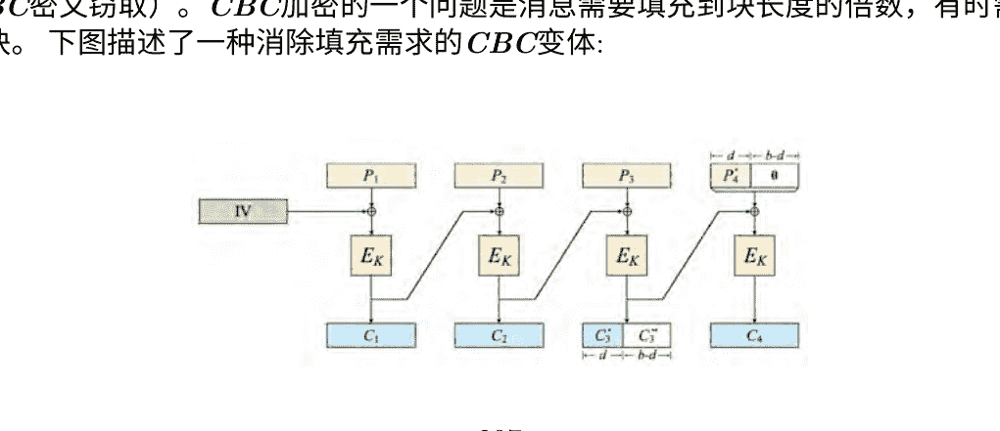

如果需要，该方法会用零填充最后一个块（永远不会添加虚拟块），但输出密文仅包含C₁，C₂，C₃，C₄的阴影部分。注意，忽略初始向量（IV），密文的长度与明文相同。这种技术被称为密文窃取。

(a) 解释解密的工作原理。
(b) 如果明文只包含一个块，是否可以使用这种方法？

5.17 (CBC模式中的单个密文块损坏)。假设c是一个ℓ块CBC加密的密文，其中ℓ > 3。假设c的一个块被损坏，并使用CBC解密算法解密结果。解密后的明文有多少个块被损坏？

5.18 (CBC模式的可塑性)。设c为某个消息m的CBC加密，其中X := {0,1}ⁿ。你不知道m。设ffi为X中的一个元素。展示如何修改密文c以获得一个新的密文c'，该密文解密为m'，其中m'[0] = m[0] ⊕ ffi，且m'[i] = m[i]，对于i=1,…,ℓ⊕1。也就是说，通过适当修改c，你可以在解密c的第一个块中翻转自己选择的位，而不影响其他块。

5.19 (在线密码)。实际上，有强烈的愿望每次只加密一个明文块，立即输出相应的密文块。这样系统可以在准备好时立即传输密文块，而不必等到整个消息被加密算法处理完毕。
(a) 定义一个捕捉这种加密方法的类似CPA安全游戏。不是强迫对手在每个加密查询中提交完整的消息对，而是允许对手发出一个指示消息开始的查询，然后重复发出包含消息块的更多查询，并最后发出一个指示消息结束的查询。对这些查询的响应将包括根据给定信息可以计算出的所有密文块。
(b) 在这个模型中，证明随机CBC加密不是CPA安全的。
(c) 证明随机计数器模式是在线CPA安全的。

5.20 (冗余位不会损害CPA安全性)。设ℰ=(E, D)是在(K, M, C)上定义的CPA安全密码。证明在密文中附加从密文计算出的附加数据不会损害CPA安全性。具体来说，设g: C → Y是一些可以高效计算的函数。证明以下修改后的密码ℰ'=(E', D')是CPA安全的：
E'(k, m) := {c E(k, m), t g(c), 输出 (c, t)
D'(k, (c, t)) := D(k, c)

## 第6章

# 消息完整性

在之前的章节中，我们专注于对抗窃听对手的安全性。对手有能力窃听传输的消息，但不能在传输过程中更改消息。我们证明了选择明文安全性是抵御这种攻击所需的自然安全性属性。

在本章中，我们将注意力转向主动对手。我们从基本问题开始消息完整性：Bob从Alice那里收到一条消息 m，并希望确信该消息在传输过程中没有被修改。我们将设计一种机制，让Alice为消息m计算一个简短的消息完整性标签 t，并将配对的(m, t)发送给Bob，如图6.1所示。收到后，Bob检查标签 t，如果标签验证失败，则拒绝该消息。如果标签验证成功，则Bob可以确信消息在传输过程中没有被修改。

我们强调，在本章中，消息本身不需要保密。与之前的章节不同，我们的目标不是隐藏消息。相反，我们只关注消息的完整性。在第9章中，我们将讨论同时提供消息保密性和消息完整性的更一般的问题。有许多应用程序需要消息的完整性，但不需要消息保密性。我们给出两个例子。

例6.1.考虑通过互联网传递财经新闻或股票报价的问题。虽然新闻本身是公开信息，但对于没有第三方修改数据的用户来说，确保数据在传输过程中不被篡改是至关重要的。在这种情况下，消息的保密性是无关紧要的，但消息的完整性是至关重要的。我们的构造将确保如果用户Bob拒绝所有具有无效消息完整性标签的消息，则攻击者无法注入看起来合法的修改内容。一个注意事项是，攻击者仍然可以改变新闻报告到达Bob的顺序。例如，Bob可能在看到报告1之前先看到报告2。在某些情况下，这可能导致用户采取错误的行动。为了防止这种情况发生，新闻服务可能希望在每个报告中包含一个序列号，以便用户的设备可以缓冲报告并确保用户始终按正确的顺序查看新闻。 □

在这一章中，我们只关注试图修改数据的攻击。我们不考虑拒绝服务（DoS）攻击，即攻击者延迟或阻止新闻内容到达用户。拒绝服务攻击通常通过确保网络中包含从发送者到接收者的冗余路径来处理，以便攻击者无法阻塞所有路径。我们不会在这里讨论这些问题。

例子6.2. 考虑一个应用程序，比如文字处理器或邮件客户端。

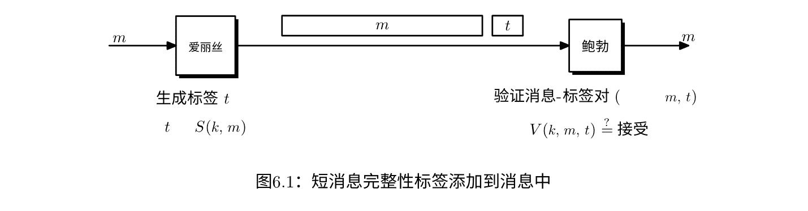

图6.1：短消息完整性标签添加到消息中

存储在磁盘上。尽管应用程序代码不是机密的（甚至可能在公共领域中），但其完整性很重要。在运行程序之前，用户希望确保病毒没有修改存储在磁盘上的代码。为此，在程序首次安装时，用户计算代码的消息完整性标签，并将标签存储在磁盘上与程序一起。然后，每次在启动应用程序之前，用户可以验证此消息完整性标签。如果标签有效，则用户可以确保自从标签最初生成以来代码没有被修改。

显然，病毒可以覆盖应用程序代码和完整性标签。然而，我们的构造将确保没有病毒能够欺骗用户运行未经身份验证的代码。正如我们第一个例子中一样，攻击者可以交换两个经过身份验证的程序 - 当用户启动应用程序 A 时，实际上会运行应用程序 B。如果两个应用程序都有有效的标签，系统将无法检测到交换。对此的标准防御措施是在可执行文件中包含程序名称。这样，当应用程序启动时，系统可以向用户显示经过身份验证的应用程序名称。 □

那么，如何设计一个安全的消息完整性机制呢？我们首先提出以下基本原则：

在两个通信方之间提供消息完整性要求发送方拥有对手方不知道的秘密密钥。

没有秘密密钥，无法确保消息的完整性：对手方有足够的信息来计算任意选择的消息的标签 - 它知道消息完整性算法的工作原理，并且不需要其他信息来计算标签。因此，所有的密码学消息完整性机制都需要对手方不知道的秘密密钥。在本章中，我们将假设发送方和接收方共享秘密密钥；在本书的后面，这个假设将被放宽。

我们注意到，通信协议通常使用无密钥完整性机制。例如，以太网协议使用CRC32作为其消息完整性算法。这个公开可用的算法在每个以太网帧中输出32位标签。TCP协议使用一个无密钥的16位校验和，嵌入在每个数据包中。我们强调这些无密钥完整性机制是设计用来检测随机传输错误，而不是恶意错误。前一段的论证表明，对手可以轻易地击败这些机制并生成看似合法的传输。例如，在以太网的情况下，对手完全了解CRC32算法的工作原理，这使他能够计算出任意消息的有效标签。然后，他可以篡改以太网传输而不被检测到。

## 6.1 消息认证码的定义

我们首先定义了基于发送方和接收方之间共享的秘密密钥的消息完整性系统。出于历史原因，这些系统被称为消息认证码，简称MAC。

定义6.1. 一个MAC系统I=(S,V)是一对高效算法，其中S被称为签名算法，V被称为验证算法。算法S用于生成标签，算法V用于验证标签。
- S是一个概率算法，被调用为t←^R S(k, m)，其中k是密钥，m是消息，输出t被称为标签。
- V是一个确定性算法，被调用为r ← V(k, m, t)，其中k是密钥，m是消息，t是标签，输出r要么是接受，要么是拒绝。
- 我们要求S生成的标签始终被V接受；也就是说，MAC必须满足以下正确性属性：对于所有的密钥k和所有的消息m，Pr[V(k, m, S(k, m)) = 接受 ] = 1.

Pr[V(k, m, S(k, m)) = 接受 ] = 1.

通常，我们说密钥位于某个有限的密钥空间K，消息位于一个有限的消息空间M，标签位于某个有限的标签空间T。我们说I=(S,V)在(K,M,T)上定义。

图6.1说明了算法S和V如何用于保护两个方之间的网络通信。每当算法V对于某个消息-标签对(m, t)输出接受时，我们说t是在密钥k下的有效标签，或者(m, t)是在k下的有效对。自然地，我们希望MAC系统的标签尽可能短，以便传输标签的开销最小。

我们将探索各种MAC系统。最简单的系统类型是一个签名算法S是确定性的，验证算法定义为

V(k, m, t) = \begin{cases} 接受 & \text{if } S(k, m) = t, \\ 拒绝 & \text{otherwise.} \end{cases}

我们将称这样的MAC系统为deterministic MAC系统。确定性MAC系统的一个特性是它具有唯一的标签：对于给定的密钥k和给定的消息m，存在一个唯一的有效标签m under k。并非我们探索的所有MAC系统都具有如此简单的设计：一些系统具有随机化的签名算法，因此对于给定的密钥k和消息m，S(k, m)的输出可能是许多可能的有效标签之一，而验证算法以其他方式工作。正如我们将看到的，这样的随机化MAC系统并不是实现安全性所必需的，但它们可以在效率/安全性权衡方面产生更好的结果。

安全的MACs。接下来，我们将描述MAC安全的含义。为了构建在各种应用中保持安全的MACs，我们将坚持在一个非常敌对的环境中保证安全。由于大多数使用MACs的真实系统在较不敌对的环境中运行，我们保守的安全定义将意味着对所有这些系统的安全性。

我们首先直观地解释定义，然后解释为什么这个保守的定义是有意义的。假设一个攻击者正在攻击一个MAC系统I=(S,V)。让k是一些

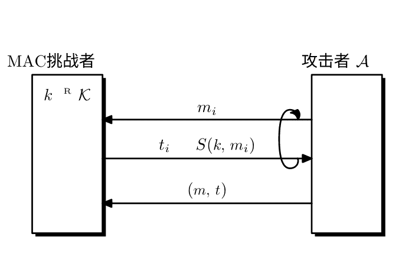

图6.2：MAC攻击游戏（攻击游戏6.1）

随机选择的MAC密钥，对攻击者来说是未知的。我们允许攻击者请求任意选择的消息 m 的标签 t := S(k, m)。这种攻击，称为选择消息攻击，使攻击者能够收集数百万个有效的消息-标签对。显然，我们给予攻击者相当大的权力 - 很难想象用户会愚蠢到签署攻击者提供的任意消息。然而，我们将看到选择消息攻击在现实世界的环境中出现。我们将攻击者使用选择消息攻击获得的消息-标签对 (m, t) 称为签名对。

通过选择的消息攻击，我们要求攻击者提出一个存在性MAC伪造。也就是说，攻击者只需要提出一些新的有效的消息-标签对 (m, t)。所谓“新”，我们指的是与所有已签名对不同的消息-标签对。攻击者可以任意选择 m；实际上，m 不需要具有任何特殊的格式或含义，可以是完全无意义的。

我们称MAC系统是安全的，即使对手可以进行选择消息攻击，也无法创建存在性伪造。这个定义赋予了对手比实际世界中更多的权力，然而我们要求它做的事情通常是无害的；伪造一个无意义消息的MAC似乎没有什么用处。然而，正如我们将看到的，这个保守的定义非常自然，并且使我们能够将MAC用于许多不同的应用。

更准确地说，我们使用挑战者和对手之间的攻击游戏来定义安全的MACs，其中对手 A。游戏的描述如下和图6.2。
- 攻击游戏6.1 (MAC安全)。对于给定的MAC系统 I = (S, V)，定义在 (K, M, T) 上，并给定对手 A，攻击游戏运行如下：
  - 挑战者随机选择一个密钥 k R K。
  - A多次查询挑战者。对于 i = 1, 2, ...，第 i 个签名查询是一个消息 m_i ∈ M。给定 m_i，挑战者计算一个标签 t_i R S(k, m_i)，然后将 t_i 给 A。
  - 最终 A 输出一个候选伪造对 (m, t) ∈ M × T，它不在已签名的对中，即，(m, t) ∉ {(m1, t1), (m2, t2), ...}。

如果 (m, t) 是 k 下的有效对（即 V(k, m, t) = accept），我们称 A 赢得了上述游戏。我们定义 A 相对于 I 的优势为 MACadv[A, I]，即 A 获胜的游戏。最后，如果A最多发出Q个签名查询，则我们称A为Q查询MAC对手。

# 定义6.2. 如果对于所有高效对手A，值MACadv[A, I]是可以忽略的，则称MAC系统I是安全的。

如果对手在攻击游戏6.1中获胜，它发送给挑战者的对(m, t)被称为存在性伪造。满足定义6.2的MAC系统被称为在选择消息攻击下存在性不可伪造的。

在确定性MAC系统的情况下，A赢得攻击游戏6.1的唯一方法是为某个新消息m∉{m1, m2, ...}生成一个有效的消息-标签对(m, t)。实际上，在这种情况下，安全性只是指S是不可预测的，如第4.1.1节所述；也就是说，给定S(k, m1), S(k, m2), ...，对于任何m∉{m1, m2, ...}，很难预测S(k, m)。

在随机化MAC系统的情况下，我们的安全定义涵盖了更强的属性。对于给定的消息，可能有许多有效的标签。假设m是某个消息，并且对于m，对手请求一个或多个有效的标签t1, t2, ...。对于m，对手能否生成一个新的有效标签t'？（即满足t' ∉ {t1, t2, ...}）。我们的定义说，一个有效的对(m, t')，其中t'是新的，是一个有效的存在性伪造。因此，为了使MAC安全，对手很难为先前签名的消息m生成一个新的有效标签t'。这可能看起来很奇怪，要求MAC具有这样的特性。如果对手已经有m的有效标签，为什么我们要在乎它是否能生成另一个呢？正如我们将在第9章中看到的，我们的安全定义防止对手在已签名的消息上生成新的标签，这对于我们所考虑的应用是必要的。

回到介绍中的例子，可以观察到存在性不可伪造性意味着攻击者无法创建一个带有有效标签的假新闻报道。同样，攻击者无法在磁盘上篡改程序而不使程序的标签无效。然而，请注意，当使用MAC来保护应用程序代码时，用户必须每次运行应用程序时提供他们的秘密MAC密钥。这将很快让大多数用户感到恼火。在第8章中，我们将讨论一种无需密钥的方法来保护公共应用程序代码。

为了行使安全MAC的定义，让我们首先看一下它的一些后果。设I = (S, V)是在(K, M, T)上定义的MAC，设k是K中的一个随机密钥。

# 例6.3. 假设m1和m2是几乎相同的消息。假设m1是一笔金额为$100的转账订单，m2是一笔金额为$101的转账订单。显然，拦截到m1的有效标签的对手不应该能够从中推断出m2的有效标签。满足定义6.2的MAC系统可以确保这一点。为了看到为什么，假设对手A可以在给定m1的标签的情况下伪造m2的标签。那么A可以赢得攻击游戏6.1：它使用选择消息攻击来请求m1的标签，推断出m2的伪造标签t2，并输出(m2, t2)作为有效的存在性伪造。显然，A赢得了攻击游戏6.1。因此，存在性不可伪造性捕捉到了一个消息m1的标签对于生成另一个消息m2的标签没有任何有用的信息，即使m2几乎与m1相同。□

# 例子6.4. 我们对安全MAC的定义使得对于任意消息，对手都能够获得标签。这可能看起来给了对手太多的权力。然而，在实践中，存在许多可行的选择消息攻击的情况。原因是MAC签名者通常不知道正在签名的数据的来源。例如，考虑一个备份系统，将磁盘内容转储到备份磁带中。由于备份的完整性很重要，所以系统在将每个磁盘块写入磁带时计算完整性标签。该标签与数据块一起存储在磁带上。现在，假设攻击者向磁盘的低安全部分写入数据。攻击者的数据将被备份，系统将对其计算一个标签。通过检查备份磁带，攻击者可以获得他选择的消息的标签。如果MAC系统对于选择消息攻击是安全的，那么这对于攻击者来说没有帮助。 □

注6.1. 就像我们对其他安全原语所做的那样，可以将安全MAC的概念推广到多密钥设置，并证明安全MAC在多密钥设置中也是安全的。参见练习6.3。 □

## 6.1.1 数学细节

像往常一样，我们使用在第2.4节中定义的术语，给出了一个更加数学上精确的MAC定义。在第一次阅读时，可以安全地跳过本节。

# 定义6.3 (MAC)。

MAC系统是一对高效算法S和V，以及具有系统参数化P的三个空间族：

$$\mathbf{K} = \{\mathcal{K}_{\lambda,\Lambda}\}_{\lambda,\Lambda}, \quad \mathbf{M} = \{\mathcal{M}_{\lambda,\Lambda}\}_{\lambda,\Lambda}, \quad \text{and} \quad \mathbf{T} = \{\mathcal{T}_{\lambda,\Lambda}\}_{\lambda,\Lambda},$$

通常情况下， $\lambda \in \mathbb{Z}_{-1}$ 是一个安全参数，而 $\Lambda \in \text{Supp}(P(\lambda))$ 是一个域参数。我们要求
1. $\mathbf{K}$，$\mathbf{M}$和$\mathbf{T}$可以高效地识别。
2. $\mathbf{K}$可以高效地采样。
3. 算法$S$是一个高效的概率算法，输入为$\lambda$，$\Lambda$，$k$，$m$，其中$\lambda \in \mathbb{Z}_{-1}$，$\Lambda \in \text{Supp}(P(\lambda))$，$k \in \mathcal{K}_{\lambda, \Lambda}$，以及$m \in \mathcal{M}_{\lambda, \Lambda}$，输出一个$\mathcal{T}_{\lambda, \Lambda}$的元素$t$。
4. 算法$V$是一个高效的确定性算法，输入为$\lambda$，$\Lambda$，$k$，$m$，$t$，其中$\lambda \in \mathbb{Z}_{-1}$，$\Lambda \in \text{Supp}(P(\lambda))$，$k \in \mathcal{K}_{\lambda, \Lambda}$，$m \in \mathcal{M}_{\lambda, \Lambda}$，以及$t \in \mathcal{T}_{\lambda, \Lambda}$，输出接受或拒绝。

在定义安全性时，我们通过安全参数 $\lambda$ 对攻击游戏6.1进行参数化，该参数同时提供给对手和挑战者。MAC的优势$\text{adv}[\mathcal{A}, \mathcal{I}]$然后是一个函数$\text{of } \lambda$。第6.2定义应该被理解为$\text{MACadv}[\mathcal{A}, \mathcal{I}](\lambda)$是一个可以忽略的函数。

## 6.2 MAC验证查询对攻击者没有帮助

在我们对安全MAC的定义中（攻击游戏6.1），对手无法测试给定的消息-标签对是否有效。事实上，对手甚至无法确定自己是否赢得了游戏，因为只有挑战者拥有运行验证算法所需的秘密密钥。在现实生活中，能够发起选择消息攻击的攻击者可能还可以测试给定的消息-标签对是否有效。例如，攻击者可以构建一个包含问题消息-标签对的数据包，并将该数据包发送到受害者的机器上。然后，通过检查机器的行为，攻击者可以判断该数据包是否被接受或丢弃，从而判断标签是否有效。

因此，将攻击游戏6.1扩展，使对手能够验证消息-标签对是有意义的。当然，我们继续允许对手请求任意选择的消息的标签。

## 攻击游戏6.2（带验证查询的MAC安全性）

对于给定的MAC系统 $\mathcal{I}= (S, V)$, 在 $(\mathcal{K}, \mathcal{M}, \mathcal{T})$ 上定义，并给定的对手 $\mathcal{A}$, 攻击游戏运行如下：

- 挑战者随机选择一个密钥 $k \xleftarrow{R} \mathcal{K}$。
- 一个多次向挑战者查询。每个查询可以是两种类型之一：
  - 签名查询: 对于 $i = 1,2,\ldots$，第 $i$ 个签名查询由消息 $m_i \in \mathcal{M}$ 组成。挑战者计算一个标签 $t_i \xleftarrow{R} S(k, m_i)$，并将 $t_i$ 给 $\mathcal{A}$。
  - 验证查询: 对于 $j = 1,2,\ldots$，第 $j$ 个验证查询由消息-标签对 $(\hat{m}_j, \hat{t}_j) \in \mathcal{M} \times \mathcal{T}$ 组成，该对不在先前签名的对中，即，$(\hat{m}_j, \hat{t}_j) \notin \{(m_1, t_1), (m_2, t_2), \ldots\}$。
- 挑战者用 $V(k, \hat{m}_j, \hat{t}_j)$ 回应 $\mathcal{A}$。

如果挑战者对验证查询的回应是接受，则我们说 $\mathcal{A}$ 赢得了上述游戏。我们定义 $\mathcal{A}$ 相对于 $\mathcal{I}$ 的优势，表示为 $\mathrm{MAC}^{\mathrm{vq}}\mathrm{adv}[\mathcal{A}, \mathcal{I}]$，即 $\mathcal{A}$ 赢得游戏的概率。 $\square$

这两个定义是等价的。攻击游戏6.2本质上与原始的攻击游戏6.1相同，只是 $\mathcal{A}$ 可以发出MAC验证查询。我们证明这种额外的能力对于对手没有帮助。

## 定理6.1

特别是，对于每个攻击 $\mathcal{I}$ 的MAC对手 $\mathcal{A}$，该对手在攻击游戏6.2中，最多进行 $Q_v$ 个验证查询和最多进行 $Q_s$ 个签名查询，存在一个攻击 $\mathcal{I}$ 的MAC对手 $\mathcal{B}$，该对手在攻击游戏6.1中，是 $\mathcal{A}$ 的一个基本封装器，使得

$\mathrm{MAC}^{\mathrm{vq}}\mathrm{adv}[\mathcal{A}, \mathcal{I}] \leq \mathrm{MAC}\mathrm{adv}[\mathcal{B}, \mathcal{I}] \cdot Q_v$。

证明思路。假设 $\mathcal{A}$ 是一个攻击 $\mathcal{I}$ 的MAC对手，该对手在攻击游戏6.2中，最多进行 $Q_v$ 个验证查询和最多进行 $Q_s$ 个签名查询。从对手 $\mathcal{A}$ 构建一个攻击 $\mathcal{I}$ 的对手 $\mathcal{B}$，该对手在攻击游戏6.1中，最多进行 $Q_s$ 个签名查询。对手 $\mathcal{B}$ 可以通过将签名查询转发给 $\mathcal{B}$ 的挑战者并将结果标签传递回 $\mathcal{A}$ 来轻松回答 $\mathcal{A}$ 的签名查询。

问题是如何回应 $\mathcal{A}$ 的验证查询。注意，根据定义，$\mathcal{A}$ 只提交不在先前签名对中的消息对的验证查询。因此，$\mathcal{B}$ 采用了一种简单的策略：对来自 $\mathcal{A}$ 的所有验证查询都回应拒绝。如果 $\mathcal{B}$ 回答错误，它就有一个伪造品，这将使它赢得攻击游戏6.1。不幸的是，$\mathcal{B}$ 不知道这些验证查询中哪一个是伪造品，所以它只是随机猜测，选择其中一个。

由于 $\mathcal{A}$ 最多进行 $Q_v$ 个验证查询，$\mathcal{B}$ 将以至少 $1/Q_v$ 的概率猜对。这是误差项中 $Q_v$ 因子的来源。 $\square$

证明。更详细地说，对手 $\mathcal{B}$ 在攻击游戏6.2中扮演挑战者的角色，同时在攻击游戏6.1中扮演对MAC挑战者的对手的角色。逻辑如下：

初始化：
$\omega \xleftarrow{R} \{1, \ldots, Q_v\}$

在收到签名查询 $m_i \in \mathcal{M}$ 来自 $\mathcal{A}$ 时：
  将 $m_i$ 转发给MAC挑战者，获取标签 $t_i$
  将 $t_i$ 发送给 $\mathcal{A}$

在收到验证查询 $(m_j, t_j) \in \mathcal{M} \times \mathcal{T}$ 来自 $\mathcal{A}$ 时：
  如果 $j = \omega$
    则将 $(m_j, t_j)$ 输出为候选伪造对并停止
    否则将拒绝发送给 $\mathcal{A}$

为了严格证明对手 $\mathcal{B}$ 的构造，我们分析 $\mathcal{A}$ 在三个密切相关的游戏中的行为。

## 游戏0

这是原始攻击游戏，由攻击游戏6.2中的挑战者和对手 $\mathcal{A}$ 进行。以下是该游戏中挑战者的逻辑：

初始化：
$k \xleftarrow{R} \mathcal{K}$

在收到签名查询 $m_i \in \mathcal{M}$ 来自 $\mathcal{A}$ 时：
  使用 $S(k, m_i)$ 进行 $t_i$ 的生成
  将 $t_i$ 发送给 $\mathcal{A}$

在收到验证查询 $(m_j, t_j) \in \mathcal{M} \times \mathcal{T}$ 来自 $\mathcal{A}$ 时：执行以下操作：检查是否存在一个正确的验证路径 $V(k, m_j, t_j)$
(*) 向 $\mathcal{A}$ 发送 $j$

$\Pr[W_0] = \mathrm{MAC}^{\mathrm{Vq}}\mathrm{adv}[\mathcal{A}, \mathcal{I}]. \qquad (6.1)$

游戏1。这与游戏0相同，只是上面标记为 (*) 的行被改为：

向 $\mathcal{A}$ 发送拒绝

也就是说，在回应验证查询时，挑战者总是向 $\mathcal{A}$ 回复拒绝。我们还定义 $W_1$ 为在游戏1中，存在某个 $j$ 使得 $r_j =$ 接受的事件。尽管挑战者不会通知 $\mathcal{A}$ $W_1$ 发生了，但是在事件 $W_0$ 和 $W_1$ 发生之前，游戏0和游戏1的进行完全相同；因此，

$\Pr[W_1] = \Pr[W_0]. \qquad (6.2)$

还要注意，在游戏1中，尽管使用了 $r_j$ 值来定义获胜条件，但它们不用于任何其他目的，因此不会对攻击产生任何影响。游戏2。这与游戏1相同，只是在游戏开始时，挑战者选择 $\omega \xleftarrow{R} \{1, \ldots, Q_v\}$。我们定义 $W_2$ 为在游戏2中， $r_\omega =$ 接受的事件。由于 $\omega$ 的选择与攻击本身无关，我们有

$\Pr[W_2] = \Pr[W_1]/Q_v. \qquad (6.3)$

显然，根据构造，我们有

$$
\mathrm{Pr}[W_2] = \mathrm{MACadv}[\mathcal{B}, \mathcal{I}].
$$

该定理现在可以从(6.1)-(6.3)推导出来。 $\square$

总结一下，我们展示了攻击游戏6.2，该游戏赋予了对手更多的权力，等价于定义安全MAC时使用的攻击游戏6.1。这个约简引入了一个误差项中的因子 $Q_v$。在整本书中，我们将同时使用攻击游戏：

- 在构建安全MAC时，使用攻击游戏6.1更容易，该游戏限制对手只能进行签名查询。这样更容易证明安全性，因为我们只需要担心一种类型的查询。我们将在本章中使用这个攻击游戏。
- 在使用安全MAC构建更高级别的系统（如认证加密）时，更方便假设MAC对于更强大的对手是安全的，该对手在攻击游戏6.2中描述。

我们还指出，如果我们使用了一个更弱的安全概念，即对手只有在提供一个新消息的有效标签时才能获胜（而不是新的有效消息-标签对），那么攻击游戏6.1和攻击游戏6.2的类比是不等价的（参见练习6.7）。

## 6.3 从伪随机函数构造MAC

我们现在转向使用我们手头的工具构建安全的MAC。在之前的章节中，我们使用伪随机函数（PRF）构建了各种加密系统。我们给出了一些实际的PRF示例，例如AES（虽然AES是一个分组密码，但由于PRF切换引理，定理4.4，它可以被视为PRF）。在这里，我们展示了任何安全的PRF都可以直接用于构建安全的MAC。

回想一下，PRF是一个算法 $F$，它接受两个输入，一个密钥 $k$ 和一个输入数据块 $x$，并输出一个值 $y := F(k, x)$。通常，我们说 $F$ 定义在 $(\mathcal{K}, \mathcal{X}, \mathcal{Y})$ 上，其中密钥在 $\mathcal{K}$ 中，输入在 $\mathcal{X}$ 中，输出在 $\mathcal{Y}$ 中。对于一个PRF $F$，我们定义了从 $F$ 派生的确定性MAC系统 $\mathcal{I}= (S, V)$：$S(k, m) := F(k, m)$；

$V(k, m, t) := \begin{cases} \text{如果 } F(k, m) = t\text{，则} \ \text{接受，否则拒绝。} \end{cases}$

正如已经讨论过的那样，任何具有大（即超多项式）输出空间的PRF都是不可预测的（见第4.1.1节），因此，正如第6.1节中所讨论的那样，上述构造产生了一个安全的MAC。为了完整起见，我们将其作为一个定理陈述如下：

定理6.2. 假设 $F$ 是一个在 $(\mathcal{K}, \mathcal{X}, \mathcal{Y})$ 上定义的安全PRF，其中 $|\mathcal{Y}|$ 是超多项式的。那么从 $F$ 派生的确定性MAC系统 $\mathcal{I}$ 是安全的。

特别地，对于每个以攻击游戏6.1中的方式攻击 $\mathcal{I}$ 的 $Q$ 查询MAC对手 $\mathcal{A}$，存在一个以攻击游戏4.2中的方式攻击 $F$ 的 $(Q+1)$ 查询PRF对手 $\mathcal{B}$，其中 $\mathcal{B}$ 是 $\mathcal{A}$ 的一个基本封装器，使得

$$
\mathrm{MACadv}[\mathcal{A}, \mathcal{I}] \leq \mathrm{PRFadv}[\mathcal{B}, F] + 1/|\mathcal{Y}|
$$

证明思路。假设 $\mathcal{A}$ 是一个高效的MAC攻击者。我们通过限制 $\mathcal{A}$ 生成伪造的消息-标签对来推导出对 $\mathrm{MACadv}[\mathcal{A}, \mathcal{I}]$ 的上界。通常情况下，用真正的随机函数 $f$ 替换底层安全PRF $F$ 并不会对 $\mathcal{A}$ 的优势产生太大影响。但是现在，攻击者 $\mathcal{A}$ 与一个真正的随机函数进行交互，他面临着一个无望的任务：使用所选择的消息攻击，在他选择的几个点上获得 $f$ 的值。然后，他需要猜测 $f(m) \in \mathcal{Y}$ 在一些新的点 $m$ 上的值。但是由于 $f$ 是一个真正的随机函数，$\mathcal{A}$ 对 $f(m)$ 没有任何信息，因此几乎没有机会正确猜测 $f(m)$。证明。我们通过让 $\mathcal{A}$ 与两个密切相关的挑战者进行交互来使这种直觉变得严谨。

## 游戏0

通常，我们首先回顾MAC攻击游戏6.1中的挑战者，因为它适用于 $\mathcal{I}$。我们在这个游戏中实现挑战者如下：

$k \xleftarrow{R} \mathcal{K},\ f \leftarrow F(k, \cdot)$

在收到第 $i$ 个签名查询 $m_i \in \mathcal{M}$ (对于 $i= 1, 2, ...$)后执行以下操作：

$t_i \leftarrow f(m_i)$

将 $t_i$ 发送给对手。

游戏结束时，对手输出一个消息-标签对 $(m, t)$。我们定义 $W_0$ 为条件 $t = f(m)$ 的事件和 $m \notin \{m_1, m_2, \ldots\}$ (6.5)在游戏0中成立。

显然，$\Pr[W_0] = \mathrm{MACadv}[\mathcal{A}, \mathcal{I}]$。

## 游戏1

接下来我们玩常规的“PRF卡”，将函数 $F(k, \cdot)$ 替换为真正的随机函数 $f$ 在 $\mathrm{Funs}[\mathcal{X}, \mathcal{Y}]$ 中。直观上，由于 $F$ 是一个安全的PRF，攻击者 $\mathcal{A}$ 不应该察觉到差异。我们在游戏1中的挑战者与游戏0中的相同，只是将(*)行更改为：

$f \xleftarrow{R} \mathrm{Funs}[\mathcal{X}, \mathcal{Y}]$

我们定义 $W_1$ 为在游戏1中条件(6.5)成立的事件。应该清楚如何设计相应的PRF攻击者 $\mathcal{B}$，使得：

$|\Pr[W_1] - \Pr[W_0]| = \mathrm{PRFadv}[\mathcal{B}, F]$。

接下来，我们直接限制 $\Pr[W_1]$。攻击者 $\mathcal{A}$ 在各个点上看到 $f$ 的值 $m_1, m_2, \ldots$ 然后需要猜测在某个新点 $m$ 上的值。但由于 $f$ 是一个真正的随机函数，值 $f(m)$ 与其在其他所有点的值是独立的。因此，由于 $m \notin \{m_1, m_2, \ldots\}$，攻击者 $\mathcal{A}$ 将以概率 $1/|\mathcal{Y}|$ 猜测 $f(m)$。因此，$\Pr[W_1] \leq 1/|\mathcal{Y}|$。

将所有内容整合在一起，我们得到

$\mathrm{MACadv}[\mathcal{A}, \mathcal{I}] = \Pr[W_0] \leq |\Pr[W_0] - \Pr[W_1]| + \Pr[W_1] \leq \mathrm{PRFadv}[\mathcal{B}, F] + 1/|\mathcal{Y}|$

按要求。 $\square$

具体的标签长度。该定理表明，为了确保 $\mathrm{MACadv}[\mathcal{A}, \mathcal{I}] < 2^{-128}$，我们需要一个输出空间为 $\mathcal{Y}$ 的PRF，满足 $|\mathcal{Y}| > 2^{128}$。如果输出空间 $\mathcal{Y}$ 为 $\{0,1\}^n$，则生成的标签长度必须至少为128位。

## 6.4 长消息的前缀自由伪随机函数

在前一节中，我们看到任何安全的PRF也是安全的MAC。然而，第4章中的具体PRF示例仅接受短输入，因此只能用于提供非常短消息的完整性。例如，将AES视为PRF可以为128位消息提供MAC。显然，我们希望构建用于更长消息的MAC。

本章中的所有MAC构造都遵循相同的范例：它们从一个适用于短输入（如AES）的PRF开始，并生成一个适用于更长输入的PRF和MAC。因此，本章剩余部分的目标如下：

在给定短输入上构建一个安全的PRF，以便在长输入上构建一个安全的PRF。

我们通过以下三个步骤解决这个问题：

- 首先，在本节中，我们构建了适用于长输入的前缀无冲突安全PRF。更具体地说，我们在单个块（例如128位）输入上操作的安全PRF的基础上，构建了一个适用于可变长度块序列的前缀无冲突安全PRF。回顾一下，前缀无冲突安全PRF（定义4.5）只在有限的意义上是安全的：我们只要求前缀无冲突的对手无法将PRF与随机函数区分开。前缀无冲突PRF对手发出的查询是非空的块序列，并且没有查询可以是另一个查询的正确前缀。
- 其次，在接下来的几节中，我们将展示如何将前缀自由安全的长输入PRF转换为完全安全的长输入PRF。因此，在这些部分的最后，我们将拥有几个安全的PRF，因此也有了操作长输入的安全MAC。
- 第三，在第6.8节中，我们将展示如何将一个操作由块组成的消息的PRF转换为一个操作由位组成的字符串的PRF。

前缀自由PRF。我们从两个经典的前缀自由安全PRF构造开始。CBC构造如图6.3a所示。级联构造如图6.3b所示。我们证明当底层的 $F$ 是一个安全的PRF时，CBC和级联都是前缀自由安全PRF。

### 6.4.1 CBC前缀自由安全伪随机函数

设 $F$ 是一个将 $n$ 位输入映射到 $n$ 位输出的PRF。符号上，$F$ 定义在 $(\mathcal{K}, \mathcal{X}, \mathcal{X})$ 上，其中 $\mathcal{X}=\{0,1\}^n$。对于任何多项式边界的值 $\ell$，我们构建一个新的PRF，记为 $F_{\mathrm{CBC}}$，它将 $\mathcal{X}$ 中的消息映射到 $\mathcal{X}$ 中的输出。图6.3a中描述的函数 $F_{\mathrm{CBC}}$ 的工作原理如下：

输入： $k \in \mathcal{K}$ 和 $m = (a_1, \ldots, a_v) \in \mathcal{X}^{\leq \ell}$ 对于某个 $v \in \{0, \ldots, \ell\}$

输出：$\mathcal{X}$ 中的一个标签

$t \leftarrow 0^n$

对于 $i$ 从 $1$ 到 $v$ 做：
    $t \leftarrow F(k, a_i \oplus t)$

输出 $t$

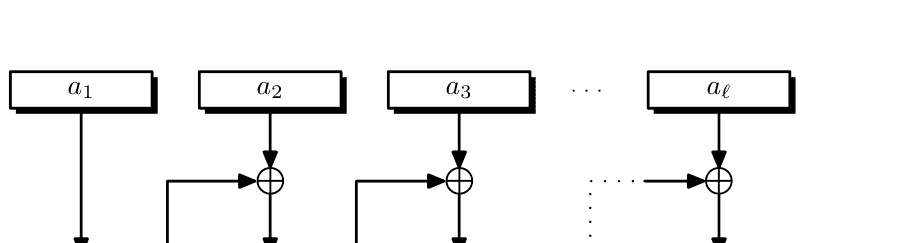

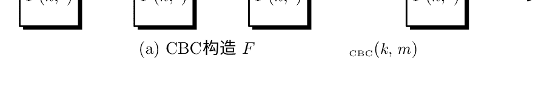

图6.3：两个前缀自由安全PRF

$F_{\mathrm{CBC}}$ 与图5.4中的CBC模式加密类似，但有两个重要的区别。首先，$F_{\mathrm{CBC}}$ 不会输出沿着CBC链的任何中间值。其次，$F_{\mathrm{CBC}}$ 使用一个固定的IV，即 $0^n$，而CBC模式加密使用每个消息的随机IV。

以下定理表明 $F_{\mathrm{CBC}}$ 是在 $(\mathcal{K}, \mathcal{X}^{\leq \ell}, \mathcal{X})$ 上定义的前缀自由安全PRF。

定理6.3. 设 $F$ 是在 $(\mathcal{K}, \mathcal{X}, \mathcal{X})$ 上定义的安全PRF，其中 $\mathcal{X} = \{0, 1\}^n$ 且 $|\mathcal{X}| = 2^n$ 是超多项式的。那么对于任何多项式有界的值 $\ell$，我们有 $F_{\mathrm{CBC}}$ 是在 $(\mathcal{K}, \mathcal{X}^{\leq \ell}, \mathcal{X})$ 上定义的前缀自由安全PRF。

特别地，对于每个前缀自由PRF攻击者 $\mathcal{A}$ 攻击 $F_{\mathrm{CBC}}$ 如同攻击游戏4.2中所示，并且发出最多 $Q$ 个查询，存在一个PRF攻击者 $\mathcal{B}$ 攻击 $F$ 如同攻击游戏4.2中所示，其中 $\mathcal{B}$ 是对 $\mathcal{A}$ 进行简单封装的。

$\mathrm{PRF}^{\mathrm{pf}}\mathrm{adv}[\mathcal{A}, F_{\mathrm{CBC}}] \leq \mathrm{PRF}\mathrm{adv}[\mathcal{B}, F] + \frac{(Q\ell)^2}{2|\mathcal{X}|}. \qquad (6.6)$

练习6.6针对固定长度 $F_{\mathrm{CBC}}$ 的攻击证明了安全性以二次方式下降与 $Q$ 成二次关系。这表明(6.6)中对 $Q$ 的二次依赖是必要的。一个更困难的安全性证明表明安全性只以线性方式随 $\ell$ 下降（见第6.13节）。特别地，(6.6)中的误差项可以被减小为由 $O(Q^2\ell/|\mathcal{X}|)$ 主导的表达式证明思路。我们将对手的查询表示为一棵根树，其中树的边缘由消息块（即 $\mathcal{X}$ 的元素）标记。对 $F_{\mathrm{CBC}}(k, m)$ 的查询，其中 $m=(a_1, \dots, a_v) \in \mathcal{X}^v$ 且 $1 \leq v \leq \ell$，定义了一条从根开始的路径，如下所示：

$\mathrm{root} \xrightarrow{a_1} p_1 \xrightarrow{a_2} p_2 \xrightarrow{a_3} \cdots \xrightarrow{a_v} p_v. \qquad (6.7)$

因此，两个消息 $m$ 和 $m'$ 对应于树中从根节点开始的路径；这两个路径可能共享一个对应于 $m$ 和 $m$ '的最长公共前缀的初始子路径。

对于这棵树中的每个节点 $p$，我们关联一个值 $\gamma_p \in \mathcal{X}$，它表示CBC链中的计算值。更准确地说，我们定义 $\gamma_{\mathrm{root}}:=0^n$，并且对于任何非根节点 $q$ 与父节点 $p$，如果树中对应的边是 $p \xrightarrow{a} q$，则 $\gamma_q := F(k, \gamma_p \oplus a)$。根据这些约定，我们可以看到如果一个消息 $m$ 按照(6.7)中的路径追踪，那么 $\gamma_p = F_{\mathrm{CBC}}(k, m)$。

证明的关键是要证明如果 $F$ 的行为类似于随机函数，那么对于树中的每一对不同的边，比如 $p \xrightarrow{a} q$ 和 $p' \xrightarrow{a'} q'$，我们有 $\gamma_p \oplus a = \gamma_{p'} \oplus a'$ 的概率是压倒性的。为了证明没有这种类型的碰撞，前缀无重复限制是至关重要的，因为它保证了对手从未看到 $\gamma_p$ 和 $\gamma_{p'}$，因此 $a$ 和 $a'$ 与这些值无关。一旦我们证明了没有这些类型的碰撞，就会得出结论，与非根节点相关的所有值都是随机且独立的，特别是与叶子节点相关的值，它们代表了对手看到的 $F_{\mathrm{CBC}}$ 的输出。因此，对手无法区分 $F_{\mathrm{CBC}}$ 和随机函数。 $\square$

证明。我们通过让 $\mathcal{A}$ 与三个密切相关的挑战者在三个游戏中进行互动来使这种直觉变得严谨。

对于 $j=0,1,2,3$，我们让 $W_j$ 成为 $\mathcal{A}$ 在游戏 $j$ 结束时输出 1 的事件。

## 游戏0

这是攻击游戏 4.2 的实验 0。

## 游戏1

接下来我们玩常规的 “PRF 卡”，将函数 $F(k,\cdot)$ 替换为真正的随机函数 $f$ 在 $\mathrm{Funs}[\mathcal{X}, \mathcal{X}]$ 中。显然，我们有

$|\Pr[W_1] - \Pr[W_0]| = \mathrm{PRFadv}[\mathcal{B}, F]$ (6.8)

对于一个高效的攻击者 $\mathcal{B}$。

## 游戏2

现在我们进行一个纯粹的概念性改变，将随机函数 $f$ 实现为一个 “忠诚的小矮人” （如 4.4.2节所述）。然而，我们以一种特定的方式来做这件事，使用上面讨论过的 “查询树”。

为此，首先令 $B := Q\ell$，它表示函数 $f$ 将被评估的点的上界。我们的挑战者首先准备随机值

$\beta_i \xleftarrow{R} \mathcal{X} \quad (i=1,\ldots,B).$

这些将是我们挑战者使用的唯一随机值。

当对手进行查询时，我们的挑战者将动态构建查询树。最初，树只包含根节点。每当对手进行查询时，挑战者在现有查询树中跟踪相应的路径；在某个时刻，该路径将超出现有查询树，并且我们的挑战者添加必要的节点和边，使查询树扩展以包括新路径。

我们的挑战者还必须计算与每个节点相关联的值 $\gamma_p$。最初，$\gamma_{\mathrm{root}}=0^n$。

当向树中添加新边 $p \xrightarrow{a} q$ 时，如果这是添加的第 $i$ 条边（对于 $i=1, \ldots, B$）, 我们的挑战者执行以下操作：

$\gamma_q \leftarrow \beta_i$

(*) 如果 $\exists$ 另一个边缘 $p' \xrightarrow{a'} q'$ 与 $\gamma_{p'} \oplus a' = \gamma_p \oplus a$ 那么 $\gamma_q \leftarrow \gamma_{q'}$思路是我们使用准备好的列表中的下一个未使用的值 β₁,…,β_B 作为“默认”值为 γ_q。标记为(*)的行执行必要的一致性检查，确保我们的模拟器确实忠诚。

因为这个改变纯粹是概念上的，我们有  
$\text{Pr}[W_2] = \text{Pr}[W_1].$  
(6.9)

游戏3. 接下来，我们让我们的模拟器忘记检查，通过在游戏2的逻辑中删除标记为(*)的一致性检查。

为了分析这个改变的影响，让 Z是事件，在游戏3中，对于一些不同的边缘对 $p \rightarrow a \ q$ 和 $p' \rightarrow a' \ q$，我们有 $\gamma_{p'} \oplus a' = \gamma_p \oplus a.$

现在，在游戏2和3中，唯一随机选择的值是对手的随机选择，硬币的值和值列表 β₁,…,β_B。观察到对于任何固定的值选择硬币 β₁,…,β_B，如果 Z不发生，那么实际上游戏2和3会完全相同。因此，我们可以应用差异引理（定理4.7），得到  
$|\text{Pr}[W_3] - \text{Pr}[W_2]| \leq \text{Pr}[Z].$  
(6.10)

接下来，我们限制Pr[Z]。考虑两个不同的边 $p \rightarrow a \ q$ 和 $p' \rightarrow a' \ q$，我们想限制 $\gamma_{p'} \oplus a' = \gamma_p \oplus a$ 的概率，这等价于  
$\gamma_{p'} \oplus \gamma_p = a' \oplus a.$  
(6.11)

有两种情况需要考虑。

由于边是不同的，我们必须有 a' = a，因此（6.11）以概率1成立。

情况2: $p = p'$。 对手的查询必须是对前缀自由的要求意味着在游戏3中，对手从未看到 — 或了解 — 值 $\gamma_p$ 和 $\gamma_{p'}$。 p 或 p'中的一个可以是根，但不能同时是。由此可知，值 $\gamma_p \oplus \gamma_{p'}$ 在 $\mathcal{X}$ 上均匀分布，并且与 $a \oplus a'$ 独立。由此可知，（6.11）以概率 $1/|\mathcal{X}|$ 成立。

根据并集界定，由此可知  
$\text{Pr}[Z] \leq \frac{B^2}{2|\mathcal{X}|}.$  
(6.12)

通过结合(6.8)，(6.9)，(6.10)和(6.12)，我们得到  
$\text{PRF}^{\text{pf}}\text{adv}[A, F_{\text{CBC}}] = |\text{Pr}[W_3] - \text{Pr}[W_0]| \leq \text{PRFadv}[B, F] + \frac{B^2}{2|\mathcal{X}|}.$  
(6.13)

此外，第3个游戏与攻击游戏4.2的实验1完全对应，从而得出定理。

### 6.4.2 级联前缀自由安全伪随机函数

让 F 是一个以 𝒦 为密钥并产生 𝒦 为输出的PRF。用符号表示，F 在(𝒦, 𝒳, 𝒦)上定义。对于任何多项式有界的值 ℓ，我们构建一个新的PRF F^*，称为 F 的级联，它将 𝒳^{≤ℓ} 的消息映射到 𝒦 的输出。函数 F^*，如图6.3b所示，工作原理如下：

输入：$k \in \mathcal{K}$和$m=(a_1, \dots, a_v) \in \mathcal{X}^{\le \ell}$对于某个$v \in \{0, \dots, \ell\}$
输出：在$\mathcal{K}$中的一个标签
$t \leftarrow k$
对于$i$从1到$v$做：
    $t \leftarrow F(t, a_i)$
输出$t$

下面的定理表明$F^*$是一个前缀自由安全$PRF$。

### 定理6.4。
假设$F$是一个在$(\mathcal{K}, \mathcal{X}, \mathcal{K})$上定义的安全$PRF$。那么对于任何多项式有界的值$\ell$，级联$F^*$的结果$F$是一个在$(\mathcal{K}, \mathcal{X}^{\le \ell}, \mathcal{K})$上定义的前缀自由安全$PRF$。

特别地，对于每一个前缀自由$PRF$攻击者$\mathcal{A}$，该攻击者攻击$F^*$，如同攻击游戏4.2中，且发出最多$Q$个查询，存在一个$PRF$攻击者$\mathcal{B}$，该攻击者攻击$F$，如同攻击游戏4.2中，其中$\mathcal{B}$是对$\mathcal{A}$的一个基本封装。
$$\text{PRF}^{\text{pfadv}}[\mathcal{A}, F^*] \le Q\ell \cdot \text{PRFadv}[\mathcal{B}, F]. \tag{6.14}$$

练习6.6展示了对固定长度$F^*$的攻击，证明了安全性在$Q$中呈二次退化。这令人不安，因为它似乎与$Q$的线性依赖关系在(6.14)中相矛盾。然而，请放心，这里没有矛盾。练习6.6中的对手$\mathcal{A}$，使用$\ell=3$，当$Q$约为$\sqrt{|\mathcal{K}|}$时，其优势约为1/2。将$\mathcal{A}$插入到定理6.4的证明中，我们得到一个攻击$PRF\ F$的$PRF$对手$\mathcal{B}$，大约进行$Q$次查询以获得约为$1/Q$的优势。请注意，当$Q$接近$\sqrt{|\mathcal{K}|}$时，$1/Q \approx Q/|\mathcal{K}|$。对于这个对手$\mathcal{B}$，没有什么令人惊讶的地方：它本质上是来自练习4.27的通用$PRF$攻击者。因此，(6.14)与练习6.6中的攻击是一致的。另一种观点是，(6.14)中的二次依赖于$Q$，因为在数量$\text{PRFadv}[\mathcal{B}, F]$中有一个隐含的$Q$因子隐藏其中。

定理6.4的证明与第4.6节中可变长度树构造是前缀自由安全$PRF$ (定理4.11)的证明类似。让我们简要解释如何扩展定理4.11的证明来证明定理6.4。

与树构造的关系。级联构造是第4.6节可变长度树构造的一般化。回想一下，树构造从将种子映射到一对种子的安全$PRG$构建了一个安全$PRF$。很容易看出，当$F$是在$(\mathcal{K}, \{0,1\}, \mathcal{K})$上定义的$PRF$时，定理6.4是定理4.11的一个直接推论：简单地定义$G$将$k \in \mathcal{K}$映射到 $G(k):=(F(k,0), F(k,1)) \in \mathcal{K}^2$，并观察到级联应用于$F$与可变长度树构造应用于$G$是相同的。

定理4.11的证明很容易推广到证明任何$PRF$的定理6.4。例如，假设$F$定义在$(\mathcal{K}, \{0,1,2\}, \mathcal{K})$上。这对应于一个将 $k \in \mathcal{K}$映射到$G(k):=(F(k,0), F(k,1), F(k,2)) \in \mathcal{K}^3$的$PRG\ G$。级联构造应用于$F$可以被视为一个三叉树，而不是二叉树，定理4.11的证明可以毫无实质性的改变。

但为什么只停留在宽度为三的树上？我们可以使树的宽度任意宽。使用在$(\mathcal{K}, \mathcal{X}, \mathcal{K})$上定义的$PRF\ F$的级联构造对应于宽度为$|\mathcal{X}|$的树。同样，定理4.11的证明可以毫无实质性的改变。我们将细节留给感兴趣的读者作为练习（练习4.26可能会很方便）。

比较CBC和级联PRF。请注意，CBC在所有应用中使用固定密钥 $k$，而级联在每一轮中使用不同的密钥。由于分组密码通常优化为使用相同密钥加密多个分组，级联中的常量重新密钥可能导致比CBC更差的性能。因此，当使用类似AES的现成分组密码时，CBC是更自然的选择。

级联的一个优点是在定理6.4中没有加法误差项。因此，即使底层PRF具有较小的域 $\mathcal{X}$，级联构造仍然是安全的。相比之下，只有当 $\mathcal{X}$ 很大时，CBC才是安全的。因此，级联可以用于将PRG转换为适用于大输入的PRF，而CBC则不能。

### 6.4.3 扩展攻击：CBC和级联不安全的MAC

我们证明了从CBC和级联派生的MAC是不安全的。这将意味着CBC和级联不是安全的PRF。我们在前一节中所展示的只是CBC和级联是前缀自由安全的PRF。

级联的扩展攻击。给定 $F^*(k, m)$ 对于某个消息 $m$ 在 $\mathcal{X}^{\leq \ell}$ 中，任何人都可以计算
$t' := F^*(k, m \parallel m')$ 对于任何 $m' \in \mathcal{X}^*$，在不知道 $k$ 的情况下。 (6.15)
一旦 $F^*(k, m)$ 被知道，任何人都可以继续评估使用消息 $m'$ 的块并获得 $t'$。我们将其称为级联的扩展属性。

扩展属性立即意味着从 $F^*$ 派生的MAC是非常不安全的。伪造者可以请求消息 $m$ 的MAC，然后推断出任意选择的 $m \parallel m'$ 的MAC。根据定理6.2，可以得出 $F^*$ 不是一个安全的PRF。

对CBC的攻击。我们描述了一个简单的MAC伪造器，用于从CBC派生的MAC。伪造器的工作原理如下：

1.  选择任意的 $a_1 \in \mathcal{X}$;
2.  请求在单块消息 $(a_1)$ 上的标签 $t$;
3.  定义 $a_2 := a_1 \oplus t$ 并将 $t$ 输出为两块消息 $(a_1, a_2)$ 的MAC伪造 $\in \mathcal{X}^2$。

注意 $t = F(k, a_1)$ 和 $a_1 = F(k, a_1) \oplus a_2$。根据CBC的定义，我们有：
$F_{CBC}(k, (a_1, a_2)) = F(k, F(k, a_1) \oplus a_2) = F(k, a_1) = t.$

因此，$((a_1, a_2), t)$ 是从CBC派生的MAC的存在性伪造。因此，$F_{CBC}$ cannot be a secure PRF. 注意，对级联MAC的攻击比对CBC MAC的攻击更具破坏性。但无论如何，这些攻击都表明CBC和级联都不应直接用作MAC。

### 6.5 从前缀自由安全PRF到完全安全PRF（方法1）：加密PRF

我们展示了如何将前缀自由安全PRF $F_{CBC}$ 和 $F^*$ 转换为安全PRF，这将为我们提供可变长度输入的安全MAC。更一般地，我们展示了如何将前缀自由安全PRF $PF$ 转换为安全PRF。我们提出了三种方法：

-   **加密PRF**：使用另一个PRF加密 $PF$ 的短输出。
-   **前缀无编码**：对输入进行编码，使得没有输入是另一个输入的前缀。
-   **CMAC**：使用随机化的更高效的前缀无编码。

在本节中，我们讨论了加密PRF方法。构造很简单。设 $PF$ 是将 $\mathcal{X}^{\leq \ell}$ 映射到 $\mathcal{Y}$ 的PRF，$F$ 是将 $\mathcal{Y}$ 映射到 $\mathcal{T}$ 的PRF。定义

$$EF((k_1, k_2), m) := F(k_2, PF(k_1, m)) \tag{6.16}$$

构造如图6.4所示。
我们声称当 $PF$ 是CBC或级联时，$EF$ 是一个安全的PRF。更一般地，我们证明了当 $PF$ 是可扩展的PRF时，$EF$ 是安全的，定义如下：

> **定义6.4.** 让 $PF$ 是在 $(\mathcal{K}, \mathcal{X}^{\leq \ell}, \mathcal{Y})$ 上定义的 $PRF$。我们说如果对于所有的 $k \in \mathcal{K}, x, y \in \mathcal{X}^{\leq \ell-1}$, 和 $a \in \mathcal{X}$，如果 $PF(k, x) = PF(k, y)$ 那么 $PF(k, x \parallel a) = PF(k, y \parallel a)$，则 $PF$ 是可扩展的 $PRF$。

很容易看出，CBC和级联都是可扩展的PRF。下一个定理表明，当 $PF$ 是可扩展的、前缀自由安全的PRF时，$EF$ 是安全的PRF。

> **定理6.5.** 让 $PF$ 是在 $(\mathcal{K}_1, \mathcal{X}^{\leq \ell+1}, \mathcal{Y})$ 上定义的可扩展和前缀自由安全的 $PRF$，其中 $|\mathcal{Y}|$ 是超多项式的，$\ell$ 是多项式有界的。让 $F$ 是在 $(\mathcal{K}_2, \mathcal{Y}, \mathcal{T})$ 上定义的安全 $PRF$。那么根据(6.16)定义的 $EF$ 是在 $(\mathcal{K}_1 \times \mathcal{K}_2, \mathcal{X}^{\leq \ell}, \mathcal{T})$ 上定义的安全 $PRF$。
特别是，对于每个作为攻击游戏4.2中攻击 $EF$ 的 $PRF$ 对手 $\mathcal{A}$，并且发出最多 $Q$ 个查询，存在一个作为攻击游戏4.2中攻击 $F$ 的 $PRF$ 对手 $\mathcal{B}_1$，以及一个作为攻击游戏4.2中攻击 $PF$ 的前缀自由 $PRF$ 对手 $\mathcal{B}_2$，其中 $\mathcal{B}_1$ 和 $\mathcal{B}_2$ 是对 $\mathcal{A}$ 的基本封装。

$$\text{PRFadv}[\mathcal{A}, EF] \leq \text{PRFadv}[\mathcal{B}_1, F] + \text{PRFpfadv}[\mathcal{B}_2, PF] + \frac{Q^2}{2|\mathcal{Y}|}. \tag{6.17}$$

我们在下一章（第7.3.1节）中证明定理6.5，之后我们将开发必要的工具。
请注意，为了使 $EF$ 成为一个对长度最多为 $\ell$ 的输入安全的PRF，该定理要求 $PF$ 对长度为 $\ell + 1$ 的输入是前缀自由安全的。

(6.17)中的界限是紧密的。虽然不是完全必要的，但让我们假设 𝒴 = 𝒯, F是一个分组密码，并且|𝒳|不太小。这些假设将大大简化论证。我们展示了一种攻击，可以在 Q ≈ √|𝒴| 之后以恒定的概率破解 EF。事实上，我们的攻击将破解 EF作为MAC。攻击者选择 Q个随机输入 x_1, . . . , x_Q ∈ 𝒳^2并查询其MAC挑战者的所有 Q输入以获得 t_1, . . . , t_Q ∈ 𝒯。根据生日悖论(推论 B.2)，对于任意固定的密钥 k_1，以恒定的概率存在不同的索引 i, j 使得 x_i = x_j 且 PF(k_1, x_i) = PF(k_1, x_j)。一方面，如果发生这样的碰撞，我们将会检测到它，因为对于这样一对索引，t_i = t_j。另一方面，如果对于某对索引 i, j, t_i = t_j，那么我们假设 F是一个分组密码保证 PF(k_1, x_i) = PF(k_1, x_j)。

现在，假设 x_i = x_j 和 PF(k_1, x_i) = PF(k_1, x_j)，并且由于 PF是可扩展的，我们知道对于所有的 a ∈ 𝒳，我们有 PF(k_1, (x_i ∥ a)) = PF(k_1, (x_j ∥ a))。因此，我们的对手可以获得 x_i ∥ a的MAC标签 t，而这个标签 t也将是 x_j ∥ a的有效标签。这种攻击很容易推广到显示(6.17)中项 Q^2/(2|𝒴|)的必要性。

### 6.5.1 ECBC和NMAC: 可变长度输入的MAC

图6.5a和6.5b显示了将 EF构造(6.16)应用于CBC和级联的结果。

### 加密-CBC PRF

将EF应用于CBC结果会产生一个经典的PRF（因此也是MAC），称为加密CBC或ECBC。这个MAC是由ANSI标准化的（参见第6.9节），并且在银行业中使用。ECBC PRF对于CBC和最终加密都使用相同的基础PRF F。因此，ECBC定义在（$\mathcal{K}^2$, $\mathcal{X}^{\leq \ell}$, $\mathcal{X}$）上。

> **定理6.6（ECBC安全性）**。假设F是在（$\mathcal{K}$, $\mathcal{X}$, $\mathcal{X}$）上定义的安全PRF。假设$\mathcal{X}$是超多项式的，并且$\ell$是多项式有界的长度参数。那么ECBC是在（$\mathcal{K}^2$, $\mathcal{X}^{\leq \ell}$, $\mathcal{X}$）上定义的安全PRF。

特别是，对于每个作为攻击游戏4.2中攻击ECBC的PRF对手 A，并发出最多 Q个查询，存在作为攻击游戏4.2中攻击F的PRF对手 B1, B2的基本包装器，这些包装器是A的基础上的

$$\text{PRFadv}[A, \text{ECBC}] \leq \text{PRFadv}[B_1, F] + \text{PRFadv}[B_2, F] + \frac{(Q(\ell+1))^2 + Q^2}{2|\mathcal{X}|} \quad (6.18)$$

证明。根据定理6.3，CBC显然是可扩展的，并且是一个前缀自由安全的PRF。因此，如果底层PRF F是安全的，那么ECBC是一个安全的PRF，根据定理6.5。 □
在定理6.5之后给出的论证表明，存在一个攻击者，在 Q \approx \sqrt{|\mathcal{X}|} 之后查询以恒定优势破坏了这个PRF。回想一下，对于3DES，我们有 $\mathcal{X} = \{0,1\}^{64}$。因此，在大约十亿次查询之后（或者更准确地说，$2^{32}$次查询），攻击者可以以恒定的概率破坏ECBC-3DES MAC。

### NMAC PRF

将 EF应用于级联结果，得到一个PRF（因此也是一个MAC），称为嵌套MAC或简称为NMAC。这种MAC的一个变种已经被IETF标准化（参见第8.7.2节），并广泛用于互联网协议。

我们希望使用相同的基础PRF F来进行级联构造和最终加密。不幸的是，级联的输出在 $\mathcal{K}$中，而输入到 F的消息在 $\mathcal{X}$中。为了解决这个问题，我们需要将级联的输出嵌入到 $\mathcal{X}$中。更准确地说，我们假设$|\mathcal{K}| \leq |\mathcal{X}|$并且存在一个有效计算的一对一函数 g 将 $\mathcal{K}$映射到 $\mathcal{X}$。例如，假设 $\mathcal{K} := \{0,1\}^\kappa$ 和 $\mathcal{X} := \{0,1\}^n$ 其中 $\kappa \leq n$。定义 $g(t) := t \parallel \text{fpad}$ 其中$\text{fpad}$是长度为 $n - \kappa$ 位的固定填充。这个 $\text{fpad}$可以是一个简单的0字符串。通过这种转换，可以从一个安全的PRF F构建出整个NMAC，如图6.5b所示。

> **定理6.7（NMAC安全性）**。设 F是一个在（$\mathcal{K}$, $\mathcal{X}$, $\mathcal{K}$）上定义的安全PRF，其中 $\mathcal{K}$可以嵌入到 $\mathcal{X}$中。那么 NMAC是一个在（$\mathcal{K}^2$, $\mathcal{X}^{\leq \ell}$, $\mathcal{K}$）上定义的安全PRF。

特别是，对于每个以Attack Game 4.2中攻击 NMAC的PRF对手 A，并且发出最多 Q个查询，存在以Attack Game 4.2中攻击 F的PRF对手 B1, B2，它们是对 A的基本包装器，使得

$$\text{PRFadv}[A, \text{NMAC}] \leq (Q(\ell+1)) \cdot \text{PRFadv}[B_1, F] + \text{PRFadv}[B_2, F] + \frac{Q^2}{2|\mathcal{K}|} \quad (6.19)$$

证明。根据定理6.4，NMAC显然是可扩展的，并且是一个前缀自由安全的PRF。因此，如果底层PRF F是安全的，那么根据定理6.5，NMAC是一个安全的PRF。 □

ECBC和NMAC都是流式MAC。ECBC和NMAC都可以用于验证可变大小的消息$\mathcal{X}^{\leq \ell}$。此外，不需要提前知道消息长度。具有这种属性的MAC被称为流式MAC。这个属性使得应用程序可以一次一个消息块地提供消息给MAC，并在任意时刻决定消息是否完成。这对于像流媒体视频这样的应用程序非常重要，因为消息长度可能事先不知道。

相比之下，一些MAC系统要求在消息主体之前添加消息长度（参见第6.6节）。这样的MAC在实践中更难使用，因为它们要求应用程序在开始MAC计算之前确定消息长度。

## 6.6 从前缀自由安全PRF到完全安全PRF（方法2）：前缀自由编码

将前缀自由安全PRF转换为安全PRF的另一种方法是对PRF的输入进行编码，使得没有编码的输入是另一个输入的前缀。我们使用以下术语：

- 如果集合$S \subseteq \mathcal{X}^{\leq \ell}$是一个前缀自由集，则集合$S$中的任何元素都不是其他元素的真前缀。例如，如果$(x_1, x_2, x_3)$属于前缀自由集$S$，则既不是$x_1$也不是$(x_1, x_2)$在$S$中。
- 让$\mathcal{X}_{>0}^{\leq \ell}$表示长度最多为$\ell$的所有非空字符串的集合。我们说函数$pf: \mathcal{M} \to \mathcal{X}_{>0}^{\leq \ell}$是一个无前缀编码。如果$pf$是一个单射（即一对一）且$pf$的像集是一个无前缀集，则是一个无前缀编码。

让$PF$是一个在$(\mathcal{K}, \mathcal{X}^{\leq \ell}, \mathcal{Y})$上定义的无前缀安全PRF，$pf$是一个从$\mathcal{M}$到$\mathcal{X}_{>0}^{\leq \ell}$的无前缀函数，是一个无前缀编码。将派生PRF$F$定义为$$F(k, m) := PF(k, pf(m))$$。

定理6.8. 如果$PF$是一个无前缀安全PRF且$pf$是一个无前缀编码，则$F$是一个安全PRF。

### 6.6.1 前缀自由编码

使用定理6.8构建PRF时，我们描述了两个无前缀编码$pf: \mathcal{M} \to \mathcal{X}_{>0}^{\leq \ell}$。我们假设$\mathcal{X} = \{0, 1\}$对于某个$n$。

**方法1：在前面添加长度。** 设$\mathcal{M} := \mathcal{X}^{\leq \ell - 1}$并且令$m = (a_1, \ldots, a_v) \in \mathcal{M}$。定义$$pf(m) := (\langle \nu \rangle, a_1, \ldots, a_v) \in \mathcal{X}_{>0}^{\leq \ell}$$其中$\langle \nu \rangle \in \mathcal{X}$是$\nu$的二进制表示，即$m$的长度。我们假设$\ell < 2^n$，以便将消息长度编码为一个$n$位二进制字符串。

我们证明$pf$是一个无前缀编码。显然，$pf$是单射的。为了证明$pf$的映射是一个无前缀集，假设$pf(x)$和$pf(y)$是$pf$的映射中的两个元素。如果$pf(x)$和$pf(y)$包含相同数量的块，则它们互不是对方的真前缀。否则，$pf(x)$并且 $pf(y)$ 包含不同数量的块，因此在第一个块中必须不同。但是再说一次，两者都不是对方的正确前缀。因此， $pf$ 是一个前缀自由编码。

这种前缀自由编码在实践中很少使用，因为生成的MAC不是流式的MAC：使用此MAC的应用程序必须预先确定要进行MAC处理的消息的长度。这对于流媒体应用程序（如流媒体视频）来说是不可取的，因为数据包的长度可能事先不知道。

**方法2：停止位。** 令 $\bar{\mathcal{X}} := \{0,1\}^{n-1}$ 并且令 $\mathcal{M} = \bar{\mathcal{X}}^{\leq \ell}_{>0}$。对于 $m = (a_1, \ldots, a_v) \in \mathcal{M}$，定义
$$
pf(m) := ( (a_{v-1} \| 0), (a_v \| 1)) \qquad ( \in \mathcal{X}^{\leq \ell}_{>0})
$$

显然，$pf$是单射。为了看到$pf$的图像是一个前缀自由集合，让$pf(x)$和$pf(y)$是$pf$的图像中的两个元素。让$v$是$pf(x)$中的块数。如果$pf(y)$包含$v$或更少的块，则$pf(x)$不是$pf(y)$的正确前缀。如果$pf(y)$包含超过$v$个块，则$pf(y)$中的第$v$个块以0结尾，但$pf(x)$中的第$v$个块以1结尾。因此，$pf(x)$和$pf(y)$在第$v$个块上不同，因此$pf(x)$不是$pf(y)$的正确前缀。

从这个前缀自由编码得到的MAC是流式MAC。然而，这种编码会增加消息到MAC的长度 $v$ 位。在使用CBC或级联计算长消息的MAC时，这种编码将导致对底层PRF（例如AES）的额外评估。相比之下，第6.5节的加密PRF方法只增加了一次对底层PRF的应用。例如，使用ECBC-AES和$pf$对一个兆字节的消息（$2^{20}$字节）进行MAC需要额外的511次AES评估，超过了加密PRF方法所需的次数。实际上，情况更糟。由于计算机更喜欢字节对齐的数据，所以大多数情况下需要在每个块后附加一个完整的字节，而不仅仅是一个位。因此，使用ECBC-AES和$pf$对一个兆字节的消息进行MAC会导致额外的4096次AES评估，超过了加密PRF方法的开销约为6%。

## 6.7 从前缀自由安全PRF到完全安全PRF（方法3）：CMAC

前面一节中的两种前缀自由编码方法都存在问题。第一种方法导致非流式MAC。第二种方法需要对底层PRF进行更多的评估以处理长消息。通过对前缀自由编码进行随机化，我们可以做得更好。我们构建了一个流式安全PRF，除了底层前缀自由安全PRF之外没有额外开销。图6.6中显示的结果MAC优于从加密PRF和确定性编码中获得的MAC。

这种方法在NIST的MAC标准CMAC中使用，并在第6.10节中进行了描述。

首先，我们引入一些方便的符号：

**定义6.5.** 对于两个字符串$x$, $y$属于$\mathcal{X}$，我们写作$x\sim y$，如果$x$是$y$的前缀或者$y$是$x$的前缀。

**定义6.6.** 令 $\epsilon$ 为实数，满足 $0 \leq \epsilon \leq 1$。一个随机化的 $\epsilon$-前缀无重码编码是一个函数 $rpf: \mathcal{K} \times \mathcal{M} \rightarrow \mathcal{X}^{\leq}_{>0}$ 对于所有 $m_0, m_1 \in \mathcal{M}$ 且 $m_0 = m_1$，我们有
$$
\mathrm{Pr} \left[ rpf(k, m_0) \sim rpf(k, m_1) \right] \leq \epsilon,
$$
其中概率是在随机选择的 $k \in \mathcal{K}$ 的情况下计算的。

注意，rpf(k,·)的映像不一定是一个前缀无重码集合。然而，如果没有k的知识，很难找到消息m0, m1 ∈ M使得rpf(k, m0)是rpf(k, m1)的一个合适的前缀（或者反之亦然）。函数rpf(k,·)甚至不需要是单射的。

一个简单的rpf. 让K:=X和M:=X^{≤ℓ}_{>0}. 定义
```
rpf(k, (a1, ..., av)) := (a1, ..., a_{v-1}, (a_v ⊕ k)) ∈ X^{≤ℓ}_{>0}
```
很容易看出，rpf是一个随机化的(1/|X|)-前缀无重复编码。让m0, m1 ∈ M且m0 = m1。假设|m0| = |m1|。那么很明显，对于所有的k的选择，rpf(k, m0)和rpf(k, m1)都是相同长度的不同字符串，因此它们互不是对方的前缀。接下来，假设|m0| < |m1|。如果v := |rpf(k, m0)|，那么很明显rpf(k, m0)只是rpf(k, m1)的一个合适的前缀，当且仅当
```
m0[v⊕1]⊕k = m1[v⊕1]
```
但是这在随机选择k的情况下以概率1/|X|成立，正如所需。最后，情况|m0| > |m1|通过对称论证来处理。

使用rpf. 让PF是一个在(K, X^{≤ℓ}, Y)上定义的前缀自由安全PRF，而rpf : K1 × M → X^{≤ℓ}_{>0}是一个随机化的前缀自由编码。定义派生的PRF F为
```
F((k, k1), m) := PF(k, rpf(k1, m)) \quad (6.20)
```
然后F在(K × K1, M, Y)上定义。我们得到了以下类似于定理6.8的定理。

## 定理6.9.

如果PF是一个前缀自由安全PRF，ε是可以忽略的，而rpf是一个随机化的ε-前缀自由编码，那么F在(6.20)中定义的是一个安全的PRF。

特别地，对于每个攻击F的PRF对手A，在攻击游戏4.2中发出至多Q个查询，存在前缀自由PRF对手B1和B2，它们攻击PF如同攻击游戏4.2中的A，其中B1和B2是对A的基本封装。
```
PRF^{\text{adv}}[A, F] \leq PRF^{\text{pf adv}}[B_1, PF] + PRF^{\text{pf adv}}[B_2, PF] + Q^2 \epsilon/2 \quad (6.21)
```

## 证明思路.

如果对手的输入集合F导致输入集合PF是无前缀的，那么对手只能看到一些随机的输出。此外，如果对手看到随机的输出，它对密钥k1的信息量为零，这确保了输入集合PF确实是无前缀的（以极高的概率）。不幸的是，这个论证是循环的。

然而，在详细的证明中，我们将看到如何打破这种循环。 □

## 证明.

不失一般性，我们假设A从不发出相同的查询两次。我们将证明结构化为三个游戏的序列。对于j=0,1,2，我们令Wj为在游戏j结束时A输出1的事件。

### 游戏0.

在与F相关的PRF攻击游戏4.2的实验0中，挑战者的工作如下。
> $k \stackrel{R}{\leftarrow} \mathcal{K}, \quad k_1 \stackrel{R}{\leftarrow} \mathcal{K}_1$

在收到签名查询 $m_i \in \mathcal{M}$ (对于 $i=1,2,\ldots$) 执行以下操作：
- $x_i \stackrel{R}{\leftarrow} \text{rpf}(k_1, m_i) \in \mathcal{X}_{\leq \ell}^{\geq 0}$
- $y_i = PF(k, x_i)$
- 将 $y_i$ 发送给 $\mathcal{A}$

### 游戏 1.

我们将游戏 0 中的挑战者更改为确保对 $PF$ 的所有查询都是前缀自由的。回顾符号 $x \sim y$，表示 $x$ 是 $y$ 的前缀或 $y$ 是 $x$ 的前缀。
> $k \stackrel{R}{\leftarrow} \mathcal{K}, \quad k_1 \stackrel{R}{\leftarrow} \mathcal{K}_1, \quad r_1, \ldots, r_Q \stackrel{R}{\leftarrow} \mathcal{Y}$

在收到签名查询 $m_i \in \mathcal{M}$ (对于 $i=1,2,\ldots$) 执行以下操作：
1. 如果存在某个 $j < i$ 使得 $x_i \sim x_j$，则 $y_i \stackrel{R}{\leftarrow} r_i$
2. 其他 $y_i = PF(k, x_i)$
- 将 $y_i$ 发送给 $\mathcal{A}$

令 $Z_1$ 为事件，在游戏1的某个时刻满足第1行的条件。显然，游戏1和游戏2在事件 $Z_1$ 发生之前都是相同的进行；特别地，当且仅当 $W_0 \land \bar{Z}_1$ 发生时，$W_1 \land \bar{Z}_1$ 发生。应用差分引理（定理4.7），我们得到
> $|\Pr[W_1] \oplus \Pr[W_0]| \leq \Pr[Z_1]$. (6.22)

不幸的是，在这一点上我们无法对 $\Pr[Z_1]$ 进行界定。在分析的这个阶段，我们无法说第2行对 $k_1$ 的评估不会泄露一些关于 $\mathcal{A}$ 使 $Z_1$ 发生的信息。这就是我们上面提到的循环问题。为了克服这个问题，我们将把 $Z_1$ 的分析推迟到下一场比赛。

### 游戏 2.

现在我们玩常规的“PRF卡”，用真正的随机函数 $PF(k,\cdot)$ 替换函数 $PF(k,\cdot)$。这是合理的，因为在游戏1中，输入 $PF(k,\cdot)$ 的集合是前缀无重复的。要实现这个变化，我们可以简单地将标记为 (2) 的行替换为
- (2) 其他 $y_i \stackrel{R}{\leftarrow} r_i$

在进行这个变化后，我们可以看到 $y_i$ 被赋予随机值 $r_i$，无论行(1)上的条件是否成立。

现在，让 $Z_2$ 是在游戏2期间行(1)上的条件成立的事件。很容易看出
> $|\Pr[Z_1] \oplus \Pr[Z_2]| \leq \mathsf{PRF}^{\mathsf{pf}}\text{adv}[\mathcal{B}_1, F]$ (6.23)
和
> $|\Pr[W_1] \oplus \Pr[W_2]| \leq \mathsf{PRF}^{\mathsf{pf}}\text{adv}[\mathcal{B}_2, F]$ (6.24)

对于高效的前缀无冲突PRF对手 $\mathcal{B}_1$ 和 $\mathcal{B}_2$。这两个对手基本上是相同的，除了 $\mathcal{B}_1$ 在第（1）行的条件成立时输出1，而 $\mathcal{B}_2$ 输出 $\mathcal{A}$ 输出的任何值。

此外，在第2局中，$k_1$ 的值显然与 $\mathcal{A}$ 的查询无关，因此通过利用 rpf 的前缀无冲突属性和并集界，我们有
> $\Pr[Z_2] \leq Q^2 \epsilon / 2$ (6.25)

最后，游戏2完美地模拟了在Funs[$\mathcal{M}$, $\mathcal{Y}$]中的一个随机函数。因此，游戏2与PRF攻击游戏4.2的实验1在 $F$ 方面是相同的。
```
$|\text{Pr}[W_0] \oplus \text{Pr}[W_2]| = \text{PRF}_{\text{adv}}[\mathcal{A}, F]$. (6.26)
```
现在，结合(6.22)–(6.26)证明了定理。 □

## 6.8 将块级PRF转换为位级PRF

到目前为止，我们已经构建了一些针对可变长度输入的PRF，其中 $\mathcal{X}^{\le \ell}$。通常， $\mathcal{X} = \{0,1\}^n$ 其中 $n$ 是构建CBC或级联的底层PRF的块大小（例如， $n = 128$ 对于AES）。到目前为止，我们所有的MAC都设计用于认证长度为 $n$ 位的消息。

在本节中，我们将展示如何将这些PRF转换为任意位数消息的PRF。也就是说，给定一个针对 $\mathcal{X}^{\le \ell}$ 中消息的PRF，我们构建一个针对 $\{0,1\}^{\le n\ell}$ 中消息的PRF。

设 $F$ 为一个以 $\mathcal{X}^{\le \ell+1}$ 为输入的PRF。设 $\text{inj} : \{0,1\}^{\le n\ell} \to \mathcal{X}^{\le \ell+1}$ 为一个单射（即一对一）函数。定义派生的PRF $F_{\text{bit}}$ 为
```
$F_{\text{bit}}(k, x) := F(k, \text{inj}(x))$。
```
然后我们得到以下显然的定理。

定理6.10. 如果 $F$ 是在 $(\mathcal{K}, \mathcal{X}^{\le \ell+1}, \mathcal{Y})$ 上定义的安全PRF，那么 $F_{\text{bit}}$ 是在 $(\mathcal{K}, \{0,1\}^{\le n\ell}, \mathcal{Y})$ 上定义的安全PRF。

一个单射函数。对于 $\mathcal{X} := \{0,1\}^n$，一个标准的单射 $\text{inj}$ 从 $\{0,1\}^{\le n\ell}$ 到 $\mathcal{X}^{\le \ell+1}$ 的示例如下。如果输入消息的长度不是 $n$ 的倍数，则 $\text{inj}$ 会添加 $100..00$ 来填充消息，使其长度成为下一个 $n$ 的倍数。如果给定的消息长度是 $n$ 的倍数，则 $\text{inj}$ 会添加一个完整的 $n$ 位块 $(1 \| 0^{n-1})$。图6.7以图片形式描述了这一过程。更准确地说，该函数的工作方式如下：
```
输入： m ∈ {0,1}^{≤ nℓ}
u = |m| mod n,   m' = m || 1 || 0^{n-u-1}
输出 m' 作为一系列 n 位消息块
```
为了证明 $\text{inj}$ 是单射的，我们需要证明它是可逆的。给定 $y = \text{inj}(m)$ 从右到左扫描 $y$ 并删除所有的0，直到包括第一个1。剩下的字符串是 $m$。常见的错误是使用全0填充将给定的消息填充到块大小的倍数。这种填充不是单射的，并导致不安全的MAC：对于任何长度不是块长度的倍数的消息 $m$，$m$ 的 MAC 也是 $m \| 0$ 的有效MAC。因此，MAC容易受到存在性伪造的攻击。

单射函数必须扩展。当我们将一个 $n$ 位单块消息输入 $\text{inj}$ 时，该函数会添加一个“虚拟”块并输出一个两块的消息。这对于需要MAC许多单块消息的应用程序来说是不幸的。在使用CBC或级联时，虚拟块会强制签名者和验证者对每个消息评估底层PRF两次，即使所有消息都只有一个块长。因此，$\text{inj}$ 迫使所有参与方工作的工作量是必要的两倍。

从 $\{0,1\}^{\le n\ell}$ 到 $\mathcal{X}^{\le \ell}$ 的单射函数通常不会添加虚拟块。不幸的是，由于集合 $\{0,1\}^{\le n\ell}$ 比集合 $\mathcal{X}^{\le \ell}$ 大，所以没有这样的函数。因此，所有的单射函数都必须偶尔在输出中添加一个“虚拟”块。第6.10节中描述的CMAC构造提供了一个优雅的解决方案。CMAC通过使用一个随机化的单射函数来避免添加虚拟块。

## 6.9 案例研究：ANSI CBC-MAC

当从PRF构建MAC时，实现者通常通过只输出PRF输出的 $w$ 个最高有效位来缩短最终标签。练习4.4表明，截断安全的PRF对其作为PRF的安全性没有影响。然而，截断会影响派生的MAC。定理6.2表明，$w$ 越小，MAC的安全性就越低。特别地，该定理在具体的安全性界限中添加了一个 $1/2^w$ 的误差。

两个ANSI标准（ANSI X9.9和ANSI X9.19）和两个ISO标准（ISO 8731-1和ISO/IEC 9797）指定了使用DES作为底层的ECBC的消息认证变体PRF. 这些标准截断了ECBC-DES的最后64位输出，并仅使用输出的最左侧 $w$ 位，其中 $w = 32, 48,$ 或64位。 这降低了标签长度，但也降低了安全性。

两个ANSI CBC-MAC标准指定了用于消息的填充方案，该消息的长度不是DES或AES块大小的倍数。 填充方案与第6.8节中描述的函数 $\mathrm{inj}_j$ 相同。 在签署消息时和验证消息-标签对时使用相同的填充方案。

## 6.10 案例研究：CMAC

基于密码的MAC — CMAC — 是国家标准技术研究所（NIST）于2005年采用的ECBC的变体。 它基于Black和Rogaway的提议，并由Iwata和Kurosawa进行了扩展。 CMAC在两个方面改进了ANSI标准中使用的ECBC。 首先，CMAC使用随机化的前缀自由编码将前缀自由安全PRF转换为安全PRF。 这样可以节省ECBC中使用的最后一个加密。 其次，CMAC使用“双密钥”方法来避免在输入消息长度是底层PRF块大小的倍数时附加虚拟消息块。

CMAC是从CBC前缀自由安全PRF构建比特安全PRF的最佳方法。 应该使用它来替代ANSI方法。 在练习6.14中，我们展示了CMAC构造同样适用于级联。

### CMAC比特PRF

CMAC算法由两个步骤组成。 首先，使用子密钥生成算法从MAC密钥 $k$ 派生出三个密钥 $k_0$, $k_1$, $k_2$。 然后，使用这三个密钥 $k_0$, $k_1$, $k_2$ 计算MAC。

设 $F$ 为在 $(\mathcal{K}, \mathcal{X}, \mathcal{X})$ 上定义的PRF，其中 $\mathcal{X} = \{0, 1\}^n$。 NIST标准使用AES作为PRF $F$。 CMAC签名算法在表6.1中给出，并在图6.8中进行了说明。 当消息长度是块大小的倍数时，使用左侧的图形。 否则，使用右侧的图形。 标准允许通过仅输出最终值 $t$ 的 $w$ 最高有效位来截断最终输出为 $w$ 位。

**安全。** 在图6.8中描述的CMAC算法可以使用随机前缀编码范式进行分析。 实际上，CMAC直接将CBC前缀自由安全PRF转换为位安全PRF，使用随机前缀编码 $\mathrm{rpf} : \mathcal{K} \times \mathcal{M} \to \mathcal{X}^{\leq \ell}$

`pf` 的定义如下：

输入：$m \in \mathcal{M}$ 和 $(k_1, k_2) \in \mathcal{X}^2$

如果 $|m|$ 不是 $n$ 的正倍数，则

$\quad$ $u = |m| \mod n$

$\quad$ 将 $m$ 分割为一系列字符串 $a_1, \ldots, a_v \in \mathcal{X}$,

$\quad \quad$ 使得 $m = a_1 \| \ldots \| a_v$ 和 $a_1, \ldots, a_{v-1}$ 是 $n$ 位字符串

如果 $|m|$ 是 $n$ 的正倍数

$\quad$ 则输出 $(a_1, \ldots, a_{v-1}, (a_v \oplus k_1))$

$\quad$ else output $(a_1, \ldots, a_{v-1}, ((a_v \| 1 \| 0^{n-u-1}) \oplus k_2))$

关于 $\mathrm{rpf}$ 是随机化的 $2^{-n}$ 前缀自由编码的论证类似于第6.7节中的论证。

因此，CMAC符合随机化前缀自由编码范式，并且其安全性由此得到保证。

输入: 密钥 $k \in \mathcal{K}$ 和 $m \in \{0, 1\}^*$  
输出: 标签 $t \in \{0, 1\}^w$ 对于某个 $w \leq n$  
设置:  
$\quad$ 运行子密钥生成算法以生成来自 $k \in \mathcal{K}$ 的密钥 $k_0, k_1, k_2 \in \mathcal{X}^\ell$  
$\quad$ $\text{length}(m)$  
$\quad$ $u \quad \text{max}(1, \lceil \ell / n \rceil)$  
$\quad$ 将 $m$ 分成连续的 $n$ 位块  
$\quad$ $m = a_1 \parallel a_2 \parallel \cdots \parallel a_{u-1} \parallel a_u^*$ 其中 $a_1, \ldots, a_{u-1} \in \{0, 1\}^n$.  
$\quad$ $(*) \quad$ 如果 $\text{length}(a_u^*) = n$  
$\quad \quad$ 则 $a_u = k_1 \oplus a_u^*$  
$\quad \quad$ 否则 $a_u = k_2 \oplus (a_u^* \parallel 1 \parallel 0^j)$ 其中 $j = n u \oplus \ell \oplus 1$  
CBC:  
$\quad$ $t \quad 0^n$  
$\quad$ 对于 $i \quad$ 从1到 $u$ 进行:  
$\quad \quad t \quad F(k_0, \quad t \oplus a_i)$  
$\quad$ 输出 $t[0 \ldots w \oplus 1] \quad // \text{输出} t \text{的} w \text{个最高位.}$

表6.1: CMAC签名算法

图6.8: CMAC签名算法

定理6.9. 键 $k_1$, $k_2$ 用于解决消息长度为 $n$ 的正倍数和填充后成为 $n$ 的正倍数的消息之间的冲突。这对于CMAC $\mathrm{rpf}$ 的分析是必要的。

**子键生成。** 子密钥生成算法从 $k$ 生成键 ($k_0$, $k_1$, $k_2$)。它使用一个依赖于 $F$ 的块大小的固定掩码字符串。 例如，对于128位的块大小，标准规定 $R_{128}:= 0^{120}10000111$。 对于位串 $X$, 我们用 $X << 1$ 表示丢弃最左边的位 $X$ 并在右边添加一个0位的位串。子密钥生成算法的工作原理如下：

输入: 密钥 $k \in \mathcal{K}$  
输出: 密钥 $k_0, k_1, k_2 \in \mathcal{X}$  
$k_0$ $k$  
$L$ $F(k, 0^n)$  
(1) 如果 $\text{msb}(L) = 0$, 则 $k_1$ $(L <<1)$ 否则 $k_1$ $(L << 1) \oplus R_n$  
(2) 如果 $\text{msb}(k_1) = 0$, 则 $k_2$ $(k_1 <<1)$ 否则 $k_2$ $(k_1 <<1) \oplus R_n$  
输出: $k_0, k_1, k_2$.

其中 $\text{msb}(L)$ 指的是 $L$ 的最高有效位。 标记为(1)和(2)的行可能看起来有点神秘，但实际上它们只是在有限域 $\text{GF}(2^n)$ 中分别将 $L$ 乘以 $x$ 和 $x^2$。 对于128位块大小，对应于 $R^{128}$ 的 $\text{GF}(2^{128})$ 的定义多项式为 $g(X) := X^{128} + X^7 + X^2 + X + 1$。 练习6.16探讨了子密钥生成的不安全变体。

子密钥生成算法输出的三个密钥 ($k_0, k_1, k_2$) 可用于验证多个消息。 因此，它的运行时间在许多消息之间分摊。显然，密钥 $k_0, k_1$ 和 $k_2$ 不是独立的。 如果它们是独立的，或者如果它们是由常数 $\alpha_0, \alpha_1, \alpha_2$ 派生的，那么CMAC的安全性将直接从这里提出的论证和我们的一般框架中得出。 然而，更复杂的分析可以证明CMAC确实是安全的[58]。

## 6.11 PMAC: 并行MAC

我们迄今为止开发的MAC，ECBC、CMAC和NMAC，本质上是顺序的: 块编号 $i$ 在块编号 $i+1$ 之前不能被处理。 这使得利用硬件并行性或流水线技术加速MAC的生成和验证变得困难。 在本节中，我们构建了一个适用于并行架构的安全MAC。 最好的构造称为PMAC。 我们介绍了稍微容易描述的 $\text{PMAC}_0$。

令 $F_1$ 为在 ($\mathcal{K}_1$, $\mathbb{Z}_p$, $\mathcal{Y}$) 上定义的PRF, 其中 $p$ 是一个素数, $\mathcal{Y} := \{0, 1\}^n$。 令 $F_2$ 为在 ($\mathcal{K}_2$, $\mathcal{Y}$, $\mathcal{Z}$) 上定义的PRF。我们构建了一个新的PRF, 称为 $\text{PMAC}_0$, 它接受一个密钥和一个在 $\mathbb{Z}_p^{\leq \ell}$ for some $\ell$ 中的消息作为输入。 它输出一个值在 $\mathcal{Z}$ 中。 $\text{PMAC}_0$ 的密钥由 $k \in \mathbb{Z}_p$, $k_1 \in \mathcal{K}_1$ 和 $k_2 \in \mathcal{K}_2$ 组成。 $\text{PMAC}_0$ 的构造如下:

输入：$m=(a_1,\dots,a_v) \in \mathbb{Z}_p^v$ 对于某个 $0 \leq v \leq \ell$，并且密钥 $\vec{k}=(k, k_1, k_2)$ 其中 $k \in \mathbb{Z}_p$，$k_1 \in \mathcal{K}_1$，且 $k_2 \in \mathcal{K}_2$  
输出：在 $\mathcal{Z}$ 中的值

```
PMAC₀($\vec{k}$, m):  
$t \leftarrow 0^n \in \mathcal{Y}$, 掩码 $\leftarrow 0 \in \mathbb{Z}_p$  
对于 i 从 1 到 v 执行:  
    掩码 $\leftarrow$ 掩码 + k       // 掩码 = i·k ∈ ℤₚ  
    $r \leftarrow a_i + $掩码       // $r = a_i + i·k \in \mathbb{Z}_p$  
    $t \leftarrow t \oplus F_1(k_1, r)$  
output $F_2(k_2, t)$
```

主循环将掩码添加到 $k$, $2k$, $3k$ 等等。在评估PRF $F_1$ 之前，将掩码添加到消息块中。在顺序机器上，每次迭代需要两个模 $p$ 的加法。在并行机器上，每个处理器可以独立计算 $a_i + ik$，然后应用 $F_1$。参见图6.9。PMAC₀是一个安全的PRF，因此对于大消息提供了安全的MAC。证明将很容易从下一章中开发的定理7.7中得出。现在我们陈述定理，并将其证明推迟到第7.3.3节。

定理6.11. 如果 $F_1$ 和 $F_2$ 是安全的PRF，并且 $|\mathcal{Y}|$ 和素数 $p$ 是超多项式的，则对于任何多项式边界 $\ell$，PMAC₀是一个安全的PRF。

特别是，对于每一个攻击PMAC₀的PRF对手 $A$，如攻击游戏4.2中所示，并且最多发出 $Q$ 个查询，存在PRF对手 $B_1$ 和 $B_2$，它们是对 $A$ 的基本包装器，使得

$\text{PRF对手}[A,\text{PMAC}_0] \leq \text{PRF对手}[B_1,F_1] + \text{PRF对手}[B_2,F_2] + \frac{Q^2}{2|\mathcal{Y}|} + \frac{Q^2\ell^2}{2p}$.   (6.27)

使用PMAC₀时，输入消息必须被分成块，其中每个块是 $\mathbb{Z}_p$ 的一个元素。 在实践中，这是不方便的。 将消息分成块要容易得多，其中每个块是 $\{0,1\}^n$ 中的一个 $n$ 位字符串，对于某个 $n$。 下面介绍的更好的并行MAC构造方法正是通过使用有限域 $\text{GF}(2^n)$ 而不是 $\mathbb{Z}_p$ 来实现的。 这是为什么 $\text{GF}(2^n)$ 在密码学中如此有用的一个很好的例子。 出于安全原因，我们经常需要在一个域中工作，但是像 $\mathbb{Z}_p$ 这样的素数有限域在实践中使用起来不方便。 相反，我们使用 $\text{GF}(2^n)$，其中算术运算速度更快。 $\text{GF}(2^n)$ 还可以让我们自然地操作位块。

### PMAC: 比 PMAC₀ 更好

虽然PMAC₀非常适合并行架构，但还有改进的空间。 有更好的PMAC₀方法实现。 例如PMAC [16] 和 XECB [47]，两者都可以并行化。 例如，PMAC相比于PMAC₀提供了以下改进：

- PMAC使用有限域 $\text{GF}(2^n)$ 中的算术，而不是 $\mathbb{Z}_p$ 中的算术。 $\text{GF}(2^n)$ 的元素可以表示为 $n$ 位字符串，在 $\text{GF}(2^n)$ 中的加法只是按位异或。 因此，PMAC只使用 $F_1 = F_2 = F$，其中 $F$ 是在 ($\mathcal{K}, \mathcal{Y}, \mathcal{Y}$) 上定义的PRF，并且PMAC的输入空间由 $\mathcal{Y} = \{0,1\}^n$ 的元素序列组成，而不是 $\mathbb{Z}_p$ 的元素。
- 块 $i$ 的PMAC掩码定义为 $\gamma_i \cdot k$ 其中 $\gamma_1, \gamma_2, \ldots$ 在 $\text{GF}(2^n)$ 中，乘法是在 $\text{GF}(2^n)$ 中定义的，并且这些常数是固定的。 特别选择了 $\gamma_i$，以便计算从 $\gamma_i \cdot k$ 计算 $\gamma_{i+1} \cdot k$ 非常便宜。
- PMAC将密钥 $k$ 推导为 $k: F(k_1, 0^n)$ 并设置 $k_2 = k_1$。 因此，PMAC使用比PMAC₀更短的秘密密钥。
- PMAC使用一个技巧来节省一次 $F$ 的应用。
- PMAC使用CMAC的变体 $\mathrm{rpf}$ 提供位级PRF。

最终结果是，PMAC在顺序机器上与ECBC和NMAC一样高效，但在并行或流水线架构上具有更好的性能。 PMAC是本章中最好的PRF构造；它在各种计算机架构上都表现良好，并且对于长短消息都非常高效。

PMAC₀是增量的。 假设Bob计算了一条长消息 $m$ 的标签 $t$。 过了一段时间，他改变了 $m$ 中的一个块，并且想要重新计算这个新消息 $m'$ 的标签。 当使用CBC-MAC时，标签 $t$ 没有帮助 - Bob必须从头开始重新计算 $m'$ 的标签。 使用PMAC₀我们可以做得更好。 假设在构建PMAC₀时使用的PRF $F_2$ 是像AES这样的分组密码的加密算法，并且让 $D$ 是相应的解密算法。 让 $m'$ 是将 $m$ 的块编号 $i$ 从 $a_i$ 更改为 $a'_i$ 的结果。 那么标签 $t' := \text{PMAC}_0(k, m')$ for $m'$ 可以很容易地从标签 $t := \text{PMAC}_0(k, m)$ for $m$ 派生如下：

```
t₁ = D(k₂, t)
t₂ = t₁ ⊕ F₁(k₁, aᵢ + ik) ⊕ F₁(k₁, a'ᵢ + ik)
t' = F₂(k₂, t₂)
```

因此，给定一条长消息 $m$（以及MAC秘钥），很容易推导出对 $m$ 的本地编辑的标签。 具有这种属性的MAC被称为增量的。 我们刚刚证明了使用分组密码实现的PMAC₀是增量的。

## 6.12 一个有趣的应用：在加密数据上进行搜索

待写。

## 6.13 注释

待添加文献引用。

## 6.14 练习

### 6.1 (802.11b不安全的MAC)

考虑以下MAC (802.11b WEP中用于WiFi加密的变种)。让 $F$ 是在 $(\mathcal{K}, \mathcal{R}, \mathcal{X})$ 上定义的PRF，其中 $\mathcal{X} := \{0, 1\}^{32}$。让CRC32是一种简单且流行的用于检测随机错误的纠错码；CRC32 ($m$) 接受输入 $m \in \{0, 1\}^{\leq \ell}$ 并始终输出一个32位字符串。对于这个练习，你需要知道的唯一事实是CRC32 ($m_1$) $\oplus$ CRC32 ($m_2$) = CRC32 ($m_1 \oplus m_2$)。定义以下MAC系统 ($S, V$) ：

```
S(k, m) := { r ← R, t ← F(k, r) ⊕ CRC32(m), output (r, t) }
V(k, m, (r, t)) := {如果 t = F(k, r) ⊕ CRC32(m) 则接受否则拒绝}
```

证明这个MAC系统是不安全的。

### 6.2 (使用验证查询的更紧密界限)

设 $F$ 是在 $(\mathcal{K}, \mathcal{X}, \mathcal{Y})$ 上定义的PRF，设 $I$ 是从 $F$ 导出的MAC系统，如第6.3节所讨论的。设 $A$ 是一个攻击 $I$ 的对手在攻击游戏6.2中，最多进行 $Q_v$ 个验证查询和最多进行 $Q_s$ 个签名查询。定理6.1表明存在一个 $Q_s$ 个查询的MAC对手 $B$ 在攻击游戏6.1中攻击 $I$，其中 $B$ 是对 $A$ 的一个基本封装，使得

```
MAC^vqadv[A, I] ≤ MACadv[B, I] · Q_v
```

定理6.2表明存在一个 ($Q_s+1$) 个查询的PRF对手 $B'$ 在攻击游戏4.2中攻击 $F$，其中 $B'$ 是对 $B$ 的一个基本封装，使得

```
MACadv[B, I] ≤ PRFadv[B', F] + 1/|Y|
```

将这两个陈述结合起来，我们得到

```
MAC^vqadv[A, I] ≤ (PRFadv[B', F] + 1/|Y|) · Q_v
```

这个界限不是最好的。给出一个直接的分析，证明存在一个 ($Q_s + Q_v$)-查询PRF对手 $B''$，其中 $B''$ 是对 $A$ 的一个基本封装，使得

```
MAC^vqadv[A, I] ≤ PRFadv[B'', F] + Q_v/|Y|
```

### 6.3 (多密钥MAC安全性)

就像我们在练习5.2中对语义安全加密所做的那样，我们可以将安全MAC的定义从单密钥设置扩展到多密钥设置。在这个练习中，你将证明单密钥设置中的安全性意味着多密钥设置中的安全性。

(a) 展示如何推广攻击游戏6.2，使得攻击者可以提交签名查询和验证查询，针对多个MAC密钥 $k_1, \ldots, k_Q$。在游戏开始时，攻击者输出一个数字 $Q$ 表示它想要攻击的密钥数量然后挑战者选择 $Q$ 个随机密钥 $k_1, \ldots, k_Q$。随后，攻击者的每个查询都包含一个索引 $j \in \{1, \ldots, Q\}$。挑战者使用密钥 $k_j$ 来回应查询。

(b) 证明每个高效的对手 $A$ 在你的多密钥MAC攻击游戏中以概率 $\epsilon$ 获胜，可以转化为一个在攻击游戏6.2中以概率 $\epsilon/Q$ 获胜的高效对手 $B$。

提示：这不是使用混合论证，而是一种‘猜测’论证，有点类似于定理6.1证明中使用的方法。对手 $B$ 扮演对手 $A$ 的挑战者的角色。一旦 $A$ 输出一个数字 $Q$，$B$ 选择 $Q$ 个随机密钥 $k_1,\ldots,k_Q$ 和一个随机索引 $\omega \in \{1,\ldots,Q\}$。当 $A$ 发出关于密钥编号 $j=\omega$ 的查询时，对手 $B$ 使用它的密钥 $k_j$ 来回答查询。当 $A$ 发出关于密钥 $k_\omega$ 的查询时，对手 $B$ 通过查询其MAC挑战者来回答查询。如果 $A$ 在密钥 $k_\omega$ 下输出一个伪造品，那么对手 $B$ 获胜MAC伪造游戏。证明 $B$ 以概率 $\epsilon/Q$ 获胜攻击游戏6.2。

> 我们称这种论证方式为‘插入并祈祷’：$B$ 在一个随机索引处‘插入’他被挑战的密钥！并‘祈祷’ $A$ 使用索引处的密钥来构造他的存在性伪造。

### 6.4 (多播MACs)

考虑这样一种情况，Alice想要将相同的消息广播给 $U_1,\ldots,U_n$ 个用户。她希望用户能够验证消息来自于她，但她不关心消息的保密性。更一般地，Alice可能希望广播一系列消息，但在这个练习中，我们只关注单个消息。

(a) 在最简单的解决方案中，Alice与每个用户 $U_i$ 共享一个MAC密钥 $k_i$。当她广播一条消息 $m$ 时，她将标签 $t_1,\ldots,t_n$ 附加到消息上，其中 $t_i$ 是在密钥 $k_i$ 下 $m$ 的有效标签。使用它们共享的密钥 $k_i$，每个用户 $U_i$ 可以通过验证 $t_i$ 是否是在 $k_i$ 下 $m$ 的有效标签来验证 $m$ 的真实性。假设MAC是安全的，证明这个广播认证方案是安全的，即使用户串通。例如，用户 $U_1,\ldots,U_{n-1}$ 可能串通，共享他们的密钥 $k_1,\ldots,k_{n-1}$ 彼此之间，试图让用户 $U_1$ 接受一个不真实的消息。

(b) 虽然上述广播认证方案在碰撞存在的情况下是安全的，但效率不高；密钥和标签的数量与 $n$ 成线性增长。这里有一个更高效的方案，但安全性保证较弱。我们以 $n=6$ 为例说明。目标是只使用 $\ell < 6$ 个密钥和标签。我们只使用 $\ell = 4$ 个密钥，$k_1,\ldots,k_4$。Alice存储这四个密钥。总共有 $\binom{4}{2} = 6$ 个大小为2的子集 $\{1,\ldots,4\}$。让我们给这些子集编号 $J_1,\ldots,J_6$。对于每个用户 $U_i$，如果 $J_i = \{v,w\}$，那么该用户存储密钥 $k_v$ 和 $k_w$。当爱丽丝广播一条消息 $m$ 时，她附加标签 $t_1,\ldots,t_4$，对应于密钥 $k_1,\ldots,k_4$。每个用户 $U_i$ 使用其密钥 $k_v, k_w$ 验证标签 $t_v$ 和 $t_w$，其中 $J_i = \{v,w\}$ 如上所述。假设MAC是安全的，证明这个广播认证方案是安全的，前提是没有两个用户串通。例如，使用他拥有的密钥，用户 $U_1$ 可能试图欺骗用户 $U_6$ 接受一个伪造的消息，但是用户 $U_1$ 和 $U_2$ 不能串通并共享他们的密钥进行这样的尝试。

(c) 证明如果允许两个用户串通，那么在第（b）部分提出的方案是完全不安全的。

### 6.5 (MAC组合器)

我们想要使用两个MAC系统 $I_1 = (S_1, V_1)$ 和 $I_2 = (S_2, V_2)$ 来构建一个MAC系统 $I$，以便如果在某个时间点 $I_1$ 或 $I_2$ 被破解（但不是同时），那么 $I$ 仍然是安全的。

安全。换句话说，我们希望从 $\mathcal{I}_1$ 和 $\mathcal{I}_2$ 构建 $\mathcal{I}$，以便如果 $\mathcal{I}_1$ 或 $\mathcal{I}_2$ 是安全的，那么 $\mathcal{I}$ 是安全的。

- (a) 定义 $\mathcal{I} = (S, V)$，其中
$S((k_1, k_2), m) := ( S_1(k_1, m), S_2(k_2, m) )$，
并且 $V$ 以明显的方式定义：在输入 $(k, m, (t_1, t_2))$ 时，$V$ 接受当且仅当 $V_1(k_1, m, t_1)$ 和 $V_2(k_2, m, t_2)$ 接受。证明如果 $\mathcal{I}_1$ 或 $\mathcal{I}_2$ 是安全的，那么 $\mathcal{I}$ 是安全的。
- (b) 假设 $\mathcal{I}_1$ 和 $\mathcal{I}_2$ 是确定性MAC系统（见第211页的定义），并且两者都具有标签空间 $\{0,1\}^n$。定义确定性MAC系统 $\mathcal{I} = (S, V)$，其中
$S((k_1, k_2), m) := S_1(k_1, m) \oplus S_2(k_2, m)$。
如果 $\mathcal{I}_1$ 或 $\mathcal{I}_2$ 是安全的，那么证明 $\mathcal{I}$ 是安全的。

## 6.6 (对CBC和级联的具体攻击)

我们对 $F_{CBC}$ 和 $F^*$ 作为前缀无重复PRF的攻击进行了研究，结果表明安全性随着攻击者发起的查询次数 $Q$ 的增加而二次降低。为了简单起见，让我们在输入恰好为三个块长的情况下进行攻击的研究。

- (a) 假设 $F$ 是在 $(\mathcal{K}, \mathcal{X}, \mathcal{X})$ 上定义的PRF，其中 $\mathcal{X} = \{0,1\}^n$，其中 $|\mathcal{X}|$ 是超多项式。考虑输入空间为 $\mathcal{X}^3$ 的 $F_{CBC}$ 前缀无重复PRF。假设对手在点 $(x_1, y_1, z), (x_2, y_2, z), \dots$ 向挑战者发起查询 $(x_Q, y_Q, z)$，其中 $x_i$，$y_i$ 和 $z$ 是从 $\mathcal{X}$ 中随机选择的。证明如果 $Q \approx \sqrt{|\mathcal{X}|}$，攻击者可以预测在新的点上 $\mathcal{X}^3$ 的PRF，概率至少为 $1/2$。
- (b) 证明类似的攻击也适用于由一个在 $(\mathcal{K}, \mathcal{X}, \mathcal{X})$ 上定义的PRF构建的三块级联 $F^*$ 前缀自由PRF。假设 $\mathcal{X} = \mathcal{K}$ 且 $|\mathcal{K}|$ 是超多项式的。在进行 $Q \approx \sqrt{|\mathcal{K}|}$ 次查询后，在 $\mathcal{X}^3$ 中，对手应该能够预测在新的点上 $\mathcal{X}^3$ 的PRF，概率至少为 $1/2$。

## 6.7 (弱安全MAC)

对于MAC，定义一个更弱的安全概念是很自然的，即为了获胜，对手必须在一个新的消息上提交一个有效的标签。可以修改攻击游戏6.1和6.2中的获胜条件以反映这种更弱的安全概念。在攻击游戏6.1中，这意味着为了获胜，除了是一个有效的对，对手的伪造对（m, t）还必须满足一个约束条件，即 m 不在签名查询中。在攻击游戏6.2中，这意味着如果挑战者对一个验证查询 $(\hat{m}_j, \hat{t}_j)$ 做出回应为 accept，其中 $\hat{m}_j$ 不在此验证查询之前的签名查询中，对手获胜。这两个修改后的攻击游戏对应于我们称之为没有验证查询的弱安全概念和有验证查询的弱安全概念的安全性概念。不幸的是，相对于这些弱安全概念，定理6.1的类比不成立。在这个练习中，你需要通过给出一个明确的反例来证明这一点。假设存在一个安全的PRF（在任何方便的输入、输出和密钥空间上定义）。展示如何“破坏”这个PRF以获得一个在没有验证查询的情况下是弱安全的MAC，但在有验证查询的情况下不是弱安全的。

## 6.8 (修复CBC：一个糟糕的想法)

我们证明了CBC是一个前缀自由安全PRF，但不是一个安全PRF。我们证明了在消息前面添加消息长度可以使CBC成为安全PRF。请证明在应用CBC之前附加消息长度不会使CBC成为安全PRF。

## 6.9 (修复CBC：一个非常糟糕的想法)

为了避免对CBC的扩展攻击，人们可能会尝试使用随机化IV定义一个带有概率签名算法的CBC-MAC。这是一个具有概率签名算法的MAC，对于输入 $k \in \mathcal{K}$ 和 $(x_1, \ldots, x_v) \in \mathcal{X}^{\leq \ell}$，工作原理如下：随机选择 $IV \xleftarrow{R} \mathcal{X}$；输出 $(IV, t)$，其中 $t := F_{CBC}(x_1 \oplus IV, x_2, \ldots, x_v)$。对于输入 $(k, (x_1, \ldots, x_v), (IV, t))$，验证算法测试是否 $t = F_{CBC}(x_1 \oplus IV, x_2, \ldots, x_v)$。请证明这个MAC是完全不安全的，甚至不是一个前缀自由安全PRF。

## 6.10 (截断CBC)

证明截断CBC的输出对于可变长度消息来说是一个安全PRF。更具体地说，如果CBC使用一个操作在n位块上的分组密码，并且我们将CBC的输出截断为w < n位，则这个截断版本对于可变长度输入是一个安全PRF，前提是 $1/(2^{n-w})$ 是可以忽略的。

提示：改编定理6.3的证明。

## 6.11 (截断级联)

在前一个练习中，我们看到截断CBC构造产生了一个安全PRF。在这个练习中，你需要通过给出一个明确的反例来证明级联构造不具备相同的性质。对于你的反例，你可以假设一个安全PRF F'（定义在任意方便的输入、输出和密钥空间上）。使用F构造另一个PRF F，使得(a) F是一个安全PRF，但是(b)相应的截断版本F*不是一个安全PRF。

## 6.12 (理想密码模型中的截断级联)

在前面的练习中，我们看到当使用某些伪随机函数实例化截断级联时，它可能不安全。然而，在你的反例中，该伪随机函数被构造成使级联失败 - 直观上，对于“典型”的伪随机函数，我们不会期望发生这种情况。为了证实这种直觉，这个练习要求你证明在理想密码模型（见第4.7节）中，级联构造是一个安全的伪随机函数。更具体地说，如果我们将F建模为理想密码的加密函数，则截断版本的F*是一个安全的伪随机函数。在这里，你可以假设F在n位块和n位密钥上操作，并且F*的输出被截断为w位，其中 $1/2^{n-w}$ 是可以忽略的。

## 6.13 (对CBC和级联的非自适应攻击)

这个练习检查了变长CBC和级联是否对非自适应对手（即一次性提出所有查询的对手）安全，参见练习4.6。

- (a) 假设底层函数F是PRF，证明CBC对非自适应对手是安全的PRF。

提示：改编定理6.3的证明。

- (b) 给出一个破解级联作为PRF安全性的非自适应攻击，不考虑F的选择。

## 6.14 (广义CMAC)

- (a) 证明CMAC rpf (第6.10节) 是一个随机化的 $2^{-n}$ 前缀自由编码。
- (b) 使用CMAC rpf将级联转换为位安全的PRF。

## 6.15 (一个简单的随机前缀自由编码)

证明附加一个随机消息块会产生一个随机前缀自由编码。也就是说，以下函数
```
rpf(k, m) = m || k
```
是一种随机化的 $1 / |\mathcal{X}|$-前缀自由编码。在这里，$m \in \mathcal{X}^{\leq \ell}$ 和 $k \in \mathcal{X}$。

## 6.16 (CMAC的一个不安全的变体)

证明如果子密钥生成算法像当前算法一样输出 $k_{0}$ 和 $k_{2}$，但设置 $k_{1}$，那么CMAC作为PRF是不安全的。

## 6.17 (域扩展)

这个练习探索了一些不能工作的扩展MAC系统域的简单思想。设 $\mathcal{I} = (S, V)$ 是一个确定性MAC (见第211页的定义)，定义在 $(\mathcal{K}, \mathcal{M}, \{0,1\}^{n})$ 上。以下每个都是用于具有消息空间 $\mathcal{M}^{2}$ 的确定性MAC的签名算法。你需要证明每个结果MAC都是不安全的。

- (a) $S_{1}(k, (a_{1}, a_{2})) = S(k, a_{1}) \parallel S(k, a_{2})$,
- (b) $S_{2}(k, (a_{1}, a_{2})) = S(k, a_{1}) \oplus S(k, a_{2})$,
- (c) $S_{3}((k_{1}, k_{2}), (a_{1}, a_{2})) = S(k_{1}, a_{1}) \parallel S(k_{2}, a_{2})$,
- (d) $S_{4}((k_{1}, k_{2}), (a_{1}, a_{2})) = S(k_{1}, a_{1}) \oplus S(k_{2}, a_{2})$.

## 6.18 (数据库记录的完整性)

让 $(S, V)$ 是在 $(\mathcal{K}, \mathcal{M}, \mathcal{T})$ 上定义的安全MAC。考虑一个包含记录 $m_{1}, ..., m_{n} \in \mathcal{M}$ 的数据库。为了为数据提供完整性，数据所有者生成一个随机的秘密密钥 $k \in \mathcal{K}$ 并存储 $t_{i} \longleftarrow S(k, m_{i})$ 与记录 $m_{i}$ 一起存储，对于每个 $i = 1, ..., n$。这并不能确保完整性，因为攻击者可以从数据库中删除记录或复制旧记录而不被检测到。为了防止添加或删除记录，数据所有者生成另一个秘密密钥 $k' \in \mathcal{K}$ 并计算 $t \longleftarrow S(k', (t_{1}, ..., t_{n}))$（我们假设 $\mathcal{T}^{n} \subseteq \mathcal{M}$）。她将 $(k, k', t)$ 存储在自己的机器上，远离数据库。

- (a) 证明在数据库中更新单个记录可以高效地完成。也就是说，当数据库中的单个记录 $m_{j}$ 被替换为更新后的记录 $m'_{j}$ 时，解释需要做什么来重新计算标签 $t$。
- (b) 这种方法是否确保数据库的完整性？假设MAC $(S, V)$ 是由一个安全的PRF $F$ 定义在 $(\mathcal{K}, \mathcal{M}, \mathcal{T})$ 上，其中 $|\mathcal{T}|$ 是超多项式的。证明以下PRF $F_{n}$ 是消息空间 $\mathcal{M}^{n}$ 上的安全PRF。
$$F_{n}((k, k'), (m_{1}, ..., m_{n})) := F(k', (F(k, m_{1}), ..., F(k, m_{n}))).$$

## 6.19 (时序攻击)

让 $(S, V)$ 成为一个确定性MAC系统，其中标签 $\mathcal{T}$ 是N字节长。验证算法 $V(k, m, t)$ 的实现如下：首先计算 $t' \longleftarrow S(k, m)$ 然后执行：
```
对于 i 从 0 到 n-1 进行:
    如果 t[i] ≠ t'[i] 输出拒绝并退出
输出接受
```

- (a) 证明该实现容易受到时序攻击。一个攻击者可以向算法 $V$ 提交任意查询，并准确测量 $V$ 的响应时间，从而可以伪造出每个选择的消息 $m$ 的有效标签，最多需要进行 $256 \cdot n$ 次查询到 $V$。
- (b) 如何实现 $V$ 以防止(a)部分的时序攻击？

## 第7章

## 来自通用哈希的消息完整性

在前一章中，我们展示了如何从安全的伪随机函数构建安全的MAC。特别地，我们讨论了ECBC、NMAC和PMAC构造。我们在这一章中陈述了这些MAC的安全性定理，但将它们的证明推迟到了这一章。

在本章中，我们描述了一种使用哈希函数构建MAC的通用范例。哈希函数通常指的是一个将输入映射到某个大集合 $\mathcal{M}$ 的函数 $H$，将其映射到短输出 $T$。通常将 $T$ 中的元素称为消息摘要或简称摘要。本章中经常使用的带密钥哈希函数还接受一个密钥 $k$ 作为输入。

从哈希函数构造的MAC在两个步骤中工作。首先，我们使用哈希函数将消息 $m$ 哈希到一个短摘要 $t$。其次，我们将PRF应用于摘要 $t$，如图7.1所示。

正如我们将看到的，ECBC、NMAC和PMAC$_0$都是这种“先哈希后PRF”的实例。例如，对于ECBC（在图6.5a中描述），CBC函数充当将长输入消息哈希为短摘要的哈希函数。使用密钥 $k_2$ 进行PRF的最终应用是最后的PRF步骤。哈希-然后-PRF范式将使我们能够直接且相当容易地推断出ECBC、NMAC和PMAC$_0$的安全性。

哈希-然后-伪随机函数范式非常通用，使我们能够利用各种哈希函数构建新的消息认证码。其中一些哈希函数非常快速，并且产生的消息认证码比前一章讨论的更高效。

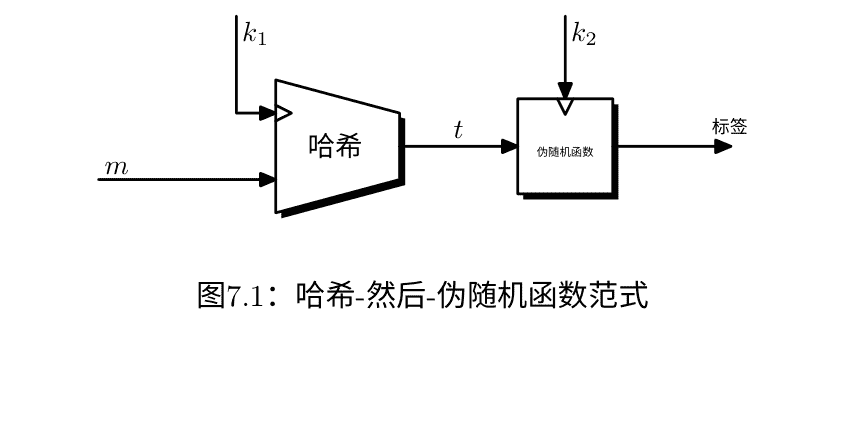

### 7.1 通用哈希函数（UHF）

我们通过定义一个被广泛应用于密码学的带密钥哈希函数来开始我们的讨论。一个带密钥哈希函数 H 接受两个输入：一个密钥 k 和一条消息 m。它输出一个短摘要 $t := H(k, m)$。密钥 k 可以被看作是哈希函数的选择器：对于每个 k，我们从消息到摘要获得一个特定的函数 $H(k, ·)$。更准确地说，带密钥哈希函数的定义如下：

> **定义7.1 (带密钥哈希函数)**。带密钥哈希函数 H 是一个确定性算法，它接受两个输入，一个密钥 k 和一条消息 m；它的输出 $t := H(k, x)$ 被称为摘要。通常情况下，有相关的空间：密钥空间 $\mathcal{K}$，其中包含密钥 k，消息空间 $\mathcal{M}$，其中包含消息 m，以及摘要空间 $\mathcal{T}$，其中包含摘要 t。我们说哈希函数 H 定义在 $(\mathcal{K}, \mathcal{M}, \mathcal{T})$ 上。

我们注意到输出摘要 $t \in \mathcal{T}$ 可以比输入消息 m 短得多。通常，摘要的大小是固定的，比如 128 位或 256 位，与输入消息的长度无关。哈希函数 $H(k, ·)$ 可以将千兆字节长的消息映射为仅有 256 位的摘要。

如果两个消息 $m_0, m_1 \in \mathcal{M}$ 在密钥 $k \in \mathcal{K}$ 下对于哈希函数 H 形成碰撞，我们称之为碰撞。$H(k, m_0) = H(k, m_1)$ 且 $m_0 \neq m_1$。

由于摘要空间 $\mathcal{T}$ 通常比消息空间 $\mathcal{M}$ 小得多，因此存在许多这样的碰撞。然而，我们对哈希函数的一个普遍要求是，实际上很难找到碰撞。正如我们最终将看到的那样，有许多方法来表达这种“碰撞抵抗”属性。这些表述在对敌手在寻找碰撞时获得多少关于密钥的信息方面有微妙的差异。在本章中，我们专注于这种碰撞抵抗属性的最弱表述，即敌手必须在没有任何关于密钥的信息的情况下找到碰撞。一方面，这个属性足够弱，我们实际上可以构建非常高效的哈希函数，满足这个属性，而不需要对敌手的计算能力做任何假设。另一方面，这个属性足够强，可以确保哈希-然后-伪随机函数范式产生一个安全的消息认证码。

满足这种非常弱的碰撞抵抗性质的哈希函数被称为通用哈希函数，或 UHF。通用哈希函数在计算机科学的各个领域中被广泛使用，尤其是用于构建高效的哈希表。UHF 也广泛应用于密码学。在我们分析哈希-PRF 范式的安全性之前，我们首先给出一个更正式的 UHF 定义。通常，为了使这个直观的概念更加精确，我们定义了一个攻击游戏。

> **攻击游戏 7.1 (通用哈希函数)**。对于一个定义在 $(\mathcal{K}, \mathcal{M}, \mathcal{T})$ 上的密钥哈希函数 H 和给定的对手 $\mathcal{A}$，攻击游戏运行如下：
> - 挑战者随机选择一个 $k \xleftarrow{R} \mathcal{K}$ 并将 k 保留给自己。
> - $\mathcal{A}$ 输出两个不同的消息 $m_0, m_1 \in \mathcal{M}$。
>
> 如果 $H(k, m_0) = H(k, m_1)$，我们说 $\mathcal{A}$ 赢得了上述游戏。我们定义 $\mathcal{A}$ 相对于 H 的优势为 $\mathrm{UHF}^{\mathrm{adv}}[\mathcal{A}, H]$，即 $\mathcal{A}$ 赢得游戏的概率。 □

现在我们定义了几种不同的 UHF 概念，这取决于对手的能力和在上述攻击游戏中的优势。

**定义 7.2.** 假设 $H$ 是定义在 $(\mathcal{K}, \mathcal{M}, \mathcal{T})$ 上的键控哈希函数。

- 如果对于所有对手 $\mathcal{A}$（即使是低效的对手），都有 $\mathrm{UHF}^{\mathrm{adv}}[\mathcal{A}, H] \leq \epsilon$，我们称 $H$ 为 $\epsilon$-有界通用哈希函数或 $\epsilon$-**UHF**。
- 如果它是一个可忽略的 $\epsilon$-**UHF**，则我们说 $H$ 是一个统计 **UHF**。
- 如果对于所有高效的对手 $\mathcal{A}$，$\mathrm{UHF}^{\mathrm{adv}}[\mathcal{A}, H]$ 是可以忽略的，则我们说 H 是一个计算 **UHF**。

统计 **UHF** 对所有对手，无论是否高效，都是安全的：没有对手能够在统计 **UHF** 上以非可忽略的优势赢得攻击游戏 7.1。我们考虑计算能力无限的对手的主要原因是我们可以：与本文中讨论的大多数其他安全概念不同，我们知道如何在没有对对手的任何计算限制的情况下构建良好的 **UHF**。请注意，每个统计 **UHF** 也是一个计算 **UHF**，但反之则不成立。

如果 $H$ 是在 $(\mathcal{K}, \mathcal{M}, \mathcal{T})$ 上定义的一个键控哈希函数，则 $\epsilon$-**UHF** 属性的另一种表征是以下内容(参见练习 7.3)：
对于每一对不同的消息 $m_0, m_1 \in \mathcal{M}$，我们有 $\mathrm{Pr}[H(k, m_0) = H(k, m_1)] \leq \epsilon$,
其中概率是在随机选择的 $k \in \mathcal{K}$ 上计算的。  (7.1)

#### 7.1.1 多查询UHF

考虑计算 **UHF** 的一般化将会很方便。在这里，如果对手能够输出一组不同的消息列表，使得列表中的某对消息是 $H(k, \cdot)$ 的碰撞，则对手获胜。关键是，尽管对手可能不知道他的列表中哪对消息导致了碰撞，但他仍然赢得了比赛。更详细地说，多查询 **UHF** 的定义如下游戏：

**攻击游戏 7.2 (多查询 UHF)**。对于一个有密钥的哈希函数 $H$ over $(\mathcal{K}, \mathcal{M}, \mathcal{T})$，以及一个给定的对手 $\mathcal{A}$，攻击游戏的运行如下。
- 挑战者随机选择一个 $k \xleftarrow{R} \mathcal{K}$ 并将 k 保留给自己。
- $\mathcal{A}$ 输出不同的消息 $m_1, \ldots, m_s \in \mathcal{M}$。

我们说 $\mathcal{A}$ 赢得了上述游戏，如果存在指数 $i \neq j$ 使得 $H(k, m_i) = H(k, m_j)$。我们定义 $\mathcal{A}$ 相对于 $H$ 的优势，表示为 $\mathrm{MUHF}^{\mathrm{adv}}[\mathcal{A}, H]$，即 $\mathcal{A}$ 赢得游戏的概率。我们称 $\mathcal{A}$ 为 $Q$-查询 **UHF** 对手，如果它总是输出大小为 $s \leq Q$ 的列表。 □

**定义 7.3.** 我们说哈希函数 $H$ over $(\mathcal{K}, \mathcal{M}, \mathcal{T})$ 是一个多查询 **UHF**，如果对于所有高效对手 $\mathcal{A}$，数量 $\mathrm{MUHF}^{\mathrm{adv}}[\mathcal{A}, H]$ 是可以忽略的。

**引理 7.1** 下面显示了任何 **UHF** 也是多查询 **UHF**。然而，对于特定的构造，我们有时可以获得更好的安全性界限。

**引理 7.1.** 如果 $H$ 是一个计算 **UHF**，则它也是一个多查询 **UHF**。

特别地，对于每个 $Q$-查询 **UHF** 对手 $\mathcal{A}$，存在一个 **UHF** 对手 $\mathcal{B}$，它是 $\mathcal{A}$ 的一个基本封装，使得
$$ \mathrm{MUHF}^{\mathrm{adv}}[\mathcal{A}, H] \leq (Q^2 / 2) \cdot \mathrm{UHF}^{\mathrm{adv}}[\mathcal{B}, H] $$ (7.2)

证明。UHF对手 $\mathcal{B}$ 运行 $\mathcal{A}$ 并获得 $s \leq Q$ 个不同的消息 $m_1, \ldots, m_s$。它从 $\{1, \ldots, s\}$ 中随机选择一对不同的索引 $i$ 和 $j$，并输出 $m_i$ 和 $m_j$。由 $\mathcal{A}$ 生成的列表以概率 MUHF 对手 $[\mathcal{A}, H]$ 包含 $H(k, \cdot)$ 的碰撞，并且 $\mathcal{B}$ 将以至少 $2/Q^2$ 的概率选择一个碰撞对。因此，UHF 对手 $[\mathcal{B}, H]$ 至少为 MUHF 对手 $[\mathcal{A}, H] \cdot (2/Q^2)$，如所需。 $\square$

## 7.1.2 数学细节

通常情况下，我们使用数学上更精确的定义来定义 UHF，使用在第 2.4 节中定义的术语。

**定义 7.4**（带密钥的哈希函数）。一个带密钥的哈希函数是一个高效的算法 $H$，以及三个带有系统参数化 $P$ 的空间族：
$$\mathbf{K} = \{\mathcal{K}_{\lambda,\Lambda}\}_{\lambda,\Lambda}, \quad \mathbf{M} = \{\mathcal{M}_{\lambda,\Lambda}\}_{\lambda,\Lambda}, \quad \text{和} \quad \mathbf{T} = \{\mathcal{T}_{\lambda,\Lambda}\}_{\lambda,\Lambda},$$
满足以下条件：

1.  $\mathbf{K}$，$\mathbf{M}$ 和 $\mathbf{T}$ 可以高效地识别。
2.  $\mathbf{K}$ 和 $\mathbf{T}$ 可以高效地进行采样。
3.  算法 $H$ 是一个高效的确定性算法，输入为 $\lambda \in \mathbb{Z}_{-1}$，$\Lambda \in \text{Supp}(P(\lambda))$，$k \in \mathcal{K}_{\lambda,\Lambda}$，和 $m \in \mathcal{M}_{\lambda,\Lambda}$，输出为 $\mathcal{T}_{\lambda,\Lambda}$ 的一个元素。

在定义 UHF 时，我们通过安全参数 $\lambda$ 来参数化攻击游戏 7.1。UHF 的优势 $\text{UHFadv}[\mathcal{A}, H]$ 是一个关于 $\lambda$ 的函数。
信息论属性 (7.1) 是文献中更传统的方法，在没有安全或系统参数的情况下为单个哈希函数定义无碰撞的通用哈希函数 (UHF)；在我们的渐进设置中，如果每个安全和系统参数的设置都满足属性 (7.1)，那么我们对 $\epsilon$-UHF 的定义肯定会被满足。

## 7.2 构建 UHF

构建良好的通用哈希函数 (UHF) 的挑战在于构建一个使用短密钥实现小碰撞概率的函数。最好的情况是，密钥的大小不应该依赖于被哈希的消息的长度。我们给出了三种构造方法。第一种是使用模运算和多项式的统计 UHF 的优雅构造。我们的第二种构造方法基于第 6.4 节中定义的 CBC 和级联函数。我们证明了两者都是计算 UHF。第三种构造方法基于第 6.11 节中的 $\text{PMAC}_0$。

### 7.2.1 构建 1：使用多项式的 UHF

我们从使用多项式模素数的 UHF 构造开始。令 $\ell$ 为一个（多项式有界）长度参数，令 $p$ 为一个素数。我们定义一个哈希函数 $H_{\text{poly}}$，它将消息 $m \in \mathbb{Z}_p^{\leq \ell}$ 哈希到一个单一元素 $t \in \mathbb{Z}_p$。密钥空间为 $\mathcal{K} := \mathbb{Z}_p$。
令 $m$ 为一条消息，所以 $m = (a_1, a_2, \ldots, a_v) \in \mathbb{Z}_p^{\leq \ell}$，其中 $0 \leq v \leq \ell$。令 $k \in \mathbb{Z}_p$ 为一个密钥。哈希函数 $H_{\text{poly}}(k, m)$ 的定义如下：

$$H_{\text{poly}}(k, (a_1, \ldots, a_v)) := k^v + a_1k^{v-1} + a_2k^{v-2} + \cdots + a_{v-1}k + a_v \in \mathbb{Z}_p \qquad (7.3)$$

也就是说，我们使用 $(1, a_1, a_2, \ldots, a_v)$ 作为多项式 $f(X)$ 的系数向量，然后在一个秘密点 $k$ 处评估 $f(X)$。

这个哈希函数非常有用的一个特性是，在不知道消息长度的情况下也可以进行评估。当消息块可用时，可以将其输入哈希函数中。当消息结束时，我们得到最终的哈希值。我们使用霍纳法则进行多项式评估：

```
输入: m = (a1, a2, ..., av) ∈ Z_p^≤ℓ 和密钥 k ∈ Z_p
输出: t := H_poly(k, m)
1. 设置 t := 1
2. 对于 i 从1到 v:
3.     t := t·k + a_i ∈ Z_p
4. 输出 t
```

很容易证明该算法产生与 (7.3) 中定义的相同的值。注意，长消息可以使用很少的额外空间逐个块进行处理。每次迭代需要一次乘法和一次加法。

在具有多个乘法单元的机器上，例如四个单元，我们可以使用 Horner 方法的 4 路并行版本来利用所有可用的单元并加速 $H_{\text{poly}}$ 的计算。假设 $m$ 的长度是 4 的倍数，只需用以下内容替换上述的 (2) 和 (3) 行

```
2. 对于 i 从 1 到 v，每次迭代 i 增加 4:
3.     t := t·k^4 + a_i·k^3 + a_{i+1}·k^2 + a_{i+2}·k + a_{i+3} ∈ Z_p
```

可以预先计算值 $k^2, k^3, k^4$ 在 $\mathbb{Z}_p$ 中。然后在每次迭代中，我们使用四个并行的乘法处理消息的四个块。

**作为一个 UHF 的安全性**。接下来我们将证明 $H_{\text{poly}}$ 是一个 $(\ell/p)$-UHF。如果 $p$ 是超多项式的，这意味着 $\ell/p$ 是可以忽略的，这意味着 $H_{\text{poly}}$ 是一个统计 UHF。

**引理 7.2**。函数 $H_{\text{poly}}$ 在 $(\mathbb{Z}_p, (\mathbb{Z}_p)^{\leq \ell}, \mathbb{Z}_p)$ 中如 (7.3) 所定义，是一个 $(\ell/p)$-UHF。

**证明**。考虑两个不同的消息 $m_0 = (a_1, \ldots, a_u)$ 和 $m_1 = (b_1, \ldots, b_v)$ 在 $(\mathbb{Z}_p)^{\leq \ell}$ 中。我们证明 $\Pr[H_{\text{poly}}(k, m_0) = H_{\text{poly}}(k, m_1)] \leq \ell/p$，其中概率是在随机选择的密钥 $k$ 在 $\mathbb{Z}_p$ 上。定义这两个多项式：

$$
\begin{aligned}
f(X) &:= X^u + a_1 X^{u-1} + a_2 X^{u-2} + \dots + a_{u-1} X + a_u \\
g(X) &:= X^v + b_1 X^{v-1} + b_2 X^{v-2} + \dots + b_{v-1} X + b_v
\end{aligned}
\qquad (7.4)
$$

然后，根据 $H_{\text{poly}}$ 的定义，我们需要证明 $\Pr[f(k) = g(k)] \leq \ell/p$。

其中 $k$ 在 $\mathbb{Z}_p$ 中均匀分布。换句话说，我们需要限制在哪些点 $k \in \mathbb{Z}_p$ 上有 $f(k) = g(k)$。由于消息 $m_0$ 和 $m_1$ 是不同的，我们知道 $f(X) - g(X)$ 是一个非零的多项式。此外，它的次数最多为 $\ell$，因此在 $\mathbb{Z}_p$ 中最多有 $\ell$ 个根。由此可知，在 $\mathbb{Z}_p$ 中最多有 $\ell$ 个值的 $k \in \mathbb{Z}_p$ 满足 $f(k) = g(k)$，因此对于一个随机的 $k \in \mathbb{Z}_p$，我们有 $\Pr[f(k) = g(k)] \leq \ell/p$，符合要求。 $\square$

为什么主导项 $k^v$ 在 $H_{\text{poly}}(k, m)$ 中？在 (7.3) 中，$H_{\text{poly}}(k, m)$ 的定义包括一个主导项 $k^v$。这个项确保函数对于可变大小的输入是一个统计上的 UHF。如果我们不包含这个项来定义 $H_{\text{fpoly}}(k, m)$，即

$$H_{\text{fpoly}}(k, (a_1, \dots, a_v)) := a_1 k^{v-1} + a_2 k^{v-2} + \dots + a_{v-1}k + a_v \in \mathbb{Z}_p,$$

那么结果对于可变大小的输入将不是一个 UHF。例如，两个消息 $m_0=(a_1, a_2) \in \mathbb{Z}_p^2$ 和 $m_1=(0, a_1, a_2) \in \mathbb{Z}_p^3$ 是 $H_{\text{fpoly}}$ 在所有密钥 $k \in \mathbb{Z}_p$ 下的碰撞。然而，在练习 7.16 中，我们证明了如果我们将输入空间限制为固定长度的消息，即 $\mathcal{M} := \mathbb{Z}_p^{\ell}$，则 $H_{\text{fpoly}}$ 是一个统计上的 UHF。具体来说，$H_{\text{fpoly}}$ 是一个 $(\ell + 1)/p$-UHF。相比之下，函数 $H_{\text{poly}}$ 在输入空间 $\mathbb{Z}_p^{\leq \ell}$ 中定义为一个统计上的 UHF，该空间包含不同长度的消息。

**备注 7.1**。函数 $H_{\text{poly}}$ 接受输入 $\mathbb{Z}_p^{\leq \ell}$ 并输出值 $\mathbb{Z}_p$。这可能很难处理：我们更喜欢处理在某个 $n$ 位块上操作的函数。$n$ 的定义可以适应 $H_{\text{poly}}$ 在 (7.3) 中，以便不再在 $\mathbb{Z}_p$ 中进行算术运算，而是在有限域 $\text{GF}(2^n)$ 中进行。这个版本的 $H_{\text{poly}}$ 是一个 $\ell/2^n$-UHF，使用与引理 7.2 中完全相同的分析，输出值在 $\text{GF}(2^n)$ 中。在练习 7.1 中，我们证明了简单地定义 $H_{\text{poly}}$ 模 $2^n$（即，在 $\mathbb{Z}_{2^n}$ 中进行运算）是一个完全不安全的 UHF。 $\square$

**使用 UHF 时要小心**。UHF 可能很脆弱——一个学习了函数在几个点上的值的对手可以完全恢复秘密密钥。例如，单个点上的 $H_{\text{poly}}(k, \cdot)$ 的值完全暴露了秘密密钥 $k \in \mathbb{Z}_{p}$。确实，如果 $m=(a_1)$，由于 $H_{\text{poly}}(k, m)=k+a_1$，一个同时拥有 $m$ 和 $H_{\text{poly}}(k, m)$ 的对手立即获得 $k \in \mathbb{Z}_{p}$。因此，在我们使用 UHF 的所有应用中，我们将始终隐藏 UHF 的值，不让对手知道，可以通过加密它们或其他方式。

**数学细节**。

$H_{\text{poly}}$ 的定义需要一个素数 $p$。到目前为止，我们只是假设 $p$ 是一个在时间开始时选择的公共值，并且永远不变。在正式的 UHF 框架（第 7.1.2 节）中，素数 $p$ 是一个系统参数，用 $\Lambda$ 表示。它由一个系统参数生成算法 $\mathcal{P}$ 生成，该算法将安全参数 $\lambda$ 作为输入，并输出一些素数 $p$。

更准确地说，让 $L : \mathbb{Z} \rightarrow \mathbb{Z}$ 是将安全参数映射到所需素数位长度的函数。然后，$H_{\text{poly}}$ 的正式描述包括一个算法 $\mathcal{P}$，该算法将安全参数 $\lambda$ 作为输入，并输出长度为 $L(\lambda)$ 位的素数 $p$。具体而言，$\Lambda := p$ 和

$$\mathcal{K}_{\lambda,p} = \mathbb{Z}_p, \quad \mathcal{M}_{\lambda,p} = \mathbb{Z}_p^{\leq \ell(\lambda)}, \quad \text{和} \quad \mathcal{T}_{\lambda,p} = \mathbb{Z}_p,$$

其中 $\ell : \mathbb{Z} \rightarrow \mathbb{Z}^{+0}$ 是多项式有界的。根据引理 7.2，我们知道

$$\text{UHFadv}[\mathcal{A}, H_{\text{poly}}](\lambda) \leq \ell(\lambda)/2^{L(\lambda)}$$

这是 $\lambda$ 的可忽略函数，只要 $2^{L(\lambda)}$ 是超多项式的。

### 7.2.2 构建 2：CBC 和级联是计算 UHF

接下来我们将展示在第 6.4 节中定义的 CBC 和级联构造是计算 UHF。更一般地，我们将展示任何前缀自由安全 PRF 也是可扩展的计算 UHF。回想一下，如果对于所有的 $k \in K$，$x, y \in X^{\leq \ell-1}$，和 $a \in X$，PRF $F$ 在 $(K, X^{\leq \ell}, Y)$ 上是可扩展的，我们有：

> 如果 $F(k, x) = F(k, y)$ 那么 $F(k, x \parallel a) = F(k, y \parallel a)$.

在前一章中，我们展示了 CBC 和级联都是前缀自由安全 PRF，并且两者都是可扩展的。

**定理 7.3**。假设 $PF$ 是一个定义在 $(K, X^{\leq \ell+1}, Y)$ 上的可扩展和前缀自由安全 $PRF$，其中 $|Y|$ 是超多项式的，$|X| > 1$。那么 $PF$ 是一个定义在 $(K, X^{\leq \ell}, Y)$ 上的计算 $UHF$。

特别地，对于每一个与 $PF$ 相关的 $UHF$ 攻击者 $\mathcal{A}$，在攻击游戏 7.1 中，存在一个前缀自由 $PRF$ 攻击者 $\mathcal{B}$，它是 $\mathcal{A}$ 的一个基本封装。

> $\text{UHFadv}[\mathcal{A}, PF] \leq \text{PRFpfadv}[\mathcal{B}, PF] + \frac{1}{|Y|}.$ (7.6)

此外，$\mathcal{B}$ 只对 $PF$ 进行了两次查询。

**证明**。假设 $\mathcal{A}$ 是一个攻击 $PF$ 的 $UHF$ 对手。我们构建了一个前缀自由的 $PRF$ 对手 $\mathcal{B}$ 来攻击 $PF$。$\mathcal{B}$ 在 $PRF$ 攻击游戏 4.2 中扮演对手的角色。其目标是区分实验 0，其中它查询一个函数 $f$ 为 $PF(k, \cdot)$，其中 $k \in K$ 是随机选择的，以及实验 1，其中它查询一个随机函数 $f \xleftarrow{R} \text{Funs}[X^{\leq \ell+1}, Y]$。

我们首先给出 $\mathcal{B}$ 如何工作的一些直觉。$\mathcal{B}$ 首先运行 $UHF$ 对手 $\mathcal{A}$ 来获得两个不同的消息 $m_0, m_1 \in X^{\leq \ell}$。根据 $\mathcal{A}$ 的定义，我们知道在实验 0 中我们有

> $\Pr [f(m_0) = f(m_1)] = \text{UHFadv}[\mathcal{A}, PF]$

在实验 1 中，由于 $f$ 是一个随机函数且 $m_0 = m_1$，我们有

> $\Pr [f(m_0) = f(m_1)] = 1/|Y|$.

因此，如果 $\mathcal{B}$ 可以查询 $f$ 在 $m_0$ 和 $m_1$ 处，它可以区分这两个实验，并具有优势 $|\text{UHFadv}[\mathcal{A}, PF] - 1/|Y||$，这将证明定理。

不幸的是，这种设计对于 $\mathcal{B}$ 来说并不完全有效：$m_0$ 可能是 $m_1$ 的一个合适的前缀，在这种情况下，$\mathcal{B}$ 不允许同时查询 $f$ 在 $m_0$ 和 $m_1$ 处，因为 $\mathcal{B}$ 被假定为一个无前缀的对手。然而，可扩展性属性提供了一个简单的解决方案：我们通过一个单独的块 $a \in X$ 来扩展 $m_0$ 和 $m_1$，使得 $m_0 \parallel a$ 不再是 $m_1 \parallel a$ 的一个合适的前缀。如果 $m_0=(a_1, \ldots, a_u)$ 和 $m_1=(b_1, \ldots, b_v)$，那么任何 $a = b_{u+1}$ 都可以。此外，根据扩展性质，我们知道

> $PF(k, m_0) = PF(k, m_1) \implies PF(k, m_0 \parallel a) = PF(k, m_1 \parallel a)$.

由于 $m_0 \parallel a$ 不再是 $m_1 \parallel a$ 的正确前缀，我们的 $\mathcal{B}$ 可以自由查询 $f$ 在两个输入上，并获得区分实验 0 和实验 1 的所需优势。

更详细地说，攻击者 $\mathcal{B}$ 的工作如下：

运行 $\mathcal{A}$ 以获取两个不同的消息 $m_0$, $m_1$ 在 $X^{\le \ell}$ 中，其中 $m_0 = (a_1, \dots, a_u)$ 和 $m_1 = (b_1, \dots, b_v)$
假设 $u \le v$ （否则，交换两个消息）
如果 $m_0$ 是 $m_1$ 的一个合适前缀
    选择一些 $a \in X$ 使得 $a = a_{u+1}$
    $m'_0 = m_0 \parallel a$ 和 $m'_1 = m_1 \parallel a$
否则
    $m'_0 = m_0$ 和 $m'_1 = m_1$

// 此时我们知道 $m'_0$ 不是 $m'_1$ 的一个合适前缀，反之亦然。

查询 $f$ 在 $m'_0$ 和 $m'_1$ 处并获得 $t_0 := f(m'_0)$ 和 $t_1 := f(m'_1)$
如果 $t_0 = t_1$ 输出 1；否则输出 0

观察到 $\mathcal{B}$ 是一个前缀自由的 PRF 攻击者，只向 $f$ 发出两个查询，如所需。
现在，对于 $b=0,1$，让 $p_b$ 是 $\mathcal{B}$ 在实验 $b$ 中输出 1 的概率。然后在实验 0 中，我们知道

$p_0 := \Pr[f(m'_0) = f(m'_1)] = \Pr[f(m_0) = f(m_1)] = \text{UHFadv}[\mathcal{A}, PF]$. \hfill (7.7)

在实验 1 中，我们知道

$p_1 := \Pr[f(m'_0) = f(m'_1)] = 1/|\mathcal{Y}|$. \hfill (7.8)

因此，根据 (7.7) 和 (7.8)：

$\text{PRF}^{\text{pf}}\text{adv}[\mathcal{B}, PF] = |p_0 - p_1| = p_0 - p_1 = \text{UHFadv}[\mathcal{A}, PF] - 1/|\mathcal{Y}|$,
由此可得 (7.6). $\square$

**作为多查询 UHF 的 $PF$**。引理 7.1 表明 $PF$ 也是多查询 UHF。然而，直接证明这一事实可以得到更好的安全性界限。

**定理 7.4**。

假设 $PF$ 是一个可扩展且前缀无重复的安全 $PRF$，定义在 $(\mathcal{K}, \mathcal{X}^{\le \ell+1}, \mathcal{Y})$，其中 $|\mathcal{X}|$ 和 $|\mathcal{Y}|$ 都是超多项式的，$\ell$ 是多项式有界的。那么 $PF$ 是一个定义在 $(\mathcal{K}, \mathcal{X}^{\le \ell}, \mathcal{Y})$ 上的多查询 $UHF$。

特别地，如果 $|\mathcal{X}| > \ell Q$，那么对于每个 $Q$ 查询的 $UHF$ 对手 $\mathcal{A}$，存在一个 $Q$ 查询的前缀无重复 $PRF$ 对手 $\mathcal{B}$，它是 $\mathcal{A}$ 的一个基本封装器，使得

$\text{MUHFadv}[\mathcal{A}, PF] \le \text{PRF}^{\text{pf}}\text{adv}[\mathcal{B}, PF] + \frac{Q^2}{2|\mathcal{Y}|}$. \hfill (7.9)

**证明**。

证明与定理 7.3 的证明类似。对手 $\mathcal{B}$ 首先运行查询 UHF 对手 $\mathcal{A}$ 以获取不同的消息 $m_1, \dots, m_s$。接下来，$\mathcal{B}$ 找到一个 $a \in \mathcal{X}$ 使得 $a$ 不等于 $m_1, \dots, m_s$ 中的任何一个消息块。由于 $|\mathcal{X}|$ 是超多项式的，我们可以假设它比 $\ell Q$ 更大，因此这个 $a$ 必定存在。令 $m'_i := m_i \parallel a$ 对于 $i = 1, \dots, s$。然后，根据 $a$ 的定义，集合 $\{m'_1, \dots, m'_s\}$ 是一个前缀自由集合。前缀自由对手 $\mathcal{B}$ 现在查询挑战者在 $m'_1, \dots, m'_s$ 并得到响应 $t_1, \dots, t_s$。如果存在 $i \ne j$ 使得 $t_i = t_j$，则输出 1，否则输出 0。

为了分析 B的优势，我们假设 p_b 是 B 在 PRF 实验 b 中输出 1 的概率，其中 b= 0,1。如同 (7.7) 中所述，扩展性质意味着 p_0 = MUHF_adv[A, PF]。在实验 1 中，联合界限意味着

p_1 <= Q(Q+1)/(2|Y|)

因此，

PRF_pf_adv[B, PF] = |p_0 - p_1| <= p_0 + p_1 <= MUHF_adv[A, PF] + Q^2/(2|Y|)

由此得出 (7.9)。 □

## 定理 7.3 和 7.4 的应用
将定理 7.4 应用于 CBC 和级联证明了它们都是计算 UHF。我们在以下推论中给出了由 CBC 定理 (定理 6.3) 和级联定理 (定理 6.4) 得出的误差界限。¹

推论 7.5. 设 F 是在 (K, X, Y) 上定义的安全 PRF。然后 CBC 构造 F_CBC (假设 Y = X 是超多项式大小) 和级联构造 F^* (假设 Y = K)，它们接受输入 X^{<=ℓ}，对于多项式有界的 ℓ 是计算 UHF。

特别地，对于每个 Q 查询的 UHF 对手 A，存在前缀无重复的 PRF 对手 B1, B2，它们是围绕 A 的基本包装器。

MUHF_adv[A, F_CBC] <= PRF_pf_adv[B1, F] + ( (2Q+1)^2 + Q^2 ) / (2|Y|)      (7.10)
MUHF_adv[A, F^*] <= Q(ℓ+1) * PRF_pf_adv[B2, F] + Q^2/(2|Y|)                  (7.11)

在 (7.10)-(7.11) 中将 Q := 2，得到 F 的误差界限 CBC 和 F^* 作为 UHF。

### 7.2.3 构建3：从小PRF生成并行UHF

CBC 和级联构造从小域 PRF 中产生高效的 UHF，但它们是固有的顺序的：它们不能利用硬件并行性。幸运的是，从适用于并行架构的小域 PRF 构造 UHF 并不困难。一个名为 XOR-hash 的示例，表示为 F⁻，在图 7.2 中显示。XOR-hash 定义在 (K, X^{<=ℓ}, Y) 上，其中 Y = {0, 1}^n，并且是由 PRF F 定义在 (K, X×{1,...,ℓ}, Y) 上构建的。XOR-hash 的工作原理如下：

```
输入: k ∈ K 和 m = (a_1, ..., a_v) ∈ X^{<=ℓ} 对于某个 0 <= v <= ℓ
输出: 在 Y 中的一个标签
    t <- 0^n
    对于 i=1 到 v 做:
        t <- t ⊕ F(k, (a_i, i))
    输出 t
```

¹注意定理 7.4 强制我们使用定理 6.3 和 6.4，将 ℓ+1 替换为 ℓ。

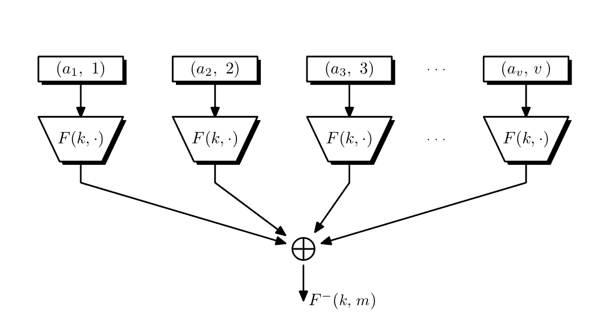

图 7.2: 来自小型 PRF 的并行 UHF

评估 F⁻可以轻松并行进行。下面的定理表明 F⁻是一个计算 UHF。请注意，与我们先前的 UHF 构造不同，安全性不依赖于输入消息的长度。在下一节中，我们将使用 F⁻构建适用于并行架构的安全 MAC。

> 定理 7.6. 假设 F 是一个安全的 PRF，并且假设 |𝒴| 是超多项式的。那么 F⁻ 是一个计算 UHF。

特别地，对于每一个 UHF 攻击者 𝒜, 存在一个 PRF 攻击者 ℬ, 它是一个围绕 𝒜 的基本包装器, 使得

UHF_adv[𝒜, F⁻] ≤ PRF_adv[ℬ, F] + \frac{1}{|𝒴|}.

> 证明. 证明是一个由两个游戏组成的序列。

游戏0。在这个游戏中，挑战者计算：

k ← 𝒦, f ← F(k, ·)

攻击者 𝒜 输出两个不同的消息 U, V 在 𝒳^{≤ℓ} 中。我们定义 W₀ 为条件

\bigoplus_{i=0}^{u-1} f(U[i], i) = \bigoplus_{j=0}^{v-1} f(V[j], j)  \tag{7.13}

在第0轮游戏中成立。显然，我们有

Pr[W₀] = UHF_adv[𝒜, F⁻]. \tag{7.14}

第1轮游戏。我们打出“PRF卡”，并将挑战者的计算替换为

f ← Fun[𝒳 × {1, …, ℓ}, 𝒴]

我们定义 $W_1$ 为条件(7.13)在第1轮游戏中成立的事件。

通常情况下，存在一个PRF对手 $\mathcal{B}$ 使得

$$|\Pr[W_0] - \Pr[W_1]| \leq \mathsf{PRFadv}[\mathcal{B}, F] \tag{7.15}$$

证明的关键在于限制$\Pr[W_1]$，即限制(7.13)对于消息$U, V$成立的概率。 假设 $u \neq v$，如果需要可以交换 $U$和 $V$。 很容易看出，由于 $U$和 $V$是不同的，必然存在一个索引 $i^*$使得在(7.13)的左侧对中($U[i^*], i^*$)在(7.13)的右侧对中($V[j], j$)中不存在：如果$u > v$，则 $i^* = u$可以满足条件；否则，如果$u = v$，则必然存在某个 $i^*$使得 $U[i^*] \neq V[i^*]$，而这个 $i^*$可以满足条件。

我们可以将(7.13)重写为

$$f(U[i^*], i^*) = \bigoplus_{i=i^*}^{u-1} f(U[i], i) \oplus \bigoplus_{j=0}^{v-1} f(V[j], j). \tag{7.16}$$

由于(7.16)的左右两边是独立的，并且左边均匀分布在 $\mathcal{Y}$上，等式以概率$1/|\mathcal{Y}|$成立。因此

$$\Pr[W_1] = 1/|\mathcal{Y}| \tag{7.17}$$

定理的证明由(7.14)，(7.15)和(7.17)得出。 $\square$

在练习7.27中，我们将定理7.6推广为多查询UHF的 $F^-$界限。

## 7.3 PRF (UHF) 组合: 使用UHF构建MAC

我们现在将证明哈希-然后-伪随机函数范式在哈希是计算UHF的情况下产生一个安全的伪随机函数。 ECBC, NMAC和PMAC$_0$都可以看作是这种构造的实例，它们的安全性很容易从哈希-然后-伪随机函数范式的安全性得出。

让 $H$ 成为一个在 ($\mathcal{K}_H$, $\mathcal{M}$, $\mathcal{X}$) 上定义的带密钥的哈希函数，让 $F$ 成为在 ($\mathcal{K}_F$, $\mathcal{X}$, $\mathcal{Y}$) 上定义的伪随机函数。 通常情况下，我们假设 $\mathcal{M}$ 包含比 $\mathcal{X}$ 更长的消息，以便 $H$ 将长输入哈希为短摘要。 我们通过将哈希函数 $H$ 与伪随机函数 $F$ 组合来构建一个新的伪随机函数，记为 $F'$，如图7.3所示。具体而言， $F'$ 定义如下：

$$F'((k_1, k_2), m) := F \left( k_2, H (k_1, m) \right) \tag{7.18}$$

我们将 $F'$ 称为 $F$ 和 $H$ 的组合。 它使用 $\mathcal{K}_H \times \mathcal{K}_F$ 中的密钥 ($k_1, k_2$) 在 $\mathcal{M}$ 中接收输入，并在 $\mathcal{Y}$ 中输出值。 因此，我们得到了一个与底层 $F$ 相同输出空间的伪随机函数，但接受更长的输入。 以下定理表明 $F'$ 是一个安全的伪随机函数。

### 定理 7.7 (PRF(UHF) 组合).
假设 $H$ 是一个计算UHF， $F$ 是一个安全PRF。 那么 $F'$ 在(7.18)中定义的是一个安全PRF。

特别地，假设 $\mathcal{A}$ 是一个针对 $F'$ 进行攻击游戏4.2的PRF对手，并且发出最多 $Q$ 个查询。 那么存在一个PRF对手 $\mathcal{B}_F$ 和一个UHF对手 $\mathcal{B}_H$，它们是围绕 $\mathcal{A}$ 的基本包装器。

$$\mathsf{PRFadv}[\mathcal{A}, F'] \leq \mathsf{PRFadv}[\mathcal{B}_F, F] + (Q^2/2) \cdot \mathsf{UHFadv}[\mathcal{B}_H, H]. \tag{7.19}$$


图7.3: PRF(UHF)组合: MAC签名

更一般地，存在一个 $Q$ 查询 $UHF$ 对手 $B'_H$，它是一个基本的包装器围绕 $\mathcal{A}$，使得

$$\mathsf{PRFadv}[\mathcal{A}, F'] \leq \mathsf{PRFadv}[B_F, F] + \mathsf{MUHFadv}[B'_H, H]. \tag{7.20}$$

为了理解为什么 $H$ 需要是 $UHF$，让我们假设一分钟它不是。特别是，假设很容易找到不同的 $m_0, m_1 \in \mathcal{M}$ such that $H(k_1, m_0) = H(k_1, m_1)$， without knowledge of $k_1$。这个 $H$ 上的碰撞意味着 $F'((k_1, k_2), m_0) = F'((k_1, k_2), m_1)$。但是 $F'$ 显然不是一个安全的 $PRF$：对手可以请求 $t_0 := F'((k_1, k_2), m_0)$ 和 $t_1 := F'((k_1, k_2), m_1)$，然后只有在 $t_0 = t_1$ 时输出1。当与 $F'$ 交互时，对手总是输出1，但对于一个随机函数，他通常输出0。因此，对手成功地区分出 $F'$ 和一个随机函数。这个论证表明，对于 $F'$ 成为 $PRF$，必须在不知道 $k_1$ 的情况下很难找到 $H$ 的碰撞。换句话说，对于 $F'$ 成为 $PRF$，哈希函数 $H$ 必须是 $UHF$。定理7.7表明这个条件是充分的。

备注 7.2. 定理 7.7 中的界限是紧的。考虑在第 7.2.1 节中讨论的 $UHF$ $H_{\text{poly}}$。为了具体起见，让我们假设 $\ell=2$，因此 $H_{\text{poly}}$ 的消息空间为 $\mathbb{Z}_p^2$，输出空间为 $\mathbb{Z}_p$，碰撞概率为 $\epsilon=1/p$。在练习 7.26 中，你被要求证明对于任意固定的哈希密钥 $k_1$，对于 $H_{\text{poly}}(k_1, \cdot)$ 的 $\sqrt{p}$ 个随机输入，发生碰撞的概率都有一个下界；此外，对于任何这样的碰撞，可以高效地恢复密钥 $k_1$。现在考虑使用 $H_{\text{poly}}$ 得到的 $PRF(UHF)$ 组合的 $MAC$。如果对手找到两个导致内部碰撞（即在 $H_{\text{poly}}$ 上发生碰撞）的消息 $m_0, m_1$，他可以恢复秘密 $H_{\text{poly}}$ 密钥，然后破解 $MAC$。这表明出现在 (7.19) 中的项 $(Q^2/2)\epsilon$ 不能被大幅改进。 $\square$

### 定理7.7的证明.
我们现在证明 $F$ 和 $H$ 的组合是一个安全的 $PRF$。

**证明思路.** 假设 $\mathcal{A}$ 是一个高效的 $PRF$ 对手，他在攻击游戏4.2中与 $F'$ 相关。我们对 $\mathsf{PRFadv}[\mathcal{A}, F']$ 进行了一个上界估计。也就是说，我们限制了 $\mathcal{A}$ 区分 $F'$ 和 $\text{Funs}[\mathcal{M}, \mathcal{Y}]$ 中的真正随机函数的能力。通常情况下，我们首先观察到用真正的安全 $PRF$ $F$ 替换底层函数不会对 $\mathcal{A}$ 的优势产生太大影响。接下来，我们将证明，由于 $f$ 是一个随机函数，$\mathcal{A}$ 只有在找到两个输入 $m_0, m_1$ 使得 $H(k_1, m_0) = H(k_1, m_1)$ 时，才能区分 $F_0 := f(H(k_1, m))$ 和一个真正的随机函数。但是，由于 $H$ 是一个计算 $UHF$，$\mathcal{A}$ 无法找到 $H(k_1, \cdot)$ 的碰撞。因此，$F'$ 无法被区分为一个随机函数。 $\square$

**证明.** 我们通过(7.20)证明了界限。方程(7.19)是由(7.20)推导出来的。我们让 $\mathcal{A}$ 与密切相关的挑战者在三个游戏中互动。对于 $j=0,1,2$，我们定义 $W_j$ 为 $\mathcal{A}$ 在游戏 $j$ 结束时输出1的事件。

**游戏0.**

游戏0的挑战者与PRF攻击实验0中的挑战者完全相同，关于 $F'$。不失一般性，我们假设 $\mathcal{A}$ 对 $F'$ 的查询都是不同的。挑战者的工作方式如下：

```
k_1 ←_R 𝒦_H,    k_2 ←_R 𝒦_F
在收到第 i 个查询 m_i ∈ 𝒴 (对于 i= 1, 2, …)时，执行以下操作：
x_i ← H(k_1, m_i)
t_i ← F(k_2, x_i)
将 t_i 发送给对手
```

请注意，由于 $\mathcal{A}$ 保证进行不同的查询，所有的 $m_i$ 值都是不同的。

**游戏1.**

现在我们玩常规的“PRF卡”，将函数 $F(k_2, \cdot)$ 替换为真正的随机函数 $f$ 在 $\text{Funs}[\mathcal{X}, \mathcal{Y}]$ 中实现，我们将其体现为一个忠实的小矮人（如4.4.2节所述）。游戏1挑战者的工作如下：

```
k_1 ←_R 𝒦_H,    t'_1, …, t'_Q ←_R 𝒴
在收到第 i 个查询 m_i ∈ 𝒴 (对于 i= 1, 2, …)时，执行以下操作：
x_i ← H(k_1, m_i)
t_i ← t'_i
(*)        如果 x_i = x_j 对于某个 j < i，那么 t_i ← t_j
将    t_i 发送给对手
```

对于 i= 1, …, Q，将 t'_i 的值预先选择为 t_i = f(x_i) 的默认随机值。尽管这些消息是不同的，但它们的哈希值可能相同。带有(*)标记的行确保挑战者在 $\text{Funs}[\mathcal{X}, \mathcal{Y}]$ 函数中模拟 — 如果两个哈希值碰撞，挑战者对两个查询的响应是相同的。通常情况下，可以很容易地证明存在一个PRF对手 $\mathcal{B}_F$，其运行时间与 $\mathcal{A}$ 的运行时间大致相同，使得：

$$|\Pr[W_1] - \Pr[W_0]| = \mathsf{PRFadv}[\mathcal{B}_F, F] \tag{7.21}$$

**游戏2.**

接下来，我们通过删除标记为(*)的行使我们的小矮人遗忘。
我们通过 $\mathcal{A}$ 无法为 $H$ 找到碰撞来展示 $\mathcal{A}$ 无法区分游戏1和游戏2。形式上，我们使用差分引理（定理4.7) 分析数量 $|\Pr[W_2] - \Pr[W_1]|$。让 $Z$ 为在游戏2中存在某些 i ≠ j 使得 x_i = x_j 的情况。事件 $Z$ 本质上是多查询 $\text{UHF}$ 游戏（攻击游戏7.2）关于 $H$ 的获胜条件。特别地，存在一个 $Q$ 查询 $\text{UHF}$ 对手 $\mathcal{B}'_H$，其以概率 $\Pr[Z]$ 赢得攻击游戏7.2。对手 $\mathcal{B}'_H$ 简单地模拟游戏2中的挑战者，直到 $\mathcal{A}$ 终止，然后输出查询 $m_1, m_2, \ldots$ 作为其最终列表。从 $\mathcal{A}$ 作为其最终列表。这有效，因为在游戏2中，挑战者实际上不需要哈希密钥 $k_1$：它只是用 $\mathcal{Y}$ 的随机元素响应每个查询。因此，对手 $\mathcal{B}'_H$ 可以在不知道 $k_1$ 的情况下轻松模拟游戏2中的挑战者。根据 $Z$ 的定义，我们有 $\mathsf{MUHFadv}[\mathcal{B}'_H, H] = \Pr[Z]$。

显然，除非事件 $Z$ 发生，否则游戏1和2的进行完全相同；特别地， $W_2 \wedge \bar{Z}$ 发生的充分必要条件是 $W_1 \wedge \bar{Z}$ 发生。应用差分引理，我们得到

$$|\Pr[W_2] - \Pr[W_1]| \leq \Pr[Z] = \mathsf{MUHFadv}[\mathcal{B}'_H, H]. \tag{7.22}$$

**证明的完成.** 游戏2挑战者在 $\text{Funs}[\mathcal{M}, \mathcal{Y}]$ 中模拟 $\mathcal{A}$ 的随机函数，因此，它与关于 $F'$ 的实验1 PRF挑战者完全相同。我们得到

$$\mathsf{PRFadv}[\mathcal{A}, F'] = |\Pr[W_2] - \Pr[W_0]| \leq |\Pr[W_2] - \Pr[W_1]| + |\Pr[W_1] - \Pr[W_0]| = \mathsf{PRFadv}[\mathcal{B}_F, F] + \mathsf{MUHFadv}[\mathcal{B}'_H, H]$$

这证明了 (7.20)，如所需。 $\square$

### 7.3.1 使用PRF（UHF）组合：ECBC和NMAC安全

使用定理7.7，我们可以快速证明许多MAC构造的安全性。只需证明MAC签名算法可以描述为PRF与UHF的组合。我们首先展示了ECBC和NMAC可以这样描述，并在下面的两个子部分中给出更多示例。

ECBC和NMAC的安全性直接来自PRF(UHF)的组合。这两个方案的证明如下：

- 首先，我们证明了CBC和级联是前缀自由安全的PRF（定理6.3和6.4）。我们观察到它们都是可扩展的。
- 接下来，我们证明了任何可扩展的前缀自由安全的PRF也是计算UHF（定理7.3）。特别地，CBC和级联是计算UHF。
- 最后，我们证明了计算UHF和PRF的组合是安全的PRF（定理7.7）。因此，ECBC和NMAC是安全的PRF。

更一般地，加密PRF构造（定理6.5）是PRF（UHF）组合的一个实例，因此其证明可以从定理7.7得出。ECBC和NMAC定理（定理6.6和6.7）中的具体界限分别通过将（7.10）和（7.11）代入（7.20）得到。

可以通过直接证明CBC和级联是计算UHF来简化ECBC和NMAC安全性的证明。我们证明了它们是前缀自由安全的PRF，这比我们需要的更多。然而，这个更强的结果使我们能够构建其他安全的MAC，如CMAC（见第6.7节）。

### 7.3.2 使用多项式UHF组合的PRF(UHF)

当然，可以使用基于多项式的UHF（如 $H_{\text{poly}}$）的PRF（UHF）构造。根据底层硬件的不同，这种构造在处理非常长的消息时可能比ECBC、NMAC或PMAC$_0$更快。

回想一下 $H_{\text{poly}}$ hashes 消息在 $\mathbb{Z}_p^{\leq \ell}$ 到摘要在 $\mathbb{Z}_p$，其中 $p$ 是一个素数。现在，我们可能非常希望使用一个块密码，如AES，它以一个 $n$ 位块作为输入。为了使这个工作，我们必须以某种方式进行调整，使得哈希的摘要空间等于PRF的输入空间。一种方法是选择素数 $p$，使得它比 $2^n$ 稍微小一点，这样我们可以将哈希摘要编码为PRF的输入。这种方法是有效的；然而，它的缺点是我们必须将哈希的输入视为 $\mathbb{Z}_p$ 的元素序列。因此，例如，对于 $n=128$，就像AES一样，我们可以选择一个128位的素数，但是然后哈希的输入必须被分成，比如，120位（即15字节）。

块。如果我们还可以直接将输入处理为哈希的n位块序列，那将更加方便。练习7.23的(d)部分展示了如何做到这一点，使用一个比2的n稍大一点的素数。另一种方法是，我们可以将哈希基于有限域GF(2的n次方)，而不是基于一个素数p的算术运算，如备注7.1所讨论的那样。

## 7.3.3 使用PRF(UHF)组合: PMAC₀安全性

接下来，我们将展示在第6.11节讨论的PMAC₀构造是PRF(UHF)组合的一个实例。回想一下，PMAC₀是由两个PRF构建而成的，F₁定义在(K₁, Zₚ, Y)上，F₂定义在(K₂, Y, Z)上，其中Y:={0,1}^n。

读者应该仔细阅读PMAC₀的构造，特别是图6.9。可以看到PMAC₀是由带有某个密钥散列函数Ĥ的PRF F₂组成的，这是图6.9中的其他部分。

现在的目标是要证明Ĥ是一个计算UHF。为了做到这一点，我们观察到Ĥ可以被看作是在第7.2.3节中应用于PRF F'的XOR-hash构造的一个实例，该构造定义在(Zₚ × K₁, Zₚ × {1, …, ℓ}, Y)上，如下所示：
F'((k, k₁), (a, i)) := F₁(k₁, a + i·k)。

因此，它证明了F'是一个安全的PRF。但事实证明，我们可以将F'本身视为PRF(UHF)组合的一个实例。也就是说，它是PRF F₁与带键的哈希函数H在(Zₚ, Zₚ × {1, …, ℓ}, Zₚ)上的组合，定义为H(k, (a, i)) := a + i·k。然而，H只是H_fpoly的一个特例（见第7.2.1节）。特别地，根据练习7.16的结果，H是一个1/p-UHF。

PMAC₀的安全性来自于上述观察。定理6.11中的具体安全界（6.27）来自于定理7.7中的具体安全界（7.20）和练习7.27中对XOR-hash的更精细分析。

在PMAC₀的设计中，我们假设输入空间F₁等于Zₚ。虽然这简化了分析，但在实践中却更难处理。就像上面第7.3.2节中一样，我们更愿意使用以块密码（如AES）为输入的PRF来工作，它接受一个n位块作为输入。可以将第7.3.2节讨论的技术应用于PMAC₀的变体，其输入空间由n位块的序列组成，而不是Zₚ的元素序列。例如，请参见练习7.25。

## 7.4 Carter-Wegman MAC

在本节中，我们介绍了一种构建安全MAC系统的不同范式，它与PRF（UHF）组合相比具有不同的权衡。

回想一下，在PRF（UHF）组合中，敌手在看到Q个签名消息后打破MAC的优势随着ε·Q²/2的增长而增加，使用ε-UHF。因此，为了确保在需要签署许多消息时的安全性，ε-UHF必须具有足够小的ε，使得ε·Q²/2很小。这可能会影响Hpoly等ε-UHF的性能，其中ε越小，哈希函数越慢。例如，假设在签署Q:=2³²个消息后，敌手打破MAC的优势不超过2⁻⁶⁴，则ε必须最多为1/2¹²⁷。

我们的第二个MAC范例，称为Carter-Wegman MAC，保持与PRF(UHF)组合相同的安全级别，但使用更大的ε值。使用给定的参数 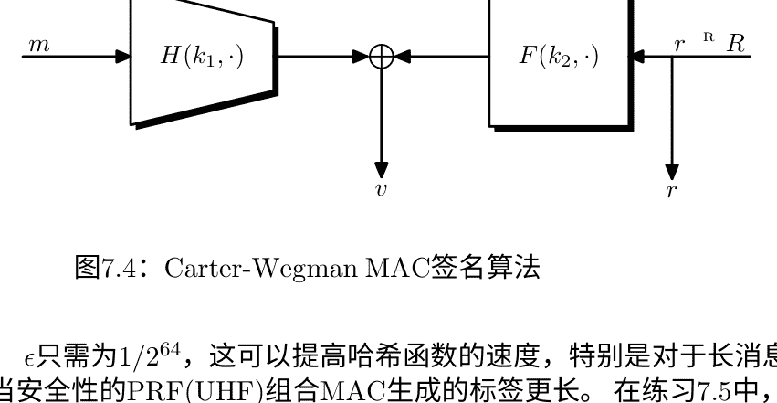 在上面的示例中，ϵ只需为1/2^64，这可以提高哈希函数的速度，特别是对于长消息。缺点是生成的标签比具有相当安全性的PRF(UHF)组合MAC生成的标签更长。在练习7.5中，我们探讨了一种不同的随机化MAC构造，它以与Carter-Wegman相同的安全性和相同的ϵ值，但标签更短。

Carter-Wegman MAC是我们的第一个随机化MAC系统的示例。签名算法是随机化的，每个消息都有许多有效的标签。

为了描述Carter-Wegman MAC，首先固定一个大整数 N，并设置 T := Z_N，即大小为 N的群，其中加法被定义为“模 N”。我们使用哈希函数 H和PRF F 输出 Z_N中的值：

- H是一个在(K_H, M, T)上定义的密钥散列函数，
- F是一个在(K_F, R, T)上定义的伪随机函数。

Carter-Wegman MAC，表示为 I_CW，将输入从 M转换为 R × T的标签。它使用 K_H × K_F中的密钥。从 F和 H派生的Carter-Wegman MAC的工作原理如下（也可参见图7.4）：

- 对于密钥(k_1, k_2)和消息 m，我们定义
S( (k_1, k_2), m ) :=
    r ← R
    v = H(k_1, m) + F(k_2, r) ∈ Z N //模 N加法
输出 ( r, v )
- 对于密钥(k_1, k_2)，消息 m和标签(r, v)，我们定义
V( (k_1, k_2), m, (r, v) ) :=
    v* = H(k_1, m) + F(k_2, r) ∈ Z N //模 N加法
    如果 v = v*则输出接受；否则输出拒绝

Carter-Wegman签名算法使用一个随机数生成器 r ∈ R。正如我们将看到的，集合 R需要足够大，以使得两个标签使用相同的随机数生成器的概率可以忽略不计。

一个加密的UHF MAC。Carter-Wegman MAC可以被描述为一个哈希函数输出的加密。实际上，令 E = (E, D) 为密码
E(k, m) := { r ← R, 输出 ( r, m + F(k, r) ) } 和 D(k, (r, c)) := c ⊕ F(k, r) 其中 $F$ 是在 $(K_F, R, T)$ 上定义的PRF。当 $F$ 是一个安全的PRF时，这个密码是CPA安全的，如示例5.2所示。然后Carter-Wegman MAC可以写成：

```
S((k_1, k_2), m) := E(k_2, H(k_1, m))(

V((k_1, k_2), m, t) := \begin{cases} 如果 D(k_2, t) = H(k_1, m), & 则 接受, \ 否则拒绝。 \end{cases}
```

我们称之为从 $E$ 和 $H$ 派生的加密UHF MAC系统。

为什么要加密哈希函数的输出？回想一下，在PRF(UHF)组合MAC中，如果对手找到两个消息 $m_1, m_2$ 在哈希函数上发生碰撞（即 $H(k_1, m_1)=H(k_1, m_2)$），那么 $m_1$ 的MAC与 $m_2$ 的MAC相同。因此，通过请求许多消息的标签，对手可以确定在哈希函数上发生碰撞的消息 $m_1$ 和 $m_2$（假设PRF上的碰撞是不太可能的）。UHF上的碰撞 $m_1, m_2$ 可以揭示关于哈希函数密钥 $k_1$ 的信息，这可能完全破坏MAC。为了防止这种情况，我们必须使用一个具有足够小的 $\epsilon$ 的 $\epsilon$-UHF，以确保对手几乎不可能找到哈希函数碰撞。相反，通过使用CPA安全的密码对哈希函数的输出进行加密，我们防止对手了解哈希函数碰撞发生的时间：即使 $H(k_1, m_1) = H(k_1, m_2)$， $m_1$ 和 $m_2$ 的标签也有很高的概率不同。这样，我们可以使用一个更小的 $\epsilon$ 来保持安全性。

问题在于加密的UHF MAC通常不安全，即使 $(E, D)$ 是CPA安全的， $H$ 是一个 $\epsilon$-UHF。例如，我们在下面的备注7.5中展示了当哈希函数 $H$ 用 $H_{poly}$ 实例化时，Carter-Wegman MAC是不安全的。为了获得一个安全的Carter-Wegman MAC，我们加强了哈希函数 $H$，并要求它满足一个更强的性质，称为差异不可预测性，下面定义。习题9.16探讨了加密的UHF MAC的其他方面。

## Carter-Wegman MAC的安全性。

为了证明 $I_{CW}$ 的安全性，我们需要哈希函数 $H$ 满足比普遍性（UHF）更强的性质。我们将这个更强的性质称为差异不可预测性。粗略地说，这意味着对于任意两个不同的消息，很难预测它们的哈希之间的差异（在 $Z_N$ 中）。像往常一样，一个游戏：

## 攻击游戏 7.3 (差异不可预测性).

对于一个在 $(K, M, T)$ 上定义的带密钥哈希函数H，给定一个对手 $A$，攻击游戏运行如下。

- 挑战者随机选择一个 $k \xleftarrow{R} K$ 并将 $k$ 保留给自己。
- $A$ 输出两个不同的消息 $m_0, m_1 \in M$ 和一个值 $\delta \in T$。

如果 $A$ 赢得游戏，则我们说 $A$ 赢得了游戏 $H(k, m_1) \oplus H(k, m_0) = \delta$。我们定义 $A$ 相对于 $H$ 的优势，表示为 $DUFadv[A, H]$，即A赢得游戏的概率。 $\square$

## 定义 7.5.

让 $H$ 是在 $(K, M, T)$ 上定义的带密钥哈希函数。

- 我们说 $H$ 是一个 $\epsilon$ 有界差异不可预测函数，或者 $\epsilon$**-DUF**，如果 $DUFadv[A, H] \leq \epsilon$ 对于所有的对手 $A$（即使是低效的对手）都成立。
- 我们说 $H$ 是一个统计**DUF**，如果它是一个 $\epsilon$**-DUF** 对于一些可以忽略的 $\epsilon$。
- 我们说 $H$ 是一个计算**DUF**，如果对于所有高效的对手 $A$, $DUFadv[A, H]$ 是可以忽略的。

## 注 7.3.

注意，根据我们对DUF的定义，摘要空间 $\mathcal{T}$ 必须是 $\mathbb{Z}_N$ 的形式，其中 $N$ 是一个整数。我们这样做是为了保持简单。更一般地，可以为具有适当的差异运算符的密钥散列函数定义差异不可预测性的概念（在抽象代数的语言中， $\mathcal{T}$ 应该是一个阿贝尔群）。除了 $\mathbb{Z}_N$ 之外，另一个流行的摘要空间是所有 $n$ 位字符串的集合， $\{0,1\}^n$，其中使用异或作为差异运算符。在这种情况下，我们使用术语 $\epsilon$-XOR-DUF和统计/计算 XOR-DUF对应于术语 $\epsilon$-DUF和统计/计算DUF。 $\square$

当 $H$ 是一个在 $(\mathcal{K}, \mathcal{M}, \mathcal{T})$ 上定义的带密钥散列函数时， $\epsilon$-DUF属性的另一种表征是以下内容：

对于每一对不同的消息 $m_0, m_1 \in \mathcal{M}$ 和每一个 $\delta \in \mathcal{T}$，以下不等式成立： $\Pr[H(k, m_1) \oplus H(k, m_0) = \delta] \leq \epsilon$。这里，概率是在随机选择的密钥 $k \in \mathcal{K}$ 上计算的。

显然，如果 $H$ 是一个 $\epsilon$-DUF，则 $H$ 也是一个 $\epsilon$-UHF：可以将一个UHF攻击者转换为一个具有相同概率的DUF攻击者（只需设置 $\delta= 0$）。

我们给出了一个简单的例子，它是一个与哈希函数 $H_{\text{poly}}$ 在方程 (7.3) 中定义的函数非常相似的统计DUF。回想一下， $H_{\text{poly}}$ 是一个在 $(\mathbb{Z}_p, (\mathbb{Z}_p)^{\leq \ell}, \mathbb{Z}_p)$ 上定义的UHF。显然，它不是一个DUF：对于任意的 $\mathbb{Z}_p$ 中的 $a$，我们设置 $m_0:= (a)$ 和 $m_1:= (a+1)$，这样 $m_0$ 和 $m_1$ 都是长度为1的 $\mathbb{Z}_p$ 元组。然后对于每一个密钥 $k$，我们有

$$H_{\text{poly}}(k, m_1) \oplus H_{\text{poly}}(k, m_0) = (k + a + 1) \oplus (k + a) = 1$$

这使得攻击者能够赢得DUF游戏。

对 $H_{\text{poly}}$ 进行简单修改可以得到一个好的DUF。对于消息 $m= (a_1, a_2, \ldots, a_v) \in (\mathbb{Z}_p)^{\leq \ell}$ 和密钥 $k \in \mathbb{Z}_p$ 定义一个新的哈希函数 $H_{\text{xpoly}}(k, m)$ 如下：

$$H_{\text{xpoly}}(k, m) := k \cdot H_{\text{poly}}(k, m) = k^{v+1} + a_1 k^v + a_2 k^{v-1} + \cdots + a_v k \in \mathbb{Z}_p. \quad (7.23)$$

## 引理 7.8.

函数 $H_{\text{xpoly}}$ over $(\mathbb{Z}_p, (\mathbb{Z}_p)^{\leq \ell}, \mathbb{Z}_p)$ 在 (7.23) 中定义为 $(\ell + 1)/p$-DUF.

证明. 考虑两个不同的消息 $m_0= (a_1, \ldots, a_u)$ 和 $m_1= (b_1, \ldots, b_v)$ 在 $(\mathbb{Z}_p)^{\leq \ell}$ 和一个任意值 $\delta \in \mathbb{Z}_p$.. 我们想要证明 $\Pr[H_{\text{xpoly}}(k, m_1) \oplus H_{\text{xpoly}}(k, m_0) = \delta] \leq (\ell + 1)/p$, 其中概率是在随机选择密钥 $k$ 在 $\mathbb{Z}_p$ 的情况下计算的. 就像引理 7.2 的证明一样，输入 $m_0$ 和 $m_1$ 定义了 $\mathbb{Z}_p[X]$ 中的两个多项式 $f(X)$ 和 $g(X)$，如 (7.4) 所示。然而，当且仅当 $k$ 是多项式 $X(g(X) \oplus f(X)) \oplus \delta$ 的根时， $H_{\text{xpoly}}(k, m_1) \oplus H_{\text{xpoly}}(k, m_0) = \delta$ 成立，该多项式是一个次数最多为 $\ell+1$ 的非零多项式，在 $\mathbb{Z}_p$ 中最多有 $\ell+1$ 个根. 因此，选择这样一个 $k$ 的机会最多为 $(\ell+1)/p. \quad \square$

## 注 7.4.

我们可以通过在有限域GF(2 n)中进行所有算术运算，而不是在$\mathbb{Z}_p$中，来修改$H_{\text{xpoly}}$以在$n$位块上操作。与引理7.8中完全相同的分析表明，得到的哈希函数是一个$(\ell+1)/2^n$-XOR-DUF. $\square$

现在我们转向Carter-Wegman构造的安全性分析。

## 定理7.9 (Carter-Wegman安全性)

设 F 是在 (K, F, R, T)上定义的安全PRF，其中 |R| 是超多项式的。设 H 是在 (K, H, M, T)上定义的计算DUF。那么由 F 和 H 导出的 Carter-Wegman MAC $I_{CW}$ 是一个安全的MAC。
特别是，对于每个攻击 $I_{CW}$ 的 MAC 对手 A，存在一个PRF 对手 $\mathcal{B}_F$ 和一个DUF 对手 $\mathcal{B}_H$，它们是围绕 A 的基本包装器，使得
MAC对手[A, $I_{CW}$] ≤ PRF对手[$\mathcal{B}_F$, F] + DUF对手[$\mathcal{B}_H$, H] + $\frac{Q^2}{2|R|}$ + $\frac{1}{|T|}$。(7.24)

## 备注7.5.

为了理解为什么 H 需要是一个DUF，让我们假设一分钟它不是。特别是，假设很容易找到不同的 $m_0, m_1 ∈ M$ 和 $δ ∈ T$，使得 $H(k1, m1) = H(k1, m0) + δ$，没有 $k1$ 的知识。然后，对手可以要求消息 $m_0$ 的标签，并获得 $(r, v)$，其中 $v = H(k1, m0) + F(k2, r)$。因为

$v = H(k1, m0) + F(k2, r)$ ⟹ $v + δ = H(k1, m1) + F(k2, r)$，
标签$(r, v + δ)$是$m_1$的有效标签。因此，$(m1, (r, v + δ))$是对$I_{CW}$的存在性伪造。这表明当散列函数 H 实例化为 $H_{poly}$ 时，Carter-Wegman MAC 很容易被破解。

## 注7.6.

我们还注意到，式(7.24)中的项 $Q^2/2|R|$ 对应于两个签名查询生成相同随机化器的概率。事实上，如果发生这样的碰撞，Carter-Wegman 对于某些 DUFs（包括 $H_{poly}$）可能会完全破解-参见练习7.13和7.14。□证明思路。设 A 是一个针对 $I_{CW}$ 进行攻击游戏6.1的高效MAC对手。

我们得到了关于MACadv[A, $I_{CW}$] 的上界。通常情况下，我们首先用真正的随机函数 $f ∈ Funs[R, T]$ 替换底层安全PRF F，并且证明这不会对对手的优势产生太大影响。然后我们展示了只有三种情况可能发生，使得对手能够生成伪造的消息-标签对，并且每种情况的概率都很小：

1.  挑战者可能不幸选择相同的随机化器 $r ∈ R$ 来回应两个不同的签名查询。这种情况发生的概率最多为 $Q^2/(2|R|)$。
2.  对手可能输出一个MAC伪造 $(m, (r, v))$ 其中 $r ∈ R$ 是一个从未用于回应 A 的签名查询的新鲜随机化器。然后 f(r) 是独立于 A 的视图的因此等式 $v = H(k1, m) + f(r)$ 最多以概率 1/|T| 成立。
3.  最后，对手可以输出一个MAC伪造 $(m, (r, v))$ 其中 $r = r_j$ 对于某个唯一确定的签名消息-标签对 $(m_j, (r_j, v_j))$。但是然后 $v_j = H(k1, m_j) + f(r_j)$ 和 $v = H(k1, m) + f(r_j)$。通过从左边等式中减去右边等式，$f(r_j)$ 项被消除，我们得到 $v_j ⊕ v = H(k1, m_j) ⊕ H(k1, m)$。但由于 H 是一个可计算的DUF，攻击者只能以可忽略的概率找到这样的关系。

□ 证明。我们通过考虑 A 在三个密切相关的游戏中的行为来严格地证明上述直观论证。对于 j=0,1,2，我们定义 W_j 为 A 赢得游戏 j 的事件。游戏0将与原始的MAC攻击游戏在 I 方面完全相同。然后，我们稍微修改每个游戏，并论证攻击者不会察觉到这些修改。最后，我们证明 Pr[W_3] 是可忽略的，这将证明 Pr[W_0] 是可忽略的，符合要求。

## 游戏0.

我们首先回顾MAC攻击游戏6.1中的挑战者 I_CW。

我们按照以下方式实现这个挑战者中的挑战者：

```
初始化:
k1 ← KH, k2 ← KF
r1, ........., rQ ← R // 为游戏准备所需的随机数
```

```
在收到第 i 个签名查询 m_i ∈ M (对于 i=1,2,...) 执行以下操作:
vi ← H(k1, mi) + F(k2, ri) ∈ T
将 (ri, vi) 发送给对手
```

游戏结束时，A 输出一个不在挑战者生成的签名消息对 (m, (r, v)) 中的消息-标签对。这个游戏的获胜条件定义如下子例程的结果：

```
如果 v = H(k1, m) + F(k2, r)
    那么返回胜利
    否则返回失败
```

然后，通过构造 MACadv[A, I_CW] = Pr[W_0]. (7.25)

## 游戏1.

接下来我们使用通常的“PRF 卡”，将函数 F(k2, ·) 替换为一个真正的随机函数 f in Funs[R, T]，我们将其现为一个忠实的小矮人（如第4.4.2节所述）。我们的挑战者在游戏1中的工作如下：

```
初始化:
k1 ← KH
r1, ........., rQ ← R // 为游戏准备所需的随机数
u'0, u'1, ..., u'Q ← T // 准备默认的 f 输出
```

```
在收到第 i 个签名查询 m_i ∈ M (对于 i=1,2,...) 时:
(1) 如果 ri = rj 对于某个 j < i，则 ui ← uj
    vi 将 (ri, vi) 发送给对手
```

假设 A 在输出伪造尝试 (m, (r, v)) 之前进行了恰好 s ≤ Q 签名查询。获胜条件的子程序如下：如果 $r = r_j$ 对于某个 $j = 1, \dots, s$ 则 $u = u_j$，否则 $u = u_0'$。如果 $v = H(k_1, m) + u$ 则返回胜利，否则返回失败。

对于 $i = 1, \dots, Q$，预先选择 $u'$ 作为 $u_i = f(r_i)$ 的默认随机值。在标记为（1）和（2）的行上的测试确保我们的预言机是忠诚的，即我们在 $\text{Funs}[\mathcal{R}, \mathcal{T}]$ 中模拟一个函数。在（2）处，如果值 $u = f(r)$ 已经定义，我们使用该值；否则，我们使用新鲜的随机值 $u_0'$ 作为 $u$。

$$|Pr[W_1] \oplus Pr[W_0]| = \text{PRFadv}[B_F, F] \quad (7.2)$$

6）游戏2。我们让我们的预言机健忘。我们通过删除挑战者中标记为（1）的行来实现这一点。此外，在获胜的子程序中标记为（2）的行之前，我们插入以下特殊测试：

如果存在某个 $1 \leq i < j \leq s$，使得 $r_i = r_j$，则返回 lose。

令 $Z$ 为事件，其中存在 $1 \leq i < j \leq Q$ 使得 $r_i = r_j$。根据并集边界，我们知道 $Pr[Z] \leq Q^2/(2|R|)$。此外，如果 $Z$ 不发生，则游戏1和2将完全相同进行。因此，根据差异引理（定理4.7），我们得到

$$|Pr[W_2] \oplus Pr[W_1]| \leq Pr[Z] \leq Q^2/(2|R|) \quad (7.27)$$

为了限制 $Pr[W_2]$，我们将 $W_2$ 分解为两个事件：

- $W_2'$：$A$ 在游戏中获胜，并且存在某个 $j = 1, \dots, s$ 使得 $r = r_j$；
- $W_2''$：$A$ 在游戏中获胜，并且对于所有 $j = 1, \dots, s$，都有 $r = r_j$。

因此，我们有 $W_2 = W_2' \cup W_2''$，而且分析这些事件是足够的，因为

$$Pr[W_2] \leq Pr[W_2'] + Pr[W_2''] \quad (7.28)$$

首先考虑 $W_2''$。如果发生这种情况，那么 $u = u_0'$ 且 $v = u + H(k_1, m)$；也就是说，$u_0' = v \oplus H(k_1, m)$。但由于 $u_0'$ 和 $v \oplus H(k_1, m)$ 是独立的，这种情况发生的概率为 $1/|\mathcal{T}|$。所以我们有

$$Pr[W_2''] \leq 1/|\mathcal{T}| \quad (7.29)$$

接下来，考虑 $W_2'$。我们的目标是展示

$$Pr[W_2'] \leq \text{DUFadv}[B_H, H] \quad (7.30)$$

对于一个和 $A$ 一样高效的 DUF 攻击者 $B_H$。为了达到这个目的，考虑一下如果 $A$ 在第二个游戏中获胜，并且 $r = r_j$ 对于某个 $j = 1, \dots, s$。由于 $A$ 获胜，并且因为我们在标记为（2）的线上添加了特殊测试，值 $r_1, \dots, r_s$ 是不同的，所以只能有一个这样的索引 $j$，且 $u = u_j$。因此，我们有以下两个等式：

$$v_j = H(k_1, m_j) + u_j \quad \text{和} \quad v = H(k_1, m) + u_j;$$

减去，我们得到
$$v_j \oplus v = H(k_1, m_j) \oplus H(k_1, m).$$
我们声称 $m = m_j$。实际上，如果 $m = m_j$，那么 (7.31) 将意味着 $v = v_j$，这将意味着 $(m, (r, v)) = (m_j, (r_j, v_j))$；然而，这是不可能的，因为我们要求 $\mathcal{A}$ 不会提交一个之前签名过的对作为伪造尝试。
因此，如果 $W'_2$ 发生，我们有 $m = m_j$，并且等式 (7.31) 成立。但是请注意，在游戏2中，挑战者的回答完全独立于 $k_1$，因此我们可以轻松地将 $\mathcal{A}$ 转换为一个 DUF 攻击者 $\mathcal{B}_H$，在攻击游戏7.3中以至少 $\Pr[W'_2]$ 的概率成功。攻击者 $\mathcal{B}_H$ 的工作方式如下：它与 $\mathcal{A}$ 交互，通过简单地响应每个签名查询与一个随机对 $(r_i, v_i) \in \mathcal{R} \times \mathcal{T}$ 来模拟游戏2中的挑战者；当 $\mathcal{A}$ 输出其伪造尝试 $(m, (r, v))$ 时，$\mathcal{B}_H$ 确定是否存在 $r = r_j$ 和 $m = m_j$，其中某个 $j = 1, \dots, s$；如果是这样的话，$\mathcal{B}_H$ 输出这个三元组。

界限 (7.30) 现在清晰了。
该定理由 (7.25) - (7.30) 得出。 $\square$

## 7.4.1 使用多项式UHF的Carter-Wegman

如果我们想要使用基于多项式的 DUF 的 Carter-Wegman 构造，例如 $H_{\text{xpoly}}$，那么我们需要进行调整，使得哈希函数的摘要空间等于 PRF 的输出空间。再次强调的问题是，我们的示例 $H_{\text{xpoly}}$ 的输出在 $\mathbb{Z}_p$ 中，而对于典型的实现，PRF 的输出将是 $n$ 位块。

与我们在第7.3.2节中所做的类似，我们可以选择 $p$ 为一个比 $2^n$ 稍微大一点的素数。这也使我们能够将哈希的输入视为 $n$ 位块。练习7.23的(b)部分展示了如何做到这一点。也可以使用一个比 $2^n$ 小一点的素数 $p$（参见练习7.22的(a)部分），尽管这样做不太方便，因为哈希的输入将需要被分成小于 $n$ 大小的块。或者，我们可以使用 $H_{\text{xpoly}}$ 的变体，在有限域 $\text{GF}(2^n)$ 中进行所有算术运算，如备注7.4所讨论的。

## 7.5 基于随机数的MAC

在第7.4节的 Carter-Wegman 构造中，我们需要的唯一必要属性是这些随机化器是不同的。与我们在第5.5节中所做的类似，我们可以研究基于随机数的 MAC：这种方法不仅可以减小标签的大小，还可以提高安全性。

基于随机数的 MAC 与普通 MAC 类似，由一对确定性算法 $S$ 和 $V$ 组成，用于签名和验证标签。然而，这些算法需要一个额外的输入 $\varkappa$，称为一个随机数空间 $\mathcal{N}$。算法 $S$ 和 $V$ 的工作方式如下：

- $S$ 接受一个密钥 $k \in \mathcal{K}$，一个消息 $m \in \mathcal{M}$ 和一个随机数 $\varkappa \in \mathcal{N}$ 作为输入。它输出一个标签 $t \in \mathcal{T}$。
- $V$ 接受四个值 $k$，$m$，$t$，$\varkappa$ 作为输入，其中 $k$ 是一个密钥，$m$ 是一个消息，$t$ 是一个标签，$\varkappa$ 是一个随机数。它输出接受或拒绝。

我们说基于随机数的消息认证码定义在 $(\mathcal{K}, \mathcal{M}, \mathcal{T}, \mathcal{N})$ 上。通常情况下，我们要求由 $S$ 生成的标签总是被 $V$ 接受的，只要它们都使用相同的随机数。消息认证码必须满足以下正确性属性：对于所有的密钥 $k$，所有的消息 $m$ 和所有的随机数 $\varkappa \in \mathcal{N}$:

$$\Pr\left[ V\left(k, m, S\left(k, m, \varkappa\right), \varkappa\right) = \text{接受}\right] = 1.$$

就像在第5.5节中一样，为了保证安全性，发送方应避免在相同的密钥上使用相同的随机数两次。如果发送方可以维护状态，那么可以使用一个简单的计数器来实现随机数。或者，随机数可以随机选择，只要随机数空间足够大，以确保生成相同随机数的概率可以忽略不计。

### 7.5.1 安全的基于随机数的MAC

在对手选择nonce时，基于nonce的MAC必须在选择消息攻击下是存在性不可伪造的。然而，对手绝不能使用先前使用过的nonce请求标签。这捕捉到了nonce可以任意选择的想法，只要它们从未被重复使用。基于nonce的MAC安全性是使用以下游戏来定义的。

攻击游戏7.4（基于nonce的MAC安全性）。对于给定的基于nonce的MAC系统 $\mathcal{I} = (S, V)$，定义在 $(\mathcal{K}, \mathcal{M}, \mathcal{T}, \mathcal{N})$ 上，以及给定的对手 $\mathcal{A}$，攻击游戏运行如下：

- 挑战者随机选择一个密钥 $\quad k \stackrel{\mathrm{R}}{\leftarrow} \mathcal{K}$。
- $\mathcal{A}$多次查询挑战者。对于 $i = 1, 2, \ldots$，第 $i$个签名查询由一对$(m_i, \varkappa_i)$组成，其中 $m_i \in \mathcal{M}$且 $\varkappa_i \in \mathcal{N}$。我们要求对于所有$j < i$， $\varkappa_i \neq \varkappa_j$。挑战者计算 $t_i \stackrel{\mathrm{R}}{\leftarrow} S(k, m_i, \varkappa_i)$，并将 $t_i$给 $\mathcal{A}$。
- 最终 $\mathcal{A}$输出一个候选伪造三元组 $(m, t, \varkappa) \in \mathcal{M} \times \mathcal{T} \times \mathcal{N}$，其中
$$(m, t, \varkappa) \notin \{(m_1, t_1, \varkappa_1), (m_2, t_2, \varkappa_2), \ldots\}.$$
如果 $V(k, m, t, \varkappa) = \text{接受}$，我们说 $\mathcal{A}$赢得了游戏。我们定义 $\mathcal{A}$相对于 $\mathcal{I}$的优势为 $\mathrm{nMACadv}[\mathcal{A}, \mathcal{I}]$，即 $\mathcal{A}$赢得游戏的概率。 $\square$

#### 定义 7.6.

如果对于所有高效的攻击者 $\mathcal{A}$，非重复性MAC系统 $\mathcal{I}$是安全的，那么值 $\mathrm{nMACadv}[\mathcal{A}, \mathcal{I}]$是可以忽略的。

**基于随机数的Carter-Wegman MAC。** Carter-Wegman MAC（第7.4节）可以重新定义为基于随机数的MAC：我们将随机数生成器 $r \in \mathcal{R}$视为一个nonce，作为输入提供给签名算法，而不是作为标签的一部分的随机生成值。使用第7.4节的符号表示，MAC系统则为

$$\begin{aligned} S((k_1, k_2), m, \varkappa) &:= H(k_1, m) + F(k_2, \varkappa) \\ V((k_1, k_2), m, t, \varkappa) &:= \begin{cases} \text{接受} & \text{如果 } t = S((k_1, k_2), m, \varkappa), \\ \text{拒绝} & \text{否则} \end{cases} \end{aligned}$$

我们得到了以下安全性定理，它是基于nonce的Theorem 7.9的类比。证明与Theorem 7.9的证明基本相同。

#### 定理7.10.

根据定理7.9的符号，我们得到以下界限

$$\mathrm{nMAC优势}[\mathcal{A}, \mathcal{I}_{\mathrm{CW}}] \leq \mathrm{PRF优势}[\mathcal{B}_F, F] + \mathrm{DUF优势}[\mathcal{B}_H, H] + \frac{1}{|\mathcal{T}|}.$$

这个界限比(7.24)要严格得多：第二项已经消失。当然，它消失是因为我们坚持不重复使用相同的随机数。如果随机数实际上是由签名者随机生成的，那么第二项会重新出现；然而，如果签名者将随机数实现为计数器，则我们可以避免第二项——唯一的要求是签名者不要签署超过|R|个值。关于H的实现，也请参见练习7.12中的一个微妙的问题。类似于备注7.6中的讨论，在使用基于随机数的Carter-Wegman时，随机数绝不能被用于不同的消息。如果发生这种情况，Carter-Wegman可能会完全破解——请参见练习7.13和7.14。

## 7.6 无条件安全的一次性MAC

在第2章中，我们看到一次性密码本只要密钥仅用于加密单个消息，就能提供无条件的安全性。即使运行时间为指数级的算法也无法破解一次性密码本的语义安全性。不幸的是，如果密钥被多次使用，安全性将完全丧失。

在本节中，我们提出了与MACs类似的问题：是否可以构建一个“一次性MAC”，只要密钥仅用于为单个消息提供完整性，就能提供无条件的安全性？

我们可以使用标准的MAC攻击游戏6.1来模拟一次性MACs，该游戏用于定义MAC安全性。为了捕捉MAC的一次性特性，我们允许对手只发出一个签名查询。我们用MAC1adv[A,I]来表示对手在这个受限游戏中的优势。这个游戏捕捉了对手只看到一个消息-标签对，然后尝试使用这个对来创建存在性伪造。

无条件安全性意味着对于所有的对手A，即使是计算能力无限的对手，MAC1adv[A,I]都是可以忽略的。在本节中，我们将展示如何使用哈希函数实现高效且无条件安全的一次性MAC。

### ### 7.6.1 两两不可预测函数

设H为在(K,M,T)上定义的带密钥哈希函数。直观地说，如果对于一个随机选择的密钥k∈K，给定值H(k,m0)，很难预测任何m1≠m0时的H(k,m1)。通常情况下，我们使用攻击游戏来严格定义这个概念。

攻击游戏7.5(成对不可预测性)。对于在(K,M,T)上定义的带密钥哈希函数H和给定的对手A，攻击游戏的运行如下。

- 挑战者随机选择一个 k ∈ K 并将 k 保留给自己。
- A向挑战者发送消息 m0 ∈ M，挑战者用 t0 = H(k, m0)回应。
- A输出(m1, t1) ∈ M×T，其中 m1 ≠ m0。

如果 t1 = H(k, m1)，则我们说A赢得了游戏。我们定义A相对于H的优势为PUFadv[A,H]，即A赢得游戏的概率。

定义7.7.如果对于所有的对手A（即使是低效的对手），H是一个ε-有界的成对不可预测函数（简称ε-PUF），则我们说H是一个ε-PUF。

应该清楚的是，如果H是一个ε-PUF，那么H也是一个ε-UHF；如果此外，T的形式是Z_N（或者像备注7.3中一样是一个阿贝尔群），那么H是一个ε-DUF。

### 7.6.2 构建不可预测函数

到目前为止，我们知道任何 ϵ-PUF也是一个 ϵ-DUF。反之不成立（见练习7.28）。然而，我们证明任何 ϵ-DUF都可以进行调整，使其成为一个 ϵ-PUF。这种调整会增加密钥大小。

设 H 是一个定义在 (𝒦, ℳ, 𝒯) 上的键控哈希函数，其中 𝒯 = ℤ_N，其中 N。我们构建一个从 H 派生出来的新哈希函数 H'，其输入和输出空间与 H 相同。然而，密钥空间是 𝒦 × 𝒯。函数 H' 的定义如下：

> H'((k1, k2), m) = H(k1, m) + k2 ∈ 𝒯 (7.32)

引理 7.11. 如果 H 是一个 ϵ-DUF，那么 H' 是一个 ϵ-PUF。

证明。假设 𝒜 作为一个 PUF 攻击 H'。作为对其查询 m' 的响应，攻击者 𝒜 收到 t0 := H(k1, m0) + k2。观察到 t0 在 𝒯 上均匀分布，并且与 k1 独立。此外，如果 𝒜 对 H(k1, m1) + k2 的预测 t1 是正确的，那么 t1 ⊕ t0 正确地预测了差异 H(k1, m1) ⊕ H(k1, m0)。

因此，我们可以将 DUF 攻击者 ℬ 定义如下：它运行 𝒜，并且当 𝒜 提交其查询 m0 时，ℬ 用一个随机数 t0 ∈ 𝒯 回应；当 𝒜 输出 (m1, t1) 时，攻击者 ℬ 输出 (m0, m1, t1 ⊕ t0)。
很明显

> PUFadv[𝒜, H'] ≤ DUFadv[ℬ, H] ≤ ϵ. □

特别地，引理7.11展示了如何将函数 H_xpoly（在 (7.23) 中定义）转换为一个 (ℓ+1)/p-PUF。我们得到了以下在 (ℤ_p^2, ℤ_p^≤ℓ, ℤ_p) 上定义的带密钥的哈希函数：

> H'_xpoly((k1, k2), (a1, ..., aν)) := k1^{ν+1} + a1 k1^ν + ... + aν k1 + k2. (7.33)

### 7.6.3 从PUFs到无条件安全的一次性MAC

现在我们回到构建无条件安全的一次性MAC的问题上。实际上，PUFs是完成这项工作的正确工具。

设 H 为在 (𝒦, ℳ, 𝒯) 上定义的带密钥散列函数。我们可以使用 H 来定义从 H 派生出的 MAC 系统 ℐ= (S, V):

> S(k, m) := H(k, m);
> V(k, m, t) := \begin{cases} \text{接受} & \text{if } H(k, m) = t, \\ \text{拒绝} & \text{otherwise.} \end{cases}

下面的定理表明PUFs是一次性密码本的MAC模拟，因为两者都提供了一次性使用的无条件安全性。从定义中可以立即得出证明。

定理7.12. 设 H 为一个 ϵ-PUF，并且 ℐ 是从 H 导出的 MAC 系统。那么对于所有的对手 𝒜（即使是低效的对手），我们有 MAC_1adv[𝒜, ℐ] ≤ ϵ。

第7.6.2节中的PUF构造与Carter-Wegman MAC非常相似。唯一的区别是PRF被一个真正的随机pad k2替换。因此，定理7.12表明，带有真正随机pad的Carter-Wegman MAC是一个无条件安全的一次性MAC。

## 7.7 一个有趣的应用：时序攻击

待写。

## 7.8 注释

待添加文献引用。

## 7.9 练习

7.1 (使用 H_poly 与 2 的幂模数)。我们可以调整 H_poly 在 (7.3) 中的定义，使其在 $\mathbb{Z}_p$ 中工作，而不是在 $\mathbb{Z}_{2^n}$ 中工作 (即，对 $2^n$ 取模)。证明这个版本的 H_poly 不是一个好的 UHF，特别是攻击者可以找到两个消息 $m_0, m_1$，每个消息都有两个块的长度，并且它们保证会发生碰撞。

7.2 (非自适应安全 PRF 是计算 UHF)。证明如果 F 是针对非自适应对手的安全 PRF (参见练习 4.6)，且 F 的输出空间的大小是超多项式的，则 F 是计算 UHF。

注意：使用练习 6.13 的结果，这给出了 CBC 是计算 UHF 的另一个证明。

7.3 (关于 $\epsilon$-UHF 属性的替代特征)。设 H 是在 $(\mathcal{K}, \mathcal{M}, \mathcal{T})$ 上定义的键控哈希函数。假设对于某对不同的消息 $m_0$ 和 $m_1$，我们有 $\Pr[H(k, m_0) = H(k, m_1)] > \epsilon$，其中概率是在随机选择的 $k \in \mathcal{K}$ 上计算的。给出一个攻击者 $\mathcal{A}$，其在攻击游戏 7.1 中获胜的概率大于 $\epsilon$。你的对手不允许将值 $m_0$ 和 $m_1$ “硬编码”到其代码中，但它可能是非常低效的。

7.4 (MAC(UHF) 组合是不安全的)。PRF(UHF) 组合表明，UHF 可以扩展特定类型的 MAC 的输入域，即 MAC 本身是 PRF。证明这种构造不能扩展到任意的 MAC。也就是说，展示一个安全的 MAC $\mathcal{I} = (S, V)$ 和一个计算 UHF H，其中 MAC(UHF) 组合 $\mathcal{I}' = (S', V')$ 其中 $S'((k_1, k_2), m) = S(k_2, H(k_1, m))$ 是不安全的。在你的设计中，你可以假设存在一个安全的 PRF，定义在任何方便的空间上。然后展示如何“破坏”这个 PRF，使其仍然是一个安全的 MAC，但 MAC(UHF) 组合变得不安全。

### 7.5 (随机化 PRF (UHF) 组合)

在这个练习中，我们开发了一个随机化的 PRF（UHF）组合的变体，它在运行时间上对安全性的影响很小。设 H 是一个在 $(\mathcal{K}_H, \mathcal{M}, \mathcal{X})$ 上定义的密钥散列函数，F 是一个在 $(\mathcal{K}_F, \mathcal{R} \times \mathcal{X}, \mathcal{T})$ 上定义的 PRF。定义随机化 PRF（UHF）系统 $\mathcal{I}= (S, V)$，如下所示：对于密钥 $(k_1, k_2)$ 和消息 $m \in \mathcal{M}$，定义

```
S((k_1, k_2), m) := \{r \leftarrow \mathcal{R}, x \leftarrow H(k_1, m), v \leftarrow F(k_2, (r, x))\}, \text{ 输出 } (r, v)   \quad \text{(见图7.5)}
V((k_1, k_2), m, (r, v)) := \{ \text{接受 如果 } x = H(k_1, m), v = F(k_2, (r, x)); \text{ 否则 拒绝} \}
```

这个 MAC 是在 $(\mathcal{K}_F \times \mathcal{K}_H, \mathcal{M}, \mathcal{R} \times \mathcal{T})$ 上定义的。标签大小比确定性 PRF（UHF）组合中稍大，但签名和验证时间大致相同。

- (a) 假设 $\mathcal{A}$ 是一个针对 $\mathcal{I}$ 进行攻击的 MAC 对手，并发出最多 $Q$ 个查询。证明存在一个 PRF 对手 $\mathcal{B}_F$ 和 UHF 对手 $\mathcal{B}_H$ 和 $\mathcal{B}'_H$，它们是围绕 $\mathcal{A}$ 的基本包装器，使得
    ```
    \text{MACadv}[\mathcal{A}, \mathcal{I}] \leq \text{PRFadv}[\mathcal{B}_F, F] + \text{UHFadv}[\mathcal{B}_H, H] + \frac{Q^2}{2|\mathcal{R}|} \text{UHFadv}[\mathcal{B}'_H, H] + \frac{Q^2}{2|\mathcal{R}||\mathcal{T}|} + \frac{1}{|\mathcal{T}|}.   \quad (7.34)
    ```
    讨论：当 H 是一个 $\epsilon$-UHF 时，让我们设置 $\epsilon= 1/|\mathcal{T}|$ 和 $|\mathcal{R}| = Q^2/2$，使得(7.34)中最右边的四项都相等。然后(7.34)变得简单
    ```
    \text{MACadv}[\mathcal{A}, \mathcal{I}] \leq \text{PRFadv}[\mathcal{B}_F, F] + 4\epsilon.   \quad (7.35)
    ```
    与确定性 PRF(UHF) 组合相比，在(7.19)中的误差项 $\epsilon \cdot Q^2/2$ 要比(7.35)中的误差项更糟糕。这意味着对于相同的参数，随机化 PRF(UHF) 组合的安全性在查询方面比确定性 PRF(UHF) 组合要更好。
    在卡特-韦格曼 MAC 中，为了得到一个错误界限，我们必须将 $|\mathcal{R}|$ 设置为 $|Q|^2/\epsilon$ 在(7.24)中。在随机化 PRF(UHF) 组合中，我们只需要 $|\mathcal{R}| = |Q|^2$，因此随机化 PRF(UHF) 中的标签比卡特-韦格曼中的标签更短，但安全性相同 $\epsilon$。

- (b) 将 MAC 系统 $\mathcal{I}$ 重新表述为基于 nonce 的 MAC 系统（如第7.5节所述）。该系统的具体安全界限是什么？
    观察到，如果 nonce 被意外重用，甚至总是设置为相同的值，那么 MAC 系统 $\mathcal{I}$ 仍然提供一定的安全性：安全性降低到确定性 PRF(UHF) 组合的安全性。我们将此称为 nonce 重用抵抗。

### 7.6 (单密钥 PRF(UHF) 组合)

这个练习分析了 PRF(UHF) 构造的单密钥变体。设 F 为在 $(\mathcal{K}, \mathcal{X}, \mathcal{Y})$ 上定义的 PRF，设 H 为在 $(\mathcal{Y}, \mathcal{M}, \mathcal{X})$ 上定义的带密钥哈希函数；特别地，F 的输出空间等于 H 的密钥空间，以及 H 的输出空间等于 F 的输入空间。设 $x_0$ 为公共常数。考虑定义在 $(\mathcal{K}, \mathcal{M}, \mathcal{Y})$ 上的 PRF $F'$ 如下：
```
F'(k, m) := F(k, H(k', m)), \text{其中 } k' := F(k, x_0).
```
这与通常的 $PRF(UHF)$ 组合相同，只是我们使用单个密钥 $k$ 并使用 $F$ 来派生 $H$ 的密钥 $k'$。

- (a) 假设 $F$ 是一个安全的 PRF， $H$ 是一个计算 UHF，并且 $H$ 满足以下预像抗性属性，在这个游戏中展示 $F'$ 是一个安全的 PRF。
    在这个游戏中，对手计算一个消息 $M$, 挑战者（独立地）选择一个随机的哈希密钥 $k'$。如果 $H(k', M) = x_0$, 其中 $x_0$ 是一个常数，对手赢得这个游戏。我们说 $H$ 是预像抗性的，如果每个高效的对手只以可以忽略的概率赢得这个游戏。
    提示：修改定理7.7的证明。

- (b) 假设底层 PRF 是一个安全的 PRF, 证明级联结构具有原像抗性。
    提示：这几乎立即可以从级联是前缀自由 PRF 的事实得出。

7.7 (XOR-DUFs)。在备注7.3中，我们将 DUF 的定义调整为一个哈希函数，其摘要空间是所有 $n$ 位字符串的集合， $\{0,1\}^n$, 其中 $\text{XOR}$ 被用作差异运算符。

- (a) 证明在第7.2.3节中定义的 XOR 哈希函数 $F^-$ 是一个计算 XOR-DUF。
- (b) 证明在第6.4.1节中定义的 CBC 构造 $F^{CBC}$ 是一个计算 XOR-DUF。提示：利用 $F^{CBC}$ 是一个前缀自由安全 PRF（或者，利用练习6.13的结果）。

7.8 (Luby-Rackoff 与 XOR-DUF)。证明 Luby-Rackoff 构造（见第4.5节）在将第一轮函数 $F(k_1, \cdot)$ 替换为计算 XOR-DUF 后仍然安全。

7.9 (基于 Nonce 的 CBC 密码与 XOR-DUF)。证明在基于 Nonce 的 CBC 密码（第5.5.3节）中，应用于 Nonce 的 PRF 可以被 XOR-DUF 替换。

7.10 (可调整的分组密码)。继续练习4.11，证明在部分 (c) 的构造中，PRF 可以被 XOR-DUF 替换。也就是说，证明以下构造是一个强安全的可调整分组密码：
```
\begin{aligned}
E'((k_0, k_1), m, t) &:= \{p \leftarrow h(k_0, t); \text{ 输出 } p \oplus E(k_1, m \oplus p)\} \\
D'((k_0, k_1), c, t) &:= \{p \leftarrow h(k_0, t); \text{ 输出 } p \oplus D(k_1, c \oplus p)\}
\end{aligned}
```
这里 $(E, D)$ 是一个在 $(\mathcal{K}_0, \mathcal{X})$ 上定义的强安全分组密码，而 $h$ 是在 $(\mathcal{K}_1, \mathcal{T}, \mathcal{X})$ 上定义的异或-DUF，其中 $\mathcal{X} := \{0,1\}^n$。

讨论: XTS 模式，用于磁盘加密系统，是基于这个可调整的分组密码的。
XTS 中的调整是 $i$ 和 $j$ 的组合，其中 $i$ 是磁盘扇区号，$j$ 是块在扇区中的位置。XTS 中使用的异或-DUF 定义为 $h(k_0, (i, j)) := E(k_0, i) \cdot \alpha^j \in \text{GF}(2^n)$，其中 $\alpha$ 是 $\text{GF}(2^n)$ 的一个固定原始元素。XTS 使用密文窃取（练习5.16）来处理长度不是 $n$ 的倍数的扇区。

7.11 (Carter-Wegman 带验证查询：具体安全性)。考虑 Carter-Wegman 构造（第7.4节）在带验证查询（第6.2节）的攻击下的安全性。证明以下具体安全性结果：对于每个攻击 Carter-Wegman 的 MAC 对手 $\mathcal{A}$，该对手在攻击游戏6.2中，最多进行 $Q_v$ 个验证查询和最多进行 $Q_s$ 个签名查询，存在一个 PRF 对手 $\mathcal{B}_F$ 和一个 DUF 对手 $\mathcal{B}_H$，它们是对 $\mathcal{A}$ 的基本封装。
```
\text{MAC}^{\text{vq}}\text{adv}[\mathcal{A}, \mathcal{I}_{\text{CW}}] \leq \text{PRFadv}[\mathcal{B}_F, F] + Q_v \cdot \text{DUFadv}[\mathcal{B}_H, H] + \frac{Q_s^2}{2|\mathcal{R}|} + \frac{Q_v}{|\mathcal{T}|}.
```

7.12 (基于 Nonce 的 Carter-Wegman：改进的安全性界限)。在第7.5节中，我们研究了基于 Nonce 的 Carter-Wegman MAC。特别地，在定理7.10中，我们得到了安全性界限。
```
\text{nMAC优势}[\mathcal{A}, \mathcal{I}_{\text{CW}}] \leq \text{PRF优势}[\mathcal{B}_F, F] + \text{DUF优势}[\mathcal{B}_H, H] + \frac{1}{|\mathcal{T}|},
```
并且高兴的是，在这个界限中没有 $Q^2$ 项，其中 $Q$ 是签名查询的界限。不幸的是，常见的 $F$ 的实现是使用在 $(\mathcal{K}, \mathcal{X})$ 上定义的分组密码 $\mathcal{E}$ 的加密函数，因此 $\mathcal{R} = \mathcal{X} = \mathcal{T} = \mathbb{Z}_N$。PRF 切换引理的直接应用（参见定理4.4）给出了我们的安全界限。
```
\text{nMACadv}[\mathcal{A}, \mathcal{I}_{\text{CW}}] \leq \text{BCadv}[\mathcal{B}_{\mathcal{E}}, \mathcal{E}] + \frac{Q^2}{2N} + \text{DUFadv}[\mathcal{B}_H, H] + \frac{1}{N},
```
并且一个 $Q^2$ 项已经返回！特别是当 $Q^2 \approx N$ 时，这个界限完全没有用。然而，我们可以得到一个更好的界限。使用练习4.25的结果，假设 $Q^2 < N$，我们有以下安全界限：
```
\text{nMACadv}[\mathcal{A}, \mathcal{I}_{\text{CW}}] \leq \text{BCadv}[\mathcal{B}_{\mathcal{E}}, \mathcal{E}] + 2 \cdot \left( \text{DUFadv}[\mathcal{B}_H, H] + \frac{1}{N} \right).
```

7.13 (Carter-Wegman MAC 在重用 nonce 时失效)。假设在使用基于 nonce 的 MAC 时，由于实现错误导致系统重复使用 nonce。让我们证明，如果发生这种情况，基于 nonce 的 Carter-Wegman MAC 将失效。
- (a) 考虑使用哈希函数 $H_{\text{xpoly}}$ 构建的基于 nonce 的 Carter-Wegman MAC。证明如果对手使用 nonce $n$ 获得了某个单块消息 $m_1$ 的标签，并且使用相同的 nonce $n$ 获得了另一个单块消息 $m_2$ 的标签，那么 MAC 系统将变得不安全：对手可以以非常大的概率伪造他选择的任何消息的 MAC。
- (b) 考虑使用任意哈希函数的基于随机数的 Carter-Wegman MAC。假设对手可以随意重复使用随机数。展示如何创建存在性伪造。
注意：这些攻击也适用于 Carter-Wegman 的随机化版本，如果签名者不幸多次生成相同的随机数 $r \in \mathcal{R}$。此外，部分 (a) 中的攻击可以通过使用在有限域上找到多项式根的高效算法来扩展，即使消息不是单个块消息也可以工作。

## 7.14 (加密的 Carter-Wegman)

继续上一个练习，我们展示如何通过加密标签使 Carter-Wegman 对随机数重用具有抵抗力。为了更具体，假设 H 是在 $(\mathcal{K}_H, \mathcal{M}, \mathcal{X})$ 上定义的 $\epsilon$-DUF，其中 $\mathcal{X}=\mathbb{Z}_N$，并且 $\mathcal{E}= (E, D)$ 是在 $(\mathcal{K}_E, \mathcal{X})$ 上定义的安全块密码。加密的 Carter-Wegman 基于随机数的 MAC 系统 $\mathcal{I}= (S, V)$ 具有键空间 $\mathcal{K}_H \times \mathcal{K}_E^2$，消息空间 $\mathcal{M}$，标签空间 $\mathcal{X}$，随机数空间 $\mathcal{X}$，并且定义如下：
- 对于密钥 $(k_1, k_2, k_3)$、消息 $m$ 和随机数 $\aleph$，我们定义
    $S((k_1, k_2, k_3), m, \aleph) := E(k_3, H(k_1, m) + E(k_2, \aleph))$
- 对于密钥 $(k_1, k_2, k_3)$、消息 $m$、标签 $v$ 和随机数 $\aleph$，我们定义
    $V((k_1, k_2, k_3), m, v, \aleph) :=$
    $v^{*} \leftarrow E(k_3, H(k_1, m) + E(k_2, \aleph))$
    如果 $v = v^{*}$ 则输出接受；否则输出拒绝

(a) 证明假设没有重复使用的随机数，该方案与 Carter-Wegman 方案一样安全。特别是，利用练习7.12的结果，证明对于每个最多进行 $Q$ 个签名查询的攻击者 $\mathcal{A}$，其中 $Q^2 < N$，攻击者 $\mathcal{A}$ 产生存在性伪造的概率最多为 $\text{BCadv}[\mathcal{B}, \mathcal{E}] + 2(\epsilon+1/N)$，其中 $\mathcal{B}$ 是对 $\mathcal{A}$ 进行封装的基本包装器。
(b) 现在假设攻击者可以随意重复使用随机数。证明对于每个最多进行 $Q$ 个签名查询的攻击者 $\mathcal{A}$，其中 $Q^2 < N$，攻击者 $\mathcal{A}$ 产生存在性伪造的概率最多为 $\text{BCadv}[\mathcal{B}, \mathcal{E}] + (Q+1)^2 \epsilon+2/N$，其中 $\mathcal{B}$ 是对 $\mathcal{A}$ 进行封装的基本包装器。因此，虽然重复使用随机数会降低安全性，但并非灾难性。
提示：定理7.7和练习4.25以及7.21可能会有帮助。

## 7.15 (组合 UHFs)

让 $H_1$ 是定义在 $(\mathcal{K}_1, \mathcal{X}, \mathcal{Y})$ 上的一个密钥散列函数。让 $H_2$ 是定义在 $(\mathcal{K}_2, \mathcal{Y}, \mathcal{Z})$ 上的一个密钥散列函数。让 $H$ 是定义在 $(\mathcal{K}_1 \times \mathcal{K}_2, \mathcal{X}, \mathcal{Z})$ 上的密钥散列函数，其中 $H((k_1, k_2), x) := H_2(k_2, H_1(k_1, x))$。
- (a) 证明如果 $H_1$ 是一个 $\epsilon_1$-UHF，$H_2$ 是一个 $\epsilon_2$-UHF，那么 $H$ 是一个 $(\epsilon_1 + \epsilon_2)$-UHF。
- (b) 证明如果 $H_1$ 是一个 $\epsilon_1$-UHF 并且 $H_2$ 是一个 $\epsilon_2$-DUF，那么 $H$ 是一个 $(\epsilon_1 + \epsilon_2)$-DUF。

## 7.16 (关于 $H_{poly}$ 的变种)

证明如果 $p$ 是质数并且输入空间是 $\mathbb{Z}_p^l$ 对于某个固定的(多项式有界)值 $l$，那么
(a) 函数 $H_{fpoly}$ 在(7.5)中定义是一个 $(l + 1)/p$-UHF。
(b) 函数 $H_{fxpoly}$ 定义为
$H_{fxpoly}(k, (a_1, ..., a_l)) := k \cdot H_{fpoly}(k, (a_1, ..., a_l)) = a_1 k^l + a_2 k^{l-1} + ... + a_l k \in \mathbb{Z}_p$
是一个 $(l/p)$-DUF。

## 7.17 (来自理想置换的 DUF)

设 $\pi: \mathcal{X} \rightarrow \mathcal{X}$ 是一个置换，其中 $\mathcal{X} := \{0,1\}^n$。定义 $H: \mathcal{X} \times \mathcal{X}^{\leq \ell} \rightarrow \mathcal{X}$ 为以下密钥散列函数:
```
H(k, (a_1, ..., a_\ell)) :=
    h \leftarrow k
    \text{对于 } i \text{ 从 } 1 \text{ 到 } \ell \text{ 执行: } h \leftarrow \pi(a_i \oplus h)
    \text{输出 } h
```
假设 $2^n$ 是超多项式，证明 $H$ 是一个计算 XOR-DUF (见备注7.3)，在理想置换模型中，我们将 $\pi$ 建模为随机置换 $\Pi$ (见第4.7节)。我们在这里概述了一种可能的证明方法。第一个想法是使用与在 Theorem 6.3 的证明中使用的相同策略在 CBC 的分析中; 的确，可以看到这两个构造以非常相似的方式处理消息块。第二个想法是使用域分离引理 (Theorem 4.15) 来简化证明。
考虑两个游戏:
- 0. 原始攻击游戏: 对手进行一系列理想排列查询，评估对手选择的点上的 $\Pi$ 和 $\Pi^{-1}$。然后对手向挑战者提交两个不同的消息 $m_0$, $m_1$, 以及一个值 $\delta$, 并希望 $H(k, m_0) \oplus H(k, m_1) = \delta$。
- 1. 使用域分离引理将 $\Pi$ 分成许多独立的排列。其中一个是 $\Pi_{ip}$，用于评估理想排列查询。其他的形式是 $\Pi_{\text{std},\alpha}$ for $\alpha \in \mathcal{X}^{\leq \ell}$。这些用于执行评估 $H(k, m_0)$, $H(k, m_1)$: 在哈希算法的第 $i$ 次循环迭代中，我们使用排列 $\Pi_{\text{std},\alpha}$，其中 $\alpha = (a_1, \ldots, a_i)$。现在只需要分析分离失败的概率。
请注意 $H$ 绝对不是一个安全的 PRF，即使我们限制自己只针对非自适应或前缀自由的对手: 对于任何消息 $m$，给定 $H(k, m)$，我们可以高效地计算出密钥 $k$。

## 7.18 (较短哈希密钥的最优碰撞概率)

对于正整数 $d$，令 $I_d := \{0, \ldots, d - 1\}$ 和 $I_d^* := \{1, \ldots, d - 1\}$。
- (a) 令 $N$ 为正整数，$p$ 为质数。考虑键控哈希函数 $H$ 定义如下 $(I_p \times I_p^*, I_p, I_N)$: $H((k_0, k_1), a) := ((k_0 + a k_1) \bmod p) \bmod N$。证明 $H$ 是一个 $1/N$-UHF。
- (b) 尽管(a)部分的构造给出了一个具有“最佳”碰撞概率的 UHF，但密钥空间比消息空间要大。利用(a)部分的结果，以及练习7.15的(a)部分和练习7.16的结果，你需要设计一个具有“几乎最佳”碰撞概率但密钥更小的哈希函数。
- 设 $N$ 和 $\ell$ 为正整数。设 $\alpha$ 为一个满足 $0 < \alpha < 1$ 的数。设计一个 $(1+\alpha)/N$-UHF，其消息空间为 $\{0, 1\}^\ell$，输出空间为 $I_N$，其中密钥为长度为 $O(\log(N\ell/\alpha))$ 的位串。

## 7.19 (内积哈希)

设 $p$ 为一个素数。
- (a) 考虑定义在 $(\mathbb{Z}_p^\ell, \mathbb{Z}_p^\ell, \mathbb{Z}_p)$ 上的键控哈希函数 $H$ 如下所示: $H((k_1, \ldots, k_\ell), (a_1, \ldots, a_\ell)) := a_1 k_1 + \cdots + a_\ell k_\ell$。证明 $H$ 是一个 $1/p$-DUF。
- (b) 由于乘法比加法更昂贵，以下是部分(a)中哈希函数的变体，有时更可取。假设 $\ell$ 是偶数，并考虑带键的哈希函数 $H'$ 在 $(\mathbb{Z}^\ell_p, \mathbb{Z}^\ell_p, \mathbb{Z}_p)$ 上定义如下：
$$
H'((k_1, \ldots, k_\ell), (a_1, \ldots, a_\ell)) := \sum_{i=1}^{\ell/2} (a_{2i-1} + k_{2i-1})(a_{2i} + k_{2i}).
$$
证明 $H'$ 也是一个 $1/p$-DUF。

(c) 尽管 $H$ 和 $H'$ 都是具有“最优” $\epsilon$ 值的 $\epsilon$-DUF，但密钥非常大。使用与上一个练习的 (b) 部分类似的方法，设计一个 $(1+\alpha)/p$-DUF，其中消息空间为 $\{0,1\}^\ell$，输出空间为 $\mathbb{Z}_p$，密钥为长度为 $O(\log(p\ell/\alpha))$ 的位串。

## 7.20 (无除法哈希)

这个练习开发了一个不需要除法或取模运算的哈希函数，这些运算可能很昂贵。它只需要使用移位和加法操作来实现。对于正整数 $d$，令 $I_d := \{0, \ldots, d-1\}$。令 $n$ 为正整数，并设置 $N:=2^n$。

- (a) 考虑以下定义在 $(I^\ell_N, I^\ell_N, \mathbb{Z}_N)$ 上的密钥散列函数 $H$：
$$
H((k_1, \ldots, k_\ell), (a_1, \ldots, a_\ell)) := [t]_N \in \mathbb{Z}_N, \text{ 其中 } [t] := \sum_i a_i k_i \pmod{N^2} \pmod{N}.
$$
证明 $H$ 是一个 $2/N$-DUF。在练习 7.30 中，我们将看到 $H$ 的一个次要变体，它满足更强的性质，特别是一个 $1/N$-DUF。

- (b) 类似于上一个练习中的第 (b) 部分，假设 $\ell$ 是偶数，并考虑以下定义在 $(I^\ell_N, I^\ell_N, \mathbb{Z}_N)$ 上的密钥散列函数 $H$：
$$
H'((k_1, \ldots, k_\ell), (a_1, \ldots, a_\ell)) := [t]_N \in \mathbb{Z}_N,
$$
其中
$$
t := \lfloor \left( \sum_{i=1}^{\ell/2} (a_{2i-1} + k_{2i-1})(a_{2i} + k_{2i}) \pmod{N^2} \right) \pmod{N} \rfloor.
$$
证明 $H'$ 是一个 $2/N$-DUF。

## 7.21 (DUF到UHF的转换)

设 $H$ 是一个定义在 $(\mathcal{K}, \mathcal{M}, \mathbb{Z}_N)$ 上的密钥散列函数。我们构建一个新的密钥散列函数 $H'$，定义在 $(\mathcal{K}, \mathcal{M} \times \mathbb{Z}_N, \mathbb{Z}_N)$ 上，如下所示：$H'(k, (m, x)) := H(k, m) + x$。证明如果 $H$ 是一个 $\epsilon$-DUF，那么 $H'$ 是一个 $\epsilon$-UHF。

## 7.22 (DUF模数切换)

我们将使用具有不同 $m$ 的 DUF 进行工作，为了更清晰地表达，我们将使用普通的整数集作为摘要空间，并明确说明模数 $m$，如“一个 $\epsilon$-DUF 模 $m$”。对于正整数 $d$，令 $I_d := \{0, \ldots, d-1\}$。

令 $p$ 和 $N$ 为大于 1 的整数。令 $H$ 为在 $(\mathcal{K}, \mathcal{M}, I_p)$ 上定义的密钥散列函数。令 $H'$ 为在 $(\mathcal{K}, \mathcal{M}, I_N)$ 上定义的密钥散列函数，定义如下：$H'(k, m) := H(k, m) \bmod N$。

- (a) 证明如果 $p \le N/2$，并且 $H$ 是一个 $\epsilon$-DUF 模 $p$，则 $H'$ 是一个 $\epsilon$-DUF 模 $N$。
- (b) 假设 $p > N$ 和 $H$ 是一个模 $p$ 的 $\epsilon$-DUF。证明 $H'$ 是一个模 $N$ 的 $\epsilon'$-DUF，其中 $\epsilon' = 2(p/N+1)\epsilon$。特别地，如果 $\epsilon = \alpha/p$，我们可以取 $\epsilon' = 4\alpha/N$。

## 7.23 (更灵活的输出空间)

与前一个练习一样，我们使用的是其摘要空间为整数集的DUF，但我们明确声明了模 $m$。同样，对于正整数 $d$，我们定义 $I_d := \{0, \ldots, d-1\}$。

设 $1 < N \leq p$，其中 $p$ 是素数。

- (a) $H_{\text{fxpoly}}^*$ 是一个键控哈希函数，定义在 $(I_p, I_N^\ell, I_N)$ 上，如下所示：
$$
H_{\text{fxpoly}}^*(k, (a_1, \ldots, a_\ell)) := \left( \left( a_1 k^\ell + \cdots + a_\ell k \bmod p \right) \bmod N \right).
$$
证明 $H_{\text{fxpoly}}^*$ 是一个 $4\ell/N$-DUF模 $N$。

- (b) $H_{\text{xpoly}}^*$ 是定义在 $(I_p, I_N^{\leq \ell}, I_N)$ 上的密钥哈希函数，如下所示：
$$
H_{\text{xpoly}}^*(k, (a_1, \ldots, a_v)) := \left( \left( k^{v+1} + a_1 k^v + \cdots + a_v k \bmod p \right) \bmod N \right).
$$
证明 $H_{\text{xpoly}}^*$ 是一个 $4(\ell + 1)/N$-DUF模 $N$。

- (c) $H_{\text{fpoly}}^*$ 是定义在 $(I_p, I_N^\ell, I_N)$ 上的键控哈希函数，如下所示：
$$
H_{\text{fpoly}}^*(k, (a_1, \ldots, a_\ell)) := \left( \left( \left( a_1 k^{\ell-1} + \cdots + a_{\ell-1} k \bmod p \right) + a_\ell \right) \bmod N \right).
$$
证明 $H_{\text{fpoly}}^*$ 是一个 $4(\ell - 1)/N$-UHF。

- (d) $H_{\text{poly}}^*$ 是定义在 $(I_p, I_N^{\leq \ell}, I_N)$ 上的键控哈希函数，如下所示：
$$
H_{\text{poly}}^*(k, (a_1, \ldots, a_v)) := \left( \left( \left( k^v + a_1 k^{v-1} + \cdots + a_{v-1} k \bmod p \right) + a_v \right) \bmod N \right).
$$
对于 $v > 0$，对于长度为零的消息，它被定义为常数1。证明 $H_{\text{poly}}^*$ 是一个 $4\ell/N$-UHF。

提示：除了在(d)部分中需要单独处理长度为零的消息外，所有这些结果都可以轻松地从前两个练习中得出。

## 7.24 (小心：在错误的时间进行缩减可能是危险的)

使用前面练习中的符号表示法，证明如果 $(3/2)N \leq p < 2N$，则键控哈希函数 $H$ 在 $(I_p, I_N^2, I_N)$ 上定义为
$$
H(k, (a, b)) := ((ak + b) \bmod p) \bmod N
$$
不是一个 $(1/3)$-UHF。将这个函数与前一个练习中的(c)部分的函数进行对比，其中 $\ell = 2$。

## 7.25 (A PMAC$_0$替代)

再次，对于正整数 $d$，令 $I_d := \{0, \ldots, d-1\}$。令 $N = 2^n$ 并且令 $p$ 为一个满足 $N/4 < p < N/2$ 的素数。令 $H$ 为定义在 $(I_{N/4}, I_N \times I_{N/4}, I_N)$ 上的哈希函数，定义如下：
$$
H(k, (a, i)) := (((i \cdot k) \bmod p) + a) \bmod N.
$$

- (a) 证明 $H$ 是一个 $4/N$-UHF。
提示：使用练习 7.21 和练习 7.22 的第 (a) 部分。

(b)展示如何使用 H 修改 PMAC0，使得消息空间为 $Y^{\leq \ell}$ (其中 $Y = \{0,1\}^n$ 并且 $\ell < N/4$)，且 PRF $F_1$ 定义在 $(\mathcal{K}_1, Y, Y)$ 上。分析你的构造的安全性，并给出一个具体的安全界限。

## 7.26 (哈希多项式碰撞下界 $H_{\text{poly}}$)

考虑函数 $H_{\text{poly}} (k, m)$ 在 (7.3) 中定义，使用一个素数 $p$ 并假设 $\ell = 2$。

- (a) 证明对于足够大的素数 $p$，以下结论成立：对于任意固定的 $k \in \mathbb{Z}_p$，在 $H_{\text{poly}} ( k, \cdot)$ 的随机输入中，发生碰撞的概率被下界限制为一个常数。
> 提示: 使用生日悖论 (附录B.1)。

- (b) 证明对于给定的 $H_{\text{poly}}$ 下的任何碰撞，我们可以高效地计算 $k$。也就是说，给出一个高效的算法，它接受两个输入 $m, m' \in \mathbb{Z}_p^2$，并输出 $\hat{k} \in \mathbb{Z}_p$，并满足以下性质：对于每个 $k \in \mathbb{Z}_p$，如果 $H (k, m) = H (k, m')$ ，则 $\hat{k} = k$。

## 7.27 (异或哈希分析)

将定理7.6推广到对于每个 $Q$ 查询的UHF对手 $A$，存在一个PRF对手 $B$，它是 $A$的一个基本封装，使得
$$
\text{MUHF}^{\text{adv}}[A, F^-] \leq \text{PRF}^{\text{adv}}[B, F] + \frac{Q^2}{2|Y|}.
$$
此外， $B$ 最多向 $F$ 发出 $Q\ell$ 个查询。

## 7.28 ($H_{\text{xpoly}}$ 不是一个好的 PUF)

通过展示一个以概率 1 赢得攻击游戏 7.5 的对手，证明 $H_{\text{xpoly}}$ 在 (7.23) 中不是一个好的 PUF。

## 7.29 (将一次性 MAC 转换为 MAC)

假设 $\mathcal{I} = (\mathcal{S}, \mathcal{V})$ 是在 $(\mathcal{K}_1, \mathcal{M}, \mathcal{T})$ 上定义的 (可能是随机化的) MAC，其中 $\mathcal{T} = \{0,1\}^n$，它是一次性安全的 (参见第 7.6 节)。进一步假设 $F$ 是在 $(\mathcal{K}_2, \mathcal{R}, \mathcal{T})$ 上定义的安全 PRF，其中 $|\mathcal{R}|$ 是超多项式的。考虑如下定义的 MAC $\mathcal{I}' = (\mathcal{S}', \mathcal{V}')$，它在 $(\mathcal{K}_1 \times \mathcal{K}_2, \mathcal{M}, \mathcal{R}\times\mathcal{T})$ 上定义：
$$
\begin{aligned}
\mathcal{S}'((k_1, k_2), m) &:= \{ r \leftarrow \mathcal{R}; t \leftarrow \mathcal{S}(k_1, m); t' \leftarrow F(k_2, r) \oplus t; \text{ 输出 } (r, t')\} \\
\mathcal{V}'((k_1, k_2), m, (r, t')) &:= \{ t \leftarrow F(k_2, r) \oplus t'; \text{ 输出 } \mathcal{V}(k_1, m, t)\}
\end{aligned}
$$
证明 $\mathcal{I}'$ 是一个安全的 (多次) MAC。

## 7.30 (成对独立函数)

在这个练习中，我们开发了一个在最多进行两次查询的情况下无条件安全的PRF的概念。我们称在$(\mathcal{K}, \mathcal{X}, \mathcal{Y})$上定义的PRF $F$为几乎成对独立函数或 $\epsilon$-APIF，如果对于所有在攻击游戏4.2中最多进行2次查询的对手 $A$ (即使是低效的对手)，我们有 $\text{PRF}^{\text{adv}}[A, F] \leq \epsilon$。如果 $\epsilon = 0$，我们称 $F$ 为成对独立函数或PIF。

- (a) 假设 $|\mathcal{X}| > 1$，并且对于所有的 $x_0, x_1 \in \mathcal{X}$，以及所有的 $y_0, y_1 \in \mathcal{Y}$，我们有 $\Pr[F(k, x_0) = y_0 \land F(k, x_1) = y_1] = 1/|\mathcal{Y}|^2$，其中概率是在随机选择的 $k \in \mathcal{K}$ 上计算的。证明 $F$ 是一个PIF。

(b) 考虑从 $H$ (7.32) 构建的函数 $H'$。证明如果 $H$ 是一个 $1/N$-DUF，则 $H'$ 是一个 PIF。

(c) 对于正整数 $d$，令 $I_d := \{0, \ldots, d-1\}$。令 $n$ 为一个正整数，并设置 $N := 2^n$。考虑在 $(I_N^{\ell+1} \times I_N^\ell, I_N)$ 上定义的密钥散列函数 $H$ 如下所示：
$$
H((k_0, k_1, \ldots, k_\ell), (a_1, \ldots, a_\ell)) := \lfloor ( (k_0 + \sum_i a_i k_i) \mod N^2) / N \rfloor.
$$
证明 $H$ 是一个 PIF。注意：在一台典型的计算机上，如果 $n$ 不太大，这可以很容易地通过整数乘法、加法和移位来实现。

(d) 证明在 PRF(UHF) 组合中，如果 $H$ 是一个 $\epsilon_1$-UHF，$F$ 是一个 $\epsilon_2$-APIF，那么组合 $F'$ 是一个 $(\epsilon_1 + \epsilon_2)$-APIF。

(e) 证明任何 $\epsilon$-APIF 都是一个 $(\epsilon + 1/|\mathcal{Y}|)$-PUF。

(f) 使用适当的 APIF，展示如何构建一个概率密码，只要对手在攻击游戏 5.2 中最多进行两次查询，就能保证无条件 CPA 安全。

## 第8章 来自碰撞抗性哈希的消息完整性

在前一章中，我们讨论了通用哈希函数（UHF）并展示了它们如何用于构建MAC。回想一下，只要密钥保密，UHF是难以找到碰撞的密钥哈希函数。

在本章中，我们研究了无密钥哈希函数，对于这些函数，找到碰撞是困难的。非正式地说，无密钥函数是一种可以高效计算的函数，其描述是完全公开的。没有秘密密钥，任何人都可以评估该函数。设$H$为一种无密钥哈希函数，从某个大的消息空间$\mathcal{M}$到一个小的摘要空间$\mathcal{T}$。与前一章一样，如果对于函数$H$，两个消息$m_0$，$m_1 \in \mathcal{M}$是一对碰撞，那么$H(m_0) = H(m_1)$ 并且 $m_0 \neq m_1$。

非正式地说，如果找到一个$H$的碰撞是困难的，我们说函数$H$是抗碰撞的。由于摘要空间$\mathcal{T}$远小于$\mathcal{M}$，我们知道存在许多这样的碰撞。然而，如果$H$是抗碰撞的，实际上找到一对碰撞的$m_0$，$m_1$应该是困难的。我们将在下一节中给出一个精确的定义。在本章中，我们将构建抗碰撞函数并介绍几个应用。举个抗碰撞函数的例子，我们提到了一个美国联邦标准，称为安全散列算法标准或简称SHA。SHA标准描述了许多具有不同程度抗碰撞性的散列函数。例如，SHA256是一个将长消息哈希为256位摘要的函数。人们认为找到SHA256的碰撞是困难的。

抗碰撞哈希函数有许多应用。我们在这里简要提到了两个这样的应用，并在本章后面给出了详细信息。书中还描述了许多其他应用。

**扩展密码原语。** 抗碰撞性的一个重要应用是将为短输入构建的原语扩展为适用于更长输入的原语。我们以一个MAC构造为例。假设我们有一个只对短消息进行身份验证的MAC系统$\mathcal{I}=(\mathcal{S}, \mathcal{V})$，例如长度为256位的消息。我们希望扩展MAC的域，使其能够对更长的输入进行身份验证。抗碰撞哈希提供了一个非常简单的解决方案。要为一些长消息$m$计算MAC，我们首先对$m$进行哈希，然后应用$\mathcal{S}$。

如图8.1所述，MAC验证类似地通过首先对消息进行哈希，然后验证摘要的标签。如果很容易找到碰撞，那么这种哈希-然后-MAC构造显然是不安全的。对于 $H$，如果对手能够找到两个长消息 $m_0$和 $m_1$，使得 $H(m_0) = H(m_1)$，那么他可以使用选择消息攻击来伪造标签。假设 $m_0$是一个无害的消息，而 $m_1$是恶意的，比如一个带有病毒的程序。对手会要求消息 $m_0$的标签，并获得一个标签 $t$作为回应。然后，对$(m_0, t)$这对消息-标签对来说是有效的，但$(m_1, t)$也是有效的消息-标签对。因此，对手能够伪造 $m_1$的标签，这破坏了MAC。更糟糕的是，有效的标签可能会欺骗用户运行病毒。这个论证表明，碰撞抗性对于这种哈希-然后-MAC构造的安全性是必要的。在本章后面，我们证明了碰撞抗性实际上足以证明安全性。

哈希-然后-MAC结构看起来与前一章讨论的PRF(UHF)组合类似（第7.3节）。这两种方法从非常不同的构建模块构建类似的MAC。主要区别在于，抗碰撞哈希可以扩展任何MAC的输入域。另一方面，UHF只能扩展特定类型的MAC的域，即PRF。这在练习7.4中进一步说明。另一个区别是，哈希-然后-MAC方法中的秘密密钥与底层MAC中的秘密密钥完全相同。相反，PRF(UHF)方法通过添加UHF秘密密钥来扩展底层PRF的秘密密钥。当我们希望在多个密钥 $k_1,...,k_n$下计算单个消息 $m$的标签时，哈希-然后-MAC结构的性能优于PRF(UHF)。也就是说，我们希望计算所有 $i = 1,...,n$的 $\mathcal{S}'(k_i, m)$。例如，在为多个用户可读的磁盘上提供文件的完整性时会遇到这个问题。文件头包含每个用户的一个完整性标签，以便每个用户可以使用自己的MAC密钥验证完整性。使用哈希-然后-MAC结构，只需计算一次 $H(m)$然后从这个单个哈希快速派生出$N$个标签。使用PRF(UHF)MAC，UHF取决于密钥 $k_i$，因此我们需要重新对整个消息进行$N$次哈希，每个用户一次。有关此问题的更多信息，请参见练习6.4。

**文件完整性。** 碰撞抗性的另一个应用是文件完整性，也在第6章的引言中讨论过。考虑一组不经常更改的关键文件，例如某些操作系统文件。我们需要一种方法来验证这些文件没有被某些恶意代码或恶意软件修改。为此，我们需要一小块只读内存，即恶意软件可以读取但无法修改的内存。只读内存可以通过使用一个小型USB磁盘来实现，该磁盘具有物理开关，可以切换到“只读”位置。我们将每个关键文件的哈希值放入只读内存中，以便该存储区域仅用于此目的。包含 n 短哈希值。然后，我们可以通过重新计算哈希值 F 并将其与只读存储器中存储的哈希值进行比较来检查文件 F 的完整性。如果发现不匹配，系统将宣布文件 F 已损坏。TripWire恶意软件保护系统[63]使用此机制来保护关键系统文件。

为了使此完整性机制安全，哈希函数 H 应满足什么属性？让 F 成为此系统保护的文件。由于恶意软件无法更改只读存储器的内容，它唯一可以修改文件 F 而不被检测到的方法是找到另一个文件 F'，使得 H(F) = H(F')。通过将 F 替换为 F'，此哈希系统将无法捕捉到。然而，如果 H 具有碰撞抗性，找到这样的 F' 将会很困难。因此，碰撞抗性意味着恶意软件无法在不被哈希检测到的情况下更改文件 F。

该系统将所有文件哈希值存储在只读内存中。当需要保护许多文件时，所需的只读内存量可能变得很大。我们可以通过将整个文件哈希集合视为存储在磁盘上的另一个文件，并将其表示为 F_H，从而大大减小只读内存的大小。我们将 F_H 的哈希值存储在只读内存中，如图8.2所述。然后只读内存包含一个单独的哈希值。要验证某个文件 F 的完整性，我们首先验证 F_H 的完整性，方法是对 F_H 的内容进行哈希，并将结果与只读内存中的值进行比较。然后，我们通过对 F 进行哈希并将结果与 F_H 中存储的相应哈希进行比较来验证 F 的完整性。我们在第8.9节中介绍了一种更高效的解决方案，即使用认证树。

在第6章的引言中，我们提出了一种基于MAC的文件完整性系统。该系统存储了每个文件的标签以及文件本身。我们还需要一小部分秘密存储来存储用户的秘密MAC密钥。每次验证文件完整性时都会使用该密钥。相比之下，使用抗碰撞哈希时没有秘密，也不需要秘密存储。

相反，我们需要一小部分只读存储来存储文件哈希值。一般来说，只读存储比秘密存储容易构建得多。因此，对于这个特定的应用程序，碰撞抵抗性似乎更合适。在第13章中，我们将开发一种更好的解决方案，使用数字签名，不需要只读存储或在线秘密存储。

没有碰撞抵抗性的安全性。通过在哈希函数的输入中添加一些随机位，我们可以使用一种较弱的碰撞抵抗性概念（称为目标碰撞抵抗性或TCR）来证明上述两种应用的安全性。我们在第8.11.2节中展示了如何使用TCR来实现文件完整性和扩展密码原语。缺点是生成的标签比碰撞抗性哈希获得的标签更长。因此，尽管原则上通常可以避免依赖碰撞抗性，但是得到的系统并不高效。

## 8.1 碰撞抗性哈希的定义

一个（无密钥）哈希函数 $H : \mathcal{M} \to \mathcal{T}$ 是一个从某个（大）消息空间 $\mathcal{M}$ 到一个（小）摘要空间 $\mathcal{T}$ 的高效计算函数。我们说 $H$ 定义在 $(\mathcal{M}, \mathcal{T})$ 上。我们使用以下（退化的）游戏定义 $H$ 的碰撞抗性：

攻击游戏 8.1（碰撞抗性）。对于给定的哈希函数 $H$ over $(\mathcal{M}, \mathcal{T})$ 和对手 $\mathcal{A}$，对手不输入任何内容，并输出两个消息 $m_0$ 和 $m_1$ 在 $\mathcal{M}$ 中。我们说对手 $\mathcal{A}$ 赢得了游戏，如果对 $H$ 而言，对 $m_0$ 和 $m_1$ 的对是碰撞，即 $m_0 \neq m_1$ 且 $H(m_0) = H(m_1)$。我们定义对于 $H$，对手 $\mathcal{A}$ 的优势，表示为 $CRadv[\mathcal{A}, H]$，是对手 $\mathcal{A}$ 赢得游戏的概率。对手 $\mathcal{A}$ 被称为碰撞发现者。

> 定义8.1. 我们称哈希函数 $H$ over $(\mathcal{M}, \mathcal{T})$ 为碰撞抗性如果对于所有高效的对手 $\mathcal{A}$，数量 $CRadv[\mathcal{A}, H]$ 是可以忽略的。

乍一看，似乎不可能存在碰撞抗性函数。问题在于：由于 $|\mathcal{M}| > |\mathcal{T}|$，必然存在输入 $m_0$ 和 $m_1$ 在 $\mathcal{M}$ 中发生碰撞，即 $H(m_0) = H(m_1)$。一个简单地输出 $m_0$ 和 $m_1$ 然后退出的对手 $\mathcal{A}$ 是一个破坏 $H$ 碰撞抗性的高效对手。我们可能无法为 $\mathcal{A}$ 编写明确的程序代码（因为我们不知道 $m_0, m_1$），但这个 $\mathcal{A}$ 肯定存在。因此，对于任何定义在 $(\mathcal{M}, \mathcal{T})$ 上的哈希函数 $H$，存在一些高效的对手 $\mathcal{A}_H$ 破坏 $H$ 的碰撞抗性。因此，似乎没有任何函数 $H$ 能够满足定义8.1。

解决这个问题的方法是，从形式上讲，我们的哈希函数是由系统参数化的：每个系统参数的选择描述了一个不同的函数 $H$，因此我们不能简单地将一个固定的碰撞“硬编码”到对手中：一个有效的对手必须能够根据系统参数有效地计算出一个碰撞作为函数的一部分。这在下面的数学细节部分中更详细地讨论。^1

### 8.1.1 数学细节

像往常一样，我们使用第2.4节中定义的术语给出了一个更加数学上精确的碰撞抗性哈希函数的定义。

> 定义8.2（无密钥哈希函数）。一个（无密钥）哈希函数是一个高效的算法 $H$，以及具有系统参数化 $I$ 的两个空间族：
> 
> ```
> $$\mathbf{M} = \{ \mathcal{M}_{\lambda,\Lambda} \}_{\lambda,\Lambda}, \quad \text{和} \quad \mathbf{T} = \{ \mathcal{T}_{\lambda,\Lambda} \}_{\lambda,\Lambda},$$
> ```
> 
> 满足以下条件：
> 
> -   1. $\mathbf{M}$ 和 $\mathbf{T}$ 可以高效识别。
> 
> ^[1] 一些作者通过让 $H$ 以随机选择的密钥 $k$ 作为输入，并在攻击游戏开始时将 $k$ 提供给对手来处理这个问题。通过将 $k$ 视为系统参数，这种方法实际上与我们的方法相同。
> 
> 2. 算法 H是一种高效的确定性算法，它在输入 λ ∈ Z₋₁, Λ ∈ Supp(P(λ)), 和 m ∈ M_{λ,Λ}时输出一个 T_{λ,Λ}的元素。
> 
> 在定义碰撞抵抗性时，我们通过安全参数 λ对攻击游戏8.1进行参数化。渐近游戏显示在图8.3中。优势CRadv[A, H]然后是 λ的一个函数。定义8.1应该被理解为CRadv[A, H](λ)是一个可以忽略的函数。
> 
> 需要注意的是，安全和系统参数是形式框架的产物，用于理解定义8.1。然而，在现实世界中，这些参数是在设计哈希函数时选择的，并且从那时起被忽略。例如，SHA256不接受安全参数或系统参数作为输入。

## 8.2 为大消息构建MAC

为了运用碰撞抵抗的定义，我们从介绍中描述的一个简单应用开始——扩展MAC的消息空间。假设我们有一个用于短消息的安全MACΣ=(S, V)。我们的目标是构建一个用于更长消息的新安全MAC Σ’。

我们使用一个抗碰撞的哈希函数来实现这一点：Σ’通过首先将长消息 m哈希为短摘要，然后应用Σ到摘要上，如图8.1所示。更准确地说，假设 H是一个将长消息 M哈希为短摘要 T_H的哈希函数。假设 Σ定义在(K, T_H, T)上。对于长消息，定义 Σ’=(S’, V’)如下：

```
S’(k, m) := S(k, H(m)), V’(k, m) := V(k, H(m))
```

然后 Σ’对长消息进行认证在 M中。下面的简单定理表明 Σ’是安全的，假设 H是抗碰撞的。

定理8.1.假设MAC系统 Σ是一个安全的MAC，哈希函数 H是抗碰撞的。那么在(8.1)中定义的派生MAC系统 Σ’=(S’, V’)是一个安全的MAC。

特别地，假设 A是攻击 Σ’的MAC对手（如攻击游戏6.1中）。那么存在一个MAC对手 B_Σ和一个高效的碰撞发现器 B_H，它们是对 A的基本封装器。

```
MAC对手[A, Σ’] ≤ MAC对手[B_Σ, Σ] + CR对手[B_H, H]。
```

很明显，$H$ 的抗碰撞性对 $\mathcal{I}'$ 的安全性至关重要。事实上，如果一个对手可以找到 $H$ 上的碰撞 $m_0, m_1$，那么他可以通过以下方式赢得 MAC 攻击游戏：将 $m_0$ 提交给 MAC 挑战者进行签名，得到一个标签 $t_0 := S(k, H(m_0))$，然后输出消息-标签对 $(m_1, t_0)$。由于 $H(m_0) = H(m_1)$，标签 $t_0$ 必须是消息 $m_1$ 的有效标签。

证明思路。我们的目标是展示对于我们的新的 MAC 系统，没有高效的对手能够在 MAC 攻击游戏 6.1 中获胜 $\mathcal{I}'$。在这个游戏中，对手 $\mathcal{A}$ 要求挑战者对一些长消息 $m_1, m_2, \dots \in \mathcal{M}$ 进行 MAC 操作，然后试图发明一个新的有效的消息-MAC 对 $(m, t)$。如果 $\mathcal{A}$ 能够产生一个有效的伪造 $(m, t)$，那么必然会发生以下两种情况之一：

-   1. 要么 $m$ 与对手 $\mathcal{A}$ 的某个查询 $i$ 发生碰撞，即 $H(m) = H(m_i)$ 且 $m = m_i$；
-   2. 要么 $m$ 在 $H$ 下与对手 $\mathcal{A}$ 的任何查询 $m_1, m_2, \dots \in \mathcal{M}$ 都不发生碰撞。

直观上可以清楚地看到，如果 $\mathcal{A}$ 产生了第一种类型的伪造，那么 $\mathcal{A}$ 可以用来破解 $H$ 的碰撞抗性，因为 $m$ 和 $m_i$ 是 $H$ 的一个有效碰撞。另一方面，如果 $\mathcal{A}$ 产生了第二种类型的伪造，那么 $\mathcal{A}$ 可以用来破解 MAC 系统 $\mathcal{I}$：对 $(H(m), t)$ 来说，这是 $\mathcal{I}$ 的一个有效 MAC 伪造。因此，如果 $\mathcal{A}$ 赢得了对 $\mathcal{I}'$ 的 MAC 攻击游戏，我们就打破了我们的某个假设。 $\square$

证明。我们将这种直觉形式化。令 $m_1, m_2, \dots \in \mathcal{M}$ 是 $\mathcal{A}$ 在 MAC 攻击游戏中的查询，并且 $(m, t) \in \mathcal{M} \times \mathcal{T}$ 是对手的输出，我们假设它不在签名对中。我们定义三个事件：

-   • 让 $X$ 是对手 $\mathcal{A}$ 在 MAC 攻击游戏 6.1 中相对于 $\mathcal{I}'$ 获胜的事件。
-   • 让 $Y$ 表示某个 $m_i$ 在 $H$ 下与 $m$ 发生碰撞，即存在某个 $i$ 使得 $H(m)=H(m_i)$ 且 $m = m_i$。
-   • 让 $Z$ 表示对手 $\mathcal{A}$ 在 $\mathcal{I}'$ 上获胜 Attack Game 6.1 并且事件 $Y$ 未发生的事件。

使用事件 $Y$ 和 $Z$，我们可以将对手 $\mathcal{A}$ 在 Attack Game 6.1 中获胜的优势重新表述如下：

> MACadv$[\mathcal{A}, \mathcal{I}'] = \Pr[ X ] \leq \Pr[X \wedge \neg Y] + \Pr[Y] = \Pr[ Z ] + \Pr[Y]$ (8.2)

为了证明定理，我们构造了一个碰撞查找器 $\mathcal{B}_H$ 和一个 MAC 攻击者 $\mathcal{B}_\mathcal{I}$，使得

$\Pr[Y] = \text{CRadv}[\mathcal{B}_H, H] \quad \text{and} \quad \Pr[Z] = \text{MACadv}[\mathcal{B}_\mathcal{I}, \mathcal{I}]$.

这两个攻击者都很直接。攻击者 $\mathcal{B}_H$ 在 MAC 攻击游戏中扮演了挑战者的角色，具体如下：

```
初始化：
    $k \xleftarrow{R} \mathcal{K}$
当从 $\mathcal{A}$ 接收到一个签名查询 $\mathcal{M}$ 时，执行以下操作：
    $t_i \xleftarrow{R} S(k, H(m_i))$
    将 $t_i$ 发送给 $\mathcal{A}$
当从 $\mathcal{A}$ 接收到最终的消息-标签对 $(m, t)$ 时：
    如果 $H(m) = H(m_i)$ 且 $m = m_i$ 对于某个 $i$
        则输出这对 $(m, m_i)$
```

算法 $\mathcal{B}_{H}$完全按照真实的$MAC$攻击游戏中$\mathcal{A}$的签名查询进行响应。因此，在与 $\mathcal{B}_{H}$的交互过程中，事件 $Y$ 发生的概率与在真实的$MAC$攻击游戏中发生的概率相同。显然，当事件 $Y$ 发生时，$\mathcal{A}_{H}$成功找到了 $H$的碰撞。因此，$\mathrm{CRadv}[\mathcal{B}_{H}, H] = \mathrm{Pr}[ Y]$，如所需。

MAC对手 $\mathcal{B}_{\mathcal{I}}$非常简单，如图8.4所示。当 $\mathcal{A}$输出最终的消息-标签对$(m, t)$时，对手 $\mathcal{B}_{\mathcal{I}}$输出$(H(m), t)$。当事件 $Z$发生时，我们知道$V'(k, m, t)$输出接受，并且对$(m, t)$不等于任何$(m_1, t_1), (m_2, t_2), \ldots \in \mathcal{M} \times \mathcal{T}_0$。此外，由于事件 $Y$不发生，我们知道 $(H(m), t)$ 不等于任何一个$(H(m_1), t_1), (H(m_2), t_2), \ldots \in \mathcal{T}_H \times \mathcal{T}$。由此可见，$(H(m), t)$ 是一个有效的存在性伪造$\mathcal{I}$。因此， $\mathcal{B}_{\mathcal{I}}$成功地创建了一个与事件 $Z$发生的在性伪造，概率相同。换句话说，$\mathrm{MACadv}[\mathcal{B}_{\mathcal{I}}, \mathcal{I}] = \mathrm{Pr}[Z]$，如所需。证明现在由 (8.2) 得出。$\square$

## 8.3 碰撞抗性哈希函数的生日攻击

当输出摘要大小较小时，密码哈希函数最有用。挑战在于设计输出尽可能短的哈希函数，同时找到碰撞是困难的。直观上很清楚，摘要越短，攻击者找到碰撞的难度就越小。为了说明这一点，考虑一个哈希函数 $H$，它输出某个小 $\ell$的位摘要。

显然，通过对$2^{\ell}+ 1$个不同的消息进行哈希，攻击者将找到两个哈希到相同摘要的消息，从而破坏$H$的碰撞抵抗性。这种穷举攻击将破坏任何哈希函数的碰撞抵抗性。因此，例如，输出16位摘要的哈希函数不能具有碰撞抵抗性——只需使用$2^{16} + 1 = 65537$次哈希计算就可以找到碰撞。

生日攻击。使用附录B.1中讨论的生日悖论，可以构建出一种更具破坏性的攻击。设 $H$ 为定义在$(\mathcal{M}, \mathcal{T})$上的哈希函数，并设置 $N := |\mathcal{T}|$。对于标准哈希函数来说， $N$相当大，例如$\mathrm{SHA}^{256}$的 $N = 2^{256}$。在本节中，我们将假设 $\mathcal{M}$的大小至少为$100N$。这基本上意味着被哈希的消息略长于输出摘要。我们描述了一个通用的碰撞攻击。

生日攻击是一种碰撞查找器，它在对 $H$ 进行预期的 $O(\sqrt{N})$ 次评估后找到碰撞。作为比较，上述的暴力攻击需要 $O(N)$ 次评估。这种更高效的碰撞查找器迫使我们使用更大的摘要。

$H$ 的生日碰撞查找器的工作原理如下：它选择 $s \approx \sqrt{N}$ 个随机且独立的消息 $m_1, \dots, m_s \stackrel{R}{\leftarrow} \mathcal{M}$，并寻找这些 $s$ 个消息之间的碰撞。我们将证明生日悖论意味着这些消息中很可能存在碰撞。更准确地说，生日碰撞查找器的工作原理如下：

### 算法 BirthdayAttack:

-   1. 设置 $s \leftarrow \lceil 2\sqrt{N} \rceil + 1$
-   2. 在 $\mathcal{M}$ 中生成 $s$ 个均匀随机消息 $m_1, \dots, m_s$
-   3. 计算 $x_i \leftarrow H(m_i)$ 对于所有 $i=1, \dots, s$
-   4. 寻找不同的 $i, j \in \{1, \dots, s\}$ 使得 $H(m_i) = H(m_j)$
-   5. 如果存在这样的 $i, j$ 且 $m_i = m_j$ 则
-   6. 输出配对 $(m_i, m_j)$

我们认为当对手选择 $s := \lceil 2\sqrt{N} \rceil + 1$ 随机消息在 $\mathcal{M}$ 中，然后以至少 $1/2$ 的概率，存在不同的 $i, j$，使得 $H(m_i) = H(m_j)$ 且 $m_i \neq m_j$。 这意味着该算法将以至少 $1/2$ 的概率输出碰撞。

引理 8.2. 令 $m_1, \dots, m_s$ 是在步骤 2 中采样的随机消息。假设 $|\mathcal{M}| \geq 100N$。然后，至少有 $1/2$ 的概率存在 $i, j$ 在 $\{1, \dots, s\}$ 中，使得 $H(m_i) = H(m_j)$ 且 $m_i \neq m_j$。

证明. 对于 $i=1, \dots, s$。首先，我们证明至少有 $3/4$ 的概率两个 $x_i$ 值会发生碰撞。如果 $x_i$ 在 $\mathcal{T}$ 中均匀分布，那么根据定理 B.1 的第 (i) 部分，这将立即得出结论。实际上，如果 $x_i$ 在 $\mathcal{T}$ 中是独立且均匀分布的，那么 $x_i$ 之间的碰撞至少以概率 $1 \oplus e^{-s(s-1)/2N} \geq 1 \oplus e^{-2} \geq 3/4$ 发生。

然而，在现实中，函数 $H(\cdot)$ 可能会偏向于输出分布。尽管 $m_i$ 是从 $\mathcal{M}$ 均匀采样的，但得到的 $x_i$ 在 $\mathcal{T}$ 中可能不均匀。作为一个简单的例子，考虑一个只在 $\mathcal{T}$ 的某个小子集中输出摘要的哈希函数 $H(\cdot)$。得到的 $x_i$ 在 $\mathcal{T}$ 中肯定不均匀。幸运的是（对于攻击者来说），推论 B.2 表明非均匀的 $x_i$ 只会增加碰撞的概率。由于 $x_i$ 是独立且相同分布的，推论意味着 $x_i$ 之间的碰撞概率至少为 $1 \oplus e^{-s(s-1)/2N} \geq 3/4$，正如所需。

接下来，我们将论证 $x_i$ 之间的碰撞很可能导致 $H(\cdot)$ 上的碰撞。假设存在不同的 $i, j \in \{1, \dots, s\}$，使得 $x_i = x_j$。由于 $x_i = H(m_i)$ 和 $x_j = H(m_j)$，对 $m_i, m_j$ 来说，它们是 $H(\cdot)$ 上的碰撞候选。我们只需要证明 $m_i \neq m_j$。我们通过论证所有的 $m_1, \dots, m_s$ 至少有 $4/5$ 的概率是不同的。这直接来自于定理 B.1 的第二部分。回想一下 $\mathcal{M}$ 大于 $100N$。由于 $m_1, m_2, \dots$ 在 $\mathcal{M}$ 中是均匀且独立的，且 $s < |\mathcal{M}|/2$，定理 B.1 的第二部分暗示了在这些 $m_i$ 之间的碰撞概率至多为 $1 \oplus e^{-s(s-1)/100N} \leq 1/5$。因此，没有发生碰撞的概率至少为 $4/5$。

总结一下，对于算法发现 $H(\cdot)$ 的碰撞，只需要在 $x_i$ 值上发生碰撞，而在 $m_i$ 值上不发生碰撞即可。这种情况发生的概率至少为 $3/4 \oplus 1/5 > 1/2$，符合要求。 $\square$

变化。算法生日攻击需要 \(O(\sqrt{N})\) 的内存空间，可能相当大：大于商业可用磁盘农场的大小。然而，一个修改过的生日碰撞查找器，在练习8.7中描述，将在预期的 \(4\sqrt{N}\) 次哈希函数评估和常数内存空间中找到碰撞。

如果我们对 \(H(\cdot)\) 进行少于 \(\sqrt{N}\) 次查询，生日攻击可能会失败。假设我们只进行了 \(s = \epsilon \sqrt{N}\) 次查询到 \(H(\cdot)\)，对于一些小的 \(\epsilon \in [0,1]\)。为了简单起见，我们假设 \(H(\cdot)\) 均匀分布在 \(\mathcal{T}\) 中。然后，定理B.1的第(ii)部分表明，找到碰撞的概率以指数方式降低到约 \(1 - e^{-(\epsilon^2)} \approx \epsilon^2\)。

换句话说，如果在评估哈希函数 \(s\) 次后，对手最多以概率 \(\delta\) 获得碰撞，则我们需要摘要空间 \(\mathcal{T}\) 满足 \(|\mathcal{T}| \geq s^2/\delta\)。例如，如果在对 \(H\) 进行 \(2^{80}\) 次评估后，以概率不超过 \(2^{-80}\) 找到碰撞，则摘要大小必须至少为240位。诸如SHA256的密码哈希函数输出256位摘要。其他哈希函数，如SHA384和SHA512，输出更长的摘要，分别为384位和512位。

## 8.4 Merkle-Damgård范例

我们现在转向构建抗碰撞哈希函数。许多实际构造都遵循Merkle-Damgård范例：从一个碰撞抗性哈希函数开始，对短消息进行哈希，并从中构建一个对长消息进行哈希的碰撞抗性哈希函数。

这个范例将构建抗碰撞哈希的问题简化为构建对短消息的碰撞抗性的问题，我们将在下一节中讨论。

设 \(h: \mathcal{X} \times \mathcal{Y} \rightarrow \mathcal{X}\) 为一个哈希函数。我们假设 \(\mathcal{Y}\) 的形式为 \(\{0,1\}^\ell\)，其中 \(\ell\)。虽然这不是必需的，但通常 \(\mathcal{X}\) 的形式为 \(\{0,1\}^n\)，其中 \(n\)。从 \(h\) 派生的Merkle-Damgård函数，记为 \(H_{MD}\) 并在图8.5中显示，是一个在 \((\{0,1\}^{\le L}, \mathcal{X})\) 上定义的哈希函数，其工作原理如下（填充PB的定义如下）：

```
输入: \(M \in \{0,1\}^{\le L}\)
输出: 在 \(\mathcal{X}\) 中的一个标签
\(M\)       \(M \parallel PB\)  // 用 \(PB\) 填充以确保 \(M\) 的长度是 \(\ell\) 位的倍数
将 \(M\) 分成连续的 \(\ell\) 位块，使得
    \(\hat{M} = m_1 \parallel m_2 \parallel \cdots \parallel m_s\)
    其中 \(m_1, \ldots, m_s \in \{0,1\}^\ell\)
\(t_0\)   \(IV \in \mathcal{X}\)
对于 \(i=1\) 到 \(s\) 做:
   \(t_i\)   \(h(t_{i-1}, m_i)\)
输出  \(t_s\)
```

函数SHA256是一个Merkle-Damgård函数，其中 \(\ell=512\)， \(n=256\)。

在证明 \(H_{MD}\) 的碰撞抵抗性之前，让我们先介绍一些图8.5中各个元素的术语：

- 哈希函数 \(H\) 的压缩函数为 \(h\)。
- 常量IV被称为初始值，并被固定为预先指定的某个值。可以选择将IV设置为0，但通常IV被设置为一些复杂的字符串。例如，SHA256使用一个256位的IV，其十六进制值为
```
IV := 6A09E667 BB67AE85 3C6EF372 A54FF53A 510E527F 9B05688C 1F83D9AB 5BE0CD19。
```
- 变量 \(m_1, ..., m_s\) 被称为消息块。
- 变量 \(t_0, t_1, ..., t_s \in \mathcal{X}\) 被称为链接变量。
- 字符串PB被称为填充块。它被附加到消息中以确保消息长度是 \(\ell\) 位的倍数。

填充块PB必须包含输入消息长度的编码。我们将在下面的安全性证明中使用这个。PB的标准格式如下：
```
PB := 1 00...00 || <s>
```
其中 <s> 是一个固定长度的位串，以二进制形式编码了 \(M\) 中的 \(\ell\) 位块的数量。通常，这个字段是64位，这意味着要散列的消息长度小于 \(2^{64}\) 块。字符串'1 00...00'是一个可变长度的填充，用于确保总消息长度，包括PB，是 \(\ell\) 的倍数。可变长度字符串'1 00...00'以'1'开头，用于标识填充结束和消息开始的位置。如果消息长度导致最后一个块中没有空间容纳PB（例如，如果消息长度恰好是 \(\ell\) 的倍数），则会额外添加一个块用于填充块。

## Merkle-Damgård的安全性。

接下来我们证明Merkle-Damgård函数在压缩函数是碰撞抗性的情况下是碰撞抗性的。

> **定理8.3 (Merkle-Damgård)**。设 \(L\) 为一个多项式有界长度参数，\(h\) 为一个在 \((\mathcal{X} \times \mathcal{Y}, \mathcal{X})\) 上定义的碰撞抗性哈希函数。那么从 \(h\) 派生的Merkle-Damgård哈希函数 \(H_{MD}\)，在 \((\{0, 1\}^{\leq L}, \mathcal{X})\) 上定义，是碰撞抗性的。

特别地，对于每一个攻击 \(H_{MD}\) 的碰撞发现者 \(A\)（如攻击游戏8.1中的情况），存在一个攻击 \(h\) 的碰撞发现者 \(B\)，其中 \(B\) 是对 \(A\) 的一个基本封装，使得
```
CRadv[A, H_MD] = CRadv[B, h]。
```

证明。用于寻找 \(h\)-碰撞的碰撞查找器 \(B\) 的工作原理如下：首先运行 \(A\) 以获得两个不同的消息 \(M\) 和 \(M'\)，使得 \(H_{MD}(M) = H_{MD}(M')\)。我们证明 \(B\) 可以使用 \(M\) 和 \(M'\) 找到一个 \(h\)-碰撞。为此，\(B\) 从最后一个块开始扫描 \(M\) 和 \(M'\)，并向后工作。为了简化表示法，我们假设 \(M\) 和 \(M'\) 已经包含其最后一个块中的适当填充块 PB。

让 \(m_u\) 是 \(M\) 的 \(u\) 个块，让 \(M' = m'_1 m'_2 ...\) 让 \(m'_v\) 是 \(M'\) 的 \(v\) 个块。我们让 \(t_0, t_1, ..., t_u \in \mathcal{X}\) 是 \(M\) 的链接值，\(t'_0, t'_1, ..., t'_s \in \mathcal{X}\) 是 \(M'\) 的链接值。最后一次应用 \(h\) 给出最终的输出摘要，由于 \(H_{MD}(M) = H_{MD}(M')\) 我们知道
$$h(t_{u-1}, m_u) = h(t'_{v-1}, m'_v).$$
如果 \(t_{u-1} = t'_{v-1}\) 或 \(m_u = m'_v\)，那么输入对 \((t_{u-1}, m_u)\) 和 \((t'_{v-1}, m'_v)\) 是一个 \(h\)-碰撞。\(B\) 输出这个碰撞并终止。

回想一下，填充块包含在 \(m_u\) 和 \(m'_v\) 中，这些填充块包含了 \(u\) 和 \(v\) 的编码。因此，由于 \(m_u = m'_v\)，我们推断出 \(u = v\)，所以 \(M\) 和 \(M'\) 必须包含相同数量的块。

此时我们知道 \(u = v\), \(m_u = m'_u\)，以及 \(t_{u-1} = t'_{u-1}\)。现在我们考虑倒数第二个块。由于 \(t_{u-1} = t'_{u-1}\)，我们知道
$$h(t_{u-2}, m_{u-1}) = h(t'_{u-2}, m'_{u-1}).$$
与之前一样，如果要么 \(t_{u-2} = t'_{u-2}\) 要么 \(m_{u-1} = m'_{u-1}\)，那么 \(B\) 刚刚找到了一个 \(h\)-碰撞。它输出这个碰撞并终止。

否则，我们知道 \(t_{u-2} = t'_{u-2}\) 且 \(m_{u-1} = m'_{u-1}\)。我们现在考虑从末尾开始的第三个块。与之前一样，我们要么找到一个 \(h\)-碰撞，要么推断出 \(m_{u-2} = m'_{u-2}\) 且 \(t_{u-3} = t'_{u-3}\)。我们继续迭代这个过程，每次向左移动一个块。在第 \(i\) 个块处，会发生两种情况之一。要么消息对 \((t_{i-1}, m_i)\) 和 \((t'_{i-1}, m'_i)\) 是一个 \(h\)-碰撞，这种情况下 \(B\) 输出这个碰撞并终止。要么我们推断出 \(t_{i-1} = t'_{i-1}\) 且 \(m_j = m'_j\) 对于所有 \(j = i, i+1, ..., u\)。

假设这个过程一直持续到第一个块，我们仍然没有找到一个哈-碰撞。那么在这一点上，我们知道 \(m_i = m'_i\) 对于 \(i = 1, ..., u\)。但这意味着 \(M = M'\) 与 \(M\) 和 \(M'\) 是 \(H_{MD}\) 的一个碰撞相矛盾。因此，由于 \(M = M'\)，从右到左扫描 \(M\) 和 \(M'\) 的过程必须产生一个哈-碰撞。我们得出结论，\(B\) 打破了哈的碰撞抵抗性，如所需。

总之，我们证明了无论 \(A\) 输出一个 \(H_{MD}\)-碰撞，\(B\) 输出一个哈-碰撞。因此，CR adv[A, H_{MD}] = CRadv[B, h] 如所需。 □

变体。注意，Merkle-Damgård 构造是固有的顺序性 - 第 \(i\) 个块在哈希之前不能被哈希。这使得在有硬件并行性可用时很难利用。在练习 8.8 中，我们研究了一种更适合多处理器机器的不同哈希构造。

Merkle-Damgård 定理 (定理 8.3) 表明，压缩函数的碰撞抵抗足以确保迭代函数的碰撞抵抗。然而，这个条件并非必要条件。Black、Rogaway 和 Shrimpton [17] 给出了几个明显不具备碰撞抵抗性的压缩函数的例子，然而由此产生的迭代 Merkle-Damgård 函数具备碰撞抵抗性。

## 8.4.1 Joux的攻击

我们简要描述了一种可爱的攻击方法，专门针对 Merkle-Damgård 哈希函数。设 \(H_1\) 和 \(H_2\) 是 Merkle-Damgård 哈希函数，输出标签在 \(\mathcal{X} := \{0,1\}^n\) 中。人们预计找到 \(H_{12}\) 的碰撞至少需要 \(\Omega(2^n)\) 的时间。事实上，如果 \(H_1\) 和 \(H_2\) 是独立的随机函数，那么情况就是这样。

我们证明当 \(H_1\) 和 \(H_2\) 是 Merkle-Damgård 函数时，我们可以在大约时间复杂度为 \(O(n2^{n/2})\) 的情况下找到 \(H\) 的碰撞，这远远小于 \(2^n\)。这个攻击说明了我们对随机函数的直觉在应用于 Merkle-Damgård 函数时可能导致错误的结论。

我们称哈希函数 \(H\) 的一个 \(s\)-碰撞是一组消息 \(M_1, M_2, …, M_s\)，使得 \(H(M_1) = … = H(M_s)\)。Joux 展示了如何在时间复杂度为 \(O((\log^2 s)|\mathcal{X}|^{1/2})\) 的情况下找到 Merkle-Damgård 函数的 \(s\)-碰撞。使用 Joux 的方法，我们可以找到一个 \(2^{n/2}\)-碰撞 \(M_1, ..., M_s\)。然后，根据生日悖论，这些消息中的两个，比如 \(M_i, M_j\)，很可能也是 \(H_2\) 的碰撞。这对 \(M_i, M_j\) 对于 \(H_1\) 和 \(H_2\) 都是碰撞，因此也是 \(H_{12}\) 的碰撞。它在时间 \(O(n2^{n/2})\) 内被找到，如承诺所述。

寻找 \(s\)-碰撞。为了找到一个 \(s\)-碰撞，让 \(H\) 是一个由压缩函数 \(f\) 构建的 Merkle-Damgård 函数，其中 \(\mathcal{M}\) 和 \(\mathcal{X}\) 是输入。我们找到一个 \(s\)-碰撞 \(M_1, ..., M_s \in \mathcal{M}\) 其中每个消息 \(M_i\) 包含 \(\log_2 s\) 个块。为了简单起见，假设 \(s\) 是 2 的幂，使得 \(\log_2 s\) 是一个整数。
通常，我们将 \(t_0\) 表示为 Merkle-Damgård 构造中使用的初始值（IV）。计划是在压缩函数 \(f\) 上使用生日攻击 \(\log_2 s\) 次。我们首先花费时间 \(2^{n/2}\) 找到两个不同的块 \(m_0, m'_0\)，使得 \((t_0, m_0)\) 和 \((t_0, m'_0)\) 在 \(f\) 下发生碰撞。让 \(t_1 := f (t_0, m_0)\)。接下来，我们再花费 \(2^{n/2}\) 的时间找到两个不同的块 \(m_1, m'_1\)，使得 \((t_1, m_1)\) 和 \((t_1, m'_1)\) 在 \(f\) 下发生碰撞。同样，我们让 \(t_2 := f (t_1, m_1)\) 并重复。我们重复这个过程 \(b := \log_2 s\) 次，直到我们有 \(b\) 对块：
```
\((m_i, m'_i)\) for \(i=0,1,\dots,b-1\) satisfy \(h(t_i, m_i) = h(t_i, m'_i)\).
```
现在，考虑消息 \(M = m_0 m_1 … m_{b-1}\)。主要观点是，用 \(m'_i\) 替换这条消息中的任何块 \(m_i\) 不会改变链接值 \(t_{i+1}\)，因此 \(H(M)\) 的值不会改变。因此，我们可以用 \(m_0\) 的任何子集替换 \(m'_0, …, m'_{b-1}\) 而不改变 \(H(M)\)。因此，我们得到 \(s = 2^b\) 个消息
- \(m_0 m_1 \dots m_{b-1}\)
- \(m'_0 m_1 \dots m_{b-1}\)
- \(m_0 m'_1 \dots m_{b-1}\)
- \(m'_0 m'_1 \dots m_{b-1}\)
- \(\vdots\)
- \(m'_0 m'_1 \dots m'_{b-1}\)

在 \(H\) 下都哈希到相同的值。总结一下，我们在时间 \(O(b2^{n/2})\) 内找到了一个 \(2^b\)-碰撞。如上所述，这使我们能够在时间 \(O(n2^{n/2})\) 内找到 \(H(M)\) 的碰撞，其中 \(H(M) := H_1(M) \parallel H_2(M)\)。

## 8.5 构建压缩函数

Merkle-Damgård 范例表明，为了构建一个对长消息具有碰撞抗性的哈希函数，只需为短块构建一个具有碰撞抗性的压缩函数 \(h\) 即可。

在本节中，我们描述了几个候选的压缩函数。这些构造分为两个类别：

- 基于分组密码的压缩函数。最广泛使用的方法被称为Davies-Meyer。SHA系列的密码哈希函数都使用Davies-Meyer。
- 使用数论原理的压缩函数。这些是优雅的构造，具有清晰的安全证明。不幸的是，它们通常比第一种方法效率低下。

### 8.5.1 一个简单但低效的压缩函数

我们从使用模算术构建的压缩函数开始。设 \(p\) 为一个大素数，使得 \(q := (p - 1)/2\) 也是素数。设 \(x\) 和 \(y\) 为在范围\([1, q]\)内适当选择的整数。考虑以下简单的压缩函数，它接受两个在范围\([1, q]\)内的整数作为输入，并输出一个在范围\([1, q]\)内的整数：

H(a, b) = \text{abs}(x^a y^b \mod p),  其中 \text{abs}(z) := \begin{cases} z & \text{如果 } z \leq q, \\ p - z & \text{如果 } z > q \end{cases}  (8.3)

我们将在练习10.18中展示，假设某个特定的标准数论问题很难，这个函数是碰撞抗性的。将Merkle-Damgård范例应用于这个函数，可以得到一个对任意大小输入具有碰撞抗性的哈希函数。尽管这是一个优雅的碰撞抗性哈希函数，并且具有清晰的安全证明，但它的效率远低于从Davies-Meyer构造派生的函数，因此在实践中几乎不被使用。

### 8.5.2 Davies-Meyer压缩函数

在第4章中，我们花费了精力构建像AES这样的安全分组密码。自然而然地会问，我们是否可以利用这些构造来构建快速的压缩函数。Davies-Meyer方法使我们能够做到这一点，但安全性只能在理想密码模型中得到证明。

设 \(E= (E, D)\) 是一个在 \((\mathcal{K}, \mathcal{X})\) 上的分组密码，其中 \(\mathcal{X} = \{0,1\}^n\)。从 \(E\) 派生的Davies-Meyer压缩函数将输入从 \(\mathcal{X} \times \mathcal{K}\) 映射到 \(\mathcal{X}\)。该函数的定义如下：

h_{DM}(x, y) := E(y, x) \oplus x

并且在图8.6中有所示。用符号表示， \(h_{DM}\) 在 \((\mathcal{X} \times \mathcal{K}, \mathcal{X})\) 上定义。

当将此压缩函数插入Merkle-Damgård范式中时，输入是一个链接变量 \(x := t_{i-1} \in \mathcal{X}\) 和一个消息块 \(y := m_i \in \mathcal{K}\)。输出是下一个链接变量 \(t_i := E(m_i, t_{i-1}) \oplus t_{i-1} \in \mathcal{X}\)。请注意，消息块被用作块密码密钥这似乎有点奇怪，因为对手完全控制消息。尽管如此，我们将证明 \(h_{DM}\) 是抗碰撞的，因此得到的Merkle-Damgård函数是抗碰撞的。

在Merkle-Damgård中使用 \(h_{DM}\) 时，块密码密钥 \((m_i)\) 从一个消息块到下一个消息块会发生变化，这是一种不寻常的块密码使用方式。常见的块密码被优化用于使用固定密钥加密长消息；在每个块上更改块密码密钥可能会减慢密码的速度。因此，使用AES等现成的块密码进行Davies-Meyer会导致相对较慢的哈希函数。相反，人们使用专门设计用于快速密钥更改的自定义块密码。

在Davies-Meyer中不使用现成的块密码的另一个原因是块大小可能太短，例如AES的块大小为128位。基于AES的压缩函数将产生一个128位的输出，这对于碰撞抵抗来说太短了：只需对函数进行 \(2^{64}\) 次评估就可以找到碰撞。此外，现成的块密码使用相对较短的密钥，例如128位长。这将导致Merkle-Damgård每轮只处理128个消息位。在Merkle-Damgård哈希函数中使用的典型密码使用更长的密钥（通常为512位或甚至1024位长），以便在每轮中处理更多的消息位。

**Davies-Meyer变种。** Davies-Meyer构造不是唯一的。许多其他类似的方法可以将块密码转换为抗碰撞的压缩函数。例如，可以使用一个

- Matyas-Meyer-Oseas: \(h_1(x, y) := E(x, y) \oplus y\)
- Miyaguchi-Preneel: \(h_2(x, y) := E(x, y) \oplus y \oplus x\)
- 或者: \(h_3(x, y) := E(x \oplus y, y) \oplus y\)

或者许多其他类似的变种。Preneel等人[89]提供了十二种不同的变种，可以证明它们是抗碰撞的。

Matyas-Meyer-Oseas函数 \(h_1\) 类似于Davies-Meyer，但是颠倒了链接变量和消息块的角色-在 \(h_1\) 中，链接变量被用作块密码密钥。函数 $h_1$ 将 $(K \times \mathcal{X})$ 中的元素映射到 $\mathcal{X}$。因此，在Merkle-Damgård中使用 $h_1$ 时，我们需要一个辅助编码函数 $g: \mathcal{X} \rightarrow \mathcal{K}$，将链接变量 $t_{i-1} \in \mathcal{X}$ 映射到 $\mathcal{K}$ 中的一个元素，如图8.7所示。对于Miyaguchi-Preneel函数 $h_2$ 也是如此。Davies-Meyer函数不需要这样的编码函数。我们注意到Miyaguchi-Preneel函数在安全性上比Davies-Meyer函数略有优势，如练习8.14中所讨论的。许多其他自然变体的Davies-Meyer函数是完全不安全的。例如，对于以下函数

$$h_4(x, y) := E(y, x) \oplus y$$
$$h_5(x, y) := E(x, x \oplus y) \oplus x$$

我们可以在常数时间内找到碰撞（参见练习8.10）。

## 8.5.3 Davies-Meyer的碰撞抵抗性

我们无法通过假设关于分组密码的标准复杂性假设来证明Davies-Meyer是抗碰撞的。仅仅假设 $\mathcal{E} = (E, D)$ 是一个安全的分组密码对于证明 $h_{DM}$ 是抗碰撞的是不足的。相反，我们必须将分组密码建模为一个理想密码。

我们在第4.7节介绍了理想密码模型。回想一下，这是一种启发式技术，我们将分组密码视为一组随机置换。如果 $\mathcal{E}= (E, D)$ 是一个具有密钥空间 $\mathcal{K}$ 和数据块空间 $\mathcal{X}$ 的分组密码，则随机置换的集合是 $\{\Pi_k\}_{k \in \mathcal{K}}$，其中每个 $\Pi_k$ 是 $\mathcal{X}$ 上的真正随机置换，而 $\Pi_k$ 的集体是相互独立的。

攻击游戏8.1可以适应理想密码模型，因此在对手输出冲突之前，它可以进行一系列的 $\Pi$-查询和 $\Pi^{-1}$-查询给它的挑战者。

- 对于一个 $\Pi$-查询，对手提交一个对 $(k, a) \in \mathcal{K} \times \mathcal{X}$ 的配对，挑战者会回应 $b := \Pi_k(a)$。
- 对于一个 $\Pi^{-1}$-查询，对手提交一个对 $(k, b) \in \mathcal{K} \times \mathcal{X}$ 的配对，挑战者会回应 $a := \Pi_k^{-1}(b)$。

在进行这些查询之后，对手试图输出一个冲突，对于 Davies-Meyer 来说，这意味着 $(x, y) = (x', y')$ 这样的情况。

$$\Pi_y (x) \oplus x = \Pi_{y'} (x') \oplus x'.$$

对于在理想密码模型中找到哈希函数 $h_{DM}$ 的碰撞的对手 $\mathcal{A}$ 的优势被表示为 $CR^{ic}adv[\mathcal{A}, h_{DM}]$，在理想密码模型中的安全性意味着这种优势对于所有高效的对手 $\mathcal{A}$ 来说都是可以忽略的。

定理8.4 (Davies-Meyer)。设 $h_{DM}$ 是从块密码 $\mathcal{E}= (E, D)$ 定义在 $(\mathcal{K}, \mathcal{X})$ 上的Davies-Meyer哈希函数，其中 $|\mathcal{X}|$ 很大。那么 $h_{DM}$ 在理想密码模型中是抗碰撞的。

特别地，每个最多发出 $q$ 理想密码查询的碰撞查找对手 $\mathcal{A}$ 都会满足

$$CR^{ic}adv[\mathcal{A}, h_{DM}] \leq (q + 1)(q + 2)/|\mathcal{X}|.$$

该定理表明Davies-Meyer是一种最优的压缩函数：对手必须发出$q = \Omega(\sqrt{|\mathcal{X}|})$个查询（因此必须至少运行该时间量）才能以恒定的概率找到$h_{DM}$的碰撞。由于生日攻击，没有压缩函数可以具有更高的安全性。

证明。假设$\mathcal{A}$是一个对$h_{DM}$进行最多$q$个理想密码查询的碰撞发现器。
我们假设$\mathcal{A}$是“合理的”：在$\mathcal{A}$输出碰撞尝试$(x, y)$之前，它会进行相应的理想密码查询：对于$(x, y)$，要么在$(y, x)$上进行$\Pi$-查询，要么在$(y, \cdot)$上进行$\Pi^{-1}$查询以获得$x$，对于$(x', y')$也是如此。如果$\mathcal{A}$还不合理，我们可以通过将总查询数增加到最多$q' := q + 2$来使其合理。因此，从现在开始，我们将假设$\mathcal{A}$是合理的，并且最多进行$q'$个理想密码查询。

对于$i=1, \dots, q'$，第$i$个理想密码查询定义了一个三元组$(k_i, a_i, b_i)$：对于一个$\Pi$-查询$(k_i, a_i)$，我们设置$b_i := \Pi_{k_i}(a_i)$，对于一个$\Pi^{-1}$-查询$(k_i, b_i)$，我们设置$a_i := \Pi_{k_i}^{-1}(b_i)$。我们假设$\mathcal{A}$不进行额外的查询，因此没有重复的三元组。

如果对手输出了一个碰撞，根据我们的合理性假设，存在一对不同的索引$i, j$。让我们称这个事件为$Z$。所以我们有

$$\mathrm{CR}^{\mathrm{ic}}\mathrm{adv}[\mathcal{A}, h_{DM}] \leq \Pr[Z].$$

我们的目标是展示

$$\Pr[Z] \leq \frac{q'(q' + 1)}{2|\mathcal{X}|}, \tag{8.4}$$

其中$|\mathcal{X}| = 2^n$。

考虑任意固定的索引$i < j$。在对手的硬币和第一个$j + 1$个三元组的任意固定值的条件下，$a_j$和$b_j$中的一个是完全固定的，而另一个是均匀分布在至少大小为$|\mathcal{X}| - j + 1$的集合上。因此，

$$\Pr[a_i \oplus b_i = a_j \oplus b_j] \leq \frac{1}{2^n - j + 1}.$$

因此，根据并集界，我们有

$$\Pr[Z] \leq \sum_{j=1}^{q'} \sum_{i=1}^{j-1} \Pr[a_i \oplus b_i = a_j \oplus b_j] \leq \sum_{j=1}^{q'} \frac{j - 1}{2^n - j + 1} \leq \sum_{j=1}^{q'} \frac{j - 1}{2^n - q'} = \frac{q'(q' - 1)}{2(2^n - q')}. \tag{8.5}$$

对于$q' \leq 2^{n-1}$这个界限简化为$\Pr[Z] \leq q'(q' - 1)/2^n$。对于$q' > 2^{n-1}$这个界限显然成立。因此，(8.4)对于所有$q'$成立。

## 8.6 案例研究：SHA256

安全散列算法（SHA）是由NIST于1993年发布的[FIPS 180]，作为数字签名标准（DSS）的设计规范的一部分。这个哈希函数通常被称为**SHA-0**，输出160位摘要。两年后，即1995年，NIST更新了标准[FIPS 180-1]，通过在压缩函数中添加一条额外的指令。结果得到的函数被称为**SHA-1**。NIST没有解释这个改变的原因，但后来发现这个额外的指令对于碰撞抵抗是至关重要的。SHA-1成为了碰撞抵抗哈希的事实标准，并且被广泛应用。

**表8.1: Merkle-Damgård抗碰撞哈希函数**

| 姓名 | 年份 | 摘要大小 | 块大小 | 速度 (MB/秒) | 最佳已知攻击时间 |
|------|------|----------|--------|--------------|------------------|
| SHA-0 | 1993 | 160 | 512 | | 2^39 |
| SHA-1 | 1995 | 160 | 512 | 153 | 2^63 |
| SHA224 | 2004 | 224 | 512 | | |
| SHA256 | 2002 | 256 | 512 | 111 | |
| SHA384 | 2002 | 384 | 1024 | | |
| SHA512 | 2002 | 512 | 1024 | 99 | |
| MD4 | 1990 | 128 | 512 | | 2^1 |
| MD5 | 1992 | 128 | 512 | 255 | 2^30 |
| Whirlpool | 2000 | 512 | 512 | 57 | |

生日攻击可以在预期的2^80函数评估中找到SHA-1的碰撞。2002年，NIST向SHA系列添加了[FIPS 180-2]两个新的哈希函数：SHA256和SHA512。它们输出更大的摘要（分别为256位和512位摘要），因此对生日攻击提供了更好的保护。NIST还批准了SHA224和SHA384，它们分别通过将输出截断为224位和384位来从SHA256和SHA512获得。这些以及其他几个提议的哈希函数在表8.1中总结。2004年至2005年是抗碰撞哈希函数的糟糕年份。许多新的攻击展示了如何找到各种哈希函数的碰撞。特别是，Wang、Yao和Yao [103]提出了一个使用2^63函数评估的SHA-1碰撞查找器，远远少于生日攻击。因此，SHA-1不再被认为是抗碰撞的。目前推荐的做法是使用我们在这里描述的SHA256。

SHA256函数。SHA256是一种使用Davies-Meyer压缩函数的Merkle-Damgård哈希函数。它以256位链接变量 t 和512位消息块 m 作为输入。它输出256位链接变量。

我们首先描述SHA256 Merkle-Damgård链。回想一下，在我们对Merkle-Damgård的描述中，填充块PB包含了消息中的块数的64位编码。对于SHA256也是如此，只是PB编码的是消息中的位数。因此，SHA256可以哈希最多$2^{64} - 1$位长的消息。SHA256中的Merkle-Damgård初始值（IV）设置为：

```
IV := 6A09E667 BB67AE85 3C6EF372 A54FF53A 510E527F 9B05688C 1F83D9AB 5BE0CD19 ∈ {0,1}^{256}
```

以16进制编写。
显然，SHA256的输出可以被截断以获得更短的摘要，但代价是降低了安全性。事实上，SHA224哈希函数的工作原理与SHA256完全相同，只有两个例外：(1) SHA224使用不同的初始化向量IV，(2) SHA224将SHA256的输出截断为其最左边的224位。

性能数据由魏岱使用Crypto++ 5.6.0基准测试在1.83 GHz英特尔Core 2处理器上提供。较高的数字表示更好的性能。

接下来，我们描述SHA256 Davies-Meyer压缩函数 $h$。它是由一个分组密码构建而成，我们用 $E_{SHA256}$表示。然而，SHA256与Davies-Meyer不同，它使用模 $2^{32}$的加法。也就是说，令

$x_0, x_1, \ldots, x_7 \in \{0, 1\}^{32}$ 和 $y_0, y_1, \ldots, y_7 \in \{0, 1\}^{32}$

并设置
\[x := x_0 \,\|\, \cdots \,\|\, x_7 \in \{0, 1\}^{256} \quad \text{和} \quad y := y_0 \,\|\, \cdots \,\|\, y_7 \in \{0, 1\}^{256}.\]

定义: $x \boxplus y := (x_0 + y_0) \,\|\, \cdots \,\|\, (x_7 + y_7) \in \{0, 1\}^{256}$　其中所有的加法都是模 $2^{32}$。
然后 SHA256 压缩函数 $h$被定义为：

\[h(t, m) := E_{SHA256}(m, t) \boxplus t \in \{0, 1\}^{256}.\]

我们对 Davies-Meyer 的理想密码分析 (定理 8.4) 同样适用于这个修改后的函数。

### SHA256块密码。

为了完成SHA256的描述，还需要描述块密码 $E_{SHA256}$。该算法使用了表8.2中定义的几个辅助函数。这里，SHR和ROTR表示标准的右移和循环右移函数。

密码 $E_{SHA256}$ 以512位密钥 $k$ 和256位消息 $t$ 作为输入。我们首先将密钥和消息都分成32位的字。也就是写成：
\[k := k_0 \,\|\, k_1 \,\|\, \cdots \,\|\, k_{15} \in \{0, 1\}^{512}\]
\[t := t_0 \,\|\, t_1 \,\|\, \cdots \,\|\, t_7 \in \{0, 1\}^{256}\]

其中每个 $k_i$ 和 $t_i$ 都在 $\{0, 1\}^{32}$ 中。

$E_{SHA256}$ 的代码显示在表8.3中。它在相同的轮函数中迭代64次。在每一轮中，密码使用递归定义的轮密钥 $W_i \in \{0, 1\}^{32}$ 在密钥设置步骤中。

一个密码轮，如图8.8所示，看起来像两个相连的费斯特尔轮。密码使用64个固定常量 $K_0, K_1, \ldots, K_{63} \in \{0, 1\}^{32}$ 其值在SHA256标准中指定。例如，$K_0 := 428A2F98$ 和 $K_1 := 71374491$，以16进制表示。

有趣的是，NIST从未给块密码 $E_{SHA256}$ 一个官方名称。该密码被非官方地命名为 **SHACAL-2**，由Handschuh和Naccache (提交给NESSIE, 2000年) 命名。
同样，SHA-1的分组密码被称为SHACAL-1。SHACAL-2分组密码与 $E_{SHA256}$ 完全相同，唯一的区别是它可以使用长度小于512位的密钥进行加密。

给定一个密钥 $k \in \{0, 1\}^{\leq 512}$，SHACAL-2密码会在密钥后面添加零以获得512位的密钥。然后，它会将 $E_{SHA256}$ 应用于给定的256位消息块。SHACAL-2中的解密与加密类似。这种密码非常适合已经实现了SHA256的应用程序，从而减小了加密代码的整体大小。

### 8.6.1 其他Merkle-Damgård哈希函数

**MD4和MD5**。这是由Rivest于1990-1年设计的两个密码散列函数[90, 91]。它们都是Merkle-Damgård散列函数，输出一个128位的摘要。它们非常相似，尽管MD5使用比MD4更强的压缩函数。如表8.1所述，这两个散列函数的碰撞可以有效地找到。因此，不应再使用这些散列函数。

**Whirlpool**。Whirlpool是由Barreto和Rijmen于2000年设计的，并于2004年被采用为ISO/IEC标准。Whirlpool是一种Merkle-Damgård哈希函数。它的压缩函数使用了Miyaguchi-Preneel方法（图8.7）和一个名为W的分组密码。这个分组密码与AES非常相似，但块大小为512位。生成的哈希输出为512位。

**其他**。文献中提出了许多其他的Merkle-Damgård哈希函数。一些例子包括Tiger/192 [12]和RIPEMD-160等。

## **8.7 案例研究：HMAC**

在本节中，我们回到了构建适用于长消息的安全MAC的问题。

像SHA1和SHA256这样的Merkle-Damgård哈希函数被广泛应用。大多数密码库都包含多个Merkle-Damgård函数的实现。此外，这些实现非常快速：使用SHA256可以比使用AES的CBC-MAC更快地对一个非常长的消息进行哈希处理。

当然，人们可以使用在第8.2节中分析的哈希-然后-MAC结构。回想一下，在这个结构中，我们将一个安全的MAC系统 $I=(S, V)$和一个抗碰撞的哈希函数 $H$组合起来，从而得到一个签名算法，该算法通过首先使用 $H$对消息 $m$进行哈希运算以获得一个短摘要 $H(m)$，然后使用 $S$对 $H(m)$进行签名以获得MAC标签 $t = S(k, H(m))$。正如我们在定理8.1中所看到的，得到的结构是安全的。然而，这种结构并没有被广泛应用。为什么呢？

首先，正如在定理8.1之后所讨论的，如果一个人能够在 $H$中找到碰撞，那么哈希-然后-MAC结构就完全被破解了。碰撞查找攻击，例如生日攻击（第8.3节），或者更复杂的攻击，可以完全在离线情况下进行，也就是说，不需要与系统的任何用户进行交互。相比之下，在线攻击需要攻击者与系统的诚实用户之间进行多次交互。一般来说，离线攻击被认为是特别危险的，因为攻击者可以在很长一段时间内投入大量计算资源：在哈希-然后-MAC攻击中，攻击者可能会花费数月的时间。

对于 $x, y, z$ 在 $\{0, 1\}^{32}$ 定义：

**表8.2: SHA256分组密码中使用的函数**

| 函数 | 定义 |
| :--- | :--- |
| $Ch(x, y, z)$ | $(x \land y) \oplus (\neg x \land z)$ |
| $Maj(x, y, z)$ | $(x \land y) \oplus (x \land z) \oplus (y \land z)$ |
| $\Sigma_0(x)$ | $ROTR^2(x) \oplus ROTR^{13}(x) \oplus ROTR^{22}(x)$ |
| $\Sigma_1(x)$ | $ROTR^6(x) \oplus ROTR^{11}(x) \oplus ROTR^{25}(x)$ |
| $\sigma_0(x)$ | $ROTR^7(x) \oplus ROTR^{18}(x) \oplus SHR^3(x)$ |
| $\sigma_1(x)$ | $ROTR^{17}(x) \oplus ROTR^{19}(x) \oplus SHR^{10}(x)$ |

**表8.3: SHA256分组密码**

输入：明文 $ t = t_{0} \| \cdots \| t_{7} \in \{0, 1\}^{256} $ 和
密钥 $ k = k_{0} \| k_{1} \| \cdots \| k_{15} \in \{0, 1\}^{512} $
输出：$ \{0, 1\}^{256}$的密文。
// 这里的所有加法都是模 $ 2^{32} $的。
// 该算法使用常量 $ K_{0}, K_{1}, \ldots, K_{63} \in \{0, 1\}^{32} $

密钥设置：构建64个轮密钥 $ W_{0}, \ldots, W_{63} \in \{0, 1\}^{32} $:
对于 $i=0,1,\ldots,15$ 设置 $W_{i} = k_{i}$
对于 $i=16,17,\ldots,63$ 设置 $W_{i}=\sigma_{1}(W_{i-2}) + W_{i-7} + \sigma_{0}(W_{i-15}) + W_{i-16}$

64轮：
$(a_{0}, b_{0}, c_{0}, d_{0}, e_{0}, f_{0}, g_{0}, h_{0}) = (t_{0}, t_{1}, t_{2}, t_{3}, t_{4}, t_{5}, t_{6}, t_{7})$
对于 $i=0$ 到 $63$ 做：
$T_{1} = h_{i} + \Sigma_{1}(e_{i}) + Ch(e_{i}, f_{i}, g_{i}) + K_{i} + W_{i}$
$T_{2} = \Sigma_{0}(a_{i}) + Maj(a_{i}, b_{i}, c_{i})$
$(a_{i+1}, b_{i+1}, c_{i+1}, d_{i+1}, e_{i+1}, f_{i+1}, g_{i+1}, h_{i+1}) = (T_{1}+T_{2}, a_{i}, b_{i}, c_{i}, d_{i}+T_{1}, e_{i}, f_{i}, g_{i})$

输出：$ a_{64} \| b_{64} \| c_{64} \| d_{64} \| e_{64} \| f_{64} \| g_{64} \| h_{64} \in \{0, 1\}^{256} $

在许多机器上安静地计算，以找到 H 上的碰撞，而不引起任何怀疑。不直接使用哈希-然后-MAC结构的另一个原因是我们需要同时具备哈希函数 H 和 MAC 系统 I。因此，一个实现可能需要软件和/或硬件来执行两者，比如使用 SHA256 进行哈希和使用 AES 进行 CBC-MAC。其他条件相同的情况下，使用一个算法作为 MAC 的基础将是很好的选择。这引出了以下问题：如何使用无密钥的 Merkle-Damgård 哈希函数（例如 SHA256）来实现一个安全的有密钥函数，甚至更好的是一个安全的 PRF。此外，我们希望能够在比碰撞抵抗性更弱的假设下证明该构造的安全性；特别是，该构造不应容易受到基础压缩函数的离线碰撞查找攻击的影响。

假设 H 是由压缩函数构建的 Merkle-Damgård 哈希，其中 H : {0,1}^n × {0,1}^ℓ → {0,1}^n。有几种简单的方法可以想到。

- 在密钥前面添加: F_pre(k, M) := H(k ∥ M)。这是完全不安全的，因为存在以下扩展攻击: 给定 F_pre(k, M)，可以轻松计算 F_pre(k, M ∥ PB ∥ M')，其中 M'。在这里，PB 是消息 k ∥ M 的 Merkle-Damgård 填充块。除了这个扩展攻击，该构造在合理的假设下是安全的（参见练习 8.17）。

- 在密钥后面添加: F_post(k, M) := H(M ∥ k)。这与先哈希后 MAC 的构造有些相似，依赖于 h 的碰撞抵抗性。实际上，它容易受到离线碰撞查找攻击的影响: 假设我们找到两个不同的 ℓ 位字符串 M₀ 和 M₁，使得 h(IV, M₀) = h(IV, M₁)，那么我们有 F_post(k, M₀) = F_post(k, M₁)。出于这些原因，这个构造不能解决我们的问题。然而，在正确的假设下（包括当然， h 的碰撞抵抗性），我们仍然可以得到安全证明（参见练习 8.18）。

- 信封方法: F_env(k, M) := H(k ∥ M ∥ k)。在合理的伪随机性假设下，以及某些格式化假设（k 是一个 ℓ 位字符串， M 被填充为 ℓ 的倍数位字符串），可以证明这是一个安全的 PRF。参见练习 8.16。

- 双密钥嵌套: F_nest((k₁, k₂), M) := H(k₂ ∥ H(k₁ ∥ M))。在合理的伪随机性假设下，以及某些格式化假设（k₁ 和 k₂ 是 ℓ 位字符串），也可以证明这是一个安全的 PRF。

双密钥嵌套与一个被称为 HMAC 的经典 MAC 构造密切相关。HMAC 是互联网上部署最广泛的 MAC。它在 SSL、TLS、IPsec、SSH 和许多其他安全协议中使用。TLS 和 IPsec 还使用 HMAC 作为会话建立过程中派生会话密钥的手段。我们将对双密钥嵌套进行安全分析，然后讨论它与 HMAC 的关系。

## 8.7.1 两个密钥嵌套的安全性

我们现在将证明双密钥嵌套在适当的伪随机性假设下确实是一个安全的 PRF。让我们从“打开” F_nest((k₁, k₂), M) 的定义开始，利用 H 是由 h 构建的 Merkle-Damgård 哈希。请参见图 8.9。读者应该仔细研究这个图。我们假设密钥 k₁ 和 k₂ 是 ℓ 位字符串，因此它们各自占据一个完整的消息块。内部评估 H 的输入是填充字符串 k₁ ∥ M ∥ PB_i，如图所示，它被分成 ℓ 位块。内部评估 H 的输出是 n 位字符串 t。外部评估 H 的输入是填充字符串 k₂ ∥ t ∥ PB_o。我们假设 ℓ 比 n 要小得多，所以 t ∥ PB_o 是一个单独的 ℓ 位块，如图所示。

我们现在陈述我们需要的伪随机性假设。我们定义以下两个 PRF h_bot 和 h_top 派生自 h：

$$h_{\mathrm{bot}}(k, m) := h(k, m) \quad \text{和} \quad h_{\mathrm{top}}(k, m) := h (m, k) \text{。} \tag{8.6}$$

对于 PRF h_bot，PRF 密钥 k 被视为 h 的第一个输入，即图 8.9 中的 n 位链接变量输入，它是 h 盒子的 bottom 输入。对于 PRF h_top，PRF 密钥 k 被视为 h 的第二个输入，即图中的 ℓ 位消息块输入，它是 h 盒子的 top 输入。为了使图更容易理解，我们用 > 符号装饰了 h 盒子的输入，表示哪个输入被视为 PRF 密钥。事实上，读者将观察到我们将处理出现在虚线框内的两个 h 的评估，使其成为 PRF h_top 的评估，因此图中标记为 k'_1 和 k'_2 的值是计算为 k'_1 = h_top(k_1, IV) 和 k'_2 = h_top(k_2, IV)。图中的其他 h 的评估将被视为 h_bot 的评估。

我们的假设是 h_bot 和 h_top 都是安全的 PRF。稍后，我们将使用理想密码模型来证明这个假设对于 Davies-Meyer 压缩函数是成立的（参见第 8.7.3 节）。现在，我们将简要概述以下结果的证明：

如果 h_bot 和 h_top 是安全的 PRF，那么两个密钥嵌套也是安全的。

第一个观察结果是，密钥 k_1 和 k_2 仅用于派生 k'_1 和 k'_2，其中 k'_1 = h_top(k_1, IV) 和 k'_2 = h_top(k_2, IV)。假设 h_top 是一个安全的 PRF，意味着在 PRF 攻击游戏中，我们可以有效地用真正的随机 n 位字符串替换 k'_1 和 k'_2。得到的新构造如图 8.10 所示。我们在这里所做的只是丢弃了图 8.9 中在虚线框内的所有元素。这个新构造中的函数以输入作为参数两个密钥 k'_1 和 k'_2 以及一条消息 M。通过上述观察，可以证明图 8.10 中的构造是一个安全的 PRF。

希望（不看标题的情况下），读者能够认出图 8.10 中的构造是 NMAC 应用于 h_bot 的构造，我们在第 6.5.1 节中介绍过（特别是看一下图 6.5b）。实际上，图 8.10 中的构造是 NMAC 的位运算版本，通过填充从块运算版本获得（如第 6.8 节所讨论的）。因此，对于两个密钥的嵌套现在可以直接从 NMAC 安全定理（定理 6.7）和 h_bot 是安全 PRF 的假设得出安全性。

## 8.7.2 HMAC 标准

HMAC 标准与两个密钥嵌套（图 8.9）完全相同，但有一个重要的区别：密钥 k_1 和 k_2 不是独立的，而是从一个单一密钥 k 派生出来的，这种派生方式有点特殊。

为了更详细地描述这一点，我们首先观察到 HMAC 本身在某种程度上是字节导向的，因此所有字符串都是字节字符串。假设底层 Merkle-Damgård 哈希的消息块为 B 字节（而不是 ℓ 位）。HMAC 的密钥 k 是任意长度的字节字符串。为了派生密钥 k_1 和 k_2，它们是长度为 B 的字节字符串，我们首先使 k 的长度恰好为 B 字节：如果 k 的长度小于或等于 B，我们用零字节填充它；否则，我们用零字节填充 H(k)。然后我们计算

k_1 = k ⊕ ipad 和 k_2 = k ⊕ opad,

其中 ipad 和 opad（“i”和“o”代表“内部”和“外部”）是 B 字节的常量字符串，定义如下：

ipad = 字节 0x36 重复 B 次
opad = 字节 0x5C 重复 B 次

使用哈希函数 H 实现的 HMAC 表示为 HMAC-H。实际应用中最常见的 HMAC 是 HMAC-SHA1 和 HMAC-SHA256。HMAC 标准还允许输出要被截断的 HMAC。例如，当将 SHA1 的输出截断为 80 位时，HMAC 函数被表示为 HMAC-SHA1-80。例如，TLS 1.0 的实现需要支持 HMAC-SHA1-96。

### HMAC 的安全性

由于密钥 k_1 和 k_2 之间存在关联性——它们的异或等于 opad ⊕ ipad——我们之前给出的两个密钥嵌套的安全性证明不再适用：在所述假设下，我们无法证明派生的密钥 k_1 和 k_2 与随机数不可区分。一个解决方案是对压缩函数 h 进行更强的假设——需要假设 h 在相关密钥攻击下仍然是 PRF（由 Bellare 和 Kohno [6] 定义）。如果 h 本身是 Davies-Meyer 压缩函数，则可以在理想密码模型中证明这个更强的假设。

## 8.7.3 Davies-Meyer 是理想密码模型中的安全 PRF

我们仍然需要证明我们假设的 PRFs 从 (8.6) 中派生的 PRFs 是安全的。假设压缩函数是 Davies-Meyer 函数，即 h(x, y) := E(y, x) ⊕ x，其中 E = (E, D) 是一个分组密码。那么

*   h_bot(k, m) := E(m, k) ⊕ k 是在 (𝒦, 𝒳, 𝒳) 上定义的 PRF，且
*   h_top(k, m) := E(k, m) ⊕ m 是在 (𝒳, 𝒦, 𝒳) 上定义的 PRF

当 ℰ 是一个安全的分组密码时，h_top 是一个安全的 PRF 是显然的（参见练习 4.1 的第 (c) 部分）。h_bot 是一个安全的 PRF 的事实有点令人惊讶 - 作为输入给 h_bot 的消息 m 被用作 ℰ 的密钥。但是 m 是由对手选择的，因此 ℰ 是使用对手完全控制的密钥进行评估的。因此，即使 ℰ 是一个安全的分组密码，对于 h_bot 来说并没有安全保证。然而，我们可以证明 h_bot 是一个安全的 PRF，但这需要理想密码模型。仅仅假设 ℰ 是一个安全的分组密码是不够的。

如果需要，读者应该回顾一下关于理想密码模型的基本概念，该模型在第 4.7 节中介绍。我们在本章中也早些时候使用了理想密码模型（参见第 8.5.3 节）。

在理想密码模型中，我们启发式地将块密码 ℰ = (E, D) 定义为在 (𝒦, 𝒳) 上的随机置换族 {Π_K}_{K ∈ 𝒦}。我们将 PRF 攻击游戏 4.2 调整为在理想密码模型中运行。除了回答标准查询外，挑战者还回答 Π-查询 和 Π^{-1}-查询：Π-查询 是一个对 (K, a) 的查询，挑战者用 b := Π_K(a) 回答；Π^{-1}-查询 是一个对 (K, b) 的查询，挑战者用 a := Π_K^{-1}(b) 回答。对于标准查询 m，挑战者用 v := f(m) 回答：在攻击游戏的实验 0 中，f 是 F(k, ·)，其中 F 是一个 PRF，k 是随机选择的密钥；在实验 1 中，f 是一个真正的随机函数。

此外，在实验 0 中，使用随机排列在 E 和 D 的构建中评估 F。对于我们的 PRF h_bot，(k, m) = E(m, k) ⊕ k = Π_m(k) ⊕ k。对于对手 𝒜，我们定义 PRF^{ic}-adv[𝒜, F] 为在修改的 PRF 攻击游戏中的优势，并且在理想密码模型中的安全性意味着对于所有高效的对手，这种优势是可以忽略的。

**定理 8.5 (h_bot 的安全性)。** 让 ℰ = (E, D) 是一个在 (𝒦, 𝒳) 上的分组密码，其中 |𝒳| 很大。然后，h_bot(k, m) := E(m, k) ⊕ k 在理想密码模型中是一个安全的 PRF。

特别是，对于每个 PRF 攻击者 𝒜 攻击 h_bot 并且最多进行 Q 次理想密码查询，我们有
$$\text{PRF}^{\text{ic}}\text{-adv}[\mathcal{A}, h_{\text{bot}}] \leq \frac{2Q_{\text{ic}}}{|\mathcal{X}|}.$$
定理中的界限非常紧密，因为暴力搜索密钥接近这个界限。

证明。该证明将与 Even-Mansour/ℰ𝒳 构造的分析相类似（见第 4.7.4 节的定理 4.14），特别是将使用域分离引理（见第 4.7.4 节的定理 4.15）。

假设 𝒜 是定理陈述中的攻击者。假设 p_b 是在攻击游戏 4.2 的实验 b 中 𝒜 输出 1 的概率，其中 b=0,1。根据定义，我们有
$$\text{PRF}^{\text{ic}}\text{-adv}[\mathcal{A}, h_{\text{bot}}] = |p_0 \oplus p_1|.$$ \qquad (8.7)

我们将使用两个游戏序列来证明这个定理，应用域分离引理。

### 游戏 0
该游戏对应于密码攻击游戏中的实验 0，在理想密码模型中。我们可以将挑战者的逻辑写成如下形式：

*   **初始化：**
    *   对于每个 κ ∈ 𝒦，设置 Π_{ic, κ} ←$ Perms[𝒳]
    *   k ←$ 𝒳

*   **标准 h_bot 查询 m：**
    1. c ← Π_{ic, m}(k)
    2. v ← c ⊕ k
    3. 返回 v

游戏 0 中的挑战者处理理想密码查询的方式与定理 4.14 的证明中的游戏 0 完全相同：

*   **理想密码 Π-查询 κ, a：**
    1. b ← Π_{ic, κ}(a)
    2. 返回 b

*   **理想密码 Π^{-1} 查询 κ, b：**
    1. a ← Π_{ic, κ}^{-1}(b)
    2. 返回 a

令 W_0 为事件，在游戏 0 结束时，𝒜 输出 1。从构造中可以清楚地看出
$$\text{Pr}[W_0] = p_0.$$ \qquad (8.8)

### 游戏 1
与定理 4.14 的证明中一样，我们“凭空”声明标准查询和理想密码查询使用独立的随机排列。详细信息（与游戏 0 相比有所改变）：

*   **初始化：**
    *   对于每个 κ ∈ 𝒦，设置 Π_{std, κ} ←$ Perms[𝒳]
    *   对于每个 κ ∈ 𝒦，设置 Π_{ic, κ} ←$ Perms[𝒳]
    *   k ←$ 𝒳

*   **标准 h_bot 查询 m：**
    1. c ← Π_{std, m}(k) // 将 k 添加到 Π_{std, m} 的采样域中，将 c 添加到 Π_{std, m} 的采样范围中
    2. v ← c ⊕ k
    3. 返回 v

在游戏 1 中，挑战者的处理方式与定理 4.14 的证明中的游戏 1 完全相同：

*   **理想密码 Π-查询 κ, a：**
    1. b ← Π_{ic, κ}(a) // 将 b 添加到 Π_{ic, κ} 的采样域，将 a 添加到 Π_{ic, κ} 的采样范围
    2. 返回 b

*   **理想密码 Π^{-1}-查询 κ, b：**
    1. a ← Π_{ic, κ}^{-1}(b) // 将 a 添加到 Π_{ic, κ} 的采样域，将 b 添加到 Π_{ic, κ} 的采样范围
    2. 返回 a

设 W_1 为在游戏 1 结束时 𝒜 输出 1 的事件。考虑游戏 1 中的标准查询的输入/输出对 (m, v)。观察到 k 是唯一添加到 Π_{std, m}(k) 的采样域中的项，而 c = v ⊕ k 是唯一添加到 Π_{std, m}(k) 的采样范围中的项。特别是，c 是随机生成的，k 保持完全隐藏（即与对手的视图无关）。因此，从对手的角度来看，标准查询的行为与随机函数完全相同，而理想密码查询的行为则类似于独立理想密码的查询。特别地，我们有
$$\Pr[W_1] = p_1. \qquad (8.9)$$

最后，我们使用域分离引理来分析 |Pr[W_0] ⊕ Pr[W_1]|。域分离失败事件 Z 是指在游戏 1 中，Π_{std, m} 的采样域与 Π_{ic, κ} 的采样域之一重叠，或者 Π_{std, m} 的采样范围与 Π_{ic, κ} 的采样范围之一重叠。域分离引理告诉我们 |Pr[W_0] ⊕ Pr[W_1]| ≤ Pr[Z]。

如果 Z 发生，则对于某个输入/输出三元组 (κ, a, b) 对应于理想密码查询，κ = m 是标准查询的输入，输出为 v，并且要么

*   (i) a = κ，或者
*   (ii) b = v ⊕ κ。

对于任意固定的三元组 (κ, a, b)，由于 κ 的独立性，条件 (i) 和 (ii) 分别以概率 1/|𝒳| 成立，因此由并集界
$$\Pr[Z] \le \frac{2Q_{\text{ic}}}{|\mathcal{X}|}. \qquad (8.11)$$

定理由 (8.7)-(8.11) 得出。 □

## 8.8 海绵结构和SHA3

多年来，几乎所有抗碰撞哈希函数都基于Merkle-Damgård范式。然而，最近出现了一种名为海绵构造的替代范式。与Merkle-Damgård类似，它是一个简单的迭代构造，由更原始的函数构建；然而，它不是一个压缩函数 $h：\{0,1\}^{n+\ell} \rightarrow \{0,1\}^{n}$，而是一个置换 $\pi：\{0,1\}^{n} \rightarrow \{0,1\}^{n}$。我们强调，与块密码不同，函数 $\pi$ 没有密钥。海绵和Merkle-Damgård之间还有两个高级差异需要指出：

- 在负面方面，目前还不知道如何将海绵的碰撞抵抗力降低到具体的安全性质 $\pi$。海绵的唯一已知分析是在理想的置换模型中进行的，在这个模型中，我们（启发式地）将 $\pi$ 建模为真正的随机置换 $\Pi$。
- 在积极的一面，海绵被设计成在各种应用中灵活且安全地使用，其中碰撞抵抗力不是我们需要的主要属性。例如，在第8.7节中，我们考虑了几种可能的方法来将哈希函数 $H$ 转换为PRF。特别是，我们看到了一个直观的想法，即简单地在密钥前面添加，定义 $F_{pre}(k, M) := H(k \parallel M)$，当 $H$ 用Merkle-Damgård哈希实例化时，这种方法不起作用。

海绵避免了这些问题：它允许将可变长度的输入哈希为可变长度的输出，并且如果我们将 $\pi$ 建模为随机置换，那么可以认为海绵是一个随机函数（我们将在第8.10节中详细讨论这一点）。特别是，当 $H$ 用海绵哈希实例化时，构造 $F_{pre}$ 是安全的。

一种新的哈希标准，称为SHA3，基于海绵结构。在给出一般海绵结构的描述和分析之后，我们讨论了SHA3的一些细节。

### 8.8.1 海绵结构

现在我们来描述海绵结构。除了指定一个置换 $\pi：\{0,1\}^{n} \rightarrow \{0,1\}^{n}$ 之外，我们还需要指定两个正整数 $r$ 和 $c$，使得 $n = r + c$。数 $r$ 被称为海绵的速率：较大的速率值可以加快计算。数 $c$ 被称为海绵的容量：较大的容量值可以提供更好的安全性边界。因此，不同的 $r$ 和 $c$ 的选择会导致不同的速度/安全性权衡。

海绵允许可变长度的输入。要对长消息 $M \in \{0,1\}^{\leq L}$ 进行哈希，我们首先将填充字符串附加到 $M$ 以使其长度成为 $r$ 的倍数，然后将填充后的 $M$ 分成一个序列的 $r$ 位块 $m_1, \ldots, m_s$。填充过程的要求很小：它只需要是单射的。只需添加一个形式为 $10^*$ 的字符串，尽管在SHA3中使用的是形式为 $10^*1$ 的填充：后一种填充在最后一个块中编码了速率，并且有助于分析在使用相同海绵但不同速率的应用中的安全性；然而，在这里我们不会探讨这些用例。请注意，如果 $M$ 的长度已经接近或等于 $r$ 的倍数，则可能需要添加整个虚拟块。

海绵允许可变长度的输出。因此，除了上面的消息 $M \in \{0,1\}^{\leq L}$ 之外，它还接受一个正整数 $v$ 作为输入，该整数特指输出位数。

下面是海绵的工作原理：

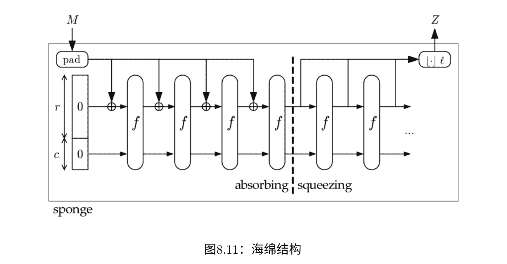

图8.11：海绵结构

```
输入：$M \in \{0, 1\}^{\leq L}$ 和 $\ell > 0$ 
输出：一个标签 $h \in \{0, 1\}^v$
//吸收阶段
填充 $M$ 并分成 $r$ 位块 $m_1, \ldots, m_s$
$h \leftarrow 0^n$
对于 $i \leftarrow 1$ 到 $s$ 执行
    $m'_i \leftarrow m_i \| 0^c \in \{0, 1\}^n$
    $h \leftarrow \pi(h \oplus m'_i)$
//挤压阶段
$z \leftarrow h[0 \ldots r \oplus 1]$
对于 $i \leftarrow 1$ 到 $\lceil v/r \rceil$ do
    $h \leftarrow \pi(h)$
    $z \leftarrow z \| (h[0 \ldots r \oplus 1])$
output $z[0 \ldots v \oplus 1]$
```

图8.11中的图表可能有助于澄清算法。海绵运行分为两个阶段：“吸收阶段”中，消息块被“混入”到链接变量 $h$ 中，以及“挤压阶段”中，输出被“从链接变量中拉出”。请注意，输入块和输出块是 $r$ 位字符串，因此链接变量的剩余 $c$ 位不能被攻击者直接篡改或查看。这就是为什么海绵具有安全性的原因，也是为什么 $c$ 必须很大的原因。事实上，如果海绵的容量很小，很容易找到碰撞（参见练习8.20）。

在SHA3标准中，海绵结构被用作抗碰撞哈希函数，并且输出长度被固定为一个值 $v \leq r$，因此挤压阶段只需输出输出的前 $v$ 位 $h$ of the absorbing stage。我们将证明这个版本的海绵函数在理想置换模型下是抗碰撞的，假设 $2^c$ 和 $2^v$ 都是超多项式的。

定理8.6. 设 $H$ 是从置换 $\pi$ 得到的哈希函数：$\{0, 1\}^n \to \{0, 1\}^n$，具有容量 $c$，速率 $r$（所以 $n = r + c$），和输出长度 $v \leq r$。在理想置换模型中，

$\pi$ 被建模为一个随机置换 $\Pi$，哈希函数 $H$ 是抗碰撞的，假设 $2^v$ 和 $2^c$ 都是超多项式的。

特别是，对于每个碰撞查找对手 $\mathcal{A}$，如果理想置换查询的数量加上 $\mathcal{A}$ 输出消息中的 $r$ 位块的数量受到 $q$ 的限制，则

$$\text{CR}^{c}\text{adv}[\mathcal{A}, H] \leq \frac{q(q + 1)}{2^v} + \frac{q(q + 1)}{2^c}.$$

证明。与定理8.4的证明类似，我们假设我们的碰撞查找对手是“合理的”，即它进行了与其输出相对应的理想置换查询。我们可以通过强制对手对其输出消息进行哈希函数评估（如果尚未执行）来轻松地将任意对手转换为合理对手。如我们所定义的，$q$ 将是我们合理对手进行的理想置换查询的总数的上限。

因此，从现在开始，我们假设一个最多进行 $q$ 个查询的合理对手 $\mathcal{A}$，并限制这样的 $\mathcal{A}$ 在其查询期间找到可以“组装”成碰撞的任何内容的概率（我们将在下面更详细地说明）。

我们还假设没有冗余查询。这意味着如果对手对 $a$ 进行 $\Pi$-查询得到 $b = \Pi(a)$，那么对手永远不会对 $b$ 进行 $\Pi^{-1}$ 查询，并且永远不会对 $a$ 进行另一个 $\Pi$-查询；同样，如果对手对 $b$ 进行 $\Pi^{-1}$ 查询得到 $a = \Pi^{-1}(b)$，那么对手永远不会对 $a$ 进行 $\Pi$-查询，并且永远不会对 $b$ 进行另一个 $\Pi^{-1}$ 查询。当然，对手没有必要进行这种冗余查询，这就是为什么我们排除它们的原因；此外，这样做极大地简化了证明中的“记账”工作。

将对手的攻击视为构建一个有向图 $G$ 会有所帮助。$G$ 中的节点由长度为 $2^n$ 的所有位字符串组成。图 $G$ 起初没有边，每个 $\mathcal{A}$ 的查询都会向图中添加一条边：如果 $\mathcal{A}$ 对 $a$ 进行 $\Pi$-查询得到 $b$ 或者对 $b$ 进行 $\Pi^{-1}$ 查询得到 $a$，则添加一条边 $a \rightarrow b$。注意，如果有一条边 $a \rightarrow b$，那么 $\Pi(a) = b$，无论这条边是通过 $\Pi$-查询还是 $\Pi^{-1}$ 查询添加的。我们称通过 $\Pi$-查询添加的边为正向边，通过 $\Pi^{-1}$ 查询添加的边为反向边。

请注意，对手不进行冗余查询的假设意味着每个边只会被添加一次到图中，并且它的分类是由查询类型唯一确定的。

接下来，我们定义了图中与海绵评估相对应的特殊路径的概念。对于一个 $z$ 的 $t$ 位字符串，$R(z)$ 表示 $z$ 的前 $t$ 位，$C(z)$ 表示 $z$ 的后 $c$ 位。我们将 $R(z)$ 称为 $z$ 的 $R$ 部分，将 $C(z)$ 称为 $z$ 的 $C$ 部分。对于 $s$ 为0或1的整数，长度为 $s$ 的 $C$ 路径是一个由 $2s$ 个节点组成的序列，$b$ 为 $0$ 或 $1$ 的整数 $a$ 为 $0$ 或 $1$ 的整数 $b$ 为 $s$。

其中

- $C(a_0) = 0^c$ 并且对于 $i= 1, \ldots, s \oplus 1$, 我们有 $C(b_i) = C(a_i)$, 并且
- $G$ 包含边缘 $a_{i-1} \rightarrow b_i$ 对于 $i= 1, \ldots, s$。

对于这样的路径 $p$, $p$ 的消息被定义为 $(m_0, \ldots, m_{s-1})$, 其中

$$m_0 := R(a_0) \text{ 并且 } m_i := R(b_i) \oplus R(a_i) \text{ 对于 } i= 1, \ldots, s \oplus 1.$$

并且 $p$ 的结果被定义为 $m_s := R(b_s)$。这样的 $C$ 路径 $p$ 对应于在消息 $(m_0, \dots, m_{s-1})$ 上评估海绵并获得（未截断的）输出 $m_s$。让我们将这样的路径写为

$m_0|a_0 \oplus \rightarrow b_1|m_1|a_1 \oplus \rightarrow \dots \oplus \rightarrow b_{s-2}|m_{s-2}|a_{s-2} \oplus \rightarrow b_{s-1}|m_{s-1}|a_{s-1} \oplus \rightarrow b_s|m_s.$  $(8.12)$

下图说明了长度为3的 $C$ 路径。

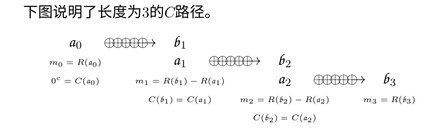

该路径具有消息 $(m_0, m_1, m_2)$ 和结果 $m_3$。使用 (8.12) 中的符号，我们将此路径写为

$m_0|a_0 \oplus \rightarrow b_1|m_1|a_1 \oplus \rightarrow b_2|m_2|a_2 \oplus \rightarrow b_3|m_3.$

现在我们可以描述碰撞在图 $G$ 中的表现形式。它是一对 $C$-路径，不同的消息但其结果在它们的前 $v$ 位上相同（回忆 $v \leq r$）。让我们称这样一对路径为碰撞。

为了分析找到一对碰撞路径的概率，定义另一个概念会很方便。设 $p$ 和 $p'$ 是两个不同消息上的 $C$ 路径，它们的最后一条边分别是 $a_{s-1} \rightarrow b_s$ 和 $a'_{t-1} \rightarrow b'_t$。如果这样一对路径存在，我们称之为有问题的。

- (i) $a_{s-1} = a'_{t-1}$，或者
- (ii) $p$ 或 $p'$ 中的一条边是回边。

设 $W$ 是 $\mathcal{A}$ 找到一对碰撞路径的事件。设 $Z$ 是 $\mathcal{A}$ 找到一对有问题路径的事件。那么我们有

$\Pr[W] \leq \Pr[Z] + \Pr[W \text{ 且非 } Z]$  $(8.13)$

首先，我们限制了 $\Pr[W \text{ 且非 } Z]$。对于一个 $z$ 位的字符串，让 $V(z)$ 是 $z$ 的前 $v$ 位，我们将 $V(z)$ 称为 $z$ 的 $V$ 部分。假设 $\mathcal{A}$ 能够找到一对不会引起问题的碰撞路径。根据定义，这两条路径的最后一条边对应于在不同输入上进行的 $\Pi$-查询，其输出的 $V$ 部分相同。也就是说，如果出现 $W$ 和非 $Z$，那么必定存在某个时刻 $\mathcal{A}$ 发出了两个 $\Pi$-查询，分别在不同的输入 $a$ 和 $a'$ 上，得到了输出 $b$ 和 $b'$，使得 $V(b) = V(b')$。我们可以使用并集边界：对于每一对索引 $i < j$，令 $X_{ij}$ 为事件，即第 $i$ 个查询是一个 $\Pi$-查询，对某个值 $a$，得到 $b = \Pi(a)$，而第 $j$ 个查询也是一个 $\Pi$-查询，对某个其他值 $a' = a$，得到 $b' = \Pi(a')$，使得 $V(b) = V(b')$。如果我们固定 $i$ 和 $j$，固定 $\mathcal{A}$ 的硬币，并固定在第 $j$ 个查询之前进行的所有查询的输出，那么值 $a$、$b$ 和 $a'$ 都是固定的，但是值 $b'$ 在至少有 $2^n \oplus j + 1$ 个元素的集合上均匀分布。为了得到 $V(b) = V(b')$，值 $b'$ 必须等于与 $b$ 的前 $v$ 位相同的 $2^{n-v}$ 个字符串之一，因此我们有

$\Pr[X_{ij}] \leq \frac{2^{n-v}}{2^n \oplus j + 1}$

像定理8.4证明中的(8.5)那样进行的简单计算得出

$$\Pr[W \text{ 且非 } Z] \leq \frac{q(q \oplus 1)}{2^v}. \tag{8.14}$$

其次，我们限制了 $\Pr[Z]$，即 $\mathcal{A}$ 找到一对有问题的路径的概率。分析的技术核心如下：

主要声明：如果 $Z$ 发生，则以下情况之一发生：

- (E1) 某个查询的输出的 $C$ 部分为 $0^c$，或者
- (E2) 两个不同的查询的输出的 $C$ 部分相等。

只是为了明确起见，(E1) 意味着 $\mathcal{A}$ 进行了以下形式的查询：

- (i) 对某个值 $b$ 进行了一个 $\Pi^{-1}$ 查询，使得 $C(\Pi^{-1}(b)) = 0^c$，或者
- (ii) 对某个值 $a$ 进行了一个 $\Pi$ 查询，使得 $C(\Pi(a)) = 0^c$

而 (E2) 意味着 $\mathcal{A}$ 一对查询的形式：

- (i) 对某个值进行 $\Pi$-查询 $a$ 和 $\Pi^{-1}$ 对某个值进行查询 $b$，使得 $C(\Pi(a)) = C(\Pi^{-1}(b))$，或者
- (ii) 对两个不同的值进行 $\Pi$-查询 $a$ 和 $a'$，使得 $C(\Pi(a)) = C(\Pi(a'))$

首先，假设 $\mathcal{A}$ 能够找到一个有问题的路径对，其中一个路径包含一个反向边。因此，在执行结束时，存在一个包含一个或多个反向边的 $C$-路径。让 $p$ 是这样一条最短长度的路径，并将其写成 (8.12) 的形式。我们观察到 $p$ 中的最后一条边是一个反向边，而其他边（如果有的话）都是正向边。事实上，如果不是这种情况，那么我们可以从 $p$ 中删除这条边，得到一条包含反向边的更短的 $C$-路径，这与 $p$ 是这种类型的最短路径的假设相矛盾。根据这个观察，我们可以得出以下结论之一：

- $s = 1$ 并且 (E1) 在 $\Pi^{-1}$ 查询中出现在 $b_1$，或者
- $s > 1$ 并且 (E2) 在 $\Pi^{-1}$ 查询中出现在 $b_s$ 和 $\Pi$-查询中的 $a_{s-2}$。

其次，假设 $\mathcal{A}$ 能够找到一对不包含任何反向边的有问题的路径。让我们称这些路径为 $p$ 和 $p'$。在这种情况下，论证有点类似于Merkle-Damgård分析中的“反向行走”。将 $p$ 写成 (8.12)，将 $p'$ 写成

$$m'_0|a'_0 \oplus \rightarrow b'_1|m'_1|a'_1 \oplus \rightarrow \cdots \oplus \rightarrow b'_{t-2}|m'_{t-2}|a'_{t-2} \oplus \rightarrow b'_{t-1}|m'_{t-1}|a'_{t-1} \oplus \rightarrow b'_t|m'_t.$$

我们假设 $(m_0, \ldots, m_{s-1}) = (m'_0, \ldots, m'_{t-1})$ 但是 $a_{s-1} = a'_{t-1}$，并且这些边都不是回边。我们还假设选择的路径是最短的，即在这种类型的 $C$-路径中 $s+t$ 是最小的。另外，让我们假设 $s \le t$（如果需要交换）。有几种情况：

1. $s = 1$ 且 $t = 1$。这种情况是不可能的，因为在这种情况下路径只是 $m_0|a_0 \rightarrow b_1|m_1$ 和 $m'_0|a'_0 \rightarrow b'_1|m'_1$，我们不能同时有 $m_0 = m'_0$ 和 $a_0 = a'_0$。
2. $s = 1$ 且 $t \geq 2$。在这种情况下，我们有 $a_0 = b'_{t-1}$，因此 (E1) 在 $a'_{t-2}$ 的 $\Pi$-查询中发生。
3. $s \geq 2$ and $t \geq 2$。

考虑倒数第二条边，即正向边：
$$
a_{s-2} \rightarrow b_{s-1} | m_{s-1} | a_{s-1}
$$
和
$$
a'_{t-2} \rightarrow b'_{t-1} | m'_{t-1} | a'_{t-1}.
$$
我们假设 $a_{s-1} = a'_{t-1}$。因此，$b_{s-1}$ 和 $b'_{t-1}$ 的 $C$ 部分相等，它们的 $R$ 部分由 $m_{s-1} \oplus m'_{t-1}$ 不同。有两种子情况：

我们认为这种情况是不可能的。实际上，在这种情况下，我们有 $b_{s-1}=b'_{t-1}$，因此 $a_{s-2}=a'_{t-2}$，而截断的消息 $(m_0, ..., m_{s-2})$ 和 $(m'_0, ..., m'_{t-2})$ 不同。因此，我们可以简单地丢弃每个路径中的最后一条边，得到一对更短的路径，这与 $s \leq t$ 的最小性相矛盾。

在这种情况下，我们知道：$b_{s-1}$ 和 $b'_{t-1}$ 的 $C$ 部分相同，但是它们的 $R$ 部分不同，因此 $a_{s-1}=a'_{t-2}$。因此，在对 $a_{s-2}$ 和 $a'_{t-2}$ 进行 $\Pi$-查询时发生 (E2)。

这证明了主要的声明。现在我们可以转向界定 (E1) 或 (E2) 发生的概率的问题。这实际上只是我们之前至少计算过两次的相同类型的计算，一次是在得到 (8.13) 时，另一次是在定理8.4的证明中。与 (8.13) 的唯一区别是我们现在在 $C$ 部分计算碰撞，并且我们有一种新的“碰撞”类型要计算，即“命中 $0^c$”如 (E1) 中所示。我们将其留给读者验证：

$$\Pr[Z] \leq \frac{q(q+1)}{2^c}. \tag{8.15}$$

该定理现在可以从 (8.13)-(8.15) 推导出来。$\square$

### 8.8.2 案例研究：SHA3, SHAKE256和SHAKE512

NIST SHA3规范规定了一系列基于海绵结构的哈希函数。这些哈希函数的核心是一个称为Keccak的置换，它将1600位字符串映射到1600位字符串。我们用Keccak[c]表示从具有容量 $c$ 的Keccak派生的海绵，并使用 $10^*1$ 填充规则。这是一个接受两个输入的函数：一个消息 $m$ 和输出长度 $v$。在这里，输入 $m$ 是任意的比特串，Keccak[c](m, v) 的输出是一个 $v$ 位的比特串。

我们不会描述Keccak置换的内部工作原理；可以在SHA3标准中找到。我们只描述标准化的不同参数选择。标准规定了四个输出长度固定的哈希函数，以及两个输出长度可变的哈希函数。

以下是四个输出长度固定的哈希函数：

- SHA3-224(m) = Keccak[448](m || 01, 224);
- SHA3-256(m) = Keccak[512](m || 01, 256);
- SHA3-384(m) = Keccak[768](m || 01, 384);
- SHA3-512(m) = Keccak[1024](m || 01, 512).

请注意消息后附加的两个额外填充位。请注意，在每种情况下，容量c等于输出长度v的两倍。因此，随着输出长度的增加，容量提供的安全性也增加，速率→因此，哈希速度→减慢。

这里有两个可变长度输出哈希函数：

+   SHAKE128(m, v) = Keccak[256](m || 1111, v);
+   SHAKE256(m, v) = Keccak[512](m || 1111, v).

请注意附加到消息的四个额外填充位。这两者之间唯一的区别是容量大小，这会影响速度和安全性。各种填充位和10*1填充规则确保这六个函数行为独立。

## 8.9 Merkle树：使用碰撞抵抗证明数据库成员资格

待写。

## 8.10 密钥派生和随机预言机模型

尽管像SHA256这样的哈希函数最初设计用于提供碰撞抵抗，但我们已经在第8.7节中看到从业者经常倾向于将它们用于解决其他问题。
直观地说，像SHA256这样的哈希函数被设计为“彻底混淆”其输入，因此这种方法似乎有些合理。事实上，在第8.7节中，我们研究了将无钥散列函数转化为安全PRF的问题，并发现在合理的假设下可以进行安全分析。

在这一部分中，我们研究另一个问题，称为密钥派生。粗略地说，这个问题是：我们从一些秘密数据开始，我们想将其转换为一个n位字符串，我们可以将其用作某些加密原语（如AES）的密钥。现在，秘密数据可能在某种意义上是随机的 - 至少有点难以猜测 - 但它可能看起来与均匀分布的、随机的n位字符串完全不同。那么，我们如何从这样的秘密s得到一个加密密钥t？当然是通过散列。在实践中，人们使用散列函数H，例如SHA256（或者，正如我们最终推荐的那样，由SHA256构建的某个函数），并计算

```
t = H(s)。
```

在此过程中，我们还将介绍random oracle模型，这是一个启发式工具，不仅对于分析密钥派生问题有用，而且对于许多其他问题也有用。

### 8.10.1 密钥派生问题

让我们更详细地看一下密钥派生问题。再次，从高层次来看，问题是将一些难以猜测的离散数据转换为我们可以直接用作密钥的n位字符串，例如AES。在所有情况下，解决方案都是通过哈希算法获取密钥。我们从一些激励性的例子开始。

+   秘密可能是一个密码。虽然这样的密码可能有点难以猜测，但直接将其作为AES密钥使用可能是危险的。即使密码是
在一个大字典上均匀分布（已经是一个可疑的假设），它作为位字符串的编码分布肯定不是均匀的。很可能有相当大一部分密码对应于使AES易受攻击的“弱密钥”。回想一下，AES的设计是使用随机位字符串作为密钥，所以它在密码上的行为完全是另一回事。
+   秘密可能是运行计算机上各种类型系统事件的日志（例如，由按键或鼠标移动引起的各种中断的时间）。同样，对于位于计算机系统外部的攻击者来说，准确预测此类日志的内容可能很困难。然而，直接使用日志作为AES密钥存在问题：它可能太长，并且远非均匀分布。
+   秘密可能是部分泄露的加密密钥。想象一下，用户拥有一个128位密钥，但其中64位已经泄露给对手。从对手的角度来看，密钥仍然相当难以猜测，但仍然不是均匀分布的，因此不应直接用作AES密钥。
+   稍后，我们将看到在公钥密码学中广泛使用的数论变换的示例。稍微展望一下，我们将看到对于一个大的复合模数N，如果随机选择一个模N的x，并且对手给出y := x^3 mod N，计算x是困难的。我们可以将x视为秘密，类似于前面的例子，我们可以将y视为泄露给对手的信息。尽管在信息论意义上，y完全确定了x的值，但人们普遍认为计算它是困难的。因此，我们可能希望像前面的例子一样将x视为秘密数据。这里出现了许多相同的问题，其中最重要的问题之一是x通常比AES密钥长得多（通常为数千位）。

正如已经提到的，实际上采用的解决方案就是简单地使用哈希函数 H 对秘密进行哈希处理，以获得密钥 t

现在让我们正式给出我们追求的安全性质的定义。
我们假设秘密 s 是根据某个固定的（并且公开已知的）概率分布 P 进行采样的。我们假设任何这样的秘密数据都可以编码为某个有限集合 S 的元素。此外，我们通过引入一个函数 I 来模拟关于秘密 s 的一些部分信息可能会泄漏的情况，这样试图猜测秘密 s 的对手就会知道侧面信息 I(s)。

#### 攻击游戏8.2（猜测优势）。让 P 是定义在一个有限集合 S 上的概率分布，并且让 I 是在 S 上定义的一个函数。. 对于给定的对手 A，攻击游戏的运行如下：

+   挑战者根据 P 随机选择 s 并将 I(s) 发送给 A;
+   对于，对手输出一个猜测 ^s，如果 ^s = s，则赢得比赛。

A 赢得这场比赛的概率被称为其猜测优势，表示为 Guessadv[A, P, I]。 □

在上面的第一个例子中，我们可以简单地将 s 建模为一个在某个字典 D of words 的编码上均匀分布的密码。在这种情况下，没有
无论对手的计算能力如何，给对手的附加信息是1/|D|，猜测优势都是1/|D|。

在上面的第二个例子中，似乎很难给出一个有意义且可靠的猜测优势估计。

在上面的第三个例子中，$s$在$\{0,1\}^{128}$上均匀分布，$I(s)$是$s$的前64位（假设如此）。显然，无论对手多么强大，猜测优势都不会超过$2^{-64}$。

在上面的第四个例子中，$s$是数字$x$，而$I(s)$是数字$y$。由于$y$完全确定了$x$，可以通过穷举搜索从$I( s)$中恢复出$s$。还有更聪明和更快的算法，但目前没有已知的高效算法可以做到这一点。因此，对于所有高效的对手来说，猜测的优势似乎是可以忽略不计的。

现在假设我们使用一个哈希函数 $H: S \to T$ 来从 $s$ 派生密钥 $t$。直观上，我们希望 $t$ “看起来随机”。为了形式化这个直观的概念，我们使用第3.11节中的计算不可区分性的概念。因此，我们希望的属性是，如果 $s$ 按照 $P$ 进行采样，$t$ 从 $T$ 中随机选择，那么两个分布 $(I(s), H(s))$ 和 $(I(s), t)$ 在计算上是不可区分的。对于一个对手 $\mathcal{A}$，让 $\text{Distadv}[\mathcal{A}, P, I, H]$ 表示这两个分布在攻击游戏3.3中对手的优势。

我们希望能够证明的定理类型大致上说，如果 $H$ 满足某些特定属性，并且对 $P$ 和 $I$ 施加了一些约束，则 $\text{Distadv}[\mathcal{A}, P, I, H]$ 不会比 $\text{Guessadv}[\mathcal{A}, P, I]$ 大太多。实际上，在某些情况下，我们可以证明这样的定理。我们将在第8.10.4节中讨论这个结果——现在，我们只是简单地说这种严格的方法在实践中并不常用，原因有很多。相反，我们将更详细地研究使用“现成”的哈希函数（如SHA256）来派生密钥的启发式方法。

子密钥派生。在继续之前，我们考虑以下相关问题：如何处理从 $s$ 派生的密钥 $t$。在某些应用中，我们可能直接使用 $t$ 作为AES密钥。然而，在其他应用中，我们可能需要多个密钥：例如，一个加密密钥和一个MAC密钥，或者用于双向安全通信的两个不同的加密密钥（因此，Alice用一个密钥向Bob发送加密消息，而Bob使用一个不同的密钥向Alice发送加密消息）。因此，一旦我们派生出一个行为“在所有意义上”类似于随机比特串的单个密钥 $t$，我们希望派生出多个子密钥。我们将这称为子密钥派生问题，以区别于密钥派生问题。对于子密钥派生问题，我们假设我们从一个真正随机的密钥 $t$ 开始——虽然实际上并非如此，但当 $t$ 在计算上无法区分与真正随机密钥时，这个假设是合理的。

幸运的是，对于子密钥派生，我们已经拥有我们需要的所有工具。事实上，我们可以使用PRG或PRF从 $t$ 派生子密钥。例如，在上面的例子中，如果爱丽丝和鲍勃有一个共享密钥 $t$，从一个秘密 $s$ 派生的，他们可以使用PRF $F$ 如下：

+   派生一个MAC密钥 $k_{\text{mac}} \stackrel{R}{\leftarrow} F(t, \text{"MAC-KEY"})$;
+   派生一个爱丽丝到鲍勃的加密密钥 $k_{AB} \stackrel{R}{\leftarrow} F(t, \text{"AB-KEY"})$;
+   派生一个鲍勃到爱丽丝的加密密钥 $k_{BA} \stackrel{R}{\leftarrow} F(t, \text{"BA-KEY"})$。

假设 $F$ 是一个安全的PRF，那么密钥 $k_{\text{mac}}$, $k_{AB}$ 和 $k_{BA}$ 在所有意义上都表现得像独立的随机密钥。为了实现 $F$，我们甚至可以使用基于哈希的PRF，比如HMAC，所以
我们可以使用一个单一的“现成”哈希函数（如SHA256）来完成我们所需的所有工作-密钥派生和子密钥派生。

因此，一旦我们解决了密钥派生问题，我们就可以使用成熟的工具来解决子密钥派生问题。不幸的是，使用“现成”哈希函数进行密钥派生的实践并不是很好理解或分析。尽管如此，还是有一些有用的启发式模型可以探索。

### 8.10.2 随机神谕：一个有用的启发式

现在，我们介绍一种启发式模型，可以用来模拟在各种应用中使用哈希函数，包括密钥派生。正如我们将在本文中看到的，这已经成为一种流行的启发式模型，用于证明许多密码构造的合理性。

这个想法是，我们将哈希函数 H模拟成一个真正的随机函数O。如果 H将 M映射到 T，那么O是从集合Funs[M, T]中均匀随机选择的。我们可以将任何攻击游戏转化为其随机预言版本：挑战者在所有计算中使用 O代替H，并且除此之外，攻击者还可以获取他选择的任意输入点上 O的值。函数 O被称为随机预言，并且在这种情况下，安全性被认为在随机预言模型中成立。函数 O太大无法写下，也不能在实际构造中使用。相反，我们只使用 O作为对实际使用 H的提议系统进行启发式安全分析的手段。

使用哈希函数分析构造的方法类似于第4.7节介绍的理想密码模型，在该模型中，我们用随机置换的族 {Πk}k∈K替换了定义在(K, X)上的块密码 E= (E, D)。

正如我们所说，随机预言模型在现代密码学中被广泛使用，我们希望能够使用一个“现成的”哈希函数 H，并将其建模为一个随机预言。然而，如果我们想要一个真正通用的工具，我们必须要小心一点，特别是如果我们想将 H建模为一个接受可变长度输入的随机预言。基本的经验法则是，Merkle-Damgård哈希函数不应直接用作通用随机预言。我们将在第8.10.3节讨论如何安全地（但是启发式地）使用Merkle-Damgård哈希函数作为通用随机预言，并且我们还将看到海绵构造（见第8.8节）可以直接“原样”使用。

我们强调，尽管随机预言机中的安全性结果是严谨的、数学定理，但它们仍然只是启发式结果，并不能保证使用任何特定哈希函数构建的系统的安全性。然而，它们确实排除了对于哈希函数是随机预言机的系统的“通用攻击”。因此，虽然这些结果并不能排除所有攻击，但它们确实排除了通用攻击，这比对系统的安全性一无所知要好。实际上，在现实世界中，如果我们在两个系统S₁和S₂之间选择，其中S₁在随机预言机模型中具有安全性证明，而S₂具有真实的安全性证明但速度是S₁的两倍，大多数从业者（非常合理地）会选择S₁而不是S₂。

在随机预言机模型中定义安全性。假设我们有一种类型的密码学方案S，其实现使用一个计算哈希函数H的子程序，该哈希函数在(M, T)上定义。方案S在其选择的任意点上评估H，但不查看H的内部实现。我们说S将H用作预言机。例如，Fpre(k, x) := H(k∥x)，我们在第8.7节简要讨论过的伪随机函数就使用了哈希函数H作为预言机。
我们希望分析 $S$ 的安全性。让我们假设我们对任何感兴趣的安全属性，比如“属性X”，都建模为一个游戏，这个游戏是一个挑战者（特定于属性X）和一个任意的对手 $\mathcal{A}$之间的对抗。可以推测，在回答某些查询时，挑战者计算与方案 $S$相关的各种函数，而这些函数可能需要在某些点上评估 $H$。这个游戏定义了一个优势Xadv[$\mathcal{A}$, $S$]，而与属性X相关的安全性意味着对于所有高效的对手 $\mathcal{A}$来说，这个优势应该是可以忽略的。

如果我们希望在随机预言模型中分析 $S$，那么定义安全性的攻击游戏将被修改，以便 $H$被一个随机函数 $\mathcal{O} \in \mathrm{Funs}[\mathcal{M}, \mathcal{T}]$有效地替代，对手和挑战者都可以访问这个预言。更准确地说，游戏被修改如下。

+   在游戏开始时，挑战者随机选择 $\mathcal{O} \in \mathrm{Funs}[\mathcal{M}, \mathcal{T}]$。
+   除了标准查询外，对手 $\mathcal{A}$可以提交随机预言查询：它给出 $m \in \mathcal{M}$给挑战者，挑战者用 $t = \mathcal{O}(m)$回应。对手可以进行任意数量的随机预言查询，与标准查询任意交错。
+   在处理标准查询时，挑战者使用 $\mathcal{O}$代替$H$进行计算。

对手的优势使用与之前相同的规则定义，但用X$^{\mathrm{ro}}$adv[$\mathcal{A}$, $S$]表示，以强调这是在随机预言模型中的优势。在随机预言模型中的安全性意味着对于所有高效对手$\mathcal{A}$，X$^{\mathrm{ro}}$adv[ $\mathcal{A}$, $S$]应该是可以忽略的。

一个简单的例子：随机预言模型中的伪随机函数。我们演示如何应用随机预言框架构建安全的伪随机函数。特别地，我们将展示 $F_{\mathrm{pre}}$是随机预言模型中的安全伪随机函数。. 我们首先调整标准伪随机函数安全性游戏，以获得随机预言模型中的伪随机函数安全性游戏。为了更清晰地说明，如果我们有一个使用哈希函数 $H$作为预言的伪随机函数$F$，我们用 $F^\mathcal{O}$表示使用随机预言 $\mathcal{O}$代替 $H$的函数。

#### 攻击游戏8.3 (在随机预言机模型中的伪随机函数)。设 $F$为在 ($\mathcal{K}$, $\mathcal{X}$, $\mathcal{Y}$) 上定义的伪随机函数它使用在 ($\mathcal{M}$, $\mathcal{T}$) 上定义的哈希函数 $H$作为预言机。对于给定的对手 $\mathcal{A}$，我们定义两个实验，实验0和实验1。对于 $b= 0,1$，我们定义：

+   $\mathcal{O} \stackrel{\mathrm{R}}{\leftarrow} \mathrm{Funs}[\mathcal{M}, \mathcal{T}]$。
+   挑战者按照以下方式选择 $f \in \mathrm{Funs}[\mathcal{X}, \mathcal{Y}]$：
  如果 $b= 0$: $k \stackrel{\mathrm{R}}{\leftarrow} \mathcal{K}$,  $F^\mathcal{O}(k, \cdot)$;
  如果 $b= 1$: $f \stackrel{\mathrm{R}}{\leftarrow} \mathrm{Funs}[\mathcal{X}, \mathcal{Y}]$。
+   对手向挑战者提交一系列查询。
  - $F$查询：对于查询 $x \in \mathcal{X}$, 回答 $y = f\left( x \right) \in \mathcal{Y}$。
  - $\mathcal{O}$查询：对于查询 $m \in \mathcal{M}$, 回答 $t = \mathcal{O}\left( m \right) \in \mathcal{T}$。
+   对手计算并输出一个比特 $\hat{b} \in \left\{ 0, 1 \right\}$。

对于 b=0,1，令 W_b 为 A 在实验 b 中输出 1 的事件。我们定义 A 相对于 F 的优势为

```
PRF^{ro}adv[A, F] := |Pr[W_0] ⊕ Pr[W_1]|. □
```

#### 定义 8.3. 我们说一个 PRF F 在随机预言机模型下是安全的，如果对于所有高效的对手 A，值 PRF^{ro}adv[A, F] 是可以忽略的。

再次考虑 PRF F_pre(k, x) := H(k || x)。让我们假设 F_pre 在 (K, X, T)上定义，其中 K = {0,1}^κ 和 X = {0,1}^{≤L}，而 H 在 (M, T)上定义，其中 M 包括所有长度最多为 κ + L 的比特串。

我们将证明这是一个在随机预言机模型下安全的 PRF。但是等等！我们已经在第8.7节中讨论过，当 H 是 Merkle-Damgård 哈希函数时，F_pre 是完全不安全的。这似乎是一个矛盾。问题在于，正如已经提到的，直接使用 Merkle-Damgård 哈希函数作为随机预言机是不安全的。我们将在第8.10.3节中看到如何解决这个问题。

#### 定理8.7. 如果 κ 很大，那么当 H 被建模为随机预言机时，F_pre 是一个安全的 PRF。

特别地，如果 A 是一个随机预言机 PRF 对手，就像在攻击游戏8.3中一样，最多进行 Q_ro 个预言机查询，那么

```
PRF 对手^{ro}adv[A, F_pre] ≤ Q_ro / |K|
```

请注意定理8.7是无条件的，也就是说对 A 的唯一约束是对 A 的 oracle 查询次数的限制：它不依赖于任何复杂性假设。

证明思路。一旦 H 被替换为 O，对手就需要区分 O(k || ·) 和 Funs[X, T] 中的随机函数，而没有 k 这个密钥。由于 O(k || ·) 是 Funs[X, T] 中的随机函数，对手唯一的希望就是从对 O 的查询返回的信息中获得一些帮助。我们称一个 O 查询 k' || x' 为相关查询，如果 k' = k。很明显，对于不相关的 O 查询无法帮助区分 O(k || ·) 和随机函数，因为返回的值与函数 O(k || ·) 无关。此外，在进行 Q_ro 次查询后，对手成功发出相关查询的概率最多为 Q_ro / |K|. □

证明。为了使这个证明思路严谨，我们让 A 与两个 PRF 挑战者进行交互。对于 j = 0, 1，让 W_j 表示 A 在游戏 j 中输出 1 的事件。

游戏0。我们将游戏0的挑战者写成与攻击游戏8.3的实验0等价，但对我们进行分析更方便。我们假设攻击者从不重复进行相同的 F_pre 查询。此外，我们使用一个关联数组 Map: M → T 来动态构建随机 oracle，使用我们经常使用的“忠诚的小矮人”思想。这是我们的挑战者：初始化：
- 初始化空的关联数组 Map: M → T
- k ← K
- 在收到关于 x 的 F_pre 查询时，其中 x ∈ {0,1}^{≤ L} do:
    - t ← T
    - (1) 如果 (k || x) ∈ Domain(Map) 则 t ← 映射[k || x]
    - (2) 映射[k || x] ← t
    - 发送 t 给 A
- 收到一个 O 查询 m ∈ M 时:
    - t ← T
    - 如果 m ∈ Domain(映射) 那么 t ← 映射[m]
    - 映射[m] ← t
    - 发送 t 给 A

很明显，这个挑战者等同于攻击游戏8.3中实验0中的挑战者。在游戏0中，每当挑战者需要对某个输入进行随机预言采样（在处理 F_pre 查询或 O 查询时），它会生成一个随机的“默认输出”，如果发现该输入已经被采样过，则覆盖该默认输出；无论哪种情况，关联数组都会记录输入/输出对。

游戏1。我们让我们的小矮人“健忘”：我们在游戏0中删除了标记为（1）和（2）的行。现在观察到，在游戏1中，挑战者在响应 F_pre 查询时不使用映射或 k：它只返回一个随机值。因此，很明显（根据 A no 不会两次进行相同的 F_pre 查询的假设），游戏1等同于攻击游戏8.3中实验1，因此

$$ \text{PRF}^{\text{ro}}_{\text{adv}}[A, F_{\text{pre}}] = |\Pr[W_1] \oplus \Pr[W_0]| $$

令 Z 为在游戏1中，对手在点 m = (k || \hat{x}) 处进行 O 查询的事件。很明显，除非 Z 发生，否则两个游戏的结果相同，因此根据差异引理，我们有

$$ |\Pr[W_1] \oplus \Pr[W_0]| \leq \Pr[Z] $$

由于密钥 k 在游戏1中与 A 的视图完全独立，每个 O 查询以概率 1/|K| 命中密钥，因此简单应用并集界定得到

$$ \Pr[Z] \leq Q_{\text{ro}} / |K| $$

证明完成。 □

## 在随机预言模型中的密钥派生

现在让我们回到第8.10.1节中介绍的密钥派生问题。再次，我们有一个从某个分布 P 中采样的秘密 s，且信息 I(s)泄露给对手。我们想要证明，如果 H 被建模为一个随机预言，那么对手在区分 (I(s), H(s)) 和 (I(s), t)（其中 t 是真正的随机数）方面的优势不会比对手仅仅通过 I(s)（而不是 H(s)）猜测秘密 s 的优势更大。

为了将 H 建模为一个随机预言 O，我们将计算不可区分攻击游戏3.3转换为随机预言模型，这样攻击者现在试图区分 (I(s), O(s)) 来自 (I(s), t), 给定对 O的访问权限。 相应的优势被表示为 $\text{Distro}_{\text{adv}}[A, P, I, H]$。

在陈述我们的安全定理之前，将攻击游戏8.2推广为允许对手输出一个猜测列表 $\hat{s}_1, \ldots, \hat{s}_Q$，其中对手在游戏中获胜如果存在某个 $i = 1, \ldots, Q$ 使得 $\hat{s}_i = s$。 对手 $A$ 在这个游戏 中获胜的概率被称为他的列表猜测优势，表示为 $\text{ListGuess}_{\text{adv}}[A, P, I]$。

显然，如果对手 $A$ 能够以概率 $\epsilon$ 赢得上述列表猜测游戏，我们可以将他转化为以概率 $\epsilon/Q$ 赢得单个猜测游戏的对手：我们只需运行 $A$ 以获得一个列表 $\hat{s}_1, \ldots, \hat{s}_Q$，随机选择 $i = 1, \ldots, Q$，并输出 $\hat{s}_i$。 然而，有时我们可以做得更好：使用部分信息 $I(s)$ 可能使我们能够排除一些 $\hat{s}_i$，而在某些情况下，我们可能能够唯一地确定正确的 $\hat{s}_i$。 这取决于应用的情况。

### 定理8.8

如果 $H$ 被建模为随机预言机，则对于每个最多进行 $Q$ 个随机预言机查询的区分对手 $A$，存在一个列表猜测对手 $B$，它是 $A$ 的一个基本封装，使得

$$ \text{Distro}_{\text{adv}}[A, P, I, H] \leq \text{ListGuess}_{\text{adv}}[B, P, I] $$

并且 $B$ 输出的列表大小最多为 $Q$ 个随机预言机。 特别地，存在一个猜测对手 $B'$，它是 $A$ 的一个基本封装，使得

$$ \text{Distro}_{\text{adv}}[A, P, I, H] \leq Q \cdot \text{Guess}_{\text{adv}}[B', P, I] $$

证明。证明与定理8.7几乎完全相同。我们定义两个游戏，并对于 $j = 0, 1$，令 $W_j$ 为 $A$ 在游戏 $j$ 中输出1的事件。

游戏0. 我们将挑战者在游戏0中写成与实验0的 $(I(s), H(s))$ vs $(H(s), t)$ 区分游戏等价。. 我们即时构建随机预言机，使用关联数组 $Map : S \to T$。 这是我们的挑战者：

- 初始化：
    - 初始化空的关联数组 $Map : S \to T$
    - 根据 $P$ 生成 $s$
    - $t \overset{R}{\gets} T$
    - $Map[s] \gets t$
    - 将 $(I(s), t)$ 发送给 $A$
- 收到一个 $O$ 查询 $\hat{s} \in S$ do:
    - $\hat{t} \overset{R}{\gets} T$
    - 如果 $\hat{s} \in Domain(Map)$ 则 $t \gets Map[\hat{s}]$
    - $Map[\hat{s}] \gets \hat{t}$
    - 将 $t$ 发送给 $A$

游戏1. 我们删除标记为(*)的行。. 这个游戏等同于这个区分游戏的实验1，因为值 $t$ 现在真正独立于随机预言机。 此外，除非在游戏1中，对手 $A$ 在点 $s$ 处进行 $O$ 查询，否则两个游戏的结果相同。因此，我们的列表猜测对手 $B$ 只需接受来自自己挑战者的值 $I(s)$，并扮演游戏1 中的挑战者角色，对 $A$ 进行挑战。 在游戏结束时， $B$ 只需输出 $Domain(Map)$ —— $A$ 进行 $O$ 查询的点的列表。 关键点是：我们的 B可以在没有关于 s的任何知识的情况下扮演这个角色，除了 I(s)，并记录 A进行的所有 O查询。 因此，根据差分引理，我们有

$$ \text{Distro}_{\text{adv}}[\mathcal{A}] = |\Pr[W_0] \oplus \Pr[W_1]| \leq \text{ListGuess}_{\text{adv}}[\mathcal{B}]. \square $$

## 8.10.3 随机神谕：安全的操作模式

我们已经看到，$F_{\text{pre}}(k, x) := H(k \parallel x)$在随机预言模型中是安全的，但是我们知道，如果 $H$ 是 Merkle-Damg°ard哈希函数，它是完全不安全的。 问题在于Merkle-Damg°ard构造具有非常简单的迭代结构，这使得它容易受到“扩展攻击”的影响。 虽然这种结构从碰撞抵抗的角度来看并不是问题，但它表明随便拿一个哈希函数并将其用作随机预言就是一种危险的举动。

在本节中，我们将讨论如何安全地使用Merkle-Damg°ard哈希函数作为随机预言。 我们还将看到，海绵构造（见第8.8节）已经可以直接安全地使用；事实上，海绵的设计目的就是为了提供一个可变长度输入和可变长度输出的哈希函数，可以直接用作随机预言。

假设 $H$ 是由压缩函数 $h$ 构建的Merkle-Damg°ard哈希： $\{0, 1\}^n \times \{0, 1\}^\ell \to \{0, 1\}^n$。 一种推荐的操作模式是使用零密钥进行安全的HMAC：

$$ \text{HMAC}_0(m) := \text{HMAC}(0^\ell, m) = H(\text{opad} \parallel H(\text{ipad} \parallel m)) $$

虽然这种构造可以阻止明显的扩展攻击，但我们为什么要对$\text{HMAC}_0$作为通用随机预言机的安全性有任何信心呢？ 我们只能提供启发式证据。 基本上，我们想要论证的是$\text{HMAC}_0$中没有固有的结构弱点，这会导致将底层压缩函数本身视为随机预言机的通用攻击，或者更现实地说，将其视为基于理想密码的Davies-Meyer构造。

基本上，我们想要展示使用特定的操作模式，我们可以构建一个“大”的随机预言机，从一个“小”的随机预言机中得到——或者从一个理想密码或理想置换中得到。 这无疑是一个相当异想天开的任务——使用启发式方法来证明启发式方法——但我们将概述基本思想。

用于执行这样一个任务的数学工具被称为不可区分性。 我们将在这里介绍一个相对简化的版本。 假设我们正在尝试构建一个“大”的随机预言机 $\mathcal{O}$，从一个较小的原始 $\rho$ 中得到，其中 $\rho$ 可以是一个小域上的随机预言机，或者是一个理想密码，或者是一个理想置换。 让我们用 $F[\rho]$ 表示基于理想原始 $\rho$ 的特定构造的一个随机预言机。

现在考虑一个由某个挑战者 $\mathcal{C}$ 和对手 $\mathcal{A}$ 定义的通用攻击游戏。 让我们将 $\mathcal{C}$ 和 $\mathcal{A}$ 之间的交互写为 $\langle \mathcal{C}, \mathcal{A} \rangle$。 我们假设交互结果是一个输出比特。 我们所有的安全定义都是以这种形式的游戏为模型。

在攻击游戏的随机预言版本中，使用大型随机预言 $\mathcal{O}$，我们会给挑战者和对手都提供对随机函数 $\mathcal{O}$ 的访问权限，并将互动表示为 $\langle \mathcal{C}^{\mathcal{O}}, \mathcal{A}^{\mathcal{O}} \rangle$。 然而，如果我们使用构造 $F[\rho]$ 来实现大型随机预言，那么尽管挑战者只能通过构造 $F$ 访问 $\rho$，但对手可以直接查询 $\rho$。 我们将这种互动表示为 $\langle \mathcal{C}^{F[\rho]}, \mathcal{A}^{\rho} \rangle$。

例如，在$\text{HMAC}_0$构造中，压缩函数 $h$ 被建模为随机预言 $\rho$，或者如果 $h$ 本身是通过Davies-Meyer构建的，则底层分组密码被建模为理想密码 $\rho$。在任何攻击游戏中，无论如何，挑战者只能间接通过 $F[\rho]$（在这种情况下为HMAC$_0$）访问 $\rho$，而对手可以直接访问$\rho$（压缩函数 $h$ 或底层分组密码）。请注意不对称性：在任何攻击游戏中，挑战者只能通过 $F[\rho]$（在这种情况下为HMAC$_0$）间接访问$\rho$，而对手可以访问$\rho$本身（压缩函数$h$或底层分组密码）。

如果满足以下条件，我们说 $F[\rho]$ 从 $\mathcal{O}$ 不可区分：对于每个高效的挑战者 $C$ 和高效的对手 $\mathcal{A}$，存在一个基于 $\mathcal{A}$ 的基本封装器 $\mathcal{B}$，使得

$$ | \Pr[\langle C^{F[\rho]}, \mathcal{A}^{\rho} \rangle \text{ 输出 } 1] \oplus \Pr[\langle C^{\mathcal{O}}, \mathcal{B}^{\mathcal{O}} \rangle \text{ 输出 } 1] | $$

是可以忽略的。

从定义上可以明显看出，如果我们在大随机预言机 $\mathcal{O}$ 的随机预言机模型中证明了任何密码方案的安全性，那么如果我们使用 $F[\rho]$ 实现 $\mathcal{O}$，该方案仍然是安全的：如果一个对手 $\mathcal{A}$ 能够破解 $F[\rho]$ 的方案，那么上述对手 $\mathcal{B}$ 将能够破解 $\mathcal{O}$ 的方案。

一些安全模式。$\text{HMAC}_0$ 构造可以被证明在可变长度输入上与随机预言机不可区分，如果我们将压缩函数本身建模为随机预言机，或者如果我们通过 Davies-Meyer 构建，并将底层分组密码建模为理想密码。

使用 $\text{HMAC}_0$ 作为随机预言机的一个问题是其输出相当短。幸运的是，使用 $\text{HMAC}_0$ 来获得输出更长的随机预言机相当容易。下面是方法。假设 $\text{HMAC}_0$ 具有一个 $n$ 位输出，我们需要一个具有 $N > n$ 位输出的随机预言机。设置 $q := \lceil N/n \rceil$。让 $e_0, e_1, \ldots, e_q$ 是整数 $0, 1, \ldots, q$ 的固定长度编码。我们的新哈希函数 $H'$ 的工作原理如下。在输入 $m$ 后，我们计算 $t = \text{HMAC}_0(e_0 \| m)$。然后，对于 $i=1, \ldots, q$，我们计算 $t_i = \text{HMAC}_0(e_i \| m)$。最后，我们输出 $N$ 位的 $t_1 \| t_2 \| \cdots \| t_q$。可以证明 $H_0$ 与具有 $N$ 位输出的随机预言机是不可区分的。如果我们用任何与具有 $n$ 位输出的随机预言机是不可区分的哈希函数替换 $\text{HMAC}'$，则该结果仍然成立。还要注意，当应用于长输入时，$H_0$ 非常高效：它只需要在长输入上评估一次 $\text{HMAC}'$。

已经证明，如果我们将海绵构造模型化为理想置换（假设 $2^c$，其中 $c$ 是容量超多项式），则其在可变长度输入上与随机预言机是不可区分的。这包括标准化实现 SHA3（用于固定长度输出）和 SHAKE 变体（用于可变长度输出），在第 8.8.2 节中讨论。SHA3 和 SHAKE 规范中使用的特殊填充规则确保所有变体都表现为独立的随机预言机。

有时候，我们需要随机预言机，其输出应在某些专门集合上均匀分布。例如，我们可能希望输出在集合 $S = \{0, \ldots, d \oplus 1\}$ 上均匀分布，其中 $d$ 是某个正整数。为了实现这一点，我们可以使用一个哈希函数 $H$，其输出为 $m$ 位，我们可以将其视为一个数字的 $m$ 位二进制编码，并定义 $H'(m) := H(m) \mod d$。如果 $H$ 与具有 $m$ 位输出的随机预言机不可区分，并且 $2^n/d$ 是超多项式的，那么哈希函数 $H'$ 与输出在 $S$ 中的随机预言机不可区分。

## 8.10.4 剩余哈希引理

现在我们回到密钥派生问题。在适当的情况下，我们可以解决密钥派生问题，而不需要任何启发式方法和计算假设。此外，解决方案是普适哈希函数的一个令人惊讶且优雅的应用（见第7.1节）。结果被称为剩余哈希引理，它表明如果我们使用一个$\epsilon$-UHF对一个可以以最多概率猜测的秘密进行哈希，那么只要$\epsilon$和$\gamma$足够小，哈希的输出在统计上无法与真正的随机值区分开来。回想一下，UHF有一个密钥，我们通常将其视为一个秘密密钥；然而，在这个结果中，密钥可以是公开的 - 实际上，它可以被视为一种公共的系统参数，只需生成一次，然后一次又一次地使用。

我们在这里的目标只是陈述结果，并指出它可以（和不能）在何时何地使用。为了陈述结果，我们需要使用两个随机变量之间的统计距离的概念，这个概念我们在第3.11节中介绍过。此外，如果$s$是一个取值范围在$\mathcal{S}$中的随机变量，我们定义$s$的猜测概率为$\max_{x \in \mathcal{S}} \Pr[s = x]$。

### 定理8.9（剩余哈希引理）

让$H$是定义在$(\mathcal{K}, \mathcal{S}, \mathcal{T})$上的一个密钥哈希函数。假设$H$是一个$(1 + \alpha) / N$-UHF，其中$N := |\mathcal{T}|$。让$\mathbf{k}$, $\mathbf{s}_1$, $\ldots$, $\mathbf{s}_m$是相互独立的随机变量，其中$\mathbf{k}$在$\mathcal{K}$上均匀分布，每个$\mathbf{s}_i$的猜测概率最多为$\gamma$。让$\delta$是统计差异

$$ (\mathbf{k}, H(\mathbf{k}, \mathbf{s}_1), \ldots, H(\mathbf{k}, \mathbf{s}_m)) $$

和在$\mathcal{K} \times \mathcal{T}^m$上的均匀分布。那么我们有

$$ \delta \leq \frac{1}{2} m \sqrt{N \gamma + \alpha} $$

让我们看看当$m=1$时引理的含义。我们有一个秘密$s$，根据已知的任何边缘信息$I(s)$，其猜测概率最多为$\gamma$。为了应用这个引理，猜测概率的界限$\gamma$必须对所有对手都成立，即使是计算上不受限制的对手。然后我们使用一个随机哈希密钥$k$对$s$进行哈希。重要的是（给定$I(s)$）和$k$是独立的 - 尽管我们在这里没有讨论可能性，但有潜在的使用情况，其中$s$或函数$I$的分布在某种程度上受到对手的偏置，这取决于$k$，而$k$被假定为公开并为对手所知。因此，为了应用这个引理，我们必须确保（给定$I(s)$）和$k$是真正独立的。如果满足所有这些条件，那么引理表明，对于任何对手$\mathcal{A}$，即使是计算上不受限制的对手，它在区分$(k, I(s), H(k, s))$和$(k, I(s), t)$之间的优势，其中$t$是$\mathcal{T}$的一个真正随机元素，受到$\delta$的界限，就像在引理中一样。

现在让我们插入一些现实的数字。如果我们希望输出用作AES密钥，我们需要$N=2^{128}$。我们知道如何构建$(1/N)$-UHFs，所以我们可以取$\alpha=0$（参见练习7.18 — 当$\alpha$非零，但仍然相当小的时候，可以使用较短的哈希密钥）。如果我们希望$\delta \leq 2^{-64}$，我们需要猜测概率$\gamma$大约为$2^{-256}$。

因此，除了上述所有条件之外，我们确实需要一个极小的猜测概率才能适用于引理。在8.10.1节讨论的示例中，没有一个满足这些要求：猜测概率要么不够小，要么不能无条件地抵御无限制的对手，要么只能凭经验估计。因此，剩余哈希引理的实际适用性有限 — 但是当它适用时，它可以是一个非常强大的工具。此外，我们注意到在$m > 1$的情况下使用引理，在正确的条件下，我们可以模拟使用相同的哈希密钥从许多独立的秘密中派生许多密钥的情况，猜测概率很小。区分概率与派生次数成线性增长，这并不奇怪。

由于这些实际限制，通常更倾向于使用密码哈希函数，模拟为随机预言机，用于密钥派生，而不是使用UHF。实际上，如果使用UHF并且上述任何假设都被证明是错误的，这很容易导致严重的安全漏洞。使用密码哈希函数，虽然只能在启发式安全性方面提供保护用于密钥派生，但也更具宽容性。

## 8.10.5 案例研究：HKDF

HKDF是在RFC 5869中指定的密钥派生函数，并且在许多标准中使用。

HKDF是根据HMAC构造指定的（参见第8.7节）。因此，它使用函数HMAC（k, m），其中k和m是可变长度的字节字符串，它本身是根据Merkle-Damgård哈希H实现的，例如SHA256。

HKDF的输入包括一个秘密值s，一个可选的盐值salt（下面讨论），一个可选的info字段（下面也讨论），以及一个输出长度参数L。参数s，salt和info是可变长度的字节字符串。

HKDF的执行包括两个阶段，称为提取（对应于我们所称的密钥派生）和扩展（对应于我们所称的子密钥派生）。在提取阶段，HKDF使用盐和s来计算

```
t = HMAC(盐, s)。
```

使用中间密钥t和信息，扩展（或子密钥派生）阶段计算L字节的输出数据，如下所示：

```
q = 将[L/HashLen]设置为0 // HashLen是H的输出长度（以字节为单位）
将 z_0 初始化为空字符串
对于 i 从1到q进行循环:
    将 z_i = HMAC(t, z_{i-1} || 信息 || 八位字节(i)) // 八位字节(i)是一个值为i的单字节
输出 z_1 || 的前 L 字节... || z_q
```

当盐为空时，HKDF的提取阶段与我们在第8.10.3节中称之为HMAC_0的相同。如在那里讨论的那样，HMAC_0可以启发式地被视为一个随机预言机，因此我们可以使用第8.10.2节中的分析来证明这是一个在随机预言机模型下的安全密钥派生过程。如果s很难猜测，那么t与随机不可区分。

HKDF的用户可以选择提供非零盐。盐的作用类似于在剩余哈希引理中使用的随机哈希密钥（参见第8.10.4节）；特别是，它不需要保密，并且可以重复使用。然而，重要的是盐值独立于秘密并且不能被对手操纵。这个想法是在这些情况下，HKDF的提取阶段的输出似乎更有可能与随机不可区分，而不依赖于完整的随机预言机模型的能力。不幸的是，已知的安全证明适用于有限的设置，因此在一般情况下，这仍然是一种启发式方法。

扩展阶段只是将HMAC作为PRF应用于派生子密钥的简单应用，正如我们在第8.10.1节末讨论的那样。信息参数可以用于“命名”派生的子密钥，确保用于不同目的的密钥的独立性。由于底层哈希的输出长度是固定的，所以使用简单的迭代方案生成更长的输出。在中间密钥t不可区分于随机的假设下，可以严格分析这个阶段，并且我们已经知道HMAC是一个安全的PRF，基于对HMAC的压缩函数的合理假设。

## 8.11 无碰撞安全性

定理8.1展示了如何使用抗碰撞哈希扩展MAC的域。自然而然地会问，是否可以在不依赖于抗碰撞函数的情况下进行MAC域扩展。在本节中，我们展示了一个称为第二原像抵抗的较弱属性是足够的。

### 8.11.1 第二原像抗性

我们首先定义了两个非密钥哈希函数的经典安全属性。设 H为定义在 (M, T) 上的哈希函数。

- 如果给定输入 t := H(m)，其中 m ∈ M是随机选择的，那么很难找到一个 m' ∈ M使得 H(m') = t，我们称之为 H是单向的。这样的 m'被称为 t的逆。换句话说，如果计算容易但反演困难，那么H是单向的。
- 如果给定一个随机选择的 m ∈ M作为输入，那么很难找到一个不同的 m' ∈ M使得 H(m) = H(m')，我们称之为 H是第二原像抗性的。换句话说，很难找到一个与给定m碰撞的 m'。
- 为了完整性，回想一下，如果一个哈希函数很难找到两个不同的消息m, m' ∈ M，使得 H(m) = H(m')，那么它就是抗碰撞的。

定义8.4. 让 H是定义在 (M, T)上的哈希函数。我们定义对手A在打败 H的单向性方面的优势OWadv[ A, H]为赢得下面游戏的概率：

- 挑战者随机选择 m ∈ M并发送 t := H(m)给 A；
- 对手 A输出 m' ∈ M，并且如果 H(m') = t，则获胜。

如果对于每个高效的对手A， OWadv[ A, H]是可以忽略的，那么H是单向的。

同样地，我们定义了对手A在击败 H的第二原像抵抗力方面的优势 SPRadv[ A, H] 为获胜的概率：

- 挑战者随机选择 m ∈ M并将其发送给 A；
- 对手 A输出 m' ∈ M，并且如果 H(m') = H(m)且 m' = m，则获胜。

如果对于每个高效对手A， SPRadv[ A, H]都是可以忽略的，则H是第二原像抵抗的。

当 M至少是 T的两倍时，我们提到了这些概念之间的一些平凡关系。在这个条件下，我们有以下推论：

如果H是碰撞抵抗的，则 H是第二原像抵抗的；如果 H是单向的，则H是碰撞抵抗的。

如练习8.22所示，反之则不成立。哈希函数可以是第二原像抵抗的，但不是碰撞抵抗的。例如，虽然SHA-1不是碰撞抵抗的，但被认为是第二原像抵抗的。同样地，哈希函数可以是单向的，但不是第二原像抵抗的。例如，对于一个大的奇合数 N，函数 h(x) := x^2 mod N被认为是单向的。换句话说，据信在给定 x^2 mod N的情况下，找到 x是困难的（只要

### 8.11.2 随机化哈希函数：目标碰撞抗性

在本章的开头，我们提到了碰撞抵抗的两个应用：扩展MAC的域和保护文件完整性。在本节中，我们描述了解决这些问题的解决方案，这些解决方案依赖于比碰撞抵抗更弱的安全属性。得到的系统虽然更有可能安全，但不如从碰撞抵抗中获得的系统高效。

目标碰撞抵抗。设H为带密钥的散列函数。我们定义H为目标碰撞抵抗（TCR）的含义，使用以下攻击游戏，也显示在图8.12中。

攻击游戏8.4（目标碰撞抵抗）。对于给定的带密钥散列函数H over (K, M, T)和对手A，攻击游戏运行如下：

- A发送消息m₀ ∈ M给挑战者。
- 挑战者随机选择一个k ←$ K并将k发送给A。
- A发送第二条消息m₁ ∈ M给挑战者。

如果m₀ = m₁且H(k, m₀) = H(k, m₁)，则攻击者被认为赢得了游戏。我们定义A相对于H的优势，表示为TCRAdv[A, H]，即A赢得游戏的概率。

定义8.5. 如果TCRAdv[A, H]可以忽略不计，则我们称一个带密钥的哈希函数H over (K, M, T)为目标碰撞抗性。

将定义转化为我们的形式化数学框架与通用哈希函数的方式完全相同（第7.1.2节）。

我们注意到可以将一个抗碰撞哈希 $H$ over $(\mathcal{M}, \mathcal{T})$ 视为一个空键的TCR函数。更准确地说，让 $\mathcal{K}$ 是一个只包含空字的大小为一的集合。我们可以定义一个带键的哈希函数 $H'$ over $(\mathcal{K}, \mathcal{M}, \mathcal{T})$ 为 $H'(k, m) := H(m)$。很容易看出，如果 $H$ 是抗碰撞的，则 $H'$ 是TCR的。因此，一个抗碰撞函数可以被视为最终的TCR哈希——它的键是最短的。

## 8.11.3 从第二原像抗性到碰撞抗性

我们展示了如何从一个无键第二原像抗性函数（如SHA-1）构建一个带键的TCR哈希函数。让 $H$ 在 $(\mathcal{M}, \mathcal{T})$ 上定义为一个第二原像抗性函数。我们构造一个在 $(\mathcal{M}, \mathcal{M}, \mathcal{T})$ 上定义的带键TCR函数 $H_{tcr}$ 如下所示：
$$H_{tcr}(k, m) = H(k \oplus m) \tag{8.16}$$
请注意，密钥 $k$ 的长度等于被散列消息的长度。这对我们设想中的应用程序来说是一个问题。因此，我们将仅将此构造用作短消息的TCR哈希。首先，我们证明该构造是安全的。

定理8.10.假设 $H$ 是第二原像抵抗的，则 $H_{tcr}$ 是 $TCR$。
特别地，对于每个攻击 $H_{tcr}$ 的 $TCR$ 对手 $\mathcal{A}$，存在一个围绕 $\mathcal{A}$ 的基本包装器 $\mathcal{B}$，它是一个第二原像查找器。
$$\mathrm{TCRadv}[\mathcal{A}, H_{tcr}] \leq \mathrm{SPRadv}[\mathcal{B}, H] \text{。}$$

证明。证明是一个简单的直接约简。对手 $\mathcal{B}$ 模拟攻击游戏8.4中的挑战者，并按以下方式工作：

- 输入：随机 $m \in \mathcal{M}$
- 输出：$m' \in \mathcal{M}$ 使得 $m = m'$ 且 $H(m) = H(m')$
1. 运行 $\mathcal{A}$ 并从中获取一个 $m_0 \in \mathcal{M}$
2. $k \gets m \oplus m_0$
3. 将 $k$ 作为哈希密钥发送给 $\mathcal{A}$
4. $\mathcal{A}$ 以一个 $m_1 \in \mathcal{M}$ 作为回应
5. 输出 $m' := m_1 \oplus k$

我们证明 $\mathrm{SPRadv}[\mathcal{B}, H] = \mathrm{TCRadv}[\mathcal{A}, H_{tcr}]$。首先，用 $W$ 表示在步骤（4）中 $\mathcal{A}$ 输出的消息 $m_0, m_1$ 是不同的且 $H_{tcr}(k, m_0) = H_{tcr}(k, m_1)$ 的事件。

输入给B的m在M中均匀分布。因此，在步骤（2）中给A的密钥k在M中均匀分布，并且与A的当前视图独立，正如在攻击游戏8.4中所要求的。由此可知B完美地模拟了攻击游戏8.4中的挑战者，因此Pr[W] = TCRadv[A, H_tcr]。

根据H_tcr的定义，我们还有以下内容：

$$H_{\text{tcr}}(k, m_0) = H((m \oplus m_0) \oplus m_0) = H(m) \tag{8.17}$$
$$H_{\text{tcr}}(k, m_1) = H(m_1 \oplus k) = H(m')$$

现在，假设事件W发生。那么H_tcr(k, m0) = H_tcr(k, m1)，因此，根据(8.17)，我们知道H(m) = H(m')。其次，我们推断出m = m'，这是因为m0 = m1和m' = m ⊕ (m1 ⊕ m0)。因此，当事件W发生时，B输出了m的第二个预像。现在可以得出以下结论：

$$\text{SPRadv}[B, H] \oplus \text{Pr}[W] = \text{TCRadv}[A, H_{\text{tcr}}]$$

根据要求。□

长输入的目标碰撞抗性。函数H_tcr在(8.16)中显示，第二原像抗性函数直接给出了TCR函数。如果假设SHA256压缩函数h是第二原像抗性的（比假设h是碰撞抗性的要弱），那么根据定理8.10，我们可以得到一个长度为512 + 265 = 768位的TCR哈希。所需密钥的长度也是768位。

我们经常需要用于更长输入的TCR函数。使用SHA256压缩函数，我们已经知道如何使用短密钥构建短输入的TCR哈希。因此，让我们假设我们有一个在(K, T×M, T)上定义的TCR函数h，其中M := {0,1}^ℓ，ℓ为某个小的ℓ= 512。我们构建一个用于更大输入的新TCR哈希。设L ∈ Z^{>0}为2的幂。我们构建一个派生的TCR哈希H，它对{0,1}^{≤ℓL}中的消息进行哈希，并使用(K×T^{1+log2 L})中的密钥。请注意，密钥的长度是消息长度的对数，这比(8.16)要好得多。

为了描述函数H，我们需要一个辅助函数ν: Z^{>0} → Z^{>0}定义如下：

$$\nu(x) := \text{最大的正整数 } n, \text{ 满足 } 2^n \text{ 整除 } x.$$

因此，ν(x)计算了x的最低有效位中为零的个数.例如，如果x是奇数，则ν(x)=0，如果x=2n，则ν(x)=n。注意，对于超过99%的整数，ν(x) ≤7。

派生的 TCR 哈希 H 与 Merkle-Damg˚ard 类似。它使用与 Merkle-Damg˚ard 相同的填充块PB和一个固定的初始值IV。派生的 TCR 哈希 H定义如下（见图8.13）：

输入: 消息 $M \in \{0, 1\}^{\leq \ell L}$ 和密钥 $(k_1, k_2) \in \mathcal{K} \times \mathcal{T}^{1+\log_2 L}$
输出: $t \in \mathcal{T}$

$M \rightarrow M \parallel \text{PB}$
将 $M$ 分成连续的 $\ell$ 位块, 使得
$M = m_1 \parallel m_2 \parallel \cdots \parallel m_s$ 其中 $m_1, \dots, m_s \in \{0, 1\}^\ell$

$t_0 \rightarrow \text{IV}$
对于 $i=1$ 到 $s$ 执行:
$u \rightarrow k_2[\nu(i)] \oplus t_{i-1} \in \mathcal{T}$
$t_i \rightarrow h(k_1, (u, m_i)) \in \mathcal{T}$
输出 $t_s$

我们注意到直接使用Merkle-Damg°ard来扩展TCR哈希的域是行不通的。将 $h(k_1, \cdot)$ 直接插入Merkle-Damg°ard可能无法得到TCR哈希。

派生哈希的安全性。 以下定理表明, 派生哈希 $H$ 是TCR的, 假设底层哈希函数 $h$ 是TCR的。 我们参考[96, 76]证明该定理。

定理8.11. 假设 $h$ 是一个TCR哈希函数, 用于哈希 $(\mathcal{T} \times \{0, 1\}^\ell)$ 中的消息。 那么, 对于任何有界的 $L$, 派生函数 $H$ 是 $\{0, 1\}^{\leq \ell L}$ 中消息的TCR哈希。
特别是, 假设 $\mathcal{A}$ 是一个攻击 $H$ 的TCR对手 (如攻击游戏8.4中所示)。 那么存在一个TCR对手 $\mathcal{B}$ (其运行时间与 $\mathcal{A}$ 大致相同), 使得
$$\text{TCRadv}[\mathcal{A}, H] \leq L \cdot \text{TCRadv}[\mathcal{B}, h]$$

与Merkle-Damg°ard类似, 这种构造本质上是顺序的。 类似于练习8.8的基于树的构造使用对数大小的密钥给出了一个更适合并行机器的TCR哈希。 我们参考[7]中的详细信息。

## 8.11.4 使用目标碰撞抵抗

我们现在知道如何从一个小的第二次预像抗性函数构建一个用于大输入的TCR函数。 我们展示了如何使用这样的TCR函数来扩展MAC的域并确保文件的完整性。 我们从文件的完整性开始。

### 文件的完整性

令 $H$ 为在 $(\mathcal{K}, \mathcal{M}, \mathcal{T})$ 上定义的TCR哈希。我们使用 $H$ 来保护文件 $F_1, F_2, \dots \in \mathcal{M}$ 使用少量只读内存。这个想法是为每个文件 $F_i$ 选择一个随机密钥 $r_i$，然后将配对 $(r_i, H(r_i, F_i))$ 存储在只读内存中。请注意，我们使用的只读内存比基于碰撞抗性的系统多一点。要验证文件 $F_i$ 的完整性，我们只需重新计算 $H(r_i, F_i)$ 并与只读内存中存储的哈希进行比较。

为什么这个机制是安全的？考虑针对特定文件 $F$ 的恶意软件。我们在只读内存中存储密钥 $r$ 和 $t := H(r, F)$。要修改 $F$ 而不被检测到，恶意软件必须提供一个新文件 $F'$，使得 $t = H(r, F')$。换句话说，恶意软件以文件 $F$ 和随机密钥 $r \in \mathcal{K}$ 作为输入，必须生成一个新的 $F'$，使得 $H(r, F) = H(r, F')$。对手（在这种情况下是恶意软件编写者）选择要攻击的文件 $F$。但这正是TCR攻击游戏8.4——对手选择一个 $F$，得到一个随机密钥 $r$，并且必须输出一个新的 $F'$，使其在 $r$ 下与 $F$ 发生碰撞。因此，如果 $H$ 是TCR，恶意软件无法在不被检测到的情况下修改 $F$。

总之，我们可以使用少量的只读内存和仅依赖于第二原像抗性来提供文件完整性。与基于碰撞抗性的系统相比，我们需要更多的只读内存来存储密钥 $r$。特别是，使用前一节中的TCR构造，所需的额外只读内存量与所保护文件的大小呈对数关系。使用递归构造（参见练习8.24），我们可以将所使用的额外只读内存减少到一个小常数，但仍然不为零。

### 扩展MAC的域

设 $H$ 为在 $(\mathcal{K}_H, \mathcal{M}, \mathcal{T})$ 上定义的TCR哈希。设 $\mathcal{I}= (S, V)$ 为用于在 $\mathcal{K}_H \times \mathcal{T}$ 中对短消息进行身份验证的MAC。我们假设 $\mathcal{M}$ 远远大于 $\mathcal{T}$。我们按照以下方式构建一个用于在 $\mathcal{M}$ 中对消息进行身份验证的新MAC $\mathcal{I}' = (S', V')$：

$$
\begin{array}{ll}
S'(k, m) := & V'(k, m, (t, r)) := \\
\quad r \leftarrow^R \mathcal{K}_H & \quad h \leftarrow H(r, m) \\
\quad h \leftarrow H(r, m) & \quad \text{输出 } V(k, (r, h), t) \\
\quad t \leftarrow S(k, (r, h)) & \\
\quad \text{输出 } (t, r) & 
\end{array}
$$

请注意，MAC签名是随机的——我们选择一个随机的TCR密钥 $r$，将 $r$ 包含在签名算法 $S$ 的输入中，并将 $r$ 作为最终标签的一部分输出。因此，这种MAC生成的标签比使用碰撞抗性哈希（如第8.2节中所述）扩展MAC生成的标签要长。使用前一节中的构造，$r$ 的长度与被验证的消息的大小呈对数关系。每个标签中都包含了这个额外的对数大小的密钥。好处是，这种构造只依赖于 $H$ 是TCR的性质，这比碰撞抗性要弱得多，因此更有可能对 $H$ 成立。

以下定理证明了上述构造的安全性。该定理是定理8.1的类比，其证明类似。然而，请注意，误差界限不如定理8.1中的界限紧密。

定理8.12. 假设MAC系统 $\mathcal{I}$ 是安全的MAC，哈希函数 $H$ 是TCR。那么在上述定义的派生MAC系统 $\mathcal{I}' = (S', V')$ 是安全的。

特别地，对于每个攻击 I' 的 MAC 对手 A（如攻击游戏 6.1 中），发出至多 Q 个签名查询，存在一个高效的 MAC 对手 B_I 和一个高效的 TCR 对手 B_H，它们是对 A 的基本包装器，使得

> MAC优势[A, I'] ≤ MAC优势[B_I, I] + Q·TCR优势[B_H, H]。

证明思路。我们的目标是要证明没有高效的 MAC 攻击者能够成功攻击 I'。这样的攻击者 A 向挑战者请求对一些长消息 m1, m2, ... ∈ M 进行签名，并获得标签 (ti, ri) 对于 i = 1, 2, ...。然后它尝试发明一个新的有效的消息-MAC对 (m, (t, r))。如果 A 是能够生成有效的伪造 (m, (t, r))，那么必须发生以下两种情况之一：

-   1. 要么 (r, H(r, m)) 等于 (ri, H(ri, mi)) 对于某个 i；
-   2. 要么不是。

很容易看出第二种类型的伪造可以用来攻击底层的 MAC I。我们证明第一种类型的伪造可以用来破坏 H 的目标碰撞抗性。实际上，如果 (r, H(r, m)) = (ri, H(ri, mi))，那么 r = ri 并且 H(r, m) = H(r, mi)。因此 mi 和 m 在随机密钥 r 下发生碰撞。我们将展示这让我们能够构建一个攻击 H 时赢得 TCR 游戏的对手 B_H。不幸的是，B_H 必须提前猜测要使用的 A 的查询作为 mi。由于有 Q 个查询可供选择，B_H 将以概率 1/Q 猜对。这是误差项中额外的 Q 因素的原因。 □

证明。设 X 为对手 A 相对于 I' 赢得 MAC 攻击游戏 6.1 的事件。

令 m1, m2, ... ∈ M 为 A 的游戏中的查询，并且令 (t1, r1), (t2, r2), ... 为挑战者的回应。此外，令 (m, (t, r)) 为对手的最终输出。我们定义两个额外的事件：

-   令 Y 表示存在某个 i= 1, 2, ... 使得 (r, H(r, m)) = (ri, H(ri, mi)) 并且 m = mi。
-   令 Z 表示对手 A 在 I' 上获胜攻击游戏 6.1 并且事件 Y 未发生的事件。

然后

> MACadv[A, I'] = Pr[ X ] ≤ Pr[X ∧ ¬Y] + Pr[Y] = Pr[ Z ] + Pr[Y]    (8.19)

为了证明定理，我们构建了一个 TCR 对手 B_H 和一个 MAC 对手 B_I，使得

> Pr[Y] ≤ Q · TCRadv[B_H, H]  和  Pr[ Z ] = MACadv[B_I, I]。

对手 B_I 与定理 8.1 的证明中的对手本质上是相同的。这里我们只描述了 TCR 对手 B_H，它模拟了一个 MAC 挑战者对 A 的行为如下：

```
$k \stackrel{R}{\leftarrow} K$
$u \stackrel{R}{\leftarrow} \{1,2,\ldots,Q\}$
运行算法 $\mathcal{A}$
```

```
收到第 $i$ 个签名查询 $m_i \in \mathcal{M}$ 来自 $\mathcal{A}$ 时：
如果 $i = u$，则
$r_i \stackrel{R}{\leftarrow} \mathcal{K}_H$
否则 $// i \neq u$: 对于查询编号 $u$ 从 $TCR$ 挑战者获取 $r_i$
$\mathcal{B}_H$ 将 $m_0 := m_i$ 发送给它的 $TCR$ 挑战者
$\mathcal{B}_H$ 从挑战者那里接收一个随机密钥 $\hat{r} \in \mathcal{K}$
$r_i = \hat{r}$
$h = H(r_i, m_i)$
$t = S(k, (r_i, h))$
将 $(t, r)$ 发送给 $\mathcal{A}$
```

```
在收到来自 $\mathcal{A}$ 的最终消息-标签对 $(m, (t, r))$ 后，$\mathcal{B}_H$ 执行以下操作：
$\mathcal{B}_H$ 将 $m_1 := m$ 发送给挑战者
```

算法 $\mathcal{B}_H$ 对 $\mathcal{A}$ 的签名查询的响应与真实的 $MAC$ 攻击游戏中完全相同。因此，在与 $\mathcal{B}_H$ 的交互过程中，事件 $Y$ 发生的概率与在真实的 $MAC$ 攻击游戏中发生的概率相同。现在，当事件 $Y$ 发生时，存在一个 $j \in \{1,2,\ldots\}$，使得 $(r, H(r, m)) = (r_j, H(r_j, m_j))$ 且 $m = m_j$。假设进一步 $j = u$，那么 $r = r_j = \hat{r}$，因此 $H(\hat{r}, m) = H(\hat{r}, m_u)$。因此，如果事件 $Y$ 发生且 $j = u$，则 $\mathcal{B}_H$ 赢得了 $TCR$ 攻击游戏。用符号表示，

$TCRadv[\mathcal{B}_H, H] = \Pr[Y \wedge (j = u)]$。

注意到 $u$ 与 $\mathcal{A}$ 的观点无关 - 它只用于选择从 $\mathcal{B}_H$ 的挑战者中随机密钥 $r_i$，但无论 $u$ 是什么，给 $\mathcal{A}$ 的密钥 $r_i$ 始终是均匀随机的。

因此，事件 $Y$ 与事件 $j = u$ 是独立的。出于同样的原因，如果对手总共进行 $w$ 次查询，则 $\Pr[j = u] = 1/w = 1/Q$。总结起来，

$TCRadv[\mathcal{B}_H, H] = \Pr[Y \wedge (j = u)] = \Pr[Y] \cdot \Pr[j = u] = \Pr[Y]/Q$

按要求。 $\square$

## 8.12 一个有趣的应用：高效的承诺方案

待写。

## 8.13 另一个有趣的应用：工作证明

待写。

## 8.14 注释

待添加文献引用。

## 8.15 练习

### 8.1 (截断CRHF是危险的)。

假设$H$是一个在$(\mathcal{M}, \{0,1\}^n)$上定义的抗碰撞哈希函数。使用$H$构建一个在$(\mathcal{M}, \{0,1\}^{n+1})$上也具有抗碰撞性的哈希函数$H'$，但如果将$H'$的输出截断一位，则$H'$不再具有抗碰撞性。
也就是说，$H'$是抗碰撞的，但是$H''(x):=H'(x)[0..n-1]$不是。

### 8.2 (CRHF组合器)。

我们想要使用两个$CRHF\ H_1$和$H_2$来构建一个$CRHF\ H$，这样如果在将来的某个时间，$H_1$或者$H_2$中的一个被破解（但不是两个都被破解），那么$H$仍然是安全的。

-   (a) 假设$H_1$和$H_2$在$(\mathcal{M}, \mathcal{T})$上定义。令$H(m) := (H_1(m), H_2(m))$（证明如果H1或者H2是安全的，那么H是一个安全的CRHF。
-   (b) 证明即使$H_1$或者$H_2$中的一个是安全的，$H'(x)=H_1(H_2(x))$也不一定是一个安全的CRHF。

### 8.3 (使用CRHF扩展PRF的域)。

假设$F$是在$(\mathcal{K}, \mathcal{X}, \mathcal{Y})$上定义的安全$PRF$，$H$是在$(\mathcal{M}, \mathcal{X})$上定义的抗碰撞哈希。证明$F'(k, m)=F(k, H(m))$是一个安全的$PRF$。这表明$H$可以用于扩展$PRF$的域。

### 8.4 (哈希后加密MAC)。

让$H$是在$(\mathcal{M}, \mathcal{X})$上定义的抗碰撞哈希，$\mathcal{E}=(\mathcal{E}, D)$是在$(\mathcal{K}, \mathcal{X})$上定义的安全分组密码。证明由$S(k, m):=\mathcal{E}(k, H(m))$定义的加密哈希$MAC$系统$(S, V)$是一个安全的$MAC$。提示：使用定理8.1。

### 8.5 (寻找多个碰撞)。

设$H$为定义在$(\mathcal{M}, \mathcal{T})$上的哈希函数，其中$N:=|\mathcal{T}|$且$|\mathcal{M}| \gg N$。我们证明了只需对$H$进行$O(\sqrt{N})$次评估就足以找到概率为1/2的碰撞。证明$O(\sqrt{sN})$对$H$进行$O$次评估就足以找到S个碰撞$(x_0^{(1)}, x_1^{(1)}), \dots, (x_0^{(S)}, x_1^{(S)})$对于$H$的概率至少为1/2。因此，找到一百万个碰撞只比找到一个碰撞困难大约一千倍。

### 8.6 (寻找多重碰撞)。

继续进行练习8.5，我们称$H$的一个S-碰撞为一组不同的点$x_1, \dots, x_S$在$\mathcal{M}$中，且$H(x_1)=\dots=H(x_S)$。证明对于每个常数S，$O(N^{(s-1)/s})$对$H$的评估足以找到$H$的一个S-collision，概率至少为1/2。

### 8.7 (常数空间中的碰撞查找)。

让$H$是在$(\mathcal{M}, \mathcal{T})$上定义的哈希函数其中$N:=|\mathcal{M}|$。在第8.3节中，我们开发了一种方法来找到一个具有常数概率的$H$碰撞使用$O(\sqrt{N})$对$H$的评估。然而，该方法需要$O(\sqrt{N})$内存空间。在这个练习中，我们开发了一种在大约相同时间内运行的常数内存碰撞查找方法。更确切地说，该方法只需要内存来存储$\mathcal{T}$中的两个哈希值。你可以假设$H: \mathcal{M} \to \mathcal{T}$是从Funs[ $\mathcal{M}, \mathcal{T}$ ]均匀选择的随机函数，且$\mathcal{T} \subseteq \mathcal{M}$。应该以至少1/2的概率产生碰撞。

-   (a) 让$x_0 \stackrel{\text{R}}{\leftarrow} \mathcal{M}$并定义$H^{(i)}(x_0)$为$H$从$x_0$开始的第$i$次迭代。例如，$H^{(3)}(x_0)=H(H(H(x_0)))$。
    -   (i) 让$i$是满足$H^{(i)}(x_0)=H^{(2i)}(x_0)$的最小正整数。
    -   (ii) 让$j$是满足$H^{(j)}(x_0)=H^{(j+i)}(x_0)$的最小正整数。注意$j \le i$。
-   证明$H^{(j-1)}(x_0)$和$H^{(j+i-1)}(x_0)$至少有3/4的概率是$H$碰撞。

### 8.8 (并行Merkle-Damgård)

第8.4节中的Merkle-Damgård构造提供了一种顺序方法来扩展安全CRHF的域。图8.14中的树构造是一种可并行化的方法。证明得到的哈希函数是抗碰撞的，假设 h 是抗碰撞的。这里 h 是一个压缩函数 h: \mathcal{X}^2 \to \mathcal{X}，我们假设消息长度可以编码为 \mathcal{X} 的一个元素。

### 8.9 (Davies-Meyer的安全变种)

证明第292页上定义的 h_1, h_2 和 h_3 变种在理想密码模型中是抗碰撞的。

### 8.10 (Davies-Meyer的不安全变种)

证明第293页上定义的 h_4 和 h_5 变种不是抗碰撞的。

### 8.11 (Davies-Meyer的不安全实例化)

让我们展示当使用真实世界的分组密码实例化Davies-Meyer时可能不是抗碰撞的。设 (E, D) 是在 (\mathcal{K}, \mathcal{X}) 上定义的分组密码，其中 \mathcal{K} = \mathcal{X} = \{0, 1\}^n。对于 \mathcal{X} 中的 y，让 \bar{y} 表示 y 的按位补。

-   (a) 假设对于所有密钥 k \in \mathcal{K} 和所有 x \in \mathcal{X}，E(k, x) = E(k, \bar{x})。DES分组密码正好具有这个性质。证明当使用算法 E 实例化时，Davies-Meyer构造 h(k, x) := E(k, x) \oplus x 不是抗碰撞的。
-   (b) 假设 (E, D) 是一个Even-Mansour密码，E(k, x) := \pi(x \oplus k) \oplus k，其中 \pi: \mathcal{X} \to \mathcal{X} 是一个固定的公共置换。证明使用算法 E 实例化的Davies-Meyer构造不具有碰撞抗性。
    -   提示：证明这个Even-Mansour密码满足(a)部分的性质。

### 8.12 (没有长度编码的Merkle-Damgård)

假设在Merkle-Damgård构造中，我们放弃了填充块编码消息长度的要求。让 h 是压缩函数，让 H 是结果哈希函数，让IV是预设的初始值。

-   (a) 假设 h 是碰撞抗性的，并且很难找到IV在 h 下的原像，证明 H 是碰撞抗性的。
-   (b) 证明如果 h 是一个Davies-Meyer压缩函数，并且我们将底层分组密码模拟为理想密码，则对于任何固定的IV，很难找到IV的原像 h。

### 8.13 (Merkle-Damgård的第二前像抗性)。

让 H 是一个由Davies-Meyer压缩函数 h 构建的Merkle-Damgård哈希函数：{0,1}^n × {0,1}^ℓ → {0,1}^n。考虑定义8.4中描述的第二前像抗性攻击游戏。假设在该攻击游戏中，初始的随机消息由 s 个块组成。我们将Davies-Meyer构造中使用的底层分组密码模拟为理想密码，并将攻击游戏调整为在理想密码模型中运行。证明对于每个最多进行 Q 次理想密码查询的对手 A，我们有

SPR^ic adv[A, H] ≤ (Q+s)s / 2^{n-1}

讨论：这个找到第二个预映像的界限比找到任意碰撞的界限要好得多。不幸的是，我们不得不诉诸于理想密码模型来证明它。

### 8.14 (固定点)。

我们考虑第8.5.2节中定义的Davies-Meyer和Miyaguchi-Preneel压缩函数。

-   (a) 证明对于Davies-Meyer压缩函数来说，很容易找到一对 (t, m)，使得 h_{DM}(t, m) = t。这样的一对被称为Davies-Meyer的固定点。
-   (b) 证明在理想密码模型中，很难找到Miyaguchi-Preneel压缩函数的固定点。

下一个练习提供了一个固定点的应用。

### 8.15 (在Merkle-Damgård中找到第二个预像)。

在这个练习中，我们开发了一个第二个预像攻击，它大致与练习8.13中的安全边界相匹配。让 H_{MD}是由Davies-Meyer压缩函数构建的Merkle-Damgård哈希，其中 h: {0,1}^n × {0,1}^ℓ → {0,1}^n。回想一下， H_{MD}用一个编码了消息长度的填充块填充给定的消息。我们还将考虑哈希函数 H，它与 H_{MD}相同，但使用的填充块不编码消息长度。在整个练习中，我们将Davies-Meyer构造中的底层分组密码建模为理想密码。为了具体起见，假设 ℓ = 2n。

-   (a) 让 s ≈ 2^{n/2}。给定一个消息 M，它由 s 个随机 ℓ 位块组成。证明通过进行 O(s) 次理想密码查询，概率为 1/2，你可以找到一个消息 M' ≠ M，使得 H(M') = H(M)。这里，概率是在随机选择 M，定义理想密码的随机排列以及攻击中的随机选择上。
    -   提示：重复选择随机块 x 在 {0,1}^ℓ 中，直到 h(IV, x) 与计算 H(M) 时获得的其中一个 s 链接变量相同。使用这个 x 构造第二个预像 M'。
-   (b) 对 H_{MD} 重复执行第 (a) 部分。
    -   提示：在第 (a) 部分的攻击可能会找到一个比 M 更短的第二个预像 M'；由于长度编码，这不会成为 H_{MD} 下的第二个预像；然而，展示如何使用固定点（参见前面的练习）修改 $M'$，使其具有与 $M$ 相同的长度。

讨论：设 $H$ 为具有 $n$ 位输出的哈希函数。如果 $H$ 是一个随机函数，那么破解第二个预像抵抗需要大约 $2^n$ 时间。这个练习表明，对于 Merkle-Damgård 函数，破解第二个预像抵抗可以更快地完成，只需要大约 $2^{n/2}$ 时间。

### 8.16 (信封方法是一个安全的 PRF)

考虑在第 8.7 节中讨论的使用哈希函数构建 PRF 的信封方法：$F_{env}(K, M) := H(K||M||K)$。在这里，我们假设 $H$ 是由压缩函数 $h$ 构建的 Merkle-Damgård 哈希，其中 $h: \{0, 1\}^n \times \{0, 1\}^\ell \to \{0, 1\}^n$。假设密钥为 $F_{env}$ 的 $\ell$ 位字符串。此外，假设消息 $M$ 为长度为 $\ell$ 的偶数倍的位字符串（如果需要，我们可以填充消息）。在假设 $H$ 和 $h$ 都是安全 PRF 的情况下，证明 $F_{env}$ 是安全 PRF。提示：使用练习 7.6 的结果；另外，首先考虑一个简化的情况，其中 $H$ 不会将常规的 Merkle-Damgård 填充块附加到输入 $k || M || k$（在这种情况下，这个填充块实际上对分析没有帮助，但也不会有害）。

### 8.17 (重新审视密钥前置方法)

考虑在第 8.7 节中讨论的使用哈希函数构建 PRF 的密钥前置方法：$F_{pre}(k, M) := H(k || M)$。在这里，我们假设 $H$ 是由压缩函数 $h$ 构建的 Merkle-Damgård 哈希，其中 $h: \{0, 1\}^n \times \{0, 1\}^\ell \to \{0, 1\}^n$。假设密钥为 $F_{pre}$ 的 $\ell$ 位字符串。在假设两者都是安全的 PRF 的情况下，证明 $F_{pre}$ 是一个前缀自由安全的 PRF。

### 8.18 (密钥附加方法再探)

考虑以下一种变体的密钥-附加方法，用于从第 8.7 节讨论的哈希函数构建 PRF：$F_{post}(k, M) := H(M || PB || k)$。在这里，我们假设 $H$ 是由压缩函数 $h$ 构建的 Merkle-Damgård 哈希，其中 $h: \{0, 1\}^n \times \{0, 1\}^\ell \to \{0, 1\}^n$。此外，PB 是用于 $M$ 的标准 Merkle-Damgård 填充，它编码了 $M$ 的长度。假设密钥为 $F_{post}$ 的 $\ell$ 位字符串。在假设 $h$ 是碰撞抗性的和 $H$ 是安全的 PRF 的情况下，证明 $F_{post}$ 是一个安全的 PRF。

### 8.19 (双重 PRF)

HMAC 的安全分析假设底层压缩函数在使用任一输入作为密钥时都是安全的 PRF。具有这种属性的 PRF 被称为双重 PRF。设 $F$ 是在 $(\mathcal{K}, \mathcal{X}, \mathcal{Y})$ 上定义的安全 PRF，其中 $\mathcal{Y} = \{0, 1\}^n$ 对于某个 $n$。我们希望构建一个新的 PRF $\hat{F}$，它是一个双重 PRF。这个 $\hat{F}$ 可以用作 HMAC 的构建模块。

-   (a) 假设 $\mathcal{K} = \mathcal{X}$。证明最自然的构造 $\hat{F}(x, y) := F(x, y) \oplus F(y, x)$ 是不安全的：存在一个安全的 PRF $F$，使得 $\hat{F}$ 不是双重 PRF。提示：从一个安全的 PRF $F'$ 开始，并对其进行“破坏”以获得所需的 $F$。
-   (b) 让 $G$ 是在 $(\mathcal{S}, \mathcal{K} \times \mathcal{X})$ 上定义的 PRG。让 $G_0: \mathcal{S} \to \mathcal{K}$ 是 $G$ 的左输出，让 $G_1: \mathcal{S} \to \mathcal{X}$ 是 $G$ 的右输出。让 $\hat{F}$ 是在 $(\mathcal{S}, \mathcal{S}, \mathcal{Y})$ 上定义的以下 PRF：\[ \hat{F}(x, y) := F(G_0(x), G_1(y)) \oplus F(G_0(y), G_1(x)). \] 假设 $G$ 是一个安全的 PRG，$G_1$ 是抗碰撞的，证明 $\hat{F}$ 是一个双重 PRF。

### 8.20 (低容量的海绵函数是不安全的)

让 $H$ 是一个从置换 $\pi: \{0, 1\}^n \to \{0, 1\}^n$ 构建的具有速率 $r$ 和容量 $c$ 的海绵哈希函数，其中 $n = r + c$（参见第 8.8 节）。

假设 $r \leq 2c$. 展示如何在时间复杂度为 $O(2^{c/2})$ 的情况下，以至少$1/2$的概率找到的碰撞。碰撞的消息可以是$2r$位。

## 8.21 (海绵作为PRF)。
假设 $H$ 是一个以速率 $r$ 和容量 $c$ 构建的海绵哈希，构建于一个置换 $\pi : \{0, 1\}^n \rightarrow \{0, 1\}^n$，其中 $n = r+c$ (参见第8.8节)。再次考虑由 $H$ 构建的$PRF$通过在密钥前面添加：$F_{\text{pre}}(k, M) := H(k \parallel M)$。假设密钥是 $r$ 位，$F_{\text{pre}}$ 的输出也是 $r$ 位。证明在理想置换模型中，将 $\pi$ 替换为随机置换 $\Pi$，该构造产生一个安全的$PRF$，假设 $2^r$ 和 $2^c$ 是超多项式的。

注意：这个结论立即可以从 $H$ 是不可区分于随机预言机 (见第8.10.3节) 和定理8.7得出。然而，你需要直接证明这个事实。提示：使用与练习7.17中概述的相同的域分割策略。

## 8.22 (定义之间的关系)。
设 $H$ 是一个在 $(\mathcal{M}, \mathcal{T})$ 上的哈希函数，其中 $|\mathcal{M}| \leq 2|\mathcal{T}|$。我们说如果存在一个不同的 $m' \in \mathcal{M}$，使得 $H(m) = H(m')$。

- (a) 证明至少一半的$\mathcal{M}$元素有第二原像。
- (b) 使用 (a) 部分证明第二原像哈希必须是单向的。
- (c) 证明具有碰撞抗性的哈希函数必须具有第二原像抗性。

## 8.23 (从TCR到第二原像抗性)。
设 $H$ 是在 $(\mathcal{K}, \mathcal{M}, \mathcal{T})$ 上定义的$TCR$哈希函数。随机选择一个 $r$ 属于 $\mathcal{M}$。证明 $f(x) := H(r, x) \parallel r$ 具有第二原像抗性，其中 $r$ 被视为系统参数。

## 8.24 (文件完整性：减少只读内存)。
第8.11.4节中的文件完整性构造使用与文件大小 $|F|$ 成比例的额外只读内存。$F$ 被保护。

- (a) 通过先对文件 $F$ 进行哈希，然后对密钥 $r$ 进行哈希，展示如何将额外只读内存的使用量减少到 $O(\log \log |F|)$。这需要在磁盘上存储额外的 $O(\log |F|)$ 位。
- (b) 将你在(a)部分的解决方案推广，以展示如何将只读开销减小到与 $|F|$ 无关的常数大小。存储在磁盘上的额外信息仍然是 $O(\log |F|)$ 大小。

## 8.25 (强第二原像抗性)。
设 $H$ 为定义在 $(\mathcal{X} \times \mathcal{Y}, \mathcal{T})$ 上的哈希函数，其中 $\mathcal{X} := \{0, 1\}^n$。我们称 $H$ 为强第二原像抗性，或简称为强SPR，如果没有高效的对手能够在给定随机输入 $x$ 的情况下输出 $y, x', y'$，使得 $H(x, y) = H(x', y')$ 的概率非常小。

- (a) 假设 $H$ 是强SPR。使用 $H$ 构建一个抗碰撞的哈希函数 $H'$，定义在 $(\mathcal{X} \times \mathcal{Y}, \mathcal{T})$ 上。
- (b) 让我们证明一个函数 $H$ 可以是强SPR，但不是抗碰撞的。例如，考虑哈希函数：$H''(0,0) := H''(0,1) := 0$，对于所有其他输入， $H''(x, y) := H(x, y)$。证明如果 $|\mathcal{X}|$ 是超多项式的，$H$ 是强SPR，则 $H''$ 也是。然而，$H''$ 显然不是抗碰撞的。
- (c) 假设 H是强SPR哈希函数，证明 H_{\text{TCR}}(k, (x, y)) := H((k \oplus x), y) 是一个TCR哈希函数。

## 8.26 (增强 TCR).
假设 H是定义在 (\mathcal{K}, \mathcal{M}, \mathcal{T}) 上的键控哈希函数。我们称H为增强 TCR，如果没有高效的对手能以非可忽略的优势赢得以下游戏：对手输出 m \in \mathcal{M}，给定随机的 k \in \mathcal{K}，并输出 (k', m') 使得H(k, m) = H(k', m')。

- (a) 让 H是一个在 (\mathcal{X} \times \mathcal{Y}, \mathcal{T}) 上定义的强SPR哈希函数，如练习8.25中所定义，其中 \mathcal{X} := \{0, 1\}^n。证明 H'(k, (x, y)) := H((k \oplus x), y) 是一个增强TCR哈希函数。
- (b) 展示如何使用增强TCR来扩展MAC的域。让 H是在 (\mathcal{K}_H, \mathcal{M}, \mathcal{X}) 上定义的增强TCR，而 (S, V) 是在 (\mathcal{K}, \mathcal{X}, \mathcal{T}) 上定义的安全MAC。证明以下是一个安全MAC：
$$ S'(k, m) := \left\{ r \stackrel{R}{\leftarrow} \mathcal{K}_H, t \leftarrow S(k, H(r, m)), \text{output } (r, t) \right\} $$
$$ V'(k, m, (r, t)) := \{\text{接受如果} t = V(k, H(r, m))\} $$

## 8.27 (弱碰撞抵抗).
设 H为定义在 (\mathcal{K}, \mathcal{M}, \mathcal{T}) 上的键控哈希函数。我们说如果没有高效的对手能够在以下游戏中获得非可忽略的优势，则 H是弱碰撞抵抗 (WCR)：挑战者选择一个随机密钥 k \in \mathcal{K}，并允许对手查询其选择的任意输入的函数 H(k, \cdot)。如果对手输出 H(k, \cdot) 的碰撞 m_0, m_1，则对手获胜。

- (a) 证明 WCR 是比安全的消息认证码更弱的概念：(1) 证明每个确定性安全的消息认证码都是WCR，(2) 给出一个安全的 WCR 的例子，但不是安全的消息认证码。
- (b) 具有WCR的MAC域扩展：设(S, V)为安全MAC， H为WCR。证明MAC系统(S', V')由 S'定义为 ((k_0, k_1), m) := S(k_1, H(k_0, m)) 是安全的。
- (c) 证明Merkle-Damgård将压缩的固定输入长度WCR扩展为可变输入长度WCR。特别地，设 H为在(\mathcal{K}, \mathcal{X} \times \mathcal{Y}, \mathcal{X})上定义的WCR，其中 \mathcal{X} :=\{0, 1\}^n 且 \mathcal{Y} := \{0, 1\}^\ell。将H定义为在(\mathcal{K}, \{0, 1\}^{\le L}, \mathcal{X})上的密钥散列函数，如下所示：

```
填充和分割 M 成 ℓ位块:          m_1, ..., m_s
\downarrow
t_0 ← 0^n ∈ X
for i = 1 to s do:
  \downarrow
t_i ← h(k_1, (t_{i-1}, m_i))
将 s 编码为一个块 b ∈ Y
t_{s+1} ← h(k_2, (t_s, b))
输出          t_{s+1}
```

证明 H是一个WCR如果 h是。

## 8.28 (随机预言机的问题).
设 H是一个定义在 (\mathcal{K} \times \mathcal{X}, \mathcal{Y}) 上的哈希函数。我们证明了当 H被建模为一个随机预言机时， H(k, x) 是一个安全的PRF。在这个练习中，我们展示了这个PRF可以被调整为一个新的PRF F，它使用 H作为黑盒，并且在 H被建模为一个随机模型时是安全的PRF。然而，对于每一个具体的哈希函数 H的实例化，PRF F变得不安全。

为了简化，假设 K 和 Y 由长度为 n 的位串组成，并且 X 由长度最多为 L 的位串组成，其中 n 和 L 是多项式边界。还假设 H 的程序将其输入解析为形式为 k || x 的位串，其中 k 属于 K， x 属于 X。

考虑一个程序 Exec(P, v, t)，它以三个位串 P, v, t 作为输入。当 Exec(P, v, t) 运行时，它尝试将 P 解释为某种编程语言（随意选择）中的程序；它在输入 v 上运行 P，但在 |t| 步（如有必要）之后停止执行，其中 |t| 是 t 的位长度。如果超过时间限制，Exec(P, v, t) 的输出是 P 在输入 v 上的输出，或者是一些特殊的默认值。为了简化起见，假设 Exec(P, v, t) 始终输出一个长度为 n 的位串（根据需要进行填充或截断）。即使 P 在输入 v 上可能运行在指数时间（甚至可能陷入无限循环），Exec(P, v, t) 始终在其输入长度的多项式时间内运行。

最后，让 T 是任意的多项式，并定义
$$F(k, x) := H(k, x) \oplus \text{Exec}(x, k \parallel x, 0^{T(|k|+|x|)}).$$

- (a) 证明如果 H 是可以由长度不超过 L 的程序 P_H 实现的哈希函数，并且在输入 k || x 上的运行时间不超过 T(|k| + |x|)，那么使用这个 H 的具体实例化 F 在多项式时间内运行且不是安全的 PRF。提示：找到一个使得 PRF 输出为 0 的 x 的值，对于所有的密钥 k ∈ K。
- (b) 证明如果 H 被建模为随机预言机，那么 F 是一个安全的 PRF。

讨论：虽然这是一个人为的例子，但它动摇了我们对随机预言机模型的信心。然而，随机预言机模型在实践中如此成功的原因是，通常现实世界的攻击将哈希函数视为黑盒子。对 F 的攻击显然不是如此。另请参阅[24]中的讨论，该讨论消除了对 H 的严格时间限制。

## 第9章
认证加密

我们在第2到8章对加密的讨论导致了这一点。在本章中，我们构建了能够确保数据机密性（保密性）和数据完整性的系统，即使面对非常具有攻击性的攻击者，他们可以与发送者和接收者进行恶意和任意的交互。这样的系统被称为提供认证加密，或者简单地说是AE安全的。本章结束了我们对对称加密的讨论。这是我们对对称加密故事的顶点。

回想一下，在第5章中我们对CPA安全性的讨论强调了CPA安全性不提供任何完整性。攻击者可以在不被解密者检测到的情况下篡改CPA安全密码的输出。我们将介绍许多现实世界的情境，其中未被检测到的密文篡改包括消息的保密性和完整性。因此，仅仅CPA安全性对于几乎所有应用来说是不够的。相反，应用程序几乎总是应该使用认证加密来确保消息的保密性和完整性。我们强调，即使只有保密性是要求，CPA安全性也是不足够的。

在本章中，我们将发展认证加密的概念，并构建几个AE系统。构建AE系统有两种常见的范式。第一种被称为通用组合，是将CPA安全密码与安全MAC组合在一起。有许多方法可以组合这两个原语，但并非所有组合都是安全的。我们简要考虑两个例子。

- 先加密再MAC加密消息，$c \stackrel{R}{\leftarrow} E(k_{enc}, m)$，然后对密文进行MAC，得到标签$\stackrel{R}{\leftarrow} S(k_{mac}, c)$；结果是密文-标签对$(c, \text{tag})$。这种方法在TLS 1.2协议及更高版本、IPsec协议以及一个广泛使用的NIST标准GCM中得到支持（参见第9.7节）。
- 先MAC再加密MAC消息，标记$\stackrel{R}{\leftarrow} S(k_{mac}, m)$，然后加密消息-标记对，$c \stackrel{R}{\leftarrow} E(k_{enc}, (m, t))$；结果是密文$c$。这种方法在较旧版本的TLS（例如SSL 3.0及其后续版本TLS 1.0）和802.11i WiFi加密协议中使用。

事实证明，只有第一种方法对于每种组合的CPA安全密码和安全MAC是安全的。直觉上，密文上的MAC防止对密文进行任何篡改。我们将展示第二种方法可能是不安全的-MAC和密码可能互动不良并导致结果系统不是AE安全的。这导致了对广泛部署系统的许多攻击。

构建认证加密的第二范式是直接从块密码或PRF构建它们，而不是首先构建独立的密码或MAC。这些有时被称为集成方案。OCB加密模式是这个类别中的主要示例（参见练习9.17）。其他示例包括IAPM，XCBC，CCFB等。

认证加密标准。密码库（如OpenSSL）通常提供用于CPA安全加密的接口（例如具有随机IV的计数器模式）和用于计算消息的MAC的单独接口。过去，开发人员需要正确地组合这两个基元以提供认证加密。每个系统都以不同的方式进行，实际使用的并非都是安全的。

最近，出现了几个用于安全认证加密的标准。一种流行的方法称为Galois计数器模式（GCM），它使用加密-然后-MAC的方式将随机计数器模式加密与Carter-Wegman MAC（见第9.7节）结合起来。我们将在本章后面详细讨论这种构造及其安全性。鼓励开发人员使用底层加密库提供的认证加密模式，而不是自己实现。

## 9.1 鉴别加密：定义
我们首先定义了密码 ℰ 提供认证加密的含义。它必须满足两个属性。首先，ℰ 必须是CPA安全的。其次，ℰ 必须提供密文完整性，如下所定义。密文完整性是一个新的属性，它捕捉到 ℰ 应该具有类似MAC的属性。设 ℰ = (E, D) 是在 (K, M, C) 上定义的密码。我们使用下面的攻击游戏来定义密文完整性，如图9.2所示。该游戏类似于MAC攻击游戏6.1。

攻击游戏 9.1（密文完整性）。对于给定的密码 ℰ = (E, D) 定义在 (K, M, C) 上，以及给定的对手 A，攻击游戏运行如下：

- 挑战者选择一个随机 k <-- R K。
- A多次查询挑战者。对于 i = 1, 2, ...，第 i 个查询由一个消息 m_i ∈ M 组成。挑战者计算 c_i ← E(k, m_i)，并将 c_i 给 A。
- 最终 A 输出一个不在给定的密文中的候选密文 c ∈ C，即 c ∈ {c_1, c_2, ...}。

我们说如果 A 在密钥 k 下生成有效密文 c，即 D(k, c) = reject，则 A 赢得了游戏。我们定义了 A 相对于 E 的优势，表示为 CIadv[A, E]，即 A 赢得游戏的概率。
最后，我们说如果 A 最多发出 Q 个加密查询，则 A 是一个 Q 查询对手。

定义 9.1. 如果对于每个高效的对手 A，值 CIadv[A, E] 是可以忽略的，则我们说 E = (E, D) 提供了密文完整性，简称 CI。

CPA 安全性和密文完整性是认证加密所需的属性。这在以下定义中得到了捕捉。

定义 9.2. 如果密码 E = (E, D) 在选择明文攻击下是语义安全的，并且提供了密文完整性，则我们说它提供了认证加密，或者简称为 AE-secure。

为什么定义9.2是正确的定义？特别是，为什么我们要求密文的完整性，而不是某种明文的完整性（这似乎更自然）？在第9.2节中，我们将描述一类非常阴险的攻击，称为选择密文攻击，并且我们将看到我们对AE安全性的定义足以防止这种攻击（实际上，是必要的）。在第9.3节中，我们对该定义给出了更高层次的理由。

一次性认证加密

在实践中，人们经常使用对称密钥加密单个消息。密钥永不再次使用。例如，当发送加密电子邮件时，人们经常选择一个临时密钥，并在此临时密钥下加密电子邮件正文。然后，临时密钥被加密并在电子邮件头部传输。每封电子邮件都会生成一个新的临时密钥。

在这些设置中，可以使用一次性加密方案，如流密码。密码必须具有语义安全性，但不必具有CPA安全性。同样，密码提供一次性密文完整性，这是比密文完整性更弱的概念。

特别地，我们改变攻击游戏9.1，使得对手只能获取单个消息 $m$ 的加密。

定义9.3. 我们说 $\mathcal{E}= (E, D)$ 提供一次性密文完整性，如果对于每个高效的单查询对手 $\mathcal{A}$，值 $\text{CIadv}[\mathcal{A}, \mathcal{E}]$ 是可以忽略的。

定义9.4. 我们说 $\mathcal{E}= (E, D)$ 提供一次性认证加密，或者简称为1AE安全，如果 $\mathcal{E}$ 具有语义安全性并提供一次性密文完整性。

在只使用对称密钥一次的应用中，1AE安全性成功。 我们将展示图9.1中使用语义安全密码和一次性MAC的加密-然后-MAC构造提供一次身份验证加密。 用一次性MAC替换MAC可以提高效率。

## 9.2 鉴别加密的影响
在构建AE安全系统之前，让我们先玩一下定义9.1，看看它意味着什么。 考虑一个发送者Alice和一个接收者Bob，他们有一个共享的秘密密钥 $k$。 Alice通过公共网络向Bob发送一系列消息。 每个消息都使用一个AE安全密码 $\mathcal{E}= (E, D)$ 使用密钥 $k$ 进行加密。

首先，考虑一个窃听对手 $\mathcal{A}$。 由于 $\mathcal{E}$ 是CPA安全的，这对于$\mathcal{A}$来说没有帮助，无法获取有关从Alice发送给Bob的消息的任何新信息。

现在考虑一个更具侵略性的对手 $\mathcal{A}$，试图让鲍勃接收到一个不是由爱丽丝发送的消息。 我们声称这是不可能的。 为了理解为什么，考虑以下单一-消息的例子：爱丽丝将一条消息 $m$ 加密给鲍勃，得到的密文 $c$ 被拦截 by $\mathcal{A}$。 对手的目标是创建一些 $\hat{c}$，使得 $\hat{m} := D(k,\hat{c}) = reject$ 且 $\hat{m} = m$。 这个 $\hat{c}$ 会让鲍勃误以为是爱丽丝发送了 $\hat{m}$ 而不是 $m$。 但是，这样一来 $\mathcal{A}$ 也可以在攻击游戏9.1中获胜，与 $\mathcal{E}$ 的密文完整性相矛盾。 因此， $\mathcal{A}$ 不能修改 $c$ 而不被检测到。 更一般地，将这个论证应用于多个消息表明 $\mathcal{A}$ 不能让鲍勃接收到任何不是由爱丽丝发送的消息。 这里的更一般结论是密文完整性意味着消息完整性。

### 9.2.1 选择密文攻击：一个激励性的例子
我们现在考虑一种更加激进的攻击类型，称为选择密文攻击简称为CCA。 正如我们将看到的，一个AE安全的密码提供了消息机密性和消息完整性，即使在这样一种强大的攻击下也是如此。

为了激发选择密文攻击的动机，假设Alice给Bob发送了一封电子邮件。 为了简单起见，让我们假设每封电子邮件都以To: 开头，后面跟着收件人的电子邮件地址。 因此，发给Bob的电子邮件以To:bob@mail.com开头，发给Mel的电子邮件以To:mel@mail.com开头。 邮件服务器会解密每封收到的电子邮件，并将其写入收件人的收件箱： 以To:bob@mail.com开头的邮件将被写入Bob的收件箱，以To:mel@mail.com开头的邮件将被写入Mel的收件箱。

在这个故事中，攻击者Mel想要读取Alice发送给Bob的电子邮件。 不幸的是，对于Mel来说，Alice很小心，并且使用只有Alice和邮件服务器知道的密钥对电子邮件进行了加密。 当密文 $c$ 在邮件服务器接收到时，它将被解密，并将结果消息放入Bob的收件箱。 Mel将无法阅读它。

然而，让我们展示如果爱丽丝使用像随机计数器模式或随机CBC模式这样的CPA安全密码加密电子邮件，那么梅尔可以很容易地获取电子邮件内容。具体方法如下：梅尔将拦截邮件服务器上的密文 c，并对其进行修改，以获取一个密文 ĉ，使得ĉ的解密以To:mel@mail.com开头，但除此之外与原始消息相同。然后，梅尔将ĉ转发给邮件服务器。当邮件服务器接收到ĉ时，它将对其进行解密，并（错误地）将明文放入梅尔的收件箱中，梅尔可以轻松阅读。

要成功进行这种攻击，梅尔必须首先解决以下问题：给定某个消息的加密 c (u ∥ m)，其中 u 是一个已知的固定前缀（在我们的例子中 u := To:bob@mail.com），计算一个密文 ĉ，它将解密为消息 (v ∥ m)，其中 v是另一个前缀（在我们的例子中 v := To:mel@mail.com）。

让我们展示梅尔可以轻松解决这个问题，假设加密方案是随机计数器模式或随机CBC。为了简单起见，我们还假设 u 和 v 是与底层分组密码块大小相同长度的二进制字符串。像往常一样，c[0] 和 c[1] 是 c 的第一个和第二个分组，其中 c[0] 是随机初始化向量。梅尔构造ĉ如下：

- 随机计数器模式：定义ĉ与 c相同，只是将ĉ[1] := c[1] ⊕ u ⊕ v。
- 随机CBC模式：定义ĉ与 c相同，只是将ĉ[0] := c[0] ⊕ u ⊕ v。

很容易看出，在任何一种情况下，ĉ的解密都以前缀 v开始（参见第3.3.2节）。梅尔现在能够获取ĉ的解密并读取明文中的秘密消息 m。

刚刚发生了什么？我们证明了两种加密模式都是CPA安全的，但我们刚刚展示了如何破解它们。这种攻击是一种选择密文攻击的例子 - 通过查询ĉ的解密，梅尔能够推断出 c 的解密。这种攻击也是攻击者如何利用密码的可塑性的另一个演示 - 我们在第3.3.2节中看到了另一种基于可塑性的攻击。

正如我们刚刚看到的，当攻击者能够解密某些密文时，一个CPA安全的系统可以变得完全不安全，即使他不能直接解密他感兴趣的密文。换句话说，缺乏密文完整性可以完全破坏机密性 - 即使明文完整性不是一个明确的安全要求。

我们非正式地认为，如果Alice使用一个AE安全的密码 ε= (E, D)，那么我们刚刚描述的攻击将是不可能的。假设梅尔截获了一个密文 c := E(k, m)。他试图创建另一个密文 ĉ such，使得 (1) m̂ := D(k, ĉ) 以前缀 v开始，且 (2) 攻击者可以从 m̂ 恢复 m，特别是 m̂ = reject。密文完整性，因此 AE-安全性，意味着攻击者无法创建这个 ĉ。事实上，攻击者无法创建任何新的有效密文，因此 AE-安全密码会挫败这种攻击。

在下一节中，我们正式定义了所谓的选择密文攻击的概念，并且证明了如果一个密码是 AE-安全的，那么它甚至对这种类型的攻击也是安全的。

### 9.2.2 选择密文攻击：定义

在本节中，我们正式定义了所谓的选择密文攻击的概念。在这种攻击中，攻击者具有选择明文攻击中攻击者的所有能力，但另外还有对手可能获得其选择的密文的解密 — 受限制。回想一下，在选择明文攻击中，对手从挑战者那里获得了一些密文，作为加密查询的回应。我们施加的限制是对手不能要求解密任何这些密文。虽然这样的限制对于使攻击游戏有意义是必要的，但它也可能看起来有点不直观：如果对手可以解密选择的密文，为什么不解密最重要的密文呢？我们将在稍后解释（在第9.3节中）这个定义背后的更多直觉。我们将在下面展示（在第9.2.3节中）如果一个密码是AE安全的，那么它对选择密文攻击是安全的。

这是正式的攻击游戏：

### **攻击游戏9.2（CCA安全）。** 对于给定的密码 ε=（E, D）定义在（K, M, C）上，对于给定的对手 A，我们定义两个实验。对于 b=0, 1，我们定义实验 b：

- 挑战者选择 k ←$ R$ K。
- 然后向挑战者提出一系列查询。每个查询可以是两种类型之一：
  - 加密查询：对于 i= 1, 2, . . . . . . . . . . . . . . . . . . . . . . .,第 i 个加密查询由一对消息组成 (m_i0, m_i1) ∈ M^2. 挑战者计算 c_i ←$ R$ E(k, m_ib) 并将 c_i 发送给 A。
  - 解密查询：对于 j= 1, 2, . . . , 第 j 个解密查询包含一个不在先前加密查询的响应中的密文 ĉ_j ∈ C，即 ĉ_j ∉ {c_1, c_2, . . .}。挑战者计算 m̂_j = D(k, ĉ_j)，并将 m̂_j 发送给 A。
- 在游戏结束时，对手输出一个比特 b̂ ∈ {0, 1}。

设 W_b 是事件，在实验 b 中 A 输出 1，并定义 A 相对于 ε 的优势为

CCAadv[A, ε] := |Pr[W_0] ⊕ Pr[W_1]|. □

我们强调，在上述攻击游戏中，加密和解密查询可以任意交错。

### **定义 9.5 (CCA 安全性).** 密码 ε 被称为对选择密文攻击具有语义安全性，或简称为CCA安全性，如果对于所有高效的对手 A，值 CCAadv[A, ε]是可以忽略的。

在某些情况下，每个消息都生成一个新的密钥，以便特定的密钥 k 仅用于加密单个消息。系统需要对抗选择密文攻击，攻击者欺骗用户使用 k 解密多个密文。对于这些设置，我们定义了对只能发出单个加密查询但可以发出多个解密查询的对手的安全性。

### **定义9.6 (1CCA安全性).** 在攻击游戏9.2中，如果对手 A 只能进行一次加密查询，我们用 1CCAadv[A, ε]来表示其优势。如果对于所有高效对手 A，密码 ε 是一次性语义安全的，即简单地说，是1 CCA-安全的，那么值 1CCAadv[A, ε]是可以忽略的。

如第2.3.5节所讨论的，攻击游戏9.2可以重新定义为一个“猜位”游戏，在这个游戏中，挑战者随机选择 b ∈ {0,1}，然后对手 A 运行实验 b。在这个游戏中，我们通过测量对手 A 的猜位优势来衡量CCAadv*[A,E]（和1CCAadv*[A,E]），即 |Pr[b̂ = b] ⊕ 1/2|。第2.3.5节的一般结果（即(2.13)）在这里也适用：

```
CCAadv[A, E] = 2 · CCAadv*[A, E]. (9.1)
```

同样地，对于仅限于单个加密查询的对手，我们有：

```
1CCAadv[A, E] = 2 · 1CCAadv*[A, E]. (9.2)
```

### 9.2.3 鉴别加密意味着选择密文安全

我们现在证明每个AE安全系统也是CCA安全的。同样地，每个1AE安全系统也是1CCA安全的。

> **定理9.1.** 设 E = (E, D) 是一个密码。如果 E 是AE安全的，则它也是CCA安全的。如果 E 是1AE安全的，则它也是1CCA安全的。

特别地，假设A是一个对于E进行最多Qe加密查询和Qd解密查询的CCA对手。那么存在一个CPA对手Bcpa和一个CI对手Bci，其中Bcpa和Bci是对A进行封装的基本包装器。

```
CCAadv[A, E] ≤ CPAadv[Bcpa, E] + 2Qd · CIadv[Bci, E]. (9.3)
```

此外，Bcpa和Bci最多进行Qe次加密查询。

在证明这个定理之前，我们指出了一个类似的逆定理：如果一个密码是CCA安全的并且提供明文完整性，那么它必须是AE安全的。你被要求在练习9.15中证明这一点。这两个结果共同为在不安全的网络上进行通用通信提供了强有力的支持。我们还注意到，可以构建一个CCA安全的密码，但不提供密文（或明文）的完整性-参见练习9.12中的一个例子。

**证明思路。** CCA对手A发出加密和允许解密的查询。我们首先论证所有这些解密查询的响应必须是拒绝。要理解为什么，观察到如果对手发出一个有效的解密查询ci，其解密结果不是拒绝，则可以用这个ci来赢得密文完整性游戏。因此，由于所有A的解密查询都被拒绝，对手通过发出解密查询不会得到任何信息，因此可以将其丢弃。在删除解密查询后，我们得到一个标准的CPA游戏。对手无法在这个游戏中获胜，因为E是CPA安全的。我们得出结论，A在CCA游戏中的优势可以忽略不计。□

**证明。** 设A为一个在攻击游戏9.2中攻击E的高效CCA对手，并且最多进行Qe次加密查询和Qd次解密查询。我们想要证明CCAadv[A,E]是可以忽略的，假设E是AE安全的。我们将使用CPA和CPA攻击游戏的比特猜测版本，并证明

```
CCAadv*[A, E] ≤ CPAadv*[Bcpa, E] + Qd · CIadv[Bci, E]. (9.4)
```

对于高效的对手 $B_{\mathrm{cpa}}$ 和 $B_{\mathrm{cio}}$ 然后(9.3)可以从(9.4)推导出来，结合(9.1)和(5.4)。此外，正如我们将看到的，对手 $B_{\mathrm{cpa}}$ 最多进行 $Q_e$ 次加密查询；因此，如果 $\mathcal{E}$ 是1AE安全的，它也是1CCA安全的。

让我们定义游戏0为攻击游戏9.2的猜比特版本。在这个游戏中，被称为游戏0的挑战者的工作如下: $b \stackrel{R}{\leftarrow}\{0,1\}$ // $\mathcal{A}$ 将尝试猜测 $b$

$k \stackrel{R}{\leftarrow} \mathcal{K}$

在收到来自 $\mathcal{A}$ 的第 $i$ 个加密查询$(m_{i0}, m_{i1})$ 后，执行以下操作 :

将 $c_i \stackrel{R}{\leftarrow} E(k, m_b)$ 发送给 $\mathcal{A}$

在收到来自 $\mathcal{A}$ 的第 $j$ 个解密查询$\hat{c}_j$后，执行以下操作 :

(1) 将 $D(k,\hat{c}_j)$ 发送给 $\mathcal{A}$

最终，对手输出一个猜测 $\hat{b} \in \{0,1\}$。我们说 $\mathcal{A}$ 在游戏中获胜，如果 $b=\hat{b}$，并且我们用 $W_0$ 来表示这个事件。 根据定义，猜比特优势是$\mathrm{CCAadv}^{*}[\mathcal{A}, \mathcal{E}] = |\mathrm{Pr}[W_0] \oplus 1/2|$。

**游戏 1.** 我们现在修改挑战者中的第一行为:

(1) 向 $\mathcal{A}$ 发送拒绝

我们认为 $\mathcal{A}$ 无法区分这个挑战者和原始的挑战者。令 $Z$ 为在游戏1中，$\mathcal{A}$ 发出一个解密查询 $\hat{c}_j$，使得 $D(k,\hat{c}_j) = \mathrm{reject}$。 显然，只要 $Z$ 不发生，游戏0和游戏1的进行方式是相同的。因此，根据差分引理（即定理4.7），我们有 $|\mathrm{Pr}[W_0] \oplus \mathrm{Pr}[W_1]| \leq \mathrm{Pr}[Z]$。

使用类似于定理6.1证明中使用的“猜测策略”，我们可以使用 $\mathcal{A}$ 来构建一个 CI-对手 $B_{\mathrm{ci}}$，其在 CI 攻击游戏中获胜的概率至少为 $\mathrm{Pr}[Z]/Q_{\mathrm{d}}$。注意，在游戏1中，解密算法根本没有被使用。对手 $B_{\mathrm{ci}}$ 的策略只是猜测一个随机数 $\omega \in \{1, \ldots, Q_{\mathrm{d}}\}$，然后扮演挑战者对 $\mathcal{A}$ 的角色:

- 当 $\mathcal{A}$ 提出加密查询时，$B_{\mathrm{ci}}$ 将其转发给自己的挑战者，并将响应返回给 $\mathcal{A}$;
- 当 $\mathcal{A}$ 提出解密查询 $\hat{c}_j$ 时，$B_{\mathrm{ci}}$ 只需向 $\mathcal{A}$ 发送拒绝，除非 $j=\omega$，$B_{\mathrm{ci}}$ 输出 $\hat{c}_j$ 并停止。

很容易看出 $\mathrm{CIadv}[B_{\mathrm{ci}}, \mathcal{E}] \oplus \mathrm{Pr}[Z]/Q_{\mathrm{d}}$，因此

$|\mathrm{Pr}[W_0] \oplus \mathrm{Pr}[W_1]| \leq \mathrm{Pr}[Z] \leq Q_{\mathrm{d}} \cdot \mathrm{CIadv}[B_{\mathrm{ci}}, \mathcal{E}]$。 (9.6)

**最终简化。** 由于在游戏1中拒绝了所有解密查询，这本质上是一个CPA攻击游戏。更准确地说，我们可以构建一个CPA对手 $B_{\mathrm{cpa}}$，扮演挑战者的角色给 $\mathcal{A}$ 如下所示:

- 当 $\mathcal{A}$ 发出加密查询时，$B_{\mathrm{cpa}}$ 将其转发给自己的挑战者，并将响应返回给 $\mathcal{A}$;
- 当 $\mathcal{A}$ 发出解密查询时，$B_{\mathrm{cpa}}$ 只需向 $\mathcal{A}$ 发送拒绝。

游戏结束时，$B_{\mathrm{cpa}}$ 简单地输出 $\mathcal{A}$ 输出的比特 $\hat{b}$。显然，

$|\mathrm{Pr}[W_1] \oplus 1/2| = \mathrm{CPAadv}^{*}[B_{\mathrm{cpa}}, \mathcal{E}]$ (9.7)

将方程式(9.5)–(9.7)放在一起得到(9.4)，从而证明了定理。 $\square$

### 9.3 加密作为一个抽象接口

为了进一步激励认证加密的定义，我们展示它准确地捕捉到了安全加密的直观概念，作为一个抽象接口。AE安全性意味着这个接口的真实实现可以被一个理想化的实现所替代，在这个实现中，消息可以直接从发送者跳到接收者，而不需要经过网络（即使是以加密形式）。我们现在更全面地发展这个想法。

假设发送方 S 和接收方 R 正在使用某个任意的基于互联网的系统（例如，赌博、拍卖、银行等）。此外，我们假设 S 和 R 已经建立了一个共享的随机加密密钥 k。在协议期间，S 将发送消息的加密 m1, m2, ... 给 R。消息 mi 由 S 使用的协议逻辑决定，无论这个逻辑是什么。我们可以想象 S 将消息 mi 放在他的“发件箱”中，具体发件箱的工作细节对 S 来说并不重要。当然，在 S 的发件箱内部，我们知道发生了什么：计算了消息 mi 在 k 下的加密 ci，并将其发送到 R。在接收端，当一个密文 ĉ 在 R 的接收端收到时，它会使用 k 进行解密，如果解密结果是一个消息 m̂ = reject，则将消息 m̂ 放在 R 的“收件箱”中。

无论何时一条消息出现在他的收件箱中，R 可以检索并根据协议逻辑处理它，而不必担心消息是如何到达那里的。

攻击者可能以多种方式破坏 S 和 R 之间的通信。

- 首先，攻击者可能删除、重新排序或复制由 S 发送的密文。
- 其次，攻击者可能修改由 S 发送的密文，或者注入完全虚构的密文。
- 第三，攻击者可能部分了解 S 发送的某些消息，甚至可能影响这些消息的选择。
- 第四，通过观察 R 的行为，攻击者可能能够部分了解 R 处理的某些消息。甚至知道一个传递给 R 的密文是否被拒绝也可能是有用的。

在描述了一个抽象的加密接口及其实现之后，我们现在描述一个理想的实现，以直观的方式捕捉到认证加密所保证的保证。当 S 将 mi 放入其发件箱时，理想的实现不是加密 mi，而是通过加密一个与 mi 无关的虚拟消息 dummy_i 来创建一个密文 ci（除了长度应该相同之外）。因此，ci 作为 mi 的“句柄”，但不包含任何关于 mi 的信息（除了长度）。当 ci 到达 R 时，相应的消息 mi 会神奇地从 S 的发件箱复制到 R 的收件箱中。如果一个密文到达 R，而该密文不在先前生成的 ci 中，则理想的实现只是将其丢弃。这个理想的实现显然无法以任何高效的方式实现（除非首先发明传送）。然而，正如我们将要证明的，如果底层密码 ε 提供认证加密，那么理想的实现在实际上等同于真实的实现。因此，协议设计者不需要担心真实实现的任何细节或密码学定义的细微差别：他可以简单地假装使用具有理想实现的抽象加密接口，在其中密文只是句柄，消息可以神奇地从 S 跳到 R。

希望在这个环境中，分析高级协议的安全性质会更容易。

请注意，即使在理想的实现中，攻击者仍然可能丢弃、重新排序或复制密文，这些操作将导致相应的消息被丢弃、重新排序或复制。使用序列号和缓冲区，处理这些可能性并不困难，但这留给高级协议处理。

我们现在非正式地论证当 ε提供认证加密时，真实世界的实现与理想实现是无法区分的。这个论证分为三个步骤。我们从真实的实现开始，在每个步骤中，我们进行轻微的修改。

- 首先，我们修改 R 的真实实现，如下所示。当一个密文 ĉ 到达 R 的端口时，扫描由 S 生成的密文列表 c1, c2, ...如果 ĉ = ci，则将相应的消息 mi 从 S 的输出箱神奇地复制到 R 的输入箱中，而不实际运行解密算法。
- 其次，我们再次修改R的输入框上的实现，以便如果R的端口收到一个不是由S生成的密文^c，实现将简单地丢弃^c。
- 第三，我们修改S的输出框的实现，用dummy代替mi的加密。R的输入框的实现与第二种修改相同。请注意，在第二种和第三种修改中，解密算法从未被使用过。因此，能够区分这种修改与第二种修改的敌手可以直接破坏ε的CPA安全性。因此，由于ε是CPA安全的，这两种修改是无法区分的。

ε的正确性属性确保这种修改的行为与实际实现完全相同。

敌手唯一能够区分这种修改与第一种修改的方法是他能够创建一个不会被拒绝且不是由S生成的密文。但这是不可能的，因为ε具有密文完整性。

由于第三次修改与理想实现相同，我们可以看出从对手的角度来看，真实和理想的实现是无法区分的。

我们没有考虑的一个技术问题是 S 生成的 ci 可能不是唯一的。当然，如果我们将 ci 视为理想实现中的句柄，唯一性似乎是一个必要的属性。事实上，CPA安全性意味着在理想实现中生成的 ci 是以极大概率唯一的 — 请参见练习5.11。

### 9.4 通用组合的鉴别加密密码

现在我们转向通过组合CPA安全密码和安全MAC来构建认证加密。我们证明了加密后MAC始终是AE安全的，但MAC后加密则不是。

## 9.4.1 先加密再进行消息认证

设 E = (E, D) 是在 (K_e, M, C) 上定义的密码，设 I = (S, V) 是在 (K_m, C, T) 上定义的MAC。 加密-然后-MAC系统 E_EtM = (E_EtM, D_EtM)，简称EtM，定义如下：

```
E_EtM( (ke, km), m ) :=
    c ← E(ke, m), t ← S(km, c)
    输出 (c, t)
```

```
D_EtM( (ke, km), (c, t) ) :=
    如果 V(km, c, t) = reject 则输出 reject
    否则，输出 D(ke, c)
```

EtM系统定义在 (K_e × K_m, M, C × T) 上。 以下定理表明 E_EtM 提供了认证加密。

**定理 9.2.** 设 E = (E, D) 为一个密码系统， I = (S, V) 为一个MAC系统。 那么 E_EtM 是AE安全的，假设 E 是CPA安全的， I 是一个安全的MAC系统。 另外， E_EtM 是 1AE安全的，假设 E 是语义安全的， I 是一个一次性安全的MAC系统。

特别是，对于每个密文完整性攻击者 A_ci，它攻击 E_EtM，就像在攻击游戏9.1中一样，存在一个MAC攻击者 B_mac，它攻击 I，就像在攻击游戏6.1中一样，其中 B_mac 是对 A_ci 的一个基本封装，它的签名查询次数不超过 A_ci 的加密查询次数，这样

```
CIAdv[A_ci, E_EtM] = MACAdv[B_mac, I]。
```

对于每个CPA攻击者 A_cpa，它攻击 E_EtM，就像在攻击游戏5.2中一样，存在一个CPA攻击者 B_cpa，它攻击 E，就像在攻击游戏5.2中一样，其中 B_cpa 是对 A_cpa 的一个基本封装，它的加密查询次数不超过 A_cpa，这样

```
CPAAdv[A_cpa, E_EtM] = CPAAdv[B_cpa, E]。
```

**证明.** 首先让我们展示 E_EtM 提供了密文完整性。证明是通过一个直接的约简来完成的。假设 A_ci 是一个攻击 E_EtM 的密文完整性对手。我们构造一个MAC对手 B_mac 来攻击 I。

对手 B_mac 扮演了一个MAC攻击游戏中的对手的角色，该游戏是为了 I 而设的。它与一个MAC挑战者 C_mac 进行交互，该挑战者首先随机选择一个 k_m ∈ K_m。对手 B_mac 通过以下方式来模拟 A_ci 的 E_EtM 密文完整性挑战者：

```
k_e ∈ K_e
在收到来自 A_ci 的查询 m_i ∈ M 时，执行以下操作：
    c_i ← E(k_e, m_i)
    在 C_mac 上查询 c_i 并获得响应 t_i ← S(k_m, c_i)
    将 (c_i, t_i) 发送给 A_ci // 然后 (c_i, t_i) = E_EtM( (k_e, k_m), m_i)
最终 A_ci 输出一个密文 (c, t) ∈ C × T
输出消息-标签对 (c, t)
```

很明显，B_mac 响应 A_ci 的查询，就像在一个真实的密文完整性攻击游戏中一样。因此，概率为 CIAdv[A_ci, E_EtM] 的对手 A_ci 输出一个使其赢得攻击游戏9.1的密文 (c, t)，其中 (c, t) ∈ {(c1, t1), ...} 和 V(k_m, c, t) = accept。由此可知 (c, t) 是一个让 B_mac 赢得MAC攻击游戏的消息-标签对，因此 CIAdv[A_ci, E_EtM] = MACAdv[B_mac, I]，如所需。

还需要证明如果 E 是CPA安全的，那么 EtM 也是。这只是说在密文中包含的标签，是使用密钥 km 计算的（完全不涉及加密密钥 ke），不会帮助攻击者破解 EtM 的CPA安全性。这是直接的，作为一个简单的练习留给读者完成（参见练习5.10）。

回想一下，我们在第6章中对安全MAC的定义要求，在给定消息-标签对 (c, t) 的情况下，攻击者不能构造一个新的标签 t' ≠ t 使得 (c, t') 是一个有效的消息-标签对。当时要求这个似乎有点奇怪：如果攻击者已经有了一个对于 c 的有效标签，为什么我们还要在乎他是否能找到另一个对于 c 的标签呢？在这里我们可以看到，如果攻击者能够为 c 构造一个新的有效标签 t'，那么他就能够破坏EtM的密文完整性。从一个EtM密文 (c, t) 攻击者可以构造一个新的有效密文 (c, t') 并赢得密文完整性游戏。我们对安全MAC的定义确保了攻击者不能修改EtM密文而不被检测到。

## 在实现加密-然后-MAC时常见的错误

在实现加密-然后-MAC时，常见的错误是在密码和MAC中使用相同的密钥，即设置 ke = km。生成的系统不需要提供认证加密，并且可能是不安全的，如练习9.8所示。在定理9.2的证明中，我们依赖于两个密钥 ke 和 km 是独立选择的事实。

另一个常见的错误是只对部分密文应用MAC签名算法。我们来看一个例子。假设底层的CPA安全密码 E = (E, D) 是随机化CBC模式（第5.4.3节），因此消息 m 的加密是 (r, c) ← E(k, c) 其中 r 是随机的初始向量。在实现加密-然后-MAC EtM = (E_EtM, D_EtM) 时，加密算法被错误地定义为

```
E_EtM((ke, km), m) :=
    (r, c) ← R E(ke, m), t ← R S(km, c)
    输出 (r, c, t)
```

在这里，E(ke, m) 输出密文 (r, c)，但MAC签名算法仅应用于 c；IV未受MAC保护。这个错误完全破坏了密文的完整性：给定密文 (r, c, t)，攻击者可以为某个 r' ≠ r 创建一个新的有效密文 (r', c, t)。解密算法将无法检测到IV的这种修改，并且不会输出 reject。相反，解密算法将输出 D(ke, (r', c))。由于 (r', c, t) 是一个有效的密文，攻击者赢得了密文完整性游戏。更糟糕的是，如果 (r, c, t) 是一个消息 m 的加密结果，那么将 (r, c, t) 更改为 (r ⊕ Δ, c, t) 会导致CBC解密算法输出一个消息 m' 其中 m'[0] = m[0] ⊕ Δ。这意味着攻击者可以更改 m 的第一个块中的头部信息为攻击者选择的任何值。ISO 19772标准的早期版本在认证加密方面犯了这个错误[81]。类似地，在2013年发现，苹果iOS中用于数据加密的 RNCryptor 工具使用了一个有缺陷的加密-然后-MAC，其中HMAC未应用于加密IV [84]。

在实现中需要注意的另一个陷阱是，在整个消息的完整性标签验证之前，不应该输出任何明文数据。请参阅第9.9节的示例。

## 9.4.2 MAC-then-encrypt通常不安全：SSL上的填充预言攻击

接下来，我们考虑CPA安全密码和安全MAC的MAC-then-encrypt通用组合。我们证明这种构造不一定是AE安全的，并且可能导致许多现实世界的问题。

要精确定义MAC-then-encrypt，让 $\mathcal{I} = (S, V)$ 是在 $(\mathcal{K}_m, \mathcal{M}, \mathcal{T})$ 上定义的MAC，让 $\mathcal{E} = (E, D)$ 是在 $(\mathcal{K}_e, \mathcal{M} \times \mathcal{T}, \mathcal{C})$ 上定义的密码。MAC-then-encrypt系统 $\mathcal{E}_{\text{MtE}} = (E_{\text{MtE}}, D_{\text{MtE}})$，或简称为MtE，定义如下：

$$
E_{\text{MtE}}((k_e, k_m), m) := t \stackrel{R}{\leftarrow} S(k_m, m), c \stackrel{R}{\leftarrow} E(k_e, (m, t)) \\
\text{输出 } c
$$

$$
D_{\text{MtE}}((k_e, k_m), c) := (m, t) \leftarrow D(k_e, c) \\
\text{如果 } V(k_m, m, t) = \text{reject} \text{ 则输出 reject} \\
\text{否则，输出 } m
$$

MtE系统定义在 $(\mathcal{K}_e \times \mathcal{K}_m, \mathcal{M}, \mathcal{C})$ 上。

一个严重破损的MtE密码。我们证明了即使 $\mathcal{E}$ 是一个CPA安全的密码和 $\mathcal{I}$ 是一个安全的MAC，MtE也不能保证是AE安全的。事实上，MtE可能对广泛使用的密码和MAC不安全，这导致了许多对部署系统的重大攻击。

考虑用于保护WWW流量超过二十年的SSL 3.0协议（现代浏览器已禁用该协议）。SSL 3.0使用MtE将随机化的CBC模式加密和安全的MAC组合起来。我们在第5章中证明了随机化的CBC模式加密是CPA安全的，然而这种组合是严重破损的：攻击者可以使用选择的密文攻击有效地解密所有流量。这导致了对SSL 3.0的毁灭性攻击，称为 POODLE [18]。

让我们假设在CBC中使用的底层分组密码操作在16字节分组上，就像AES一样。回想一下，CBC模式加密将其输入填充到分组长度的倍数，并且SSL 3.0的填充方式如下：如果需要长度为 $p$ 字节的填充，则该方案使用 $p-1$ 个任意字节填充消息，并添加一个附加字节，其值设置为(p-1)。如果消息长度已经是分组长度（16字节）的倍数，则SSL 3.0会添加一个16字节的虚拟块，其中最后一个字节设置为15，前15个字节是任意的。在解密过程中，通过读取最后一个字节并删除相应数量的字节来移除填充。

具体来说，通过将MtE应用于随机化CBC模式加密和安全MAC所得到的密码 $\mathcal{E}_{\text{MtE}} = (E_{\text{MtE}}, D_{\text{MtE}})$ 的工作方式如下：

- $E_{\text{MtE}}((k_e, k_m), m)$: 首先使用MAC签名算法计算一个固定长度的标签 $t \stackrel{R}{\leftarrow} S(k_m, m)$ 用于 $m$。接下来，使用随机CBC加密对 $m \| t$ 进行加密：对消息进行填充，然后使用密钥 $k_e$ 和随机IV在CBC模式下进行加密。因此，以下数据被加密生成密文 $c$:

| 消息 $m$ | 标签 $t$ | 填充 $p$ |
|----------|----------|----------|
| | | | (9.8)

注意，标签 $t$ 不能保护填充的完整性。我们将利用这一点来通过选择性密文攻击来破坏CPA安全性。

- $D_{\text{MtE}}((k_e, k_m), c)$: 运行CBC解密以获取(9.8)中的明文数据。接下来，通过读取(9.8)中的最后一个字节并从数据中删除相应数量的字节来移除填充 $p$（即，如果最后一个字节是3，则删除该字节以及额外的3个字节）。接下来，验证MAC标签，如果有效，则返回剩余的字节作为消息。否则，输出 reject。

SSL 3.0和TLS 1.0都使用了一个有缺陷的随机CBC加密变体，在练习5.12中讨论过，但这与我们的讨论无关。在这里，我们假设使用了正确的随机CBC加密实现。

选择密文攻击。我们展示了对系统 $\mathcal{E}_{\text{MtE}}$ 的选择密文攻击，使得对手可以解密任意选择的密文。由此可见，$\mathcal{E}_{\text{MtE}}$ 不需要是AE安全的，即使底层密码是CPA安全的。在本节中，我们用$(E, D)$表示CBC模式加密中使用的分组密码。它对16字节的块进行操作。

假设对手截获了一个有效的密文 $c := E_{\text{MtE}}((k_e, k_m), m)$，其中 $m$ 是未知的消息。消息 $m$ 的长度使得在MAC标签 $t$ 附加到 $m$ 之后，$(m \parallel t)$ 的长度是16字节的倍数。这意味着在CBC加密过程中附加了一个完整的16字节填充块，该填充块的最后一个字节是15。然后，密文 $c$ 如下所示：

首先让我们展示对手可以了解一些关于 $m[0]$（第一个16字节块 of $m$）的信息。这将破坏 $\mathcal{E}_{\text{MtE}}$ 的语义安全性。攻击者通过将的最后一个块替换为$c[1]$来准备一个选择的密文查询 $\hat{c}$。也就是说，

$$\hat{c} := \begin{array}{|c|c|c|c|} \hline c[0] & c[1] & \cdots & c[\ell-1] & c[1] \\ \hline \end{array} \qquad \text{(9.9)}$$

根据CBC解密的定义，解密$\hat{c}$的最后一个块将得到16字节的明文块

$$v := D(k_e, c[1]) \oplus c[\ell-1] = m[0] \oplus c[0] \oplus c[\ell-1].$$

如果$v$的最后一个字节是15，则在解密过程中整个最后一个块将被视为填充块并被移除。剩余的字符串是一个有效的消息-标签对，并且将正确解密。如果$v$的最后一个字节不是15，则很可能对解密查询的响应是 reject。

换句话说，如果对于$\hat{c}$的解密查询的响应不是 reject，那么攻击者就会得知 $m[0]$ 的最后一个字节等于 $u$ 的最后一个字节: $u := 15 \oplus c[0] \oplus c[\ell-1]$。否则，攻击者会得知 $m[0]$ 的最后一个字节不等于 $u$ 的最后一个字节。这直接破坏了 $\mathcal{E}_{\text{MtE}}$ 的语义安全性：攻击者对明文 $m$ 有了一些了解。我们将其作为一个有教育意义的练习，将这种攻击重新表述为选择密文攻击游戏中的对手（如攻击游戏9.2）。通过一个单一的明文查询，然后是一个单一的密文查询，对手在赢得游戏方面具有1/256的优势。这已经证明了$\mathcal{E}_{\text{MtE}}$是不安全的。

现在，假设攻击者获得了 $m$ 的另一个加密，称为 $c'$，使用不同的IV。攻击者可以使用密文 $c$ 和 $c'$ 来形成四个有用的选择密文查询：它可以将 $c$ 或 $c'$ 的最后一个块替换为 $c[1]$ 或 $c'[1]$。通过发出这四个密文查询，攻击者可以得知 $m[0]$ 的最后一个字节是否等于其中一个的最后一个字节

- $15 \oplus c[0] \oplus c[\ell-1]$
- $15 \oplus c[0] \oplus c'[\ell-1]$
- $15 \oplus c'[0] \oplus c[\ell-1]$
- $15 \oplus c'[0] \oplus c'[\ell-1]$

如果这四个值是不同的，攻击者就有四次机会来了解 $m[0]$ 的最后一个字节。多次重复这个过程，使用更多的新加密的消息 $m$ 将很快揭示出最后一个字节的 m[0]。每个选择的密文查询都以1/256的概率揭示出该字节。因此，平均而言，通过256个选择的密文查询，攻击者可以了解 m[0] 的确切值。因此，攻击者不仅可以破解语义安全性，还可以实际恢复出一个明文字节。接下来，假设攻击者可以请求一个将 m 向右移动一个字节的加密以获得一个密文 c1。将 c1[1]插入到前一阶段的密文的最后一个块中（即未移动的 m 的加密）并发出结果选择的密文查询，揭示了 m[0] 的倒数第二个字节。重复这个过程，对于 m 的每个字节最终都会揭示出 m 的所有内容。接下来，我们将展示这对SSL 3.0构成了一个真正的攻击。

SSL 3.0的完全破解。选择性密文攻击可能看起来是理论上的，但它们经常转化为毁灭性的现实世界攻击。考虑一个名为bank.com的Web浏览器和受害者Web服务器。这两者使用SSL 3.0进行加密交换信息。浏览器和服务器有一个称为cookie的共享密钥，并且浏览器将此cookie嵌入到发送给bank.com的每个请求中。也就是说，从浏览器到bank.com的请求如下所示：

```
GET path cookie: cookie
```

其中 path 标识正在从bank.com请求的资源的名称。浏览器只会将cookie插入发送给bank.com的请求中。

攻击者的目标是恢复秘密cookie。首先，它让浏览器访问attacker.com，在那里它向浏览器发送一个Javascript程序。这个Javascript程序使浏览器发出对bank.com上资源“/AA”的请求。选择此特定路径的原因是确保消息和MAC的长度是块大小（16字节）的倍数，这是攻击所需的。因此，浏览器向bank.com发送以下请求

```
GET /AA cookie: cookie  (9.10)
```

使用SSL 3.0加密。攻击者可以拦截这个加密请求 c 并对MtE发起选择密文攻击，以了解一个字节的cookie。也就是说，攻击者准备了 $\hat{c}$（如（9.9）所示），将 $\hat{c}$ 发送给 bank.com，并查看 bank.com 是否以SSL错误消息响应。如果没有生成错误消息，则攻击者将了解一个字节的cookie。Javascript可以导致浏览器重复发出请求（9.10），从而使对手获得最终了解一个字节的cookie所需的新加密。

一旦对手了解了一个字节的cookie，它可以通过使Javascript程序向 bank.com 发出请求来将cookie向右移动一个字节，以获取

```
GET /AAA cookie: cookie
```

这给攻击者一个密文块，称为 c1[2]，其中cookie向右移动了一个字节。将上一阶段的请求重新发送到服务器，但现在最后一个块被 c1[2]替换，最终会揭示cookie的第二个字节。对cookie的每个字节进行迭代此过程最终会揭示整个cookie。

实际上，浏览器中的Javascript为攻击者提供了发起所需的明文攻击的手段。拦截网络中的数据包，修改它们并观察服务器的响应，为攻击者提供了发起所需的密文攻击的手段。这两者的结合完全破坏了SSL 3.0中的MtE加密。

一个小细节是，每当 bank.com 响应 SSL 错误消息时，SSL 会话就会关闭。这并不是一个问题：浏览器中运行的 Javascript 对 bank.com 发出的每个请求都会启动一个新的 SSL 会话。因此，每个所选密文查询都是在不同的会话密钥下加密的，但这对攻击没有影响：每个查询都测试一个 cookie 字节是否等于一个已知的随机字节。通过足够的查询，攻击者可以了解整个 cookie 的内容。

## 9.4.3 更多的填充预言攻击

TLS 1.0 是 SSL 3.0 的更新版本。它通过在填充中添加结构来防御前一节中的攻击，如第 5.4.4 节所述：当填充使用 $p$ 字节时，填充的所有字节都设置为 $p \oplus 1$。此外，在解密过程中，解密器需要检查所有填充字节是否具有正确的值，如果不正确，则拒绝密文。这使得更难发起前一节中的攻击。当然，我们的目标只是展示 MtE 并不是普遍安全的，而 SSL 3.0 则明确表明了这一点。

**填充预言定时攻击。** 尽管 TLS 1.0 中有防御措施，但对于 MtE 解密的天真实现仍可能存在漏洞。假设实现的工作方式如下：首先对接收到的密文应用 CBC 解密；然后检查填充结构是否有效，如果无效则拒绝密文；如果填充有效，则检查完整性标签，如果有效则返回明文。在这种实现中，只有在填充结构有效时才会检查完整性标签。

这意味着具有无效填充结构的密文被拒绝的速度比具有有效填充结构但无效标签的密文更快。攻击者可以测量服务器响应选择的密文查询所花费的时间，如果快速生成 TLS 错误消息，则可以得知填充结构无效。否则，它会得知填充结构有效。

这个时序信道被称为填充预言侧信道。这是一个很好的练习，可以基于这种行为设计一个基于选择的密文攻击，完全解密一个秘密 cookie，就像我们为 SSL 3.0 所做的那样。为了看到这可能是如何工作的，假设攻击者拦截了一个加密的 TLS 1.0 记录 $c$。让 $m$ 是 $c$ 的解密。假设攻击者希望测试 $m$ 的最后一个字节是否等于某个固定的字节值 $b$。让 $B$ 是一个任意的 16 字节块，其最后一个字节是 $b$。攻击者创建一个新的密文块 $\hat{c}[1] := c[1] \oplus B$，并将 3 块记录 $\hat{c} = (c[0], \hat{c}[1], c[2])$ 发送到服务器。在对 $\hat{c}$ 进行 CBC 解密后，最后一个明文块将是

$\hat{m}[2] := \acute{c}[1] \oplus D(k, c[2]) = m[2] \oplus B$.

如果 $m[2]$ 的最后一个字节等于 $b$，那么 $\hat{m}[2]$ 以零结尾，这是一个有效的填充。服务器将尝试验证完整性标签，导致响应变慢。如果 $m[2]$ 的最后一个字节不等于 $b$，那么 $\hat{m}[2]$ 将不以 0 结尾，很可能以无效的填充结尾，导致响应快速。通过测量响应时间，攻击者可以了解 $m[2]$ 的最后一个字节是否等于 $b$。重复进行许多选择的密文查询，就像我们对 SSL 3.0 所做的那样，可以揭示整个秘密 cookie。

对于 TLS 1.0 中使用的 MtE，一种更复杂的填充预言定时攻击被称为 Lucky13 [3]。实现 TLS 1.0 解密以隐藏 Lucky13 攻击所利用的时序信息是非常具有挑战性的。

**信息安全错误消息。** 更糟糕的是，TLS 1.0 规范 [31] 规定，当密文因为 MAC 验证错误而被拒绝时，应发送一种类型的错误消息（称为坏记录 MAC）；当密文因为无效的填充块而被拒绝时，应发送另一种类型的错误消息（称为解密失败）。原则上，这告诉攻击者密文是因为无效的填充块被拒绝还是因为错误的完整性标签被拒绝。这可能使得前一段落中的选择密文攻击成为可能，而无需使用时间测量。幸运的是，错误消息是加密的，攻击者无法看到错误代码。

然而，这里有一个重要的教训：当解密失败时，系统不应该解释原因。应该发送一个通用的“解密失败”代码，而不提供任何其他信息。TLS 1.1 已经认识到并解决了这个问题。此外，在解密失败时，正确的实现应该始终以相同的时间响应，无论失败的原因如何。

## 9.4.4 安全的先进行消息认证再加密实例

尽管当应用于 CPA 安全密码时，MtE 通常不安全，但可以证明在第 5 章讨论的特定 CPA 密码中是安全的。我们在下面的定理 9.3 中证明，如果 E 恰好实现了随机计数器模式，则 MtE 是安全的。在习题 9.9 中，我们证明了对于随机 CBC 也是如此，假设没有消息填充。

定理 9.3 表明，使用随机计数器模式的 MAC-then-encrypt 即使 MAC 只有一次安全也是 AE-secure 的。也就是说，只需要使用一种只对单个选择的消息查询进行安全的弱 MAC 即可。直观上，我们可以使用这样一个弱 MAC 来证明安全性的原因是 MAC 值被加密，因此对于攻击者来说更难攻击 MAC。由于一次性 MAC 比多次性 MAC 更短且更快，因此使用随机计数器模式的 MAC-then-encrypt 比先加密后 MAC 具有一定的优势。然而，前一节中对 MAC-then-encrypt 的攻击表明其实现正确是困难的，不应该使用。

我们的起点是一个随机计数器模式密码 E = (E, D)，如第 5.4.2 节所讨论的。我们将假设 E 的一般结构如第 5.4.2 节末尾的 AES 计数器模式案例研究中所介绍的（第 189 页）。也就是说，我们使用一种计数器模式变体，其中密码 E 是由一个安全 PRF F 定义的，该 PRF 定义在 $(K_e, X \times Z_\ell, Y)$ 上，其中 $Y := \{0,1\}^n$。更准确地说，对于消息 $m \in Y^{\le \ell}$ 算法 E 的工作原理如下：

```
E(k_e, m) := 
{
  x ←R X
  for j = 0 to |m| - 1:
      u[j] ← F(k_e, (x, j)) ⊕ m[j]
  输出 c := (x, u) ∈ X × Y^{|m|}
}
```

算法 $D(k_e, c)$ 的定义类似。令 $I = (S, V)$ 是一个基于 $(K_m, M, T)$ 定义的安全一次性 MAC，其中 $M := Y^{\le \ell_m}$ 和 $T := Y^{\ell_t}$，且 $\ell_m + \ell_t < \ell$。

从 F 和 I 构建的 MAC-then-encrypt 密码 $E_{MtE} = (E_{MtE}, D_{MtE})$，接受消息在 M 中，定义如下：

```
E_MtE((k_e, k_m), m) := 
{
  t ←R S(k_m, m)
  c ←R E(k_e, (m || t))
  输出 c
}

D_MtE((k_e, k_m), c) := 
{
  (m || t) ← D(k_e, c)
  如果 V(k_m, m, t) = 拒绝则输出拒绝
  否则，输出 m
}
```

正如我们在 9.4.1 节末尾和习题 9.8 中讨论的那样，两个密钥 $k_e$ 和 $k_m$ 必须独立选择。设置 $k_e = k_m$ 将使下面的安全定理失效。

### 定理 9.3

密码 $\mathcal{E}_{MtE} = (E_{MtE}, D_{MtE})$ 在 (9.11) 中由 PRF $F$ 和 MAC $\mathcal{I}$ 构建提供认证加密，假设 $\mathcal{I}$ 是安全的一次性 MAC，$F$ 是安全的 PRF，其中 $1/|\mathcal{X}|$ 是可以忽略的。

特别地，对于每个 $Q$ 查询的密文完整性对手 $\mathcal{A}_{ci}$，攻击 $\mathcal{E}_{MtE}$ 如同攻击游戏 9.1 一样，存在两个 MAC 对手 $\mathcal{B}_{mac}$ 和 $\mathcal{B}'_{mac}$ 攻击 $\mathcal{I}$ 如同攻击游戏 6.1 一样，以及一个 PRF 对手 $\mathcal{B}_{prf}$ 攻击 $F$ 如同攻击游戏 4.2 一样，每个对手都是 $\mathcal{A}_{ci}$ 的基本封装器，这样

$\mathsf{CIadv}[\mathcal{A}_{ci}, \mathcal{E}_{MtE}] \leq \mathsf{PRFadv}[\mathcal{B}_{prf}, F] + \qquad \qquad \qquad Q \cdot \mathsf{MAC}_1\mathsf{adv}[\mathcal{B}_{mac}, \mathcal{I}] + \mathsf{MAC}_1\mathsf{adv}[\mathcal{B}'_{mac}, \mathcal{I}] + \frac{Q^2}{2|\mathcal{X}|}.$ (9.12)

对于每个攻击 $\mathcal{E}_{MtE}$ 的 CPA 对手 $\mathcal{A}_{cpa}$，如攻击游戏 5.2 中所示，存在一个攻击 $\mathcal{E}$ 的 CPA 对手 $\mathcal{B}_{cpa}$，它是对 $\mathcal{A}_{cpa}$ 的一个基本封装，使得

$\mathsf{CPAadv}[\mathcal{A}_{cpa}, \mathcal{E}_{MtE}] = \mathsf{CPAadv}[\mathcal{B}_{cpa}, \mathcal{E}]$

**证明思路。** 系统的 CPA 安全性立即从随机计数器模式的 CPA 安全性得出。挑战是证明 $\mathcal{E}_{MtE}$ 的密文完整性。所以让 $\mathcal{A}_{ci}$ 成为一个密文完整性对手。该对手提出一系列查询，$m_1, \ldots, m_Q$。对于每个 $m_i$，CI 挑战者给 $\mathcal{A}_{ci}$ 一个密文 $c_i = (x_i, u_i)$，其中 $x_i$ 是一个随机 IV，$u_i$ 是使用从 $x_i$ 使用 PRF $F$ 派生的伪随机 pad $r_i$ 对 $m_i \parallel t_i$ 进行一次性 pad 加密的。这里，$t_i$ 是计算在 $m_i$ 上的 MAC 标签。在攻击游戏结束时，对手 $\mathcal{A}_{ci}$ 输出一个密文 $c = (x, u)$，它不是 $c_i$ 中的任何一个，并且如果 $c$ 是一个有效的密文，则获胜。这意味着 $u$ 使用从 $x$ 派生的伪随机 pad $r$ 解密为 $m \parallel t$，并且 $t$ 是 $m$ 上的有效标签。现在，利用 PRF 安全性属性和 $x_i$ 不太可能重复的事实，我们可以有效地将伪随机 $r_i$ (和 $r$ ) 替换为真正的随机 pad，而不会显著影响 $\mathcal{A}_{ci}$ 的优势。这就是 $\mathsf{PRFadv}[\mathcal{B}_{prf}, F]$ 和 $Q^2/2|\mathcal{X}|$ in (9.12) 的术语来源。

请注意，在进行这种修改之后，$t_i$ 的内容将完全隐藏在对手视线之外。然后我们考虑两种不同的方式，$\mathcal{A}_{ci}$ 可以在这种修改后的攻击游戏中获胜。

+   ● 在第一种方式中，$\mathcal{A}_{ci}$ 输出的值 $x$ 不在 $x_j$ 的范围内。但在这种情况下，$\mathcal{A}_{ci}$ 获胜的唯一方法就是希望随机消息上的随机标签是有效的。这就是为什么 (9.12) 中的术语 $\mathsf{MAC}_1\mathsf{adv}[\mathcal{B}'_{mac}, \mathcal{I}]$ 的含义。
    ● 在第二种方式中，$x$ 的值等于某个 $j = 1, \ldots, Q$ 的值。在这种情况下，要获胜，$u$ 的值必须在 $m \parallel t$ 下解密，其中 $t$ 是 $m$ 的有效标签。此外，由于 $c = c_j$，我们有 $(m, t) = (m_j, t_j)$。要将 $\mathcal{A}_{ci}$ 转化为一次性 MAC 对手，我们必须提前猜测索引 $j$：对于所有与猜测索引不同的索引，我们可以用虚拟标签替换标签 $t_i$。这种猜测策略就是 (9.12) 中的术语 $Q \cdot \mathsf{MAC}_1\mathsf{adv}[\mathcal{B}_{mac}, \mathcal{I}]$ 的含义。□

**证明。** 为了证明密文的完整性，我们让 $\mathcal{A}_{ci}$ 与一些密切相关的挑战者进行交互。对于 $j = 0, 1, 2, 3, 4$，我们定义 $W_j$ 为对手在游戏 $j$ 中获胜的事件。

**游戏 0。** 像往常一样，我们首先让 $\mathcal{A}_{ci}$ 与标准密文完整性挑战者在攻击游戏 9.1 中进行交互，该攻击适用于 $\mathcal{E}_{MtE}$，因此 $\Pr[W_0] = \mathsf{CIadv}[\mathcal{A}_{ci}, \mathcal{E}_{MtE}]$。

**游戏 1。** 现在，我们将计数器模式密码中的伪随机填充替换为真正独立的一次性填充。由于 F 是一个安全的伪随机函数，而 $1/|\mathcal{X}|$ 是可以忽略的，对手不会注意到这种差异。对于 $\mathcal{E}_{MtE}$ 的结果 CI 挑战者的工作如下。

```
k_m ←R K_m              // 选择随机的 MAC 密钥
ω ←R {1, ..., Q}        // 在收到第 i 个查询 m_i 时，这个 ω 将会在第 i 个游戏中使用
for i = 1, 2, ... do:
    (1)    t_i = S(k_m, m_i) ∈ T    // 计算 m_i 的标签
    (2)    x_i ←R X                // 选择一个随机的 IV
           r_i ←R Y^{|m_i|+ℓ_t}    // 选择一个足够长的真正随机的一次性密码本
           u_i = (m_i || t_i) ⊕ r_i,  c_i = (x_i, u_i)    // 构建密文
           将 c_i 发送给对手
```

在游戏结束时，$\mathcal{A}_{ci}$ 输出 $c = (x, u)$，它不在 $c_1, ..., c_Q$ 中，并且胜利条件如下评估：

```
// 解密密文 c
(3)    如果 $x = x_j$ 对于某个 j，则 $(m || t) = u ⊕ r_j$
(4)    否则，$r ←R Y^{|u|}$ 并且 $(m || t) = u ⊕ r$
       如果 $V(k_m, m, t) = 接受$    // 检查结果的消息-标签对
```

请注意，在第（3）行中，如果存在多个 j 使得 $x = x_j$，我们可以选择最小的 j。

标准的论证表明，存在一个高效的 PRF 对手 $\mathcal{B}_{prf}$，使得：
$|\Pr[W_1] \oplus \Pr[W_0]| \leq \mathsf{PRFadv}[\mathcal{B}_{prf}, F] + \frac{Q^2}{2|\mathcal{X}|}$。 (9.13)

请注意，如果我们想要更加谨慎一些，我们可以将这个论证分为两个步骤。在第一步中，我们将使用我们的“PRF 卡”来替换 $F(k_e, ·)$ 成为一个真正的随机函数 $f$。这引入了术语 $\mathsf{PRFadv}[\mathcal{B}_{prf}, F]$ 在 (9.13) 中。在第二步中，我们将使用“健忘的侏儒”技术使 $f$ 的所有输出独立。应用差分引理到所有的 $x_i$ 都不相同的事件中引入了术语 $Q^2/2|\mathcal{X}|$ in (9.13)。

**游戏 2。** 现在我们将对手的获胜条件限制为要求最终密文 $c$ 中使用的 IV 与 $\mathcal{A}_{ci}$ during the game 中给出的 IV 之一相同。特别地，我们将第(4)行替换为

```
(4)      否则，对手在游戏 2 中失败。
```

令 $Z_2$ 为在第 2 局中，最终密文 $c = (x, u)$ 来自 $\mathcal{A}_{ci}$ 且有效，尽管使用了之前未使用过的 $x \in \mathcal{X}$。我们知道除非发生事件 $Z_2$，否则两局游戏进行相同。当事件 $Z_2$ 在第 2 局发生时，得到的对 $(m, t)$ 在 $\mathcal{Y}^{|u|-\ell_t} \times \mathcal{Y}^{\ell_t}$ 中均匀随机。这样的对很难形成有效的消息-标签对。不仅如此，在第 2 局中，挑战者有效地使用一次性密码本对所有在第(1)行生成的标签 $t_i$ 进行加密，因此这些标签可以被虚假标签替换，而不影响 $Z_2$ 发生的概率。基于这些观察，我们可以轻松构建一个高效的 MAC 攻击者 $\mathcal{B}'_{mac}$，使得 $\Pr[Z_2] \leq \mathsf{MACadv}[\mathcal{B}'_{mac}, \mathcal{I}]$。攻击者 $\mathcal{B}'_{mac}$ 的运行如下。它扮演 $\mathcal{A}_{ci}$ 的挑战者的角色，就像在第 2 局中一样，只是在上述的第(1)行中，它计算 $t_i$ 为 $0^{\ell_t}$。当 $\mathcal{A}_{ci}$ 输出 $c = (x, u)$ 时，对手 $\mathcal{B}'_{mac}$ 在 $\mathcal{Y}^{|u|-\ell_t} \times \mathcal{Y}^{\ell_t}$ 中生成一个随机对。因此，根据差分引理，我们有

$|\Pr[W_2] \oplus \Pr[W_1]| \leq \mathsf{MAC}_1\mathsf{adv}[\mathcal{B}'_{mac}, \mathcal{I}]$。 (9.14)

**游戏 3。** 我们进一步限制对手的获胜条件，要求伪造的密文使用来自密文编号 $\omega$ 给予 $\mathcal{A}_{ci}$ 的 IV。这里 $\omega$ 是挑战者选择的 $\{1, \ldots, Q\}$ 中的一个随机数。对于游戏 2 的获胜条件唯一的改变是第(3)行现在变为:

+   (3) 如果 $x = x_{\omega}$ 那么 $(m \parallel t) = u \oplus r_{\omega}$
    否则，对手在游戏 3 中失败。

由于 $\omega$ 与 $\mathcal{A}_{ci}$ 的观点无关，我们知道
$|\Pr[W_3] - (1/Q) \Pr[W_2]|$ 可以忽略。

**游戏 4。** 最后，我们改变挑战者，使其只为由 $\mathcal{A}_{ci}$ 发出的查询号码 $\omega$ 计算有效标签。对于其他所有查询，挑战者只是随意编造一个（无效的）标签。由于标签使用一次性密码本进行加密，攻击者无法知道他得到的是无效标签的加密。特别地，与游戏 3 相比，唯一的区别是我们将第（1）行替换为以下两行:

+   (1) $t_i \leftarrow (0^n)^{\ell_t} \in \mathcal{T}$
    如果 $i = \omega$ 那么 $t_i = S(k_m, m_i) \in \mathcal{T}$ // 仅为 $m_{\omega}$ 计算正确的标签

由于攻击者在这个游戏中的视图与他在游戏 3 中的视图相同，我们有
$\Pr[W_4] = \Pr[W_3]$ (9.16)

**最终简化。** 我们声称存在一个高效的一次性 MAC 伪造者 $\mathcal{B}_{mac}$，使得
$\Pr[W_4] = \mathsf{MAC}_1\mathsf{adv}[\mathcal{B}_{mac}, \mathcal{I}]$ (9.17)

对手 $\mathcal{B}_{mac}$ 与 MAC 挑战者 $\mathcal{C}$ 进行交互，并按照以下方式工作:

| 步骤/描述 | 操作 |
| :--- | :--- |
| 初始化 | $\omega \stackrel{R}{\leftarrow} \{1, \ldots, Q\}$ |
| 对第 $i$ 个查询 $m_i \in \{0,1\}^{\ell_m}$ 的响应 ($i=1,2,...$) | 1. $t_i \leftarrow (0^n)^{\ell_t} \in \mathcal{T}$<br>2. 如果 $i = \omega$，则查询 $\mathcal{C}$ 获取 $m_i$ 上的标签，并将 $t_i \in \mathcal{T}$ 作为响应<br>3. $x_i \stackrel{R}{\leftarrow} \mathcal{X}$ // 选择一个随机的 IV<br>4. $r_i \stackrel{R}{\leftarrow} \mathcal{Y}^{|m_i|+\ell_t}$ // 选择一个足够长的随机一次性密码本<br>5. $u_i \leftarrow (m_i || t_i) \oplus r_i,\quad c_i \leftarrow (x_i, u_i)$<br>6. 将密文 $c_i$ 发送给对手 |
| 当 $\mathcal{A}_{ci}$ 输出 $c = (x, u)$ 时 | 1. 如果 $x = x_\omega$ 则<br>2. $\quad (m || t) \leftarrow u \oplus r_\omega$<br>3. $\quad$ 将 $(m, t)$ 作为消息标签伪造输出 |

由于 $c = c_\omega$ 我们知道 $(m, t) = (m_\omega, t_\omega)$。因此，每当 $\mathcal{A}_{ci}$ 赢得第 4 场比赛时，我们知道 $\mathcal{B}_{mac}$ 不会中止，并输出一个让它赢得一次性 MAC 攻击的对 $(m, t)$。由此可得 $\Pr[W_4] = \mathsf{MAC}_1\mathsf{adv}[\mathcal{B}_{mac}, \mathcal{I}]$ 如所需。总之，将方程式 (9.13)-(9.17) 放在一起证明了定理。 □

## 9.4.5 先加密再进行消息认证还是先进行消息认证再加密？

到目前为止，我们证明了关于 MtE 和 EtM 模式的以下事实：

- 只要密码是 CPA 安全的，MAC 是安全的，EtM 就提供了认证加密。密文上的 MAC 防止了对密文的任何篡改。
- MtE 通常不安全 — 存在一些对于 MtE 系统不是 AE 安全的 CPA 安全密码的例子。此外，由于潜在的时间侧信道，导致严重的选择密文攻击，MtE 的正确实现很困难。然而，对于特定的密码，例如随机计数器模式和随机 CBC，即使 MAC 只有一次安全，MtE 模式也是 AE 安全的。
- 第三种模式称为加密和 MAC（EaM），在习题 9.10 中进行了讨论。习题表明，使用随机计数器模式密码时，只要 MAC 是安全的伪随机函数，EaM 是安全的。EaM 在各个方面都不如 EtM，不应该使用。

这些事实和对 MtE 的示例攻击表明 EtM 是更好的模式。当然，底层密码必须是 CPA 安全的，底层 MAC 必须是安全的 MAC。否则，EtM 可能提供不了任何安全性。

考虑到过去在实现这些模式时的错误，建议开发人员不要自己实现 EtM。相反，最好使用一个加密标准，比如 GCM（参见第 9.7 节），它使用 EtM 来提供开箱即用的认证加密。

## 9.5 基于 Nonce 的带关联数据的认证加密

在本节中，我们扩展了认证加密的语法，以匹配其常见的使用方式。首先，我们像加密和 MAC 一样，定义了基于 nonce 的认证加密，其中加密和解密算法是确定性的，但它们接受一个唯一的 nonce 作为输入。这种方法可以减小密文大小，同时提高安全性。

其次，我们通过给加密算法添加一个额外的输入消息，称为相关数据，来扩展加密算法，其完整性由密文保护，但其机密性不受保护。在许多情况下都需要相关数据。例如，在网络协议中加密数据包时，认证加密保护数据包正文，但头部必须明文传输，以便网络可以将数据包路由到其预期的目的地。

然而，我们希望确保头部的完整性。头部作为相关数据的输入提供给加密算法。

支持相关数据的密码称为 AD 密码。基于随机数的 AD 密码 $\mathcal{E}=(E, D)$ 的语法如下：

$c = E(k, m, d, \nu)$

其中 $c \in \mathcal{C}$ 是密文， $k \in \mathcal{K}$ 是密钥， $m \in \mathcal{M}$ 是消息， $d \in \mathcal{D}$ 是相关数据，而 $\nu \in \mathcal{N}$ 是随机数。此外，加密算法 $E$ 需要是确定性的。

同样，解密的语法为

$D(k, c, d, \nu)$

它输出消息 $m$ 或拒绝。我们说基于随机数的 AD 密码定义在 $(\mathcal{K}, \mathcal{M}, \mathcal{D}, \mathcal{C}, \mathcal{N})$ 上。通常，我们要求 $E$ 生成的密文能够正确解密。只要两者都给出相同的 nonce 和相关数据，就可以通过 D 进行解密。也就是说，对于所有的密钥 k，所有的消息 m，所有的相关数据 d，以及所有的 nonce n∈N：
$D(k, E(k, m, d, n), d, n)=m$。
如果作为加密算法输入的消息 m 为空消息，则密码（E，D）实际上成为相关数据 d 的 MAC 系统。

### CPA 安全性。

基于 nonce 的 AD 密码如果在加密过程中不泄露任何有用信息给窃听者，假设没有 nonce 被多次使用，则它是 CPA 安全的。基于 nonce 的 AD 密码的 CPA 安全性定义与标准基于 nonce 的密码的 CPA 安全性相同（第 5.5 节）。唯一的区别在于加密查询。在实验 b 中的加密查询，对于 b=0，1，处理如下：

$\text{nCPA}_{\text{adv}}[\mathcal{A}, \mathcal{E}] := |\Pr[W_0] - \Pr[W_1]|$。

定义 9.7（CPA 安全性）。基于一次性密码本的 AD 密码称为选择明文攻击下的语义安全，或者简称为 CPA 安全，如果对于所有高效的攻击者 A，数量 $\text{nCPA}_{\text{adv}}[\mathcal{A}, \mathcal{E}]$ 是可以忽略的。

密文完整性。基于一次性密码本的 AD 密码提供密文完整性，如果一个攻击者可以请求使用他选择的消息、相关数据和一次性密码的密钥进行加密，但不能输出一个被解密算法接受的新三元组（c, d, n）。然而，攻击者不能使用先前使用过的一次性密码发出加密查询。

更准确地说，我们将密文完整性游戏（攻击游戏 9.1）修改如下：

攻击游戏 9.3（密文完整性）。对于给定的 AD 密码 $\mathcal{E}=(E, D)$ 定义在 $(\mathcal{K}, \mathcal{M}, \mathcal{D}, \mathcal{C}, \mathcal{N})$ 上，以及给定的攻击者 $\mathcal{A}$，攻击游戏运行如下：

- 挑战者选择一个随机 $k \stackrel{R}{\leftarrow} \mathcal{K}$。
- 一个查询挑战者多次。对于 i=1,2,..., 第 i 个查询由一条消息 $m_i \in \mathcal{M}$，相关数据 $d_i \in \mathcal{D}$ 和一个以前未使用的随机数 $n_i \in \mathcal{N} \setminus \{n_1,...,n_{i-1}\}$ 组成。挑战者计算 $c_i \stackrel{R}{\leftarrow} E(k, m_i, d_i, n_i)$，并将 $c_i$ 给 $\mathcal{A}$。
- 最终 $\mathcal{A}$ 输出一个候选三元组（c, d, n），其中 $c \in \mathcal{C}$， $d \in \mathcal{D}$，且 $n \in \mathcal{N}$ 不在它所给出的三元组中，即，$(c, d, n) \notin \{(c_1, d_1, n_1), (c_2, d_2, n_2), ...\}$。

如果 $D(k, c, d, n) =$ 拒绝，我们说 $\mathcal{A}$ 赢得了比赛。我们定义 $\mathcal{A}$ 相对于 $\mathcal{E}$ 的优势为 $\text{nCI}_{\text{adv}}[\mathcal{A}, \mathcal{E}]$，即 $\mathcal{A}$ 赢得比赛的概率。

定义 9.8. 如果基于一次性密码本的 AD 密码 $\mathcal{E}= (E, D)$ 具有密文完整性，对于所有高效的对手 $\mathcal{A}$, 值 $\text{nCI}_{\text{adv}}[\mathcal{A}, \mathcal{E}]$ 是可以忽略的。

定义 9.9. 如果基于一次性密码本的 AD 密码 $\mathcal{E}= (E, D)$ 提供认证加密，或者简单地说是基于一次性密码本的 AEAD 密码，如果 $\mathcal{E}$ 是 CPA 安全的并且具有密文完整性。

通用的加密-然后-MAC 组合。我们通过将基于随机数的 CPA 安全密码（如第 5.5 节所述）与基于随机数的安全 MAC（如第 7.5 节所述）结合起来，构建了一个基于随机数的 AEAD 密码 $(\mathcal{E}_{EtM}, \mathcal{D}_{EtM})$ 如下：

$E_{EtM}((k_e, k_m), m, d, n) :=$
$c \stackrel{R}{\leftarrow} E(k_e, m, n)$,
$t \stackrel{R}{\leftarrow} S(k_m, (c, d), n)$
输出 $(c, t)$

$D_{EtM}((k_e, k_m), (c, t), d, n) :=$
如果 $V(k_m, (c, d), t, n) =$ 拒绝，则输出拒绝
否则，输出 $D(k_e, c, n)$

$\mathcal{E}_{EtM}$ 系统定义在 $(\mathcal{K}_e \times \mathcal{K}_m, \mathcal{M}, \mathcal{D}, \mathcal{C} \times \mathcal{T}, \mathcal{N})$ 上。以下定理表明 $\mathcal{E}_{EtM}$ 是一个安全的 AEAD 密码。

定理 9.4。设 $\mathcal{E}= (E, D)$ 为基于 nonce 的密码， $\mathcal{T}= (S, V)$ 为基于 nonce 的 MAC 系统。假设 $\mathcal{E}$ 是 CPA 安全的， $\mathcal{T}$ 是一个安全的 MAC 系统，则 $\mathcal{E}_{EtM}$ 是基于 nonce 的 AEAD 密码。
定理 9.4 的证明与定理 9.2 的证明基本相同。

## 9.6 另一种变体：带关联数据的 CCA 安全密码

在第 9.5 节中，我们向我们的密码引入了两个新特性：nonce 和相关数据。我们可以考虑两种变体：带有 nonce 但没有相关数据的密码，以及带有相关数据但没有 nonce 的密码。我们还可以考虑所有这些变体与其他安全概念的关系，例如 CCA 安全。详细考虑所有这些变体将会非常繁琐。然而，我们考虑了一种变体，这种变体在本文中将会很重要，即带有相关数据的 CCA 安全密码（但没有 nonce）。

为了定义这个概念，我们首先定义了一个带有相关数据的密码的语法，或者 AD 密码，没有 nonce。对于这样一个密码 $\mathcal{E}= (E, D)$，加密算法可能是随机的，并且工作如下：

$c \triangleq E(k, m, d)$,
其中 $c \in \mathcal{C}$ 是密文， $k \in \mathcal{K}$ 是密钥， $m \in \mathcal{M}$ 是消息，而 $d \in \mathcal{D}$ 是相关的数据。解密语法是
$D(k, c, d)$,
它输出一个消息 $m$ 或拒绝。我们说 AD 密码是在 $(\mathcal{K}, \mathcal{M}, \mathcal{D}, \mathcal{C})$ 上定义的。像往常一样，我们要求 $E$ 生成的密文能够被 $D$ 正确解密，只要它们都给定相同的相关数据。也就是说，

$\Pr [D(k, E(k, m, d), d) = m] = 1$。

### 定义 9.10 (CCA 和 1CCA 安全性与相关数据)

对于普通密码的 CCA 安全性定义自然地适用于 AD 密码。攻击游戏 9.2 被修改如下。对于加密查询，除了一对消息 $(m_{i0}, m_{i1})$，对手还提交相关数据 $d_i$，挑战者计算 $c_i \stackrel{R}{\leftarrow} E(k, m_{ib}, d_i)$。对于解密查询，除了一个密文 $\hat{c}_j$，对手提交相关数据 $\hat{d}_j$，挑战者计算 $\hat{m}_{j}$。限制是对于以前的加密查询，$(\hat{c}_j, \hat{d}_j)$ 不能是这些对之一 $(c_1, d_1)$， $(c_2, d_2)$， ...，对应于以前的加密查询。一个对手 $\mathcal{A}$ 在这个游戏中的优势被表示为 $\text{CCA}_{\text{ad}}\text{adv}[\mathcal{A}, \mathcal{E}]$，如果对于所有高效的对手 $\mathcal{A}$，这个优势是可以忽略的，则密码被称为 CCA 安全。如果我们限制对手只能进行单个加密查询，如定义 9.6 中所述，优势被表示为 $1\text{CCA}_{\text{ad}}\text{adv}[\mathcal{A}, \mathcal{E}]$，如果对于所有高效的对手 $\mathcal{A}$，这个优势是可以忽略的，则密码被称为 1CCA 安全。

### 通用的加密-然后-MAC 组合。

在后续的应用中，我们将使用 1CCA 安全性的概念，因此为了简单起见，我们现在将重点放在这个概念上。我们通过将语义安全密码 $(E, D)$ 与一次性 MAC $(S, V)$ 组合来构建一个 1CCA 安全的 AD 密码 $\mathcal{E} = (E_{EtM}, D_{EtM})$，具体如下：

$E_{EtM}((k_e, k_m), m, d) :=$
$c \stackrel{R}{\leftarrow} E(k_e, m)$,
$t \stackrel{R}{\leftarrow} S(k_m, (c, d))$
输出 $(c, t)$

$D_{EtM}((k_e, k_m), (c, t), d) :=$
如果 $V(k_m, (c, d), t) =$ 拒绝，则输出拒绝
否则，输出 $D(k_e, c)$

$\mathcal{E}_{EtM}$ 系统定义在 $(\mathcal{K}_e \times \mathcal{K}_m, \mathcal{M}, \mathcal{D}, \mathcal{C} \times \mathcal{T})$ 上。

> 定理 9.5. 设 $\mathcal{E} = (E, D)$ 是一个语义安全的密码系统， $\mathcal{I} = (S, V)$ 是一个一次安全的 MAC 系统。那么 $\mathcal{E}_{EtM}$ 是一个 1CCA 安全的 AD 密码系统。

定理 9.5 的证明很直观，我们将其留给读者作为练习。

我们观察到，在大多数常见的语义安全密码 $\mathcal{E} = (E, D)$ 的实现中，加密算法 $E$ 是确定性的。同样，在大多数常见的一次安全 MAC $\mathcal{I} = (S, V)$ 的实现中，签名算法是确定性的。因此，对于这样的实现，得到的 1CCA 安全的 AD 密码系统将具有确定性的加密算法。

## 9.7 案例研究：Galois 计数模式 (GCM)

Galois 计数模式 (GCM) 是一种由 NIST 在 2007 年标准化的流行的基于随机数的 AEAD 密码。GCM 是一种将 CPA 安全密码和安全 MAC 组合在一起的加密-然后-MAC 密码。CPA 安全密码是基于随机数的计数模式，通常使用 AES。安全 MAC 是由称为 GHASH 的密钥散列函数构建的 Carter-Wegman MAC，它是函数 $H_{\times poly}$（第 7.4 节）的变体。当加密空消息时，密码变成了一个称为 GMAC 的 MAC 系统，为相关数据提供完整性。

GCM 使用底层块密码 $\mathcal{E} = (E, D)$，例如 AES，定义在 $(\mathcal{K}, \mathcal{X})$ 上，其中 $\mathcal{X} := \{0,1\}^{128}$。块密码用于计数模式加密和 Carter-Wegman MAC。GHASH 函数定义在 $(\mathcal{K}_H, \mathcal{X}^{\leq \ell}, \mathcal{X})$ 上，其中 $\ell := 2^{32} - 1$。

GCM 可以使用可变大小的 nonce，但让我们首先使用 96 位的 nonce $\mathscr{n}$ 来描述 GCM 的最简单情况。GCM 加密算法的操作如下：

- 输入：密钥 $k \in \mathcal{K}$，消息 $m$，相关数据 $d$ 和 nonce $\mathscr{n} \in \{0,1\}^{96}$
- $k_m \leftarrow E(k, 0^{128})$ // 首先，生成 GHASH（$H_{\times poly}$ 的变体）的密钥
- 计算计数器在计数器模式加密中的初始值：
  - $x \leftarrow (\mathscr{n} \| 0^{31}1) \in \{0,1\}^{128}$
  - $x' \leftarrow x + 1$ // 计数器的初始值
- $c \leftarrow \text{使用计数器模式对 } m \text{ 进行加密，从计数器值 } x' \text{ 开始}$
- $d' \leftarrow \text{用零填充 } d \text{ 到最接近的 128 位的倍数}$
- $c' \leftarrow \text{用零填充 } c \text{ 到最接近的 128 位的倍数}$
- 计算 Carter-Wegman MAC：
  - $h \leftarrow \text{GHASH}(k_m, (d' \| c' \| \text{length}(d) \| \text{length}(c))) \in \{0,1\}^{128}$
  - $t \leftarrow h \oplus E(k, x) \in \{0,1\}^{128}$
- 输出 $(c, t)$ // 加密然后进行 MAC 的密文

行(\*)上的每个长度字段都是一个 64 位的值，表示相应字段的字节长度。如果输入的 nonce $\mathscr{n}$ 不是 96 位长，则将 $\mathscr{n}$ 填充到最接近的 128 位的倍数，得到填充字符串 $\mathscr{n}'$，并计算初始计数器值 $x$ 为 $x = \text{GHASH}(k_m, (\mathscr{n}' \| \text{length}(\mathscr{n})))$，它是一个值在 $\{0,1\}^{128}$ 中的元素。通常情况下，完整性标签 $t$ 可以被截断为任意长度。标签 $t$ 越短，系统对密文完整性攻击的脆弱性就越高。

要加密的消息每个块必须小于 $2^{32}$（即，消息必须在 $\mathcal{X}^{v}$ 中，其中某个 $v < 2^{32}$）。标准建议单个密钥 $k$ 不应用于加密超过 $2^{32}$ 个消息。

GCM 解密算法的输入包括密钥 $k \in \mathcal{K}$，密文 $(c, t)$，相关数据 $d$ 和一个随机数 $\mathscr{n}$。它的操作类似于加密后进行 MAC：首先派生 $k_m \leftarrow E(k, 0^{128})$ 并检查 Carter-Wegman 完整性标签 $t$。如果有效，则输出 $c$ 的计数器模式解密。我们强调解密必须是原子的：在整个消息上验证完整性标签之前，不会输出任何明文数据。

### GHASH

剩下的是描述在 $(\mathcal{K}_H, \mathcal{X}^{\leq \ell}, \mathcal{X})$ 上定义的密钥散列函数 GHASH。这个散列函数在 Carter-Wegman MAC 中使用，因此为了安全起见，必须是 DUF。在第 7.4 节中，我们展示了函数 $H_{\times poly}$ 是 DUF，而 GHASH 本质上是相同的东西。回想一下，$H_{\times poly}(k, z)$ 通过在点 $k$ 处评估从 $z$ 派生的多项式来工作。我们使用模素数 $p$ 来描述 $H_{\times poly}$，以便 $z$ 的两个块和输出都是 $\mathbb{Z}_p$ 中的元素。

散列函数 GHASH 与 $H_{\times poly}$ 几乎相同，只是输入消息块和输出是 $\{0,1\}^{128}$ 中的元素。此外，DUF 属性与异或运算符 $\oplus$ 相关，而不是减法模某个数字。如备注 7.4 中所讨论的，为了构建一个 XOR-DUF，我们使用在有限域 $GF(2^{128})$ 上定义的多项式。这是一个 $2^{128}$ 的域，称为 Galois 场，这就是 GCM 得名的原因。这个场由不可约多项式 $g(X) := X^{128} + X^7 + X^2 + X + 1$ 定义。$GF(2^{128})$ 的元素是 $GF(2)$ 上次数小于 128 的多项式，其算术运算是模 $g(X)$ 进行的。虽然听起来很高级，但 $GF(2^{128})$ 的元素可以方便地表示为 128 位的字符串（每个位编码多项式的系数之一）。在该场中，加法只是异或运算，而乘法则稍微复杂一些，但仍然不太困难（见下文 - 许多现代计算机提供直接的硬件支持）。

用这种表示法，对于 $k \in GF(2^{128})$ 和 $z \in (GF(2^{128}))^v$，函数 $\text{GHASH}(k, z)$ 在 $GF(2^{128})$ 中进行多项式求值：

$$ \text{GHASH}(k, z) := z[0]k^v + z[1]k^{v-1} + \ldots + z[v-1]k \in GF(2^{128}) \tag{9.18} $$

就是这样。在第(\*)行将两个长度字段附加到 GHASH 输入上，确保即使对于不同长度的消息，也能保持 XOR-DUF 属性。

安全性。GCM 的 AEAD 安全性类似于我们对加密-然后-MAC 的通用组合进行的分析（定理 9.4），并且来自于底层分组密码作为 PRF 的安全性。GCM 和我们的通用组合之间的主要区别在于密钥方面：“GCM 在密钥方面“剪了几个角”，它只使用一个密钥 $k$，并使用 $E(k, 0^{128})$ 作为 GHASH 密钥，$E(k, x)$ 作为用于掩盖 GHASH 输出的填充。这与 Carter-Wegman 中所做的类似，但并不完全相同。重要的是，计数器模式加密从计数器值 $x' := x + 1$ 开始，以确保用于加密消息的 PRF 的输入与用于派生 GHASH 密钥和填充的输入不同。上述讨论集中在 nonce 为 96 位的情况下。另一种情况是，GHASH 应用于 nonce 以计算 $x$，这需要更复杂的分析 - 请参见练习 9.14。GCM 没有重用 nonce 的抵抗能力。如果一个 nonce 意外地在两个不同的消息上被重用，则这些消息的所有机密性都会丢失。更糟糕的是，GHASH 秘密密钥 $k_m$ 被暴露出来（练习 7.13），这可以用来破坏密文的完整性。因此，在 GCM 中非常重要的是不要重用 nonce。

优化和性能。有很多优化 GCM 和 GHASH 实现的方法。在实践中，使用霍纳法则计算多项式 (9.18)，这样处理每个明文块只需要一个 $GF(2^{128})$ 中的加法和乘法。英特尔最近在其指令集中添加了一条特殊指令（称为 PCLMULQDQ），以快速执行二进制多项式乘法。由于与标准中 $GF(2^{128})$ 元素表示方式的不兼容性，这个指令不能直接用于实现 GHASH。幸运的是，Gueron 的工作展示了如何克服这些困难并利用 PCLMULQDQ 指令在 Intel 平台上加速 GHASH。

由于 GHASH 每个块只需要一个 $GF(2^{128})$ 中的加法和乘法，人们会预期在 GCM 加密和解密过程中，大部分时间都花在了计数器模式下的 AES 上。然而，由于 AES 硬件实现的改进，特别是 AES-NI 指令的流水线处理，情况并非总是如此。在英特尔的 Haswell 处理器上（2013 年推出），由于 GHASH 的额外开销，GCM 大约比纯计数器模式慢三倍。然而，对 PCLMULQDQ 实现的即将到来的改进可能会使 GCM 的性能略高于纯计数器模式，这是人们可以期望的最好情况。

我们应该指出，已经可以实现安全的身份验证加密，而成本几乎不比AES计数模式高——可以通过使用OCB等集成方案来实现（参见练习9.17）。

## 9.8 案例研究：TLS 1.3记录协议

传输层安全（TLS）协议是目前最广泛部署的安全协议。几乎每一次在线购买都受到TLS的保护。虽然TLS主要用于保护Web流量，但它是一个通用协议，可以保护许多类型的流量：电子邮件、消息传递等等。

TLS的最初版本是在Netscape设计的，当时被称为安全套接字层协议或SSL。SSL 2.0于1994年设计用于保护Web电子商务流量。SSL 3.0于1995年设计，纠正了SSLv2中的几个重要安全问题。例如，SSL 2.0使用相同的密钥用于密码和MAC。虽然这是不好的做法——它使得MtE和EtM的安全性证明无效——但它也意味着如果使用弱密码密钥，比如由于出口限制，那么MAC密钥也必须是弱的。SSL 2.0仅支持少量算法，特别是仅支持基于MD5的MAC。

互联网工程任务组（IETF）创建了传输层安全（TLS）工作组，以标准化类似SSL的协议。该工作组于1999年制定了TLS 1.0协议的规范[31]。TLS 1.0是SSL 3.0的一个小变体，通常被称为SSL版本3.1。大多数主要浏览器和Web服务器都支持TLS，推荐使用TLS 1.3协议。我们在这里主要关注TLS 1.3。

TLS 1.3记录协议。抽象地说，TLS由两个组件组成。第一个组件称为TLS会话设置，用于协商将用于加密会话的密码套件，然后在浏览器和服务器之间建立一个共享密钥。第二个组件称为TLS记录协议，使用这个共享密钥在两个方向之间安全地传输数据。TLS会话设置使用公钥技术，在第20章中将进行讨论。在这里，我们重点关注TLS记录协议。

在TLS术语中，会话建立期间生成的共享密钥被称为主密钥。这个高熵主密钥用于派生两个密钥 $k_{b \rightarrow s}$ 和 $k_{s \rightarrow b}$。密钥 $k_{b \rightarrow s}$ 用于加密浏览器到服务器的消息，而 $k_{s \rightarrow b}$ 用于加密反向传输的消息。TLS通过使用主密钥和其他随机性作为密钥派生的种子，使用称为HKDF（第8.10.5节）的密钥派生函数派生足够的伪随机比特来派生这两个密钥。这个步骤由浏览器和服务器同时执行，以便双方都拥有密钥 $k_{b \rightarrow s}$ 和 $k_{s \rightarrow b}$。

TLS记录协议以最多 $2^{14}$ 字节的记录发送数据。如果一方需要传输超过 $2^{14}$ 字节的数据，则记录协议将数据分割成多个大小最多为 $2^{14}$ 的记录。每个参与方都维护一个64位的写序列号，该序列号初始化为零，并在该参与方发送每个记录时递增一次。

TLS 1.3使用基于nonce的AEAD密码（E, D）来加密记录。在TLS会话建立期间，使用的基于nonce的AEAD密码是通过协商确定的。AEAD加密算法接收以下参数：

- 密钥：根据浏览器或服务器进行加密，可以是 $k_{b \rightarrow s}$ 或 $k_{s \rightarrow b}$。
- 明文数据：最多可以有 $2^{14}$ 字节。
- 关联数据：由三个字段连接而成：加密方的64位写序列号、1字节的记录类型（值为23表示应用数据）和2字节的协议版本（在TLS 1.3中设置为0x0304）。
- nonce（8字节或更长）：nonce通过以下方式计算得出：（1）将加密方的64位写序列号左侧填充零，使其达到预期的nonce长度，（2）将填充后的序列号与从会话建立期间的主密钥派生出的随机字符串（称为客户端写IV或服务器写IV，取决于谁进行加密）进行异或运算，该随机字符串在会话的整个生命周期内保持不变。TLS 1.3也可以使用等效且稍微容易理解的方法：随机选择初始nonce值，然后按顺序递增每个记录的nonce。TLS 1.3使用的方法稍微容易实现一些。

AEAD密码器输出一个密文 c，然后按照以下方式格式化为加密的TLS记录：

| 类型 | 版本 | 长度 | 密文 c |
|---|---|---|---|

其中类型是一个字节的记录类型（握手记录或应用数据记录），版本是一个2字节的协议版本，对于TLS 1.3设置为0x0304，长度是一个2字节的字段，表示 c的长度，而 c是密文。类型、版本和长度字段都是明文发送的。请注意，随机数不是加密的TLS记录的一部分。接收者自己计算随机数。

为什么初始随机数值要随机选择？为什么不直接将其设置为零？在网络协议中，通过TLS发送的第一个消息块通常是一个固定的公共值。如果随机数设置为零，则第一个密文将计算为 $c_0 = E(k, m_0, d, 0)$，其中对手知道 $m_0$ 和相关数据 $d$。这使得系统容易受到在第18章中讨论的时间-空间权衡下的穷举搜索攻击。该攻击表明，通过大量的预计算和足够的存储空间，攻击者可以快速从 $c_0$ 中恢复 $k$，并获得非可忽略的优势——对于128位密钥，这样的攻击在不久的将来可能是可行的。通过随机化初始随机数，“未来证明”了TLS对此类攻击的防范。

当接收方收到一条记录时，接收方运行AEAD解密算法来解密 c。如果解密结果为拒绝，则发送方向其对等方发送致命的坏记录mac警报，并关闭TLS会话。

长度字段。在TLS 1.3中，与TLS的早期版本一样，记录长度是明文发送的。基于流量分析的几种攻击利用记录长度来推断有关记录内容的信息。例如，如果加密的TLS记录包含两个不同大小的图像之一，则长度将向窃听者透露哪个图像被加密。陈等人[25]表明，加密记录的长度可以揭示用户向云应用程序提供的私密数据的相当多的信息。他们以在线纳税申报系统为例。

其他研究还展示了对许多其他系统的此类攻击。由于这个问题没有完全的解决方案，因此通常被忽视。

在加密TLS记录时，长度字段不是相关数据的一部分，因此没有完整性保护。原因是由于可变长度的填充，加密算法终止之前可能无法知道c的长度。因此，长度不能作为输入提供给加密算法。这不会损害安全性：安全的AEAD密码会拒绝篡改长度字段的密文。

重放攻击预防。攻击者可能尝试重放先前的记录，以在接收方引发错误操作。例如，攻击者可以尝试重放包含购买订单的记录，使得相同的购买订单被处理两次。TLS使用64位序列号来丢弃这种重复的数据包。TLS假设记录按顺序传递，因此接收方已经知道期望的序列号，不需要任何额外的信息在记录中。重复的记录将被丢弃，因为AEAD解密算法将得到错误的nonce作为输入。

## 9.9 案例研究：SSH中的非原子解密攻击

SSH（安全外壳）是一种流行的命令行工具，用于与远程主机安全地交换信息。SSH旨在取代telnet、rlogin、rsh和rcp等（不安全的）UNIX工具。在这里，我们描述了SSH中使用的旧密码套件中的一个有趣的漏洞。这个漏洞是解密不是原子的典型例子，也就是说，在验证整个记录的完整性之前，解密算法会释放一部分解密的记录片段。

首先，让我们来看一下历史。SSH的第一个版本称为SSHv1，于1995年发布。很快就指出SSHv1存在严重的设计缺陷。

- 特别值得注意的是，SSHv1通过对明文计算循环冗余校验（CRC）并将结果校验和附加到明文中来提供数据完整性。CRC是一种简单的无密钥线性函数，因此它不仅直接泄露有关明文的信息，而且也不太难破坏完整性。
- 另一个问题是错误使用CBC模式加密。SSHv1总是将CBC初始值（IV）设置为0。因此，攻击者可以判断两个SSHv1数据包是否包含相同的前缀。回想一下，为了实现CPA安全性，必须随机选择IV。
- 还有一个问题，同样的加密密钥被用于用户到服务器和服务器到用户的两个方向。

为了纠正这些问题，1996年发布了一种修订和不兼容的协议称为SSHv2。会话设置导致两个密钥 $k_{u \rightarrow s}$，用于加密用户到服务器的数据，以及 $k_{s \rightarrow u}$，用于加密反向数据。在这里，我们只关注这些密钥在SSHv2中用于消息传输的方式。

### **SSHv2加密**。让我们来看一下在SSHv2中使用的旧密码套件。SSHv2将CPA安全密码与安全MAC结合使用加密和MAC（习题9.10）的方式，试图构建一个安全的AEAD密码。具体而言，SSHv2加密的工作方式如下（图9.3）：

1.  **填充**。用随机字节填充明文，使得总长度是密码块长度的倍数（对于AES来说是16字节）。填充长度可以是4字节到255字节之间的任意值。数据包长度字段以字节为单位测量数据包的长度，不包括完整性标签或数据包长度字段本身。

    明文 := 数据包长度 || 填充长度 || 消息 || 填充

2.  **加密**。使用AES在随机CBC模式下加密图9.3中的灰色区域，根据加密方选择使用 $k_{u \rightarrow s}$ 或 $k_{s \rightarrow u}$。SSHv2使用了一个有缺陷的随机CBC模式加密，详见练习5.12。

灰色区域被加密；方框区域由完整性标签进行认证

### 图9.3：一个SSHv2数据包

3.  **MAC**。MAC是在图9.3中的粗线框中计算的，它由一个序列号和明文数据组成。这里的序列号是一个32位的序列号，第一个数据包初始化为零，每个数据包递增一次。SSHv2可以使用多种MAC算法，但必须支持HMAC-SHA1-160。

当接收到加密数据包时，解密算法的工作方式如下：首先，使用 $k_{u \rightarrow s}$ 或 $k_{s \rightarrow u}$ 解密数据包长度字段。接下来，从网络中读取与所需完整性标签所需的字节数相同的数据包。然后，解密剩余的密文并验证完整性标签的有效性。如果有效，则删除填充并返回明文消息。

尽管SSH使用的是加密和MAC，这在一般情况下不安全，但我们在习题9.10中证明了对于某些密码和MAC的组合，包括SSHv2中所需的组合，加密和MAC提供了认证加密。

通过长度加密隐藏SSH边界。SSHv2的一个有趣方面是加密算法加密了数据包长度字段，如图9.3所示。这样做的动机是确保如果一系列加密的SSH数据包作为字节流通过不安全的网络发送，窃听者无法确定发送的数据包数量或其长度。这旨在阻挠某些流量分析攻击，从中推断出明文的信息。

在认证加密中，隐藏连续加密消息之间的边界不在要求范围内。事实上，许多安全的AEAD模式并不提供这种级别的保密性。例如，TLS 1.0以明文形式发送每个记录的长度，从而很容易检测到连续加密记录之间的边界。增强认证加密为了确保边界隐藏，Boldyreva、Degabriele、Paterson和Stam [20]提出了一些满足定义的构造。

对非原子解密的攻击。注意CBC解密分为两个步骤：首先解密32位数据包长度字段，并用其决定从网络中读取多少字节。接下来，解密剩余的CBC密文。

一般来说，AEAD密码算法不是设计用于这种方式：明文数据在整个密文解密过程完成之前不应该被使用；然而，在SSHv2中，解密后的长度字段在完整性验证之前被使用。

这可以用来攻击SSHv2吗？一种精妙的攻击[1]展示了这种非原子解密如何完全破坏机密性。在这里，我们只描述高层次的思想，忽略了许多细节。假设攻击者拦截了一个16字节的密文块 c，并且它想要了解 c的解密的前四个字节。它通过滥用解密过程来实现：首先，它将密文块 c发送给服务器，就好像它是一个新加密数据包的第一个块一样。

服务器解密 c并将前四个字节解释为长度字段 l。服务器现在期望从网络中读取 l字节的数据，然后再检查完整性标签。攻击者可以逐字节地缓慢发送任意字节给服务器，每个字节后等待服务器的响应。一旦服务器读取了 l字节，它会尝试验证接收到的字节的完整性标签，这很可能会失败，导致服务器发送回一个错误消息。因此，一旦读取了 l字节，攻击者就会收到一个错误消息。这告诉攻击者 l的值，这正是它想要的。

实际上，在发起这样的攻击时存在许多复杂因素。尽管如此，它展示了在验证完整性之前使用解密数据（在本例中为长度字段）的危险。如上所述，我们参考[20]中安全隐藏数据包长度的加密方法。

对SSH的巧妙流量分析攻击。SSHv2通过发送一个网络数据包来响应每个用户的按键。这导致了一个有趣的流量分析攻击，该攻击在[98]中有报道。假设网络窃听者知道用户正在键盘上输入密码。通过测量连续数据包之间的时间差异，窃听者获取了连续按键之间的时间信息。这暴露了有关用户密码的信息：连续按键之间的时间间隔较大，揭示了相关按键的键盘位置信息。作者表明，这些信息可以显著加快离线密码字典攻击的速度。更糟糕的是，密码数据包很容易被识别，因为应用程序通常在输入密码时关闭回显，以便密码数据包不会生成来自服务器的回显数据包。

一些SSH实现通过注入随机定时的“虚假”消息来防御这个问题，以使流量分析更加困难。虚假消息通过将第一个消息字节设置为SSH MSG IGNORE来识别，并且接收者会忽略它们。由于加密，窃听者无法区分虚假记录和真实记录。

## 9.10 案例研究：802.11b WEP，一个严重破损的系统

1999年正式通过的IEEE 802.11b标准定义了一种用于短距离无线通信（WiFi）的协议。安全性由Wired Equivalent Privacy（WEP）对802.11b进行封装来提供。

### 图9.4：WEP加密

数据帧。WEP的设计目标是在有线网络的级别上提供数据隐私。然而，WEP在这方面完全失败，并给我们提供了一个优秀的案例研究，说明了一个薄弱的设计如何导致灾难性的结果。

启用WEP时，无线网络的所有成员共享一个长期的秘密密钥 k。该标准支持40位密钥或128位密钥。40位版本符合当时起草标准时的美国出口限制。我们将使用以下符号来描述WEP：

- WEP加密使用RC4流密码。我们用RC4(s)表示由RC4生成的伪随机序列，给定种子 s。
- 我们用CRC(m)表示消息 m的32位CRC校验和，其中 $m \in \{0,1\}^*$。CRC的细节对我们的讨论无关紧要，我们可以将CRC视为从位字符串到 $\{0,1\}^{32}$ 的某个固定函数。

设 m为802.11b明文帧。帧 m的前几位编码了 m的长度。要加密802.11b帧 m，发送方选择一个24位IV并计算：

$c = (m \parallel \text{CRC}(m)) \oplus \text{RC4}(\text{IV} \parallel k)$
$c_{\text{full}} = (\text{IV}, c)$

WEP加密过程如图9.4所示。接收方首先计算 $c \oplus \text{RC4}(\text{IV} \parallel k)$ 以获得一对 $(m, s)$。如果 $s= \text{CRC}(m)$，接收方接受该帧，否则拒绝。

**攻击1：IV碰撞。** WEP的设计者们明白流密码密钥不应该被重复使用。因此，他们使用24位IV来派生每帧密钥 $k_f := \text{IV} \parallel k$。然而，标准没有规定如何选择IV，许多实现都做得很差。当一个无线站点恰好发送两个帧时，我们称之为IV碰撞，这两个帧使用相同的IV进行加密，分别是帧编号 i和帧编号 j。由于IV是明文发送的，窃听者可以轻易检测到IV碰撞。此外，一旦发生IV碰撞，攻击者可以使用第3.3.1节讨论的两次密码攻击来解密帧 i和 j。那么，IV碰撞有多大可能性呢？根据生日悖论，每帧选择一个随机IV的实现在预期只需 $\sqrt{2^{24}} = 2^{12} = 4096$ 帧后就会发生IV碰撞。由于每个帧的主体最多为1156字节，平均传输约4MB后将发生碰撞。

或者，一个实现可以使用计数器生成IV。在发送了 $2^{24}$ 帧之后，实现将耗尽整个IV空间，这需要大约一天的时间，对于一个以满负荷工作的无线接入点来说。更糟糕的是，一些使用计数器方法的无线网卡在上电时将计数器重置为0。因此，这些网卡经常重复使用低值IV，使得通信非常容易受到两次密码本攻击的威胁。

## **攻击2：相关密钥。**

WEP加密面临的更严重的攻击是使用相关的RC4密钥。在第3章中，我们解释了每个加密消息都必须选择一个新的和随机的流密码密钥。然而，WEP使用的是 $1 \parallel k,\; 2 \parallel k$ 等密钥。这些密钥都非常相关——它们都有相同的后缀 $k$。RC4从未设计用于这种用途，事实上，在这些设置中完全不安全。Fluhrer、Mantin和Shamir [38]表明，在发送了大约一百万个WEP帧之后，窃听者可以恢复整个长期秘密密钥 $k$。该攻击由Stubblefield、Ioannidis和Rubin [101]实施，并且现在可以在各种黑客工具中使用，如WepCrack和AirSnort。

生成每帧密钥应该使用PRF完成，例如，将密钥设置为帧 $i$的 $k_i := F(k, \text{IV})$ —— 生成的密钥将与随机、独立的密钥无法区分。当然，虽然这种方法可以防止相关密钥问题，但无法解决上述IV碰撞问题或可塑性问题。

## **攻击3：可塑性。**

回想一下，WEP试图通过使用CRC校验和来提供认证加密。从某种意义上说，WEP使用MAC-然后加密的方法，但它使用CRC而不是MAC。我们证明，尽管有加密步骤，这种构造完全无法提供密文完整性。

该攻击利用了CRC的线性性质。也就是说，对于某个消息 $m$，给定 $\text{CRC}(m)$，很容易计算出任意 $\delta$ 的 $\text{CRC}(m \oplus \delta)$。更准确地说，存在一个公共函数 $L$，对于任意 $m$ 和 $\delta \in \{0,1\}^\ell$，我们有

$\text{CRC}(m \oplus \delta) = \text{CRC}(m) \oplus L(\delta)$

这个特性使得攻击者可以对WEP密文进行任意修改，而不会被接收者检测到。设 $c$ 为WEP密文，即

$c = (m, \text{CRC}(m)) \oplus \text{RC4}(\text{IV} \parallel k)$

对于任意的 $\delta \in \{0,1\}^\ell$，攻击者可以创建一个新的密文 $c' = c \oplus (\delta, L(\delta))$，满足

$\begin{aligned}
c' &= \text{RC4}(\text{IV} \parallel k) \oplus (m, \text{CRC}(m)) \oplus (\delta, L(\delta)) \\
&= \text{RC4}(\text{IV} \parallel k) \oplus (m \oplus \delta, \; \text{CRC}(m) \oplus L(\delta)) \\
&= \text{RC4}(\text{IV} \parallel k) \oplus (m \oplus \delta, \; \text{CRC}(m \oplus \delta))
\end{aligned}$

因此，$c'$ 解密后没有错误地得到 $m \oplus \delta$。我们可以看到，给定 $m$ 的加密，攻击者可以为任意选择的 $\delta$ 创建一个有效的 $m \oplus \delta$ 的加密。我们在第3.3.2节中解释了这可能导致严重的攻击。

## **攻击4：选择密文攻击。**

该协议容易受到一种称为“chop-chop”的选择密文攻击的攻击者解密所选择的加密帧。我们在习题9.5中描述了这种攻击的简单版本。

## 9.11 案例研究：IPsec

IPsec协议为Internet IP数据包提供了机密性和完整性。该协议首次发布于1998年，并在2005年进行了更新。IPsec协议由许多与我们的讨论无关的子协议组成。在本节中，我们将重点介绍最常用的IPsec协议，即封装安全载荷（ESP）在隧道模式下。

虚拟私人网络（VPN）是IPsec的重要应用。VPN使得两个分支能够通过公共互联网信道安全通信，如图9.5所示。在这里，来自机器1、2、3的数据包在西网关使用IPsec进行加密，并通过公共信道传输。东网关解密每个接收到的数据包，并将其转发到东分支内的目的地，即4、5、6之一。我们注意到，从西到东发送的所有数据包都使用相同的加密密钥 $ k_{w \to e} $ 进行加密。从东到西发送的数据包处理方式类似，但使用不同的密钥进行加密，即 $ k_{e \to w} $。我们将以这个VPN示例作为我们对IPsec的激励示例。

要理解IPsec，首先需要对IP协议有基本的了解。在这里，我们重点关注目前广泛部署的IP版本4（IPv4）。图9.6的左侧显示了一个（明文）IPv4数据包。该数据包由数据包头和数据包有效载荷组成。头部包含一系列字段，但只有少数字段与我们的讨论相关：

- 前四位表示版本号，对于IPv4设置为4。
- 2字节的数据包长度字段包含整个数据包（包括头部）的字节长度。
- 1字节的协议字段描述数据包的有效载荷。例如，protocol = 6 表示TCP有效载荷。
- 2字节的头部校验和字段包含所有头部字节（不包括校验和字段）的校验和。校验和用于检测头部的随机传输错误。接收方会丢弃校验和无效的数据包。校验和可以由任何人计算，因此对抗攻击者没有完整性保证。事实上，互联网路由器会在数据包从路由器到路由器传输时更改头部字段并重新计算校验和。
- 源IP和目的IP指示数据包的源地址和目的地址。
- 负载包含数据包内容，长度可变。

IPsec封装的安全负载（ESP）。图9.6的右侧显示了使用ESP在隧道模式下加密数据包的结果。我们首先描述加密数据包中的字段，然后描述加密过程。

**IPsec密钥管理 - SPI字段。** 每个ESP端点都维护一个安全关联数据库（SAD）。SAD中的一条记录称为安全关联（SA），并由称为安全参数索引（SPI）的32位标识符标识。SAD记录（SA）包含许多连接特定的参数，例如ESP加密算法（例如3DES-CBC或AES-CBC），ESP秘密密钥（例如 $ k_{w->e} $ 或 $ k_{e->w} $），源IP地址和目的IP地址，SPI以及各种密钥交换参数。

当东侧分支网关发送一个数据包时，它使用数据包的目标IP地址和其他参数来选择一个安全关联（SA），该SA存储在其安全关联数据库（SAD）中。网关将所选SA的32位SPI嵌入数据包头部，并使用SA中指定的秘密密钥加密数据包。当数据包到达目的地时，接收方使用以下算法在自己的SAD中找到一个合适的SA：

1. 首先，查找与接收到的（SPI，目标地址，源地址）匹配的SA；
2. 如果找不到匹配项，则接收方根据（SPI，目标地址）对进行匹配；
3. 否则，它根据SPI进行匹配。

如果接收到的数据包没有对应的SA，则将其丢弃。否则，网关使用所选SA中指定的秘密密钥解密数据包。通常，一个SA用于单向传输数据包，例如从东到西。东西之间的双向TCP连接使用两个单独的SA —— 一个用于从东到西的数据包，另一个用于从西到东的数据包。通常，ESP端点为每个对等方维护两个SAD记录。

特定主机上的SAD是半手动管理的。一些参数是手动管理的，而其他参数是在通信主机之间协商的。特别地，SA密钥可以在两个端点手动设置，也可以使用一个名为IKE的IPsec密钥交换协议进行协商。我们将不在这里讨论SAD管理。

**ESP反重放攻击 - 序列号字段。** 序列号使接收方能够检测和丢弃重复的数据包。重复可能是由网络错误引起的，也可能是由恶意攻击者故意重放旧数据包引起的。每个ESP终端点都为每个安全关联维护一个序列号。默认情况下，序列号长度为64位（称为扩展序列号），尽管旧版本的ESP使用较短的32位序列号。安全关联创建时，序列号初始化为零，并且每发送一个使用SA的数据包，序列号递增一次。整个64位序列号都包含在MAC计算中。然而，只有32个最低有效位（LSB）包含在ESP数据包头中。换句话说，ESP终端点维护64位计数器，其中32个最高有效位（MSB）在数据包头中隐含，而32个最低有效位（LSB）在数据包头中显式。

在我们对序列号进行讨论时，我们假设每个安全关联（SA）最多只有一个主机发送数据包。因此，对于特定的SA，不存在两个主机同时发送具有相同序列号的数据包的危险。请注意，多个主机可以接收特定SA的数据包，例如多播的情况。我们只禁止多个主机使用单个SA发送数据包。

对于特定的SA，接收方必须丢弃任何序列号在先前数据包中出现过的数据包。由于数据包可能无序到达，接收方在验证序列号的唯一性时需要一些努力。RFC 4303建议接收方维护一个大小为32的窗口（例如位向量）。窗口的“右”边界表示在此SA上接收到的最高验证序列号值。包含序列号低于窗口的“左”边界的数据包将被丢弃。在窗口内接收到的数据包将与窗口内的接收到的数据包列表进行检查，如果其序列号已经出现，则将其丢弃。每当接收到具有当前窗口右侧的序列号的有效数据包时，窗口会移动。因此，接收方可以从一系列丢失的数据包中恢复正常。

如果超过 $ 2^{32} $ 个连续的数据包丢失，发送方和接收方的64位序列号将不同步 - 两者隐含维护的32位最高有效位将不同。因此，由于MAC验证失败，所有后续数据包将被拒绝。这解释了为什么ESP的设计者选择在数据包头中包含32位 - 丢失 $ 2^{32} $ 个数据包是不太可能的。包含较少的位数（例如16位）将大大增加通信失败的机会。

**填充和下一个标头字段。** ESP首先附加填充以确保要加密的数据长度是所选加密算法的块长度的倍数（例如，对于AES-CBC，是16字节的倍数）。它还确保生成的密文长度是四个字节的倍数。填充长度可以是0到255字节。附加了一个额外的填充长度字节，用于指示其前面的填充字节数。最后，附加了一个下一个标头（next header）字节，用于指示有效载荷类型。最常见的有效载荷类型是IPv4数据包，在这种情况下，下一个标头=4。

ESP支持可选的流量机密性（TFC）服务，发送方试图隐藏明文数据包的长度。为此，发送方在填充之前附加虚拟（未指定）字节到有效负载中。TFC填充的长度是任意的。明文IP头中的数据包长度字段指示TFC填充的开始位置。解密后，TFC填充将被移除。

ESP还支持“虚拟”数据包以防止流量分析。目标是防止观察者判断发送方何时传输数据。例如，可以指示发送方每毫秒传输一个数据包，无论是否有数据要发送。当没有可用数据时，发送方传输一个“虚拟”数据包，通过设置next-hdr=59来指示。由于next-hdr字段被加密，观察者无法区分虚拟数据包和真实数据包。然而，在目的地，所有虚拟数据包在解密后立即被丢弃。

**加密过程。** ESP在四个步骤中实现了加密然后MAC的方法。我们依次讨论每个步骤。

1. 填充。填充，包括可选的TFC填充和下一个标头字段，附加到明文IP数据包上。
2. 加密。图9.6中的灰色区域使用SA指定的算法和密钥进行加密。ESP支持多种加密算法，但必须支持3DES-CBC，AES-CBC和AES计数器模式。对于CBC模式，IV被添加到加密的有效负载之前，并以明文形式发送。加密算法可以设置为NULL，此时不进行加密。当ESP提供完整性但不提供机密性时使用此选项。
3. MAC。使用SA中指定的算法和密钥计算完整性标签。标签计算的数据如下：SPI || 64位序列号 || 密文，其中密文是第2步的结果。请注意，标签是在64位序列号上计算的，即使数据包中只嵌入了32位。生成的标签放置在密文后面的完整性标签约段中。ESP支持多种MAC算法，但必须支持HMAC-SHA1-96、HMAC-MD5-96和AES-XCBC-MAC-96（XCBC-MAC是CMAC的一种变体）。完整性标签约段是可选的，如果加密算法已经提供了认证加密，如GCM的情况下，则会被省略。
4. 封装。最后，将IPv4数据包头添加到ESP数据包中，如图9.6右侧所示。IPv4头中的协议字段设置为50，表示ESP负载。

解密遵循类似的过程。接收者首先检查32位序列号。如果值重复或超出允许的窗口范围，则丢弃数据包。接下来，接收者检查标签约段，如果MAC验证失败，则拒绝数据包。然后解密数据包并移除填充。如果数据包是虚拟数据包（即下一个头字段等于59），则丢弃数据包。最后，原始明文数据包被重建并发送到目的地。请注意，原则上，序列号字段可以被加密。ESP的设计者选择明文发送该字段，以减少拒绝重复数据包的时间。

**安全性。** IP数据包可以以任意顺序到达，可以重复，并且甚至可以被修改。通过依赖于加密-然后-MAC和序列号，ESP确保接收者看到与发送者传输的数据流完全相同。困扰ESP的一个问题是在不进行完整性检查的情况下提供CPA安全加密的设置。RFC 4303指出ESP允许仅加密的SA，因为这可能提供更好的性能并且仍然提供足够的安全性，例如，当高层身份验证/完整性保护是独立提供的时候。

依赖更高的应用层来保证完整性是非常危险的。在发送方，应用层在将数据传递给IP层之前对其进行处理。因此，这实现了MAC-then-encrypt。从理论上来看，我们知道这可能是不安全的。更重要的是，在实践中，假设更高的层将保护整个IP数据包是危险的。例如，像SSL这样的更高层可以提供完整性而不提供加密。组合仅加密的ESP和仅完整性的SSL将是不安全的，因为SSL层不会为加密的数据包头提供完整性。因此，攻击者可以篡改加密数据包中的目标IP字段。接收方的IPsec网关将解密数据包并将结果转发到意外的目的地，从而造成严重的隐私泄露。ESP仅加密模式的这些和其他危险在[8, 87]中进行了讨论。

然而，我们注意到，当使用的密码提供了认证加密（如GCM模式）时，使用没有完整性检查的加密是完全可以的，因为密码已经提供了认证加密。

**图 9.6: 明文 IPv4 数据包和 IPsec ESP 数据包**

| ver |  | 数据包长度 |
| --- | --- | --- |
|  |  |  |
| 协议 | hdr 校验和 |
| 源 IP 地址 |
| 目标 IP 地址 |
| 有效载荷 |

32位

| ver |  | 数据包长度 |
| --- | --- | --- |
|  |  |  |
|  | prot=ESP |  |
| 源 IP 地址 |
| 目标 IP 地址 |
| 安全参数索引 (SPI) |
| 序列号 |
| 数据包 |
| 填充 | 填充长度 | 下一个 hdr |
| 完整性标签 |

32位

## 9.12 一个有趣的应用：私人信息检索

待写。

## 9.13 注释

待添加文献引用。

## 9.14 练习

9.1 (AE安全性: 简单示例)。让(E, D)是一个AE安全的密码。考虑以下派生密码：

(a) $E_1(k, m) := (E(k, m), E(k, m)); D_1(k, (c_1, c_2)) := \begin{cases} D(k, c_1) & \text{如果} D(k, c_1) = D(k, c_2) \\ \text{拒绝} & \text{否则} \end{cases}$

(b) $E_2(k, m) := \{ c \gets E(k, m), \text{输出} (c, c) \}; D_2(k, (c_1, c_2)) := \begin{cases} D(k, c_1) & \text{如果} c_1 = c_2 \\ \text{拒绝} & \text{否则} \end{cases}$

证明部分(b)是AE安全的，但部分(a)不是。

9.2 (AE安全性: 一些不安全的构造)。设(E, D)是在(K, M, C)上定义的CPA安全密码，且 H1: M → T 和 H2: C → T是抗碰撞的哈希函数。定义以下两个密码：

$E_1(k, m) := (E(k, m), H_1(m)) ; \quad D_1(k, (c_1, c_2)) := \begin{cases} D(k, c_1) & \text{如果 } H_1(D(k, c_1)) = c_2 \\ \text{拒绝} & \text{否则} \end{cases}$

$E_2(k, m) := (E(k, m), H_2(c)) ; \quad D_2(k, (c_1, c_2)) := \begin{cases} D(k, c_1) & \text{如果 } H_2(c_1) = c_2 \\ \text{拒绝} & \text{否则} \end{cases}$

证明这两个密码都不是AE安全的。

9.3 (Android密钥库攻击)。设$(E, D)$是在$(\mathcal{K}, \mathcal{X})$上定义的安全分组密码，设$(E_{\text{cbc}}, D_{\text{cbc}})$是使用随机化CBC模式从$(E, D)$派生的密码，如第5.4.3节所述。设$H: \mathcal{M} \to \mathcal{X}$是一个抗碰撞的哈希函数。考虑以下构建AE安全密码的尝试：

$E_1(k, m) := E_{\text{cbc}}(k, (H(m), m)) ; \quad D_1(k, c) := \begin{cases} (t, m) & D_{\text{cbc}}(k, c) \\ \text{如果 } t = H(m) \text{ 输出 } m, \text{ 否则拒绝} \end{cases}$

通过给出一个选择密文攻击，证明$(E_1, D_1)$不是AE安全的。为简单起见，可以假设$m \in \mathcal{X}$。这种构造方法被用于保护Android KeyStore中的秘密密钥。选择密文攻击导致密钥存储的妥协[93]。

9.4 (冗余消息编码不能提供AE)。在前面的练习中的攻击可以推广，如果我们使用随机化计数器模式作为底层密码，就像在5.4.2节中所述。设$(E_{\text{ctr}}, D_{\text{ctr}})$是这样一个计数器模式密码，并假设其消息空间为$\{0, 1\}^\ell$。设$f: \{0, 1\}^\ell \to \{0, 1\}^{\ell 0}$是一个一对一函数，设$g: \{0, 1\}^{\ell 0} \to \{0, 1\}^\ell \cup \{\perp\}$是其逆函数，即$g(m0) = m$当$m' = f(m)$时，对于某个$m$，且$g(m') = \perp$ if $m'$不在$f$的像中。直观上，$f$表示一个“错误检测码”：一个消息$m \in \{0, 1\}^\ell$被“编码”为$m0 = f(m)$。如果$m'$被修改为一个值$\tilde{m}'$，则如果$g(\tilde{m}') = \perp$，则会检测到这个修改。现在定义一个新的密码$(E_2, D_2)$，其消息空间为$\{0, 1\}^\ell$，如下所示：

$E_2(k, m) := E_{\text{ctr}}(k, f(m)) ; \quad D_2(k, c) := \begin{cases} m' & D_{\text{ctr}}(k, c) \\ \text{输出 } g(m'), \text{ 否则拒绝} \end{cases}$

通过对其进行选择性密文攻击，证明$(E_2, D_2)$不是AE安全的。

9.5 (Chop-chop攻击)。对于消息$m \in \{0, 1\}^*$，奇偶校验位$b$只是$m$中所有位的异或。在附加奇偶校验位之后，消息$m' = m \parallel b$具有所有位的异或为零的属性。奇偶校验位有时被用作一种非常简单的错误检测形式。它们旨在提供一些保护，防止低概率的随机错误：如果$m'$的单个位被翻转，这可以被检测到，因为损坏的$m'$的位的异或现在将为一。考虑一种使用随机化计数器模式进行加密且没有任何填充的密码。消息是可变长度的比特串，密文是与明文长度相同的比特串。不使用MAC，但在明文加密之前，发送者在明文末尾添加一个奇偶校验位。接收者解密后，检查奇偶校验位，并返回明文（去除奇偶校验位）或拒绝。

设计一种选择密文攻击，以恢复每个加密消息的完整明文。提示：利用系统加密可变长度消息的事实。

备注：这种攻击的变体，称为chop-chop，已成功用于802.11b协议中的加密。这个名字是攻击原理的提示。注意，前面的练习已经告诉我们这个方案不是CCA安全的，但是这个练习中的攻击更加毁灭性。

9.6 (嵌套加密)

设 (E, D) 是一个AE安全的密码。考虑以下派生密码 (E', D')：

$E'((k_1, k_2), m) := E(k_2, E(k_1, m))$; $D'((k_1, k_2), c) := \begin{cases} D(k_1, D(k_2, c)) & \text{如果 } D(k_2, c) \neq \text{拒绝} \\ \text{拒绝} & \text{否则} \end{cases}$

- (a) 证明当对手知道 $k_1$ 但不知道 $k_2$ 时，$(E', D')$ 仍然是AE安全的。
- (b) 证明当对手知道 $k_2$ 但不知道 $k_1$ 时，$(E', D')$ 不是AE安全的。
- (c) 设计一个密码系统，其中密钥是对 $(k_1, k_2) \in \mathcal{K}^2$ 的组合，即使对手知道其中一个密钥但不知道另一个密钥，该密码系统仍然保持AE安全。

9.7 (格式预言攻击)

设 $\mathcal{E}$ 为任意CPA安全密码，假设 $\mathcal{E}$ 的密文空间为 $\{0,1\}^n$。展示如何“破坏” $\mathcal{E}$ 以获得另一个密码 $\mathcal{E}'$，使得 $\mathcal{E}'$ 仍然是CPA安全的，但对于选择密文攻击来说 $\mathcal{E}'$ 是不安全的，具体如下。在攻击中，对手可以进行多次解密查询，每次查询中对手只能得知解密结果是否为拒绝。设计一个对手，进行一系列如上所述的解密查询，然后输出完整的秘密密钥。

9.8 (选择独立密钥)

让我们看一个例子，其中一个CPA安全密码和一个安全的MAC在使用相同的秘密密钥 $k$ 进行加密-然后-MAC时是不安全的。设 $(E, D)$ 是在 $(\mathcal{K}, \mathcal{X})$ 上定义的分组密码，其中 $\mathcal{X} = \{0, 1\}^n$，且 $|\mathcal{X}|$ 是超多项式。考虑从 $(E, D)$ 构建的随机CBC模式加密作为单个块消息的CPA安全密码：$m \in \mathcal{X}$ 的加密是对 $c$ 的一对 $(r, E(k, r \oplus m))$，其中 $r$ 是随机的初始向量。使用从 $(E, D)$ 构建的Raw CBC作为安全MAC。在这种情况下，该MAC是安全的，因为它仅应用于固定长度的消息（$\mathcal{X}^2$）：密文 $c \in \mathcal{X}^2$ 的标签是 $t = E(k, E(k, c[0]) \oplus c[1])$。证明在加密-然后-MAC中使用相同的密钥 $k$ 对于密码和MAC都不是CPA安全的密码。

9.9 (MAC-然后-加密)

证明当底层密码是随机化CBC模式加密且MAC是安全的MAC时，MAC-然后-加密提供了认证加密。具体来说，如果底层密码在固定大小的块上工作，消息 $m$ 是一个完整块的序列，标签 $t$ 对于MAC是一个完整的块，因此CBC加密的消息是块序列 $m \parallel t$。

9.10 (从加密和MAC中获得AEAD)

让 $(E, D)$ 是在 $(\mathcal{K}, \mathcal{M}, \mathcal{C})$ 上定义的随机计数器模式加密，其中底层安全PRF的域是 $\mathcal{X}$。我们让 $E(k, m; r)$ 表示使用 $r \in \mathcal{X}$ 作为IV的密钥 $k$ 对消息 $m$ 进行加密。让 $F$ 是在 $(\mathcal{K}, (\mathcal{M} \times \mathcal{D} \times \mathcal{N}), \mathcal{X})$ 上定义的安全PRF。证明以下密码 $(E_1, D_1)$ 是安全的基于nonce的密码。

假设AEAD密码$\mathscr{X}$是超多项式的。

```
$$E_1((k_e, k_m), m, d, \mathscr{X}) := \begin{cases} t \gets F(k_m, (m, d, \mathscr{X})) \\ c \gets E(k_e, m; t) \\ \text{输出} \quad (c, t) \end{cases}$$
```

```
$$D_1((k_e, k_m), (c, t), d, \mathscr{X}) := \begin{cases} m \gets D(k_e, c; t) \\ \text{如果} \; F(k_m, (m, d, \mathscr{X})) = t \; \text{输出} \quad m \\ \text{拒绝, 否则输出} \quad \bot \end{cases}$$
```

这种方法被宽松地称为加密和MAC，因为消息 $m$ 既被密码算法加密，又是MAC签名算法的输入，这里是PRF。

讨论：这种构造与认证SIV密码（练习9.11）相关，并提供类似的重用nonce的抵抗性。这个系统的一个缺点是标签 $t$ 不能像PRF-based MAC一样截断。

## 9.11（认证$SIV$）。

我们讨论了$SIV$构造的修改，该构造在练习5.8中介绍，可以提供密文完整性而不增加密文的大小。我们将其称为认证$SIV$构造。对于$\mathcal{E} = (\mathcal{E}, D)$，$F$和$\mathcal{E}' = (\mathcal{E}', D')$如练习5.8中所述，我们定义$\mathcal{E}'' = (\mathcal{E}', D'')$，其中

```
$$D''((k, k'), c) := \begin{cases} m \gets D(k, c) \\ \text{如果} \; E'((k, k'), m) = c \text{，则输出} m \text{，否则输出拒绝} \end{cases}$$
```

假设$\mathscr{R}$是超多项式，并且对于每个固定的密钥$k \in \mathscr{K}$和消息$m \in \mathscr{M}$，函数$E(k, m; \cdot) : \mathscr{R} \rightarrow \mathscr{C}$是一一的（对于计数器和CBC模式加密成立）。证明$\mathcal{E}''$提供密文完整性。

注意：由于 $\mathcal{E}''$的加密算法与 $\mathcal{E}'$的加密算法相同，我们知道 $\mathcal{E}''$是确定性CPA安全的，假设 $\mathcal{E}$是CPA安全的（如练习5.8所示）。

## 9.12（基于强安全块密码的构造）。

设$(E, D)$是一个定义在$(\mathscr{K}, \mathscr{M} \times \mathscr{R})$上的块密码。

### (a)

如练习5.6中所述，设$(E', D')$定义为

```
$$E'(k, m) := \begin{cases} r \gets \mathscr{R} \\ c \gets E(k, (m, r)) \\ \text{输出} \quad c \end{cases}$$
```

```
$$D'(k, c) := \begin{cases} (m, r') \gets D(k, c) \\ \text{输出} \quad m \end{cases}$$
```

证明当$(E, D)$是一个强安全块密码且$1/|\mathscr{R}|$是可忽略的时，$(E', D')$是CCA安全的。这是一个明显不提供密文完整性的CCA安全密码的例子。

### (b)

设$(E'', D'')$定义为

```
$$E''(k, m) := \begin{cases} r \gets \mathscr{R} \\ c \gets E(k, (m, r)) \\ \text{输出} \quad (c, r) \end{cases}$$
```

```
$$D''(k, (c, r)) := \begin{cases} (m, r') \gets D(k, c) \\ \text{如果} \; r = r' \text{则输出} \; m \text{，否则输出拒绝} \end{cases}$$
```

该密码是基于定义的 $(\mathscr{K}, \mathscr{M}, (\mathscr{M} \times \mathscr{R}) \times \mathscr{R})$。证明当$(E'', D'')$是AE安全的时候，$(E, D)$是强安全的分组密码且$1/|\mathscr{R}|$是可以忽略的。

### (c)

假设 $0 \in \mathscr{R}$ 并且我们修改算法 $E''$ 和 $D''$ 如下：

```
$$\tilde{E}''(k, m) := \begin{cases} r \gets 0 \\ c \gets E(k, (m, r)) \\ \text{输出} \quad c \end{cases}$$
```

```
$$\tilde{D}''(k, c) := \begin{cases} (m, r') \gets D(k, c) \\ \text{如果} \; r' = 0 \text{ 则输出 } m \text{，否则输出拒绝} \end{cases}$$
```

证明 $(\tilde{E}'', \tilde{D}'')$ 在 $(E, D)$ 是强安全分组密码的情况下是一次性AE安全的，并且 $1/|\mathscr{R}|$ 是可以忽略的。

## 9.13（加密的 MAC）。
设 $(E, D)$ 是在 $(\mathcal{K}, \mathcal{M}, \mathcal{C})$ 上定义的密码。定义以下也在 $(\mathcal{K}, \mathcal{M}, \mathcal{C})$ 上定义的 MAC系统 $(S, V)$：

```
$$S(k, m) := E(k, m); \quad V(k, m, t) := \begin{cases} \text{如果 } D(k, t) = m, \text{ 则接受} \\ \text{否则拒绝} \end{cases}$$
```

证明如果 $(E, D)$ 具有密文完整性，则 $(S, V)$ 是一个安全的MAC系统。

## 9.14（GCM分析）。
对 GCM进行完整的安全性分析（参见第9.7节）。证明在底层分组密码作为PRF的情况下，它是基于nonce的AEAD安全的，并且GHASH是一个XOR-DUF。首先考虑nonce为96位的简单情况。然后考虑更一般的情况，其中GHASH可以应用于nonce来计算 $x$。

## 9.15（明文完整性）。
考虑一种较弱的完整性概念，称为明文完整性（PI），或简称PI。PI游戏与CI游戏相同，只是获胜条件放宽为：

- $D(k, c) = \text{拒绝}$，并且
- $D(k, c) \in \{m_1, m_2, ...\}$

证明以下结论成立：

### (a)
证明MAC-then-Encrypt既是CPA安全的，也是PI安全的。

### (b)
证明既是CCA安全又是PI安全的系统也是AE安全的。证明只需要一个弱版本的CCA，即对手发出一个解密查询并被告知密文是被接受还是被拒绝。此外，您可以假设有一个超多项式大小的消息空间。

## 9.16（加密 UHF MAC）。
让 $H$ 是定义在 $(\mathcal{K}_H, \mathcal{M}, \mathcal{X})$ 上的哈希函数，和 $(E, D)$ 是定义在 $(\mathcal{K}_E, \mathcal{X}, \mathcal{C})$ 上的密码。定义加密 UHF MAC系统 $\mathcal{I} = (S, V)$，如下所示：对于密钥 $(k_1, k_2)$ 和消息 $m \in \mathcal{M}$ 定义

```
$$S((k_1, k_2), m) := E(k_1, H(k_2, m))$$
```

```
$$V((k_1, k_2), m, c) := \begin{cases} \text{如果 } H(k_2, m) = D(k_1, c), \text{ 则接受，否则拒绝。} \end{cases}$$
```

假设 $H$ 是一个计算UHF且 $(E, D)$ 提供了认证加密，证明 $\mathcal{I}$ 是一个安全的MAC系统。回顾第7.4节，$(E, D)$的CPA安全性对于这个MAC系统来说是不够的。

## 9.17（简化OCB模式）。
$OCB$是一种优雅且高效的AE密码，由一个可调整的分组密码构建而成（如练习4.11中定义）。让 $(E, D)$ 是在 $(\mathcal{K}, \mathcal{X}, \mathcal{T})$ 上定义的可调整的分组密码，其中 $\mathcal{X} := \{0,1\}^n$, $\mathcal{T} := \mathcal{N} \times \{0, 1, \ldots, \ell\}$。考虑以下基于 $n$-bit 的密码 $(E', D')$，其密钥空间为 $\mathcal{K}$，消息空间为 $\mathcal{X}^{\leq \ell}$，密文空间为 $\mathcal{X}^{\leq \ell} \times \mathcal{X}$，以及 nonce 空间为 $\mathcal{N}$。为简单起见，该密码不支持关联数据。

```
E'(k, m, N) := 
  创建（未初始化） c ∈ X^{|m|}
  校验和 0^n
  对于 i = 0, ..., |m|-1:
    c[i] ← E(k, m[i], (N, i+1))
    校验和 ← 校验和 ⊕ m[i]
  t ← E(k, 校验和, (N, ⊕|m|))
  输出 (c, t)

D'(k, (c, t), N) :=
  创建（未初始化） m ∈ X^{|c|}
  校验和 0^n
  对于 i = 0, ..., |c|-1:
    m[i] ← D(k, c[i], (N, i+1))
    校验和 ← 校验和 ⊕ m[i]
  t' ← E(k, 校验和, (N, ⊕|c|))
  如果 t = t' 输出 m, 否则拒绝
```

### (a)
证明 $(E', D')$ 是一个基于nonce的AE安全密码，假设 $(E, D)$ 是一个强安全的可调整块密码，且 $|\mathcal{X}|$ 是超多项式的。

### (b)
证明如果 $t$ 被计算为 $t \gets E(k, \text{校验和}, (N, 0))$ 那么该方案将是不安全的：它没有密文完整性。

## 9.18（非承诺加密）。
设 $(E, D)$ 是一个密码。我们说该密码是非承诺的，如果攻击者可以找到一个密文 $c$ 和两个密钥 $k_0$, $k_1$，使得 $c$ 在 $k_0$ 和 $k_1$ 下成功解密，并且得到的明文不同。非承诺的特性意味着攻击者可以传输 $c$，但如果他们以后需要透露解密密钥，例如进行内部审计，攻击者可以以两种不同的方式“打开”密文。

### (a)
设 $(E, D)$ 是一个应用了加密后认证的AE-安全密码系统，其中底层加密采用了使用安全伪随机函数构建的随机计数器模式。证明 $(E, D)$ 是非承诺的。

### (b)
证明GCM模式加密是非承诺的。

### (c)
描述一种简单的方法，可以使部分(a)和(b)中的密码系统成为承诺的。

## 9.19（中间盒加密）。
在这个练习中，我们开发了一种加密模式，它允许放置在发送者和接收者之间的中间盒检查明文中的所有流量，但防止中间盒在传输过程中修改流量。这在企业环境中经常需要，其中中间盒确保没有敏感信息被意外发送出去。为了实现这个目标，让我们将中间盒密码定义为一个四元组 $(E, D, D', K)$，其中 $E(k, m)$ 和 $D(k, c)$ 是端点使用的常规加密和解密算法，$K$ 是一个从主密钥 $k$ 派生子密钥 $k'$ 的算法（即 $k' \leftarrow K(k)$），而 $D'(k', c)$ 是中间盒使用子密钥 $k'$ 的解密算法。我们要求满足常规的正确性属性：当 $c \leftarrow E(k, m)$ 和 $k' \leftarrow K(k)$ 时，$D(k, c)$ 和 $D'(k', c)$ 输出 $m$。

### (a)
一个中间盒密码 $(E, D, D', K)$ 的安全性满足我们的机密性和完整性要求。特别地，我们说一个中间盒密码是安全的，如果满足以下三个属性：

- (i) 当对手对 $k$ 一无所知时，密码对抗选择明文攻击（CPA安全）。
- (ii) 密码提供密文完整性，对于解密算法 $D'(k', \cdot)$ 而言，对手对 $k$ 一无所知。
- (iii) 密码提供密文完整性，对于解密算法 $D(k, \cdot)$ 而言，对手被给予一个子密钥 $k' \leftarrow K(k)$，但对 $k$ 一无所知。第二个要求表示中间盒只会解密真实的密文。第三个要求表示接收端只会解密真实的密文，即使中间盒被破坏。

将这些要求形式化为攻击游戏。

### (b)
给出一个满足你在第(a)部分中定义的构造。你可以使用一个AE安全密码和一个安全MAC作为构建模块。

## 第二部分

# 公钥密码学

在本书的第二部分中，我们研究了在公共网络上不共享密钥的各方如何进行通信。我们首先介绍了公钥密码学中使用的基本工具——RSA和Diffie-Hellman函数。然后我们展示了一方，Alice，如何在给定Bob的公钥的情况下向另一方，Bob，发送消息。然后我们讨论了数字签名并给出了几种构造。一些构造完全基于第一部分的工具，而其他构造则基于公钥工具。第二部分的最后两章解释了如何使用身份验证和密钥交换建立安全会话。

# 第10章
## 公钥工具

我们通过介绍几个基本工具来开始讨论公钥密码学，这些工具将在本书的其余部分中使用。这些工具的主要应用将在接下来的几章中展现出来，我们将用它们进行公钥加密、数字签名和密钥交换。

由于本章中使用了一些基本的代数和数论知识，建议读者先简要浏览附录A。

我们从一个简单的玩具问题开始：生成两个参与方之间的共享秘密密钥，以便被动窃听的对手无法猜测他们的共享密钥。对手可以监听网络流量，但不能修改传输中的消息或注入自己的消息。在后面的章节中，我们将开发完整的机制，以应对主动攻击者可能干扰网络流量的情况。

我们强调，在现实世界的应用中，仅仅防止窃听通常是不够的，因为能够监听网络流量的攻击者通常也能够篡改它；尽管如此，这个玩具窃听模型是介绍新的公钥工具的好方法。

### 10.1 一个玩具问题：匿名密钥交换

两个用户，爱丽丝和鲍勃，之前从未见过面，在电话上交谈。他们担心有人窃听他们的对话，因此希望加密会话。由于爱丽丝和鲍勃之前从未见过面，他们没有共享的秘密密钥来加密会话。

因此，他们最初的目标是生成对对手未知的共享秘密。他们以后可以使用这个秘密作为安全通信的会话密钥。为此，爱丽丝和鲍勃执行一个协议，在其中轮流向对方发送消息。窃听对手可以听到所有这些消息，但不能更改它们或注入自己的消息。在协议结束时，爱丽丝和鲍勃应该有一个对对手未知的秘密。协议本身不能向爱丽丝提供她真正与鲍勃交谈的保证，也不能向鲍勃提供他真正与爱丽丝交谈的保证 - 在这个意义上，该协议是“匿名的”。

更准确地说，我们将爱丽丝和鲍勃建模为通信机器。密钥交换协议 $\mathcal{P}$ 是一对概率机器（$\mathcal{A}$，$\mathcal{B}$），它们轮流向对方发送消息。

在协议结束时，当两台机器终止时，它们都获得相同的值 $k$。一个协议传输 $T_\mathcal{P}$ 是在协议的一个执行中交换的消息序列。由于 $\mathcal{A}$ 和 $\mathcal{B}$ 是概率性机器，我们获得一个不同的传输

每次运行协议时都是如此。形式上，协议 $\mathcal{P}$ 的传输 $T_\mathcal{P}$ 是一个随机变量，它是 $\mathcal{A}$ 和 $\mathcal{B}$ 生成的随机比特的函数。窃听对手 $\mathcal{A}$ 看到整个传输 $T_\mathcal{P}$，其目标是找出秘密 $k$。我们使用以下游戏来定义密钥交换协议的安全性。

### 攻击游戏 10.1（匿名密钥交换）。
对于一个密钥交换协议 $\mathcal{P} = (\mathcal{A}, \mathcal{B})$ 和给定的对手 $\mathcal{A}$，攻击游戏运行如下。

- 挑战者在 $\mathcal{A}$ 和 $\mathcal{B}$ 之间运行协议以生成共享密钥 $k$ 和传输 $T_\mathcal{P}$。它将 $T_\mathcal{P}$ 给 $\mathcal{A}$。
- $\mathcal{A}$ 输出一个猜测 $\hat{k}$ 为 $k$。

我们定义 $\mathcal{A}$ 的优势，表示为 $\text{AnonKE}^{\text{adv}}[\mathcal{A}, \mathcal{P}]$，是 $\hat{k} = k$ 的概率。□

### 定义 10.1.
我们说一个匿名密钥交换协议 $\mathcal{P}$ 对于窃听者是安全的，如果对于所有高效的对手 $\mathcal{A}$，数量 $\text{AnonKE}^{\text{adv}}[\mathcal{A}, \mathcal{P}]$ 是可以忽略的。

这个安全性定义非常弱，有三个原因。首先，我们假设对手无法篡改消息。其次，我们只保证对手无法完全猜测 $k$。这并不排除对手可以猜测，比如说，一半的 $k$ 的可能性。如果我们要使用 $k$ 作为秘密会话密钥，我们真正希望的属性是 $k$ 与真正的随机密钥不可区分。第三，该协议不提供参与者的身份保证。我们将在第20章加强定义10.1，以满足这些更强的要求。

在第一部分中我们开发的所有工具都给我们提供了一个自然的问题，即是否可以使用任意安全的对称密码进行匿名密钥交换。答案是肯定的，我们在第10.8节中展示了如何做到，但是得到的协议效率非常低。为了开发高效的协议，我们首先需要引入一些新的工具。

### 10.2 单向陷门函数

在本节中，我们介绍了一个工具，它将允许我们构建一个高效且安全的密钥交换协议。在第8.11节中，我们介绍了单向函数的概念。这是一个函数 $F : \mathcal{X} \rightarrow \mathcal{Y}$，它很容易计算，但很难反转。正如我们在第8.11节中所看到的，有很多非常高效的函数可以被认为是单向的。然而，单向函数对于我们的目的来说是不够的。我们需要具有特殊特性的单向函数，称为陷门。

陷门是一个秘密，允许人们高效地反转函数；然而，如果没有陷门的知识，函数仍然很难反转。

让我们更加精确地定义这个概念。

### 定义 10.2（陷门函数方案）。
让 $\mathcal{X}$ 和 $\mathcal{Y}$ 是有限集合。一个陷门函数方案 $\mathcal{T}$，定义在 $(\mathcal{X}, \mathcal{Y})$ 上，是一个由三个算法组成的三元组 $(G, F, I)$，其中

- $G$ 是一个概率性密钥生成算法，被调用为 $(pk, sk) \leftarrow^R G()$，其中 $pk$ 被称为公钥，$sk$ 被称为私钥。
- $F$ 是一个确定性算法，被调用为 $y \leftarrow F(pk, x)$，其中 $pk$ 是公钥（由 $G$ 输出），而 $x$ 属于 $\mathcal{X}$。输出 $y$ 是 $\mathcal{Y}$ 的一个元素。
- $I$ 是一个确定性算法，被调用为 $x \leftarrow I(sk, y)$，其中 $sk$ 是一个秘密密钥（由 $G$ 输出），而 $y$ 位于 $\mathcal{Y}$ 中。输出 $x$ 是 $\mathcal{X}$ 的一个元素。

此外，应满足以下正确性属性：对于 $G()$ 的所有可能输出 $(pk, sk)$，以及 $\mathcal{X}$ 中的所有 $x$，我们有 $I(sk, F(pk, x) ) = x$。

注意，对于每个 $pk$，函数 $F(pk, \cdot)$ 是从 $\mathcal{X}$ 到 $\mathcal{Y}$ 的函数。正确性属性表明，$sk$ 是反转此函数的陷阱门；请注意，此属性还意味着函数 $F(pk, \cdot)$ 是一对一的。 请注意，我们不要求 $F(pk, \cdot)$ 将 $\mathcal{X}$ 映射到 $\mathcal{Y}$。也就是说，可能存在 $\mathcal{Y}$ 中没有任何原像的元素 $y$。 对于这样的 $y$，我们对算法 $I$ 没有任何要求-它可以返回一些任意的元素 $x \in \mathcal{X}$ (在这种情况下，可以考虑返回一个特殊的拒绝符号，但为了简化事情，我们不这样做)。 在 $\mathcal{X} = \mathcal{Y}$ 的特殊情况下， $F(pk, \cdot)$ 不仅是一对一的，而且是到的。 也就是说， $F(pk, \cdot)$ 是集合 $\mathcal{X}$ 上的一个排列。 在这种情况下，我们可以将 $(G, F, I)$ 称为在 $\mathcal{X}$ 上定义的陷阱门置换方案。

我们从陷门置换方案中希望得到的基本安全性质是单向性属性，基本上是说给定 $pk$ 和 $F(pk, x)$ 对于随机的 $x \in \mathcal{X}$，很难计算 $x$ 而不知道陷门 $sk$。 这在以下游戏中得到了形式化。

### 攻击游戏 10.2（单向陷门函数方案）。

对于给定的陷门函数方案 $\mathcal{T} = (G, F, I)$，定义在 $(\mathcal{X}, \mathcal{Y})$ 上，并给定的对手 $\mathcal{A}$，攻击游戏运行如下：

- 挑战者计算 $(pk, sk) \leftarrow^R G()$, $x \leftarrow^R \mathcal{X}$, $y \leftarrow F(pk, x)$ 并将 $(pk, y)$ 发送给对手。
- 对手输出 $\hat{x} \in \mathcal{X}$。

我们定义反转 $\mathcal{T}$ 的对手优势为 $\text{OW}^{\text{adv}}[\mathcal{A}, \mathcal{T}]$，即概率 $\hat{x} = x$。 □

### 定义 10.3.
我们称陷门函数方案 $\mathcal{T}$ 为单向的，如果对于所有高效的对手 $\mathcal{A}$，数量 $\text{OW}^{\text{adv}}[\mathcal{A}, \mathcal{T}]$ 是可以忽略的。

请注意，在攻击游戏 10.2 中，由于值 $x$ 在 $\mathcal{X}$ 上均匀分布且 $F(pk, \cdot)$ 是一对一的，因此值 $y := F(pk, x)$ 在 $F(pk, \cdot)$ 的图像上均匀分布。在陷门置换方案的情况下，其中 $\mathcal{X} = \mathcal{Y}$，值 $y$ 在 $\mathcal{X}$ 上均匀分布。

### 10.2.1 使用单向陷门函数方案的密钥交换

我们现在展示如何使用单向陷门函数方案 $\mathcal{T} = (G, F, I)$，定义在 $(\mathcal{X}, \mathcal{Y})$ 上，来构建一个安全的匿名密钥交换协议。协议的运行如下，如图10.1所示：

- Alice 计算 $(pk, sk) \leftarrow^R G()$, 并将 $pk$ 发送给 Bob。
- 收到 Alice 的 $pk$ 后，Bob 计算 $x \leftarrow^R \mathcal{X}$, $y \leftarrow F(pk, x)$, 并将 $y$ 发送给 Alice。

收到Bob的 y后，Alice计算 x = I(sk, y)。

陷门函数方案的正确性属性保证了在协议结束时，艾丽丝和鲍勃拥有相同的值 x —— 这是他们共享的秘密密钥。现在考虑该协议的安全性，根据定义10.1的意义。在攻击游戏10.1中，对手看到了由两个消息组成的记录 pk 和 y。如果对手能够从这个记录中计算出秘密x，并且具有一定的优势，那么这个对手可以直接用来破解陷门函数方案，就像攻击游戏10.2中一样，具有完全相同的优势。

## 10.2.2 数学细节

我们给出了一个更加数学上精确的陷门函数方案定义，使用了第2.4节中定义的术语。

### 定义10.4 (陷门函数方案)。

陷门函数方案是一组高效算法 (G, F, I) 以及具有系统参数化的空间族 P:

$$\mathbf{X} = \{\mathcal{X}_{\lambda,\Lambda}\}_{\lambda,\Lambda}, \mathbf{Y} = \{\mathcal{Y}_{\lambda,\Lambda}\}_{\lambda,\Lambda}.$$

通常情况下， $\lambda \in \mathbb{Z}_{-1}$ 是一个安全参数，而 $\Lambda \in \text{Supp}(P(\lambda))$ 是一个域参数。我们要求

1. $\mathbf{X}$ 可以高效地识别和采样。
2. $\mathbf{Y}$ 可以高效地识别。
3. $G$ 是一个高效的概率算法，输入为 $\lambda, \Lambda$，其中 $\lambda \in \mathbb{Z}_{-1}$， $\Lambda \in \text{Supp}(P(\lambda))$，输出一对 $(pk, sk)$，其中 $pk$ 和 $sk$ 是位串，其长度始终受到多项式的限制。
4. $F$ 是一个高效的确定性算法，输入为 $\lambda, \Lambda$， $pk$， $x$，其中 $\lambda \in \mathbb{Z}_{-1}$， $\Lambda \in \text{Supp}(P(\lambda))$， $(pk, sk) \in \text{Supp}(G(\lambda, \Lambda))$ 对于某些 $sk$，和 $x \in \mathcal{X}_{\lambda,\Lambda}$，输出一个元素 $\mathcal{Y}_{\lambda,\Lambda}$。
5. $I$ 是一个高效的确定性算法，输入为 $\lambda, \Lambda, sk, y$，其中 $\lambda \in \mathbb{Z}_{\lambda_1}$，$\Lambda \in \text{Supp}(P(\lambda))$，$(pk, sk) \in \text{Supp}(G(\lambda, \Lambda))$ 对于某些 $pk$ 和 $y \in \mathcal{Y}_{\lambda, \Lambda}$，输出一个元素 $\mathcal{X}_{\lambda, \Lambda}$。
6. 对于所有的 $\lambda \in \mathbb{Z}_{\lambda_1}$，$\Lambda \in \text{Supp}(P(\lambda))$，$(pk, sk) \in \text{Supp}(G(\lambda, \Lambda))$，和 $x \in \mathcal{X}_{\lambda, \Lambda}$，我们有 $I(\lambda, \Lambda; sk, F(\lambda, \Lambda; pk, x)) = x$。

通常情况下，在定义单向安全性属性时，我们通过安全参数 $\lambda$ 来参数化攻击游戏10.2，并且优势 $\text{OWadv}[\mathcal{A}, \mathcal{T}]$ 实际上是 $\lambda$ 的一个函数。 定义10.3应该被理解为 $\text{OWadv}[\mathcal{A}, \mathcal{T}](\lambda)$ 是一个可以忽略的函数。

## 10.3 基于RSA的陷门置换方案

我们现在描述一个可信的陷门置换方案。 它被称为RSA，以其发明者Rivest、Shamir和Adleman命名。回想一下，陷门置换是陷门函数的一种特殊情况，其中定义域和值域是相同的集合。 这意味着对于每个公钥，该函数是其定义域的置换，这就是为什么我们称之为陷门置换的原因。 尽管经过多年的研究，RSA基本上是唯一已知的合理候选陷门置换方案（还有一些其他方案，但它们都与RSA方案非常密切相关）。

这里是RSA的工作原理。 首先，我们描述一个概率算法RSAGen，它以一个整数 $\ell > 2$ 和一个奇数 $e > 2$ 作为输入。

| 算法步骤 | 描述 |
| :--- | :--- |
| RSAGen($\ell, e$) := | 1. 生成一个随机的 $\ell$ 位素数 $p$，使得 $\gcd(e, p + 1) = 1$。<br>2. 生成一个随机的 $\ell$ 位素数 $q$，使得 $\gcd(e, q + 1) = 1$ 且 $q \neq p$。<br>3. 令 $n \gets pq$。<br>4. 计算 $d \gets e^{-1} \mod (p + 1)(q + 1)$。<br>5. 输出 $(n, d)$。 |

为了高效实现上述算法，我们需要一个高效的算法来生成随机的 $\ell$ 位素数。这在 ?? 中讨论。 此外，我们使用扩展欧几里得算法（见 ??）来计算 $e^{-1} \mod (p + 1)(q + 1)$。 注意，由于 $\gcd(e, p + 1) = \gcd(e, q + 1) = 1$，所以可以推出 $\gcd(e, (p + 1)(q + 1)) = 1$，因此 $e$ 在模 $(p + 1)(q + 1)$ 下有一个乘法逆元。

现在我们描述RSA陷门置换方案 $\mathcal{T}_{\text{RSA}} = (G, F, I)$。 它由固定值 $\ell$ 和 $e$ 参数化。

- 密钥生成过程如下：
    $G() :=$
    $(n, d) \stackrel{\text{R}}{\leftarrow} \text{RSAGen}(\ell, e)$,
    $pk \gets (n, e)$,
    $sk \gets (n, d)$
    输出 $(pk, sk)$。
- 对于给定的公钥 $pk= (n, e)$，和 $x \in \mathbb{Z}_n$，我们定义 $F(pk, x) := x^e \in \mathbb{Z}_n$。
- 对于给定的私钥 $sk= (n, d)$，和 $y \in \mathbb{Z}_n$，我们定义 $I(sk, y) := y^d \in \mathbb{Z}_n$。

请注意，尽管加密指数 $e$ 被认为是一个固定的系统参数，但我们也将其作为公钥的一部分 $pk$。

一个技术细节。对于每个固定的 $pk = (n, e)$，函数 $F(pk, \cdot)$ 将 $\mathbb{Z}_n$ 映射到 $\mathbb{Z}_n$；因此，该函数的定义域和值域实际上随着 $pk$ 而变化。然而，在我们对陷门置换方案的定义中，函数的定义域和值域不允许随公钥而变化。因此，实际上，该方案并不完全满足陷门置换方案的形式语法要求。可以很容易地推广陷门置换方案的定义，以允许这种变化。然而，我们不打算这样做；相反，我们将陈述和分析基于我们定义的陷门置换方案的各种方案，然后展示如何使用RSA实例化这些方案。练习10.23探讨了一种基于RSA构建适当的陷门置换方案的想法。

暂时忽略这个技术问题，让我们首先验证 $\mathcal{T}_{\text{RSA}}$ 满足陷门置换方案的正确性要求。这是由以下推导得出的：

### 定理10.1.

设 $n = pq$ 其中 $p$ 和 $q$ 是不同的质数。设 $e$ 和 $d$ 是整数，使得 $ed \equiv 1 \pmod{(p + 1)(q + 1)}$。那么对于所有的 $x \in \mathbb{Z}$，我们有 $x^{ed} \equiv x \pmod{n}$。

### 证明.

假设 $ed \equiv 1 \pmod{(p + 1)(q + 1)}$ 只意味着 $ed = 1 + k(p + 1)(q + 1)$ 对于某个整数 $k$。当然，如果 $x \equiv 0 \pmod{p}$，那么 $x^{ed} \equiv 0 \equiv x \pmod{p}$；否则，如果 $x \not\equiv 0 \pmod{p}$，那么根据费马小定理（见 ??），我们有 $x^{p-1} \equiv 1 \pmod{p}$，所以 $x^{ed} \equiv x^{1+k(p-1)(q-1)} \equiv x \cdot (x^{(p-1)})^{k(q-1)} \equiv x \cdot 1^{k(q-1)} \equiv x \pmod{p}$。因此，$x^{ed} \equiv x \pmod{p}$。通过对称论证，我们有 $x^{ed} \equiv x \pmod{q}$。因此，$x^{ed} - x$ 可以被不同的质数 $p$ 和 $q$ 整除，因此必须能够被它们的乘积 $n$ 整除，这意味着 $x^{ed} \equiv x \pmod{n}$。 $\square$

现在我们知道 $\mathcal{T}_{\text{RSA}}$ 满足陷门置换方案的正确性属性。然而，目前还不清楚它是否是单向的。对于 $\mathcal{T}_{\text{RSA}}$，单向性意味着没有有效的算法可以在给定 $n$ 和 $e$ 的情况下，其中 $x$ 是随机选择的 $\mathbb{Z}_n$ 中的一个数，有效地计算出 $x$。很明显，如果 $\mathcal{T}_{\text{RSA}}$ 是单向的，那么要分解 $n$ 必须是困难的；事实上，如果分解 $n$ 很容易，那么可以像 $\text{RSAGen}$ 算法中那样计算出 $d$，然后使用 $d$ 来计算 $x = y^d$。

广泛认为，分解 $n$ 是困难的，只要 $n$ 足够大——通常选择的 $n$ 在1000到1500位之间。此外，目前唯一已知的有效算法是先分解 $n$，然后按上述方法计算 $d$ 来反转 $\mathcal{T}_{\text{RSA}}$。然而，目前没有已知的证明表明分解 $n$ 困难意味着 $\mathcal{T}_{\text{RSA}}$ 是单向的。尽管如此，根据目前的证据，合理地推测 $\mathcal{T}_{\text{RSA}}$ 确实是单向的。我们现在将这个猜想作为明确的假设陈述。像往常一样，这是通过攻击游戏来完成的。

### 攻击游戏10.3 (RSA).

对于给定的整数 $\ell >2$ 和奇数 $e >2$，以及给定的对手 $\mathcal{A}$，攻击游戏运行如下：

- 挑战者计算
    $(n, d) \leftarrow^{R} \text{RSAGen}(\ell, e), \quad x \leftarrow^{R} \mathbb{Z}_{n}, \quad y \leftarrow x^{e} \in \mathbb{Z}_{n}$
    并将输入 $(n, y)$ 提供给对手。
- 对手输出 $\hat{x} \in \mathbb{Z}_{n}$。

我们定义对手在破解 RSA 中的优势，表示为 $\text{RSAadv}[\mathcal{A}, \ell, e]$，即 $\hat{x} = x$ 的概率。 $\square$

定义 10.5 (RSA 假设)。如果对于所有高效对手 $\mathcal{A}$，量 $\text{RSAadv}[\mathcal{A}, \ell, e]$ 是可以忽略的，则我们说 RSA 假设对 $(\ell, e)$ 成立。

我们在第15章后面分析RSA假设并介绍几种已知的攻击方法。
接下来我们介绍一些后面会用到的术语。 假设$(n, d)$是RSAGen$(\ell, e)$的输出，并且假设$x \in \mathbb{Z}_{n}$，令$y := x^{e}$。数字$n$被称为RSA模数，数字$e$被称为加密指数，数字$d$被称为解密指数。我们称$(n, y)$为RSA问题的一个实例，并且称$x$为这个RSA问题的一个解。RSA假设断言没有一种高效的算法能够有效地解决RSA问题。

### 10.3.1 基于RSA假设的密钥交换

现在考虑将密钥交换协议在第10.2.1节中实例化为$\mathcal{T}_{\text{RSA}}$的情况。 协议的运行如下：

- Alice计算$(n, d) \leftarrow^{R} \text{RSAGen}(\ell, e)$，并将$(n, e)$发送给Bob。
- 当接收到$(n, e)$来自Alice时，Bob计算$x \leftarrow^{R} \mathbb{Z}_{n}, y \leftarrow x^{e}$，并发送$y$给Alice。
- 当接收到来自Bob的$y$时，Alice计算$x \leftarrow y^{d}$。

Alice和Bob共享的秘密是$x$。消息流与图10.1中的相同。在RSA假设下，这是一个安全的匿名密钥交换协议。

### 10.3.2 数学细节

我们给出了RSA假设的更加数学上精确的定义，使用了第2.4节中定义的术语。

在攻击游戏10.3中，参数$\ell$和$e$实际上是多项式边界的，并且是安全参数$\lambda$的有效计算函数。同样，$\text{RSAadv}[\mathcal{A}, \ell, e]$是$\lambda$的一个函数。 通常情况下，定义10.5应该被理解为$\text{RSAadv}[\mathcal{A}, \ell, e](\lambda)$是一个可以忽略的函数。

还有一些进一步的细节我们应该指出。首先，如上面已经提到的，RSA方案并不完全符合我们对陷门置换方案的定义，因为后者的定义不允许公钥的集合 $\mathcal{X}$ 随之变化。修改我们对陷门置换方案的定义以适应这种泛化并不太困难。

其次，RSAGen的规范要求我们生成给定位数的随机素数。 理论上，我们可以在（预期的）多项式时间内完成这个过程；然而，最实际的算法（参见第 ?? 节）可能会以可忽略的概率输出一个数字，该数字是
不是一个质数。如果发生这种情况，那么基本的正确性要求可能不再满足 $I(sk, F(pk, x)) = x$ 对于所有的 $pk, sk, x$。我们也可以很容易地修改我们对陷门置换方案的定义，以适应这种类型的泛化。例如，我们可以将这个要求重新定义为一个攻击游戏（其中任何高效的对手以可忽略的概率获胜）：在这个游戏中，挑战者生成 $(pk, sk) \leftarrow G()$ 并将 $(pk, sk)$ 发送给对手；如果对手能够输出一个属于 $\mathcal{X}$ 的 $x$，使得 $I(sk, F(pk, x)) = x$，那么对手赢得游戏。虽然这是一个完全合理的定义，但使用它需要我们修改更高级构造的安全性定义。例如，如果我们在密钥交换的上下文中使用这种放松的正确性要求，我们必须允许两个参与方以可忽略的概率得到不同的密钥。

## 10.4 Diffie-Hellman 密钥交换

在本节中，我们将探讨另一种构建安全密钥交换协议的方法，这种方法是由迪菲和赫尔曼发明的。就像基于RSA的协议一样，这个协议也需要一些代数和数论的知识。然而，在深入了解细节之前，我们先提供一些动机和直觉。

考虑下面这个“通用”的密钥交换协议，它使用了两个函数 $E$ 和 $F$。Alice选择一个随机的秘密 $\alpha$，计算 $E(\alpha)$，并通过不安全的通道将 $E(\alpha)$ 发送给Bob。同样，Bob选择一个随机的秘密 $\beta$，计算 $E(\beta)$，并通过不安全的通道将 $E(\beta)$ 发送给Alice。Alice和Bob都以某种方式计算出一个共享密钥 $F(\alpha, \beta)$。在这个高层描述中，$E$ 和 $F$ 是一些满足以下属性的函数：

1. $E$应该容易计算；
2. 给定 $\alpha$ 和 $E(\beta)$，应该容易计算 $F(\alpha, \beta)$；
3. 给定 $E(\alpha)$ 和 $\beta$，应该容易计算 $F(\alpha, \beta)$；
4. 给定 $E(\alpha)$ 和 $E(\beta)$，应该难以计算 $F(\alpha, \beta)$。

属性1-3确保Alice和Bob能够高效地实现协议：Alice使用属性2中的算法和她的给定数据 $\alpha$ 和 $E(\beta)$ 计算共享密钥 $F(\alpha, \beta)$。Bob使用属性3中的算法和他的给定数据 $E(\alpha)$ 和 $\beta$ 计算相同的密钥 $F(\alpha, \beta)$。

属性4确保协议的安全性：窃听者看到 $E(\alpha)$ 和 $E(\beta)$ 时，不能计算出共享密钥 $F(\alpha, \beta)$。

请注意，属性1-4共同意味着 $E$ 很难被反转；实际上，如果我们可以从 $E(\alpha)$ 有效地计算出 $\alpha$，那么根据属性2，我们可以从 $E(\alpha)$, $E(\beta)$ 有效地计算出 $F(\alpha, \beta)$，这将违反属性4。

为了使这种通用方法起作用，我们必须提出适当的函数 $E$ 和 $F$。初步的想法是用某个固定的基数 $g$ 来实现 $E$，定义 $E(\alpha) := g^\alpha$ 和 $F(\alpha, \beta) := g^{\alpha \beta}$。然后注意到

$$E(\alpha)^\beta = (g^\alpha)^\beta = F(\alpha, \beta) = (g^\beta)^\alpha = E(\beta)^\alpha.$$

因此，如果指数运算是高效的，那么属性1-3就得到满足。此外，如果要满足属性4，那么至少需要对数运算（即，反转 $E$）是困难的。

为了将其转化为实际且可能安全的方案，我们不能简单地对普通整数进行指数运算，因为数字会变得太大。 相反，我们必须在适当的有限代数域中工作，下面我们介绍这个概念。

### 10.4.1 密钥交换协议

假设 $p$ 是一个大素数，并且 $q$ 是一个大素数，能够整除 $p - 1$（将 $p$ 视为非常大的随机素数，比如2048位长，将 $q$ 视为大约256位长）。
 我们将进行模运算 $p$，也就是在 $\mathbb{Z}_p$ 中进行运算。回想一下 $\mathbb{Z}_p^*$ 是 $\mathbb{Z}_p$ 的非零元素的集合。一个重要的事实是，由于 $q$ 整除 $p - 1$，$\mathbb{Z}_p^*$ 中存在一个阶为 $q$ 的元素 $g$（见第 ?? 节）。这意味着 $g^q = 1$，并且所有的幂 $g^a$，对于 $a=0,\ldots,q - 1$，都是不同的。令 $\mathbb{G} := \{g^a : a=0,\ldots,q - 1\}$，这样 $\mathbb{G}$ 就是 $\mathbb{Z}_p^*$ 的一个基数为 $q$ 的子集。很容易看出 $\mathbb{G}$ 在乘法和倒数运算下是封闭的；也就是说，对于所有的 $u, v \in \mathbb{G}$，我们有 $uv \in \mathbb{G}$ 和 $u^{-1} \in \mathbb{G}$。从代数的角度来看，$\mathbb{G}$ 被称为 $\mathbb{Z}_p^*$ 的一个子群。对于每个 $u \in \mathbb{G}$ 和整数 $a$ 和 $b$，很容易看出如果 $a \equiv b \mod q$，那么 $u^a = u^b$。因此，$u^a$ 的值仅取决于 $q$ 模下的余数类。因此，如果 $\alpha = [a] \ q \in \mathbb{Z}_q$ 是 $q$ 模下的余数类，我们可以定义 $u^\alpha := u^a$，并且这个定义是明确的。从现在开始，我们经常使用 $\mathbb{Z}_q$ 的元素作为 $\mathbb{G}$ 的指数。

现在我们拥有描述Diffie-Hellman密钥交换协议所需的一切。我们假设描述 $\mathbb{G}$ 的内容，包括 $g \in \mathbb{G}$ 和 $q$，是在系统设置时生成的系统参数，并由所有参与方共享。协议的运行如下，如图10.2所示：

1. Alice计算 $\alpha \stackrel{R}{\leftarrow} \mathbb{Z}_q, \ u := g^\alpha$，并将 $u$ 发送给Bob。
2. Bob计算 $\beta \stackrel{R}{\leftarrow} \mathbb{Z}_q, \ v := g^\beta$，并将 $v$ 发送给Alice。
3. Alice收到Bob的 $v$后，计算 $w := v^\alpha$。
4. Bob收到Alice的 $u$后，计算 $w := u^\beta$。

Alice和Bob共享的秘密是

$$w = v^\alpha = g^{\alpha \beta} = u^\beta.$$

### 10.4.2 Diffie-Hellman 密钥交换的安全性

对于固定的元素 $g \in \mathbb{G}$，不等于1，从 $\mathbb{Z}_q$ 到 $\mathbb{G}$ 的函数，将 $\alpha \in \mathbb{Z}_q$ 映射到 $g^\alpha \in \mathbb{G}$，称为离散指数函数。该函数是一对一且到上的，其反函数称为离散对数函数，通常表示为 $\text{Dlog}_g$；因此，对于 $u \in \mathbb{G}$，$\text{Dlog}_g(u)$ 是唯一的 $\alpha \in \mathbb{Z}_q$，使得 $u = g^\alpha$。值 $g$ 称为离散对数的基数。

如果Diffie-Hellman协议希望具有安全性，计算 $\alpha$ 必须很困难^a 对于一个随机 $\alpha$；换句话说，计算离散对数函数必须很困难。
有许多候选群族 $\mathbb{G}$ 其中离散对数函数被认为很难计算。例如，当 $p$ 和 $q$ 足够大时，选择适当的素数，在 $\mathbb{Z}_p^*$ 的次序 $q$ 子群中，离散对数函数被认为很难计算（$p$ 至少应为2048位，$q$ 至少应为256位）。这个假设被称为离散对数假设，并在下一节中定义。

不幸的是，仅凭离散对数假设本身是不足以确保迪菲-赫尔曼协议的安全性的。观察到协议只有在以下情况下才是安全的成立：

给定 $g^{\alpha}$, $g^{\beta} \in \mathbb{G}$，其中 $\alpha \stackrel{R}{\leftarrow} \mathbb{Z}_q$ 和 $\beta \stackrel{R}{\leftarrow} \mathbb{Z}_q$，计算 $g^{\alpha\beta} \in \mathbb{G}$ 是困难的。

这个安全属性被称为计算迪菲-赫尔曼假设。尽管计算迪菲-赫尔曼假设比离散对数假设更强，但所有的证据仍然表明，在离散对数假设成立的群中，这是一个合理的假设。

## 10.5 离散对数和相关假设

在本节中，我们更准确地陈述离散对数和相关假设，并在更一般的情况下进行探讨，并更详细地探讨它们之间的关系。

我们在第10.4节中定义的子集 $\mathbb{G}$ of $\mathbb{Z}_p^*$ 是一种特定类型的数学对象，称为循环群。实际上，还有其他在密码学中非常有用的循环群，尤其是基于椭圆曲线的群——我们将在第16章中研究椭圆曲线密码学。从现在开始，我们将以抽象循环群 $\mathbb{G}$ of prime order $q$ generated by $g \in \mathbb{G}$ 的术语来陈述假设和算法。一般来说，这样的群可以通过随机过程选择，并且 $\mathbb{G}$ 的描述，包括 $g \in \mathbb{G}$ 和 $q$，是系统设置时间生成的一次性系统参数，并由所有参与方共享。

我们将仅使用一点群论的术语。对于不熟悉群概念的读者，可以参考 ??；或者，暂时可以忽略这个抽象概念：

- 每当我们提到“循环群”时，读者可以安全地假设这意味着上面定义的 $\mathbb{G}$ 的子群 $\mathbb{Z}_p^*$。
- “群 G 的阶”只是集合 G 的大小的一个花哨的名称，即 q。
- “群 G 的生成元”是一个元素 g ∈ G，具有这样的性质：群 G 的每个元素都可以表示为 g 的幂。

我们从我们更一般的语言中对离散对数假设进行正式陈述。像往常一样，我们需要一个攻击游戏。

## 攻击游戏 10.4（离散对数）。设 G 是一个由 g ∈ G 生成的素阶循环群 q。对于给定的对手 A，定义以下攻击游戏：

- 挑战者计算 $$\alpha \xleftarrow{R} \mathbb{Z}_q, \quad u = g^\alpha,$$ 并将该值 u 提供给对手。
- 对手输出一些 \(\hat{\alpha} \in \mathbb{Z}_q\)。

我们定义 A 在解决离散对数问题时的优势，表示为 \(\text{DLadv}[\mathcal{A}, \mathbb{G}]\)，即 \(\hat{\alpha} = \alpha\) 的概率。

## 定义 10.6（离散对数假设）。我们说对于所有高效的对手 A，离散对数（DL）假设对于 G 成立，即 \(\text{DLadv}[\mathcal{A}, \mathbb{G}]\) 是可忽略的。

我们说 \(g^\alpha\) 是离散对数（DL）问题（对于 G）的一个实例，而 \(\alpha\) 是该问题实例的解。按照惯例，我们假设 G 的描述包括其阶 q 和一个生成元 g。离散对数假设断言没有有效的算法可以有效地解决离散对数问题。

请注意，DL 假设是根据一个群 G 和生成元 g ∈ G 来定义的。正如已经提到的，群 G 和生成元 g 是通过一个可能是随机的过程在系统设置时选择和固定的。还要注意，所有的 G \ {1} 的元素实际上都是 G 的生成元，但我们不要求 g 在这些元素中均匀选择（但参见练习 10.16）。选择不同的群和生成元的方法会导致不同的 DL 假设（类似地，CDH 和 DDH 假设也是如此，在下面定义）。现在我们陈述计算 Diffie-Hellman 假设。

## 攻击游戏 10.5（计算 Diffie-Hellman）。让 G 是一个由 g ∈ G 生成的素数阶循环群。对于给定的对手 A，攻击游戏的运行如下。

- 挑战者计算 $$\alpha, \beta \xleftarrow{R} \mathbb{Z}_q, \quad u = g^\alpha, \quad v = g^\beta, \quad w = g^{\alpha\beta}$$ 并将配对 (u, v) 提供给对手。
- 对手输出一些 \(\hat{w} \in \mathbb{G}\)。

我们定义 A 在解决计算 Diffie-Hellman 问题时的优势为 \(\text{CDHadv}[\mathcal{A}, \mathbb{G}]\)，即 \(\hat{w} = w\) 的概率。

## 定义 10.7（计算 Diffie-Hellman 假设）。如果对于所有高效的对手 A，数量 \(\text{CDHadv}[\mathcal{A}, \mathbb{G}]\) 是可以忽略的，则我们说计算 Diffie-Hellman（CDH）假设成立。

我们说 $(g^\alpha, g^\beta)$ 是计算Diffie-Hellman (CDH) 问题的一个实例，而 $g^{\alpha\beta}$ 是这个问题实例的一个解。同样，按照惯例，我们假设 $\mathbb{G}$ 的描述包括它的阶 $q$ 和一个生成元 $g$。 CDH假设断言没有有效的算法可以有效地解决CDH问题。

CDH问题的一个有趣特性是，没有一种通用且高效的算法能够识别CDH问题的正确解，也就是说，给定CDH问题的一个实例 $(u, v)$，以及一个群元素 $\hat{w}$，无法确定 $\hat{w}$ 是否是给定问题实例的解。 这与RSA问题形成对比：给定RSA问题的一个实例 $(n, e, y)$，以及一个元素 $\hat{x}$ of $\mathbb{Z}_n^*$，我们可以高效地测试 $\hat{x}$ 是否是给定问题实例的解，只需测试 $\hat{x}^e = y$ 即可。在某些密码学应用中，CDH问题没有高效的算法来识别解，这可能导致技术上的困难。然而，这种明显的限制也是一个机会：如果我们不仅假设解决CDH问题很困难，而且假设识别CDH问题的解也很困难，那么我们有时可以为某些密码方案证明更强的安全性质。

我们现在将形式化假设为识别CDH问题的解决方案是困难的。 事实上，我们将陈述一个更强的假设，即区分解决方案和随机群元素是困难的。事实证明，这个更强的假设等价于较弱的假设（参见练习10.9）。

## 攻击游戏10.6 (决策性Diffie-Hellman)。

让 $\mathbb{G}$ 是一个由 $g \in \mathbb{G}$ 生成的循环群，其素数阶为 $q$。对于给定的对手 $\mathcal{A}$，我们定义两个实验。

实验 $b$ ($b = 0, 1$):

- 挑战者计算 
  $\alpha, \beta, \gamma \leftarrow^R \mathbb{Z}_q, \quad u = g^\alpha, \quad v = g^\beta, \quad w_0 = g^{\alpha\beta}, \quad w_1 = g^\gamma,$ 
  并将三元组 $(u, v, w_b)$ 提供给对手。
- 对手输出一个位 $\hat{b} \in \{0, 1\}$。

如果 $W_b$ 是对手在实验 $b$ 中输出1的事件，则我们定义 $\mathcal{A}$ 在解决决策性Diffie-Hellman问题上的优势为

$\text{DDHadv}[\mathcal{A}, \mathbb{G}] := |\Pr[W_0] \oplus \Pr[W_1]|. \quad \square$

## 定义10.8 (决策性Diffie-Hellman假设)。

我们说决策性 Diffie-Hellman (DDH) 假设对于 $\mathbb{G}$ 成立，如果对于所有高效的对手 $\mathcal{A}$，数量 $\text{DDHadv}[\mathcal{A}, \mathbb{G}]$ 是可以忽略的。

对于 $\alpha,\beta,\gamma \in \mathbb{Z}_q$，我们称 $(g^\alpha, g^\beta, g^\gamma)$ 为 DH三元组如果 $\gamma = \alpha\beta$；否则，我们称之为非 DH三元组。 DDH假设表明没有高效的算法可以有效地区分随机的DH三元组和随机的三元组。 更准确地说，在第3.11节的术语中，DDH假设表明DH三元组的均匀分布和 $\mathbb{G}^3$ 的均匀分布在计算上是无法区分的。 很容易证明DDH假设意味着很难区分随机的DH三元组和随机的非 DH三元组 (见练习10.6)。

显然，DDH假设蕴含了CDH假设：如果我们能有效地解决CDH问题，那么我们可以通过首先计算CDH问题实例(u, v)的正确解 w，然后测试是否w= ^ w来确定给定三元组(u, v,ŵ)是否为DH三元组。

在定义DL、CDH和DDH假设时，我们将注意力限制在素数阶群上。出于许多技术原因，这是方便的。例如，参见练习10.20，你被要求证明偶数阶群的DDH假设是错误的。

### 10.5.1 随机自约化

离散对数函数在群G中的一个重要特性是，它要么在G中几乎处处困难，要么在G中处处容易。离散对数函数在某些输入上容易，在其他输入上困难的中间地带是不可能的。我们通过展示离散对数函数具有随机自降解来证明这一点。

考虑一个特定的循环群 G，其素数阶 q由 g ∈ G生成。假设 A是一个具有以下特性的高效算法：如果随机选择 u ∈ G，则 Pr[𝒜(u) = Dlog_g(u)] = ϵ。也就是说，在随机输入 u上，算法 𝒜以概率计算出 u的离散对数为ϵ。这里，概率是在随机选择 u以及 𝒜自身的任意随机选择上计算的。¹ 假设 ϵ= 0。¹。那么，群 G在密码学中几乎没有用处，因为窃听者可以使用 𝒜来破解¹⁰%的迪菲-赫尔曼密钥交换。然而，这并不意味着 𝒜能够以非零概率计算出所有u ∈ G的 Dlog_g( u)。可能的情况是，在输入 u ∈ G的¹⁰%的情况下，算法 𝒜总是计算出 Dlog_g(u)，而在剩下的90%情况下，它从不计算 Dlog_g(u)。

我们展示了如何将 𝒜转换为一个高效的算法 ℬ，具有以下特性：对于所有u ∈ G，算法 ℬ在输入u成功计算 Dlog_g( u)的概率为 ϵ。在这里，概率仅仅是在 ℬ所做的随机选择上。我们通过将给定的离散对数实例映射到一个随机离散对数实例来实现。这样的映射被称为随机自约化。

> 定理10.2. 考虑一个特定的循环群 G，其素数阶为 q，由 G中的 g生成。假设 𝒜是一个具有以下特性的高效算法：如果随机选择 u ∈ G，则 Pr[𝒜(u) =Dlog_g(u)] = ϵ，其中概率是在随机选择 u和 𝒜所做的随机选择上。那么存在一个具有以下特性的高效算法 ℬ：对于所有 u ∈ G，算法 ℬ要么输出 fail，要么输出 Dlog_g(u)，并且它以概率 ϵ输出后者，其中现在概率仅仅是在 ℬ所做的随机选择上。

定理10.2实现了图10.3中所示的转换。关键在于，与 𝒜不同，算法 ℬ适用于所有输入。要计算特定 u ∈ G的离散对数，可以对相同的输入 u进行迭代，例如对于某个N，迭代ℬN次。利用方便的不等式1 + x ≤ exp(x)（对于所有的 x都成立），这个迭代将以概率产生离散对数。

特别地，如果1/ϵ是多项式有界的，我们可以高效地计算任何群元素的离散对数，失败概率可以忽略不计。相比之下，对相同的输入 u进行多次迭代可能永远无法得到正确的答案。因此，如果离散对数对于非可忽略的一部分实例来说很容易，那么对于所有实例来说都将很容易。

¹技术说明：概率 ϵ与DLadv[𝒜, G]不完全相同，因为后者还涉及系统设置时对群/生成器的随机选择；在这里，我们将其视为真正固定的。

## 定理10.2的证明。

算法 $B$ 的工作原理如下：

```
输入： $u \in \mathbb{G}$ 
输出： $\text{Dlog}_g(u)$ 或失败

$\sigma \stackrel{R}{\leftarrow} \mathbb{Z}_q$
$u_1 \quad u \cdot g^\sigma \in \mathbb{G}$
$\alpha_1 \quad \mathcal{A}(u_1)$
如果 $g^{\alpha_1} = u_1$
    则输出失败
否则输出 $\alpha = \alpha_1 \oplus \sigma$
```

假设 $u = g^\alpha$。观察到 $u_1 = g^{\alpha + \sigma}$。由于 $\sigma$ 在 $\mathbb{Z}_q$ 上均匀分布，群元素 $u_1$ 在 $\mathbb{G}$ 上均匀分布。因此，在输入 $u_1$ 时，对手 $\mathcal{A}$ 将输出 $\alpha_1 = \alpha + \sigma$ 的概率为 $\epsilon$。当这种情况发生时，$B$ 将输出 $\alpha_1 \oplus \sigma = \alpha$，否则，$B$ 将输出失败。 $\square$

为什么随机自约化很重要。任何困难的问题都有可能成为密码系统的基础。例如，一个被称为子集和的NP难问题已经吸引了多年的关注。不幸的是，包括子集和在内的许多困难问题只在最坏情况下困难。一般来说，这些问题在密码学中没有多大用处，我们需要的是不仅在最坏情况下困难，而且在平均情况下也困难（即对随机选择的输入困难）。对于具有随机自约化的问题，如果在最坏情况下困难，那么平均情况下也必须困难。这个推论使得这些问题在密码学中很有吸引力。

对于CDH和DDH问题以及RSA问题（在更有限的意义上），我们也可以给出随机自约化。这些思想在章节练习中得到了发展。

### 10.5.2 数学细节

与前几节一样，我们给出了与DL、CDH和DDH假设相关的数学细节。我们使用了第2.4节介绍的术语。在第一次阅读时，可以安全地跳过本节，几乎不会损失理解能力。

为了渐近地陈述假设，我们引入一个安全参数 $\lambda$ 来标识在其中进行DL、CDH和DDH游戏的群组。我们要求对手在打破假设方面的优势是一个可以忽略的函数 $\lambda$。随着lambda的增加，对手在由 $\lambda$ 定义的群组中打破离散对数的优势应该迅速趋近于零。

为了理解安全参数 $\lambda$ 的意义，我们需要一个随着增长而增大的群组族。$\lambda$增加时。 就像第2.4节中一样，这个群组族是由 $\lambda$和一个额外的系统参数$\Lambda$参数化的。 这个想法是一旦选择了 $\lambda$，系统参数$\Lambda$就由一个系统参数化算法 $P$生成。 然后，对$(\lambda, \Lambda)$的配对完全确定了群组 $\mathbb{G}_{\lambda, \Lambda}$，在其中进行DL、CDH和DDH游戏。 偶尔我们会将$\Lambda$称为一个群组描述。这个$\Lambda$是一个三元组。

$$\Lambda := (\ \Lambda_1, q, g\ )$$

其中， $\Lambda_1$是任意字符串， $q$是表示群 $\mathbb{G}_{\lambda}$的阶数的质数和 $g$是 $\mathbb{G}_{\lambda}$的生成元。

定义10.9（群族）。一个群族 $\mathbb{G}$由一个算法 $\textsf{Mul}$和一个空间族组成：

$$\mathbf{G} = \{\mathbb{G}_{\lambda, \Lambda}\}_{\lambda,\Lambda}$$

其中， $P$是系统参数化算法，满足以下条件：

1. $\mathbb{G}$可以高效地识别。
2. 算法 $\textsf{Mul}$是一个高效的确定性算法，对于输入 $\lambda \in \mathbb{Z}_{>-1}$, $\Lambda \in \textsf{Supp}(P(\lambda))$, $u, v \in \mathbb{G}_{\lambda,\Lambda}$，输出 $w \in \mathbb{G}_{\lambda,\Lambda}$。
3. 对于所有 $\lambda \in \mathbb{Z}_{>-1}$, $\Lambda = (\Lambda_1, q, g) \in \textsf{Supp}(P(\lambda))$，算法 $\textsf{Mul}$是在$\mathbb{G}_{\lambda}$上的乘法运算，$_\Lambda$定义了一个由 $g$生成的素数阶循环群 $q$。

这个定义意味着所有的空间 $\mathbb{G}_{\lambda, \Lambda}$都可以高效地进行采样。 由于 $\Lambda = (\Lambda_1, q, g)$，我们可以随机采样一个随机元素 $u$从 $\mathbb{G}_{\lambda, \Lambda}$中，通过选择一个随机 $\alpha \stackrel{R}{\leftarrow} \mathbb{Z}_q$并设置 $u = g^\alpha$。特定的群族可能允许更高效的方法来生成一个随机的群元素。 群的单位元素可以通过将 $g$的幂次 $q$获得，尽管对于特定的群族，可能存在更简单和更快的方法来实现这一点。

一个例子。 我们定义了一个素数阶子群的渐近版本 $q$在 $\mathbb{Z}_p^*$中，其中$q$是一个能整除 $p-1$的素数，而 $p$本身是素数。. 在这里，系统参数化算法 $P$将 $\lambda$作为输入，并输出一个群描述 $\Lambda := (p, q, g)$，其中 $p$是一个随机的 $\ell$（对于某个多项式有界长度函数 $\ell$）的素数，而 $g$是 $\mathbb{Z}_p^*$的阶为 $q$的元素。 群 $\mathbb{G}_{\lambda,\Lambda}$是由 $g$生成的 $\mathbb{Z}_p^*$的子群。 群 $\mathbb{G}_{\lambda,\Lambda}$的元素可以通过以下方式有效地识别：首先，可以检查给定的位串是否正确地编码了 $\mathbb{Z}_p^*$的一个元素 $u$；其次，可以检查 $u^q= 1$。

凭借群族概念，我们现在通过安全参数 $\lambda$来参数化DL攻击游戏10.4。 在这个游戏中，对手被给予安全参数 $\lambda$和群描述$\Lambda = (\Lambda_1, q, g)$，其中 $g$是群 $\mathbb{G}_{\lambda}$的生成元，$_\Lambda$。 它还被给予一个随机元素 $u \in \mathbb{G}_{\lambda,\Lambda}$，如果它计算出 $\textsf{Dlog}_g(u)$，则它赢得游戏。 它的优势$\textsf{DLadv}[\mathcal{A}, \mathbb{G}]$现在是一个关于 $\lambda$的函数，对于每个 $\lambda$，这个优势是一个概率，取决于群和生成元的随机选择，以及挑战者和对手的随机选择。

定义10.6应该被理解为$\textsf{DLadv}[\mathcal{A}, \mathbb{G}](\lambda)$是一个可以忽略的函数。
我们使用相同的方法来定义渐近CDH和DDH假设。

## 10.6 从数论原理中得到的抗碰撞哈希函数

事实证明，RSA和DL假设非常多才多艺，并且可以在许多密码应用中使用。例如，在本节中，我们展示了如何基于RSA和DL假设构建抗碰撞哈希函数。

回顾第8.1节，哈希函数 $H$ 定义在 ($\mathcal{M}$, $\mathcal{T}$) 上是一个高效可计算的函数。在大多数应用中，我们希望消息空间 $\mathcal{M}$ 要比摘要空间 $\mathcal{T}$ 大得多。我们还定义了碰撞抵抗的概念，即对于每个高效的对手 $\mathcal{A}$，其碰撞查找优势 $\text{CRAdv}[\mathcal{A}, H]$ 是可以忽略的。在这里，$\text{CRAdv}[\mathcal{A}, H]$ 被定义为 $\mathcal{A}$ 能够产生碰撞的概率，即一对 $m_0, m_1 \in \mathcal{M}$，使得 $m_0 \neq m_1$ 但 $H(m_0) = H(m_1)$。

### 10.6.1 基于DL的抗碰撞性

令 $\mathbb{G}$ 为一个由 $g$ 生成的素数阶循环群 $q$。我们定义一个哈希函数 $H_{\text{dl}}$ 定义在 ($\mathbb{Z}_q \times \mathbb{Z}_q, \mathbb{G}$) 上。这个哈希函数由群 $\mathbb{G}$ 和生成元 $g$ 参数化，以及一个随机选择的 $u \in \mathbb{G}$。因此，群 $\mathbb{G}$ 以及群元素 $g$ 和 $u$ 一次选择并且共同定义了哈希函数 $H_{\text{dl}}$。对于 $\alpha, \beta \in \mathbb{Z}_q$，我们定义

$$H_{\text{dl}}(\alpha, \beta) := g^{\alpha} u^{\beta}.$$

注意，对于 $H_{\text{dl}}$ 的碰撞，存在 $\alpha, \beta, \alpha', \beta' \in \mathbb{Z}_q$ 使得

> $$(\alpha, \beta) \neq (\alpha', \beta') \quad \text{且} \quad g^{\alpha} u^{\beta} = g^{\alpha'} u^{\beta'}. \qquad (10.1)$$

也就是说，这种类型的碰撞给我们提供了两种不同的方式来表示相同的群元素，作为 $g$ 的幂次乘以 $u$ 的幂次。找到这种类型的碰撞的问题有时被称为表示问题。

### 定理10.3. 哈希函数 $H_{\text{dl}}$ 在 DL 假设下是抗碰撞的。

特别地，对于每一个找到碰撞的对手 $\mathcal{A}$，存在一个 DL 对手 $\mathcal{B}$，它是 $\mathcal{A}$ 的一个基本封装，使得

> $$\text{CRAdv}[\mathcal{A}, H_{\text{dl}}] = \text{DLAdv}[\mathcal{B}, \mathbb{G}]. \qquad (10.2)$$

证明。考虑一个如 (10.1) 中的碰撞。注意到 $g^{\alpha} u^{\beta} = g^{\alpha'} u^{\beta'}$ 意味着

> $$g^{\alpha-\alpha'} u^{\beta-\beta'} = 1, \qquad (10.3)$$

其中要么 $\alpha - \alpha' = 0$，要么 $\beta - \beta' = 0$。因此，我们可以将 1 表示为 $g$ 的幂次方乘以 $u$ 的幂次方。

我们断言 $\beta - \beta' \neq 0$。为了证明这一点，假设反证法，即 $\beta - \beta' = 0$。然后 (10.3) 意味着 $g^{\alpha-\alpha'} = 1$，由于 $g$ 是 $\mathbb{G}$ 的生成元，这意味着 $\alpha - \alpha' = 0$。因此，我们将会得到 $\alpha - \alpha' = 0$ 和 $\beta - \beta' = 0$，这是一个矛盾。

由于 $\beta - \beta' \neq 0$ 且 $q$ 是素数，所以 $\beta - \beta'$ 在 $\mathbb{Z}_q$ 中有一个乘法逆元，我们可以高效地计算（见第 ? 节）。因此，我们可以将 (10.3) 重写为

> $$u = g^{(\alpha'-\alpha)/(\beta-\beta')},$$

这意味着
$$
\text{Dlog}_g(u) = (\alpha' - \alpha) / (\beta - \beta').
$$ (10.4)

因此，我们使用给定的碰撞查找对手 $\mathcal{A}$ 来构建一个DL对手 $\mathcal{B}$ 如下。当 $\mathcal{B}$ 从其DL挑战者接收到其挑战 $u \in \mathbb{G}$ 时， $\mathcal{B}$ 使用 $H_{\text{dl}}$ 运行 $\mathcal{A}$，该函数使用 $\mathbb{G}$, $g$ 和给定的 $u$ 定义。如果 $\mathcal{A}$ 产生了一个像 (10.1) 中的碰撞，对手 $\mathcal{B}$ 计算并输出 $\text{Dlog}_g(u)$ 如 (10.4) 中所示。通过上述讨论， (10.2) 是清楚的。 $\square$

函数 $H_{\text{dl}}: \mathbb{Z}_q \times \mathbb{Z}_q \to \mathbb{G}$ 从大小为 $q^2$ 的消息空间映射到大小为 $q$ 的摘要空间。好消息是消息空间比摘要空间大，因此哈希函数实际上是压缩的。坏消息是 $\mathbb{G}$ 的编码集合可能比集合 $\mathbb{G}$ 本身要大得多。实际上，如果 $\mathbb{G}$ 按照第10.4节的建议构建为 $\mathbb{Z}_p^*$ 的子集，则 $\mathbb{G}$ 的元素被编码为2048位字符串，即使群 $\mathbb{G}$ 本身的阶为 $\approx 2^{256}$。因此，如果我们用编码集合替换集合 $\mathbb{G}$，哈希函数 $H_{\text{dl}}$ 根本不是压缩的。可以通过使用具有更紧凑编码的其他类型的群来避免这个问题，例如椭圆曲线群（见第16章）。另请参阅练习10.17和练习10.18。

### 10.6.2 基于RSA的抗碰撞性

我们将使用一个RSA加密指数 $e$，它是一个质数。对于这个应用程序，$e$ 越大，我们得到的压缩越多。让 $I_e := \{0, \ldots, e - 1\}$。让 $n$ 是一个RSA模数，根据第10.3节使用适当的长度参数生成 $\ell$。我们还选择一个随机的 $y \in \mathbb{Z}_n^*$。这些值 $e$, $n$ 和 $y$ 一次选择一次，它们共同确定一个哈希函数 $H_{\text{rsa}}$ defined over $(\mathbb{Z}_n^* \times I_e, \mathbb{Z}_n^*)$ as follows: for $a \in \mathbb{Z}_n^*$ and $b \in I_e$, we define

$$H_{\text{rsa}}(a, b) := a^e y^b.$$

我们将证明在RSA假设下 $H_{\text{rsa}}$ 是碰撞抗性的。注意 $H_{\text{rsa}}$ 可以直接用作Merkle-Damg\'{a}ard范例（见第8.4节）中的压缩函数，以构建对任意大的消息空间都具有碰撞抗性的哈希函数。在应用定理8.3时，我们将取 $\mathcal{X} = \mathbb{Z}_n^*$ 和 $\mathcal{Y} = \{0, 1\}^{\lceil \log_2 e \rceil}$。

为了分析 $H_{\text{rsa}}$，我们需要一些技术结果。第一个结果简单地说，在RSA攻击游戏中，计算一个随机元素的 $\mathbb{Z}_n^*$ 的 $e$ 次根与计算一个随机元素的 $\mathbb{Z}_n^*$ 的 $e$ 次根一样困难。为了使这个问题明确，假设我们修改攻击游戏10.3，挑战者选择一个在 $\mathbb{Z}_n^*$ 上的随机数 $x$，其他所有条件保持不变。注意，由于 $x$ 在 $\mathbb{Z}_n^*$ 上均匀分布，所以 $y := x^e$ 也在 $\mathbb{Z}_n^*$ 上均匀分布。用 $\text{uRSAadv}[\mathcal{A}, \ell, e]$ 表示在这个修改后的攻击游戏中，对手 $\mathcal{A}$ 的优势。

**定理10.4.** 让 $\ell > 2$ 和奇数 $e > 2$ 为整数。对于每个对手 $\mathcal{A}$，都存在一个基于 $\mathcal{A}$ 的简单封装对手 $\mathcal{B}$，使得 $\text{uRSAadv}[\mathcal{A}, \ell, e] \leq \text{RSAadv}[\mathcal{B}, \ell, e]$。

**证明。** 假设 $\mathcal{A}$ 是给定的对手。这是 $\mathcal{B}$ 的工作方式。对手 $\mathcal{B}$ 接收一个随机元素 $y \in \mathbb{Z}_n$。如果 $y \in \mathbb{Z}_n^*$，则 $\mathcal{B}$ 将 $y$ 交给 $\mathcal{A}$ 并输出 $\mathcal{A}$ 的任何输出。否则， $\mathcal{B}$ 按以下方式计算 $y$ 的 $e$ 次方根 $x$。如果 $y=0$，则 $\mathcal{B}$ 将 $x$ 设置为 $0$；否则，通过计算 $y$ 和 $n$ 的最大公约数， $\mathcal{B}$ 可以分解 $n$，计算RSA 解密指数 $d$，然后计算 $x= y^d$。设 $W$ 为 $\mathcal{B}$ 成功的事件。我们有

$$
\Pr[W] = \Pr[W \mid y \in \mathbb{Z}_n^*] \Pr[y \in \mathbb{Z}_n^*] + \Pr[W \mid y \notin \mathbb{Z}_n^*] \Pr[y \notin \mathbb{Z}_n^*].
$$

结果来自观察到的事实

$$\Pr[W \mid y \in \mathbb{Z}_n^*] = \mathrm{uRSAadv}[\mathcal{A}, \ell, e]$$

和

$$\Pr[W \mid y \notin \mathbb{Z}_n^*] = 1 - \mathrm{uRSAadv}[\mathcal{A}, \ell, e]. \quad \square$$

上述定理表明标准RSA假设蕴含变种RSA假设，其中原像是从 $\mathbb{Z}_n^*$ 中随机选择的，而不是 $\mathbb{Z}_n$ 中选择的。在练习10.22中，你需要证明反过来也成立，即这个变种RSA假设蕴含标准RSA假设。

我们还需要以下技术结果，它表明给定 $y \in \mathbb{Z}_n^*$，以及与e互素的整数 $f$，以及 $y^f$ 的 $e$ 次根，我们可以轻松计算出 $y$ 本身的 $e$ 次根。

只是为了对结果有个感觉，假设 $e = 3$ 和 $f = 2$。我们有 $w \in \mathbb{Z}_n^*$，使得 $w^3 = y^2$。我们想要计算 $x \in \mathbb{Z}_n^*$ such that $x^3 = y$。如果我们设置 $x := (y / w)$，那么我们有

$$x^3 = y^3 / w^3 = y^3 / y^2 = y.$$

**定理10.5 (Shamir的技巧).** 存在一种高效算法，它以输入 $n, e, f, w, y$，其中 $n$ 是一个正整数，$e$ 和 $f$ 是互质整数，和 $w$ 和 $y$ 是 $\mathbb{Z}_n^*$ 满足 $w^e = y^f$，并输出 $x \in \mathbb{Z}_n^*$ such that $x^e = y$。

**证明。** 使用扩展欧几里得算法（见第 ??? 节），我们计算整数 $s$ 和 $t$，使得 $es + ft = \gcd(e, f)$，并输出 $x := y^s w^t$。如果 $\gcd(e, f) = 1$ 且 $w^e = y^f$，则

$$x^e = (y^s w^t)^e = y^{es} w^{et} = y^{es} y^{ft} = y^{es+ft} = y^1 = y. \quad \square$$

### 定理10.6. 散列函数 $H_{\mathrm{rsa}}$ 在 $RSA$ 假设下具有碰撞抗性。

特别地，对于每个碰撞查找对手 $\mathcal{A}$，存在一个 $RSA$ 对手 $\mathcal{B}$，它是对 $\mathcal{A}$ 的一个基本封装，使得

$$\mathrm{CRadv}[\mathcal{A}, H_{\mathrm{rsa}}] \leq \mathrm{RSAadv}[\mathcal{B}, \ell, e]. \quad \text{(10.5)}$$

**证明。** 我们构造一个对手 $\mathcal{B}'$，在定理10.4中考虑的RSA攻击游戏中进行。我们将证明 $\mathrm{CRadv}[\mathcal{A}, H_{\mathrm{rsa}}] = \mathrm{uRSAadv}[\mathcal{B}', \ell, e]$，并且该定理将从定理10.4中得出。

我们的RSA对手 $\mathcal{B}'$ 运行如下。它从挑战者那里接收到 $(n, y)$，其中 $n$ 是RSA模数，$y$ 是 $\mathbb{Z}_n^*$ 的一个随机元素。值 $e, n, y$ 定义了哈希函数 $H_{\mathrm{rsa}}$，对手 $\mathcal{B}'$ 使用这个哈希函数运行对手 $\mathcal{A}$。假设 $\mathcal{A}$ 找到了一个碰撞。这是一对输入 $(a, b) \neq (a', b')$，使得

$$a^e y^b = (a')^e y^{b'},$$

我们可以将其重写为

$$(a/a')^e = y^{b' - b}.$$

利用这个碰撞，$\mathcal{B}'$ 将计算出 $y$ 的一个 $e$ 次根。

注意到 $b' - b \neq 0$，否则我们将有 $(a/a') = 1$，因此 $a = a'$。还要注意到由于 $|b - b'| < e$ 且 $e$ 是素数，我们必须有 $\gcd(e, b - b') = 1$。现在我们只需将定理10.5应用于给定的 $n$、$e$ 和 $y$，并令 $w := a/a'$ 和 $f := b' - b$。 $\square$

## 10.7 对匿名Diffie-Hellman协议的攻击

迪ff-赫尔曼密钥交换对被动窃听者是安全的。然而，通常能够窃听流量的攻击者也能够注入自己的消息。在存在控制网络的主动对手的情况下，该协议完全崩溃。主要原因是缺乏身份验证。爱丽丝建立了一个共享的秘密，但她不知道与谁共享这个秘密。鲍勃也是一样。主动攻击者可以利用这一点来暴露爱丽丝和鲍勃之间的所有流量。这种攻击被称为中间人攻击，适用于任何不包含身份验证的密钥交换协议。它的工作原理如下（见图10.4）：

- 爱丽丝将$(g, g^\alpha)$发送给Bob。攻击者阻止这条消息传达给Bob。他选择一个随机数 $\alpha' \xleftarrow{R} \mathbb{Z}_n$并发送$(g, g^{\alpha'})$给Bob。
- Bob以$g^\beta$作出回应。攻击者阻止这条消息传达给Alice。他选择一个随机数 $\beta' \xleftarrow{R} \mathbb{Z}_n$并发送 $g^{\beta'}$给Alice。
- 现在Alice计算密钥 $k_A := g^{\alpha\beta'}$，而Bob计算密钥 $k_B := g^{\alpha'\beta}$。攻击者知道 $k_A$和 $k_B$两者。

此时，Alice认为 $k_A$是与Bob共享的秘密密钥，并将使用 $k_A$来加密发给他的消息。Bob也是如此，使用他的密钥 $k_B$。攻击者可以充当两者之间的代理。他截获Alice发送的每条消息 $c_i := E(k_A, m_i)$，并重新加密为 $c'_i := E(k_B, m_i)$ 并将 $c'_i$转发给Bob。他还重新加密从Bob到Alice的消息。通信通道对双方都正常工作，他们对这种代理过程一无所知。然而，攻击者可以清楚地看到所有明文。

这种通用攻击解释了为什么我们将密钥交换视为对窃听安全的玩具问题。在这种模型下安全的协议一旦对手能够干扰传输，就会完全崩溃。我们将在第20章回到这个问题，设计针对主动攻击者安全的协议。

## 10.8 Merkle谜题：使用块密码的密钥交换的部分解决方案

我们能够使用对称密钥原语构建安全的密钥交换协议吗？答案是肯定的，但是得到的协议非常低效。我们展示了如何使用一个在$(K, M)$上定义的块密码$E=(E, D)$进行密钥交换。Alice和Bob想要生成一个对于对手来说是未知的随机数 $s \in M$。他们使用一个叫做Merkle谜题的协议（来自Merkle-Damgård哈希范式）。该协议如图10.5所示，工作原理如下：

**协议10.1（Merkle谜题）。**

1.  Alice随机选择$(k_i, s_i) \in K \times M$，其中 $i = 1, ..., L$。我们将在后面确定最优的 $L$ 值。她构造了 $L$ 个谜题，其中谜题 $P'_i$ 定义如下：
    $P'_i = (E(k_i, s_i), E(k_i, i), E(k_i, 0))$
    接下来，她以随机顺序将 $L$ 个谜题发送给鲍勃。也就是说，她选择一个随机排列 $\pi \in \text{Perms}[\{1,...,L\}]$ 并发送 $(P_1, ..., P_L) := (P'_{\pi(1)}, ..., P'_{\pi(L)})$ 给鲍勃。
2.  鲍勃随机选择一个谜题 $P_j = (c1, c2, c3)$ 其中 $j \in \{1,...,L\}$。他通过暴力破解的方式解决谜题，尝试所有的密钥 $k \in K$ 直到找到一个使得 $D(k, c3) = 0$ 的密钥。
    (10.6)
    如果鲍勃找到满足(10.6)的两个不同的密钥，他会告诉爱丽丝协议失败，并重新开始。否则，鲍勃计算 $l$ 和 $s$，并将 $l$ 发送回给爱丽丝。
    $l = D(k, c2)$
3.  爱丽丝找到谜题 $P'_l$ 并设置 $s$。现在双方都知道共享密钥 $s \in M$。

显然，当协议成功终止时，双方都同意相同的秘密 $s \in M$。
此外，当 $|M|$远大于 $|K|$时，协议很可能成功终止，因为在这些条件下(10.6)很可能有唯一解。
此协议中每个参与方的工作如下：

```
爱丽丝的工作 = O(L)，      鲍勃的工作 = O(|K|)。
```

因此，为了使两个参与方的工作量大致相同，我们需要设置 L ≈ |K|。无论哪种方式，L 和 K 的大小都需要在合理范围内，以便双方能够在合理的时间内进行计算。例如，可以设置 L ≈ |K| ≈ 2^30。使用AES时，可以通过将密钥的最高有效位固定为零来强制 K 的大小为2^30。

安全性。攻击者可以看到包括所有谜题和Bob发送的数量 ℓ 在内的协议记录。由于攻击者不知道Bob选择了哪个谜题，直观上，他需要解决所有谜题，直到找到谜题 P_ℓ。因此，为了恢复 s ∈ M，攻击者必须解决L个谜题，每个谜题解决时间为 O(|K|)。总体而言，攻击者必须花费时间 O(L|K|)。可以通过将分组密码 E 建模为理想密码来精确地描述这个论点，就像我们在第4.7节中所做的那样。我们可以假设 |K| 是多项式有界的，|M| 是超多项式的。然后分析表明，如果攻击者对理想密码进行最多 Q 次查询，那么他学习秘密 s ∈ M 的概率将被约束在大约 L|K|。完整证明和确切界限的推导是在理想密码模型中进行良好练习的。

性能。假设我们设定 L ≈ |K|。那么对手必须花费时间 O(L^2)来破解协议，而每个参与者花费的时间为 O(L)。因此，参与者的工作量与破解协议的工作量之间存在二次差距。从技术上讲，这不符合我们对安全性的定义 - 在常数工作量下，对手的优势约为1/L^2，这是不可忽略的。更糟糕的是，在实践中，为了对抗决心坚定的攻击者，必须使 L 非常大。由此产生的协议效率非常低。

尽管如此，Merkle谜题协议非常优雅，展示了仅使用分组密码可以做到什么。据说，Merkle在伯克利大学读本科时，在一次研讨会上提出了这个巧妙的协议。教授给学生们提供了提交研究论文而不参加期末考试的选择。Merkle将他的密钥交换协议作为研究项目提交。然而，这些想法太过激进，教授拒绝了这篇论文。Merkle仍然不得不参加期末考试。随后，Merkle选择转到另一所学校与Martin Hellman合作进行博士研究。

自然而然地问，基于分组密码的更好的密钥交换协议是否能够在参与者和对手之间实现超过二次的分离。不幸的是，Impagliazzo和Rudich [57]的一个结果表明，仅使用分组密码无法实现更好的分离。

## 10.9 有趣的应用：Pedersen承诺

待写。

## 10.10 笔记

待添加文献引用。

## 10.11 练习

### 10.1 (计算能力无限的对手)

证明匿名密钥交换协议 P（如定义10.1所述）不能对抗计算能力无限的对手的安全性。这解释了为什么本章中的所有协议都必须依赖计算假设。

### 10.2 (DDH PRG)

令 G 为一个由 g ∈ G 生成的素数阶循环群 q。考虑在 (Z_q^2, G^3) 上定义的以下 PRG:

G(α, β) := (g^α, g^β, g^{αβ})。

证明 G 是一个安全的 PRG，假设 DDH 在 G 中成立。

### 10.3 (Naor-Reingold PRF)

让 G 是一个由 g ∈ G 生成的素数阶循环群 q。让我们证明以下定义的 PRF 在 G 中是安全的:

F_NR((α0,α1,…,αn), (x1,…,xn)) := g^{α0·α1^{x1}…α_n^{x_n}}

这个安全的 PRF 被称为 Naor-Reingold PRF。

- (a) 我们使用练习4.18证明 F_NR 的安全性。首先，证明 F_NR 是一个增强树构造，构造自 PRG: G_NR(α, g^β) := (g^β, g^{αβ})。
- (b) 其次，证明 G_NR 满足练习4.18部分(b)的假设，假设 DDH 在 G 中成立。使用练习10.10的结果。F_NR 的安全性现在可以从练习4.18部分(b)得出。

讨论: 从 DDH 假设中得到一个更简单的 PRF，请参见练习11.1，但在随机预言机模型中。

### 10.4 (CDH的随机自约化(I))

考虑一个特定的循环群 G 的素数阶 q 由 g ∈ G 生成。对于 u = g^α ∈ G 和 v = g^β ∈ G，定义 [u, v] = g^{αβ}，它是 CDH 问题的解实例(u, v)。考虑从 G^2 到 G^2 的随机映射，将 (u, v) 映射到 (ũ, v)，其中

ρ←R Z_q, ũ←g^ρ u.

证明

- (a) ũ 在 G 上均匀分布;
- (b) [ũ, v] = [u, v]·v^ρ.

### 10.5 (CDH的随机自约化(II))

继续上一个练习，假设 A 是一个在随机输入上以成功概率解决 CDH 问题的高效算法。也就是说，如果随机选择 u, v ∈ G，那么 Pr[A(u, v) = [u, v]] = ε，其中概率是在随机选择 u 和 v 以及 A 所做的任何随机选择上计算的。使用 A，构建一个在所有输入上以成功概率解决 CDH 问题的高效算法 B。更准确地说，对于所有 u, v ∈ G，我们有 Pr[B(u, v) = [u, v]] = ε，其中概率仅在 B 所做的随机选择上计算。

备注: 如果我们对相同的输入 (u, v) 进行多次迭代，比如说 n 次，那么这些迭代中至少有一次会以概率 1-(1-ε)^n 输出正确的结果 [u, v]，其中 n=⌈1/ε⌉。

不幸的是，假设DDH成立，我们将无法知道哪个输出是正确的结果。

### 10.6 (另一种**DDH**特征描述)

令 $\mathbb{G}$ 为一个由 $g \in \mathbb{G}$ 生成的循环群，其素数阶为 $q$。令 $\mathcal{P}$ 为 $\mathbb{G}^3$ 上的均匀分布。令 $\mathcal{P}_{\mathrm{dh}}$ 为所有 **DH** 三元组 $(g^\alpha, g^\beta, g^{\alpha\beta})$ 的均匀分布。令 $\mathcal{P}_{\mathrm{ndh}}$ 为所有非**DH**三元组 $(g^\alpha, g^\beta, g^\gamma)$ 的均匀分布，其中 $\gamma \neq \alpha\beta$。

- (a) 证明 $\mathcal{P}$ 和 $\mathcal{P}_{\mathrm{ndh}}$ 之间的统计距离是 $1/q$。
- (b) 根据第 (a) 部分，推断在 DDH 假设下，分布 $\mathcal{P}_{\mathrm{dh}}$ 和 $\mathcal{P}_{\mathrm{ndh}}$ 在计算上是无法区分的。

### 10.7 ( **DDH**的随机自约化 (I) )

考虑一个特定的循环群 $\mathbb{G}$，其素数阶为 $q$，由 $g \in \mathbb{G}$ 生成。令 $\mathbf{DH}$ 为所有 DH 三元组的集合，即

$$\mathbf{DH} := \{(g^\alpha, g^\beta, g^{\alpha\beta}) \in \mathbb{G}^3 : \alpha, \beta \in \mathbb{Z}_q\}.$$

对于固定的 $u \in \mathbb{G}$，令 $\mathbf{T}_u$ 为 $\mathbb{G}^3$ 中第一个坐标为 $u$ 的子集。考虑从 $\mathbb{G}^3$ 到 $\mathbb{G}^3$ 的随机映射，将 $(u, v, w)$ 映射为 $(u, v^*, w^*)$，其中

$$\sigma \stackrel{\mathrm{R}}{\leftarrow} \mathbb{Z}_q, \quad \tau \stackrel{\mathrm{R}}{\leftarrow} \mathbb{Z}_q, \quad v^* = g^\sigma v^\tau, \quad w^* = u^\sigma w^\tau.$$

证明以下内容：

- (a) 如果 $(u, v, w) \in \mathbf{DH}$，那么 $(u, v^*, w^*)$ 在 $\mathbf{DH} \cap \mathbf{T}_u$ 上是均匀分布的；
- (b) 如果 $(u, v, w) \notin \mathbf{DH}$，那么 $(u, v^*, w^*)$ 在 $\mathbf{T}_u$ 上是均匀分布的。

### 10.8 ( **DDH**的随机自约化 (II) )

继续上一个练习，考虑从 $\mathbb{G}^3$ 到 $\mathbb{G}^3$ 的随机映射，将 $(u, v, w)$ 映射为 $(\tilde{u}, v, \tilde{w})$，其中

$$\rho \stackrel{\mathrm{R}}{\leftarrow} \mathbb{Z}_q, \quad \tilde{u} = g^\rho u, \quad \tilde{w} = v^\rho w.$$

证明以下内容：

- (a) $\tilde{u}$ 在 $\mathbb{G}$ 上均匀分布；
- (b) $(u, v, w) \in \mathbf{DH} \iff (\tilde{u}, v, \tilde{w}) \in \mathbf{DH}$；
- (c) 如果我们将前面练习中的随机映射应用于 $(\tilde{u}, v, \tilde{w})$，得到三元组 $(\tilde{u}, v^*, \tilde{w}^*)$，那么我们有
    - 如果 $(u, v, w) \in \mathbf{DH}$，那么 $(\tilde{u}, v^*, \tilde{w}^*)$ 在 $\mathbf{DH}$ 上均匀分布；
    - 如果 $(u, v, w) \notin \mathbf{DH}$，那么 $(\tilde{u}, v^*, \tilde{w}^*)$ 在 $\mathbb{G}^3$ 上均匀分布。

### 10.9 ( **DDH**的随机自约化 (III) )

继续前面的练习，考虑一个高效的算法 $\mathcal{A}$，对于随机选择的 $\alpha, \beta, \gamma \in \mathbb{Z}_q$，可以区分 $g^\alpha, g^\beta, g^{\alpha\beta}$ 和 $g^\alpha, g^\beta, g^{\gamma}$，其优势为 $\epsilon$。也就是说，$\mathrm{Pr}[\mathcal{A}(g^\alpha, g^\beta, g^{\alpha\beta}) = 1] - \mathrm{Pr}[\mathcal{A}(g^\alpha, g^\beta, g^{\gamma}) = 1] = \epsilon$，其中概率是在 $\alpha,\beta,\gamma$ 的随机选择以及 $\mathcal{A}$ 的任何随机选择上计算的。假设 $1/\epsilon$ 是多项式有界的，展示如何使用 $\mathcal{A}$ 构建一个高效算法 $\mathcal{B}$，用于正确判断所有输入 $(u, v, w)$ 是否在 DH 中，具有可忽略的错误概率。也就是说，对手 $\mathcal{B}$ 可能输出一个错误的答案，但对于所有的输入，其答案错误的概率应该是可以忽略的。

> 提示：使用切尔诺夫界限。

### 10.10 (多重DDH)

设$\mathbb{G}$为一个由 $g \in \mathbb{G}$ 生成的素数阶循环群 $q$。设 $n \leq m$ 为正整数。定义以下两个分布在 $\mathbb{G}^{n \cdot m + n + m}$ 上：

$$\mathcal{D}: g^{\alpha_i} \ (i=1,\ldots,n), \quad g^{\beta_j} \ (j=1,\ldots,m), \quad g^{\alpha_i\beta_j} \ (i=1,\ldots,n, \ j=1,\ldots,m),$$

和

$$\mathcal{R}: g^{\alpha_i} \ (i=1,\ldots,n), \quad g^{\beta_j} \ (j=1,\ldots,m), \quad g^{\gamma_{ij}} \ (i=1,\ldots,n, \ j=1,\ldots,m).$$

其中 $\alpha_i, \beta_j$ 和 $\gamma_{ij}$ 在 $\mathbb{Z}_q$ 上均匀且独立分布。证明在DDH假设下，$\mathcal{D}$ 和 $\mathcal{R}$ 在计算上是无法区分的（如定义3.4所示）。特别地，证明对于每个区分 $\mathcal{D}$ 和 $\mathcal{R}$ 的对手 $\mathcal{A}$, 存在一个DDH对手 $\mathcal{B}$（它是 $\mathcal{A}$ 的一个基本封装）使得

$$\mathrm{Distadv}[\mathcal{A}, \mathcal{D}, \mathcal{R}] \leq n \cdot (1/q + \mathrm{DDHadv}[\mathcal{B}, \mathbb{G}]).$$

> 提示：首先使用练习10.6和练习10.7的结果给出 n=1 的证明，然后通过混合论证推广到任意 n。

> 讨论：这个结果给出了一个基于DDH的PRG $G$，定义在$(\mathbb{Z}_q^{n+m}, \mathbb{G}^{n \cdot m + n + m})$上，具有良好的扩展率，由以下公式给出

$$G(\{\alpha_i\}_{i=1}^n, \{\beta_j\}_{j=1}^m) := (\{g^{\alpha_i}\}_{i=1}^n, \{g^{\beta_j}\}_{j=1}^m, \{g^{\alpha_i\beta_j}\}_{i=1,\ldots,n}^{j=1,\ldots,m})$$

### 10.11 (矩阵DDH)

设$\mathbb{G}$是一个由 $g$ 生成的素数阶循环群 $\mathbb{G}$。设 $n$ 和 $m$ 是正整数，并且假设 $n \leq m$。对于 $A = (\alpha_{ij})_{i=1, j=1}^{n, m}$ 是一个 $n \times m$ 矩阵，其元素在 $\mathbb{Z}_q$ 中），令 $g^A$ 为 $n \times m$ 矩阵，其第 $i$ 行第 $j$ 列的元素为群元素 $g^{\alpha_{ij}}$。对于 $k = 1, \ldots, n$, 定义随机变量 $R(k)$ 为在 $\mathbb{Z}_q$ 上的所有秩为 $k$ 的 $n \times m$ 矩阵中均匀分布的随机矩阵。令 $1 \leq k_1 < k_2 \leq n$。证明 $g^{R(k_1)}$ 和 $g^{R(k_2)}$ 在DDH下是计算上无法区分的。特别地，证明对于每个区分 $g^{R(k_1)}$ 和 $g^{R(k_2)}$ 的攻击者 $\mathcal{A}$, 存在一个DDH攻击者 $\mathcal{B}$（它是 $\mathcal{A}$ 的一个基本封装），使得

$$\mathrm{Distadv}[\mathcal{A}, g^{R(k_1)}, g^{R(k_2)}] \leq (k_2 - k_1) \cdot (1/q + \mathrm{DDHadv}[\mathcal{B}, \mathbb{G}]).$$

> 提示：利用以下事实，如果 $A \in \mathbb{Z}_q^{n \times m}$ 是一个固定的秩为 $k$ 的矩阵，如果 $U \in \mathbb{Z}_q^{n \times n}$ 和 $V \in \mathbb{Z}_q^{m \times m}$ 是随机可逆矩阵，那么矩阵 $U A V \in \mathbb{Z}_q^{n \times m}$ 在所有 $n \times m$ 秩为 $k$ 的矩阵中均匀分布。你也可以尝试证明这个事实，这并不太难。

> 讨论：对于 $k_1 = 1$ 和 $k_2 = n$, 这个结果暗示了一个相关但稍微弱一些的形式的练习10.10。从这个意义上说，这个练习是练习10.10的一个推广。

### 10.12 (陷阱门测试)

考虑一个特定的循环群 $G$，其素数阶 $q$ 由 $g \in G$ 生成。

设 $u \in G$， $f: G \rightarrow G^3$。现在设置

$$\sigma \stackrel{R}{\leftarrow} \mathbb{Z}_q, \quad \tau \stackrel{R}{\leftarrow} \mathbb{Z}_q, \quad \tilde{u} = g^\sigma u^\tau, \quad (v, w, \bar{w}) = f(\tilde{u}).$$

设 $S$ 为事件，即 $(u, v, w)$ 和 $(\tilde{u}, v, \bar{w})$ 都是 DH 三元组。设 $T$ 为事件，使得 $\bar{w} = v^\sigma w^\tau$。证明：

- (a) $\tilde{u}$ 在 $G$ 上均匀分布；
- (b) $\mathrm{Pr}[S \land \lnot T] = 0$；
- (c) $\mathrm{Pr}[\lnot S \land T] \leq 1/q$。

备注：这个结果给我们提供了一种陷门测试。假设给定一个群元素 $u \in G$（可以随机选择或者对手选择）。然后我们可以生成一个随机元素 $\tilde{u}$ 和一个“陷门”$(\sigma, \tau)$。利用这个陷门，给定群元素 $v, w, \bar{w} \in G$（可能是对手以某种方式选择的），我们可以可靠地测试 $(u, v, w)$ 和 $(\tilde{u}, v, \bar{w})$ 是否都是 DH-三元组，尽管我们不知道 $\mathrm{Dlog}_g(u)$ 或 $\mathrm{Dlog}_g(\tilde{u})$，并且我们无法判断 $(u, v, w)$ 和 $(\tilde{u}, v, \bar{w})$ 是否分别是 DH-三元组。这个相当技术性的结果有几个不错的应用，其中一个在下面的练习中开发。

### 10.13 (一个 CDH 自校正器)

考虑一个特定的循环群 $G$，其素数阶 $q$ 由 $g \in G$ 生成。设 $\mathcal{A}$ 是一个具有以下特性的高效算法：如果随机选择 $\alpha, \beta \in \mathbb{Z}_q$，则 $\mathrm{Pr}[\mathcal{A}(g^\alpha, g^\beta) = g^{\alpha\beta}] = \epsilon$。这里，概率是在随机选择的 $\alpha$ 和 $\beta$，以及 $\mathcal{A}$ 所做的任何随机选择上。假设 $1/\epsilon$ 是多项式有界的，且 $|G|$ 是超多项式的，展示如何利用 $\mathcal{A}$ 构建一个高效算法 $\mathcal{B}$，该算法在所有输入上解决 CDH 问题，且具有可忽略的错误概率；也就是说，对于每个输入 $(g^\alpha, g^\beta)$，算法 $\mathcal{B}$ 输出一个群元素 $w$，且 $w = g^{\alpha\beta}$ 的概率可忽略（这个概率仅仅是在 $\mathcal{B}$ 所做的随机选择上）。

这里是如何 $\mathcal{B}$ 在输入 $(u, v)$ 上工作的高级概述。

- 以某种方式选择 $\tilde{u} \in G$
- 以某种方式使用 $\mathcal{A}$ 生成列表 $L, \bar{L}$ 的群元素
- 对于 $L$ 中的每个 $w$ 和 $\bar{L}$ 中的每个 $\bar{w}$，执行以下操作
    - 如果 $(u, v, w)$ 和 $(\tilde{u}, v, \bar{w})$ 都是 DH 三元组，则输出 $w$ 并停止
- 输出任意群元素

如上所述，此算法未完全规定。尽管如此，您可以使用此大致概述，结合练习 10.4 中的 CDH 随机自约化和练习 10.12 中的陷门测试，证明所需的结果。

对于下一个问题，我们需要从复杂性理论中引入以下概念：

- 如果存在一个确定性算法 $R$，该算法在所有输入上调用解决问题 $B$ 的子程序，其中 $R$ 的运行时间（不包括解决问题 $B$ 的子程序的运行时间）是输入长度的多项式，则我们说问题 $A$ 可以确定性多项式归约到问题 $B$。
- 如果 $A$ 可以确定性多项式归约到 $B$，且 $B$ 可以确定性多项式归约到 $A$，则我们说 $A$ 和 $B$ 是确定性多项式等价的。

### 10.14 (等价于DH的问题)

考虑一个特定的循环群 $G$，其素数阶为 $q$，由 $g \in G$ 生成。证明以下问题是确定性多项式等价的：

- (a) 给定 $g^\alpha$ 和 $g^\beta$，计算 $g^{\alpha\beta}$（这就是迪菲-赫尔曼问题）。
- (b) 给定 $g^\alpha$，计算 $g^{\alpha^2}$。
- (c) 给定 $g^\alpha$ 和 $\alpha \neq 0$，计算 $g^{1/\alpha}$。
- (d) 给定 $g^\alpha$ 和 $g^\beta$ 以及 $\beta \neq 0$，计算 $g^{\alpha/\beta}$。

请注意，所有问题实例都是相对于相同的群 $G$ 和生成元 $g \in G$ 定义的。

### 10.15 (系统参数)

在制定离散对数攻击游戏10.4时，我们假设包括 $g \in G$ 和 $q$ 在内的 $G$ 的描述是系统设置时间生成的一次性系统参数，并由所有参与方共享。该参数可以通过某种随机过程生成，此时优势 $\epsilon = \mathrm{DLadv}[\mathcal{A}, G]$ 是对系统参数的选择以及挑战者和对手进行的任何随机选择的概率。因此，我们可以将系统参数视为随机变量 $\Lambda$，对于任何特定的系统参数 $\Lambda_0$，我们可以考虑给定 $\Lambda = \Lambda_0$ 的条件下的相应条件优势 $\epsilon(\Lambda_0)$，这是仅仅关于挑战者的随机选择以及对手的任何随机选择的概率。如果 $\epsilon(\Lambda_0) \geq \epsilon / 2$，则我们将 $\Lambda_0$ 称为“易受攻击”的参数。

- (a) 证明 $\Lambda$ 易受攻击的概率至少为 $\epsilon / 2$。

请注意，即使对于随机生成的系统参数，对手破解与DL相关的问题，也可能存在许多特定的系统参数，对手无法或不会破解DL（可以想象一个全能但反复无常的对手，他对某些群和生成元拒绝破解DL很有帮助）。然而，这个结果表明，仍然存在一部分易受攻击的系统参数，对手可以破解DL。

- (b) 针对CDH问题陈述并证明类似的结果。
- (c) 针对DDH问题陈述并证明类似的结果。

### 10.16 (生成元的选择)

在制定DL、CDH和DDH假设时，我们使用一个由 $g \in G$ 生成的素数阶循环群 $G$。我们没有指定如何选择生成元 $g$。实际上，选择一个允许更高效实现的特定生成元 $g$ 可能是有益的。可以想象，这样的 $g$ 可能是一个“弱”生成元，使得对手更容易破解DL、CDH或DDH假设。因此，为了安全起见，我们可能会坚持要求生成元 $g$ 在 $G \setminus \{1\}$ 上均匀分布。如果我们这样做，我们得到新的假设，称为rDL、rCDH和rDDH假设。证明：

- (a) rDL和DL假设是等价的；
- (b) rCDH和CDH假设是等价的；
- (c) rDDH和DDH假设是等价的。

(c) DDH假设蕴含rDDH假设。

提示：首先，你可以考虑在一个特定的群中工作的情况，然后将你的结果推广到包括渐进攻击游戏的所有方面（参见第10.5.2节），包括安全参数和系统参数（其中群是在系统设置时间选择的）。

备注：rDDH假设不被认为蕴含DDH假设，因此对于使用DDH假设的应用程序，最安全的做法似乎是使用随机生成器。

### 10.17 从离散对数得到的碰撞抗性

设$\mathbb{G}$为一个由$g \in \mathbb{G}$生成的素数阶循环群$q$。设$n$为一个多项式有界参数。我们定义了一个在$(\mathbb{Z}^{nq}, \mathbb{G})$上定义的哈希函数$H$。该哈希函数由群$\mathbb{G}$和随机选择的群元素$g_1, \ldots, g_n \in \mathbb{G}$参数化。对于$(\alpha_1, \ldots, \alpha_n) \in \mathbb{Z}^{nq}$，我们定义$$H(\alpha_1, \ldots, \alpha_n) := g_1^{\alpha_1} \cdots g_n^{\alpha_n}.$$证明$H$在对于$\mathbb{G}$的DL假设下是碰撞抗性的。特别地，证明对于每一个碰撞查找对手$\mathcal{A}$，存在一个DL对手$\mathcal{B}$，它是一个对$\mathcal{A}$的基本包装器，使得$\mathrm{CRadv}[\mathcal{A}, H] \leq \mathrm{DLadv}[\mathcal{B}, \mathbb{G}] + 1/q$。

### 10.18 在$\mathbb{Z}_p^*$中的碰撞抗性

这个练习要求你证明在适当的DL假设下，第8.5.1节中介绍的哈希函数是碰撞抗性的。让我们更加准确地定义一下。让$p$是一个大素数，使得$q:=(p + 1)/2$也是素数。素数$q$被称为Sophie Germain素数，而$p$有时被称为“强”素数。这样的素数在密码学中经常非常方便使用。假设$x$是在范围$[2, q]$内随机选择的整数，$y$是在范围$[1, q]$内随机选择的整数。这些参数定义了一个哈希函数$H$，它接受两个在$[1, q]$范围内的整数作为输入，并输出一个在$[1, q]$范围内的整数，如(8.3)中所指定的那样。让$\mathbb{G}$是$\mathbb{Z}_p^*$中的阶为$q$的子群，并考虑对于$\mathbb{G}$的DL假设，其中生成元是随机选择的。证明$H$在这个DL假设下是碰撞抗性的。

提示：使用以下事实和映射，将$\alpha \in \mathbb{Z}_p^*$映射到$\alpha^2 \in \mathbb{Z}_p^*$是一个群同态，其像为$\mathbb{G}$，核为$\pm1$；还要利用在$\mathbb{Z}_p^*$中进行平方根运算的高效算法。

### 10.19 一个破解的CRHF

考虑前一个练习中哈希构造的以下变体。设$p$是一个大素数，使得$q:=(p + 1)/2$也是素数。设$x$和$y$是在范围$[2, p + 2]$内随机选择的整数（因此两者都不能是$\pm1 \pmod p$）。这些参数定义了一个哈希函数$H$，它接受两个在$[1, p + 1]$范围内的整数作为输入，并输出一个在$[1, p + 1]$范围内的整数，具体如下：$$H(a, b) := x^a y^b \mod p.$$给定一个高效、确定性的算法，以$p, x, y$为输入，计算相应$H$上的碰撞。你的算法应该适用于所有输入$p, x, y$。

### 10.20 在偶数阶群中，DDH很容易

我们将DL、CDH和DDH假设限制为素数阶群$\mathbb{G}$。考虑一个循环群$\mathbb{G}$的DDH假设，其阶数为偶数$q$，生成元为$g \in \mathbb{G}$。除了放弃$q$是素数的限制外，攻击游戏与攻击游戏10.6完全相同。给出一个高效的对手，在解决$\mathbb{G}$的DDH问题上具有$1/2$的优势。

备注：对于一个素数p > 2，群 Z*_p 是一个偶数阶的循环群 p + 1。这个练习表明，在这个群中，DDH假设是错误的。练习10.19给出了限制自己在素数阶群中的另一个原因。

### 10.21 RSA变种(I)

令 n 为由 RSAGen(ℓ, e) 生成的 RSA 模数。令 X 和 X* 为随机变量，其中 X 均匀分布在 Z_n 上， X* 均匀分布在 Z*_n 上。证明统计距离 Δ[X, X*] 小于 2^-(ℓ-2)。

### 10.22 RSA变种(II)

在定理10.4中，我们考虑了 RSA 假设的一个变种，其中挑战者从 Z*_n 中随机选择原像 x，而不是从 Z_n 中选择。该定理表明标准 RSA 假设蕴含了这个变种 RSA 假设。在这个练习中，你需要证明反过来也成立。特别地，证明对于每个攻击者 A，有 RSAadv[A, ℓ, e] ≤ u RSAadv[B, ℓ, e] + 2^-(ℓ-2)。

提示：使用上一个练习的结果。

### 10.23 基于RSA的适当陷门置换方案

如第10.3节所讨论的，我们基于 RSA 的陷门置换方案并不完全满足我们的定义，仅仅是因为它作用的域随着公钥的变化而变化。这个练习展示了一种修补的方法。让 ℓ 和 e 是用于 RSA 密钥生成的参数，让 G 是密钥生成算法，它输出一对 (pk, sk)。 回想一下， pk = (n, e)，其中 n 是 RSA 模数，它是两个 ℓ 位素数的乘积，而 e 是加密指数。秘密密钥是 sk = (n, d)，其中d是与加密指数e相对应的解密指数。选择一个参数 L，它远大于 2ℓ，以便 n/2^L 可以忽略不计。让 X 是范围在 [0, 2^L) 内的整数集合。我们将介绍一个陷门置换方案 (G, F*, I*)，定义在 X 上。函数 F* 接受两个输入：上述的公钥 pk 和一个整数 x ∈ X，并输出一个整数 y ∈ X，计算方法如下。将 x 除以 n，得到整数商Q和余数 R，使得 x = Q × n + R，且 0 ≤ R < n。如果 Q > 2^L / n + 1，则设置 S := R；否则，设置 S := R^e mod n。最后，设置 y := Q × n + S。

-   (a) 证明 F*(pk, ·) 是 X 上的置换，并给出一个高效的逆函数 I*，满足 I*(sk, F*(pk, x)) = x 对于所有的 x ∈ X。
-   (b) 在RSA假设下，(G, F*, I*) 是单向的。

### 10.24 RSA的随机自约化

假设我们运行 (n, d) ← RSAGen(ℓ, e)。 可能存在“弱”RSA 模数 n，对于这些模数，攻击者可以以一定的概率 ε 破解 RSA 假设。更准确地说，假设存在一个高效的算法 A，对于任何这样的“弱”模数 n，如果随机选择一个 x ∈ Z*_n，则有 Pr[A(x^e) = x] = ε，其中概率是在随机选择的 x 以及 A 所做的任何随机选择上计算的。使用 A，构建一个高效的算法 B，对于每个“弱”模数 n 和每个 x ∈ Z_n，我们有 Pr[A(x^e) = x] = ε，其中概率现在只计算 B 所做的随机选择。

提示：使用从 Z*_n 到 Z*_n 的随机映射，将 y 映射到其中对于每个 Z*_n ⊆ Z_n，值 y 在 Z*_n 上均匀分布。

### 10.25 n-积CDH

设 G 为一个由 g ∈ G 生成的素数阶循环群 q。下面的攻击游戏定义了 n-积 CDH问题 (这里，n 是一个多项式边界参数，不一定是常数)。挑战者首先选择 α_i ← Z_q，其中 i = 1, ..., n。然后，对手进行一系列查询。在每个查询中，对手提交一个合适的子集索引 $S \subseteq \{1, \ldots, n\}$, 挑战者回应 $g^{\prod_{i \in S} \alpha_i}$。

如果对手输出 $g^{\alpha_1 \cdots \alpha_n}$, 对手获胜。

我们将解决 $n$-乘积CDH问题的难度与另一个问题，称为 $n$-幂CDH问题相关联。在这个问题的攻击游戏中，挑战者首先选择 $\alpha \xleftarrow{\$} \mathbb{Z}_q^*$, 并给出 $g, g^{\alpha}, \ldots, g^{\alpha^{n-1}}$ 给对手。如果对手输出 $g^{\alpha^n}$, 则对手获胜。

证明如果存在一个高效的对手 $\mathcal{A}$ 以非可忽略的概率破解 $n$-乘积CDH问题，则存在一个高效的对手 $\mathcal{B}$ 以非可忽略的概率破解 $n$-幂CDH问题。

### 10.26 陷门碰撞抵抗

-   (a) 回想一下，$H_{\mathrm{dl}}$ 被定义为 $H_{\mathrm{dl}}(\alpha, \beta) := g^{\alpha} u^{\beta} \in \mathbb{G}$，其中 $g$ 和 $u$ 是在设置时选择的参数。证明任何知道 $u$ 基于 $g$ 的离散对数 (陷门) 的人都可以破解 $H_{\mathrm{dl}}$ 的第二次预像抵抗。也就是说，给定输入 $(\alpha, \beta)$，以及陷门，任何人都可以高效地计算出 $(\alpha', \beta') = (\alpha, \beta)$，使得 $H_{\mathrm{dl}}(\alpha', \beta') = H_{\mathrm{dl}}(\alpha, \beta)$。
-   (b) 回顾一下 $H_{\mathrm{rsa}}$ 的定义为 $H_{\mathrm{rsa}}(a, b) := a^e y^b \in \mathbb{Z}_n$，其中 $n, e$ 和 $y$ 是在设置时选择的参数。证明任何知道 $\mathbb{Z}_n$ 中 $y$ 的 $e$ 次方根 (陷门) 的人都可以破解 $H_{\mathrm{rsa}}$ 的第二次预像抗性。
-   (c) 继续第 (b) 部分，证明任何知道 $Z_n$ 的因数分解 (陷门) 的人都可以反演 $H_{\mathrm{rsa}}$。也就是说，给定输入 $z \in \mathbb{Z}_n$, 可以找到 $(a, b)$ 使得 $H_{\mathrm{rsa}}(a, b) = z$。讨论: 第 (c) 部分表明 $Z_n$ 的因数分解是 $H_{\mathrm{rsa}}$ 的一个“更强”陷门，而 $Z_n$ 中 $y$ 的 $e$ 次方根只能破解第二次预像抗性。后者只能破解 $H_{\mathrm{rsa}}$ 的第二次预像抗性，而前者可以完全反演。两个陷门都能破解碰撞抗性。

## 第11章 公钥加密

在本章中，我们再次考虑加密的基本问题。作为一个激励的例子，假设爱丽丝想要给鲍勃发送一封加密的电子邮件，即使他们两个人没有共享一个秘密密钥（也没有与某个共同的第三方共享秘密密钥）。令人惊讶的是，这可以通过一种称为公钥加密的技术来实现。

公钥加密的基本思想是接收者（在这种情况下是鲍勃）运行一个密钥生成算法 $G$，获得一对密钥：

(公钥,私钥) \stackrel{R}{=} G()

密钥公钥是鲍勃的公钥，私钥是鲍勃的私钥。正如它们的名称所暗示的，鲍勃应该保密私钥，但可以公开公钥。

要给鲍勃发送一封加密的电子邮件，爱丽丝需要两样东西：鲍勃的电子邮件地址和鲍勃的公钥。爱丽丝如何可靠地获取这些信息是我们将在第13.8节中探讨的一个主题。目前，可以想象这些信息是由鲍勃放在某种公共目录中，爱丽丝可以读取。

现在让我们假设艾丽丝拥有鲍勃的电子邮件地址和公钥 $pk$。为了给鲍勃发送她的电子邮件消息 $m$的加密，她计算密文

c \stackrel{R}{=} E(pk, m)

然后她使用鲍勃的电子邮件地址将 $c$发送给鲍勃。稍后，鲍勃收到密文$c$，并使用他的秘钥解密：

m \stackrel{R}{=} D(sk, c)

公钥加密有时被称为非对称加密，以表示加密者使用一个密钥 $pk$，而解密者使用一个不同的密钥 $sk$。这与第一部分讨论的对称加密形成对比，在对称加密中，加密者和解密者都使用相同的密钥。

还有几点值得进一步讨论：

-   一旦艾丽丝获得了鲍勃的公钥，艾丽丝和鲍勃之间的唯一交互是从艾丽丝到鲍勃的密文传输：不需要进一步的交互。事实上，我们选择加密电子邮件作为示例问题，正是为了突出这个特点，因为电子邮件传递协议不允许除了消息传递之外的任何交互。
-   正如我们将在后面讨论的那样，同一个公钥可以被多次使用。因此，一旦爱丽丝获得了鲍勃的公钥，她可以随意向他发送加密消息。此外，除了爱丽丝之外的其他用户也可以使用相同的公钥 pk向鲍勃发送加密消息。
-   正如前面提到的，鲍勃可以公开他的公钥 pk。显然，对于任何安全的公钥加密方案，从 pk计算 sk必须很困难，因为任何人都可以使用 sk解密。

### 11.1 另外两个示例应用

公钥加密在许多现实世界的场景中被使用。我们再给出两个例子。

#### 11.1.1 共享加密文件

在许多现代文件系统中，用户可以存储加密文件，其他用户可以读取：文件的所有者可以选择允许其他人读取文件的未加密内容。这是通过使用公钥加密和普通的对称密码组合来实现的。

下面是它的工作原理。爱丽丝使用普通的对称密码将文件 f加密在一个密钥 k下。生成的密文 c存储在文件系统中。如果爱丽丝想要授予鲍勃访问文件的权限，她会使用鲍勃的公钥对密钥 k进行加密；也就是说，她计算出密文 c_B ^R E(pk_B, k)，其中 pk_B是鲍勃的公钥。然后，密文 c_B存储在文件系统中的密文 c附近，比如作为文件头的一部分，文件头还包括文件元数据（如文件名、修改时间等）。现在，当鲍勃想要读取文件 f时，他可以使用他的秘密密钥 sk_B解密密文 c_B，得到密钥 k，然后使用对称密码解密密文 c。此外，为了让爱丽丝自己能够读取文件，她像对鲍勃一样，使用自己的公钥 pk_A对密钥 k进行加密。

如果爱丽丝想要授权给 f给多个用户，这个方案可以很好地扩展。加密文件系统只存储一个副本，这对于文件很大（比如视频文件）的情况非常好。对于被授权访问文件的每个用户，只在文件头部存储密钥 k的加密版本。即使文件本身非常大，这些密文也相当小（大约几百字节）。

#### 11.1.2 密钥托管

考虑一个部署了上述加密文件系统的公司。有一天，爱丽丝在旅行，但她的经理需要阅读她的一个文件以准备与重要客户的会议。不幸的是，经理无法解密该文件，因为它被加密且无法联系到爱丽丝。

大公司使用一种称为密钥托管的机制来解决这个问题。该公司运行一个密钥托管服务器，工作原理如下：在设置时，密钥托管服务器生成一个秘密密钥 sk_ES和相应的公钥 pk_ES。它保留秘密密钥，并向所有员工提供公钥。

当爱丽丝将文件 f的加密 c存储在对称密钥 k下时，她还加密 k在 pk_ES下，并将结果密文 c_ES存储在文件头中。公司员工创建的每个文件都以这种方式加密。现在，如果爱丽丝的经理以后需要访问 f和爱丽丝无法联系，经理会将 c_{ES} 发送给托管服务。服务器解密 c_{ES}，获取 k，并将 k 发送给经理，然后经理可以使用它来解密 c 并获取 f。

公钥加密使得托管服务器可以保持离线状态，直到有人需要解密一个无法访问的文件。此外，请注意，尽管托管服务允许爱丽丝的经理读取她的文件，但托管服务本身无法读取爱丽丝的文件，因为托管服务从未看到文件的加密。

### 11.2 基本定义

我们首先定义了公钥加密方案的基本语法和正确性属性。

定义 11.1. 一个公钥加密方案 \( \mathcal{E} = (G, E, D) \) 是一个由高效算法组成的三元组：密钥生成算法 G，加密算法 E，解密算法 D。

-   G 是一个概率算法，被调用为 \((pk, sk) \leftarrow^R G()\)，其中 pk 被称为公钥，sk 被称为私钥。
-   E 是一个概率算法，被调用为 \(c \leftarrow^R E(pk, m)\)，其中 pk 是公钥（由 G 输出），m 是消息，c 是密文。
-   D 是一个确定性算法，被调用为 \(m = D(sk, c)\)，其中 sk 是私钥（由 G 输出），c 是密文，m 可以是消息，也可以是一个特殊的拒绝值（与所有消息不同）。
-   通常情况下，我们要求解密能够撤销加密；具体来说，对于所有可能的输出 \((pk, sk)\) of G，以及所有的消息 m，我们有

    Pr[D(sk, E(pk, m)) = m] = 1.

-   假设消息位于某个有限的消息空间 \(M\) 中，密文位于某个有限的密文空间 \(C\) 中。我们称 \(\mathcal{E} = (G, E, D)\) 在 \((M, C)\) 上定义。

接下来，我们定义公钥加密方案的语义安全性。我们强调，这种安全性只模拟了窃听对手。我们将在下一章讨论更强的安全性属性。

**攻击游戏 11.1 (语义安全性)**。对于给定的公钥加密方案 \( \mathcal{E} = (G, E, D) \)，在 \((M, C)\) 上定义，以及给定的对手 A，我们定义两个实验。

实验 b (b = 0, 1):

-   挑战者计算 (公钥,私钥) \(\leftarrow^R G()\)，并将公钥发送给对手。
-   对手计算 \(m_0, m_1 \in M\)，长度相同，并将它们发送给挑战者。
-   挑战者计算 \(c \leftarrow^R E(\text{公钥}, m_b)\)，并将 c 发送给对手。
-   对手输出一个位 \(\hat{b} \in \{0,1\}\)。

如果 W_b 是事件 A 在实验 b 中输出1，我们定义 A 相对于 E 的优势为
$$\text{SSadv}[\mathcal{A}, \mathcal{E}] := \left| \Pr[W_0] - \Pr[W_1] \right|. \quad \square$$

请注意，在上述游戏中，事件 W_0 和 W_1 是相对于由密钥生成和加密算法的随机选择以及对手的随机选择所确定的概率空间定义的。请参见图11.1，了解攻击游戏11.1的示意图。

定义 11.2 (语义安全)。如果对于所有高效的对手 A，值 SSadv[A, E] 是可以忽略的，则公钥加密方案 E 在语义上是安全的。

如第∈.3.5节所讨论的，攻击游戏11.1可以重新定义为一个“猜位”游戏，在这个游戏中，挑战者随机选择 b ∈ {0,1}，然后对手 A 运行实验 b。在这个游戏中，我们将 A 的位猜测优势 SSadv^*[A,E] 定义为 |Pr[^b=b]-1/2|。第∈.3.5节的一般结果（即(∈.13)）在这里也适用：
$$\text{SSadv}[\mathcal{A}, \mathcal{E}] = 2 \cdot \text{SSadv}^*[\mathcal{A}, \mathcal{E}]. \qquad\qquad (11.1)$$

#### 11.2.1 数学细节

我们给出了一个更加数学上精确的公钥加密方案的定义，使用了第2.4节中定义的术语。

定义 11.3 (公钥加密方案)。一个公钥加密方案由三个算法 G, E 和 D 以及两个带有系统参数化的空间族 P 组成：
$$\mathbf{M} = \{\mathcal{M}_{\lambda,\Lambda}\}_{\lambda,\Lambda} \quad \text{和} \quad \mathbf{C} = \{\mathcal{C}_{\lambda,\Lambda}\}_{\lambda,\Lambda},$$
满足以下条件：

1.  M 和 C 可以高效地识别。

- 2. M具有有效的长度函数。

- 3. 算法 $G$ 是一个高效的概率算法，对于输入 $\lambda, \Lambda$，其中 $\lambda \in \mathbb{Z}^+$，$\Lambda \in \text{Supp}(P(\lambda))$，输出一对 ($pk, sk$)，其中 $pk$ 和 $sk$ 是位串，其长度总是多项式地受到限制。

- 4. 算法 $E$ 是一种高效的概率算法，输入为 $\lambda, \Lambda, pk, m$，其中 $\lambda \in \mathbb{Z}^+$，$\Lambda \in \text{Supp}(P(\lambda))$， ($pk, sk) \in \text{Supp}(G(\lambda, \Lambda))$ 对于某个 $sk$，以及 $m \in M\lambda,\Lambda$，总是输出 $C_{\lambda, \Lambda}$ 的一个元素。

- 5. 算法 $D$ 是一种高效的确定性算法，输入为 $\lambda, \Lambda, sk, c$，其中 $\lambda \in \mathbb{Z}^+$，$\Lambda \in \text{Supp}(P(\lambda))$， ($pk, sk) \in \text{Supp}(G(\lambda, \Lambda))$ 对于某个 $pk$，以及 $c \in C\lambda,\Lambda$，输出要么是 $M_{\lambda, \Lambda}$ 的一个元素，要么是一个特殊符号 $\text{reject} \notin M_{\lambda, \Lambda}$。

- 6. 对于所有 $\lambda, \Lambda, pk, sk, m, c$，其中 $\lambda \in \mathbb{Z}^+$，$\Lambda \in \text{Supp}(P(\lambda))$， ($pk, sk) \in \text{Supp}(G(\lambda, \Lambda))$，$k \in \mathcal{K}_{\lambda,\Lambda}$，$m \in M_{\lambda,\Lambda}$，且 $c \in \text{Supp}(E(\lambda, \Lambda; pk, m))$，我们有 $D(\lambda, \Lambda; sk, c) = m$。

像往常一样，攻击游戏11.1的正确解释是挑战者和对手都会收到 $\lambda$ 作为共同输入，并且挑战者会生成 $\Lambda$ 并将其发送给对手，在游戏正式开始之前。优势实际上是 $\lambda$ 的一个函数，而安全性意味着这是 $\lambda$ 的一个可以忽略的函数。

## 11.3 语义安全的影响

在构建语义安全的公钥加密方案之前，我们首先探讨一些语义安全的后果。我们首先展示了任何语义安全的公钥方案必须使用随机化加密算法。我们还展示了在公钥设置中，语义安全意味着CPA安全。这对对称加密方案来说并不成立：一次性密码本是语义安全的，但不是CPA安全的。

### 11.3.1 随机加密的需求

设 $\mathcal{E}= (G, E, D)$ 是一个在 $(\mathcal{M}, \mathcal{C})$ 上定义的语义安全的公钥加密方案。我们展示了加密算法 $E$ 必须是随机化的，否则方案无法达到语义安全。

为了理解为什么，假设 $E$ 是确定性的。然后下面的对手 $\mathcal{A}$ 破坏了 $\mathcal{E}= (G, E, D)$ 的语义安全性：

- 对手 $\mathcal{A}$ 从挑战者那里接收一个公钥 $pk$。
- 对手 $\mathcal{A}$ 在 $\mathcal{M}$ 中选择两个不同的消息 $m_0$ 和 $m_1$，并将它们发送给挑战者。挑战者以 $c := E(pk, m_b)$ 的形式回应，其中 $b \in \{0, 1\}$。
- 一个计算 $c_0 := E(pk, m_0)$ 并且如果 $c = c_0$ 则输出0。否则，输出1。

因为 $E$ 是确定性的，我们知道当 $b=0$ 时 $c = c_0$。因此，当 $b=0$ 时，对手总是输出0。同样，当 $b=1$ 时，它总是输出1。因此
$$\text{SSadv}[\mathcal{A}, \mathcal{E}] = 1$$
表明 $\mathcal{E}$是不安全的。

这种通用攻击解释了为什么语义安全的公钥加密方案必须是随机的。本章和下一章中构建的所有方案都使用随机加密。这与对称密钥设置完全不同，在对称密钥设置中，确定性加密方案可以是语义安全的；例如，一次性密码本。

### 11.3.2 选择明文攻击下的语义安全

回想一下，在讨论对称密码时，我们引入了两个不同的安全概念：语义安全和选择明文攻击的语义安全（或简称为CPA安全）。我们证明了对于对称密码，语义安全不意味着CPA安全。然而，对于公钥加密方案，语义安全意味着CPA安全。直观地说，这是因为在公钥设置中，对手可以加密任何他喜欢的消息，而不需要任何秘密密钥材料的知识。对手使用给定的公钥进行加密，并且从不需要向挑战者发出加密查询。相比之下，在对称密钥设置中，对手无法自行加密消息。

在公钥设置中，攻击游戏定义了对称设置中相应游戏的自然类比（参见第5.3节中的攻击游戏5.2）：

### 攻击游戏11.2（CPA安全性）

对于给定的公钥加密方案 $\mathcal{E} = (G, E, D)$，定义在 $(\mathcal{M}, \mathcal{C})$ 上，并对于给定的对手 $\mathcal{A}$，我们定义了两个实验。

实验 $b$ $(b = 0,1)$：

- 挑战者计算 $(pk, sk) \stackrel{R}{\leftarrow} G()$，并将 $pk$ 发送给对手。
- 对手向挑战者提交一系列查询。对于 $i=1,2,\ldots,\ldots,\ldots,\ldots,\ldots$，第 $i$ 个查询是一对消息，$m_{i0}, m_{i1} \in \mathcal{M}$，长度相同。挑战者计算 $c_i \stackrel{R}{\leftarrow} E(pk, m_{ib})$，并将 $c_i$ 发送给对手。
- 对手输出一个位 $\hat{b} \in \{0, 1\}$。

如果 $W_b$ 是事件 $\mathcal{A}$ 在实验 $b$ 中输出1的情况，则我们定义 $\mathcal{A}$ 相对于 $\mathcal{E}$ 的优势为
$$\text{CPAadv}[\mathcal{A}, \mathcal{E}] := \left| \Pr[W_0] \oplus \Pr[W_1] \right|.$$

### 定义11.4（CPA安全性）

一个公钥加密方案 $\mathcal{E}$ 如果对于所有高效的攻击者 $\mathcal{A}$，值 $\text{CPAadv}[\mathcal{A}, \mathcal{E}]$ 是可以忽略的，则称其为语义安全的。

### 定理11.1

如果一个公钥加密方案 $\mathcal{E}$ 是语义安全的，则它也是CPA安全的。

特别地，对于每个CPA攻击者 $\mathcal{A}$，该攻击者在攻击游戏11.2中与 $\mathcal{E}$ 相关，并且最多向其挑战者提出 $Q$ 个查询，存在一个SS攻击者 $\mathcal{B}$，其中 $\mathcal{B}$ 是一个对 $\mathcal{A}$ 进行封装的基本包装器，使得
$$\text{CPAadv}[\mathcal{A}, \mathcal{E}] = Q \cdot \text{SSadv}[\mathcal{B}, \mathcal{E}].$$
证明。证明是一个直接的混合论证，与定理5.1的证明非常相似。假设 $\mathcal{E} = (G, E, D)$ 定义在 $\mathcal{M}, \mathcal{C})$ 上。设 $\mathcal{A}$ 是一个CPA攻击者，该攻击者在攻击游戏11.2中与 $\mathcal{E}$ 相关，并且最多向其挑战者提出 $Q$ 个查询。

我们描述相关的混合游戏。对于 $j = 0, \ldots, Q$，混合 $j$ 在 $\mathcal{A}$ 和挑战者之间进行游戏，挑战者的工作如下：
```
(pk, sk) \stackrel{R}{\leftarrow} G()
将 pk 发送给 $\mathcal{A}$
收到来自 $\mathcal{A}$ 的第 $i$ 个查询 $(m_{i0}, m_{i1}) \in \mathcal{M}^2$ 时，执行以下操作：
如果 $i > j$
  则 $c_i \stackrel{R}{\leftarrow} E(pk, m_{i0})$
  否则 $c_i \stackrel{R}{\leftarrow} E(pk, m_{i1})$
将 $c_i$ 发送给 $\mathcal{A}$。
```
换句话说，混合 $j$ 中的挑战者加密
$$m_{11}, \ldots, m_{j1}, m_{(j+1)0}, \ldots, m_{Q0},$$
如常，我们定义 $p_j$ 为在混合 $j$ 中 $\mathcal{A}$ 输出1的概率。显然，
$$\text{CPAadv}[\mathcal{A}, \mathcal{E}] = |p_Q \oplus p_0|.$$
接下来，我们定义一个适当的攻击者 $\mathcal{B}$，与 $\mathcal{E}$ 相关，进行攻击游戏11.1。

首先，$\mathcal{B}$ 在 $\{1, \ldots, Q\}$ 中随机选择 $\omega$。
然后，$\mathcal{B}$ 扮演挑战者的角色，从自己的挑战者那里获得公钥$pk$，并将其转发给$\mathcal{A}$；当$\mathcal{A}$发出查询$(m_{i0}, m_{i1})$时，$\mathcal{B}$按如下方式计算其响应 $c_i$： 如果 $i > \omega$， 则 $c_i \stackrel{R}{\leftarrow} E(pk, m_{i0})$ 否则，如果 $i = \omega$， 则
```
$\mathcal{B}$ 将 $(m_{i0}, m_{i1})$ 提交给自己的挑战者
$c_i$ 设置为挑战者的响应
否则 // $i < \omega$
$c_i \stackrel{R}{\leftarrow} E(pk, m_{i1})$。
```
最后，$\mathcal{B}$ 输出与 $\mathcal{A}$ 输出相同。

这个定理的证明与定理5.1的证明之间的关键区别在于，对于 $i = \omega$，攻击者 $\mathcal{B}$ 可以使用公钥加密相关消息。

对于 $b=0,1$，让 $W_b$ 表示 $\mathcal{B}$ 在其攻击游戏的实验0中输出1的事件。很明显，对于 $j=1, \ldots, Q$，
$$\Pr[W_0 \mid \omega = j] = p_{j-1}, \quad \text{且} \quad \Pr[W_1 \mid \omega = j] = p_j,$$
通过常规的望远镜求和计算，定理得证。 $\square$

还可以考虑多密钥CPA安全性，其中对手看到许多在许多公钥下的加密。在公钥设置中，语义安全性不仅意味着CPA安全性，还意味着多密钥CPA安全性 - 参见练习11.9。

## 11.4 基于陷门函数方案的加密

在本节中，我们展示了如何使用陷门函数方案（参见第10.2节）构建一个语义安全的公钥加密方案。实际上，该方案使用了哈希函数，我们的安全性证明仅在将哈希函数建模为随机预言机时有效（参见第8.10.2节）。然后，我们提供了该方案的一个具体实例，基于RSA（参见第10.3节）。

我们的加密方案被称为 $\mathcal{E}_{TDF}$，并由几个组件构成：

- 一个陷门函数方案 $\mathcal{T} = (G, F, I)$，定义在 $(\mathcal{X}, \mathcal{Y})$ 上，
- 一个对称密码 $\mathcal{E}_s = (E_s, D_s)$，定义在 $(\mathcal{K}, \mathcal{M}, \mathcal{C})$ 上，
- 一个哈希函数 $H : \mathcal{X} \rightarrow \mathcal{K}$。

对于 $\mathcal{E}_{TDF}$ 的消息空间是 $\mathcal{M}$，密文空间是 $\mathcal{Y} \times \mathcal{C}$。现在我们描述 $\mathcal{E}_{TDF}$ 的密钥生成、加密和解密算法。

- 对于 $\mathcal{E}_{TDF}$ 的密钥生成算法是 $\mathcal{T}$ 的密钥生成算法。
- 对于给定的公钥 $pk$ 和给定的消息 $m \in \mathcal{M}$，加密算法运行如下：
  $$E(pk, m) := \begin{array}{l} x \xleftarrow{R} \mathcal{X},\quad y = F(pk, x),\quad k = H(x),\quad c \xleftarrow{R} E_s(k, m) \ \text{输出 } (y, c). \end{array}$$
- 对于给定的秘密密钥 $sk$ 和给定的密文 $(y, c) \in \mathcal{Y} \times \mathcal{C}$，解密算法如下运行： $D(sk, (y, c)) :=$
  $$\begin{array}{l} x = I(sk, y),\quad k = H(x),\quad m = D_s(k, c) \ \text{输出 } m. \end{array}$$

因此， $\mathcal{E}_{TDF} = (G, E, D)$，并且定义在 $(\mathcal{M}, \mathcal{Y} \times \mathcal{C})$ 上。

对于 $\mathcal{T}$ 的正确性属性立即意味着 $\mathcal{E}_{TDF}$ 的正确性属性。如果 $H$ 被建模为随机预言机（见第8.10节），则可以证明 $\mathcal{E}_{TDF}$ 是语义安全的，假设 $\mathcal{T}$ 是单向的，并且 $\mathcal{E}_s$ 是语义安全的。

回想一下，在随机预言机模型中，函数 $H$ 被建模为从所有函数$\mathrm{Funs}[\mathcal{X}, \mathcal{K}]$ 中随机选择的随机函数 $\mathcal{O}$。更准确地说，在攻击游戏11.1的随机预言机版本中，挑战者随机选择 $\mathcal{O}$。在任何计算中，挑战者通常会评估 $H$ 的地方，它会评估 $\mathcal{O}$。此外，对手可以在任意选择的时间点向挑战者询问函数 $\mathcal{O}$ 的值。对手可以在任意选择的时间点进行任意数量的“随机预言机查询”。我们使用$\mathrm{SS}^\mathrm{ro}\mathrm{adv}[\mathcal{A}, \mathcal{E}_{TDF}]$ 来表示在攻击游戏11.1的随机预言机版本中，$\mathcal{A}$ 对 $\mathcal{E}_{TDF}$ 的优势。

**定理11.2.** 假设 $H : \mathcal{X} \rightarrow \mathcal{K}$ 被建模为随机预言机。如果 $\mathcal{T}$ 是单向的且 $\mathcal{E}_s$ 是语义安全的，则 $\mathcal{E}_{TDF}$ 是语义安全的。

特别是，对于每个$SS$攻击者 $\mathcal{A}$，它攻击 $\mathcal{E}_{TDF}$，就像在随机预言机版本的攻击游戏11.1中一样，存在一个反转攻击者 $\mathcal{B}$，它攻击 $\mathcal{T}$，就像在攻击游戏10.2中一样，还有一个SS攻击者 $\mathcal{B}_s$，它攻击 $\mathcal{E}_s$，就像在攻击游戏2.1中一样，其中 $\mathcal{B}_{\text{ow}}$ 和 $\mathcal{B}_s$ 是围绕 $\mathcal{A}$ 的基本包装器，
$\text{SS}^\text{ro}\text{adv}[\mathcal{A}, \mathcal{E}_{\text{TDF}}] \leq 2 \cdot \text{OWadv}[\mathcal{B}_{\text{ow}}, \mathcal{T}] + \text{SSadv}[\mathcal{B}_s, \mathcal{E}_s]$. （11.2）
证明思路。假设攻击者看到密文 $(y, c)$，其中 $y = F(pk, x)$。如果 $H$ 被建模为随机预言机，那么直观上，攻击者能够了解关于生成 $c$ 的对称密钥 $k$ 的唯一方法是显式评估表示 $H$ 的随机预言机在点 $x$ 上的值；然而，如果他能够这样做，我们可以轻松地将攻击者转化为一个反转函数 $F(pk, \cdot)$ 的攻击者，这与单向性假设相矛盾。因此，从攻击者的角度来看，$k$ 是完全随机的，而 $\mathcal{E}_{\text{TDF}}$ 的语义安全性直接来自 $\mathcal{E}_s$ 的语义安全性。在详细的证明中，我们使用了与第4章中介绍的随机函数实现相同的“忠诚的侏儒”技术来实现随机预言机（参见第4.4.□节）；也就是说，我们将随机预言机表示为一个输入/输出对应的表，这些对应的表是攻击者实际查询随机预言机的点（以及挑战者在运行加密算法时查询随机预言机的点）。我们还使用了第4章中引入的许多相同的证明技巧，具体来说，是“健忘的侏儒”技术（在定理4.6的证明中引入）和差分引理（定理4.7）。□证明。使用位猜测版本的语义安全性游戏来证明定理。我们证明：
$\text{SS}^\text{ro}\text{adv}^*[\mathcal{A}, \mathcal{E}_{\text{TDF}}] \leq \text{OWadv}[\mathcal{B}_{\text{ow}}, \mathcal{T}] + \text{SSadv}^*[\mathcal{B}_s, \mathcal{E}_s]$. （11.3）
然后根据(11.2)和(2.12)得到(11.1)。 将游戏0定义为在与 $\mathcal{E}_{\text{TDF}}$ 相关的攻击游戏11.1中，$\mathcal{A}$ 和挑战者之间进行的比特猜测版本的游戏。然后我们修改挑战者以获得游戏1。在每个游戏中，$b$ 表示挑战者选择的随机比特，而 $\hat{z}$ 表示 $\mathcal{A}$ 输出的比特。此外，对于 $j=0,1$，我们定义 $W_j$ 为事件 $\hat{z} = b$ 在游戏 $j$ 中。我们将证明 $|\text{Pr}[W_1] \oplus \text{Pr}[W_0]|$ 是可以忽略的，并且 $\text{Pr}[W_1]$ 非常接近于 $1/2$。由此可知
$\text{SS}^\text{ro}\text{adv}^*[\mathcal{A}, \mathcal{E}_{\text{TDF}}] = |\text{Pr}[W_0] \oplus 1/2|$ （11.4）
也是可以忽略的。 游戏0.请注意，在游戏0中，挑战者还必须回应对手的随机预言查询。对手可以进行任意数量的随机预言查询，但最多只能进行一次加密查询。请回忆，除了通过显式的随机预言查询直接访问随机预言之外，对手还可以通过加密查询间接访问随机预言，其中挑战者也使用了随机预言。在描述这个游戏时，我们直接将随机预言实现为一个“忠诚的小矮人”。这是通过使用一个关联数组 $\text{Map}: \mathcal{X} \to \mathcal{K}$ 来完成的。详细信息请参见图11.2。在初始化步骤中，挑战者准备了一些稍后在处理加密查询时将使用的数量。特别是，在计算 $(pk, sk) \stackrel{R}{\leftarrow} G()$ 之外，挑战者还预先计算了 $x \stackrel{R}{\leftarrow} \mathcal{X}$, $y \stackrel{R}{\leftarrow} F(pk, x)$, $k \stackrel{R}{\leftarrow} \mathcal{K}$。它还设置 $\text{Map}[x] = k$，这意味着在 $x$ 处的随机预言的值等于 $k$。 游戏1。这个游戏与游戏0完全相同，只是我们通过删除图11.2中的第3行使我们的小矮人“健忘”。 设 $Z$ 为对手在游戏1中查询随机预言的点 $x$ 的事件。显然，除非 $Z$ 发生，否则游戏0和游戏1的进行完全相同，因此根据差分引理，我们初始化:
-   $(pk, sk) \xleftarrow{\$} G(), x \xleftarrow{\$} X, y \gets F(pk, x)$
    初始化一个空的关联数组 Map: $X \to K$
-   $k \xleftarrow{\$} K, b \xleftarrow{\$} \{0,1\}$
-   Map$[x] \gets k$
    将公钥 pk 发送给 A;
在收到加密查询 $(m_0, m_1) \in \mathcal{M}^2$ 后:
-   $c \gets E_s(k, m_b)$
    将 $(y, c)$ 发送给 A;
在收到随机预言查询 $\hat{x} \in X$ 时:
    如果 $\hat{x} \notin Domain(\text{Map})$, 则 Map$[\hat{x}] \xleftarrow{\$} K$
    将 Map$[\hat{x}]$ 发送给 A

## 图11.2：游戏0挑战者

有
$$|\Pr[W_1] \oplus \Pr[W_0]| \le \Pr[Z]. \tag{11.5}$$
如果事件 Z 发生，则对手的随机预言查询之一是 $y$ 在 $F(pk, \cdot)$ 下的逆。此外，在游戏1中，值 $x$ 仅用于定义 $y = F(pk, x)$，没有其他用途。因此，我们可以使用对手 A 来构建一个高效的对手 B，该对手打破了对于 T 的单向性假设，其优势等于 $\Pr[Z]$。

下面是对手 B 的详细工作原理。该对手在攻击游戏 10.2 中与挑战者 C 进行对抗，并在图 11.2中扮演对手 A 的角色，除了以下行根据指示进行修改: (1)

>   从挑战者 C 那里获取 (公钥, $y$)

+   (3) (已删除)

此外，
当 A 终止时：
如果对于某个 $\hat{x} \in Domain(\text{Map})$, $F(\text{公钥}, \hat{x}) = y$，则输出 $\hat{x}$，否则输出“失败”。

为了分析对手 B 的工作原理，我们可以自然地将游戏 1 和对手 B 与挑战者 C 之间的游戏视为在相同的概率空间上运行。根据定义，当对手 B 完成游戏时， Z 发生当且仅当 $x \in Domain(\text{Map})$。因此，

>   $\Pr[Z] = \text{OWadv}[\mathcal{B}_{ow}, T]$. (11.6)

观察到在游戏1中，密钥 $k$ 仅用于加密挑战明文。因此，攻击者实质上是在攻击 $E_s$，就像在攻击游戏2.1的比特猜测版本中一样。

此时。更准确地说，我们根据游戏1推导出一个高效的 SS 攻击者 $\mathcal{B}_S$，该攻击者使用 $\mathcal{A}$ 作为子程序，使得 $|\Pr[W_1] \oplus 1/2| = \text{SSadv}^*[\mathcal{B}_S, \mathcal{E}_S]$. (11.7) 攻击者 $\mathcal{B}_S$ 在挑战者 $\mathcal{C}_S$ 上玩攻击游戏2.1的比特猜测版本，并在 $\mathcal{A}$ 中扮演挑战者的角色，除了以下行根据指示进行修改：

+   (2) （已删除）
(3) （已删除）
(4) 将 $(m_0, m_1)$ 转发到 $\mathcal{C}_S$，得到 $c$

此外，
当 $\mathcal{A}$ 输出 $\hat{b}$ 时：
输出 $\hat{b}$

为了分析 $\mathcal{B}_S$，我们可以自然地将游戏1和 $\mathcal{B}_S$ 与 $\mathcal{C}_S$ 之间的游戏视为在相同的概率空间上进行。通过构造，$\mathcal{B}_S$ 和 $\mathcal{A}$ 输出相同的结果，因此 (11.7) 成立。

结合 (11.4)，(11.5)，(11.6) 和 (11.7)，得到 (11.3)。 $\square$

### 11.4.1 使用RSA实例化 $\mathcal{E}_{\text{TDF}}$

假设我们现在使用RSA（参见第10.3节）来实例化上述加密方案 $\mathcal{E}_{\text{TDF}}$。该方案由两个参数化：RSA模数的长度 $\ell$ 和加密指数 $e$，它是一个奇数正整数。回想一下，RSA方案并不完全符合陷门置换方案的定义，因为陷门置换的定义域不是一个固定集合，而是随着公钥的变化而变化。假设 $X$ 是一个固定集合，我们可以将 $\mathbb{Z}_n$ 嵌入其中，对于由 $\text{RSAGen}(\ell, e)$ 生成的每个RSA模数 $n$（例如，我们可以取 $X = \{0,1\}^{2\ell}$）。该方案还使用对称密码 $\mathcal{E}_S = (E_S, D_S)$，定义在 $(K, M, C)$ 上，以及哈希函数 $H : X \to K$。

基本的RSA加密方案是 $\mathcal{E}_{\text{RSA}} = (G, E, D)$，其中消息空间为 $M$，密文空间为 $X \times C$，其中

+   • 密钥生成算法的运行如下：
    $G() := (n, d) \xleftarrow{\$} \text{RSAGen}(\ell, e), pk \gets (n, e), sk \gets (n, d)$
    输出 $(pk, sk)$;

+   • 对于给定的公钥 $pk = (n, e)$ 和消息 $m \in M$，加密算法的运行如下：
    $E(pk, m) := x \xleftarrow{\$} \mathbb{Z}_n, y \gets x^e, k \gets H(x), c \xleftarrow{\$} E_S(k, m)$
    输出 $(y, c) \in X \times C$;

+   • 对于给定的私钥 $sk = (n, d)$ 和给定的密文 $(y, c) \in X \times C$，其中 $y$ 表示一个 $\mathbb{Z}_n$ 的元素，解密算法的运行如下：
    $D(sk, (y, c)) := x \gets y^d, k \gets H(x), m \gets D_S(k, c)$
    输出 $m$.

**定理11.3.** 假设 $H: \mathcal{X} \to \mathcal{K}$ 被建模为随机预言机。如果 $RSA$ 假设对于参数 $(\ell, e)$ 成立，并且 $\mathcal{E}_S$ 是语义安全的，则 $\mathcal{E}_{\text{RSA}}$ 也是语义安全的。

特别地，对于任何攻击 $\mathcal{E}_{\text{RSA}}$ 的 $SS$ 对手 $\mathcal{A}$，其在攻击游戏11.1的随机预言机版本中，存在一个 $RSA$ 对手 $\mathcal{B}_{\text{rsa}}$，其在攻击游戏10.3中打破了对于 $(\ell, e)$ 的 $RSA$ 假设，并且存在一个攻击 $\mathcal{E}_S$ 的 $SS$ 对手 $\mathcal{B}_S$，其在攻击游戏2.1中，其中 $\mathcal{B}_{\text{rsa}}$ 和 $\mathcal{B}_S$ 是对 $\mathcal{A}$ 的基本封装。

$$ \text{SS}^{\text{ro}}\text{adv}^*[\mathcal{A}, \mathcal{E}_{\text{RSA}}] \le \text{RSAadv}[\mathcal{B}_{\text{rsa}}, \ell, e] + \text{SSadv}^*[\mathcal{B}_S, \mathcal{E}_S]. $$

**证明.** 定理11.2的证明基本上保持不变。 $\square$

## 11.5 ElGamal加密

在本节中，我们将展示如何从迪菲-赫尔曼构建公钥加密方案。安全性将基于第10.5节中的CDH或DH假设。

加密方案是ElGamal首次提出的一种变体，我们称之为 $\mathcal{E}_{\text{EG}}$。它由几个组件构成：

-   一个循环群 $\mathbb{G}$，其素数阶为 $q$，生成元为 $g \in \mathbb{G}$
-   一个对称密码 $\mathcal{E}_S = (E_S, D_S)$，定义在 $(K, M, C)$ 上
-   一个哈希函数 $H: \mathbb{G} \to K$

对于 $\mathcal{E}_{\text{EG}}$ 的消息空间为 $M$，密文空间为 $\mathbb{G} \times C$。现在我们来描述 $\mathcal{E}_{\text{EG}}$ 的密钥生成、加密和解密算法。

+   - 密钥生成算法的运行过程如下：
    $G() := \begin{array}{ll} \alpha & \xleftarrow{\$} \mathbb{Z}_q, \quad u \quad g^\alpha \\ pk & \quad u, \quad sk \quad \alpha \\ \end{array}$ 输出 $(pk, sk)$;

+   - 对于给定的公钥 $pk = u \in \mathbb{G}$ 和消息 $m \in M$，加密算法运行如下：
    $E(pk, m) := \begin{array}{ll} \beta & \xleftarrow{\$} \mathbb{Z}_q, \quad v \quad g^\beta, \quad w \quad u^\beta, \quad k \quad H(w), \quad c \quad E_S(k, m) \\ \end{array}$ 输出 $(v, c)$;

+   - 对于给定的秘密密钥 $sk = \alpha \in \mathbb{Z}_q$ 和密文 $(v, c) \in \mathbb{G} \times C$，解密算法运行如下：
    $D(sk, (v, c)) := \begin{array}{ll} w \quad v^\alpha, \quad k \quad H(w), \quad m \quad D_S(k, c) \\ \end{array}$ 输出 $m.$

因此，$\mathcal{E}_{\text{EG}} = (G, E, D)$，并定义在 $(M, \mathbb{G} \times C)$ 上。请注意，群组 $\mathbb{G}$ 和生成元 $g \in \mathbb{G}$ 的描述被视为系统参数，而不是公钥的一部分。

### 11.5.1 随机预言机模型下的ElGamal语义安全

我们将分析在两种不同的假设下 $\mathcal{E}_{\text{EG}}$ 的安全性。 在本节中，我们将把分析建模为一个随机预言机，基于 $\mathbb{G}$ 的CDH假设，并假设 $\mathcal{E}_S$ 是语义安全的。 在下一节中，我们将分析 $\mathcal{E}_{\text{EG}}$，不使用随机预言机模型，而是使用 $\mathbb{G}$ 的更强的DDH假设。

**定理11.4.** 假设 $H: \mathbb{G} \rightarrow \mathcal{K}$ 被建模为一个随机预言机。 如果 $\mathbb{G}$ 的 $CDH$ 假设成立，并且 $\mathcal{E}_S$ 是语义安全的，则 $\mathcal{E}_{\text{EG}}$ 是语义安全的。

特别地，对于每个在攻击游戏11.1中与 $\mathcal{E}_{\text{EG}}$ 的随机预言机版本进行游戏，并对随机预言机进行最多 $Q$ 次查询的SS对手 $\mathcal{A}$，存在一个对于 $\mathbb{G}$ 在攻击游戏10.5中进行游戏的 $CDH$ 对手 $\mathcal{B}_{\text{cdh}}$，以及一个对于 $\mathcal{E}_S$ 在攻击游戏2.1中进行游戏的SS对手 $\mathcal{B}_S$，其中 $\mathcal{B}_{\text{cdh}}$ 和 $\mathcal{B}_S$ 是对 $\mathcal{A}$ 的基本封装。

$$ \text{SS}^{\text{ro}}\text{adv}[\mathcal{A}, \mathcal{E}_{\text{EG}}] \le 2Q \cdot \text{CDHadv}[\mathcal{B}_{\text{cdh}}, \mathbb{G}] + \text{SSadv}[\mathcal{B}_S, \mathcal{E}_S]. \tag{11.8} $$

**证明思路.** 假设攻击者看到密文 $(v, c)$，其中 $v = g^{\beta}$。 如果 $H$ 被建模为随机预言机，则直观上，攻击者能够了解关于生成 $c$ 所使用的对称密钥 $k$ 的唯一方法是显式地评估表示 $H$ 的随机预言机在点 $w = v^{\alpha}$ 处的值；然而，如果他能够这样做，我们可以将攻击者转化为一个打破 $\mathbb{G}$ 的CDH假设的攻击者。 一个问题时，当我们看到CDH问题的正确解时（如果DDH假设成立），我们无法识别它，因此我们只能通过从攻击者的随机预言机查询中随机选择来猜测。 这就是(11.8)中的 $Q$ 因子的来源。 因此，除非攻击者能够打破CDH假设，从攻击者的角度来看，$k$ 是完全随机的，而 $\mathcal{E}_{\text{EG}}$ 的语义安全性直接来自 $\mathcal{E}_S$ 的语义安全性。 $\square$

**证明.** 使用比特猜测版本的语义安全游戏方便证明定理。我们证明:

$$ \text{SS}^{\text{ro}}\text{adv}^{*}[\mathcal{A}, \mathcal{E}_{\text{EG}}] \le Q \cdot \text{CDHadv}[\mathcal{B}_{\text{cdh}}, \mathbb{G}] + \text{SSadv}^{*}[\mathcal{B}_S, \mathcal{E}_S]. \tag{11.9} $$

然后，(11.8)由(11.1)和(2.12)推出。

我们定义Game 0为在比特猜测攻击游戏11.1中，$\mathcal{A}$ 与挑战者之间进行的游戏，与 $\mathcal{E}_{\text{EG}}$ 有关。然后，我们修改挑战者以获得Game 1。 在每个游戏中，$b$ 表示挑战者选择的随机比特，而 $\hat{b}$ 表示 $\mathcal{A}$ 输出的比特。 此外，对于 $j=0,1$，我们定义 $W_{j}$ 为事件 $\hat{b} = b$ 在Game $j$ 中。 我们将证明 $|\text{Pr}[W_{1}] \oplus \text{Pr}[W_{0}]|$ 是可以忽略的，并且 $\text{Pr}[W_{1}]$ 接近于1/2。由此可得

$$ \text{SS}^{\text{ro}}\text{adv}^{*}[\mathcal{A}, \mathcal{E}_{\text{EG}}] = |\text{Pr}[W_{0}] \oplus 1/2| \tag{11.10} $$

是可以忽略的。

**游戏0.** 攻击者可以进行任意数量的随机预言查询，但最多只能进行一次加密查询。 再次回顾一下，除了通过显式的随机预言查询直接访问随机预言之外，攻击者还可以通过加密查询间接访问随机预言，其中挑战者也使用了随机预言。 随机预言使用一个关联数组 $\text{Map}: \mathbb{G} \rightarrow \mathcal{K}$ 来实现。 详细信息请参见图11.3。在第3行，我们有效地将随机预言设置为点 $w$ 到 $k$。

初始化:
(1) $\alpha, \beta \xleftarrow{\$} \mathbb{Z}_q, u = g^\alpha, v = g^\beta, w = g^{\alpha\beta}$
    初始化一个空的关联数组 Map: $\mathbb{G} \to K$
(2) $k \xleftarrow{\$} K, b \xleftarrow{\$} \{0,1\}$
(3) Map$[w] \gets k$
    将公钥发送给 $\mathcal{A}$;
在收到加密查询 $(m_0, m_1) \in M^2$ 时:
(4) $c = E_s(k, m_b)$
    将 $(v, c)$ 发送给 $\mathcal{A}$;
在收到随机预言查询 $\hat{w} \in \mathbb{G}$ 时:
    如果 $\hat{w}$ 不属于 Map 的定义域, 则 Map$[\hat{w}] \xleftarrow{\$} K$
    将 Map$[\hat{w}]$ 发送给 $\mathcal{A}$

## 图11.3：游戏0挑战者

**游戏1.** 这与图11.3中的第3行相同，只是我们删除了它。

$$|Pr[W_1] \oplus Pr[W_0]| \le Pr[Z]. \tag{11.11}$$

如果事件 Z 发生，则对手的随机预言查询之一是问题 $(u, v)$ 的解 $w$ 的实例。此外，在游戏1中，只需要计算 $u$ 和 $v$ 的值 $\alpha$ 和 $\beta$，而不需要其他地方。因此，我们可以使用对手 $\mathcal{A}$ 来构建一个对手 $\mathcal{B}_{\text{cdh}}$ 来破解CDH假设：我们只需随机选择对手的一个随机预言查询，并输出它——至少以 $\Pr[Z]/Q$ 的概率，这将是给定CDH问题实例的解。

更详细地说，对手 $\mathcal{B}_{\text{cdh}}$ 在攻击游戏10.5中与挑战者 $\mathcal{C}_{\text{cdh}}$ 对战，并像图11.3中所示，扮演对手的角色，除了以下行根据指示进行修改：

+   1. 从 $\mathcal{C}_{\text{cdh}}$ 获取 $(u, v)$。
2. (已删除)

此外，当 $\mathcal{A}$ 终止时：如果
$Domain(\text{Map}) = \emptyset$;
则 $\hat{w} \xleftarrow{\$} Domain(\text{Map})$, 输出 $\hat{w}$
否则输出“失败”

为了分析 $\mathcal{B}_{\text{cdh}}$，我们可以自然地将游戏1和 $\mathcal{B}_{\text{cdh}}$ 与 $\mathcal{C}_{\text{cdh}}$ 之间的游戏视为在相同的概率空间上运行。根据定义，当 $\mathcal{B}_{\text{cdh}}$ 完成其游戏时，Z 发生当且仅当 $w \in Domain(\text{Map})$。此外，由于 $|Domain(\text{Map})| \le Q$，因此得出结论
$\text{CDHadv}[\mathcal{B}_{\text{cdh}}, \mathbb{G}] \ge \Pr[Z]/Q. \tag{11.12}$

观察到在游戏1中，密钥 $k$ 仅用于加密挑战明文。 我们将其留给读者来描述一个高效的SS对手 $\mathcal{B}_S$，该对手使用 $\mathcal{A}$ 作为子程序，使得
$$|\mathrm{Pr}[W_1] \oplus 1/2| = \mathrm{SSadv}^*[\mathcal{B}_S, \mathcal{E}_S]. $$
结合(11.10), (11.11), (11.12)和(11.13)，得到(11.9)，从而完成了定理的证明。 $\square$

### 11.5.2 无随机预言机的ElGamal语义安全

正如我们在第8.10.2节中所评论的，随机预言模型中的安全性结果不一定意味着现实世界中的安全性。当不影响效率时，最好避免使用随机预言模型。通过用更强但仍然合理的DDH假设替换CDH假设，并对 $H$ 进行适当但合理的假设，我们可以证明相同的系统 $\mathcal{E}_{\text{EG}}$ 在不使用随机预言模型的情况下是语义安全的。

因此，我们得到了对 $\mathcal{E}_{\text{EG}}$ 的两种安全性分析：一种是在随机预言模型中，但使用CDH假设。另一种是在不使用随机预言模型的情况下，但使用更强的DDH假设。因此，我们将随机预言模型用作一种保险措施：如果DDH假设在群 $\mathbb{G}$ 中被证明是错误的，那么在假设CDH在 $\mathbb{G}$ 中成立的情况下，该方案仍然是安全的，但在一个较弱的随机预言语义安全模型中。在练习11.13中，我们开发了另一种不使用随机预言模型的ElGamal分析，但使用了比DDH更弱的假设，称为哈希Diffie-Hellman（HDH），它更准确地捕捉到所需的确切要求来证明安全性。

为了在 $\mathbb{G}$ 中使用DDH假设进行分析，我们对哈希函数 $H$ 做出了一个具体的假设：$H$ 是一个安全的密钥派生函数，或者简称为 KDF。我们已经在第8.10节中介绍了密钥派生函数的一个非常通用的概念。这里我们描述的更加专注和精确地适应我们当前的情况。

直观地说，如果没有高效的对手能够有效地区分 $H(w)$ 和 $k$，其中 $w$ 是从 $\mathbb{G}$ 中随机选择的，$k$ 是从 $\mathcal{K}$ 中随机选择的，那么 $H : \mathbb{G} \rightarrow \mathcal{K}$ 就是一个安全的KDF。为了更加一般化，我们考虑一个任意的、高效计算的哈希函数 $F : \mathcal{X} \rightarrow \mathcal{Y}$，其中 $\mathcal{X}$ 和 $\mathcal{Y}$ 是任意的有限集合。

**攻击游戏11.3（安全密钥派生）.** 对于给定的哈希函数 $F : \mathcal{X} \rightarrow \mathcal{Y}$ 和给定的对手 $\mathcal{A}$，我们定义了两个实验。

实验 $b \ (b = 0,1)$：
-   挑战者计算 $$x \xleftarrow{\$} \mathcal{X}, \quad y_0 \gets F(x), \quad y_1 \xleftarrow{\$} \mathcal{Y},$$ 并发送 $y_b$ 给对手。
-   对手输出一个位 $\hat{b} \in \{0, 1\}$。

如果 $W_b$ 是事件 $\mathcal{A}$ 在实验 $b$ 中输出1的情况，那么我们定义 $\mathcal{A}$ 相对于 $F$ 的优势为
$$\mathrm{KDFadv}[\mathcal{A}, F] := \left|\mathrm{Pr}[W_0] \oplus \mathrm{Pr}[W_1]\right|. \quad \square$$

定义11.5 (安全密钥派生)。哈希函数 $F : \mathcal{X} \rightarrow \mathcal{Y}$ 如果对于每个高效的对手 $\mathcal{A}$，值 $\text{KDFadv}[\mathcal{A}, F]$ 是可以忽略的。

可以合理推测，“现成的”哈希函数，如SHA256或HKDF (见第8.10.5节)，是安全的KDF。实际上，可以通过将哈希函数建模为随机预言机来证明这个假设；然而，使用这个明确的计算假设，而不是随机预言机模型，可以得到更有意义的结果。

甚至可以在不做任何假设的情况下构建一个安全的KDF：基于通用哈希函数和剩余哈希引理的第8.10.4节中的构造可以得到一个无条件安全的KDF。尽管这种构造在理论上很有吸引力并且非常高效，但从安全性的角度来看可能不是一个明智的选择：正如上面已经讨论过的，如果DDH假设是错误的，我们仍然可以依赖于在随机预言模型中的CDH，但为此最好使用基于SHA256或HKDF的方法，这些方法更有可能被建模为随机预言。

## 定理11.5
如果DDH假设对于 $\mathbb{G}$, $H : \mathbb{G} \rightarrow \mathcal{K}$ 成立，则 $\mathcal{E}_{\text{s}}$ 是一个安全的KDF，且 $\mathcal{E}_{\text{EG}}$ 是语义安全的。

特别地，对于每个与 $\mathcal{E}_{\text{EG}}$ 相关的攻击游戏11.1中玩Attack Game 11.1的SS对手 $\mathcal{A}$，存在一个与 $\mathbb{G}$ 相关的攻击游戏10.6中玩Attack Game 10.6的DDH对手 $\mathcal{B}_{\text{ddh}}$，一个与 $H$ 相关的攻击游戏11.3中玩Attack Game 11.3的KDF对手 $\mathcal{B}_{\text{kdf}}$，以及一个与 $\mathcal{E}_{\text{s}}$ 相关的攻击游戏2.1中玩Attack Game 2.1的SS对手 $\mathcal{B}_{\text{s}}$，其中 $\mathcal{B}_{\text{ddh}}$、$\mathcal{B}_{\text{kdf}}$ 和 $\mathcal{B}_{\text{s}}$ 都是对 $\mathcal{A}$ 的基本包装器。

$$\text{SSadv}[\mathcal{A}, \mathcal{E}_{\text{EG}}] \le 2 \cdot \text{DDHadv}[\mathcal{B}_{\text{ddh}}, \mathbb{G}] + 2 \cdot \text{KDFadv}[\mathcal{B}_{\text{kdf}}, H] + \text{SSadv}[\mathcal{B}_{\text{s}}, \mathcal{E}_{\text{s}}]. \quad (11.14)$$

证明思路。假设攻击者看到密文 $(v, c)$，其中 $v = g^\beta$， $c$ 是使用密钥 $k := H(u^\beta)$ 创建的对称加密。假设挑战者将 $w = u^\beta$ 替换为一个随机的独立群元素 $\tilde{w} \in \mathbb{G}$，并构造 $k$ 为 $k := H(\tilde{w})$。根据 DDH 假设，攻击者无法区分 $u^\beta$ 和 $\tilde{w}$ 之间的差异，因此其优势只是微不足道地改变。根据 KDF 假设，$k := H(\tilde{w})$ 在 $\mathcal{K}$ 中看起来像是一个随机密钥，与攻击者的视图无关，因此安全性由 $\mathcal{E}_{\text{s}}$ 的语义安全性得到保证。$\square$ 证明。更确切地说，使用位猜测版本的语义安全性游戏来证明定理。我们证明：

$$\text{SSadv}^*[\mathcal{A}, \mathcal{E}_{\text{EG}}] \le \text{DDHadv}[\mathcal{B}_{\text{ddh}}, \mathbb{G}] + \text{KDFadv}[\mathcal{B}_{\text{kdf}}, H] + \text{SSadv}^*[\mathcal{B}_{\text{s}}, \mathcal{E}_{\text{s}}]. \quad (11.15)$$

然后 (11.14) 由 (11.1) 和 (2.12) 推导出来。

将游戏0定义为在与 $\mathcal{A}$ 和挑战者之间进行的比特猜测版本的攻击游戏11.1，关于 $\mathcal{E}_{\text{EG}}$。然后我们修改挑战者以获得游戏1和2。在每个游戏中，$b$ 表示挑战者选择的随机比特，而 $\hat{b}$ 表示 $\mathcal{A}$ 输出的比特。此外，对于 $j = 0, 1, 2$，我们定义 $W_j$ 为事件 $\hat{b} = b$ 在游戏 $j$ 中。我们将证明 $|\text{Pr}[W_2] \oplus \text{Pr}[W_0]|$ 是可以忽略的，并且 $\text{Pr}[W_2]$ 与 $1/2$ 几乎相等。由此可知

$$\text{SSadv}^*[\mathcal{A}, \mathcal{E}_{\text{EG}}] = |\text{Pr}[W_0] \oplus 1/2| \quad (11.16)$$

是可以忽略的。

游戏0。这个游戏中挑战者的逻辑如图11.4所示。

```
初始化：
(1)   $\alpha, \beta \xleftarrow{R} \mathbb{Z}_q, \gamma \xleftarrow{R} \mathbb{Z}_q, u \gets g^\alpha, v \gets g^\beta, w \gets g^\gamma$
(2)   $k \xleftarrow{R} H(w)$
    $b \xleftarrow{R} \{0,1\}$
    将公钥 $u$ 发送给 $\mathcal{A}$;
在接收到 $(m_0, m_1) \in \mathcal{M}^2$ 后：
    $c \gets E_s(k, m_b)$，将 $(v, c)$ 发送给 $\mathcal{A}$
```

## 图11.4：游戏 0 挑战者

## 游戏 1
我们首先打出我们的“DDH牌”。这个游戏中的挑战者如图11.4所示，只是第一行被修改如下：
(1)   $\alpha, \beta \xleftarrow{R} \mathbb{Z}_q, \gamma \xleftarrow{R} \mathbb{Z}_q, u \gets g^\alpha, v \gets g^\beta, w \gets g^\gamma$
我们描述了一个高效的DDH攻击者 $\mathcal{B}_{ddh}$，它使用 $\mathcal{A}$ 作为子程序，使得
$$|\mathrm{Pr}[W_0] \oplus \mathrm{Pr}[W_1]| = \mathrm{DDHadv}[\mathcal{B}_{ddh}, \mathbb{G}]. \tag{11.17}$$
攻击者 $\mathcal{B}_{ddh}$ 在挑战者 $\mathcal{C}_{ddh}$ 的攻击游戏10.6中参与，并扮演挑战者的角色对 $\mathcal{A}$ 进行攻击，如图11.4所示，只是将第 (1) 行修改如下：
(1)   从 $\mathcal{C}_{ddh}$ 中获得 $(u, v, w)$

此外，当 $\mathcal{A}$ 输出 $\hat{b}$ 时：
如果 $b = \hat{b}$ 则输出1，否则输出0
设 $p_0$ 为DDH攻击游戏10.6中 $\mathcal{B}_{ddh}$ 在实验0中输出1的概率，设 $p_1$ 为DDH攻击游戏10.6中 $\mathcal{B}_{ddh}$ 在实验1中输出1的概率。根据定义， $\mathrm{DDHadv}[\mathcal{B}_{ddh}, \mathbb{G}] = |p_1 \oplus p_0|$。此外，如果 $\mathcal{C}_{ddh}$ 正在运行实验0，则攻击者 $\mathcal{A}$ 正在玩我们的游戏0，因此 $p_0 = \mathrm{Pr}[W_0]$，如果 $\mathcal{C}_{ddh}$ 正在运行实验1，则 $\mathcal{A}$ 正在玩我们的游戏1，因此 $p_1 = \mathrm{Pr}[W_1]$。方程 (11.17) 立即得出。

## 游戏 2
观察到在游戏1中， $w$ 是完全随机的，并且仅用作 $H$ 的输入。这使我们可以发挥我们的“KDF牌”。这个游戏中的挑战者如图11.4所示，只是以下行被修改如下：
(1)   $\alpha, \beta \xleftarrow{R} \mathbb{Z}_q, \gamma \xleftarrow{R} \mathbb{Z}_q, u \gets g^\alpha, v \gets g^\beta, w \gets g^\gamma$
(2)   $k \xleftarrow{R} \mathcal{K}$
我们可以很容易地推导出一个高效的KDF对手 $\mathcal{B}_{kdf}$，它使用 $\mathcal{A}$ 作为子程序，使得
$$|\mathrm{Pr}[W_1] \oplus \mathrm{Pr}[W_2]| = \mathrm{KDFadv}[\mathcal{B}_{kdf}, H]. \tag{11.18}$$
对手 $\mathcal{B}_{kdf}$ 在挑战者 $\mathcal{C}_{kdf}$ 上玩攻击游戏11.3，并扮演挑战者的角色对 $\mathcal{A}$ 如图11.4所示，只是以下行被修改如下：
(1)   $\alpha, \beta \xleftarrow{R} \mathbb{Z}_q, u = g^{\alpha}, v = g^{\beta}, \gamma \xleftarrow{R} \mathbb{Z}_q, w = g^{\gamma}$
(2)   从 $\mathbf{C}_{\text{kdf}}$ 获取 $k$
此外，
当 $\mathcal{A}$ 输出 $\hat{b}$ 时：
如果 $b = \hat{b}$ 则输出1，否则输出0
我们留给读者验证(11.18)。
观察到在游戏2中，密钥 $k$ 仅用于加密挑战明文。因此，在这一点上，对手实际上只是在与 $\mathcal{E}_{\text{s}}$ 进行SS游戏。我们将其留给读者描述一个高效的SS对手 $\mathcal{B}_{\text{s}}$，该对手将 $\mathcal{A}$ 作为子程序使用，使得
$$|\text{Pr}[W_2] \oplus 1/2| = \text{SSadv}^*[\mathcal{B}_{\text{s}}, \mathcal{E}_{\text{s}}]. \tag{11.19}$$
结合(11.16)、(11.17)、(11.18)和(11.19)，得到(11.15)，从而完成了定理的证明。 $\square$

## 11.6 阈值解密
接下来，我们讨论一种用于保护公钥加密方案中的秘密密钥 $sk$ 的重要技术。假设 $sk$ 存储在服务器上，并且该服务器用于解密传入的密文。如果服务器被入侵，密钥被盗，那么所有使用相应公钥加密的密文都可以被攻击者解密。因此，重要的秘密密钥有时会存储在一个特殊的硬件组件中，称为硬件安全模块 (HSM)，它可以响应解密请求，但不会以明文形式导出秘密密钥。攻击者入侵服务器后可以暂时使用密钥，但无法窃取密钥并离线使用。

保护秘密密钥的另一种方法是将其分割成多个部分，称为份额，并要求所有份额必须同时存在才能解密密文。每个份额可以存储在不同的机器上，以便所有机器必须合作才能解密密文。如果有一台机器不参与，解密将失败。因此，要窃取秘密密钥，攻击者必须破解所有机器的安全性，这可能比入侵单个机器更困难。在接下来的内容中，我们使用 $s$ 表示份额的总数。

虽然分割密钥使得窃取变得更加困难，但也会影响可用性。如果有一个份额丢失，解密将变得不可能。因此，我们经常要求即使只有一部分份额可用，解密也能继续进行，其中 $0 < t \leq s$。为了安全起见，$t+1$ 份额不应该泄露密钥 $sk$ 的任何信息，并且不应该帮助对手解密密文。常见的 $t$ 和 $s$ 值为5中的3或5中的8；然而，某些应用程序需要更大的 $t$ 和 $s$ 值。在5中的3份额共享中，仅窃取两份额不应该泄露对对手有用的任何信息。

阈值解密。理想情况下，在解密过程中，秘密密钥 $sk$ 不会在一个单一位置上重新构建。这确保了没有单一的故障点可以被对手攻击以窃取密钥。在这样的系统中，有个密钥服务器，以及一个额外的实体称为组合器，用于协调解密过程。组合器将密文 $c$ 作为输入进行解密，并将 $c$ 转发给所有密钥服务器。每个在线服务器将其密钥份额应用于 $c$，并发送回“部分解密”。一旦从密钥服务器接收到 $t$ 个响应，组合器就能够构建 $c$ 的完整解密。整个过程如图11.5所示。总体而言，该系统应该在不在单一位置重建密钥 $sk$ 的情况下解密 $c$。这样的系统被称为支持阈值解密。

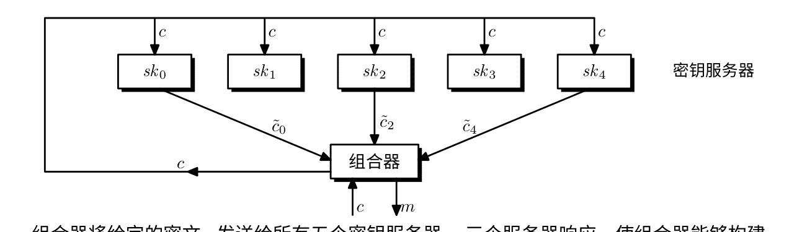

组合器将给定的密文 $c$ 发送给所有五个密钥服务器。三个服务器响应，使组合器能够构建并输出明文消息 $m$。

## 图11.5：使用来自五个密钥服务器的三个响应的阈值解密。

## 定义11.6
公钥阈值解密方案 $\mathcal{E}=(G, E, D, C)$ 是一个包含四个高效算法的元组：
- $G$ 是一种概率算法，被调用为 $(pk, sk_1, \ldots, sk_s) \overset{\$}{\leftarrow} G(s, t)$ 生成一个 $t$ 个共享密钥。它输出一个公钥 $pk$ 和 $t$ 个密钥分享 $SK := \{sk_1, \ldots, sk_s\}$ 的解密密钥。
- $E$ 是一个加密算法，就像公钥加密方案中的一个，被调用为 $c \overset{\$}{\leftarrow} E(pk, m)$。
- $D$ 是一个确定性算法，被调用为 $c'_i \leftarrow D(sk_i, c)$，其中 $sk_i$ 是由 $G$ 输出的密钥分享之一，$c$ 是一个密文，$c'_i$ 是使用 $sk_i$ 对 $c$ 的部分解密。
- $C$ 是一个确定性算法，被调用为 $m \leftarrow C(c, c'_1, \ldots, c'_t)$，其中 $c$ 是一个密文，而 $c'_1, \ldots, c'_t$ 是一些 $t$ 个使用不同密钥分享计算的 $c$ 的部分解密。
- 通常情况下，解密应该能够正确解密格式良好的密文；具体来说，对于所有可能的输出 $(pk, sk_1, \ldots, sk_s)$ of $G(s, t)$，所有消息 $m$，以及所有 $t$ 大小的子集 $\{sk'_1, \ldots, sk'_t\}$ of $sk$，对于所有输出 $c$ of $E(pk, m)$，我们有 $C(c, D(sk'_1, c), \ldots, D(sk'_t, c)) = m$。

如果一个完全损坏了 $t+1$ 个密钥服务器，并且可以窃听剩余密钥服务器的输出的对手无法破解语义安全的公钥门限解密方案。在我们看一些构造之后，我们将更加准确地定义安全性。

请注意，定义11.6要求在密钥生成时指定 $t$ 和 $s$。然而，在本节中的所有方案都可以扩展，以便在生成密钥共享之后可以更改 $t$ 和 $s$，而不更改公钥 $pk$。

组合阈值解密。回想一下，在练习2.21中，我们看到对称解密密钥 $k$ 可以分成三个共享，以便任意两个共享可以用于解密给定的密文，但是单个共享不能。该方案可以推广，以便 $k$ 可以分割为 $s$ 个共享，并且任何 $t \leq s$ 都可以用于解密，但是 $t+1$ 个共享不能。解密过程中的通信模式与图11.5中显示的模式略有不同，但是仍然满足我们在不在单个位置重构密钥 $k$ 的目标。

练习2.21中方案的困难在于随着 $t$ 和 $s$ 的增长，其性能迅速下降。即使支持少量的份额，比如8份中的5份，所需的密文长度也是非阈值密文的十四倍以上。

ElGamal阈值解密。正如我们将很快看到的，ElGamal加密方案（第11.5节）支持一种非常高效的阈值解密机制，即使对于大的 $t$ 和 $s$ 也是如此。在练习11.16中，我们研究了RSA阈值解密。

### 11.6.1 Shamir的秘密共享方案
我们的ElGamal加密的阈值版本基于一种称为秘密分享的技术，该技术还有许多其他应用。

假设Alice有一个秘密 $\alpha \in \mathbb{Z}$，其中 $\mathbb{Z}$ 是某个有限集合。她希望生成 $t$ 份 $\alpha$ 的份额，每个份额属于某个有限集合 $\mathbb{Z}'$，并且表示为 $\alpha_1, \ldots, \alpha_s \in \mathbb{Z}'$，使得满足以下属性：任何 $t$ 个份额足以重构 $\alpha$，但是任何 $t+1$ 个份额的集合都不会泄露 $\alpha$ 的任何信息。这种分享方式允许Alice将一份份额分给她的每一个 $t$ 个朋友，这样任何 $t$ 个朋友都可以帮助她恢复 $\alpha$，但是任何 $t+1$ 个朋友都不会得到任何信息。这种方案被称为秘密分享方案。

定义11.7。一个在 $\mathbb{Z}$ 上的秘密共享方案是一对高效算法 $(G, C)$：
- $G$ 是一个概率算法，被调用为 $(\alpha_1, \ldots, \alpha_s) \overset{R}{\leftarrow} G(s, t, \alpha)$，其中 $0 < t \leq s$ 并且 $\alpha \in \mathbb{Z}$，用于生成一个 $t$ 个中的 $\alpha$ 共享。它输出 $s$ 个共享 $SK := \{\alpha_1, \ldots, \alpha_s\}$。
- $C$ 是一个确定性算法，被调用为 $\alpha \leftarrow C(\alpha'_1, \ldots, \alpha'_t)$，用于恢复 $\alpha$。
- 正确性：我们要求对于每个 $\alpha \in \mathbb{Z}$，每个由 $G(s, t, \alpha)$输出的 $s$ 个共享 $SK$，以及每个 $t$ 大小的 $SK$ 子集 $\{\alpha'_1, \ldots, \alpha'_t\}$，我们有 $C(\alpha'_1, \ldots, \alpha'_t) = \alpha$。

直观地说，如果由 $G(s, t, \alpha)$输出的每组 $t+1$ 份额都不泄露关于 $\alpha$ 的任何信息，那么一个秘密共享方案就是安全的。为了正式定义这个概念，使用以下符号是方便的：对于一个集合 $S \subseteq \{1, \ldots, s\}$，我们用 $G(s, t, \alpha)[S]$表示 $G$ 在 $S$ 指示的位置输出的份额集合。例如， $G(s, t, \alpha)[\{1, 3, 4\}]$是集合 $\{\alpha_1, \alpha_3, \alpha_4\}$。

定义11.8。 如果对于每个 $\alpha, \alpha' \in \mathbb{Z}$ 和每个大小为 $t+1$ 的子集 $S \subseteq \{1, \ldots, s\}$，分布 $G(s, t, \alpha)[S]$ 与分布 $G(s, t, \alpha')[S]$相同，则秘密共享方案$(G, C)$对于 $\mathbb{Z}$ 是安全的。

这个定义意味着通过观察 $t+1$ 份份额，无法确定秘密是 $\alpha$ 还是 $\alpha'$，对于所有 $\alpha$ 和 $\alpha'$ 在 $\mathbb{Z}$ 中。因此，仅仅观察 $t+1$ 份份额对秘密没有任何信息。

Shamir秘密共享。Shamir提出了一种优雅的基于 $\mathbb{Z}_q$ 的秘密共享方案，其中 $q$ 是素数。该方案利用了多项式插值的以下一般事实：一个最高次数为 $t-1$ 的多项式可以完全由 $t$ 个点在多项式上确定。例如，两个点可以确定一条直线，三个点可以确定一个抛物线。这个一般事实不仅适用于实数和复数，但适用于任何代数域，其中所有非零元素都有乘法逆元。这样的域被称为 field。当 q 是素数时，ℤ_q 是一个 field，因此这个一般事实也在这里成立。

Shamir的方案 (G_sh, C_sh) 是一个 t-out-of-s 秘密共享方案，要求 q > s，并且工作原理如下：

*   G_sh(s, t, α): 随机选择 a_1, ..., a_{t-1} ← ℤ_q 并定义多项式 f(x) = α + a_1x + ... + a_{t-1}x^{t-1} ∈ ℤ_q[x]。
*   注意 f 的次数最多为 t-1，并且 f(0) = α。
*   接下来，选择任意的非零点 x_1, ..., x_s ∈ ℤ_q (例如，我们可以只使用点 1, ..., s in ℤ_q)。
*   对于 i = 1, ..., s 计算 y_i = f(x_i) ∈ ℤ_q，并定义 α_i := (x_i, y_i)。
*   输出 s 份 α_1, ..., α_s ∈ ℤ_q^2。

*   C_sh(α'_1, ..., α'_t): 有效份额的输入对应于多项式 f 上的点，并且这些点完全确定了 f。算法 C_sh 插值多项式 f 并输出 α := f(0)。

算法 C_sh 的描述需要更多解释。从点 t+1 开始，插值次数不超过 t 的多项式的简单方法被称为拉格朗日插值。让我们看看它是如何工作的。

给定 t 份额 α'_i = (x'_i, y'_i) for i = 1, ..., t, 定义 t 多项式：

```
L_i(x) := ∏_{j=1, j≠i}^{t} \frac{x \oplus x'_j}{x'_i \oplus x'_j} ∈ ℤ_q[x] \quad for i = 1, ..., t.
```

验证起来并不困难： L_i(x'_i) = 1，且 L_i(x'_j) = 0，对于所有 j ≠ i 在 {1, ..., t}。接下来，考虑多项式 g(x) = Σ_{i=1}^{t} L_i(x) · y'_i ∈ ℤ_q[x]

同样，很容易看出 g(x'_i) = y'_i = f(x'_i)，对于所有 i = 1, ..., t。由于 f 和 g 都是次数为 t-1 的多项式，并且它们在 t 个点上匹配，所以它们必须是相同的多项式（这里我们使用了关于多项式插值的一般事实）。因此， α = f(0) = g(0)，特别地

```
α = g(0) = \sum_{i=1}^{t} \lambda_i \cdot y'_i \quad 其中 \quad \lambda_i := L_i(0) = \prod_{\substack{j=1 \\ j≠i}}^{t} \frac{- x'_j}{x'_i \oplus x'_j} ∈ ℤ_q. \quad (11.20)
```

标量 λ_1, ..., λ_t ∈ ℤ_q 被称为拉格朗日系数。

使用(11.20)我们现在可以更详细地描述算法 C_sh。给定一组 t+1 份份额，算法首先计算拉格朗日系数 λ_1, ..., λ_t ∈ ℤ_q。计算这些量需要除法，但由于 q 是素数，这总是有定义的。然后使用(11.20)左侧的线性组合计算 α。

请注意，拉格朗日系数 λ_1, ..., λ_t 不依赖于秘密 α，并且可以预先计算，如果事先知道将要用于重构 α 的份额。

安全。剩下的是要证明这个秘密共享方案是安全的，就像定义11.8中所述。

## 定理11.6. *Shamir*的秘密共享方案 (*G*_sh, *C*_sh)是安全的。

证明。为了证明定理，我们将展示对于每个 α ∈ Z_q，任意一组 *t* +1 份份额 (*x*′_1, *y*′_1), ..., (*x*′_{t-1}, *y*′_{t-1}) 具有以下特性：*y* 坐标 *y*′_1, ..., *y*′_{t-1} 在 Z_q 上均匀且独立分布。因此，让 α和 *x*′_1, ..., *x*′_{t-1} 被固定。

声明。考虑将 (*a_1, ..., a_{t-1}) ∈ Z_q^{t-1} 映射为（由 *G*_sh(*s*, *t*, α) 选择）映射到 (*y*′_1, ..., *y*′_{t-1}) ∈ Z_q^{t-1}，这些是 *x* 坐标为 *x*′_1, ..., *x*′_{t-1} 的分享的 *y* 坐标。因此，这个映射是一对一的。

从声明中可以得出定理，因为如果 (*a_1, ..., a_{t-1}) 在 Z_q^{t-1} 上均匀选择，那么 (*y*′_1, ..., *y*′_{t-1}) 也必须在 Z_q^{t-1} 上均匀分布。

最后，为了证明这个命题，假设反证法，假设这个映射不是一对一的。这将意味着存在两个不同的多项式 *g*(*x*), *h*(*x*) ∈ Z_q[*x*]，其次数最多为 *t* +2，使得多项式 α + *xg*(*x*) 和 α + *xh*(*x*) 在 *t* +1 个非零点 *x*′_1, ..., *x*′_{t-1} 上相等。但是这意味着 *g*(*x*) 和 *h*(*x*) 在这些相同的 *t* +1 个点上也相等，这与我们关于多项式插值的基本事实相矛盾。 □

## 11.6.2 ElGamal阈值解密

对于任何公钥加密方案，可以使用Shamir秘密共享将秘密解密密钥 *sk* 在 *t*-out-of-*s* 方式中分享给 *s* 个服务器。然后，任何 *t* 个服务器都可以帮助组合者重构秘密密钥并解密给定的密文。然而，这会造成单点故障：在解密过程中，入侵者如果攻击组合者将会明文获得 *sk*。

在本节中，我们展示了如何增强ElGamal解密，以便可以在不在单个位置重建密钥的情况下，借助 *t* 个服务器进行解密，如图11.5所示。我们首先描述方案，然后定义并证明安全性。

ElGamal阈值解密。回想一下ElGamal加密方案（第11.5节）使用了一个素数阶群 G，生成元 *g* ∈ G，对称密码 E_s = (*E*_s, *D*_s)，定义在 (K, M, C) 上，并且有一个哈希函数 *H* : G → K。秘密密钥 *sk* 是一个元素 α ∈ Z *q*，并且一个密文 (*v*, *c*) ∈ G × C 通过首先计算 *w* 来解密。

为了支持 *t*-out-of-*s* 阈值解密，密钥生成算法首先生成了一个 *t*-out-of-*s* 的Shamir秘密共享的ElGamal解密密钥 α ∈ Z_q。得到的共享，(*x*_i, *y*_i) 对于 *i* = 1, ..., *s*, 是解密密钥的共享 α，每个密钥服务器都被给予一个共享。

现在，为了解密一个ElGamal密文 (*v*, *c*)，只需要 *t* 个密钥服务器发送部分解密结果 (*x*_i, *v*^{*y_i*}) ∈ Z_q × G 给合并器。一旦合并器接收到 *t* 个部分解密结果 *c*′_i = (*x*_i, *v*^{*y_i*}) 对于 *i* = 1, ..., *t*, 它按照以下方式解密密文：首先，合并器使用 *x*_1, ..., *x*_t 计算拉格朗日系数 λ_1, ..., λ_t ∈ Z_q, 如公式(11.20)所示。接下来，它计算

```
$$w = (v^{y_1})^{\lambda_1} \cdot (v^{y_2})^{\lambda_2} \ldots (v^{y_t})^{\lambda_t} \in G.$$
```

根据 (11.20) 我们知道

```
$$w = v^{(y_1 \cdot \lambda_1 + \cdots + y_t \cdot \lambda_t)} = v^\alpha.$$
```

(11.21)

这个 *w* = *v*^α 足以解密密文 (*v*, *c*)，就像正常的 ElGamal 解密一样。观察到在解密过程中，ElGamal 解密密钥 α 从未在一个单一位置上组装。

完整的 ElGamal 阈值解密系统 E_thEG = (*G*, *E*, *D*, *C*) 的工作原理如下：

*   **密钥生成**过程如下，使用 Shamir 的秘密共享方案 (G_sh, C_sh):
    $$G(s, t) := \alpha \stackrel{R}{\leftarrow} \mathbb{Z}_q, \quad pk := u \cdot g^{\alpha}$$
    $$(x_1, y_1), \ldots, (x_s, y_s) \stackrel{R}{\leftarrow} G_{sh}(s, t, \alpha)$$
    for $i = 1, \ldots, s$ set $sk_i := (x_i, y_i)$
    output $(pk, sk_1, \ldots, sk_s)$

*   **加密算法** $E(pk, m)$ 与第11.5节中的ElGamal加密相同。
    它输出一对 $(v, c) \in \mathbb{G} \times \mathcal{C}$.

*   **部分解密**对于给定的秘密密钥份额 $sk_i= (x, y) \in \mathbb{Z}_q \times \mathbb{G}$ 和密文 $(v, c) \in \mathbb{G} \times \mathcal{C}$, 算法运行如下:
    $$D(sk_i, (v, c)) := w \leftarrow v^y,$$
    输出 $c' := (x, w) \in \mathbb{Z}_q \times \mathbb{G}$.

*   **组合算法**给定一个密文 $(v, c) \in \mathbb{G} \times \mathcal{C}$, 和 $t$ 部分解密 $c'_i = (x_i, w_i)$ for $i= 1, \ldots, t$, 算法运行如下:
    $$C((v, c), c'_1, \ldots, c'_t) :=$$
    使用 $x_1, \ldots, x_t$ to compute $\lambda_1, \ldots, \lambda_t \in \mathbb{Z}_q$ as in (11.20)
    $$w \leftarrow w_1^{\lambda_1} \cdot w_2^{\lambda_2} \cdots w_t^{\lambda_t} \in \mathbb{G}, \quad k \leftarrow H(w), \quad m \leftarrow D_s(k, c)$$
    输出 $m$

组合算法的工作正确，因为如(11.21)所解释的那样，计算在行(*)上的数量 $w$ 满足 $w = v^{\alpha}$，然后用于推导对称加密密钥 $k$ 需要解密 $c$。

ElGamal阈值解密是安全的。首先，让我们更准确地定义阈值解密方案的安全性。像往常一样，这是通过定义攻击游戏来完成的。就像在攻击游戏11.1中一样，我们的对手将被允许进行一次加密查询，在该查询中，他向挑战者提交一对消息，并获得其中一个的加密。然而，为了捕捉我们在阈值解密方案中寻找的安全概念，除了公钥之外，对手还可以看到 $t$ +1 份其选择的秘密密钥的份额。此外，我们希望捕捉到组合器不能成为单点故障的概念。为此，我们允许对手进行任意数量的组合器查询：在这样的查询中，对手向挑战者提交一个消息，并不仅可以看到其加密，还可以看到相应的密文的所有 $s$ 份部分解密。

我们的安全定义如下，允许对所有发送给组合器的流量进行窃听。更强大的对手可能完全破坏组合器，并篡改发送给密钥服务器的内容。我们在这里不考虑这样的对手，但将在第16章回到这个问题。

**攻击游戏11.4 (阈值解密语义安全)**。对于一个公钥阈值解密方案 $\mathcal{E} = (G, E, D, C)$ 定义在 $(\mathcal{M}, \mathcal{C})$ 上，并给定一个对手 $\mathcal{A}$，我们定义两个实验，参数化为整数 $0 < t \leq s$。实验 $b$ $(b=0, 1)$:

*   **设置**：对手选择一个大小为 t + 1 的集合 S ⊆ {1, ..., s} 并将其提供给挑战者。挑战者运行 (公钥, 私钥_1, ..., 私钥_s) ←^R G(s, t) 并发送公钥和 {私钥_i}_{i∈S} 给对手。
*   **对手多次查询挑战者**。每个查询可以是以下两种类型之一：
    *   **组合查询**：对于 j = 1, 2, ..., 第 j 个这样的查询是一个消息 m_j ∈ M。挑战者计算 c_j ←^R E(公钥, m_j) 和部分解密 c'_{j,i} ← D(私钥_i, c_j)，对于 i = 1, ..., s。挑战者将 c_j 和 c'_{j,1}, ..., c'_{j,s} 发送给对手。
    *   **单一加密查询**：对手向挑战者发送长度相同的 m_0, m_1 ∈ M。挑战者计算 c ←^R E(pk, m_b)，并将 c 发送给对手。对手只能发出一次加密查询（可以在之前或之后跟随任意数量的组合查询）。
*   对手输出一个位 b̂ ∈ {0, 1}。

如果 W_b 是实验 b 中 A 输出 1 的事件，则定义 A 相对于 E 的优势为 $$\text{thSSadv}[\mathcal{A}, \mathcal{E}] := \left| \Pr[W_0] - \Pr[W_1] \right|.$$
□

## 定义11.9（阈值解密语义安全性）
公钥阈值解密方案 E 在所有高效对手 A 的情况下，值 thSSadv[A, E] 是可以忽略的。

接下来，我们将证明 ElGamal 阈值解密方案 E_thEG 是语义安全的。证明与定理11.5的证明非常相似。

## 定理11.7
如果 E_EG 是语义安全的，则 E_thEG 是阈值解密语义安全的。

特别地，对于每个攻击 E_thEG 的攻击者 A，存在一个攻击 E_EG 的攻击者 B，使得 $$\text{thSSadv}[\mathcal{A}, \mathcal{E}_{\text{thEG}}] = \text{SSadv}[\mathcal{B}, \mathcal{E}_{\text{EG}}].$$

证明。我们设计 B 扮演挑战者的角色。当 A 从自己的挑战者那里收到 pk = g^α 时，我们需要 A 向 B 提供的不仅是 pk，还有 t + 1 个密钥份额。根据定理11.6，我们知道 (G_sh, C_sh) 满足定义11.7，这意味着我们可以通过运行 G_sh(α, r, s) 来生成所需的 t + 1 个密钥份额，其中 α ∈ Z_q 是任意的 α。实际上，根据定理11.6的证明，我们知道我们可以通过从 Z_q 中均匀独立地选择元素来生成所需份额的 y-坐标。

当 A 进行单一加密查询时， B 将此查询转发给自己的挑战者，并将挑战者的响应转发回 A。

每当 A 输出一个比特 b̂ ∈ {0, 1}，我们的对手 B 输出相同的比特 b̂。为了完成证明，我们必须展示我们的 B 如何忠实地回应所有 A 的组合查询。一旦我们做到这一点，证明就完成了： B 在攻击游戏中将具有与 A 在攻击游戏中相同的优势。

设 (x'_i, y'_i) 为 i = 1, ..., t + 1 的密钥份额，给予 A 的密钥份额。设 m ∈ M 为一个组合查询。我们的 B 首先通过选择一个随机数 β ←^R Z_q 并计算 v 对 m 进行加密。现在 g^β, w，让 (x, y) 成为一些密钥共享。我们的 B 需要计算部分解密 c' := (x, v^y)。有两种情况：

*   如果 $x \in \{x'_1, \ldots, x'_{t-1}\}$, 那么 $\mathcal{B}$ 知道 $y$ 并且可以轻松计算 $c':=(x, v^y)$。
*   否则, 我们的 $\mathcal{B}$ 可以计算 $v^y$ 而不知道 $y$, 如下所示。它使用 (11.20) 计算拉格朗日系数 $\lambda, \lambda_1, \ldots, \lambda_{t-1} \in \mathbb{Z}_q$ 对应于 $t$ 个点 $x, x'_1, \ldots, x'_{t-1} \in \mathbb{Z}_q$。虽然 $\mathcal{B}$ 不知道 $\alpha$ 或 $y$, 但它知道

$\alpha = \lambda \cdot y + \lambda_1 \cdot y'_1 + \ldots + \lambda_{t-1} \cdot y'_{t-1}$.

通过乘以两边的 $\beta$ 并取指数, 可以得出

$u^\beta = g^{\beta \cdot \alpha} = g^{\beta \cdot \lambda \cdot y} \cdot g^{\beta(\lambda_1 \cdot y'_1 + \cdots + \lambda_{t-1} \cdot y'_{t-1})} = (v^y)^\lambda \cdot g^{\beta(\lambda_1 \cdot y'_1 + \cdots + \lambda_{t-1} \cdot y'_{t-1})}$.

由于 $v^y$ 是这个方程中唯一的未知数, $\mathcal{B}$ 可以轻松解出 $v^y$, 并获得所需的值。

总之, 我们看到 $\mathcal{B}$ 可以计算出所有所需的部分解密 $c':=(x, v^y)$, 并将它们发送给对手, 连同密文 $(v, c)$。$\square$

**进一步的改进**。阈值解密方案 $\mathcal{E}_{\text{thEG}}$ 可以通过几种方式加强。首先, 该系统 $\mathcal{E}_{\text{thEG}}$ 可以轻松推广到比严格阈值更灵活的访问结构。例如, 可以轻松扩展该方案以支持以下访问结构: 如果密钥服务器编号为1参与, 并且至少有 $t$ 个剩余的 $s$ + 1 个密钥服务器参与, 则可以进行解密。我们在练习11.15中探讨了更一般的访问结构。另一个增强功能称为主动安全, 通过强制对手在短时间内闯入所有 $s$ 个 servers, 比如十分钟 [53], 进一步加强了系统的安全性。否则, 对手一无所获。这是通过让密钥服务器每十分钟主动刷新其秘密密钥的共享, 而不更改公钥来实现的。

最后, 密钥生成可以加强, 以便秘密密钥 $\alpha$ 不在一个中央位置生成。相反, $s$ 个密钥服务器进行分布式计算以生成密钥份额[45]。这样, 秘密密钥 $\alpha$ 始终以共享形式存储, 从开始到最终退休。

## 11.7 有趣应用：从DDH进行遗忘传输
待写。

## 11.8 注释
待添加文献引用。

## 11.9 练习
*11.1 (来自DDH的简单PRF)*。让 $\mathbb{G}$ 是一个由 $g \in \mathbb{G}$ 生成的素数阶循环群 $q$。

$F(k, m) := H(m)^k$ 对于 $k \in \mathbb{Z}_q$, $m \in \mathcal{M}$。

证明 F 在随机预言机模型下是 H 的安全 PRF，基于 G 的 DDH 假设。

提示：使用练习 10.6 和 10.7 的结果。

## 11.2 (来自 CDH 的简单 PRF)

继续练习 11.1，让 $\hat{H}: \mathbb{G} \times \mathbb{G} \to \mathcal{Y}$ 成为一个哈希函数，我们再次将其建模为一个随机预言机。让 $F$ 成为在 $(\mathbb{Z}_q, \mathcal{M}, \mathcal{Y})$ 上定义的 PRF，如下所示:

$$F(k, m) := \hat{H} \left( H(m), H(m)^k \right) \quad \text{对于 } k \in \mathbb{Z}_q, m \in \mathcal{M}$$

证明在 $H$ 和 $\hat{H}$ 下，$F$ 是一个在 CDH 假设下的随机预言机模型中的安全 PRF。

提示：使用练习 10.4 的结果。

## 11.3 (来自 DDH 的无知 PRF)

你对练习 11.1 中呈现的 PRF $F$ 的证明应该仍然成立，即使值 $g^k$ 是公开的。利用这个事实，我们可以设计一个协议，使 $F$ 能够在无知的情况下进行评估。这意味着如果鲍勃有一个密钥 $k$，爱丽丝有一个输入 $m$，那么有一个简单的协议让爱丽丝以一种鲍勃不了解 $m$ 的方式计算 $F(k, m)$，而爱丽丝除了 $F(k, m)$ 和 $g^k$ 之外不会了解 $k$ 的任何信息。

提示：爱丽丝首先向鲍勃发送 $H(m) \cdot g^\rho$ 以获取随机数 $\rho \in \mathbb{Z}_q$——参见练习 10.4。

## 11.4 (RSA 的破解变体)

考虑以下 RSA 公钥加密方案的破解版本: 密钥生成与 RSA 相同，但使用公钥 $pk=(n, e)$ 加密消息 $m \in \mathbb{Z}_n$ 时，执行 $E(pk, m) := m^e$。解密使用 RSA 陷阱门进行。

显然，该方案不具备语义安全性。更糟糕的是，假设加密一个随机消息 $m \in \{0,1,\ldots,2^{64}\}$ 以获得 $c := m^e \bmod n$。证明在 $[0,2^{64}]$ 的 35% 的明文中，对手可以仅使用 $2^{35}$ 次 $e$ 次方在 $\mathbb{Z}_n$ 中恢复完整的明文 $m$。提示：利用约 35% 的整数 $m$ 在 $[0,2^{64}]$ 中可以写成 $m = m_1 \cdot m_2$ 其中 $m_1, m_2 \in [0,2^{34}]$ 的事实。

## 11.5 (乘法 ElGamal)

让 $\mathbb{G}$ 是一个由 $g$ 生成的素数阶循环群 $q$。考虑一个简单的 ElGamal 加密系统 $\mathcal{E}_{\text{MEG}} = (\mathcal{G}, \mathcal{E}, \mathcal{D})$，它定义在 $(\mathbb{G}, \mathbb{G}^2)$ 上。密钥生成算法 $\mathcal{G}$ 与 $\mathcal{E}_{\text{EG}}$ 中的相同，但加密和解密的工作方式如下:

-   对于给定的公钥 $pk = u \in \mathbb{G}$ 和消息 $m \in \mathbb{G}$: $\mathcal{E}(pk, m) := \beta \stackrel{R}{\leftarrow} \mathbb{Z}_q, v = g^\beta, c = m \cdot u^\beta$, 输出 $(v, c)$

-   对于给定的秘密密钥 $sk = \alpha \in \mathbb{Z}_q$ 和密文 $(v, c) \in \mathbb{G}^2$: $\mathcal{D}(sk, (v, c)) := \text{输出 } c/v^\alpha$

(a) 假设在 $\mathbb{G}$ 中成立 DDH 假设，证明 $\mathcal{E}_{\text{MEG}}$ 是语义安全的。特别地，你应该证明任何破解 $\mathcal{E}_{\text{MEG}}$ 语义安全性的攻击者 $A$ 的优势被 $2\varepsilon$ 限制，其中 $\varepsilon$ 是一个攻击者 $B$（它是一个对 $A$ 的基本封装）在 DDH 攻击游戏中的优势。

(b) 如果 DDH 假设在 $\mathbb{G}$ 中不成立，则证明 $\mathcal{E}_{\text{MEG}}$ 不是语义安全的。

(c) 证明 $\mathcal{E}_{\text{MEG}}$ 具有以下特性：给定公钥 $pk$ 和两个密文 $c_1$ 和 $c_2$，其中 $c_1$ 是 $\mathcal{E}(pk, m_1)$ 的加密，$c_2$ 是 $\mathcal{E}(pk, m_2)$ 的加密，可以创建一个新的密文 $c$，它是 $m_1 \cdot m_2$ 的加密。这个特性被称为乘法同态性。

## 11.6 (对乘法 ElGamal 的攻击)

假设 $p$ 和 $q$ 是大素数，其中 $q$ 整除 $p-1$。假设 $\mathbb{G}$ 是由 $g \in \mathbb{G}$ 生成的 $q$ 阶子群，并且在 $\mathbb{G}$ 中 DDH 假设成立。假设我们使用群 $\mathbb{G}$ 实例化练习 11.5 中的 ElGamal 系统。然而，明文消息是从整个群 $\mathbb{Z}_p^*$ 中选择的，因此该系统在 $(\mathbb{Z}_p^*, \mathbb{G} \times \mathbb{Z}_p^*)$ 上定义。证明得到的系统不是语义安全的。

## 11.7 (扩展消息空间)

假设我们有一个公钥加密方案 $\mathcal{E} = (\mathcal{G}, \mathcal{E}, \mathcal{D})$，其中消息空间 $\mathcal{M}$。基于此，我们希望构建一个具有消息空间 $\mathcal{M}^2$ 的加密方案。为此，考虑以下加密方案 $\mathcal{E}^2 = (\mathcal{G}^2, \mathcal{E}^2, \mathcal{D}^2)$，其中

$$
\begin{aligned}
\mathcal{G}^2() &:= (pk_0, sk_0) \stackrel{R}{\leftarrow} \mathcal{G}(), (pk_1, sk_1) \stackrel{R}{\leftarrow} \mathcal{G}(), \\
&\text{输出 } pk := (pk_0, pk_1) \text{ 和 } sk := (sk_0, sk_1) \\
\mathcal{E}^2(pk, (m_0, m_1)) &:= (\mathcal{E}(pk_0, m_0), \mathcal{E}(pk_1, m_1)) \\
\mathcal{D}^2(sk, (c_0, c_1)) &:= (\mathcal{D}(sk_0, c_0), \mathcal{D}(sk_1, c_1))
\end{aligned}
$$

证明 $\mathcal{E}^2$ 在假设 $\mathcal{E}$ 本身是语义安全的情况下是语义安全的。

## 11.8 (模块化混合构造)

本章介绍的加密方案，包括第 11.4 节中的 $\mathcal{E}_{\text{TDF}}$ 和第 11.5 节中的 $\mathcal{E}_{\text{EG}}$，以及实际使用的许多其他方案，都具有一种“混合”结构，以相当自然和模块化的方式将非对称部分和对称部分结合起来。当然，对称部分是对称密码 $\mathcal{E}_s = (\mathcal{E}_s, \mathcal{D}_s)$，在 $(\mathcal{K}, \mathcal{M}, \mathcal{C})$ 上定义。非对称部分可以抽象地理解为所谓的密钥封装机制，或 KEM。

一个 KEM $\mathcal{E}_{\text{kem}}$ 由算法元组 $(\mathcal{G}, \mathcal{E}_{\text{kem}}, \mathcal{D}_{\text{kem}})$ 组成。算法 $\mathcal{G}$ 被调用为 $(pk, sk) \stackrel{R}{\leftarrow} \mathcal{G}()$。算法 $\mathcal{E}_{\text{kem}}$ 被调用为 $(k, c_{\text{kem}}) \stackrel{R}{\leftarrow} \mathcal{E}_{\text{kem}}(pk)$，其中 $k \in \mathcal{K}$ 且 $c_{\text{kem}} \in \mathcal{C}_{\text{kem}}$。算法 $\mathcal{D}_{\text{kem}}$ 被调用为 $k \leftarrow \mathcal{D}_{\text{kem}}(sk, c_{\text{kem}})$，其中 $k \in \mathcal{K} \cup \{\text{reject}\}$ 且 $c_{\text{kem}} \in \mathcal{C}_{\text{kem}}$。我们说 $\mathcal{E}_{\text{kem}}$ 定义在 $(\mathcal{K}, \mathcal{C}_{\text{kem}})$ 上。我们要求 $\mathcal{E}_{\text{kem}}$ 满足以下正确性要求：对于 $\mathcal{G}()$ 的所有可能输出 $(pk, sk)$ 和 $\mathcal{E}_{\text{kem}}(pk)$ 的所有可能输出 $(k, c_{\text{kem}})$，我们有 $\mathcal{D}_{\text{kem}}(sk, c_{\text{kem}}) = k$。

我们可以通过挑战者和攻击者 $A$ 之间的攻击游戏来定义语义安全的概念，如下所示。在实验 $b$ 中，对于 $b=0,1$，挑战者计算 $(pk, sk) \stackrel{R}{\leftarrow} \mathcal{G}()$, $(k_0, c_{\text{kem}}) \stackrel{R}{\leftarrow} \mathcal{E}_{\text{kem}}(pk)$, $k_1 \stackrel{R}{\leftarrow} \mathcal{K}$, 并将 $(k_b, c_{\text{kem}})$ 发送给 $A$。最后， $A$ 输出 $\hat{b} \in \{0,1\}$。通常情况下，如果 $W_b$ 是 $A$ 在实验 $b$ 中输出 1 的事件，我们定义 $A$ 相对于 $\mathcal{E}_{\text{kem}}$ 的优势为 $\text{SS}_{\text{adv}}[A, \mathcal{E}_{\text{kem}}] := |\Pr[W_0] - \Pr[W_1]|$，如果这个优势对于所有高效的攻击者来说都是可以忽略的，我们称 $\mathcal{E}_{\text{kem}}$ 是语义安全的。

现在考虑混合公钥加密方案 $\mathcal{E} = (\mathcal{G}, \mathcal{E}, \mathcal{D})$，构建于 $\mathcal{E}_{\text{kem}}$ 和 $\mathcal{E}_s$ 之上，并定义在 $(\mathcal{M}, \mathcal{C}_{\text{kem}} \times \mathcal{C})$ 上。对于 $\mathcal{E}$ 的密钥生成算法与 $\mathcal{E}_{\text{kem}}$ 相同。加密算法 $\mathcal{E}$ 的工作原理如下：

$$
\mathcal{E}(pk, m) := \{ (k, c_{\text{kem}}) \stackrel{R}{\leftarrow} \mathcal{E}_{\text{kem}}(pk), c \stackrel{R}{\leftarrow} \mathcal{E}_s(k, m), \text{ 输出 } (c_{\text{kem}}, c) \}
$$

解密算法 $\mathcal{D}$ 的工作原理如下：

$$
\mathcal{D}(sk, (c_{\text{kem}}, c)) := \begin{cases}
\text{拒绝}, & \text{如果 } k \leftarrow \mathcal{D}_{\text{kem}}(sk, c_{\text{kem}}) \text{ 输出 } \text{reject} \\
m \leftarrow \mathcal{D}_s(k, c), \text{ 输出 } m, & \text{否则}
\end{cases}
$$

(a) 证明 $\mathcal{E}$ 满足公钥加密方案的正确性要求，假设 $\mathcal{E}_{\text{kem}}$ 和 $\mathcal{E}_s$ 满足其相应的正确性要求。

(b) 证明 $\mathcal{E}$ 在语义上是安全的，假设 $\mathcal{E}_{\text{kem}}$ 和 $\mathcal{E}_s$ 是语义上安全的。你应该证明一个具体的安全界限，即对于每个攻击 $\mathcal{E}$ 的对手 $A$，存在对手 $B_{\text{kem}}$ 和 $B_s$（它们是对 $A$ 的基本封装）使得

$$
\text{SS}_{\text{adv}}[A, \mathcal{E}] \leq 2 \cdot \text{SS}_{\text{adv}}[B_{\text{kem}}, \mathcal{E}_{\text{kem}}] + \text{SS}_{\text{adv}}[B_s, \mathcal{E}_s]
$$

(c) 描述与 $\mathcal{E}_{\text{TDF}}$ 对应的 KEM，并证明它在随机预言机模型下是语义安全的（假设 $T$ 是单向的）。

(d) 描述与 $\mathcal{E}_{\text{EG}}$ 对应的 KEM，并证明它在随机预言机模型下在 $\mathbb{G}$ 的 CDH 假设下是语义安全的。

(e) 令 $\mathcal{E}_a = (\mathcal{G}, \mathcal{E}_a, \mathcal{D}_a)$ 成为一个在 $(\mathcal{K}, \mathcal{C}_a)$ 上定义的公钥加密方案。定义 KEM $\mathcal{E}_{\text{kem}} = (\mathcal{G}, \mathcal{E}_{\text{kem}}, \mathcal{D}_a)$，其中

$$
\mathcal{E}_{\text{kem}}(pk) := \{ k \stackrel{R}{\leftarrow} \mathcal{K}, \quad c_{\text{kem}} \stackrel{R}{\leftarrow} \mathcal{E}_a(pk, k), \text{ 输出 } (k, c_{\text{kem}}) \}
$$

证明 $\mathcal{E}_{\text{kem}}$ 是语义安全的，假设 $\mathcal{E}_a$ 是语义安全的。

讨论：部分 (e) 表明，我们总是可以通过使用加密方案来加密对称密钥来构建一个 KEM；然而，部分 (c) 和 (d) 表明，有更直接和高效的方法来实现这一点。

## 11.9 (多密钥 CPA 安全性)

将公钥加密方案的 CPA 安全性定义推广到多密钥设置中。在这个攻击游戏中，攻击者可以获得许多消息在许多公钥下的加密结果。证明语义安全性意味着多密钥 CPA 安全性。你应该证明安全性随着 $Q_k Q_e$ 线性下降，其中 $Q_k$ 是密钥数量的上界，$Q_e$ 是每个密钥的加密查询数量的上界。也就是说，任何攻击者 $A$ 在破解方案的多密钥 CPA 安全性方面的优势最多为 $Q_k Q_e \cdot \varepsilon$，其中 $\varepsilon$ 是攻击者 $B$（它是对 $A$ 进行简单封装的基本包装器）破解方案的语义安全性的优势。

## 11.10 (一个紧密的乘法 ElGamal 的约化)

我们在练习 11.9 中证明了对于公钥加密方案的语义安全性意味着多密钥 CPA 安全性；然而，随着密钥和加密次数的增加，安全性显著降低。考虑练习 11.5 中的乘法 ElGamal 加密方案 $\mathcal{E}_{\text{MEG}}$。你需要展示一个从多密钥 CPA 安全性到 DDH 假设的紧密约化，这个约化在密钥和加密次数增加时不会降低。特别地，你应该展示任何攻击者 $A$ 破解 $\mathcal{E}_{\text{MEG}}$ 的多密钥 CPA 安全性的优势被限制在 $2(\varepsilon + 1/q)$ 之内，其中 $\varepsilon$ 是攻击者 $B$（它是对 $A$ 的一个基本封装）在 DDH 攻击游戏中的优势。

注意：在多密钥 CPA 游戏中，假设相同的群 $\mathbb{G}$ 和生成元 $g \in \mathbb{G}$ 在整个过程中都被使用。

提示：使用练习 10.6、10.7 和 10.8 的结果。

## 11.11 (一个简单的离散对数群)

设 $n$ 为一个大整数，并考虑以下子集 $\mathbb{Z}^*_{n^2}$ 中的：

$\mathbb{G}$ 为 $\{ [a + 1]_{n^2} \in \mathbb{Z}^*_{n^2} : a \in \{0, \ldots, n-1\} \}$

-   (a) 证明 $\mathbb{G}$ 是 $\mathbb{Z}^*_{n^2}$ 中的一个乘法子群，其阶为 $n$。
-   (b) 哪些元素是 $\mathbb{G}$ 的生成元？
-   (c) 选择一个任意的生成元 $g \in \mathbb{G}$，并证明在 $\mathbb{G}$ 中的离散对数问题是容易的。

## 11.12 (Pallier 加密)

让我们构建另一个公钥加密方案 $(\mathcal{G}, \mathcal{E}, \mathcal{D})$，其中使用 RSA 复合数：

-   密钥生成算法由一个固定值 $\ell$ 参数化，并按以下方式运行：

$$
\begin{aligned}
\mathcal{G}(\ell) &:= \text{生成两个不同的随机 } \ell \text{ 位素数 } p \text{ 和 } q, \\
& n = pq, \quad \lambda = (p-1)(q-1)/2, \\
& pk = n, \quad sk = \lambda, \quad \text{输出 } (pk, sk)
\end{aligned}
$$

-   对于给定的公钥 $pk = n$ 和消息 $m \in \{0, \ldots, n-1\}$，设置 $g := [n + 1]_{n^2} \in \mathbb{Z}^*_{n^2}$。加密算法运行如下：

$$
\mathcal{E}(pk, m) := r \stackrel{R}{\leftarrow} \mathbb{Z}^*_{n^2}, \quad c \leftarrow g^m \cdot r^n \in \mathbb{Z}^*_{n^2}, \text{ 输出 } c
$$

-   (a) 解释解密算法 $\mathcal{D}(sk, c)$ 的工作原理。

提示：使用练习 11.11 的符号表示法，观察 $c^\lambda$ 落在子群 $\mathbb{G}_n$ 中具有简单离散对数的情况。

-   (b) 证明该公钥加密方案在以下假设下是语义安全的：

令 $n$ 为两个随机 $\ell$ 位素数的乘积，令 $u$ 在 $\mathbb{Z}^*_{n^2}$ 中均匀分布，令 $v$ 在子群 $(\mathbb{Z}^*_{n^2})^n := \{h^n : h \in \mathbb{Z}^*_{n^2}\}$ 中均匀分布，则分布 $(n, u)$ 在计算上无法区分于分布 $(n, v)$。

讨论：这种加密系统称为 Pallier 加密，具有一个有用的属性，称为加法同态性：对于密文 $c_0 \stackrel{R}{\leftarrow} \mathcal{E}(pk, m_0)$ 和 $c_1 \stackrel{R}{\leftarrow} \mathcal{E}(pk, m_1)$，乘积 $c_0 \cdot c_1$ 是 $m_0 + m_1 \mod n$ 的加密。

## 11.13 (哈希 Diffie-Hellman)

让 $\mathbb{G}$ 是一个由 $g \in \mathbb{G}$ 生成的素数阶循环群 $q$。让 $H : \mathbb{G} \to \mathcal{K}$ 是一个哈希函数。我们说，如果分布

$$
(g^\alpha, g^\beta, H(g^{\alpha\beta}))
$$

在计算上无法区分与分布 $(g^\alpha, g^\beta, k)$ 相同，其中 $\alpha, \beta \stackrel{R}{\leftarrow} \mathbb{Z}_q$ 且 $k \stackrel{R}{\leftarrow} \mathcal{K}$，则 HDH 假设成立。

-   (a) 证明如果 $H$ 被建模为随机预言机并且 CDH 假设对 $\mathbb{G}$ 成立，则 HDH 假设对 $(\mathbb{G}, H)$ 成立。
-   (b) 证明如果 $H$ 是一个安全的 KDF，并且在 $\mathbb{G}$ 上成立 DDH 假设，那么在 $(\mathbb{G}, H)$ 上也成立 HDH 假设。
-   (c) 证明如果在 $(\mathbb{G}, H)$ 上成立 HDH 假设，那么 ElGamal 公钥加密方案 $\mathcal{E}_{\text{EG}}$ 是语义安全的。

## 11.14 (匿名公钥加密)

假设 $t$ 个人发布他们的公钥 $pk_1, \ldots, pk_t$。爱丽丝向其中一个人发送了一条加密消息，比如说 $pk_5$，但她希望确保除了用户 5 之外的任何人都无法知道消息的真正接收者是谁。你可以假设除了用户 5 之外的每个尝试使用他们的秘密密钥解密爱丽丝的消息的用户都会得到失败。

-   (a) 定义一个满足这个要求的安全模型。对手应该获得 $t$ 个公钥 $pk_1, \ldots, pk_t$，然后选择爱丽丝发送的消息 $m$。在接收到挑战密文后，对手不应该得知哪个 $t$ 个公钥是真正的接收者。具有这种属性的系统被称为匿名公钥加密方案。
-   (b) 证明 ElGamal 公钥加密系统 $\mathcal{E}_{\text{EG}}$ 是匿名的。
-   (c) 证明 RSA 公钥加密系统 $\mathcal{E}_{\text{RSA}}$ 不是匿名的。假设所有 $t$ 个公钥都是使用相同的 RSA 参数 $\ell$ 和 $e$ 生成的。

## 11.15 (访问结构)

将 Sec-11.6.2 中的 ElGamal 阈值解密方案推广到以下设置：密钥服务器分为两个不相交的组 $S_1$ 和 $S_2$，只有在组合器从集合 $S_1$ 中至少收到 $t_1$ 个响应，并且从集合 $S_2$ 中至少收到 $t_2$ 个响应时才能解密，其中 $t_1 \le |S_1|$ 且 $t_2 \le |S_2|$。将安全性定义调整为这些设置，并证明您的方案是安全的。

讨论：访问结构是应该能够解密的 $\{0, \ldots, s-1\}$ 的子集的集合。在第 11.6.2 节中，我们研究了一个阈值访问结构，而这个练习则研究了一个稍微更一般的阈值访问结构。可以使用更一般的秘密共享方案来实现其他访问结构，只要使用给定份额的线性函数重构秘密即可。这种方案被称为线性秘密共享方案（LSSS），在[5]中进行了调查。

## 11.16 (RSA 阈值解密)

让我们展示如何为第 11.4.1 节中的 RSA 公钥加密方案启用简单的阈值解密。

-   (a) 回想一下，密钥生成算法生成数字 $n$, $e$, $d$，其中 $n$ 是 RSA 模数，$e$ 是加密指数，$d$ 是解密指数。我们在密钥生成算法中增加了两个步骤：选择一个随机整数 $d_1$ 在 $[1, n^2]$ 中，并设置 $d_2 = d_1 - d \in \mathbb{Z}$。然后输出两个密钥份额 $sk_1 := (n, d_1)$ 和 $sk_2 := (n, d_2)$，以及公钥 $pk := (n, e)$。解释如何使用这个设置进行 2-out-of-2 阈值解密，以匹配定义 11.6 的框架。

提示：证明密钥分配 $d_2$ 的分布在统计上接近于均匀分布 $\{1, \ldots, n^2\}$。

-   (b) 证明你在第 (a) 部分设计的方案满足 2-out-of-2 门限解密的安全定义（定义 11.9）。
-   (c) 使用练习 2.20 的机制将方案推广到提供 2-out-of-3 门限解密。证明该方案是安全的。

## 11.17 (代理重加密)

鲍勃在 Acme 公司工作，并发布了一个公钥 $pk_{\text{bob}}$，以便鲍勃的所有收件箱中的邮件都是在 $pk_{\text{bob}}$ 下加密的。当鲍勃度假时，他指示公司的邮件服务器将他所有收到的加密邮件转发给爱丽丝。爱丽丝的公钥是 $pk_{\text{alice}}$。邮件服务器需要一种方法将使用公钥 $pk_{\text{bob}}$ 加密的邮件转换为使用公钥 $pk_{\text{alice}}$ 加密的邮件。如果邮件服务器拥有 $sk_{\text{bob}}$，这将很容易，但是这样邮件服务器就可以阅读鲍勃所有收到的邮件。

假设 $pk_{\text{bob}}$ 和 $pk_{\text{alice}}$ 是基于相同群 $\mathbb{G}$ 和生成元 $g \in \mathbb{G}$ 的 ElGamal 加密方案 $\mathcal{E}_{\text{EG}}$ 在第 11.5 节中讨论的公钥。然后邮件服务器可以在不了解邮件内容的情况下将 $pk_{\text{bob}}$ 转换为 $pk_{\text{alice}}$。

-   (a) 假设 $pk_{\text{alice}} = g^{\alpha}$ 和 $pk_{\text{bob}} = g^{\alpha'}$。证明给予 $\tau := \alpha/\alpha'$ 给邮件服务器可以将使用 $pk_{\text{bob}}$ 加密的邮件转换为使用 $pk_{\text{alice}}$ 加密的邮件，反之亦然。
-   (b) 假设 $\mathcal{E}_{\text{EG}}$ 是语义安全的。证明即使给出了鲍勃的公钥 $g^{\alpha'}$ 和翻译密钥 $\tau$，对于爱丽丝来说，对语义安全性的攻击者也无法破解。

## 11.18 (一个投票系统)

考虑一个选举系统，选民可以投票给两个政党之一，并且他们的选票只能是 0 或 1。选举服务发布一个 ElGamal 公钥 $pk$，每个选民将其投票 $b_i \in \{0,1\}$ 编码为群元素 $g^{b_i}$，并使用乘法 ElGamal 系统从练习 11.5 中的 $pk$ 进行加密。选举服务需要确定有多少人投票为 0，有多少人投票为 1。这相当于计算

$$
S := \sum_{i=1}^n b_i
$$

其中 $n$ 是发送其加密选票的选民总数。你可以假设 $n$ 最多为 $10^9$。

-   (a) 假设选举服务被分为两个组件，一个计票服务和一个解密机构。计票服务接收到选票，解密机构是一个离线盒子，只持有 $sk$ 并且只与计票服务进行通信。

证明制表服务可以将一个单一的 ElGamal 密文 $c^*$ 发送给解密机构，然后解密 $c^*$ 并输出 $S$ 明文。如果双方都诚实地遵循你的协议，那么除了 $S$ 关于个别选票的信息外，他们不会得知其他任何信息。解释一下制表服务是如何构建 $c^*$ 的。

提示：使用练习 11.5 的第 (c) 部分。

-   (b) 证明一个恶意选民可以使 $S$ 成为该选民想要的任何值。

讨论：虽然 (b) 部分表明这个投票系统是不安全的，但这个想法可以构建一个安全的选举系统的基础。详见[28]。

## 第12章 选择密文安全的公钥加密

在第11章，我们介绍了公钥加密的概念。我们还定义了一种基本形式的安全性，称为语义安全，它与对称密钥设置中的相应概念完全类似。我们观察到在公钥设置中，语义安全意味着安全性抵抗选择明文攻击，即CPA安全。

在本章中，我们研究了选择密文攻击的更强安全性概念，即CCA安全性。在CPA攻击游戏中，解密密钥从未被使用，因此CPA安全性在任何实际使用解密密钥解密消息的现实环境中都无法提供保证。CCA安全性的概念旨在模拟广泛的现实世界攻击，并被认为是公钥设置中的“黄金标准”安全性。

我们在第9.2节中简要介绍了对称密钥设置中CCA安全性的概念，并且公钥设置中的定义是对称密钥设置中定义的直接翻译。然而，事实证明，在公钥设置中，CCA安全性发挥着比对称密钥设置中更基础的作用。

### 12.1 基本定义

像往常一样，我们使用攻击游戏来形式化这种安全性概念，这是将对称设置中的CCA攻击游戏（攻击游戏9.2）直接适应到公钥设置中的一种方法。

**攻击游戏 12.1 (CCA 安全)。** 对于给定的公钥加密方案 $\mathcal{E}= (G, E, D)$，定义在 $(\mathcal{M},\mathcal{C})$ 上，并且对于给定的对手 $\mathcal{A}$，我们定义两个实验。

- 实验 $b$ $(b = 0,1)$：
  - 挑战者计算 $(pk, sk) \stackrel{R}{\leftarrow} G()$ 并发送 $pk$ 给对手。
  - 然后对手向挑战者提出一系列查询。每个查询可以是两种类型之一：
    - **加密查询：** 对于 $i= 1, 2, \ldots$，第 $i$ 个加密查询由一对消息 $(m_{i0}, m_{i1}) \in \mathcal{M}^2$ 组成，长度相同。挑战者计算 $c_i \stackrel{R}{\leftarrow} E(pk, m_{ib})$ 并将 $c_i$ 发送给 $\mathcal{A}$。
    - **解密查询：** 对于 $j= 1,2,\ldots$，第 $j$ 个解密查询包含一个密文 $\hat{c}_j \in \mathcal{C}$，该密文不在先前加密查询的响应中，即 $\hat{c}_j \notin \{c_1, c_2, \ldots\}$。挑战者计算 $m_j = D(sk, \hat{c}_j)$，并将 $m_j$ 发送给 $\mathcal{A}$。
  - 在游戏结束时，对手输出一个比特 $b' \in \{0,1\}$。

设 $W_b$ 是事件，在实验 $b$ 中 $\mathcal{A}$ 输出 1，并定义 $\mathcal{A}$ 相对于 $\mathcal{E}$ 的优势为
$\text{CCAadv}[\mathcal{A}, \mathcal{E}] := |\Pr[W_0] \oplus \Pr[W_1]|$。 □

### 定义 12.1 (CCA 安全性)
公钥加密方案 $\mathcal{E}$ 被称为对选择密文攻击具有语义安全性，或者简称为 CCA 安全性，如果对于所有高效的攻击者 $\mathcal{A}$，值 $\text{CCAadv}[\mathcal{A}, \mathcal{E}]$ 是可以忽略的。

就像我们在对称密钥设置中所做的那样，我们可以考虑一个受限制的攻击游戏，其中对手只能进行一次加密查询：

### 定义 12.2 (1CCA 安全性)
在攻击游戏 12.1 中，如果对手 $\mathcal{A}$ 被限制只能进行一次加密查询，我们用 $\text{1CCAadv}[\mathcal{A}, \mathcal{E}]$ 表示其优势。公钥加密方案 $\mathcal{E}$ 对选择密文攻击具有一次语义安全性，或者简称为 1CCA 安全性，如果对于所有高效的攻击者 $\mathcal{A}$，值 $\text{1CCAadv}[\mathcal{A}, \mathcal{E}]$ 是可以忽略的。

请注意，如果我们去除解密查询，1CCA 安全性对应于语义安全性，而 CCA 安全性对应于 CPA 安全性。我们在定理 11.1 中证明了公钥加密方案的语义安全性意味着 CPA 安全性。类似的结果也适用于选择密文安全性，即 1CCA 安全性意味着 CCA 安全性。

### 定理 12.1
如果一个公钥加密方案 $\mathcal{E}$ 是 1CCA 安全的，那么它也是 CCA 安全的。

特别地，对于每个 CCA 攻击者 $\mathcal{A}$ 在攻击游戏 12.1 中与 $\mathcal{E}$ 相关的，且最多向其挑战者发出 $Q_e$ 个加密查询的情况，存在一个 1CCA 攻击者 $\mathcal{B}$（如定义 12.2 中所述），其中 $\mathcal{B}$ 是 $\mathcal{A}$ 的一个基本封装，使得
$\text{CCAadv}[\mathcal{A}, \mathcal{E}] = Q_e \cdot \text{1CCAadv}[\mathcal{B}, \mathcal{E}]$。

证明是一个简单的混合论证，几乎与定理 11.1 的证明完全相同，我们将细节留给读者作为一个简单的练习。使用另一层混合论证，也可以将其扩展到多密钥设置中 - 请参见练习 12.5。

由于 1CCA 安全性意味着 CCA 安全性，如果我们想证明一个特定的公钥加密方案是 CCA 安全的，通常我们只需证明 1CCA 安全性。因此，更详细地研究 1CCA 攻击游戏将会有所帮助。我们可以将 1CCA 攻击游戏视为一系列阶段的进行：

- **初始化阶段：** 挑战者生成 $(pk, sk) \stackrel{R}{\leftarrow} G()$ 并将 $pk$ 发送给对手。
- **第一阶段：** 对手向挑战者提交一系列解密查询；每个查询都是一个密文 $\hat{c} \in \mathcal{C}$，挑战者用 $\hat{m} = D(sk, \hat{c})$ 回应。
- **加密查询：** 对手向挑战者提交单个加密查询 $(m_0, m_1)$；在实验 $b$（其中 $b=0,1$）中，挑战者以 $c \xleftarrow{\$} E(pk, m_b)$ 回应。
- **第二阶段：** 对手再次向挑战者提交一系列解密查询；每个查询都是一个密文 $\hat{c} \in \mathcal{C}$，受限于 $\hat{c} \neq c$ 的限制，挑战者以 $\hat{m} = D(sk, \hat{c})$ 回应。
- **结束：** 在游戏结束时，对手输出一个比特 $b' \in \{0, 1\}$。

如往常一样，如第 2.3.5 节所讨论的，攻击游戏 12.1 可以重新构造为一个“比特猜测”游戏，其中挑战者随机选择 $b \in \{0, 1\}$，然后对手 $\mathcal{A}$ 运行实验 $b$。在这个游戏中，我们将 $\mathcal{A}$ 的比特猜测优势 $\text{CCAadv}^*[\mathcal{A}, \mathcal{E}]$（和 $1\text{CCAadv}^*[\mathcal{A}, \mathcal{E}]$）定义为 $|\Pr[b' = b] - 1/2|$。第 2.3.5 节的一般结果在这里也适用：

$$\text{CCAadv}[\mathcal{A}, \mathcal{E}] = 2 \cdot \text{CCAadv}^*[\mathcal{A}, \mathcal{E}]. \qquad (12.1)$$

同样地，对于仅限于单个加密查询的对手，我们有：

$$1\text{CCAadv}[\mathcal{A}, \mathcal{E}] = 2 \cdot 1\text{CCAadv}^*[\mathcal{A}, \mathcal{E}]. \qquad (12.2)$$

### 12.2 理解CCA安全

CCA安全的定义可能一开始看起来相当不直观。确实，有人可能会问：在攻击游戏中，为什么对手可以解密除了他真正想要解密的消息之外的任何消息？一个答案是，如果没有这个限制，就无法满足定义。然而，这并不是一个非常令人满意的答案，并且它引出了一个问题，即整个定义框架是否有意义。

在本节中，我们从几个角度探讨了CCA安全的定义。希望到最后，读者能够理解为什么这个定义是有意义的，以及它的用途是什么。

#### 12.2.1 CCA安全与密文可塑性

我们的第一个例子说明了CCA安全系统的一个重要特性：它们是不可篡改的。也就是说，给定某个消息 $m$ 的加密 $c$，攻击者无法创建一个不同的密文 $c'$，解密后得到与 $m$ 某种相关的消息 $m'$。这个重要性将在下面的例子中变得清楚。

> 考虑一位教授，鲍勃，他通过电子邮件收集作业。此外，假设鲍勃生成了一对公钥/私钥 $(pk, sk)$ 用于公钥加密方案，并将 $pk$ 提供给他的所有学生。当学生艾丽斯提交一封电子邮件时，她使用 $pk$ 对其进行加密。为了具体说明，假设公钥加密方案是在第11.4节中介绍的语义安全方案 $\mathcal{E}_{\text{TDF}}$，该方案基于陷门函数以及一些对称密码 $\mathcal{E}_{\text{s}}$。对 $\mathcal{E}_{\text{s}}$ 的唯一要求是它是语义安全的，因此让我们假设 $\mathcal{E}_{\text{s}}$ 是一种流密码（例如计数器模式下的AES）。
>
> 当艾丽斯使用 $\mathcal{E}_{\text{TDF}}$ 和 $pk$ 对包含她作业的电子邮件消息 $m$ 进行加密时，得到的密文形式为 $(y, c)$，其中 $y = F(pk, x)$ 且 $c = G(H(x)) \oplus m$。在这里，$H$ 是一个哈希函数，$G$ 是一个伪随机生成器。
>
> 正如我们在第3.3.2节中所看到的，任何流密码都是极其可塑的，而公钥方案 $\mathcal{E}_{\text{TDF}}$ 继承了这个弱点。特别是，攻击者莫莉可以在这里基本上做与她在第3.3.2节中所做的事情。也就是说，假设爱丽丝的电子邮件消息 $m$ 以头部 `From:爱丽丝` 开始，通过翻转几个比特位的对称密钥密文 $c$，莫莉获得另一个密文 $c'$，解密（使用相同的对称密钥）得到一个与 $m$ 相同的消息 $m'$，只是头部现在变成了 `From:莫莉`。
>
> 使用上述技术，莫莉可以以下列方式“窃取”爱丽丝的作业。她截获了爱丽丝的密文 $(y, c)$。然后，她修改对称密钥密文 $c$ 以获得 $c'$，并将公钥密文 $(y, c')$ 发送给鲍勃。现在，当鲍勃教授解密 $(y, c')$ 时，他基本上会看到爱丽丝的作业，但鲍勃会错误地认为这份作业是莫莉提交的，并给予莫莉相应的学分。
>
> 到目前为止所描述的攻击是一个选择密文攻击的很好例子，如果公钥加密方案实际上是CCA安全的话，攻击将无法成功。实际上，如果给定 $(y, c)$，莫莉可以创建一个新的密文 $(y, c')$，其中头部 `From:Alice` 被改为 `From:Molly`，那么该系统就无法达到CCA安全。对于这样的系统，我们可以设计一个简单的CCA对手 $\mathcal{A}$，在CCA安全游戏中具有优势1。下面是具体步骤。
>
> - 创建一对具有相同头部但不同正文的消息。我们的对手 $\mathcal{A}$ 将这对消息作为加密查询提交，获得 $(y, c)$。
> - 然后，对手 $\mathcal{A}$ 使用莫莉的算法创建一个密文 $(y, c')$，该密文应该加密一个具有不同头部但相同正文的消息。
> - 对手 $\mathcal{A}$ 然后将 $(y, c')$ 作为解密查询提交，并根据所看到的正文输出0或1。
>
> 正如我们所示，如果爱丽丝使用CCA安全系统加密她的作业，她可以确信没有人可以通过修改她提交的密文来窃取她的作业。然而，CCA安全并不能防止所有对这个作业提交系统的攻击。攻击者可以代表爱丽丝恶意提交作业，可能会损害她在课堂上的成绩。事实上，任何人都可以向教授发送一份加密的作业，特别是以 `From:Alice` 开头的作业。防止这种类型的攻击需要我们稍后会开发的工具。
>
> 在第13.7节中，我们将介绍 signcryption 的概念，这是一种防止这种攻击的方法之一。

#### 12.2.2 CCA安全与认证

当我们在对称密钥环境中首次遇到CCA安全的概念时，回顾第9.2节，我们看到CCA安全是由AE安全（即密文完整性加上CPA安全）所隐含的。此外，我们还看到可以使用加密然后MAC的方法很容易地将密文完整性添加到任何CPA安全的加密方案中。我们在这里展示，在公钥环境中这种方法不起作用：简单地添加一个认证包装器并不能使系统成为CCA安全。

无论使用何种认证封装，Molly仍然可以执行前一节中描述的攻击。具体步骤如下：Molly拦截Alice的密文 $(y, c, t)$，并像之前一样计算 $(y, c')$。现在，由于Molly是Bob课程中的注册学生，她可能正在使用与其他学生相同的认证机制，因此她只需对密文 $(y, c')$ 计算自己的认证标签 $t'$，并将 $(y, c', t')$ 发送给Bob。Bob接收到 $(y, c', t')$，并相信密文的真实性。当Bob解密 $(y, c')$ 时，头部 `From:Molly` 将与认证结果完全一致。

出了什么问题？为什么在对称密钥环境中，验证密文的策略能够提供CCA安全性，而在公钥环境中却不能？原因很简单，就是在公钥环境中，任何人都可以使用Bob的公钥向Bob发送加密消息。公钥加密提供的额外灵活性使得实现CCA安全性更具挑战性，然而CCA安全性对于现实世界中的系统安全至关重要。（我们将在第13.7节讨论如何安全地结合CCA安全的公钥加密和数字签名时讨论signcryption。）

#### 12.2.3 CCA安全性和密钥托管

再次考虑在第11.1.2节中讨论的密钥托管示例。回想一下，在该示例中，Alice使用对称密钥 $k$ 加密文件 $f$。除其他事项外，Alice还将加密文件与文件的加密密钥的托管 escrow 一起存储。在这里，托管是在某个托管服务的公钥下加密的密钥 $k$ 的加密 $c_{ES}$。如果Alice为某个公司工作，那么如果需要，Alice的经理或其他授权实体可以通过向托管服务呈现 $c_{ES}$ 进行解密来检索文件的加密密钥。

如果托管服务使用CCA安全的加密方案，那么可以实施一个访问控制策略，以减轻潜在的滥用。可以按照以下步骤完成。

假设在形成托管密文 $c_{ES}$ 时，Alice使用托管服务的公钥对 $(k, h)$ 进行加密，其中 $h$ 是与文件 $f$ 相关的抗碰撞哈希值 $md$ 的加密元数据，这可能包括文件的名称、创建和/或修改的时间，以及文件所有者的身份（在这种情况下是Alice）。我们还假设所有这些元数据 $md$ 都与加密文件一起明文存储在文件系统中。

现在假设请求实体将托管密文 $c_{ES}$ 与相应的元数据 $md$ 一起提交给托管服务。托管服务可以根据给定的元数据以及请求实体的身份或凭据来施加某种类型的访问控制策略。

这样的政策可能非常具体，适用于特定的公司或组织。例如，请求实体可能是艾丽斯的经理，公司政策规定艾丽斯的经理应该能够访问艾丽斯拥有的所有文件。或者请求实体可能是外部审计员，他有权访问某些员工在某个日期创建的所有文件。

为了实际执行这个访问控制策略，托管服务不仅必须验证请求身份的凭据和提供的元数据是否符合访问控制策略，还必须执行以下检查：在解密托管密文 $c_{ES}$ 以获取配对 $(k, h)$ 之后，必须检查 $h$ 是否与请求实体提供的元数据的哈希值匹配。只有当这些匹配时，托管服务才会将密钥 $k$ 释放给请求实体。

这种类型的访问控制可以防止某些滥用。例如，考虑具有访问某些员工在某个日期创建的所有文件权限的外部审计员。假设审计员本人有点过于爱管闲事，在审计过程中，想要找到一些不是审计目标之一的爱丽丝的个人文件中的信息。上述托管服务的实现，以及CCA安全性，确保了好管闲事的审计员无法获取这些未经授权的信息。实际上，假设 $c_{ES}$ 是与爱丽丝的个人文件相关联的托管密文，该文件不受审计的限制，并且该文件具有元数据 $md$。假设审计员向托管服务提交了一对 $(c'_{ES}, md')$。有几种情况需要考虑：

- 如果 $md' \neq md$，则托管服务将拒绝请求，因为爱丽丝的个人文件的元数据 $md$ 不符合审计的要求；
- 如果 $md' = md$ 且 $c'_{ES} \neq c_{ES}$，则哈希的碰撞抗性确保了托管服务将拒绝请求，因为 $c'_{ES}$ 的解密中嵌入的哈希值与提供的元数据 $md'$ 的哈希值不匹配；
- 如果 $md' = md$ 并且 $c'_{ES} = c_{ES}$，那么托管服务可能会接受请求，但是即使它接受了，CCA安全性和 $c'_{ES} = c_{ES}$ 的事实确保不会泄露关于Alice个人文件的加密密钥的任何信息。

这个托管服务的实现相当不错，但还远未完善：

- 它假设Alice遵循实际加密文件加密密钥的协议以及正确的元数据。实际上，这可能不是一个不合理的假设，因为这些任务将由文件系统代表Alice自动执行，所以一个行为不端的Alice很难规避这个协议。
- 它假设请求实体和托管服务不会勾结。

将元数据视为关联数据。在第12.7节中，我们定义了具有关联数据的公钥加密，它是第9.5节中具有关联数据的对称加密的公钥类似物。在这里，公钥加密和解密算法需要第三个输入，称为关联数据。关键是，如果解密时使用的关联数据与加密时使用的不同，则解密不会透露任何有用的信息。

#### 12.2.4 加密作为抽象接口

为了总结我们对CCA安全性的动机讨论，我们展示了它抽象地捕捉了一个“正确”且非常自然的安全概念。我们通过将加密描述为一个抽象接口来实现这一点，在对称情况下在第9.3节中讨论过。

设置如下。我们有一个发送者 $S$ 和接收者 $R$，他们参与某个协议，在此期间 $S$ 丢弃了消息 $m_1, m_2, \ldots$ 放入他的发件箱，$R$ 从他的收件箱中检索消息。虽然 $S$ 和 $R$ 没有共享秘密密钥，但我们假设 $R$ 已生成了公钥/私钥对 $(pk, sk)$，而 $S$ 知道 $R$ 的公钥 $pk$。

那是抽象接口。在实际实现中，当 $m_i$ 被放置在 $S$ 的发件箱中时，它会被加密在 $pk$ 下，产生相应的密文 $c_i$，然后发送到 $R$。在接收端，当一个密文 $\hat{c}$ 在 $R$ 的接收端收到时，它会使用 $sk$ 进行解密，如果解密结果是一个消息 $\hat{m} = \text{reject}$，则将消息 $\hat{m}$ 放置在 $R$ 的收件箱中。

请注意，虽然我们在语法上限制了只有一个发送者 $S$，但这个限制是表面的：在具有多个用户的系统中，他们都可以访问 $R$ 的公钥，因此我们可以通过允许所有用户将消息放置在 $S$ 的发件箱中来模拟这样的系统。

就像第9.3节中一样，攻击者可以尝试以几种方式破坏通信：

- 攻击者可能会删除、重新排序或重复发送的密文 $S$。
- 攻击者可能会修改 $S$ 发送的密文，或以任意方式注入计算出的密文。
- 攻击者可能部分了解 - 甚至影响 - $S$ 发送的消息的选择。
- 攻击者可以部分了解 $R$ 检索到的某些消息，并确定是否拒绝了发送给 $R$ 的特定密文。

我们现在描述一个理想的实现方式。它与第9.3节中的理想实现略有不同 - 在那一节中，我们使用的是AE安全性的概念，而在这里我们使用的是CCA安全性的概念。当 $S$ 在其发件箱中删除 $m_i$ 时，理想的实现方式不是加密 $m_i$，而是通过加密一个与 $m_i$ 无关的虚拟消息 $dummy_i$ 来创建一个密文 $c_i$（除了长度应该相同之外）。

因此，$c_i$ 作为一个“句柄” $m_i$，但不包含任何关于 $m_i$ 的信息（除了它的长度）。当 $c_i$ 到达 $R$ 时，相应的消息 $m_i$ 会神奇地从 $S$ 的发件箱复制到 $R$ 的收件箱。如果一个密文 $\hat{c}$ 到达 $R$，它不是之前生成的 $c_i$ 之一，那么理想的实现会像往常一样使用 $sk$ 解密 $\hat{c}$。

CCA 安全性意味着该服务的理想实现在实际上与真实实现等效。在理想实现中，我们看到消息神奇地从 $S$ 跳到 $R$，尽管对手可能通过让 $R$ 解密其他密文来获得任何信息 - 在理想实现中由 $S$ 生成的密文仅仅作为相应消息的句柄，但不携带任何其他有用的信息。希望使用这种理想实现来分析更高级协议的安全性属性会更容易。

请注意，即使在理想的实现中，攻击者仍然可能丢弃、重新排序或复制密文，这些操作将导致相应的消息被丢弃、重新排序或复制。更高级的协议可以轻松采取措施来处理这些问题。

我们现在非正式地论证当 $\mathcal{E}$ 是CCA安全的时候，真实世界的实现与理想实现是无法区分的。这个论证与第9.3节中的类似。它分为两个步骤，从真实实现开始，在每个步骤中，我们进行轻微的修改。

- 首先，我们修改 $R$ 的真实实现，如下所示。当一个密文 $\hat{c}$ 到达 $R$ 的端口时，扫描由 $S$ 生成的密文列表 $c_1, c_2, \dots$。如果 $\hat{c} = c_i$，那么相应的消息 $m_i$ 会被神奇地从 $S$ 的输出箱复制到 $R$ 的输入箱中，而不需要实际运行解密算法。
$\mathcal{E}$ 的正确性属性确保这种修改的行为与实际实现完全相同。请注意，在这种修改中，到达 $R$ 端的任何密文如果不是由 S 之前生成的密文之一，将像往常一样使用 sk 进行解密。

• 其次，我们修改了 S 的输出框的实现，用 dummy_i 的加密替换了 m_i 的加密。R 的输入框的实现与第一种修改保持不变。

这是我们使用 CCA 安全属性的地方：如果攻击者能够区分第二种修改和第一种修改，我们可以利用攻击者来破坏 E_s 的 CCA 安全性。

由于第二种修改与理想实现完全相同，我们可以看到从攻击者的角度来看，真实和理想实现是无法区分的。

正如第 9.3 节中所忽略的那样，我们忽略了 S 生成的 c_i 不唯一的可能性。当然，如果我们将 c_i 视为理想实现中的句柄，唯一性似乎是一个必要的属性。正如对称情况一样，CPA 安全性（由 CCA 安全性隐含）保证 c_i 以极大的概率是唯一的（读者可以验证练习 5.11 的结果在公钥设置中也成立）。

## 12.3 从陷门函数方案到 CCA 安全的加密

现在我们转向构建 CCA 安全的公钥加密方案。我们从满足一定属性的通用陷门函数方案开始构建。我们使用这个方案从 RSA 获得 CCA 安全的系统。稍后，在第 12.6 节中，我们将展示如何从任意的 CPA 安全公钥加密方案（在随机预言机模型下）构建适当的陷门函数。使用本节的结果，所有这些陷门函数都给我们提供了 CCA 安全的加密方案。

再次考虑在第 11.4 节讨论的基于任意陷门函数方案 T= (G, F, I) 的公钥加密方案 E_TDF= (G, E, D)，其定义在 (X, Y) 上。让我们简要回顾一下这个方案：它使用了对称密码 E_s= (E_s, D_s), 定义在 (K, M, C) 上，以及一个哈希函数 H : X -> K，我们将其建模为一个随机预言机。对于 E_TDF，消息空间是 M，密文空间是 Y × C。对于 E_TDF，密钥生成算法与 T 的密钥生成算法相同，加密和解密的工作方式如下：

```
E(pk, m)  :=   x <-^R X,  y <- F(pk, x),  k <- H(x),  c <-^R E_s(k, m)
              输出 (y, c);

D(sk, (y, c))  :=  x <- I(sk, y),  k <- H(x),  m <- D_s(k, c)
              输出  m.
```

如果 X = Y，也就是说，如果 T 不是一个陷阱门置换方案，我们必须稍微修改方案，以获得一个 CCA 安全的方案。基本上，我们修改解密算法，明确检查给定的值 y ∈ Y 是否实际上在 F(pk, ·) 的图像中。因此，我们将分析的方案是 E_TDF' = (G, E, D')，其中

```
D'(sk, (y, c))  :=   x <- 如果 F(pk,x)=y
                   则 I(sk, y)
                   则 k <- H(x),  m <- D_s(k, c)
                   否则  m 拒绝
              输出 m。
```

我们将证明，如果我们将 H 建模为一个随机预言机，在适当的假设下， E'_TDF 是 CCA 安全的。我们将首先假设 E_s 是 1CCA 安全的（参见第 9.6 节）。我们还必须假设 T 是单向的。然而，当 X = Y 时，我们需要一个稍微更强的假设：即使在访问“图像预言机”的情况下， T 仍然是单向的。基本上，这意味着在给定随机选择的 x ∈ X 的情况下，给定访问形式为“给定的 y ∈ Y 是否在 F( pk, ·)的图像中？”的预言机，计算 x 是困难的。我们通过给出一个类似于攻击游戏 1.2 的攻击游戏来形式化这个概念，但是在这个攻击游戏中，攻击者可以访问一个图像预言机。

### 攻击游戏 12.2（具有图像预言功能的单向陷门函数方案）。对于给定的陷门函数方案 T = (G, F, I)，定义在 (X, Y) 上，并给定对手 A，攻击游戏的运行如下：

- 挑战者计算 (pk, sk) <- G(), x <- X, y <- F(pk, x) 并将 (pk, y) 发送给对手。
- 对手向挑战者发出一系列图像预言查询。每个查询的形式为 ŷ ∈ Y，挑战者回答“是”，如果 F(pk, I(sk, ŷ)) = ŷ，否则回答“否”。
- 对手输出 x̂ ∈ X。

我们定义对手在具有图像预言访问的情况下反转 T 的优势，表示 x̂ = x 的概率。 □

### 定义12.3. 如果对于所有高效的对手 A，陷阱门函数方案 T 是给定图像预言的单向函数，则数量 IO Wadv[A, T] 是可以忽略的。

在练习 12.13 中，我们证明了（在随机预言模型中）每个单向陷阱门函数方案都可以轻松转换为给定图像预言的单向函数。

下一个定理证明了 E'_TDF 的 CCA 安全性，假设 T 是给定图像预言的单向函数， E_s 是 1CCA 安全的（参见定义 9.6）， H 被建模为随机预言。在练习 12.12 中，我们在不同的假设下探讨了该方案的替代分析。

在证明该定理时，我们只需证明 E'_TDF 是 1CCA 安全的（参见定义 12.2）。根据定理 12.1，这就足够了。回想一下，在随机预言模型中（参见第 8.1' 节），函数 H 被建模为从所有函数集合 Funs[ X, K] 中随机选择的随机函数 O。这意味着在 1CCA 攻击游戏的随机预言版本中，挑战者随机选择 O。在任何计算中，挑战者通常评估 H 时，它会评估 O。此外，对手可以在任意选择的任何时间点向挑战者请求函数 O 的值。对手可以在任何时间点任意交错地进行任意数量的“随机预言查询”，同时进行常规的加密和解密查询。我们使用 1CCA^{ro} adv[A, E'_TDF] 来表示 A 对 E'_TDF 在随机预言版本的 1CCA 攻击游戏中的优势。

### 定理12.2. 假设 H : X -> K 被建模为随机预言机。如果 T 是一个给定图像预言机的单向函数，并且 E_s 是 1CCA 安全的，那么 E'_TDF 是 CCA 安全的。

特别地，对于每个攻击 E'_TDF 的 1CCA 对手 A，就像在随机预言机版本的定义 12.2 中一样，存在一个反转对手 B_low，它打破了 T 的单向性假设。在攻击游戏 12.2 中，以及一个攻击 E_s 的 1CCA 对手 B_s，就像在定义 9.6 中一样，其中 B_low 和 B_s 是对 A 的基本封装。

```
1CCA^{ro}adv[A, E'_{TDF}] \leq 2 \cdot IOWadv[B_{low}, T] + 1CCAadv[B_s, E_s]. \quad (12.3)
```

对于该定理在后续应用中，我们在这里记录一些进一步的技术性质，对手 B 满足。

如果 A 最多进行 Q 次解密查询，那么对手 B 最多进行 Q 次图像预言查询。
此外，对手 B 对函数 F 的唯一依赖是将其作为子程序调用 F(pk, ·)，最多 Q 次，其中 Q 是 A 进行的随机预言查询的上限；此外，如果对手 B 产生一个输出 x̂，它总是在 x̂ 处评估 F(pk, ·)。

### 证明思路。

证明的关键是要证明对手的解密查询在任何重要的方式上都不会对他有所帮助。从技术上讲，这意味着我们必须修改挑战者，使其能够计算解密查询的响应，而不使用秘密密钥 sk。实现这一点的技巧是利用我们的挑战者负责实现随机预言，维护所有输入/输出对的表。假设目标密文（即来自加密查询的密文）为 (y, c)，其中 y = F(pk, x)，假设挑战者收到一个解密查询 (ŷ, ĉ)，其中 y = ŷ = F(pk, x̂)。

- 如果对手先前在 x̂ 处查询了随机预言机，并且 x̂ 处的输出为 k̂，则挑战者只需使用 k̂ 解密 ĉ。
- 否则，如果对手没有进行这样的随机预言机查询，则挑战者不知道对称密钥的正确值，但对手也不知道。然后，挑战者可以随机选择一个密钥 k̂，并使用该密钥解密 ĉ；然而，挑战者必须进行一些额外的记录以确保一致性，以便如果对手将来在 x̂ 处查询随机预言机，则挑战者会“回补”随机预言机，使其在 x̂ 处的输出设置为 k̂。

我们还必须处理形式为 (y, ĉ) 的解密查询，其中 ĉ = c。直观地说，在对 T 的单向性假设下，对手将永远不会在 x̂ 处查询随机预言机，因此从对手的角度来看，用于加密查询和解密查询 (y, ĉ) 中的对称密钥 k̂ 与随机一样好，因此对于 E'_TDF 的 CCA 安全性可以立即从 E_s 的 1CCA 安全性推导出来。

在上面的例子中，我们忽略了形式为 (ŷ, ĉ) 的密文查询，其中 ŷ 在 F(pk, ·) 下没有原像。真正的解密算法会拒绝这样的查询。这就是为什么我们需要假设 T 是单向的，给定一个图像 oracle —— 在约简中，我们需要这个图像 oracle 来拒绝这种形式的密文。 □

证明。使用比特猜测版本的 1CCA 攻击游戏来证明定理是方便的。我们证明：

```
1CCA^{ro}adv^*[A, E'_{TDF} ] \leq IOWadv[B_{low}, T] + 1CCAadv^*[B_s, E_s]. \quad (12.4)
```

然后 (12.3) 由 (12.2) 和 (9.2) 得出。

通常情况下，我们将游戏定义为在与挑战者之间进行的 1CCA 攻击游戏的比特猜测版本中的游戏，与 E_TDF 有关。然后我们修改挑战者以获得游戏 1。在每个游戏中，b 表示挑战者选择的随机比特，而 b̂ 表示 A 输出的比特。此外，对于 j=0,1，我们定义 W_j 为 b̂ = b 在游戏 j 中的事件。

**游戏0。** 挑战者的逻辑如图 12.1 所示。挑战者必须回应随机预言查询，除了加密和解密查询之外。对手可以进行任意数量的随机预言查询和解密查询，但最多只能进行一次加密查询。回想一下，除了通过显式的随机预言查询直接访问随机预言之外，对手还可以通过加密和解密查询间接访问随机预言，挑战者也使用随机预言。在初始化步骤中，挑战者计算 (pk, sk) <-^R G()；我们还让挑战者进行与挑战明文尚知晓的加密查询相关的计算。

为了简化证明过程，我们希望挑战者在解密查询中尽可能少地使用秘密密钥 sk。这将激励我们采用一种相对复杂的策略来实现解密和随机预言机查询。

和往常一样，我们将使用关联数组来实现随机预言机。在证明定理 11.2 的过程中，我们分析了 E_TDF 的语义安全性，通过使用关联数组 Map: X -> K，我们自然地完成了这一步骤。我们可以在这里做同样的事情，但是因为我们希望挑战者尽可能少地使用秘密密钥，所以我们采用了不同的策略。具体而言，我们将使用关联数组 Map' : Y -> K 来表示随机预言机，约定如果预言机在点 x̂ ∈ X 的值等于 k̂ ∈ K，那么 Map'[ŷ] = k̂，其中 ŷ = F(pk, x̂)。我们还将使用关联数组 Pre: Y -> X 来跟踪对手明确的随机预言机查询：如果 Pre[ŷ] = x̂，这意味着对手在点 x̂ 处查询了预言机，且 ŷ = F(pk, x̂)。请注意，Map' 通常在 Pre 定义的点之外也会被定义，因为挑战者也会进行随机预言机查询。

在加密查询的准备阶段，挑战者预先计算 x <-^R X, y = F(pk, x), k <-^R K。它还设置 Map'[y] = k，这意味着随机 oracle 在 x 上的值等于 k。还要注意，在初始化阶段，挑战者设置 c = ⊥，并且在处理加密查询时，用一个密文覆盖 c 在 C 中。因此，当 c = ⊥ 时处理解密查询是第一阶段查询，而当 c ≠ ⊥ 时处理的是第二阶段查询。为了处理解密查询 (ŷ, ĉ)，尽量少使用秘密密钥，挑战者使用以下策略。

- 如果 ŷ = y，挑战者直接使用准备好的密钥 k 来解密 ĉ。
- 否则，挑战者检查是否在点 ŷ 处定义了 Map'，如果没有，则将 Map'[ŷ] 分配一个随机值 k̂。如果 ŷ 有一个原像 x̂，并且在 x̂ 处未定义 Map'，则意味着既没有攻击者也没有挑战者在 x̂ 处查询过随机预言机，因此这个新的随机值 k̂ 表示 x̂ 处随机预言机的值；特别地，如果攻击者后来在点 x̂ 处查询随机预言机，将使用相同的 k̂ 值。如果 ŷ 没有原像，则将 Map'[ŷ] 分配一个随机值 k̂ 没有实际效果 - 只是简化了逻辑。
- 接下来，挑战者测试是否 ŷ 在 F(pk, ·) 的图像中。如果 ŷ 不在图像中，挑战者只需拒绝密文。
- 最后，如果 ŷ 在 F(pk, ·) 的范围内，挑战者只需使用对称密钥 k̂ = Map'[ŷ] 直接解密 ĉ，此时该密钥已经被定义，并表示了随机预言机在前像 x̂ of ŷ 处的值。请注意，我们的挑战者可以这样做，而无需实际知道 x̂。这是证明的关键。

尽管这种有点复杂的记账方式，我们的挑战者的行为应该是清楚的，在通常的攻击游戏中完全一样。

**游戏1。** 这个游戏与游戏 0 完全相同，只是我们在图 12.1 中删除了标记为 (1) 的行。

设 Z 为对手在游戏 1 中查询随机预言机的事件。显然，

| 步骤 | 描述 |
| :--- | :--- |
| **初始化** | (pk, sk) <-^R G(), x <-^R X, y <- F(pk, x)<br>c <- ⊥<br>初始化空的关联数组 Pre: Y -> X 和 Map': Y -> K<br>k <-^R K, b <-^R {0, 1}<br>Map'[y] <- k<br>将公钥 pk 发送给 A; |
| **收到加密查询 (m0, m1) ∈ M^2** | b <-^R {0, 1}, c <-^R E_s(k, mb), 将 (y, c) 发送给 A; |
| **收到解密查询 (ŷ, ĉ) ∈ X × C, 其中 (ŷ, ĉ) ≠ (y, c)** | 如果 ŷ = y, 那么<br>    m̂ <- D_s(k, ĉ)<br>否则<br>    如果 ŷ ∉ Domain(Map') 那么 Map'[ŷ] <-^R K<br>    如果 Image(pk, sk, ŷ) = "no" // 即, ŷ 不在 F(pk, ·) 的图像中<br>    那么 m̂ <- 拒绝<br>    否则 k̂ <- Map'[ŷ], m̂ <- D_s(k̂, ĉ)<br>将 m̂ 发送给 A; |
| **收到一个随机预言查询 x̂ ∈ X** | ŷ <- F(pk, x̂), Pre[ŷ] <- x̂ (1)<br>如果 ŷ ∉ Domain(Map') 那么 Map'[ŷ] <-^R K<br>发送 Map'[ŷ] 给 A |

**图12.1：游戏0挑战者**

图像 (pk, sk, ŷ)。目前，我们可以将图像视为以下方式实现：

图像 (pk, sk, ŷ) := 
如果 F(pk, I(sk, ŷ)) = ŷ 则返回“是”，否则返回“否”。

这是我们的挑战者仅在秘密密钥处使用的地方。

除非 Z 发生，否则游戏0和游戏1的进行完全相同，因此根据差异引理，我们有

$$|\Pr[W_1] \oplus \Pr[W_0]| \leq \Pr[Z].$$ (12.5)

如果事件 Z 发生，在游戏1结束时，我们有 $Pr[y] = x$。因此，我们想要做的是使用 $\mathcal{A}$ 来构建一个高效的攻击者 $\mathcal{B}$，以帮助我们打破对于 $\mathcal{T}$ 的单向性假设，其优势等于 $\Pr[Z]$，并借助图像预言机。$\mathcal{B}$ 的逻辑非常简单。基本上，在攻击游戏1 $\epsilon$ 中，$\mathcal{B}$ 在从挑战者那里获得公钥 $pk$ 和 $\mathcal{Y}$ 中的 $y$ 后，扮演了攻击者的角色，就像在游戏1中一样。在那个游戏中，$x$ 的值从未被明确使用过（除了计算 $y$ 之外），而秘密密钥 $sk$ 的值也没有被使用，除了在 $Image$ 函数的评估中使用，对于这一点，$\mathcal{B}$ 可以使用在攻击游戏1 $\epsilon$ 中提供给它的图像预言机。在游戏结束时，如果 $y \in \mathrm{Domain}(Pre)$，那么 $\mathcal{B}$ 输出 $x = Pre[y]$。显然，根据构造，

$$\Pr[Z] = \mathrm{OWadv}[\mathcal{B}_{\mathrm{low}}, \mathcal{T}].$$ (12.6)

最后，在游戏1中，密钥 $k$ 仅用于加密挑战明文，并且用于处理形式为 $(y, \hat{c})$ 的解密查询，其中 $\hat{c} = c$。因此，攻击者在这一点上实质上只是针对 $\mathcal{E}_{\mathrm{s}}$ 进行1CCA攻击游戏。更准确地说，我们可以很容易地推导出一个高效的1CCA攻击者 $\mathcal{B}_{\mathrm{s}}$，该攻击者基于游戏1，并使用 $\mathcal{A}$ 作为子程序，使得

$$|\Pr[W_1] \oplus 1/2| = 1\mathrm{CCA}^{\mathrm{adv}*}[\mathcal{B}_{\mathrm{s}}, \mathcal{E}_{\mathrm{s}}].$$ (12.7)

这个攻击者 $\mathcal{B}_{\mathrm{s}}$ 自己生成 $(pk, sk)$，并使用 $sk$ 来回答 $\mathcal{A}$ 的查询。

结合(12.5)、(12.6)和(12.7)，我们得到(12.4)。这完成了定理的证明。

□

## 12.3.1 用RSA实例化 $\mathcal{E}'_{\mathrm{TDF}}$

假设我们使用RSA实例化 $\mathcal{E}'_{\mathrm{TDF}}$，就像我们在第11.4.1节中所做的那样。底层陷门函数实际上是 $\mathbb{Z}_n$ 上的置换。这意味着两件事。首先，在解密算法中，我们可以省略检查 $y$ 是否在陷门函数的映像中，因此我们最终得到与第11.4.1节中介绍的完全相同的方案 $\mathcal{E}_{\mathrm{RSA}}$。其次，在攻击游戏12.2中，映像预言机的实现非常简单，因此我们回到了攻击游戏1'。定理12.2的特殊情况如下：

**定理 12.3.** 假设 $H: \mathcal{X} \rightarrow \mathcal{K}$ 被建模为随机预言机。如果RSA假设对于参数 $(\ell, e)$ 成立，并且 $\mathcal{E}_{\mathrm{s}}$ 是1CCA安全的，则 $\mathcal{E}_{\mathrm{RSA}}$ 是CCA安全的。

特别是，对于每个攻击 $\mathcal{E}_{\mathrm{RSA}}$ 的1CCA攻击者 $\mathcal{A}$，如在随机预言机版本的定义12.2中，存在一个RSA对手 $\mathcal{B}_{\mathrm{rsa}}$，它在攻击游戏10.3中打破了 $(\ell, e)$ 的RSA假设，并且存在一个攻击 $\mathcal{E}_{\mathrm{s}}$ 的1CCA对手 $\mathcal{B}_{\mathrm{s}}$，如在定义9.6中，其中 $\mathcal{B}_{\mathrm{rsa}}$ 和 $\mathcal{B}_{\mathrm{s}}$ 是对 $\mathcal{A}$ 的基本包装器

$$1\mathrm{CCA}^{\mathrm{ro}}\mathrm{adv}[\mathcal{A}, \mathcal{E}_{\mathrm{RSA}}] \leq 2 \cdot \mathrm{RSAadv}[\mathcal{B}_{\mathrm{rsa}}, \ell, e] + 1\mathrm{CCAadv}[\mathcal{B}_{\mathrm{s}}, \mathcal{E}_{\mathrm{s}}].$$

## 12.4 CCA安全的ElGamal加密

我们看到基本的RSA加密方案 $\mathcal{E}_{\text{RSA}}$ 在RSA假设下可以在随机预言机模型中被证明是CCA安全的（并且假设底层对称密码是1CCA安全的）。自然而然地会问基本的ElGamal加密方案 $\mathcal{E}_{\text{EG}}$，在CDH假设下是否在随机预言机模型中是CCA安全的。不幸的是，事实并非如此：事实证明，比CDH假设稍微强的假设既是必要的，也是足够的，以证明 $\mathcal{E}_{\text{EG}}$ 的安全性。

### 12.4.1 基本ElGamal加密的CCA安全性

回想一下，在第11.5节中介绍的基本ElGamal加密方案，$\mathcal{E}_{\text{EG}} = (G, E, D)$。它是在一个由 $g \in \mathbb{G}$ 生成的循环群 $\mathbb{G}$ of prime order $q$ 上定义的，对称密码 $\mathcal{E}_{\text{S}} = (E_{\text{S}}, D_{\text{S}})$ 在 $(\mathcal{K}, \mathcal{M}, \mathcal{C})$ 上定义，并且哈希函数 $H: \mathbb{G} \to \mathcal{K}$。$\mathcal{E}_{\text{EG}}$ 的消息空间是 $\mathcal{M}$，密文空间是 $\mathbb{G} \times \mathcal{C}$。公钥的形式是 $u \in \mathbb{G}$，私钥的形式是 $\alpha \in \mathbb{Z}_q$。算法 $G$，$\mathcal{E}$ 和 $D$ 的定义如下：

```
G() := α ← Z_q, u ← g^α, pk ← u, sk ← α
输出 (pk, sk);
```

```
E(u, m) := β ← Z_q, v ← g^β, w ← u^β, k ← H(w)
输出 (v, E_S(k, m));
```

```
D(α, (v, c)) := w ← v^α, k ← H(w), m ← D_S(k, c)
输出 m.
```

为了看到为什么仅仅CDH假设不能足以确保 $\mathcal{E}_{\text{EG}}$ 对选择的密文攻击的安全性，假设公钥是 $u = g^{\alpha}$。现在，假设一个攻击者以某种任意的方式选择群元素 $\hat{v}$ 和 $\hat{w}$，并计算 $\hat{k} = H(\hat{w})$ 和 $\hat{c} \stackrel{R}{\leftarrow} E_{\text{S}}(\hat{k}, \hat{m})$ 对于某个任意的消息 $\hat{m}$。此外，假设攻击者可以获取解密 $m^*$ 的密文 $(\hat{v}, \hat{c})$。现在，很有可能 $\hat{m} = m^*$ 当且仅当 $\hat{w} = \hat{v}^{\alpha}$，或者换句话说，当且仅当 $(u, \hat{v}, \hat{w})$ 是一个DH三元组。因此，在选择的密文攻击游戏中，解密查询可以被攻击者有效地用来回答“$(u, \hat{v}, \hat{w})$ 是一个DH三元组吗？”这样的问题，对于攻击者选择的群元素 $\hat{v}$ 和 $\hat{w}$。一般来说，攻击者自己不能有效地回答这样的问题（这是DDH假设），因此这些解密查询可能会泄漏一些关于秘密密钥 $\alpha$ 的信息。根据我们目前的知识，这种泄漏似乎不会危及方案的安全性；然而，我们确实需要将其作为一个明确的假设陈述。

直观地说，交互式CDH假设是指在给定一个随机实例 $(g^{\alpha}, g^{\beta})$ 的DH问题时，即使有一个“DH决策预言机”可以识别形式为 $(g^{\alpha}, \cdot, \cdot)$ 的DH三元组，计算 $g^{\alpha\beta}$ 仍然很困难。更正式地说，这个假设是根据以下攻击游戏来定义的。

**攻击游戏 12.3 (交互式计算Diffie-Hellman)。** 假设 $\mathbb{G}$ 是一个由 $g \in \mathbb{G}$ 生成的素数阶循环群，对于给定的攻击者 $\mathcal{A}$，攻击游戏的运行如下。

-   挑战者计算

    ```
    α, β ← Z_q, u ← g^α, v ← g^β, w ← g^αβ
    ```

    并将 $(u, v)$ 提供给攻击者。

-   攻击者向挑战者发起一系列DH决策预言机查询。每个查询的形式为 $(\tilde{v}, \tilde{w}) \in \mathbb{G}^2$。在收到这样的查询后，挑战者测试是否 $\tilde{v}^{\alpha} = \tilde{w}$；如果是，则向攻击者发送“是”，否则发送“否”。
-   最后，攻击者输出一些 $\tilde{w} \in \mathbb{G}$。

我们定义 $\mathcal{A}$ 在解决交互计算Diffie-Hellman问题时的优势，表示为 $\mathrm{ICDHadv}[\mathcal{A}, \mathbb{G}]$，即 $\tilde{w} = w$ 的概率。

我们强调，在上述攻击游戏中，攻击者可以向挑战者寻求帮助以确定某些三元组是否为DH三元组，但只能是形式为 $(u, \cdot, \cdot)$ 的三元组，其中 $u$ 由挑战者生成。

**定义 12.4 (交互计算Diffie-Hellman假设)。** 我们说，对于所有高效的对手 $\mathcal{A}$，如果对于 $\mathbb{G}$，数量 $\mathrm{ICDHadv}[\mathcal{A}, \mathbb{G}]$ 是可以忽略的，则交互计算Diffie-Hellman (ICDH) 假设成立。

通过上述讨论，我们可以（至少是启发性地）看到，ICDH假设是建立 $\mathcal{E}_{EG}$ 的CCA安全性所必需的。相反，可以证明在ICDH假设下（并且还假设 $\mathcal{E}_s$ 是1CCA安全的） $\mathcal{E}_{EG}$ 在随机预言机模型下是CCA安全的；然而，我们将分析 $\mathcal{E}_{EG}$ 的一个略微变体，其简化了约简过程并且更加高效。这个加密方案，我们将其表示为 $\mathcal{E}'_{EG}$，与 $\mathcal{E}_{EG}$ 完全相同，只是对称密钥 $k$ 是通过对 $v$ 和 $w$ 进行哈希而得到的，而不仅仅是 $w$；也就是说，哈希函数 $H$ 现在的形式是 $H: \mathbb{G}^2 \to \mathcal{K}$，对称密钥 $k$ 的计算方式是 $k = H(v, w)$。

为了完整起见，我们完整地描述了方案 $\mathcal{E}'_{EG} = (G, E, D)$。它是基于一个循环群 $\mathbb{G}$，其素数阶为 $q$，由 $g \in \mathbb{G}$ 生成，一个对称密码 $\mathcal{E}_s = (E_s, D_s)$，在 $(\mathcal{K}, \mathcal{M}, \mathcal{C})$ 上定义，以及一个哈希函数 $H: \mathbb{G}^2 \to \mathcal{K}$。公钥的形式为 $u \in \mathbb{G}$，私钥的形式为 $\alpha \in \mathbb{Z}_q$。算法 $G$，$E$ 和 $D$ 的定义如下：

```
G() := α ← Z_q, u ← g^α, pk ← u, sk ← α
        输出 (pk, sk);

E(u, m) := β ← Z_q, v ← g^β, w ← u^β, k ← H(v, w), c ← E_s(k, m)
        输出 (v, c);

D(α, (v, c)) := w ← v^α, k ← H(v, w), m ← D_s(k, c)
        输出 m.
```

消息空间为 $\mathcal{M}$，密文空间为 $\mathbb{G} \times \mathcal{C}$。我们已经突出出了 $\mathcal{E}'_{EG}$ 和 $\mathcal{E}_{EG}$ 之间的差异。

**定理 12.4.** 假设 $H: \mathbb{G}^2 \to \mathcal{K}$ 被建模为随机预言机。如果对于 $\mathbb{G}$，ICDH假设成立，并且 $\mathcal{E}_s$ 是1CCA安全的，则 $\mathcal{E}'_{EG}$ 是CCA安全的。

特别地，对于每个1CCA攻击者 $\mathcal{A}$，它攻击随机预言机版本的 $\mathcal{E}'_{EG}$，存在一个ICDH攻击者 $\mathcal{B}_{icdh}$，它在攻击游戏12.3中对 $\mathbb{G}$ 进行攻击，以及一个1CCA攻击者 $\mathcal{B}_s$，它攻击 $\mathcal{E}_s$ 的方式符合定义9.6，其中 $\mathcal{B}_{icdh}$ 和 $\mathcal{B}_s$ 是对 $\mathcal{A}$ 的基本封装器。

$$1\mathrm{CCA}^{\mathrm{ro}}\mathrm{adv}[\mathcal{A}, \mathcal{E}'_{EG}] \leq 2 \cdot \mathrm{ICDHadv}[\mathcal{B}_{icdh}, \mathbb{G}] + 1\mathrm{CCAadv}[\mathcal{B}_{s}, \mathcal{E}_{s}].$$ (12.8)

此外，$\mathcal{B}_{icdh}$ 所做的DH决策预言查询次数受到 $\mathcal{A}$ 所做的随机预言查询次数的限制。

**证明.** 证明的基本结构与定理12.2的证明非常相似。与那个证明一样，使用1CCA攻击游戏的比特猜测版本非常方便。我们证明

$$1\mathrm{CCA}^{ro}\mathrm{adv}^{*}[\mathcal{A}, \mathcal{E}_{EG}^{\prime}] \leq \mathrm{ICDHadv}[\mathcal{B}_{icdh}, \mathbb{G}] + 1\mathrm{CCAadv}^{*}[\mathcal{B}_{s}, \mathcal{E}_{s}].$$

然后 (12.8) 跟随 (12.2) 和 (9.2)。

我们定义游戏0和1。游戏0是攻击游戏12.1的比特猜测版本，由 $\mathcal{A}$ 根据 $\mathcal{E}'$、$\mathcal{E}_{EG}$、0进行游戏。在每个游戏中，$b$ 表示挑战者选择的随机比特，而 $\hat{b}$ 表示 $\mathcal{A}$ 输出的比特。对于 $j=0,1$，我们定义 $W_j$ 为 $\hat{b} = b$ 在游戏 $j$ 中的事件。游戏0。挑战者的逻辑如图12.2所示。对手可以进行任意数量的随机预言查询和解密查询，但最多只能进行一次加密查询。

通常情况下，除了通过显式的随机预言查询直接访问随机预言外，对手还可以通过加密和解密查询间接访问随机预言，其中挑战者也使用随机预言。

在初始化步骤中，挑战者计算秘密密钥 $\alpha \in \mathbb{Z}_q$ 和公钥 $u = g^{\alpha}$；它还进行与加密查询相关的计算，这些计算可以在尚不知道挑战明文的情况下完成。与定理12.2的证明类似，我们希望我们的挑战者在处理解密查询时尽可能少地使用秘密密钥 $\alpha$，并且再次使用了一个有些非平凡的策略来实现解密和随机预言机查询。

尽管存在显著的表面差异，但这个实现在逻辑上与实际攻击游戏是等价的。

通常情况下，我们将使用一个关联数组 $Map : \mathbb{G}^2 \rightarrow \mathcal{K}$ 来实现随机预言机。然而，我们还将使用一个辅助关联数组 $Map^{\prime} : \mathbb{G} \rightarrow \mathcal{K}$。约定是，如果 $(u, \hat{v}, \hat{w})$ 是一个DH三元组，并且随机预言机在点 $(\hat{v}, \hat{w})$ 处的值为 $k$，则 $Map[\hat{v}, \hat{w}] = Map^{\prime}[\hat{v}] = k$。然而，在处理解密查询 $(\hat{v}, \hat{c})$ 时，我们可以假设将一个随机值 $k$ 分配给 $Map^{\prime}[\hat{v}]$，然后稍后，如果对手在点 $(\hat{v}, \hat{w})$ 处查询随机预言机，其中 $(u, \hat{v}, \hat{w})$ 是一个DH三元组，我们将值 $k$ 分配给 $Map[\hat{v}, \hat{w}]$，以保持一致性。

现在更多细节。在加密查询的准备阶段中，挑战者预先计算 $\beta \stackrel{R}{\leftarrow} \mathbb{Z}_q$, $v = g^{\beta}$, $w = \dots$ 它还将 $Map[v, w]$ 和 $Map^{\prime}[v]$ 设置为 $k$，这意味着在 $(v, w)$ 处的随机预言的值等于 $k$。还要注意，在初始化阶段，挑战者设置 $c = \perp$。在处理加密查询时，用密文覆盖 $c$。因此，在 $c = \perp$ 时处理解密查询是第一阶段查询，而在 $c \neq \perp$ 时处理的是第二阶段查询。

**处理随机预言机查询。** 当处理随机预言机查询 $(\hat{v}, \hat{w})$ 时，如果 $Map[\hat{v}, \hat{w}]$ 还没有被定义，挑战者按照以下步骤进行。

-   首先，它测试 $(u, \hat{v}, \hat{w})$ 是否为DH三元组。在图12.2中，我们通过调用函数 $DHP(\alpha, \hat{v}, \hat{w})$ 来实现这一点。暂时，我们可以将 $DHP$ 视为以下方式实现：
    $$DHP(\alpha, \hat{v}, \hat{w}) \ := \ \hat{v}^{\alpha} = \hat{w}.$$
    这是我们的挑战者仅在秘密密钥处使用的地方。
-   如果 $(u, \hat{v}, \hat{w})$ 是DH三元组，挑战者将 $Map^{\prime}[\hat{v}]$ 设置为随机值，如果尚未定义，则设置 $Map[\hat{v}, \hat{w}] = Map^{\prime}[\hat{v}]$。它还设置 $Sol[\hat{v}] = \hat{w}$，其中 $Sol : \mathbb{G} \rightarrow \mathbb{G}$ 是另一个关联数组。这个想法是 $Sol$ 记录在处理随机预言机查询时发现的Diffie-Hellman实例的解。
-   如果 $(u,\hat{v}, \hat{w})$ 不是DH三元组，则挑战者将 $Map[\hat{v},\hat{w}]$ 设置为随机值。

随机预言查询的结果始终为 $Map[\hat{v},\hat{w}]$。

**处理解密查询。** 在处理解密查询 $(v, \hat{c})$ 时，挑战者按照以下步骤进行。

-   如果 $\hat{v} = v$，则挑战者直接使用准备好的密钥 $k$ 直接解密 $\hat{c}$。
-   否则，挑战者检查点 $\hat{v}$ 是否定义了 $Map'$，如果没有，则将其分配给 $Map'[\hat{v}]$ 一个随机值。然后，它使用值 $\hat{k} = Map'[\hat{v}]$ 直接解密 $\hat{c}$。观察到我们的挑战者在解密时不使用CDH问题实例的解决方案 $\hat{w}$。然而，如果对手在该点查询随机预言 $(\hat{v},\hat{w})$，攻击者将看到相同的值 $\hat{k}$，因此保持一致性。

希望清楚地知道，尽管有更复杂的簿记，我们的挑战者的行为与通常的攻击游戏完全一样。

**游戏1。** 这个游戏与游戏0相同，只是在图12.2中删除了第1行。设 $Z$ 为事件，在游戏1中 $\mathcal{A}$ 查询随机预言机在 $(v, w)$ 处。很容易看出，除非 $Z$ 发生，游戏0和游戏1的进行完全相同。根据差分引理，我们有

$$|\mathrm{Pr}[W_1] \oplus \mathrm{Pr}[W_0]| \leq \mathrm{Pr}[Z]. \quad (12.10)$$

如果事件 $Z$ 发生，在游戏1结束时，我们有 $Sol[v] = w$。因此，我们想要做的是使用 $\mathcal{A}$ 来构建一个高效的攻击者 $\mathcal{B}_{\mathrm{icdh}}$，它能够在 $\mathbb{G}$ 的CDH假设下破解，并且借助于一个DH决策预言机，其优势等于 $\mathrm{Pr}[Z]$。$\mathcal{B}_{\mathrm{icdh}}$ 的逻辑非常直接。基本上，在攻击游戏12.3中从挑战者那里获得 $u$ 和 $v$ 之后，$\mathcal{B}_{\mathrm{icdh}}$ 扮演了挑战者对 $\mathcal{A}$ 的角色，就像在游戏1中一样。除了计算 $u$ 的值之外，在那个游戏中从未明确使用 $\alpha$，除了在 DHP 函数的评估中使用，对此，$\mathcal{B}_{\mathrm{icdh}}$ 可以使用在攻击游戏12.3中提供给它的DH决策预言机。在游戏结束时，如果 $v \in \mathrm{Domain}(Sol)$，则 $\mathcal{B}_{\mathrm{icdh}}$ 输出 $w = Sol[v]$。通过构造，很明显

$$\mathrm{Pr}[Z] = \mathrm{ICDHadv}[\mathcal{B}_{\mathrm{icdh}}, \mathbb{G}]. \quad (12.11)$$

最后，在游戏1中，密钥 $k$ 仅用于加密挑战明文，并且用于处理形式为 $(v,\hat{c})$ 的解密查询，其中 $\hat{c} = c$。因此，攻击者在这一点上实质上只是对 $\mathcal{E}_{\mathrm{s}}$ 进行1CCA攻击游戏。更准确地说，我们可以轻松地推导出一个高效的1CCA攻击者 $\mathcal{B}_{\mathrm{s}}$，该攻击者使用 $\mathcal{A}$ 作为子程序，使得

$$|\mathrm{Pr}[W_1] \oplus 1/2| = 1\mathrm{CCAadv}^*[\mathcal{B}_{\mathrm{s}}, \mathcal{E}_{\mathrm{s}}]. \quad (12.12)$$

我们将 $\mathcal{B}_{\mathrm{s}}$ 的细节留给读者。

结合 (12.10)，(12.11) 和 (12.12)，我们得到 (12.9)。这完成了定理的证明。 $\square$

初始化:
α, β \stackrel{R}{\leftarrow} \mathbb{Z}_q, u \leftarrow g^{\alpha}, v \leftarrow g^{\beta}, w \leftarrow g^{\alpha \lambda}
k \stackrel{R}{\leftarrow} \mathcal{K}, b \stackrel{R}{\leftarrow} \{0, 1\}
c \leftarrow \perp

初始化三个空的关联数组
Map: \mathbb{G}^2 \rightarrow \mathcal{K}, Map': \mathbb{G} \rightarrow \mathcal{K}, 和 Sol: \mathbb{G} \rightarrow \mathbb{G}
Map[v, w] \leftarrow k, Map'[v] \leftarrow k

(1) 将公钥发送给 \mathcal{A};

在收到加密查询 (m_0, m_1) \in \mathcal{M}^2:
c \stackrel{R}{\leftarrow} E_s(k, m_b), 将 (v, c) 发送给 \mathcal{A};

在收到解密查询 (\hat{v}, \hat{c}) \in \mathbb{G} \times \mathcal{C}, 其中 (\hat{v}, \hat{c}) = (v, c):
如果 \hat{v} = v 则
\hat{m} \leftarrow D_s(k, \hat{c})
否则
如果 \hat{v} \notin Domain(Map') 则 Map'[\hat{v}] \stackrel{R}{\leftarrow} \mathcal{K}
\hat{k} \leftarrow Map'[\hat{v}], \hat{m} \leftarrow D_s(\hat{k}, \hat{c})
将 \hat{m} 发送给 \mathcal{A};

在收到一个随机预言查询 (\hat{v}, \hat{w}) \in \mathbb{G}^2:
如果 (\hat{v}, \hat{w}) \notin Domain(Map) 那么
如果 DHP(\alpha, \hat{v}, \hat{w}) 那么
如果 \hat{v} \notin Domain(Map') 那么 Map'[\hat{v}] \stackrel{R}{\leftarrow} \mathcal{K}
Map[\hat{v}, \hat{w}] \leftarrow Map'[\hat{v}], Sol[\hat{v}] \leftarrow \hat{w}
否则
Map[\hat{v}, \hat{w}] \stackrel{R}{\leftarrow} \mathcal{K}
将 Map[\hat{v}, \hat{w}] 发送给 \mathcal{A}

## 图12.2：游戏0挑战者

讨论。我们证明了在随机预言模型下，基于ICDH假设的 \mathcal{E}'_{EG} 是CCA安全的。ICDH假设合理吗？一方面，在第16章中我们将看到ICDH假设在某些群 \mathbb{G} 中等价于CDH假设。在这样的群中，假设ICDH没有任何问题。另一方面，ElGamal系统最常用的实现是在ICDH不等价于CDH的群中。在这样的群中假设ICDH合理吗？目前，我们不知道任何一个CDH成立而ICDH不成立的群。因此，在构建密码方案时，假设ICDH是合理的。稍后，在第12.6.2节中，我们将看到ElGamal加密的一个变种，在正常CDH假设下，在随机预言模型中是CCA安全的。

## 12.5 无随机神谕的基于DDH的CCA安全性

在第11.5.2节中，我们证明了 $\mathcal{E}_{EG}$在不依赖于随机预言模型的情况下是语义安全的。相反，我们使用了DDH假设（以及其他假设）。不幸的是，似乎我们永远无法希望证明 $\mathcal{E}_{EG}$（或者 $\mathcal{E}_{EG}'$，或者其他）在不依赖于随机预言的情况下是CCA安全的。

在本节，我们介绍了一种可以在不依赖于随机预言的情况下证明CCA安全的公钥加密方案。该方案基于DDH假设（以及其他几个标准假设）。该方案是Cramer和Shoup设计的一种变体，我们称之为 $\mathcal{E}_{CS}$。它由几个组件构成：

-   一个循环群 $\mathbb{G}$，其素数阶为 $q$，生成元为 $g \in \mathbb{G}$，
-   一个对称密码 $\mathcal{E}_S = (E_S, D_S)$，定义在$(\mathcal{K}, \mathcal{M}, \mathcal{C})$上，
-   一个哈希函数 $H: \mathbb{G} \rightarrow \mathcal{K}$，
-   一个哈希函数 $H': \mathbb{G} \times \mathbb{G} \rightarrow \mathbb{Z}_q$。

对于 $\mathcal{E}_{CS}$的消息空间是 $\mathcal{M}$，密文空间是 $\mathbb{G}^3 \times \mathcal{C}$。现在我们描述一下 $\mathcal{E}_{CS}$的密钥生成、加密和解密算法。

-   密钥生成算法的运行过程如下：

$$\begin{aligned}
G() := &\quad \alpha \stackrel{R}{\leftarrow} \mathbb{Z}_q, \quad u = g^{\alpha} \\
&\quad \text{for } i = 1, \ldots, 3: \quad \sigma_i, \tau_i \stackrel{R}{\leftarrow} \mathbb{Z}_q, \quad u_i = g^{\sigma_i} u^{\tau_i} \\
&\quad pk = (u, u_1, u_2, u_3), \quad sk = (\sigma_1, \tau_1, \sigma_2, \tau_2, \sigma_3, \tau_3) \\
&\quad \text{output } (pk, sk);
\end{aligned}$$

-   对于给定的公钥 $pk = (u, u_1, u_2, u_3) \in \mathbb{G}^4$和消息 $m \in \mathcal{M}$，加密算法运行如下：

$$\begin{aligned}
E(pk, m) := &\quad \beta \stackrel{R}{\leftarrow} \mathbb{Z}_q, \quad v = g^{\beta}, \quad w = u^{\beta}, \quad \rho = H'(v, w) \\
&\quad w_1 = u_1^{\beta}, \quad w_2 = (u_2 u_3^{\rho})^{\beta} \\
&\quad k = H(w_1), \quad C \stackrel{R}{\leftarrow} E_S(k, m) \\
&\quad \text{输出 } (v, w, w_2, C);
\end{aligned}$$

-   对于给定的秘密密钥 $sk = (\sigma_1, \tau_1, \sigma_2, \tau_2, \sigma_3, \tau_3) \in \mathbb{Z}_q^6$和密文 $(v, w, w_2, C) \in \mathbb{G}^3 \times \mathcal{C}$，解密算法运行如下：

$$\begin{aligned}
D(sk, (v, w, w_2, C)) := &\quad \rho = H'(v, w) \\
&\quad \text{如果 } v^{\sigma_2 + \rho \sigma_3} w^{\tau_2 + \rho \tau_3} = w_2 \\
&\quad \text{然后 } w_1 = v^{\sigma_1} w^{\tau_1}, \text{计算 } k = H(w_1), \text{解 } m = D_S(k, C) \\
&\quad \text{否则 } m = \text{拒绝} \\
&\quad \text{输出 } m.
\end{aligned}$$

我们首先论证 $\mathcal{E}_{CS}$满足基本的正确性属性，即解密可以撤销加密。考虑一个任意的消息加密 $m$，它的形式为$(v, w, w_2, c)$，其中 $v = g^{\beta}, w = u^{\beta}, w_2 = (u_2 u_3^{\rho})^{\beta}$，且 $\rho = H'(v, w)$。

首先，观察到
$v^{\sigma_2 + \rho \sigma_3} w^{\tau_2 + \rho \tau_3} = g^{\beta(\sigma_2 + \rho \sigma_3)} u^{\beta(\tau_2 + \rho \tau_3)} = (u_2 u_3^\rho)^\beta = w_2$
这意味着解密算法中的测试成功。其次，观察到
$v^{\sigma_1} w^{\tau_1} = g^{\beta \sigma_1} u^{\beta \tau_1} = u_1^{\beta} = w_1$
这意味着解密算法派生出与加密中使用的对称密钥k相同，而$\mathcal{E}_{CS}$的正确性则来自于$\mathcal{E}_s$的正确性。我们将证明在以下假设下$\mathcal{E}_{CS}$是CCA安全的：

-   在G中成立DDH假设；
-   $\mathcal{E}_s$是1CCA安全的；
-   H是一个安全的KDF（参见定义11.5）；
-   H'是抗碰撞的（参见定义8.1）。

实际上，可以在H'上的一个较弱假设下证明$\mathcal{E}_{CS}$的安全性（即目标碰撞抵抗性-参见定义8.5）。此外，可以证明$\mathcal{E}_{CS}$的一个变体在比DDH假设稍弱的假设下是安全的（即Hash Diffie-Hellman假设，见练习11.13）。这些结果在下面的练习中进行了发展。

## 定理 12.5.

如果DDH假设在G中成立，$\mathcal{E}_s$是1CCA安全的，H是一个安全的KDF，并且H'是抗碰撞的，那么$\mathcal{E}_{CS}$是CCA安全的。

特别地，对于每一个攻击$\mathcal{E}_{CS}$的1CCA对手$\mathcal{A}$，并且最多进行$Q_d$次解密查询，存在一个攻击G的DDH对手$\mathcal{B}_{ddh}$，如同攻击游戏10.6中的情况，一个攻击$\mathcal{E}_s$的1CCA对手$\mathcal{B}_s$，如同定义9.6中的情况，一个攻击H的KDF对手$\mathcal{B}_{kdf}$，如同攻击游戏11.3中的情况，以及一个攻击H'的碰撞查找对手$\mathcal{B}_{cr}$，如同攻击游戏8.1中的情况，其中$\mathcal{B}_{ddh}, \mathcal{B}_s, \mathcal{B}_{kdf}, \mathcal{B}_{cr}$是对$\mathcal{A}$的基本封装。

$1CCAadv[\mathcal{A}, \mathcal{E}_{CS}] \leq 2\left(DDHadv[\mathcal{B}_{ddh}, G] + KDFadv[\mathcal{B}_{kdf}, H] + CRadv[\mathcal{B}_{cr}, H'] + \frac{Q_d + 1}{q}\right) + 1CCAadv[\mathcal{B}_s, \mathcal{E}_s]$. (12.13)

证明。通常情况下，使用比特猜测版本的1CCA攻击游戏更方便。我们证明
$1CCAadv^*[\mathcal{A}, \mathcal{E}_{CS}] \leq DDHadv[\mathcal{B}_{ddh}, G] + KDFadv[\mathcal{B}_{kdf}, H] + CRadv[\mathcal{B}_{cr}, H'] + \frac{Q_d + 1}{q} + 1CCAadv^*[\mathcal{B}_s, \mathcal{E}_s]$. (12.14)
然后，根据(12.2)和(9.2)，得到(12.13)。我们定义了一系列游戏，游戏j对于j=0,1,…,6。游戏0是由$\mathcal{A}$根据$\mathcal{E}_{CS}$玩的比特猜测版本的攻击游戏12.1。在每个游戏中，b表示挑战者选择的随机比特，而$\hat{b}$表示$\mathcal{A}$输出的比特。对于j=0,…,6，我们定义W_j为事件$\hat{b}=b$在游戏j中发生的事件。

## 图12.3：游戏0挑战者

游戏0挑战者的逻辑如图12.3所示。对手可以进行任意数量的解密查询，但最多只能进行一次加密查询。请注意，在初始化步骤中，挑战者执行与加密查询相关的计算，而不需要知道挑战明文。还请注意，在初始化步骤中，挑战者设置c = ⊥。在处理加密查询时，用密文覆盖c。因此，在c=⊥时处理解密查询。是第一阶段的查询，而在c=⊥时处理的是第二阶段的查询。

游戏1。我们将图12.3中标记为(2)和(3)的行替换为以下内容：
(2) $w_1 = v^{\sigma_1} w^{\tau_1}$
(3) $w_2 = v^{\sigma_2+\rho\sigma_3} w^{\tau_2+\rho\tau_3}$
基本上，我们只是用解密过程中使用的公式替换了加密过程中用于生成$w_1$和$w_2$的公式。正如我们在分析ECS的正确性属性时已经讨论过的那样，这些公式是等价的。 特别地：
$Pr[W_1] = Pr[W_0]$. (12.15)
进行这个改变的动机是现在，我们只在使用指数 $\alpha$, $\beta$和 $\gamma$ 在定义群元素 $u$, $v$和 $w$时使用，这样我们就可以在证明的下一步中使用“DDH卡”了。

游戏2. 我们用图12.3中标记为(1)的行替换为
1. $\gamma \xleftarrow{R} \mathbb{Z}_q$
在图12.3中，经过这个改变，标记为(1)，(2)和(3)的行现在如下所示：
1. $\gamma \xleftarrow{R} \mathbb{Z}_q$
2. $w_1 = v^{\sigma_1} w^{\tau_1}$
3. $w_2 = v^{\sigma_2+\rho\sigma_3} w^{\tau_2+\rho\tau_3}$
很容易看出
$|Pr[W_1] \oplus Pr[W_2]| \leq \text{DDHadv}[B_{\text{ddh}}, \mathbb{G}]$ (12.16)
对于一个高效的DDH对手 $B_{\text{ddh}}$，它的工作方式如下。 在从自己的挑战者那里获得DDH问题实例$(u, v, w)$之后，对手 $B_{\text{ddh}}$在游戏中扮演挑战者的角色，但使用给定的值$u$, $v$, $w$。 如果$(u, v, w)$是一个随机的DH三元组，那么这等同于游戏0，如果$(u, v, w)$是一个随机三元组，那么这等同于游戏1。 游戏结束时，$B_{\text{ddh}}$输出1如果$\hat{b} = b$，否则输出0。

游戏 3. 我们用图12.3中标记为(1)的行替换为
1. $\gamma \xleftarrow{R} \mathbb{Z}_q \setminus \{\alpha\beta\}$
在图12.3中，经过这个改变，标记为(1)，(2)和(3)的行现在如下所示：
1. $\gamma \xleftarrow{R} \mathbb{Z}_q \setminus \{\alpha\beta\}$
2. $w_1 = v^{\sigma_1} w^{\tau_1}$
3. $w_2 = v^{\sigma_2+\rho\sigma_3} w^{\tau_2+\rho\tau_3}$
由于在所有三元组上的均匀分布与在所有非DH三元组上的均匀分布之间的统计距离为$1/q$(参见练习10.6)，因此有：
$|Pr[W_2] \oplus Pr[W_3]| \leq \frac{1}{q}$. (12.17)

插曲。 在继续证明之前，让我们看看到目前为止的更改有什么效果。
考虑任意固定值 $\alpha$, $\beta$和 $\gamma = \alpha\beta$。 此外，考虑挑战者生成的群元素 $u_1$, $w_1$。 这些满足以下方程：
$u_1 = g^{\sigma_1} u^{\tau_1} = g^{\sigma_1+\alpha\tau_1}$ 和 $w_1 = v^{\sigma_1} w^{\tau_1} = g^{\beta\sigma_1+\gamma\tau_1}$。
通过离散对数，我们可以将其写成一个矩阵方程
$\begin{pmatrix} \text{Dlog}_g u_1 \\ \text{Dlog}_g w_1 \end{pmatrix} = \underbrace{\begin{pmatrix} 1 & \alpha \\ \beta & \gamma \end{pmatrix}}_{=:M} \begin{pmatrix} \sigma_1 \\ \tau_1 \end{pmatrix}$. (12.18)
现在，矩阵 $M$ 是非奇异的。一种看到这一点的方法是计算其行列式 $\det(M) = \gamma - \alpha\beta \neq 0$。另一种看到这一点的方法是观察 $M$ 的第二行不能是第一行的标量倍数：如果是的话，那么通过观察 $M$ 的第一列，$M$ 的第二行将等于 $\beta$ 乘以第一行，通过观察 $M$ 的第二列，这将意味着 $\gamma = \alpha\beta$，这是不成立的。
接下来，观察到 $\sigma_1$ 和 $\tau_1$ 在 $\mathbb{Z}_q$ 上均匀且独立分布。由于 $M$ 是非奇异的，根据(12.18)，$\mathrm{Dlog}_g u_1$ 和 $\mathrm{Dlog}_g w_1$ 也在 $\mathbb{Z}_q$ 上均匀且独立分布。等价地，$u_1$ 和 $w_1$ 在 $\mathbb{G}$ 上均匀且独立分布。如果攻击者没有提交任何解密查询，他对此了解不多 $u_1$ 并且 $w_1$，由于 $w_1$ 仅用于派生密钥 $k$ 并加密 $m_b$，所以安全性很容易从 $H$ 是安全的 KDF 和 $\mathcal{E}_\text{s}$ 是语义安全的假设中得出。
不幸的是，如果对手确实进行解密查询，这些查询可能会泄露关于 $w_1$ 的信息。具体来说，假设对手提交一个密文 $(\hat{v}, \hat{w}, \hat{w}_2, \hat{c})$，使得 $(u, \hat{v}, \hat{w})$ 不是 DH 三元组，但通过第5行的测试。然后，在第6行计算的 $\hat{w}_1 = \hat{v}^{\sigma_1} \hat{w}^{\tau_1}$ 的值，以及公钥中的 $u_1$ 的值，完全确定了 $\sigma_1$ 和 $\tau_1$ 的值。因此 $w_1$ 的值。这可以通过再次考虑上述矩阵方程来看出。
实际上，如果 $\hat{\beta} := \mathrm{Dlog}_g \hat{v}$ 和 $\hat{\gamma} := \mathrm{Dlog}_g \hat{w}$，其中 $\hat{\gamma} = \alpha\hat{\beta}$，则
$\begin{pmatrix} \mathrm{Dlog}_g u_1 \\ \mathrm{Dlog}_g \hat{w}_1 \end{pmatrix} = \underbrace{\begin{pmatrix} 1 & \alpha \\ \hat{\beta} & \hat{\gamma} \end{pmatrix}}_{=: \widehat{M}} \begin{pmatrix} \sigma_1 \\ \tau_1 \end{pmatrix}.$
同样，矩阵 $\widehat{M}$ 是非奇异的，因此值 $\mathrm{Dlog}_g u_1$ 和 $\mathrm{Dlog}_g \hat{w}_1$ 完全确定 $\sigma_1$ 和 $\tau_1$。
因此，为了完成证明，我们将论证在极大概率下，前一段描述的情况不会发生。也就是说，我们将论证每当对手提交一个密文 $(\hat{v}, \hat{w}, \hat{w}_2, \hat{c})$，其中 $(u, \hat{v}, \hat{w})$ 不是 DH-三元组，行 (5) 的测试将只有可忽略的概率通过。这就是包含额外群元素 $u_2$ 和 $u_3$ 在公钥和额外的群元素 $w_2$ 在密文中。

游戏4。这与游戏3相同，只是我们将第 (5) 行和第 (6) 行替换为
(5)     如果 $\hat{v}^{\alpha} = \hat{w}$ 且 $\hat{v}^{\alpha_2 + \rho\alpha_3} = \hat{w}_2$ 则
(6)     $\hat{w}_1 = \hat{v}^{\alpha_1}$
我们定义
$\alpha_i := \sigma_i + \alpha \tau_i \quad (i=1, \dots, 3). \quad\quad\quad (12.19)$
观察到如果 $(u, \hat{v}, \hat{w})$ 不是 DH 三元组，则第 (5) 行中的修改测试将不会通过；否则，如果它是一个 DH 三元组（即，$\hat{v}^{\alpha} = \hat{w}$），可以验证此测试仅在 Game 3 中的原始测试通过时通过，并且在第 (6) 行中计算的 $\hat{w}_1$ 与 Game 3 中的计算等效。特别地，这个新测试比 Game 3 中的测试严格更强。还要注意，在 Game 4 中的第 (5) 行和第 (6) 行的计算不直接依赖于 $\sigma_1, \tau_1, \sigma_2, \tau_2, \sigma_3$ 和 $\tau_3$ 的个别值。但是实际上，只是间接地通过值 $\alpha_1, \alpha_2$ 和 $\alpha_3$ 在(12.19)中定义。这一点的重要性将在证明中后面变得明显。

## 游戏5.
我们将标记为(2)的行替换为
- (2)     w1  R  G

在这个改变之后，图12.3中标记为(1)，(2)，(3)，(5)和(6)的行现在读作如下：
- (1)     γ  R  Z_q \ {αφ}
- (2)     w1  R  G
- (3)     w2     v^{σ2+ρβ3} w^{τ2+ρτ3}
- (5)           如果 ŵ^α=ŵ 且 ŵ^{α2+ρα3}=ŵ2则
- (6)           ŵ1     ŵ^{α1}

我们声称
\(\mathrm{Pr}[W_5] = \mathrm{Pr}[W_4].\) (12.25)

这是因为，如在Game 2的分析中已经讨论过的那样，值 \(\mathrm{Dlog}_g u_1\) 和 \(\mathrm{Dlog}_g w_1\) 与随机值 \(\sigma_1\) 和 \(\tau_1\) 之间通过矩阵方程(12.18)相关，其中矩阵 \(M\) 是非奇异的。此外，在Game 4中，对手所获得的关于 \(\sigma_1\) 和 \(\tau_1\) 的唯一信息是由 \(\mathrm{Dlog}_g u_1\) 和 \(\mathrm{Dlog}_g w_1\) 隐含的。这就是我们使用行(6)的计算是基于 \(\alpha_1 = \mathrm{Dlog}_g u_1\) 的事实。也就是说，在行(6)计算 \(\hat{w}_1\) 时，只使用了公钥中已经存在的信息。因此，用真正的随机群元素替换 \(w_1\) 实际上并没有改变游戏。

## 第6场比赛.
最终，舞台已经准备好玩我们的“KDF卡”和“1CCA卡”。我们用新的一行替换标记为(4)的行
- (4)     k  R  K

在这个改变之后，图12.3中标记为(1)-(6)的行现在读作如下：
- (1)     γ  R  Z_q \ {αφ}
- (2)     w1  R  G
- (3)     w2     v^{σ2+ρβ3} w^{τ2+ρτ3}
- (4)     k  R  K
- (5)           如果 ŵ^α=ŵ 且 ŵ^{α2+ρα3}=ŵ2则
- (6)           ŵ1     ŵ^{α1}

应该清楚的是
\(|\mathrm{Pr}[W_5] \oplus \mathrm{Pr}[W_6]| \leq \mathrm{KDFadv}[\mathcal{B}_{\mathrm{kdf}}, H]\) (12.26)

和
\(|\mathrm{Pr}[W_6] \oplus 1/2| = \mathrm{1CCAadv}^*[\mathcal{B}_{\mathrm{s}}, \mathcal{E}_{\mathrm{s}}],\) (12.27)

其中 \(\mathcal{B}_{\mathrm{kdf}}\) 是一个攻击 \(H\) 作为KDF的高效对手，而 \(\mathcal{B}_{\mathrm{s}}\) 是一个攻击 \(\mathcal{E}_{\mathrm{s}}\) 的1CCA对手。

不等式 (12.14) 现在直接由 (12.15) , (12.16) , (12.17) , (12.20) , (12.21) , (12.22) , (12.23) , (12.25) , (12.26) 和 (12.27) 得出。这完成了定理的证明。 □

## 12.6 通过通用转换的CCA安全性

我们提出了几种CCA安全的公钥加密方案。在第12.3节中，我们看到如何使用陷门函数方案在随机预言机模型下实现CCA安全，特别是 (在第12.3.1节中) 使用RSA。在第12.4节中，我们看到如何在交互式CDH假设下实现随机预言机模型中的CCA安全，并且通过更多的努力，我们能够在第12.5节中实现CCA安全，而不依赖于随机预言机模型，但是在DDH假设下。

自然而然地会问是否存在一种通用转换，将任何CPA安全的公钥加密方案转换为CCA安全的方案，就像我们在第9章中对对称加密所做的那样。答案是肯定的。在随机预言机模型中，可以通过一种简单而高效的转换将CPA安全转换为CCA安全。这种转换被称为Fujisaki-Okamoto转换，它可以将满足非常弱安全性属性 (比CPA安全性更弱) 的任何公钥加密方案转换为在随机预言机模型中CCA安全的公钥加密方案。原则上，可以给出一种类似的转换，而不依赖于随机预言机，然而，已知的构造方法过于低效，无法在实践中使用[33]。

应用 我们在第12.6.2节中展示，将Fujisaki-Okamoto变换应用于ElGamal加密的变体，可以得到一个在随机预言机模型下基于普通CDH假设而不是更强的交互式CDH假设的CCA安全的公钥加密方案。 (练习12.23提供了另一种方法来实现相同的结果，并且对CDH假设的安全约简更紧密)。

除了ElGamal之外，Fujisaki-Okamoto变换还可以应用于其他公钥加密方案，例如在第17章中讨论的Regev的基于格的加密方案，McEliece基于编码的方案[73]和NTRU方案[54]。使用本节中的技术，所有这些系统都可以在随机预言机模型下实现CCA安全。

Fujisaki-Okamoto变换。最好将Fujisaki-Okamoto变换理解为一种技术，它允许我们从任何单向概率公钥加密方案 \(\mathcal{E}_a = (G_a, E_a, D_a)\) (如定义12.3中的图像预言机) 开始，构建一个单向陷门函数方案 \(\mathcal{T}_{\text{FO}}\)。然后，我们可以将 \(\mathcal{T}_{\text{FO}}\) 插入到第12.3节中介绍的 \(\mathcal{E}'_{\text{TDF}}\) 构造中，以及一个1CCA对称密码，从而获得一个在随机预言机模型下CCA安全的公钥加密方案 \(\mathcal{E}_{\text{FO}}\)。

令 \(\mathcal{E}_a = (G_a, E_a, D_a)\) 为任意的公钥加密方案，其中消息空间 \(\mathcal{X}\) 和密文空间 \(\mathcal{Y}\)。

- • 加密算法 \(E_a\) 可以是概率性的，在这种情况下，将其随机硬币投掷明确表示会更方便。为此，让我们将 \(E_a\) 视为一个确定性算法，它接受三个输入：公钥 \(pk\)，消息 \(x \in \mathcal{X}\)，和一个随机数 \(r \in \mathcal{R}\)，其中 \(\mathcal{R}\) 是某个有限的随机数空间。为了在公钥 \(pk\) 下加密消息 \(x \in \mathcal{X}\)，首先随机选择一个随机数 \(r \in \mathcal{R}\)，然后计算密文 \(E_a(pk, x; r)\)。
- • 一般情况下，解密算法 \(D_a\) 可能返回特殊符号 \(\text{reject}\)；然而，我们将假设这不是情况。也就是说，我们将假设 \(D_a\) 总是返回消息空间 \(\mathcal{X}\) 中的一个元素。这并不是一个严重的限制，因为我们总是可以修改解密算法，以返回某个默认消息而不是 \(\text{reject}\)。这个假设将在一定程度上简化演示。

Fujisaki-Okamoto变换应用于 \(\mathcal{E}_a = (G_a, E_a, D_a)\) 的工作原理如下。我们还需要一个哈希函数 \(U : \mathcal{X} \to \mathcal{R}\)，将消息映射到随机数生成器，该函数在安全分析中被建模为随机预言机。陷门函数方案是 \(\mathcal{T}_{\text{FO}} = (G_a, F, D_a)\)，定义在 \((\mathcal{X}, \mathcal{Y})\) 上，其中
\(F(pk, x) :=\) (12.28)

为了证明在给定图像预言机的情况下 \(\mathcal{T}_{\text{FO}}\) 是单向的，除了将 \(U\) 建模为随机预言机外，我们还需要做出以下假设，这些假设将在下面更加明确：

1.  \(\mathcal{E}_a\) 是单向的，这基本上意味着给定一个随机消息 \(x \in \mathcal{X}\) 的加密，计算 \(x\) 是困难的；
2.  \(\mathcal{E}_a\) 是不可预测的，这基本上意味着任何密文的随机重新加密 \(y \in \mathcal{Y}\) 不太可能等于 \(y\)。

现在我们更加准确地阐述上述假设。和往常一样，单向性质是通过攻击游戏来定义的。

### 攻击游戏 12.4（单向加密）。
对于给定的公钥加密方案 \(\mathcal{E}_a = (G_a, E_a, D_a)\)，其中消息空间 \(\mathcal{X}\)，密文空间 \(\mathcal{Y}\) 和随机数空间 \(\mathcal{R}\)，以及给定的对手 \(\mathcal{A}\)，攻击游戏的进行如下：

- • 挑战者计算
  \((pk, sk) \stackrel{R}{\leftarrow} G_a(), x \stackrel{R}{\leftarrow} \mathcal{X}, r \stackrel{R}{\leftarrow} \mathcal{R}, y = E_a(pk, x; r),\) 
  并将 \((pk, y)\) 发送给对手。
- • 对手输出 \(\hat{x} \in \mathcal{R}\)。

如果 \(\hat{x} = x\)，我们说 \(\mathcal{A}\) 赢得了上述游戏，并且我们定义 \(\mathcal{A}\) 的优势 \(\text{OWadv}[\mathcal{A}, \mathcal{E}_a]\) 为 \(\mathcal{A}\) 赢得游戏的概率 \(\square\)

### 定义12.5（单向加密）。
如果对于每个高效的对手 \(\mathcal{A}\)，值 \(\text{OWadv}[\mathcal{A}, \mathcal{E}_a]\) 是可以忽略的，那么公钥加密方案 \(\mathcal{E}_a\) 是单向的。

请注意，因为\(\mathcal{E}_{\mathrm{a}}\)可能是概率性的，赢得攻击游戏12.4的对手甚至可能不知道他们赢得了游戏。

我们如下定义不可预测的加密。

### 定义12.6（不可预测的加密）。
设\(\mathcal{E}_{\mathrm{a}}=(G_{\mathrm{a}}, E_{\mathrm{a}}, D_{\mathrm{a}})\)是给定的公钥加密方案，其中消息空间为\(\mathcal{X}\)，密文空间为\(\mathcal{Y}\)，随机器空间为\(\mathcal{R}\)。如果对于每个可能的输出\((pk, sk)\)到\(G_{\mathrm{a}}\)和每个\(y \in \mathcal{Y}\)，如果我们随机选择\(r \in \mathcal{R}\)，则我们有
$$\mathrm{Pr}[E_{\mathrm{a}}(pk, D_{\mathrm{a}}(sk, y); r) = y] \le \epsilon.$$
我们说\(\mathcal{E}_{\mathrm{a}}\)是不可预测的如果它对于可以忽略的\(\epsilon\)是不可预测的。

我们注意到单向性假设是由语义安全性隐含的（见练习12.9）。我们还注意到，任何语义安全的公钥加密方案通常也是不可预测的，尽管这不是由定义隐含的。此外，任何公钥加密方案都可以轻松地转换为满足此假设的方案，而不影响单向性假设（见练习12.10）。

### 定理12.6.
如果\(U\)被建模为随机预言机，并且\(\mathcal{E}_{\mathrm{a}}\)是单向且不可预测的，则由\(Fujisaki-Okamoto\)变换（12.28）得到的陷门函数方案\(\mathcal{T}_{\mathrm{FO}}\)在给定图像预言机的情况下是单向的。

特别是，假设\(\mathcal{E}_{\mathrm{a}}\)是\(\epsilon\)-不可预测的。还假设对手\(\mathcal{A}\)以随机预言攻击\(\mathcal{T}_{\mathrm{FO}}\)，如攻击游戏12.2的随机预言版本，并且最多进行\(Q_{\mathrm{io}}\)个图像预言查询和\(Q_{\mathrm{ro}}\)个随机预言查询。此外，假设\(\mathcal{A}\)总是将其输出包含在其随机预言查询中。那么存在一个对手\(\mathcal{B}_{\mathrm{ow}}\)，它打破了\(\mathcal{E}_{\mathrm{a}}\)的单向性假设，如攻击游戏12.4中所示，其中\(\mathcal{B}_{\mathrm{ow}}\)是对\(\mathcal{A}\)的一个基本封装器，
$$\mathrm{OW}^{\mathrm{ro}} \mathrm{adv}[\mathcal{A}, \mathcal{T}_{\mathrm{FO}}] \le Q_{\mathrm{io}} \cdot \epsilon + Q_{\mathrm{ro}} \cdot \mathrm{OWadv}[\mathcal{B}, \mathcal{E}_{\mathrm{a}}]。 \quad\quad (12.29)$$

证明. 我们将游戏0定义为在随机预言攻击游戏12.2的随机预言版本中\(\mathcal{A}\)和挑战者之间进行的游戏，其中\(\mathcal{T}_{\mathrm{FO}}=(G_{\mathrm{a}}, F, D_{\mathrm{a}})\)。然后我们多次修改挑战者以获得游戏1、2等。在每个游戏中，\(x\)表示挑战者选择的\(\mathcal{X}\)中的随机元素。对于\(j=0,1,\ldots\)，我们定义\(W_j\)为\(\mathcal{A}\)在游戏\(j\)中进行的随机预言查询中\(x\)出现的事件。如上所述，我们假设\(\mathcal{A}\)总是查询其输出值的随机预言：这是一个合理的假设，我们总是可以通过简单地修改任何对手来确保其行为方式，将其随机预言查询增加最多1个。显然，我们有
$$\mathrm{OW}^{\mathrm{ro}} \mathrm{adv}[\mathcal{A}, \mathcal{T}_{\mathrm{FO}}] \le \mathrm{Pr}[W_0]。 \quad\quad (12.30)$$

游戏0. 在游戏0中，挑战者必须回答随机预言查询，除了图像预言查询之外。我们使用一个关联数组\(\mathit{Map}: \mathcal{X} \to \mathcal{R}\)来实现表示哈希函数\(U\)的随机预言。挑战者的逻辑如图12.4所示。对手可以进行任意数量的随机预言查询和图像查询。关联数组\(\mathit{Pre}: \mathcal{Y} \to \mathcal{X}\)用于跟踪对手的随机预言查询。基本上，\(\mathit{Pre}[\hat{y}] = \hat{x}\)表示\(\hat{y}\)是\(\hat{x}\)在\(F(pk, \cdot)\)下的图像。

游戏1. 在这个游戏中，我们对挑战者进行了以下修改。在处理解密查询的逻辑中，标记为（2）的行被修改如下：

（接续内容已按上述原则处理完毕，此处为示例结束）

初始化:
(pk, sk) ←R Ga(), x ←R X, r ←R R, y = Ea(pk, x; r)
初始化空的关联数组 Map: X → R 和 Pre: Y → X
映射 r: Y → R
将公钥 pk 发送给 A;
收到图像预言查询 ŷ ∈ Y 时:
    如果 ŷ = y 则
        结果 "是的"
    否则
        x̂ = Da(sk, ŷ)
        如果 x̂ ∉ Domain(Map) 则 Map[x̂] ←R X
        r̂ = Map[x̂]
        如果 Ea(pk, x̂; r̂) = ŷ
            则结果 "是的"
            否则 结果 "否"
    发送结果给 A;
在收到一个随机预言查询 x̂ ∈ X 时:
    如果 x̂ ∉ Domain(Map) 那么 Map[x̂] ←R R
    r̂ = Map[x̂], ŷ = Ea(pk, x̂; r̂), Pre[ŷ] = x̂
    发送 r̂ 给 A

## 图12.4: 游戏0挑战者

(2) 如果 ŷ ∈ Domain(Pre) 令 Z1 为在游戏1中，对手提交一个图像预言查询 ŷ 使得 ŷ = y, ŷ ∉ Domain(Pre), 且 Ea(pk, x̂; r̂) = ŷ, 其中 x̂ 和 r̂ 的计算方式与挑战者相同。很明显，游戏0和游戏1在没有发生 Z=1 的情况下进行的方式相同，因此根据差异引理，我们有

|Pr[W1] ⊕ Pr[W0]| ≤ Pr[Z1]. (12.31)

我们认为 Pr[Z1] ≤ Q_io · ϵ, (12.32)

在这里我们假设 E_a 是 ϵ-不可预测的。事实上，观察到在游戏1中，如果 A 使用一个图像查询 ŷ, 其中 ŷ = y 和 ŷ ∉ Domain(Pre), 那么要么

-   x̂ = x，因此 E_a(pk, x̂; r̂) = y = ŷ 是确定的，或者

## 图12.5：用于图像预言查询的修改逻辑

-   $\hat{x} = x$，因此 $\hat{r}$ 与 $\mathcal{A}$ 的视图无关，由此可得 $E_{\text{a}}(pk,\hat{x};\hat{r}) = \hat{y}$ 的概率最多为 $\epsilon_0$。

不等式 (12.32) 由并集界得出。

游戏2。这个游戏与游戏1相同，只是我们使用图12.5中描述的逻辑来实现图像预言查询。其思想是，在游戏1中，我们实际上不需要使用秘密密钥来实现图像预言查询。

应该清楚的是
$\text{Pr}[W_2] = \text{Pr}[W_1]$. (12.33)

由于在游戏2中根本不使用秘密密钥，这使得我们轻松地发挥了‘单向性牌’。

游戏 3.在这个游戏中，我们删除图12.4中标记为(1)的行。

我们声称
$\text{Pr}[W_3] = \text{Pr}[W_2]$. (12.34)

事实上，游戏2和游戏3在 $\mathcal{A}$ 查询随机预言机时的过程完全相同，直到在 $x$ 处。因此，如果 $W_2$ 不发生，$W_3$ 也不会发生，如果 $W_3$ 不发生，$W_2$ 也不会发生。也就是说，$W_2$ 和 $W_3$ 是相同的事件。

我们概述了一个高效的对手 $\mathcal{B}$ 的设计，使得
$\text{Pr}[W_3] \leq Q_{\text{ro}} \cdot \text{OWAdv}[\mathcal{B}, \mathcal{E}_a]$. (12.35)

基本思想与往常一样，$\mathcal{B}$ 扮演 $\mathcal{A}$ 的挑战者的角色，就像在游戏3中一样，只是值 $pk, sk, x, r$ 和 $y$ 是由 $\mathcal{B}$ 的OW挑战者生成的，从中 $\mathcal{B}$ 获得了值 $pk$ 和 $y$。对手 $\mathcal{B}$ 与 $\mathcal{A}$ 的交互方式与游戏3中的挑战者相同。关键观察是为了履行其职责，$\mathcal{B}$ 不需要知道值 $sk, x$ 和 $r$。在游戏结束时，如果 $\mathcal{A}$ 在点 $x$ 处进行了随机预言机查询，则值 $x$ 将包含在集合 $\text{Domain}(Map)$ 中。一般来说，确定该集合中的哪个值是 $y$ 的正确解密可能并不容易，因此我们使用我们通常的猜测策略；即，$\mathcal{B}$ 只需从 $\text{Domain}(Map)$ 中随机选择一个元素作为其对 $y$ 解密的猜测。很明显，不等式(12.35)成立。

不等式 (12.29) 现在可以从 (12.30) - (12.35) 推导出来。这证明了定理。 □

## 12.6.1 通用实例化

将所有的部分组合起来，我们得到以下的公钥加密方案 $\mathcal{E}_{\text{FO}}$。组件包括：

-   一个公钥加密方案 $\mathcal{E}_a = (G_a, E_a, D_a)$，其中消息空间 $\mathcal{X}$，密文空间 $\mathcal{Y}$ 和随机器空间 $\mathcal{R}$；
- 一个对称密码 $\mathcal{E}_s = (E_s, D_s)$，其中密钥空间 $\mathcal{K}$ 和消息空间 $\mathcal{M}$；
- 哈希函数 $H: \mathcal{X} \to \mathcal{K}$ 和 $U: \mathcal{X} \to \mathcal{R}$。

方案 $\mathcal{E}_{\text{FO}} = (G_a, E, D)$ 具有消息空间 $\mathcal{M}$ 和密文空间 $\mathcal{Y} \times \mathcal{C}$。加密和解密的工作如下：$E(pk, m) :=$

\begin{align*}
x &\xleftarrow{R} \mathcal{X}, \\
y &= E_a(pk, x; r), \\
k &= H(x), c &\xleftarrow{R} E_s(k, m), \\
\text{输出 } & (y, c).
\end{align*}

$D(sk, (y, c)) :=$

\begin{align*}
x &= I(sk, y), r = U(x) \\
\text{如果 } E_a(pk, x; r) &= y \\
\text{那么 } m &= \text{拒绝} \\
\text{否则 } k &= H(x), m = D_s(k, c) \\
\text{输出 } & m.
\end{align*}

结合定理12.2和定理12.6，我们立即得到以下结果：

**定理12.7.** 如果 $H$ 和 $U$ 被建模为随机预言机，$\mathcal{E}_a$ 是单向且不可预测的，并且 $\mathcal{E}_s$ 是 $1\text{CCA}$ 安全的，那么上述公钥加密方案 $\mathcal{E}_{\text{FO}}$ 是 $\text{CCA}$ 安全的。

特别地，假设 $\mathcal{E}_a$ 是 $\epsilon$-不可预测的。那么对于每个 $1\text{CCA}$ 攻击者 $\mathcal{A}$，它以 Definition 12.2 中的随机预言机版本攻击 $\mathcal{E}_{\text{FO}}$，并且最多进行 $Q_d$ 次解密查询，$Q_H$ 次对于 $H$ 的随机预言机查询，以及 $Q_U$ 次对于 $U$ 的随机预言机查询，存在一个攻击者 $\mathcal{B}_{\text{ow}}$，它以 Attack Game 12.4 中打破 $\mathcal{E}_a$ 的单向性假设，并且存在一个 $1\text{CCA}$ 攻击者 $\mathcal{B}_s$，它以 Definition 9.6 中攻击 $\mathcal{E}_s$，其中 $\mathcal{B}_{\text{ow}}$ 和 $\mathcal{B}_s$ 是对 $\mathcal{A}$ 的基本封装。

$$1\text{CCA}^{\text{ro}}\text{adv}[\mathcal{A}, \mathcal{E}_{\text{FO}}] \leq 2(Q_H + Q_U) \cdot \text{OWadv}[\mathcal{B}_{\text{ow}}, \mathcal{E}_a] + 2Q_d \cdot \epsilon + 1\text{CCAadv}[\mathcal{B}_s, \mathcal{E}_s]$$

## 12.6.2 使用ElGamal的具体实例化

在藤崎-冈本变换中，我们可以轻松地使用ElGamal加密的变体作为 $\mathcal{E}_a$ 的角色。设 $\mathbb{G}$ 为一个由 $g \in \mathbb{G}$ 生成的素数阶循环群 $q$。我们定义了一个公钥加密方案 $\mathcal{E}_a = (G_a, E_a, D_a)$，其中消息空间为 $\mathbb{G}$，密文空间为 $\mathbb{G}^2$，随机数空间为 $\mathbb{Z}_q$。公钥的形式为 $u \in \mathbb{G}$，而秘密密钥的形式为 $\alpha \in \mathbb{Z}_q$。密钥生成、加密和解密的工作原理如下：

\begin{align*}
G_a() :&= \alpha \xleftarrow{R} \mathbb{Z}_q, u = g^{\alpha}, pk = u, sk = \alpha \\
\text{输出 } &(\text{公钥}, \text{私钥}); \\
E_a(pk, x; \beta) :&= v = g^{\beta}, w = u^{\beta}, y = wx \\
\text{输出 } &(v, y); \\
D_a(\alpha, (v, y)) :&= w = v^{\alpha}, x = y/w \\
\text{输出 } &x.
\end{align*}

我们在练习11.5中将其称为乘法ElGamal方案，在那里我们证明了它在DDH假设下是语义安全的。很容易验证加密具有以下属性：

-   加密在CDH假设下是单向的。事实上，一个打破加密单向性假设的对手 $\mathcal{A}$ 很容易转化为一个具有相同优势的打破CDH的对手 $\mathcal{B}$。给定一个CDH问题的实例 $(u, v) \in \mathbb{G}^2$，对手 $\mathcal{B}$ 在攻击游戏12.4中扮演挑战者的角色，步骤如下：
    - $\mathcal{B}$ 集合 $y \stackrel{R}{\leftarrow} \mathbb{G}$，并给出 $\mathcal{A}$ 公钥 $u$ 和密文 $(v, y)$;
    - 当 $\mathcal{A}$ 输出 $x \in \mathbb{G}$ 时，对手 $\mathcal{B}$ 输出 $w \leftarrow y/x$。
    显然，如果 $x$ 是 $(v, y)$ 的解密结果，则 $w = y/x$ 是给定实例 $(u, v)$ 的CDH问题的解

-   $\mathcal{E}_a$ 是 $1/q$-不可预测的。此外，在CDH假设下，必须满足 $1/q$ 是可以忽略的。

将所有部分组合在一起，我们得到以下公钥加密方案 $\mathcal{E}^{EG}_{FO} = (G, E, D)$。组成部分包括：

-   一个由 $g \in \mathbb{G}$ 生成的素数阶循环群 $\mathbb{G}$;
- 一个对称密码 $\mathcal{E}_s = (E_s, D_s)$，其中密钥空间 $\mathcal{K}$ 和消息空间 $\mathcal{M}$;
- 哈希函数 $H : \mathbb{G} \rightarrow \mathcal{K}$ 和 $U : \mathbb{G} \rightarrow \mathbb{Z}_q$。

加密方案 $\mathcal{E}^{EG}_{FO}$ 的消息空间是 $\mathcal{M}$，它的密文空间是 $\mathbb{G}^2 \times \mathcal{C}$。公钥的形式为 $u \in \mathbb{G}$，私钥的形式为 $\alpha \in \mathbb{Z}_q$。密钥生成、加密和解密算法的工作原理如下：

$G() := \alpha \stackrel{R}{\leftarrow} \mathbb{Z}_q, u \leftarrow g^{\alpha}, pk \leftarrow u, sk \leftarrow \alpha$
输出 $(pk, sk)$;

$E(u, m) := x \stackrel{R}{\leftarrow} \mathbb{G}, \beta \leftarrow U(x), v \leftarrow g^{\beta}, w \leftarrow u^{\beta}, y \leftarrow w \cdot x$
$k \leftarrow H(x), c \stackrel{R}{\leftarrow} E_s(k, m)$
输出 $(v, y, c)$;

$D(\alpha, (v, y, c)) := w \leftarrow v^{\alpha}, x \leftarrow y/w, \beta \leftarrow U(x)$
如果 $g^{\beta} = v$
则 $k \leftarrow H(x), m \leftarrow D_s(k, c)$
否则 $m \leftarrow \text{拒绝}$
输出 $m$。

在这里，我们对解密算法进行了优化：如果 $v = g^{\beta}$，则有 $E_a(pk, x; \beta) = (g^{\beta}, u^{\beta}x) = (v, y)$，因此执行完整个算法 $E_a$ 是不必要的。

作为定理12.7的特殊情况，我们得到以下结果：

**定理12.8.** 如果 $H$ 和 $U$ 被建模为随机预言机，则对于 $\mathbb{G}$，$CDH$ 假设成立，并且 $\mathcal{E}_s$ 是 $1CCA$ 安全的，则上述公钥加密方案 $\mathcal{E}^{EG}_{FO}$ 是 $CCA$ 安全的。

特别地，对于每个攻击 $\mathcal{E}^{\text{EG}}_{\text{FO}}$ 的 $1\text{CCA}$ 对手 $\mathcal{A}$ 中所述，并且最多进行 $Q_{\text{d}}$ 次解密查询，$Q_{H}$ 次对于 $H$ 的随机预言机查询，以及 $Q_{U}$ 次对于 $U$ 的随机预言机查询，存在一个攻击 $\mathbb{G}\text{CDH}$ 假设的对手 $\mathcal{B}_{\text{cdh}}$，如同攻击游戏 $10.5$ 中所述，以及一个攻击 $\mathcal{E}_{\text{s}}$ 的 $1\text{CCA}$ 对手 $\mathcal{B}_{\text{s}}$，如同定义 $9.6$ 中所述，其中 $\mathcal{B}_{\text{cdh}}$ 和 $\mathcal{B}_{\text{s}}$ 是对 $\mathcal{A}$ 的基本封装，使得

$1\text{CCA}^{\text{ro}}\text{adv}[\mathcal{A}, \mathcal{E}^{\text{EG}}_{\text{FO}}] \leq 2(Q_{H} + Q_{U}) \cdot \text{CDHadv}[\mathcal{B}_{\text{cdh}}, \mathbb{G}] + 2Q_{\text{d}}/q + 1\text{CCAadv}[\mathcal{B}_{\text{s}}, \mathcal{E}_{\text{s}}]$。 (12.37)

将这个结果与第 $12.4.1$ 节中的构造进行对比：为了实现 $\text{CCA}$ 安全性，该方案不需要普通的 $\text{CDH}$ 假设，而需要更强的交互式 $\text{CDH}$ 假设。

## 12.7 具有关联数据的CCA安全公钥加密

在第 $9.6$ 节中，我们介绍了具有相关数据的对称密钥密码的 $\text{CCA}$ 安全性概念。在本节中，我们简要概述了如何将这个概念应用于公钥加密。

首先，我们必须处理语法上的变化。具有相关数据的公钥加密方案 $\mathcal{E} = (G, E, D)$，或者称为 $\text{AD}$ 公钥加密方案，具有与普通公钥加密方案相同的基本结构，只是加密算法 $E$ 和解密算法 $D$ 都需要额外的输入 $d$，称为相关数据。因此，$E$ 被调用为 $c \leftarrow^{\text{R}} E(pk, m, d)$，而 $D$ 被调用为 $m = D(sk, c, d)$。通常情况下，我们要求 $E$ 生成的密文能够被 $D$ 正确解密，只要它们都使用相同的相关数据。

也就是说，对于 $G$ 的所有可能输出 $(pk, sk)$，以及所有的消息 $m$ 和相关数据 $d$，我们有
$\Pr[D(sk, E(pk, m, d), d) = m] = 1$。

消息位于某个有限的消息空间 $\mathcal{M}$，密文位于某个有限的密文空间 $\mathcal{C}$，以及相关数据位于某个有限的空间 $\mathcal{D}$。我们说 $\mathcal{E}$ 是在 $(\mathcal{M}, \mathcal{D}, \mathcal{C})$ 上定义的。

### 定义12.7 (带相关数据的CCA和1CCA安全性)

对于普通公钥加密方案的 $\text{CCA}$ 安全性定义自然地适用于带相关数据的公钥加密方案。攻击游戏 $12.1$ 的修改如下。对于加密查询，除了一对消息 $(m_{i0}, m_{i1})$，攻击者还提交相关数据 $d_i$，挑战者计算 $c_i \leftarrow^{\text{R}} E(pk, m_{ib}, d_i)$。对于解密查询，除了一个密文 $\hat{c}_j$，攻击者还提交相关数据 $\hat{d}_j$，挑战者计算 $\hat{m}_j = D(sk, \hat{c}_j, \hat{d}_j)$。

限制是 $(\hat{c}_j, \hat{d}_j)$ 不能是这些对 $(c_1, d_1), (c_2, d_2), \dots$ 之一对应于先前的加密查询。

在这个游戏中，对手 $\mathcal{A}$ 的优势被表示为 $\text{CCA}_{\text{ad}}\text{adv}[\mathcal{A}, \mathcal{E}]$，如果对于所有高效的对手 $\mathcal{A}$，这个优势是可以忽略的，那么这个方案被称为 $\text{CCA}$ 安全的。如果我们将对手限制为单个加密查询，就像在定义 $12.2$ 中一样，优势被表示为 $1\text{CCA}_{\text{ad}}\text{adv}[\mathcal{A}, \mathcal{E}]$，如果对于所有高效的对手 $\mathcal{A}$，这个优势是可以忽略的，那么这个方案被称为 $1\text{CCA}$ 安全的。

观察。我们做了几个简单的观察。

-   定理 $12.1$ 适用于 $\text{AD}$ 方案。也就是说，如果一个 $\text{AD}$ 公钥加密方案是 $\text{CCA}$ 安全的，那么它也是 $\text{CCA}$ 安全的。证明和具体的安全界限没有实质性的改变。

本章介绍的所有CCA安全的公钥加密方案都可以通过将每个构造中使用的对称密码替换为CCA安全的AD密码，轻松地转换为CCA安全的AD公钥加密方案。与AD公钥方案相关的数据只需在加密和解密算法中传递给AD对称密钥密码。

应用。CCA安全的AD公钥加密具有许多自然应用。其中一个应用是密钥托管应用，我们在第12.2.3节中讨论过。在这个应用中，我们通过使用密钥托管服务的公钥对(k, h)进行加密来托管一个文件加密密钥 k。这里， h是与文件相关的一些元数据 md的抗碰撞哈希， 托管服务使用的公钥加密方案被假设为CCA安全。通过加密(k, h)这对数据， 托管服务可以根据元数据和请求密钥 k的实体的身份或凭据来强制执行各种访问控制策略。然而，元数据本身被认为是公开信息，实际上不需要加密， 只是我们希望它以某种不可篡改的方式与密钥 k捆绑在一起。通过使用CCA安全的AD公钥加密方案，可以更自然和高效地实现相同的效果，具体如下。当密钥 k被托管时， 托管密文是通过使用元数据 md作为相关数据对 k进行加密生成的。当请求实体向托管服务呈现一对(c, md)时，服务检查请求身份的凭据和提供的元数据是否符合访问控制策略，如果符合， 则使用提供的元数据 md作为相关数据对 c进行解密。访问控制策略由CCA安全属性强制执行：尝试使用不匹配的元数据作为相关数据来解密托管密文不会泄露任何关于相应文件加密密钥的信息。

我们还将在构建签名加密方案中使用CCA安全的AD公钥加密（参见第13.7.3节）。

## 12.8 案例研究：PKCS1，OAEP，OAEP+和SAEP

最广泛使用的基于RSA的公钥加密方案在RSA实验室的标准PKCS1中描述。这个方案与我们在第12.3.1节中介绍的方案 E_RSA相当不同。

为什么PKCS1标准不使用？原因是当加密一个短消息（远远短于RSA模数 n）时，PKCS1密文比 E_RSA密文更紧凑。而 E_RSA方案输出一个密文 (y, c)，其中 y在 Z_n中， c是一个对称密文，而PKCS1密文只是 Z_n的一个单元素。

公钥加密用于短消息在各种环境中使用。例如，在一些密钥交换协议中，公钥加密仅应用于短消息：对称密钥和一些元数据。同样，在一些访问控制系统中，只加密一个短访问令牌而不加密其他内容。在这些环境中，像PKCS1这样的方案比E_RSA更节省空间。然而，值得注意的是，ElGamal方案 E'_EG 可以产生更短的密文（尽管使用ElGamal的加密时间通常比RSA更长）。

本节的目标是研究PKCS1，以及更一般地基于陷门函数 T = (G, F, I)在(X, Y)上定义的公钥加密方案其中密文只是 Y的一个元素。

### 12.8.1 填充方案

设 $T = (G, F, I)$ 是在 $(\mathcal{X}, \mathcal{Y})$ 上定义的陷门函数，$\mathcal{M}$ 是一些消息空间，其中 $|\mathcal{M}| \ll |\mathcal{X}|$。我们的目标是设计一个公钥加密方案，其中密文只是 $\mathcal{Y}$ 中的一个元素。为此，我们使用以下一般范例：要加密一个消息 $m \in \mathcal{M}$，加密器将给定的消息“编码”为 $\mathcal{X}$ 的一个元素，然后应用陷门函数对编码元素进行处理以获得一个密文 $c \in \mathcal{Y}$。解密器在 $c$ 处反转陷门函数，并解码得到结果值以获得消息 $m$。作为第一个天真的尝试，假设 $\mathcal{X} := \{0, 1\}^t$ 和 $\mathcal{M} := \{0, 1\}^s$，例如，$t = 2048$ 和 $s = 256$。使用公钥 $pk$ 加密消息 $m \in \mathcal{M}$

$E(pk, m) := F(pk, 0^{t-s} \parallel m)$

在这里，我们用零填充消息 $m$ 在 $\mathcal{M}$ 中，使其成为 $\mathcal{X}$。要解密密文 $c$，通过计算 $I(sk, c)$ 并去掉左边的 $(t \oplus s)$ 零来反转陷门函数。

这个简单的方案使用确定性加密，因此甚至不具备CPA安全性。它绝对不应该被使用。相反，为了构建一个安全的公钥方案，我们需要一种更好的方法将消息 $m \in \mathcal{M}$ 编码到陷门函数的域 $\mathcal{X}$ 中。编码应该是可逆的，以实现解密，并且应该是随机的，以有一些希望提供CPA安全性，更不用说CCA安全性了。为了实现这个目标，让我们定义填充方案的概念。

### 定义 12.8
填充方案 $PS=(P, U)$，在 $(\mathcal{M}, \mathcal{R}, \mathcal{X})$ 上定义，是一对高效算法 $P$ 和 $U$，其中 $P: \mathcal{M} \times \mathcal{R} \rightarrow \mathcal{X}$ 和 $U: \mathcal{X} \rightarrow \mathcal{M} \cup \{\text{reject}\}$ 是其逆算法，具体如下：$U(x) = m$ 当且仅当 $x = P(m, r)$ 对于某些 $(m, r) \in \mathcal{M} \times \mathcal{R}$，且 $U(x) = \text{reject}$ 如果 $x$ 不在 $P$ 的映像中。

对于给定的填充方案 $(P, U)$ 定义在 $(\mathcal{M}, \mathcal{R}, \mathcal{X})$ 上，让我们定义以下公钥加密方案 $E_{\text{pad}} = (G, E, D)$ 从陷门函数 $T = (G, F, I)$ 派生而来：

$E(pk, m) :=$
$r \stackrel{R}{\leftarrow} \mathcal{R}, \quad x \gets P(m, r),$
$c \gets F(pk, x),$
输出 $c;$

$D(sk, c) :=$
$x \gets I(sk, c),$
$m \gets U(x),$
输出 $m.$

(12.38)

当陷门函数 $T$ 是RSA时，将方便地称此方案为RSA-$PS$加密。例如，当RSA与PKCS1填充结合时，我们得到RSA-PKCS1加密。

现在的挑战是设计一个填充方案 $PS$，使得 $E_{\text{pad}}$ 在随机预言机下可以被证明是CCA安全的，在假设 $T$ 是单向的情况下。已经开发了许多具有不同属性的填充方案。在下一小节中，我们将描述几种这样的方案，它们的安全性质和限制。

### 12.8.2 PKCS1填充

最古老的填充方案，至今仍在使用，被称为PKCS1填充。

为了描述这种填充方案，让我们假设从现在开始陷门函数的定义域 $\mathcal{X}$ 是 $0^8 \times \{0, 1\}^{t-8}$，其中 $t$ 是8的倍数。也就是说，$\mathcal{X}$ 由所有左边8位为零的 $t$ 位字符串组成。这些零位是为了适应 $t$ 位RSA模数，以便所有这样的字符串都是小于RSA模数的数字的二进制编码。消息空间 $\mathcal{M}$ 由所有长度是8的倍数，但最多为 $t \oplus 88$ 的位字符串组成。PKCS1标准非常字节导向，这就是为什么所有位字符串都是8的倍数。这个数字88在标准中有规定：要加密的消息必须比RSA模数短至少11字节（88位）。对于2048位的RSA模数，消息最多可以是245字节（1960位）。实际上，消息通常只有32字节（256位）。

PKCS1填充算法显示在图12.6中。图中的双位数，如00或02，表示十六进制表示法中的一个字节（8位）值。在这里，$s$ 是消息 $m$ 的长度。图中显示的随机化器 $r$ 是一个由 $(t \oplus s) / 8 \oplus 3$ 个随机非零字节组成的序列。

PKCS1填充方案 $(P, U)$ 的工作原理如下。我们可以将随机化器空间 $\mathcal{R}$ 定义为所有长度为 $t/8 \oplus 3$ 的非零字节字符串的集合；为了填充特定的消息 $m$，我们使用适当长度的前缀 $r'$ of $r$，使得结果字符串 $x$ 恰好是 $t$ 位长。这里是算法 $P$ 和 $U$ 的详细信息。

| 算法 | 描述 |
| :--- | :--- |
| **$P(m, r')$** | 输出 $x := (00 \|\| 02 \|\| r \|\| 00 \|\| m) \in \{0,1\}^t$, 其中 $r$ 是适当的前缀 $r'$ |
| **$U(x)$** | (1) 将 $x$ 解析为 $(00 \|\| 02 \|\| 非零字节 r \|\| 00 \|\| m)$ 如果 $x$ 无法以此方式解析，则输出拒绝 否则，输出 $m$ |

因为字符串 $r$ 只包含非零字节，在第(1)行中解析 $x$ 可以无歧义地从左到右扫描字符串 $x$。表示字符串左侧的00 02的16位是为什么称为PKCS1模式2（模式1在下一章中讨论）。

通过将PKCS1填充与RSA耦合，如（12.38）中所示，我们得到RSA-PKCS1加密方案。关于RSA-PKCS1的安全性，我们能说些什么？事实上，不多。实际上，它存在一个毁灭性的选择密文攻击，我们将在下面讨论。

### 12.8.3 Bleichenbacher对RSA-PKCS1加密方案的攻击

尽管RSA-PKCS1标准被广泛部署，但它对选择性密文攻击不安全。我们描述了一种攻击，由Bleichenbacher提出，它适用于客户端和服务器之间的TLS协议。TLS的更近版本可以防御这种攻击，如下所述。与本讨论相关的TLS的唯一细节如下：

- 在会话设置期间，客户端选择一个随机的48字节（192位）字符串，称为预主密钥，并使用RSA-PKCS1在服务器的公钥下进行加密。它将生成的密文c发送给服务器，称为客户端密钥交换消息。

- 当服务器接收到客户端密钥交换消息时，它提取密文c并尝试解密它。如果PKCS1解码返回拒绝，则服务器向客户端发送中止消息。否则，它将继续正常进行会话设置。

让我们展示这个系统中一个重要的漏洞，这是由于对RSA-PKCS1的选择性密文攻击的结果。假设攻击者拦截了一个先前与服务器的TLS会话中的密文c。这个c是使用服务器的RSA公钥(n, e)生成的加密，其中RSA模数为n，加密指数为e。攻击者的目标是解密c。让x是c在Z_n中的e次方根，使得x^e = c在Z_n中。我们展示了攻击者如何学习x，这足以解密c。

$c' = c \cdot r^e = (x \cdot r)^e \in Z_n$.

攻击者扮演客户端的角色，并尝试与服务器建立TLS连接。攻击者创建一个包含c′作为加密的预主密钥的客户端密钥交换消息，并将该消息发送给服务器。服务器按照协议计算c′的e次方以获得Z_n中的x′ = x · r。接下来，服务器检查x′是否是正确的PKCS1编码：x′是否以00 02两个字节开头，如果是，则后面是否跟着非零字节，然后是一个零字节，然后是48个额外的（消息）字节？如果不是，则服务器向攻击者发送中止消息。否则，解密成功，并将下一个TLS消息发送给攻击者。

因此，服务器对攻击者的客户端密钥交换消息的响应会泄露一些关于x′ = x · r的信息。它告诉攻击者x′是否是有效的PKCS1编码。攻击者可以反复使用不同的r值来重复这个过程，r ∈ Z_n是攻击者自己选择的。每次攻击者都会得知x·r是否是有效的PKCS1编码。实际上，服务器成为了攻击者的预言机，为攻击者实现了以下谓词：

$P_x(r) := \begin{cases} 1 & \text{如果 } x \cdot r \text{ 在 } Z_n \text{ 中是有效的PKCS1编码} \\ 0 & \text{否则} \end{cases}$

攻击者可以查询这个谓词，对于任意的r ∈ Z_n，可以随意查询多次。Bleichenbacher证明了对于一个2048位的RSA模数，通过对服务器进行数百万次查询，这个预言机足以恢复出所有的x。练习12.16给出了一个简单的例子来说明这个现象。这种攻击是一个现实世界中选择密文攻击的经典例子。攻击者有一个挑战密文c，希望解密它。为了做到这一点，它创建了一些相关的密文，并要求服务器“部分解密”这些密文（即，评估谓词P_x）。经过足够多的查询，攻击者能够获得c的解密结果。显然，如果RSA-PKCS1是CCA安全的，这种攻击是不可能的：CCA安全意味着即使有一个完整的解密预言机，更不用说像P_x这样的部分解密预言机了。这种毁灭性的攻击使得攻击者可以窃听任意选择的TLS会话。鉴于RSA-PKCS1在TLS中的广泛部署，问题是如何最好地防御它。

TLS的防御措施。当布莱琴巴赫攻击在1998年被发现时，有一个明确的需求来修复TLS。从PKCS1转向完全不同的填充方案将会很困难，因为这需要更新客户端和服务器，而这可能需要几十年的时间才能更新完全。挑战是找到一种只需要服务器端更改的解决方案，以便只需进行服务器端部署。这将保护所有连接到更新服务器的客户端，无论是旧的还是新的。

该解决方案在TLS 1.0及更高版本中实现，将RSA-PKCS1服务器端解密过程更改为以下步骤：

1.  生成一个包含48个随机字节的字符串 *r*,
2.  解密RSA-PKCS1密文以恢复明文 *m*,
3.  如果PKCS1填充无效，或者 *m* 的长度不完全是48个字节：
4.      设置 *m* = *r*
5.  返回 *m*

换句话说，当PKCS1解析失败时，只需选择一个随机明文 *r*，并将其用作解密值。显然，TLS会话设置将在后续过程中失败并中止设置，但假设此时不会泄露有关解密的有用信息。Jonsson和Kaliski [59]提供了这个过程的一些理由。TLS 1.2标准进一步包含了对该解密过程的以下警告：

> 无论如何，TLS服务器在处理RSA加密的预主密钥消息失败时，不得生成警报[...]而是必须继续使用随机生成的预主密钥进行握手。记录故障的真实原因可能是有用的用于故障排除目的；但是，必须注意避免将信息泄露给攻击者（例如，通过计时、日志文件或其他渠道）。

请注意最后一句话中关于侧信道攻击（如时序攻击）的要点。假设服务器在收到有效的PKCS1填充的客户端密钥交换消息时需要一定的时间来响应，而在收到无效的消息时需要不同的时间。通过测量服务器的响应时间，可以轻松地实施Bleichenbacher攻击。

DROWN攻击。为了说明密码错误的代价，我们提到了一种名为DROWN [4]的有趣攻击。虽然TLS 1.0及以上版本的实现对Bleichenbacher攻击具有免疫力，但旧版本的TLS协议（称为SSL 2.0）仍然存在漏洞。
尽管SSL 2.0相当古老且容易受攻击，但许多互联网服务器仍然支持SSL 2.0以便旧客户端可以连接到它们。问题在于，在常见的TLS部署中，服务器只有一个TLS公钥对。当使用最新版本的TLS或旧版SSL 2.0建立会话时，使用相同的公钥。因此，攻击者可以记录在现代TLS会话中使用服务器公钥加密的密文 *c*，并在SSL 2.0实现上使用Bleichenbacher攻击来解密该 *c*。这使得攻击者能够解密TLS会话，尽管TLS对Bleichenbacher攻击具有免疫力。实际上，旧版SSL 2.0实现破坏了现代TLS的安全性。

这种攻击表明，一旦部署了一个存在密码学缺陷的协议，要摆脱它就非常困难。更令人不安的是，协议中的缺陷可以被用来攻击后来的版本，即使这些缺陷已经被修复。教训是：确保第一次就正确使用密码学。做到这一点的最好方法是只使用经过适当分析的方案。

### 12.8.4 最优非对称加密填充（OAEP）

RSA-PKCS1的失败使我们面临着一个最初的问题：是否存在一个填充方案(P, U)，使得从(12.38)得到的加密方案 E_pad 可以在随机预言机模型下，基于陷门函数的单向性证明是CCA安全的？

答案是肯定的，并且这种填充方案的第一次尝试是由Bellare和Rogaway在1994年提出的。这种填充称为最优非对称加密填充（OAEP），并且派生的公钥加密方案已在PKCS1版本2.0标准中标准化。它被称为“最优”是因为密文是 y 的一个单一元素，没有其他内容。

OAEP填充方案 (P, U) 定义在 (M, R, X) 上，其中 R := {0, 1}^h 和 X := 0^8 × {0, 1}^{t-8}。像往常一样，我们假设 h 和 t 是8的倍数，以便可以用字节来测量长度。与之前一样，为了适应 t 位RSA模数，我们坚持要求 X 中任何元素的最左边8位为零。消息空间 M 由所有位字符串组成，其长度是8的倍数，但最多为 t ⊕ 2h ⊕ 16。

该方案还使用了两个哈希函数 H 和 W，其中 H : {0,1}^{t-h-8} → R, W : R → {0,1}^{t-h-8}. (12.39)

集合 R 应足够大，以成为抗碰撞哈希的范围。通常情况下，SHA256被用作函数 H，我们设置 h: = 256。函数 W 是从SHA256派生的（参见第8.10.3节推荐的派生技术）。

OAEP填充用于构建具有关联数据的公钥加密方案（如第12.7节所讨论的）。因此，填充算法 P 接受一个可选的第三个参数 d ∈ R = {0,1}^h，表示关联数据。为了支持超过 h 位长的关联数据，可以先使用抗碰撞哈希对关联数据进行哈希，以获得 R 的一个元素。如果没有将关联数据作为输入提供给 P，则将 d 设置为一个常量，该常量用于标识标准中指定的哈希函数 H。例如，对于SHA256，将 d 设置为以下256位十六进制值：

d := E3B0C442 98FC1C14 9AFBF4C8 996FB924 27AE41E4 649B934C A495991B 7852B855。

算法P（m，r，d）如图12.7所示。图中的每一对数字表示一个字节（8位）。在z中选择长度为零的字符串，以使z的总长度正好为（t⊕h⊕8）位。该算法输出一个x∈X。

逆算法U，输入为x∈X和d∈R，定义如下：
（1）如果无法以此方式解析x，则设置m拒绝
否则
    r = H(z')⊕r'，z = W(r)⊕z'
    将z解析为(d || 00 … 00 01 || m)，其中d为∈R，m为M
    如果无法按此方式解析z，则将m设置为拒绝
输出m

最后，公钥加密方案RSA-OAEP是通过将RSA陷门函数与OAEP填充方案（如12.38中所示）相结合获得的。当涉及到OAEP与一般陷门函数T=(G, F, I)时，我们用EOAEP=(G, E, D)表示所得到的加密方案。

EOAEP的安全性。人们可能希望在随机预言机模型中仅基于单向性假设来证明EOAEP的CCA安全性。不幸的是，这是不太可能的，因为存在一个合理的陷门函数T，使得所得到的EOAEP容易受到CCA攻击。请参见练习12.18。

然而，通过对EOAEP的安全性进行更强的单向性假设证明是可能的，称为部分单向性。回想一下，在定义单向函数的游戏中，对手被给予pk和y F(pk, x)，对于某些pk和随机的x∈X，被要求产生x。在定义部分单向函数的游戏中，对手被给予pk和y，但只被要求产生，比如说，x的某些位。如果没有高效的对手能够完成甚至这个更简单的任务，那么我们说T是部分单向的。更一般地，对手被要求产生x的某些位，或者产生x的特定函数f of x。这在下面的游戏中得到了体现。

#### 攻击游戏 12.5（部分单向陷门函数方案）
对于给定的陷门函数方案T=(G, F, I)，定义在X→Z，一个给定的高效可计算函数f：X→Z，和给定一个对手A，攻击游戏运行如下：

- 挑战者计算
    (pk, sk) ←^R G()，x ←^R X，y ← F(pk, x)
    并将（pk, y）发送给对手。

- 对手输出z∈Z。

我们定义对手优势，记为POWAdv[A, T, f]，为z = f(x)的概率。

## 定义 12.9
如果对陷门函数方案 T 定义在 (X, Y) 上，对于所有高效对手 A，数量 POWadv[A, T, f] 是可以忽略的。

显然，部分单向陷门函数也是单向陷门函数：如果对手可以恢复 x，它也可以恢复 f(x)。因此，假设陷门函数是部分单向的至少和假设陷门函数是单向的一样强。以下定理由 Fujisaki, Okamoto, Pointcheval 和 Stern 证明，假设 T 是部分单向的，则 E_OAEP 在随机预言机模型下是 CCA 安全的。证明可以在他们的论文[41]中找到。

## 定理12.9
设 t, h, X, H, 和 W 如 OAEP 构造中所示。假设 H 和 W 被建模为随机预言机。设 T = (G, F, I) 是一个陷门函数定义在 (X, Y) 上。令 f: X -> {0, 1}^{t-h-8} 是一个返回其输入的最右边 (t-h-8) 位的函数。如果 T 相对于 f 是部分单向的，并且 2^h 是超多项式的，则 E_OAEP 是 CCA 安全的。

根据定理12.9，问题是：RSA 是部分单向函数吗？通常我们假设 RSA 是单向的，但当对手只要求计算 (t-h-8) 位的原像时，它是否是部分单向的？事实证明，如果 RSA 是单向的，则它也是部分单向的。更准确地说，假设存在一个高效的对手 A，给定 RSA 模数 n 和加密指数 e，以及 y = x^e ∈ ℤn 作为输入，输出 x 的至少一半最低有效位。然后存在一个高效的对手 B 使用 A 并恢复 x 的所有位。参见练习12.19。

由于这个奇妙的事实，我们得到了定理12.9的一个推论，即 RSA-OAEP 在随机预言模型下是 CCA 安全的，只要 RSA 是单向函数。然而，基于 RSA 的单向性证明 RSA-OAEP 的 CCA 安全性时，得到的具体安全界限相当差。

## Manger 的时序攻击
RSA-OAEP 的安全实现很棘手。假设 OAEP 算法 U(x, d) 的实现在输入被拒绝时因为第1行的测试而花费一定的时间，并且在测试成功时花费不同的时间。注意，当 x 的八个最高有效位不全为零时，会在第1行拒绝。现在，再次考虑 Bleichenbacher 对 PKCS1 的攻击设置。对手有一个密文 c，使用服务器的 RSA 公钥生成，具有 RSA 模数 n 和加密指数 e。对手想要解密 c。它可以反复与服务器交互，发送 c' · r^e in ℤn 中的代码和数学符号都会被保留。通过测量服务器响应所花费的时间，攻击者可以判断拒绝是否是因为第一行的原因。因此，攻击者可以得知 (c')^{1/e} in ℤn 的八个最高有效位是否都为零。与 Bleichenbacher 的攻击类似，这种部分解密预言机足以解密所有的 c。详细信息请参见练习 12.16 或 Manger [69]。

## 12.8.5 OAEP+ 和 SAEP+
在前一节中，我们看到 RSA-OAEP 在 RSA 是单向函数的假设下是 CCA 安全的。然而，对于其他单向陷门函数，与通用陷门函数结合的填充方案 P, U 可能不是 CCA 安全的。下一个问题是：在随机预言机模型下，是否存在一种填充方案 (P, U)，当与通用陷门函数结合时，可以得到一个 CCA 安全的方案？答案是肯定的。

而一个称为OAEP+的填充方案则可以实现这一点，它是OAEP的一个变种[97]。本质上，与图12.7中的零字节块不同的是，它被替换为值 \( H'(m, r) \)，其中 \( H' \) 是某个哈希函数。在解密过程中，通过从 m 和 r 的恢复值重新计算 \( H'(m, r) \) 来验证该块。如果在该块中发现了错误的值，则拒绝密文。

对于RSA来说，可以使用一个更简单的CCA安全填充方案。这个更简单的填充方案称为SAEP+，它消除了哈希函数 H 和图12.7中 H 左侧的异或操作。随机数生成器 r 需要比OAEP中更长。具体来说， r 的长度必须略长于模数的一半，即略多于 \( t/2 \) 位。 RSA-SAEP+在随机预言模型下是CCA安全的，假设RSA函数是单向的[21]。它为RSA提供了一个简单的替代填充方案。

## 12.9 有趣的应用：密封竞标拍卖
待写。

## 12.10 笔记
待添加文献引用。

## 12.11 练习
- 1. **12.1 (乘法ElGamal的不安全性)。** 证明练习11.5中的乘法ElGamal不是CCA安全的。你的对手在1CCA攻击游戏中应该有1的优势。

- 2. **12.2 (粗心的CCA)。** 让 \( \mathcal{E} = (G, E, D) \) 是一个在 \( (\mathcal{M}, \mathcal{C}) \) 上定义的CCA安全的公钥加密方案。考虑加密方案 \( \mathcal{E}' = (G, E', D') \) 在 \( (\mathcal{M}, \mathcal{C}') \) 上定义如下：

\[ E'(pk, m) := E(k, m) \parallel 0 \quad \text{和} \quad D'(sk, c) := D(sk, c[0 .. \ell \oplus 1]). \]

也就是说，最后一个密文位可以是0或1，但解密算法会忽略这一位。证明 \( \mathcal{E}' \) 不是CCA安全的。你的对手在1CCA攻击游戏中应该有1的优势。

讨论：显然，在实践中，将一个位添加到密文中不会损害安全性，但会破坏方案的CCA安全性。这个问题表明CCA安全性的定义可能过于严格。一个不同的概念，称为广义CCA (gCCA)，削弱了CCA安全性的定义，使得像 \( \mathcal{E}' \) 中的简单密文转换不会破坏gCCA安全性。更正式地说，我们假设对于每个密钥对 (pk, sk) ，存在一个等价关系 \( \equiv_{pk} \) 对密文的等价关系，使得

\[ c \equiv_{pk} c' \implies D(sk, c) = D(sk, c'). \]

此外，我们假设给定 pk, c, c' ，很容易判断 \( c \equiv_{pk} c' \) 。请注意，关系 \( \equiv_{pk} \) 对于特定的加密方案是特定的。然后，在攻击游戏12.1中，我们坚持每个解密查询与之前的任何加密查询产生的任何密文不等价（而不是不相等）。

- 3. **12.3 (扩展消息空间)。** 继续进行练习11.7。证明即使 ε 是CCA安全的， ε² 也不是CCA安全的。为此，您应该假设 M 是非平凡的（即，至少包含两个相同长度的消息）。

注意：下一个练习介绍了扩展CCA安全加密方案消息空间的正确方法。

- 4. **12.4 (模块化混合构造)。** 本章介绍的所有公钥加密方案都可以看作是引入练习11.8中的一般混合构造的特殊情况。

考虑一个KEM \( \mathcal{E}_{\text{kem}} = (G, E_{\text{kem}}, D_{\text{kem}}) \)，定义在 \( (\mathcal{K}, \mathcal{C}_{\text{kem}}) \) 上。我们根据攻击游戏来定义 \( \mathcal{E}_{\text{kem}} \) 的1CCA安全性，该游戏在挑战者和对手 A 之间进行。在实验 b 中，对于 b= 0,1，挑战者首先计算

```
(pk, sk) ←^R G(), (k0, c_{kem}) ←^R E_{kem}(pk), k1 ←^R K,
```

并将 \( (k_b, c_{kem}) \) 发送给 A。接下来，对手向挑战者提交一系列解密查询。每个查询的形式为 \( \hat{c}_{kem} \in \mathcal{C}_{\text{kem}} \)，挑战者会用 \( D_{kem}(sk, \hat{c}_{kem}) \) 来回应。最后， A 输出 \( \hat{b} \in \{0,1\} \)。通常情况下，如果 \( W_b \) 是 A 在实验 b 中输出1的事件，我们定义 A 相对于 \( \mathcal{E}_{\text{kem}} \) 的优势为 \( \text{1CCAadv}[A, \mathcal{E}_{\text{kem}}] := |\Pr[W_0] - \Pr[W_1]| \)，如果对于所有高效的对手，这个优势是可以忽略的，我们说 \( \mathcal{E}_{\text{kem}} \) 是1CCA安全的。

如果 \( \mathcal{E}_s \) 是一个对称密码，定义在 \( (\mathcal{K}, \mathcal{M}, \mathcal{C}) \) 上，那么根据练习11.8，我们还考虑混合公钥加密方案 \( \mathcal{E} = (G, E, D) \)，定义在 \( (\mathcal{M}, \mathcal{C}_{\text{kem}} \times \mathcal{C}) \) 上，由 \( E_{\text{kem}} \) 和 \( E_s \) 构建 \( \mathcal{E}_{\text{kem}} \) 和 \( \mathcal{E}_s \)。

- (a) 假设 \( \mathcal{E}_{\text{kem}} \) 和 \( \mathcal{E}_s \) 都是1CCA安全的，证明 \( \mathcal{E} \) 是CCA安全的。你应该证明一个具体的安全界限，对于每个攻击 \( \mathcal{E} \) 的对手 A，存在攻击 \( E_{\text{kem}} \) 和 \( E_s \) 的对手 \( B_{\text{kem}} \) 和 \( B_s \)（它们是对 A 的基本包装器），使得
    \[ \text{1CCAadv}[A, \mathcal{E}] \leq 2 \cdot \text{1CCAadv}[B_{\text{kem}}, \mathcal{E}_{\text{kem}}] + \text{1CCAadv}[B_s, \mathcal{E}_s]. \]

- (b) 描述与 \( \mathcal{E}'_{\text{TDF}} \) 相对应的KEM，并证明它在随机预言机模型下是1CCA安全的（假设在图像预言机给定的情况下， T 是单向的）。

- (c) 描述与 \( \mathcal{E}'_{\text{EG}} \) 相对应的KEM，并证明它在随机预言机模型下是1CCA安全的（在 G 的 ICDH 假设下）。

- (d) 给出示例，表明如果 \( \mathcal{E}_{\text{kem}} \) 和 \( \mathcal{E}_s \) 中的一个是1CCA安全的，而另一个只是语义安全的，那么 \( \mathcal{E} \) 不一定是CCA安全的。

- (e) 考虑由加密方案 \( \mathcal{E}_a \) 构建的KEM，如练习11.8的(e)部分所示。证明 \( \mathcal{E}_{\text{kem}} \) 在 \( \mathcal{E}_a \) 是1CCA安全的。

讨论：使用这个结果，可以任意扩展任何CCA-安全的加密方案的消息空间，只要消息空间已经足够大，可以包含1CCA-安全对称密码的密钥空间。例如，在实践中，128位的消息空间足够。有趣的是，即使从一个针对1位消息的CCA-安全方案开始，也可以任意扩展消息空间[80, 55]。

- 5. **12.5 (多密钥CCA安全性)。** 将CCA安全性的定义推广到公钥加密方案的多密钥设置中。在这个攻击游戏中，对手可以获取许多公钥下的许多消息的加密，并且可以对任何这些密钥进行解密查询。证明1CCA安全性意味着多密钥CCA安全性。你应该证明安全性在 \( Q_k Q_e \) 方面线性降低，其中 \( Q_k \) 是密钥数量的限制，\( Q_e \) 是每个密钥的加密查询数量的限制。也就是说，任何破坏方案多密钥CCA安全性的对手 \( \mathcal{A} \) 的优势最多为 \( Q_k Q_e \cdot \epsilon \)，其中 \( \epsilon \) 是破坏方案1CCA安全性的对手 \( \mathcal{B} \)（它是对 \( \mathcal{A} \) 的基本封装）的优势。

- 6. **12.6 (ElGamal的多密钥CCA安全性)。** 考虑对公钥加密方案 \( \mathcal{E}'_{EG} \) 进行轻微修改，该方案在第12.4节中进行了介绍和分析。这个新方案，我们称之为 \( \mathcal{E}''_{EG} \)，与 \( \mathcal{E}'_{EG} \) 完全相同，只是我们不再将对称密钥推导为 \( k = H(v, w) \)，而是推导为 \( k = H(u, v, w) \)。考虑在多密钥CCA攻击游戏中对 \( \mathcal{E}''_{EG} \) 的安全性，该游戏在练习12.5中进行了讨论。在该攻击游戏中，假设 \( Q_{te} \) 是加密的总次数的上限 - 显然，\( Q_{te} \) 最多为 \( Q_k Q_e \)，但可能更小。假设 \( \mathcal{A} \) 是攻击 \( \mathcal{E}''_{EG} \) 的多密钥CCA安全性的对手。证明 \( \mathcal{A} \) 的优势最多为

\[ 2 \epsilon_{\text{icdh}} + Q_{te} \cdot \epsilon_s, \]

其中 \( \epsilon_{\text{icdh}} \) 是ICDH对手的优势 \( \mathcal{B}_{\text{icdh}} \) 攻击 \( \mathbb{G} \) 和 \( \epsilon_s \) 是1CCA对手的优势 \( \mathcal{B}_s \) 攻击 \( \mathcal{E}_s \)（其中 \( \mathcal{B}_{\text{icdh}} \) 和 \( \mathcal{B}_s \) 都是对 \( \mathcal{A} \) 的基本封装器）。提示：使用CDH的随机自约化（参见练习10.4）。

- 7. **12.7 (Fujisaki-Okamoto与ElGamal的多密钥CCA安全性)。** 考虑Fujisaki-Okamoto变换的轻微修改，其中我们在哈希函数中包含公钥，并假设我们将此方案实例化为第12.6.2节中的ElGamal加密。将此新方案称为 \( \mathcal{E}^{\text{EG}}_{\text{FO}} \)。唯一的区别是我们在哈希函数中包含公钥 \( u \)，因此我们计算 \( \beta = U(u, x) \) 和 \( k = H(u, x) \)。考虑 \( \mathcal{E}^{\text{EG}}_{\text{FO}} \) 的安全性。在前面讨论的多密钥CCA攻击游戏中，假设 \( Q_{te} \) 是加密总数的上限 - 显然，\( Q_{te} \) 最多为 \( Q_k Q_e \)，但可能更小。此外，让 \( Q_{ro} \) 是随机预言查询的上限，\( Q_{td} \) 是解密的上限。让 \( \mathcal{A} \) 是攻击多密钥CCA安全性的对手 \( \mathcal{E}^{\text{EG}}_{\text{FO}} \)。证明 \( \mathcal{A} \) 的优势最多为

\[ 2 Q_{ro} \cdot \epsilon_{\text{cdh}} + 2 Q_{td} / q + Q_{te} \cdot \epsilon_s, \]

其中 \( \epsilon_{\text{cdh}} \) 是CDH对手 \( \mathcal{B}_{\text{cdh}} \) 攻击 \( \mathbb{G} \) 的优势，\( \epsilon_s \) 是1CCA对手 \( \mathcal{B}_s \) 攻击 \( \mathcal{E}_s \) 的优势（其中 \( \mathcal{B}_{\text{cdh}} \) 和 \( \mathcal{B}_s \) 都是对 \( \mathcal{A} \) 的基本封装）。提示：使用CDH的随机自约化（见练习10.4）。

- 8. **12.8 (具有可验证密文的Fujisaki-Okamoto)。** 考虑在第12.6节中介绍的Fujisaki-Okamoto变换。假设非对称密码 \( \mathcal{E}_a \) 具有可验证密文，这意味着存在一个高效的算法，给定公钥 \( pk \)，以及 \( x \in \mathcal{X} \) 和 \( y \in \mathcal{Y} \)，确定 \( y \) 是否是 \( x \) 在 \( pk \) 下的加密。在这个假设下，将安全性界限（12.29）提高到

- 9. **12.9.** 证明任何具有超多项式大小的消息空间的语义安全公钥加密方案都是单向的（如定义12.5所述）。

- 10. **12.10 (任何密码都可以变得不可预测)。** 设 \( (G_a, E_a, D_a) \) 为一个公钥加密方案，其中消息空间为 \( \mathcal{X} \)，密文空间为 \( \mathcal{Y} \)，随机化空间为 \( \mathcal{R} \)。设 \( S \) 为一个超多项式大小的有限集合。考虑加密方案 \( (G_a, E'_a, D'_a) \)，其中消息空间为 \( \mathcal{X} \)，密文空间为 \( \mathcal{Y} \times S \)，随机化空间为 \( \mathcal{R} \times S \)，其中 \( E'_a (pk, x; (r, s)) := (E_a (pk, x; r), s) \) 和 \( D'_a (sk, (y, s)) := D_a (sk, y) \)。证明 \( (G_a, E'_a, D'_a) \) 是不可预测的（如定义12.6所示）。还证明如果 \( (G_a, E_a, D_a) \) 是单向的（如定义12.5所示），那么 \( (G_a, E'_a, D'_a) \) 也是单向的。

- 11. **12.11 (具有语义安全加密的Fujisaki-Okamoto)。** 考虑在第12.6节中介绍的Fujisaki-Okamoto变换。假设非对称密码 \( \mathcal{E}_a \) 是语义安全的。在这个假设下，将安全边界（12.29）提高到

\[ \text{OW}^{\text{ro}}\text{adv}[A, T_{\text{FO}}] \leq Q_{io} \cdot \epsilon + \text{SSadv}[B, \mathcal{E}_a] + Q_{ro}/|\mathcal{X}|. \]

- 12. **12.12 (没有图像oracle的E'_{TDF}分析)。** 定理12.2表明，假设陷门函数方案 T 具有图像oracle的单向性，并且 \( \mathcal{E}_s \) 是1CCA安全的，则 \( \mathcal{E}'_{\text{TDF}} \) 是CCA安全的。可以证明 \( \mathcal{E}'_{\text{TDF}} \) 的安全性，只要 T 是单向的（即，不假设它在具有图像oracle的情况下是单向的），前提是 \( \mathcal{E}_s \) 是1AE安全的。请注意，我们对 \( \mathcal{E}_s \)（1AE而不是1CCA）做了稍微更强的假设，但在 T 上做了更弱的假设来证明安全性。证明以下陈述：如果 \( H: \mathcal{X} \to \mathcal{K} \) 被建模为随机oracle，T是单向的，并且 \( \mathcal{E}_s \) 是1AE安全的，则 \( \mathcal{E}'_{\text{TDF}} \) 是CCA安全的。

提示：证明类似于定理12.2的证明。设 \( (\hat{y}, \hat{c}) \) 是对手的解密查询，其中 \( \hat{y} = y \)。如果 \( \mathcal{E}_s \) 提供密文完整性，则在测试 \( \hat{y} \) 是否在 \( F(pk, \cdot) \) 的像中时，我们可以测试对手是否在预像 x of \( \hat{y} \) 处查询了随机预言机。如果不是，则我们可以安全地拒绝密文——密文完整性意味着原始解密算法本来也会以极大的概率拒绝密文。

讨论：本练习中的分析要求当密文 (y, c) 无法解密时，对手不得知道原因。特别是，对手不能知道解密失败是因为 y 的倒置失败，还是对 c 的对称解密失败。这意味着，例如，如果解密时间在两种情况下不同，并且对手可以检测到这种差异，那么本练习中的分析就不再适用。相比之下，定理12.2的分析不受这种侧信道泄漏的影响：对手被给予一个像预言机，并且可以自己确定解密失败的原因。在这方面，定理12.2的分析对侧信道攻击更加健壮，是思考这个系统的首选方式。

- 13. **12.13 (免疫图像查询)。** 设 \( (G, F, I) \) 为一个陷门函数方案，定义在 \( (\mathcal{X}, \mathcal{Y}) \) 上。设 \( U: \mathcal{X} \to \mathcal{R} \) 为一个哈希函数。考虑陷门函数方案 \( (G, F', I') \)，定义在 \( (\mathcal{X}, \mathcal{Y} \times \mathcal{R}) \) 上，其中 \( F' (pk, x) := (F (pk, x), U (x)) \) 和 \( I' (sk, (y, r)) := I (sk, y) \)。证明如果 \( U \) 被建模为一个随机预言机，\( (G, F, I) \) 是单向的，并且 \( |\mathcal{R}| \) 是超多项式的，那么给定一个图像预言机，\( (G, F', I') \) 也是单向的。

- 14. **12.14 (一个破碎的CPA到CCA转换)。** 考虑以下将CPA安全方案转换为CCA安全方案的尝试。让 \( (G, E, D) \) 是在 \( (\mathcal{K} \times \mathcal{M}, \mathcal{C}) \) 上定义的CPA安全加密方案，并且让 \( (S, V) \) 是具有密钥空间 \( \mathcal{K} \) 的安全MAC。我们构建一个新的加密方案 \( (G, E', D') \)，具有消息空间 \( \mathcal{M} \)，如下所示：

\[ E'(pk, m) := \begin{cases} k \xleftarrow{\$} \mathcal{K} \\ c \xleftarrow{\$} E(pk, (k, m)) \\ t \xleftarrow{\$} S(k, c) \\ \text{输出 } (c, t) \end{cases} \quad D'(sk, (c, t)) := \begin{cases} (k, m) \leftarrow D(sk, c), \\ \text{如果 } V(k, c, t) = \text{接受输出 } m, \\ \text{否则输出拒绝} \end{cases} \]

人们可能期望这个方案是CCA安全的，因为对密文 (c, t) 的更改将使MAC标签t无效。证明这是不正确的。也就是说，展示一个CPA安全的加密方案 (G, E, D)，其中 (G, E', D') 不是CCA安全的（对于任何MAC的选择）。

- 15. **12.15 (带关联数据的公钥加密)。** 在第12.7节中，我们定义了带关联数据的公钥加密。我们提到，本章中的CCA安全方案可以通过用AD对称密码替换使用的对称密码来制作成带关联数据的公钥加密方案。这里我们开发另一种方法。考虑来自第12.3节的方案 \( \mathcal{E}_{\text{TDF}} \)。展示将加密算法E定义为：

\[ E(pk, m, d) := \begin{array}{l} x \xleftarrow{\$} \mathcal{X}, \ y \leftarrow F(pk, x), \ k \leftarrow H(x, d), \ c \xleftarrow{\$} E_s(k, m) \\ \text{输出 } (y, c); \end{array} \]

并对 \( \mathcal{E}_{\text{TDF}}' \) 解密算法D进行相应的更改，以在相同的假设下获得带有相关数据的安全公钥加密。

- 16. **12.16 (Baby Bleichenbacher攻击)。** 考虑一个RSA公钥 (n, e)，其中n是RSA模数，而e是加密指数。对于 \( x \in \mathbb{Z}_n \)，考虑谓词 \( P_x : \mathbb{Z}_n \to \{0, 1\} \) 定义如下：

\[ P_x(r) := \begin{cases} y \leftarrow x \cdot r \in \mathbb{Z}_n \\ \text{将 } y \text{ 视为区间 } [0, n) \text{ 内的整数} \\ \text{如果 } y > n/2, \text{ 则输出 } 1 \\ \text{否则，输出 } 0 \end{cases} \]

- (a) 证明通过查询谓词 \( P_x \) 大约 \( \log_2 n \) 个点，可以获得x的值。

- (b) 假设攻击者获得了RSA公钥和一个元素 \( c \in \mathbb{Z}_n \)。它想要计算c的e次方根 \( \text{in } \mathbb{Z}_n \)。为了做到这一点，攻击者可以查询一个接受 \( z \in \mathbb{Z} \) 作为输入的预言机，并在 \( [z^{1/e} \bmod n] > n/2 \) 时输出1，并在其他情况下输出0。这里 \( [z^{1/e} \bmod n] \) 是一个在区间 \( [0, n) \) 中的整数w，使得 \( w^e \equiv z \bmod n \)。使用第(a)部分来展示对手如何恢复c的e次方根。

- 17. **12.17 (OAEP对任何陷门函数都是CPA安全的)。** 设 \( \mathcal{T} = (G, F, I) \) 是在 \( \mathcal{(\mathcal{X}, \mathcal{Y})} \) 上定义的陷门函数，其中 \( \mathcal{X} = 0^8 \times \{0, 1\}^{t-8} \)。考虑图12.7中的OAEP填充方案，省略相关数据输入d，并且将 \( \mathcal{T} \) 与OAEP耦合，得到结果为（12.38）的公钥加密方案 \( \mathcal{E}_{\text{OAEP}} \)。展示在随机预言机模型中 \( \mathcal{E}_{\text{OAEP}} \) 是CPA安全的。

- 18. **12.18 (OAEP的CCA安全性的反例)。** 设 \( \mathcal{T}_0 = (G, F_0, I_0) \) 是一个单向陷门置换，定义在 \( \mathcal{R} := \{0, 1\}^h \) 上。假设，\( \mathcal{T}_0 \) 在以下意义上是异或同态的：存在一个高效算法C，对于所有由G输出的pk和所有的 \( r, \text{ft} \in \mathcal{R} \)，我们有 $C(F_0(pk, r)) = F_0(pk, r \oplus \text{fl})$。接下来，如果 $t > 2h + 16$，令 $\mathcal{T}= (G, F, I)$ 是定义在 $0^8 \times \{0,1\}^{t-8}$ 上的陷门置换，如下所示：

$$F(pk, (00 \parallel r \parallel z))( = 00 \parallel F_0(pk, r) \parallel z.$$

请注意，从 $F(pk, (00 \parallel r \parallel z))$ 很容易恢复 $z$，但不是整个原像。考虑通过将此 $\mathcal{T}$ 与 OAEP 结合得到的公钥加密 $\mathcal{E}_{\text{OAEP}}$。展示一个在这个方案上具有优势 1 的 CCA 攻击。你的攻击表明，对于某些单向陷门函数，方案 $\mathcal{E}_{\text{OAEP}}$ 可能不是 CCA 安全的。

## 12.19 (RSA是部分单向的)。

考虑一个 $RSA$ 公钥 $(n, e)$，其中 $n$ 是 $RSA$ 模数，$e$ 是加密指数。假设 $n$ 是一个 $t$ 位整数，其中 $t$ 是偶数，$T$ 是一个稍微小于 $2^{t/2}$ 的整数。令 $x$ 是区间 $[0, n)$ 内的随机整数，$y:= (x^e \mod n) \in \mathbb{Z}_n$。假设 $\mathcal{A}$ 是一个算法，使得

$$\Pr\left[ \mathcal{A}(n, e, y) = z \land 0 \leq x \leq zT < T \right] > \epsilon.$$

整数 $zT$ 与 $x$ 非常接近，这意味着 $z$ 揭示了 $x$ 的一半最高有效位。因此，$\mathcal{A}$ 是对于最高有效位的 $RSA$ 部分单向对手。

-   (a) 构建一个算法 $\mathcal{B}$，以 $(n, e, y)$ 作为输入，并以概率 $\epsilon^2$ 输出 $x$。为此，您应该确定参数 $T$ 的更精确值。提示：算法 $\mathcal{B}$ 通过选择一个随机数 $r \in \mathbb{Z}_n$ 并运行 $z_0 \leftarrow \mathcal{A}(n, e, y)$ 和 $z_1 \leftarrow \mathcal{A}(n, e, y \cdot r^e)$。如果 $\mathcal{A}$ 两次都输出有效的 $z_0$ 和 $z_1$-这种事件发生的概率为 $\epsilon^2$(解释原因)。那么

$$x \equiv z_0 T + \text{fl}_0 \pmod{n}$$
$$x \cdot r \equiv z_1 T + \text{fl}_1 \pmod{n}$$

其中 $0 \leq \text{fl}_0, \text{fl}_1 < T$。展示一个高效的算法，给定这样的 $r, z_0, z_1$，输出 $x, \text{fl}_0, \text{fl}_1$，有很高的概率。你的算法 $\mathcal{B}$ 应该利用一个用于在二维格子中找到最短向量的算法（参见，例如，[102]）。如果你卡住了，参见[41]。

讨论：这个结果表明，如果 $RSA$ 是单向的，那么攻击者甚至不能计算出一个原像的最高有效位。

-   (b) 证明如果一个算法 $\mathcal{A}'$ 输出了超过一半的最低有效位的 $x$，那么类似的结果仍然成立。

## 12.20 (乘法Cramer-Shoup加密)。

考虑以下 $Cramer-Shoup$ 加密方案的乘法版本（在第12.5节中介绍）。让 $\mathbb{G}$ 是一个循环群，其素数阶为 $q$，生成元为 $g \in \mathbb{G}$。让 $H': \mathbb{G}^3 \to \mathbb{Z}_q$ 是一个哈希函数。加密方案 $\mathcal{E}_{\text{MCS}}= (G, E, D)$ 定义在 $(\mathbb{G}, \mathbb{G}^4)$ 上，如下所示。密钥生成与 $\mathcal{E}_{\text{CS}}$ 完全相同。对于给定的公钥 $pk= (u, u_1, u_2, u_3) \in \mathbb{G}^4$ 和消息 $m \in \mathbb{G}$，加密算法运行如下：

$$\mathcal{E}(pk, m) := \begin{aligned} &\beta \stackrel{R}{\leftarrow} \mathbb{Z}_q, \quad v \leftarrow g^\beta, \quad w \leftarrow u^\beta, \quad c \leftarrow u_1^\beta \cdot m, \\ &\rho \leftarrow H'(v, w, c), \quad w_2 \leftarrow (u_2 u_3^\beta)^\beta, \quad \text{输出 } (v, w, w_2, c). \end{aligned}$$

对于给定的秘密密钥 $sk = (\sigma_1,\tau_1,\sigma_2,\tau_2,\sigma_3,\tau_3) \in \mathbb{Z}_q^6$ 和密文 $(v, w, w_2, c) \in \mathbb{G}^4$，解密算法运行如下：

$$D(sk, (v, w, w_2, c)) := \\ \rho \leftarrow H'(v, w, c) \\ \text{如果 } v^{\sigma_2 + \rho \sigma_3} w^{\tau_2 + \rho \tau_3} = w_2 \\ \text{然后输出 } c / (v^{\sigma_1} w^{\tau_1}) \\ \text{否则输出拒绝。}$$

证明 $\mathcal{E}_{\text{MCS}}$ 是CCA安全的，前提是 $H'$ 是碰撞抗性的，并且DDH假设成立对于 $\mathbb{G}$。

## 12.21（非自适应CCA安全和Cramer-Shoup lite）

可以定义一个更弱的CCA安全概念，对应于CCA攻击游戏的一种变体，在该变体中，攻击者必须在进行任何解密查询之前进行所有解密查询。此外，就像我们对于普通的CCA安全性所做的那样，只需要假设攻击者只进行一次加密查询。让我们称之为相应的安全性概念为非自适应1CCA安全。

现在考虑前一个练习中加密方案的简化版本。

再次，$\mathbb{G}$ 是一个循环群，其素数阶为 $q$，生成元为 $g \in \mathbb{G}$。加密方案 $\mathcal{E}_{\text{MCSL}} = (G, E, D)$ 在 $(\mathbb{G}, \mathbb{G}^4)$ 上定义如下。密钥生成算法运行如下：

$$G() := \\ \alpha \stackrel{R}{\leftarrow} \mathbb{Z}_q, \text{对于 } i=1,2: \sigma_i \stackrel{R}{\leftarrow} \mathbb{Z}_q, \tau_i \stackrel{R}{\leftarrow} \mathbb{Z}_q, u_i \leftarrow g^{\sigma_i} u^{\tau_i} \\ pk = (u, u_1, u_2), sk = (\sigma_1, \tau_1, \sigma_2, \tau_2) \\ \text{输出 } (pk, sk).$$

对于给定的公钥 $pk = (u, u_1, u_2) \in \mathbb{G}^3$ 和消息 $m \in \mathbb{G}$，加密算法运行如下：

$$E(pk, m) := \\ \beta \stackrel{R}{\leftarrow} \mathbb{Z}_q, v \leftarrow g^\beta, w \leftarrow u^\beta, c \leftarrow u_1^\beta \cdot m \\ w_2 \leftarrow u_2^\beta, \text{输出 } (v, w, w_2, c).$$

对于给定的秘密密钥 $sk = (\sigma_1, \tau_1, \sigma_2, \tau_2) \in \mathbb{Z}_q^4$ 和密文 $(v, w, w_2, c) \in \mathbb{G}^4$，解密算法运行如下：

$$D(sk, (v, w, w_2, c)) := \\ \text{如果 } v^{\sigma_2} w^{\tau_2} = w_2 \\ \text{则输出 } c / (v^{\sigma_1} w^{\tau_1}) \\ \text{否则输出拒绝。}$$

-   (a) 证明 $\mathcal{E}_{\text{MCSL}}$ 在DDH假设成立的情况下是非自适应1CCA安全的，其中 $\mathbb{G}$ 是DDH假设成立的群。
-   (b) 证明 $\mathcal{E}_{\text{MCSL}}$ 不是CCA安全的。

## 12.22（双CDH问题）

在第12.4.1节中，我们看到基本的ElGamal加密方案在普通CDH假设下无法证明安全，即使在随机预言机模型下也是如此。为了分析该方案，我们不得不引入一个新的更强的假设，称为交互式CDH (ICDH) 假设（参见定义13.9）。在这个练习和下一个练习中，我们将展示如何通过稍微复杂一些的加密方案避免这个更强的假设。

设 $\mathbb{G}$ 为一个由 $g \in \mathbb{G}$ 生成的素阶循环群 $q$。双CDH（2CDH）问题是：给定

$$g^{\alpha_1}, g^{\alpha_2}, g^{\beta}$$

计算出一对

$$(g^{\alpha_1 \beta}, g^{\alpha_2 \beta})。$$

一个形式为

$$(g^{\alpha_1}, g^{\alpha_2}, g^{\beta}, g^{\alpha_1 \beta}, g^{\alpha_2 \beta})$$

的元组被称为双重DH（2DH）元组。交互式双重CDH（I2CDH）假设是这样的：给定一个识别形式为 $(g^{\alpha_1}, g^{\alpha_2}, \cdots)$ 的2DH元组的oracle，难以解决随机实例 $(g^{\alpha_1}, g^{\alpha_2}, g^{\beta})$ 的2DH问题。

-   (a) 通过提供类似于攻击游戏12.3的攻击游戏，详细说明I2CDH假设的细节。特别是，你应该为攻击者 $\mathcal{A}$ 在这个攻击游戏中定义类似的优势 $\text{I2CDHadv}[\mathcal{A}, \mathbb{G}]$。
-   (b) 使用练习10.12中的陷阱门测试，证明CDH假设蕴含I2CDH假设。特别地，证明对于每个I2CDH攻击者 $\mathcal{A}$，存在一个CDH攻击者 $\mathcal{B}$（其中 $\mathcal{B}$ 是 $\mathcal{A}$ 的一个基本包装器），使得
$$\text{I2CDHadv}[\mathcal{A}, \mathbb{G}] \leq \text{CDHadv}[\mathcal{B}, \mathbb{G}] + \frac{Q_{\text{ro}}}{q},$$
其中 $Q_{\text{ro}}$ 是 $\mathcal{A}$ 所做的查询次数的上界。

## 12.23（双CDH加密）。

双CDH加密方案 $\mathcal{E}_{\text{2cdh}} = (G, E, D)$ 是一个公钥加密方案，其CCA安全性（在随机预言机模型下）基于I2CDH假设（见前面的练习）。设 $\mathbb{G}$ 是一个由生成元 $g \in \mathbb{G}$ 生成的素数阶循环群 $q$。对称密码还需要一个对称密码 $\mathcal{E}_{\text{s}} = (E_{\text{s}}, D_{\text{s}})$，定义在 $(\mathcal{K}, \mathcal{M}, \mathcal{C})$ 上，以及一个哈希函数 $H: \mathbb{G}^3 \rightarrow \mathcal{K}$。算法 $G$、$E$ 和 $D$ 的定义如下：

$$\begin{aligned}
G() &:= \alpha_1 \stackrel{\text{R}}{\leftarrow} \mathbb{Z}_q,\; \alpha_2 \stackrel{\text{R}}{\leftarrow} \mathbb{Z}_q,\; u_1 \leftarrow g^{\alpha_1},\; u_2 \leftarrow g^{\alpha_2} \\
& \quad pk \leftarrow (u_1, u_2),\; sk \leftarrow (\alpha_1, \alpha_2) \\
& \quad \text{输出} \; (pk, sk);\\[6pt]
E(pk, m) &:= \beta \stackrel{\text{R}}{\leftarrow} \mathbb{Z}_q,\; v \leftarrow g^{\beta},\; w_1 \leftarrow u_1^{\beta},\; w_2 \leftarrow u_2^{\beta} \\
& \quad k \leftarrow H(v, w_1, w_2),\; c \stackrel{\text{R}}{\leftarrow} E_{\text{s}}(k, m) \\
& \quad \text{输出} \; (v, c);\\[6pt]
D(sk, (v, c)) &:= w_1 \leftarrow v^{\alpha_1},\; w_2 \leftarrow v^{\alpha_2},\; k \leftarrow H(v, w_1, w_2),\; m \leftarrow D_{\text{s}}(k, c) \\
& \quad \text{输出} \; m.
\end{aligned}$$

消息空间为 $\mathcal{M}$，密文空间为 $\mathbb{G} \times \mathcal{C}$。

-   (a) 假设我们将哈希函数 $H$ 建模为随机预言机。证明在I2CDH假设下 $\mathcal{E}_{\text{2cdh}}$ 是CCA安全的，同时假设 $\mathcal{E}_{\text{s}}$ 是1CCA安全的。特别地，证明对于每个攻击 $\mathcal{E}_{\text{2cdh}}$ 的1CCA对手 $\mathcal{A}$，存在一个I2CDH对手 $\mathcal{B}_{\text{i2cdh}}$ 和一个1CCA对手 $\mathcal{B}_{\text{s}}$，其中 $\mathcal{B}_{\text{i2cdh}}$ 和 $\mathcal{B}_{\text{s}}$ 是对 $\mathcal{A}$ 的基本封装，使得
$$1\text{CCA}^{\text{ro}}\text{adv}[\mathcal{A}, \mathcal{E}_{\text{2cdh}}] \leq 2 \cdot \text{I2CDHadv}[\mathcal{B}_{\text{i2cdh}}, \mathbb{G}] + 1\text{CCAadv}[\mathcal{B}_{\text{s}}, \mathcal{E}_{\text{s}}]。$$

(b) 现在使用上一个练习的(b)部分的结果来证明 $\mathcal{E}_{2cdh}$ 在随机预言机模型下是安全的，前提是 $\mathbb{G}$ 的普通CDH假设成立（以及 $\mathcal{E}_{s}$ 是1CCA安全的假设）。特别地，证明对于每个攻击 $\mathcal{E}_{2cdh}$ 的1CCA对手 $\mathcal{A}$，存在一个CDH对手 $\mathcal{B}_{cdh}$ 和一个1CCA对手 $\mathcal{B}_{s}$，其中 $\mathcal{B}_{cdh}$ 和 $\mathcal{B}_{s}$ 是对 $\mathcal{A}$ 的基本封装，使得

$$1\text{CCA}^{\text{ro}}\text{adv}[\mathcal{A}, \mathcal{E}_{2cdh}] \leq 2 \cdot \text{CDHadv}[\mathcal{B}_{cdh}, \mathbb{G}] + \frac{2Q_{\text{ro}}}{q} + 1\text{CCAadv}[\mathcal{B}_{s}, \mathcal{E}_{s}],$$

其中 $Q_{\text{ro}}$ 是 $\mathcal{A}$ 所做的随机预言机查询的上界。

讨论：与我们在第12.4节中分析的ElGamal加密方案 $\mathcal{E}'_{\text{EG}}$ 相比，该方案在CDH假设下实现了CCA安全性，而不是更强的ICDH假设。此外，与使用ElGamal的Fujisaki-Okamoto变换实例相比， $\mathcal{E}^{\text{EG}}_{\text{FO}}$ 在第12.6.2节中我们分析了这个问题，这里的CDH约简要紧密得多，因为我们不需要像(12.37)中那样将CDHadv[$\mathcal{B}_{cdh}$, $\mathbb{G}$]乘以 $Q_{\text{ro}}$ 的因子。这种紧密的约简甚至扩展到了更一般的多密钥CCA设置，如下一个练习中所探讨的。

## 12.24 (双CDH的多密钥CCA安全性)。

考虑对之前练习中的公钥加密方案 $\mathcal{E}_{2cdh}$ 进行轻微修改。这个新方案我们称之为 $\mathcal{E}_{2cdh}'$，与 $\mathcal{E}_{2cdh}$ 完全相同，只是不再将对称密钥派生为 $k = H(v, w_1, w_2)$，而是派生为 $k = H(u_1, u_2, v, w_1, w_2)$。考虑在上面讨论的第12.5练习中的多密钥CCA攻击游戏中 $\mathcal{E}_{2cdh}'$ 的安全性。在那个攻击游戏中，假设 $Q_{\text{te}}$ 是加密的总次数的上限。同时，假设 $Q_{\text{ro}}$ 是随机预言查询的总次数的上限。假设 $\mathcal{A}$ 是攻击 $\mathcal{E}_{2cdh}'$ 的多密钥CCA安全性的对手。证明 $\mathcal{A}$ 的优势最多为

$$2 \cdot \epsilon_{\text{cdh}} + \frac{2Q_{\text{ro}}}{q} + Q_{\text{te}} \cdot \epsilon_{s},$$

其中 $\epsilon_{\text{cdh}}$ 是CDH对手 $\mathcal{B}_{cdh}$ 攻击 $\mathbb{G}$ 的优势， $\epsilon_{s}$ 是1CCA对手 $\mathcal{B}_{s}$ 攻击 $\mathcal{E}_{s}$ 的优势（其中 $\mathcal{B}_{cdh}$ 和 $\mathcal{B}_{s}$ 都是对 $\mathcal{A}$ 的基本封装）。提示：使用CDH的随机自约化（见练习10.4）。

## 12.25 (双HDH问题)。

这个练习和下一个练习开发了一个在没有随机神谕和在较弱的Hash Diffie-Hellman (HDH) 假设下CCA安全的公钥加密方案（参见练习11.13）。

首先，我们探讨了上述练习12.22中讨论的2CDH问题的决策变体。设 $\mathbb{G}$ 是一个由 $g \in \mathbb{G}$ 生成的素阶循环群 $q$。设 $H : \mathbb{G} \to \mathcal{K}$ 是一个哈希函数。对于 $(\mathbb{G}, H)$ 的交互双HDH (I2HDH) 假设断言很难区分形式为随机元组

$$(g^{\alpha_1}, g^{\alpha_2}, g^{\beta}, H(g^{\alpha_1\beta}))$$

和形式为随机元组

$$(g^{\alpha_1}, g^{\alpha_2}, g^{\beta}, k),$$

其中 $\alpha_1, \alpha_2, \beta \in \mathbb{Z}_q$ 并且 $k \in \mathcal{K}$，即使在访问识别形式为 $(g^{\alpha_1}, g^{\alpha_2}, \cdot, \cdot, \cdot)$ 的预言机时。

-   (a) 通过给出适当的攻击游戏和定义适当的优势概念，详细说明I2HDH 假设的细节。

## 12.26 (双 HDH加密)
双 HDH加密方案，E2hdh= (G, E, D)，是一个基于 I2HDH假设 (见前面的练习) 的公钥加密方案，其 CCA 安全性 (无随机预言机) 基于该假设。

设 G是一个由 g ∈ G 生成的素数阶循环群 q。我们还需要一个对称密码 Es= (Es, Ds)，定义在 (K, M, C) 上，以及哈希函数 H: G → K 和 H': G → Zq。算法 G, E, 和 D的定义如下：

```
G() := α1, α2, ã1, ã2 ← Zq
    u1 = g^α1, u2 = g^α2, ũ1 = g^ã1, ũ2 = g^ã2
    pk = (u1, u2, ũ1, ũ2), sk = (α1, α2, ã1, ã2)
    output (pk, sk);

E(pk, m) := β ← Zq, v = g^β, ρ = H'(v)
    x1 = (ũ1^ρ u1)^β, x2 = (ũ2^ρ u2)^β, s1 = u1^β, t = H(s1)
    c = E_s(t, m)
    output (v, x1, x2, c);

D(sk, (v, x1, x2, c)) := ρ = H'(v),
    如果 x1^(α1 ρ + ã1) = v^(α1) 并且 x2^(α2 ρ + ã2) = v^(α2)
        然后 w1 = v^α1, t = H(w1), m = Ds(t, c)
        否则 m = 拒绝。
    输出 m。
```

(a) 证明 E2hdh在(G, H)假设下是CCA安全的，同时假设Es是1CCA安全的，H'是碰撞抗性的，给出具体的安全界限。

你可能希望按照以下结构来构建你的证明。使用比特猜测版本的1CCA攻击游戏，定义一个游戏序列：

游戏0：这是原始的攻击游戏，挑战者开始游戏时生成的不仅是公钥和私钥，还包括目标密文的组件（包括 v, x1 和 x2）除了 c 之外。

游戏1：修改挑战者，使其拒绝所有解密查询 (v̂, x̂1, x̂2, ĉ) 满足 v̂ = v 但 H'(v̂) = H'(v)。证明在游戏1中的优势与在游戏0中的优势非常接近，在 H'的碰撞抗性假设下。

游戏2：修改挑战者，使公钥中的元素 ũ1, ũ2 和目标密文中的元素 x1, x2 生成如下：
    σ1, σ2 ← Zq, ũ1 = g^σ1 u1^(-ρ), ũ2 = g^σ2 u2^(-ρ), x1 = v^σ1, x2 = v^σ2,
通过这个改变，指数 ã1 和 ã2 被隐式定义为
    ã1 = σ1 - α1 ρ 和 ã2 = σ2 - α2 ρ。

展示如何进一步修改挑战者，以便所有解密查询 (v̂, x̂1, x̂2, ĉ) 使用 ρ̂ := H'(v̂) = ρ 来回答，而不使用值 α1, α2，而是使用一个测试的oracle来测试是否 (x̂1^ρ̂, x̂2^ρ̂, v̂^ρ̂, ...) 是一个2DH元组，其中

```
    ŵ1 := (x̂1 / v̂^σ1)^{1/(ρ̂-ρ)} 和 ŵ2 := (x̂2 / v̂^σ2)^{1/(ρ̂-ρ)}
```

通过这些修改，在游戏2中不应使用值 α1, α2, β，除了用于定义群元素 u1, u2, v, w1，并且隐式地在2DH-oracle的实现中使用。游戏2中的优势应与游戏1中的优势相同。

注意：这是一个所谓的几乎全部模拟策略的示例，其中我们以某种方式设置了一个公共参数，使得模拟器可以回答除了一个特定类型的查询之外的所有查询。

游戏3：用随机密钥替换用于生成目标密文的密钥 k。在I2HDH假设下，证明游戏3中的优势与游戏2中的优势几乎相同，对于 (G, H)。假设 Es 是1CCA安全的，证明游戏3中的优势是可以忽略的。

(b) 现在使用上一个练习的第 (b) 部分来证明在 (G, H) 的HDH假设下，E2hdh 是CCA安全的，还假设 Es 是1CCA安全的，H'是碰撞抗性的，给出一个具体的安全界限。

## 第13章 数字签名

在本章和下一章中，我们将开发数字签名的概念。虽然物理世界的签名和数字签名之间存在一些相似之处，但两者是完全不同的。我们通过三个例子来解释数字签名的动机。

### 例子1：软件分发
假设一个软件公司SoftAreUs发布了其产品的软件更新。客户通过某种方式下载软件更新文件 U，例如从公共分发站点或者从点对点网络。在将 U安装到他们的设备之前，客户希望验证 U确实来自SoftAreUs。为了方便起见，SoftAreUs在 U上附加了一个简短的标签，称为签名。只有SoftAreUs能够在 U上生成签名，但世界上任何人都可以验证它。请注意，这里没有保密问题——更新文件 U对每个人都是明文可用的。在这种情况下，MAC系统是无用的，因为SoftAreUs与每个客户都没有共享的秘密密钥。一些软件分发系统使用碰撞抗性哈希，但这需要一个在线只读服务器，每个客户都用它来检查接收到的文件 U的哈希值是否与只读服务器上的哈希值匹配。

为了提供一个干净的解决方案，没有额外的安全基础设施，我们需要一种新的密码学机制，称为数字签名。签名过程如下：

-   首先，SoftAreUs生成一个秘密签名密钥 sk以及一些相应的公钥 denoted pk。SoftAreUs将秘密密钥 sk保留给自己。公钥 pk被硬编码到SoftAreUs销售的所有软件副本中，并用于使用 sk发出的签名。
-   为了签署软件更新文件 U，SoftAreUs运行一个签名算法 S，该算法以(sk, U)作为输入。该算法输出一个短签名 σ。然后，SoftAreUs将配对(U,σ)发送给所有客户。
-   给定更新(U,σ)和公钥 pk，客户Bob使用签名验证算法 V检查此消息-签名配对的有效性，该算法以(pk, U,σ)作为输入。该算法输出接受或拒绝，具体取决于签名是否有效。请注意，Bob从SoftAreUs的预安装软件系统中获取 pk。

这种机制在各种软件更新系统中被广泛使用。为了安全起见，我们必须要求拥有公钥的对手无法在伪造的更新文件上生成有效的签名。我们将在下一节中详细说明这一点。

我们强调数字签名σ是对所签名数据U的函数。这与物理世界中的签名非常不同，在物理世界中，无论签署的文件是什么，签名始终相同。

### 例2：认证电子邮件
作为第二个激励示例，假设Bob收到一封声称来自他的朋友Alice的电子邮件。Bob想要验证该电子邮件是否真的来自Alice。MAC系统可以完成这项工作，但需要Alice和Bob共享一个秘密密钥。如果他们以前从未见过面并且没有共享秘密密钥怎么办？数字签名提供了一个简单的解决方案。

首先，Alice生成一个公钥/私钥对(pk, sk)。目前，我们假设Alice将pk放在一个公共只读目录中。我们将在一分钟内讨论如何摆脱这个目录。

当发送电子邮件m给Bob时，Alice使用她的秘密密钥生成一个基于m的签名σ。然后她将(m,σ)发送给Bob。Bob接收到(m,σ)并验证m是来自Alice的两个步骤。首先，Bob获取Alice的公钥pk。其次，Bob在三元组(pk, m,σ)上运行签名验证算法。如果算法输出接受，那么Bob可以确信这条消息来自Alice。更准确地说，Bob可以确信这条消息是由知道Alice秘密密钥的人发送的。通常情况下，只有Alice才能发送这条消息，但如果Alice的密钥被盗，则这条消息可能来自窃贼。

作为更具体的例子，域密钥标识邮件(DKIM)是一种广泛用于互联网上的电子邮件签名系统。使用DKIM的组织生成一个公钥/私钥对(pk, sk)并使用sk来签署组织的每封外发邮件。组织将公钥pk放置在与组织相关的DNS记录中，以便任何人都可以读取pk。电子邮件接收者验证每个收到的DKIM电子邮件的签名，以确保电子邮件的来源是所声称的组织。如果签名有效，则将传递该电子邮件，否则将被丢弃。DKIM被广泛用作一种机制，使垃圾邮件发送者更难以发送冒充可信来源的垃圾邮件。

### 示例3：证书
作为数字签名的第三个激励示例，我们考虑了它们最广泛使用的应用。在第11章和上述经过身份验证的电子邮件系统中，我们假设公钥是从只读公共目录中获取的。然而，在实践中，并没有公共目录。相反，Alice的公钥pk由某个称为证书颁发机构(CA)的第三方机构认证。我们将在第13.8节中详细介绍此过程的工作原理。目前，我们简要解释签名在认证过程中的使用方式。

为了生成一个认证的公钥，Alice首先为某个公钥密码系统(如公钥加密方案或签名方案)生成一个公钥/私钥对(pk, sk)。接下来，Alice向CA提供她的公钥pk。然后，CA验证Alice是否是她声称的人，并且一旦CA确信正在与Alice通信，CA就构造一个陈述m说“公钥pk属于Alice”。最后，CA使用自己的秘密密钥skCA对消息m进行签名，并将配对Cert:=(m, σCA)发送回给Alice。这对Cert被称为公钥pk的证书。当Bob需要Alice的公钥时，他首先从Alice那里获取Alice的证书，并验证证书中的CA签名。如果签名有效，Bob可以相信pk是Alice的公钥。CA数字签名的主要目的是向Bob证明陈述m是由CA发布的。当然，为了验证CA的签名，Bob需要CA的公钥pkCA。

通常，CA公钥预装在操作系统或Web浏览器中。换句话说，我们只是假设CA的公钥已经在Bob的机器上可用。当然，上述情况可以推广，使得CA的证书与Alice的身份关联起来，例如用于加密和签名的公钥。

### 不可否认性
上述经过身份验证的电子邮件系统的一个有趣特性是Bob现在有证据表明消息 m来自Alice。他可以向法官展示配对(m,σ)，法官也可以验证Alice的签名。因此，例如，如果 m表示Alice同意将她的车卖给Bob，那么Alice在某种意义上对这笔交易有承诺。 Bob可以使用Alice的签名作为证明，证明Alice同意将她的车卖给Bob - 签名将Alice与消息 m绑定在一起。 数字签名提供的这种属性称为不可否认性。

不幸的是，事情并不那么简单。 Alice可以通过声称公钥pk不是她的，从而否认签名，并声称签名不是她发出的。或者她可以声称她的秘密密钥sk被盗，签名是由小偷发出的。毕竟，计算机经常受到攻击，密钥也经常被盗。更糟糕的是，Alice可以在生成秘密密钥后故意泄露，从而使所有签名无效。此时，法官不知道该相信谁。

这些问题部分原因是数字签名在法律目的上很少使用的原因。数字签名主要是用于计算机系统中对数据进行身份验证的密码工具。它们是更高级机制（如密钥交换协议）的有用构建模块，但与法律系统关系不大。美国和欧洲进行了几次立法努力，试图澄清数字签署文件的过程。例如，在美国，电子签署文件不需要使用密码数字签名。我们在第13.9节讨论数字签名的法律方面。

在MAC的背景下，不涉及不可否认性，因为MAC是非约束性的。为了理解这一点，假设Alice和Bob共享一个秘密密钥，Alice向Bob发送一条带有附加MAC标签的消息。Bob不能使用该标签说服法官该消息来自Alice，因为Bob可以使用MAC密钥自己生成标签。因此，Alice可以轻易否认曾经发送过该消息。签名系统的不对称性——签名者拥有私钥 sk，而验证者拥有公钥 pk——使得Alice否认发送签名消息更加困难（虽然不是不可能的）。

## 13.1 数字签名的定义
现在我们对数字签名方案的工作原理有了直观的感觉，我们可以更加准确地定义它们。从功能上讲，数字签名类似于MAC。主要区别在于，在MAC中，签名和验证算法都使用相同的秘密密钥，而在签名方案中，签名算法使用一个密钥 sk，而验证算法使用另一个密钥 pk。

定义 13.1. 一个签名方案 S= (G, S, V)是一个由高效算法G, S和V组成的三元组，其中 G被称为密钥生成算法， S被称为签名算法， V被称为验证算法。算法 S用于生成签名，算法 V用于验证签名。

-   G是一个概率算法，不接受任何输入。它输出一对 (pk, sk)，其中sk被称为秘密签名密钥， pk被称为公共验证密钥。
-   S是一个概率算法，被调用为 σ ← S(sk, m)，其中sk是一个秘密密钥（由 G输出）， m是一条消息。该算法输出一个签名 σ。
-   V是一个确定性算法，被调用为 V(pk, m, σ)。它要么输出接受，要么输出拒绝。
-   我们要求 S 生成的签名始终被 V 接受。也就是说，对于所有由 G 输出的 (pk, sk) 和所有消息 m，我们有
    Pr[V(pk, m, S(sk, m)) = 接受] = 1。

通常情况下，我们说消息属于有限的消息空间 M，签名属于某个有限的签名空间 Σ。我们说 S = (G, S, V) 定义在 (M, Σ) 上。

### 13.1.1 安全签名
安全签名方案的定义与安全MAC的定义类似。我们给予对手发起选择消息攻击的能力，也就是攻击者可以请求对任意消息的签名。即使具有这样的能力，对手也不应该能够创建存在性伪造，也就是攻击者不能输出一个有效的消息-签名对 (m, σ) 用于某个新消息 m。这里的“新”意味着对手之前没有请求过签名的消息。

更准确地说，我们使用一个挑战者和一个对手 A 之间的攻击游戏来定义安全签名。游戏的描述如下，也可参见图13.1。

攻击游戏 13.1 (签名安全). 对于给定的签名方案 S = (G, S, V)，定义在 (M, Σ) 上，以及给定的对手 A，攻击游戏运行如下：

*   挑战者运行 (pk, sk) ← G() 并发送 pk 给 A。
*   A 多次查询挑战者。对于 i = 1, 2, ...，第 i 个签名查询是一个消息 m_i ∈ M。给定 m_i，挑战者计算 σ_i ← S(sk, m_i)，然后将 σ_i 给 A。
*   最终 A 输出一个候选伪造对 (m, σ) ∈ M × Σ。

如果满足以下两个条件，我们说对手赢得了游戏：

*   V(pk, m, σ) = 接受，且
*   m是新的，即 m ∉ {m_1, m_2, ...}。

我们定义 A 相对于 S 的优势，表示为 SIGadv[A, S]，即 A 赢得游戏的概率。最后，如果对手最多发出 q 个签名查询，则我们称 A 为 q 查询对手。

定义 13.2. 我们称一个签名方案 S 是安全的，如果对于所有高效的对手 A，数量 SIGadv[A, S] 是可以忽略的。

如果对手赢得攻击游戏13.1，它输出的对 (m, σ) 被称为存在性伪造。满足定义13.2的系统被称为在选择消息攻击下存在性不可伪造。

验证查询。在我们对MAC进行讨论时，我们证明了定理6.1，它表明标签验证查询对对手伪造MAC没有帮助。在数字签名的情况下，验证查询不是问题——对手总是可以自己验证消息-签名对。因此，数字签名不需要类似定理6.1的类比。

抵御多密钥攻击。在真实系统中，有许多用户，每个用户都可以拥有一个签名密钥对 (pk_i, sk_i)，其中 i=1, ..., n。选择消息攻击对 pk_1 有帮助吗？对于 pk_2 的签名伪造有帮助吗？如果这是可能的，那么我们对安全签名的定义将是不充分的，因为它无法模拟现实世界的攻击。就像我们对其他安全原语所做的那样，可以将安全签名的概念推广到多密钥设置中，并证明安全签名在多密钥设置中也是安全的。参见练习13.1。我们在练习6.3中证明了类似的事实，适用于安全MAC系统。

强不可伪造的签名 我们对存在性伪造的定义与安全MAC的定义略有不同。在这里，我们只要求对于新消息 m，攻击者无法伪造签名。我们不排除攻击者可以根据 m 上的其他签名生成一个新的签名。也就是说，即使攻击者可以将有效对 (m, σ) 转换为新的有效对 (m, σ')，签名方案仍然是安全的。

相比之下，对于MAC安全性，我们坚持认为在给定消息-标签对 (m, t) 的情况下，攻击者无法创建一个新的有效标签 t' ≠ t for m。这对于证明第9.4.1节中的加密-然后-MAC构造的安全性是必要的。这也对于证明MAC验证查询对攻击者没有帮助是必要的（参见定理6.1和练习6.7）。

可以类似地加强定义13.2，要求更严格的存在性不可伪造性概念。我们在以下修改的攻击游戏中捕捉到这一点。

攻击游戏 13.2. 对于给定的签名方案 S = (G, S, V)，以及给定的攻击者 A，游戏与攻击游戏13.1相同，只是获胜条件中的第二个要点改为：

*   (m, σ) 是新的，即 (m, σ) ∉ {(m_1, σ_1), (m_2, σ_2), ...}

我们定义 A 相对于 S 的优势，表示为 stSIGadv[A, S]，即 A 获胜的概率。

定义 13.3. 我们称签名方案 S 为强安全的，如果对于所有高效的攻击者 A，量 stSIGadv[A, S] 是可以忽略的。

## 13.1.2 数学细节

像往常一样，我们使用第2.4节中定义的术语给出了一个更加数学上精确的签名定义。初次阅读时可以安全地跳过本节。

定义13.4（签名）。一个签名方案是一个由高效算法（G, S, V）组成的三元组，以及具有系统参数化Λ的两个空间族：

```
M = \{M_{\lambda,\Lambda}\}_{\lambda,\Lambda}, \quad \text{和} \quad \Sigma = \{\Sigma_{\lambda,\Lambda}\}_{\lambda,\Lambda},
```

通常情况下，λ ∈ Z_{-1}是一个安全参数，而Λ ∈ Supp(P(λ))是一个系统参数。我们要求

1.  M和Σ可以高效地识别。
2.  算法G是一个高效的概率算法，输入为λ, Λ，其中λ ∈ Z_{-1}, Λ ∈ Supp(P(λ))，输出一对(pk, sk)，其中pk和sk是位串，其长度始终受多项式限制。
3.  算法S是一种高效的概率算法，其输入为λ, Λ, sk, m，其中λ ∈ Z_{-1}, Λ ∈ Supp(P(λ))，(pk, sk) ∈ Supp(G(λ, Λ))，对于某些pk，以及m ∈ M_{λ,Λ}，总是输出Σ_{λ,Λ}中的一个元素。
4.  算法V是一种高效的确定性算法，其输入为λ, Λ, pk, m, σ，其中λ ∈ Z_{-1}, Λ ∈ Supp(P(λ))，(pk, sk) ∈ Supp(G(λ, Λ))，对于某些sk，m ∈ M_{λ,Λ}，以及σ ∈ Σ_{λ,Λ}，输出接受或拒绝之一。

在定义安全性时，我们通过安全参数λ对攻击游戏13.1进行参数化，该参数同时提供给攻击者和挑战者。优势SIGadv[A, S]然后成为λ的一个函数。定义13.2应该被理解为SIGadv[A, S](λ)是一个可以忽略的函数。类似地，对于定义13.3也是如此。

## 13.2 用碰撞抗性哈希扩展消息空间

假设我们有一个安全的数字签名方案，其消息空间很小，比如说M = {0,1}^{256}。我们展示了如何使用一个碰撞抗性哈希函数将消息空间扩展到更大的消息。我们在图8.1中提出了一个类似的构造。设S = (G, S, V)是在(M, Σ)上定义的签名方案，H: M' → M是一个哈希函数，其中集合M'比M要大得多。定义一个新的签名方案S' = (G, S', V')在(M', Σ)上。

```
S'(sk, m) := S(sk, H(m)) \quad \text{and} \quad V'(pk, m, \sigma) := V(pk, H(m), \sigma) \tag{13.1}
```

新方案可以签名比原方案更大的消息。这种方法通常被称为哈希和签名范式。作为一个具体的例子，假设我们选择H为SHA256。那么任何能够签名256位消息的签名方案都可以安全地扩展为能够签名任意长消息的签名方案。因此，从现在开始，只需关注构建用于短256位消息的签名方案即可。

下面的简单定理表明这个构造是安全的。其证明与定理8.1的证明基本相同。

### 定理13.1.
假设签名方案 S 是安全的，哈希函数 H 是碰撞抗性的。那么由(13.1)定义的派生签名方案 S' = (G, S', V')是一个安全的签名方案。

特别是，假设 A 是一个攻击 S' 的签名对手（如攻击游戏13.1）。那么存在一个高效的签名对手 B_S 和一个高效的碰撞查找器 B_H，它们是 A 的基本封装。

```
SIGadv[A, S'] ≤ SIGadv[B_S, S] + CRadv[B_H, H]
```

### 13.2.1 使用TCR函数扩展消息空间

我们简要地展示了碰撞抵抗不是扩展签名方案的必要条件。第二预像抵抗（SPR）哈希函数就足够了。回想一下，在第8.11.2节中，我们使用SPR哈希函数构建了目标碰撞抵抗（TCR）哈希函数。

然后我们使用了一个TCR哈希函数来扩展MAC的消息空间。我们可以在这里做同样的事情来扩展签名方案的消息空间。

让 H 成为一个在 (K_H, M, T) 上定义的TCR哈希函数。让 S = (G, S, V) 成为一个在 K_H × T 上用于短消息的签名方案。我们按照以下方式构建一个用于签署 M 中消息的新签名方案 S' = (G, S', V')：

```
S'(sk, m) :=
  r ← K_H
  h = H(r, m)
  σ = S(sk, (r, h))
  输出 (σ, r)

V'(pk, m, (σ, r)) :=
  h = H(r, m)
  输出 V(pk, (r, h), σ)
```

签名过程选择一个随机的TCR密钥 r，将 r 作为被签名的消息的一部分，并将 r 作为最终签名的一部分输出。因此，通过这个方案产生的签名比通过使用抗碰撞哈希扩展域产生的签名更长。

使用图8.13中的TCR构造，r 的长度与被签名的消息的大小呈对数关系。这个额外的对数大小的密钥必须包含在每个签名中。练习13.6提出了一种获得更短签名的方法。

TCR构造的好处在于安全性仅依赖于 H 是TCR的属性，这比碰撞抵抗更弱，因此更有可能成立。例如，函数SHA256可能会被破解为抵抗碰撞的哈希函数，但是函数 H(r, m) := SHA256(r || m)作为TCR可能仍然是安全的。

下面的定理证明了上述构造的安全性（13.2）。该定理及其证明与应用于MAC系统的相同定理和证明几乎完全相同（定理8.12）。请注意，定理下面的具体界限有一个额外的因子 Q，而在上述定理13.1中没有出现。这个额外的 Q 因子的原因与MAC系统的证明相同（定理8.12）。

### 定理13.2.
假设 S = (G, S, V) 是一个安全的签名方案，哈希函数 H 是 TCR。那么在(13.2)中定义的派生签名方案 S' = (G, S', V')是安全的。

特别地，对于每个攻击 S' 的签名对手 A (如攻击游戏13.1中)最多发出 Q 个签名查询，存在一个高效的签名对手 B_S 和一个高效的 TCR 对手 B_H，它们是 A 的基本封装。

```
SIGadv[A, S'] ≤ SIGadv[B_S, S] + Q · TCRadv[B_H, H].
```

## 13.3 陷门置换的签名：全域哈希

现在我们转向构建签名方案。本章中的所有构造都在随机预言模型下被证明安全。我们在第16章和下一章中介绍了实际的非随机预言构造。在第19章中，我们将看到更多的随机预言签名方案。

我们从陷门置换构建开始。然后，我们介绍了一个具体的签名方案，该方案仅基于我们拥有的陷门置换，即RSA。回想一下，定义在 $X$ 上的陷门置换方案是一个由三个算法 $T= (G, F, I)$ 组成的三元组，其中 $G$ 生成公钥/私钥对（$PK, SK$）， $F（PK, ·）$ 在正向方向上对 $X$ 中的元素进行置换， $I（SK, ·）$ 在反向方向上对置换进行评估。详见第10.2节。

我们展示了陷门置换提供了一个简单的签名方案。我们唯一需要的其他要素是将消息 $M$ 映射到元素 $X$ 的哈希函数 $H$。在安全分析中，该函数将被建模为随机预言。这个签名方案称为全域哈希（FDH），表示为 $S_{FDH}$，工作原理如下：

- $S_{FDH}$ 的密钥生成算法是陷门排列方案 $T$ 的密钥生成算法 $G$。它输出一对（公钥，私钥）。
- 对于消息 $m$ 的签名就是函数 $F（公钥， ·）$ 关于 $H（消息）$ 的逆。也就是说，使用私钥对消息 $m \in M$ 进行签名的算法 $S$ 的运行如下：
  $S（私钥，消息） := y \quad H（消息）， \sigma \quad I（私钥， y）$
  输出 $\sigma$。
- 要验证消息 $m$ 上的签名 $\sigma$，验证算法 $V$ 检查 $F（公钥， \sigma）$ 是否等于 $H（消息）$。更准确地说，验证算法 $V$ 的工作如下：
  $V（公钥，消息， \sigma） := y \quad F(pk, \sigma)$
  如果 $y = H(m)$ 输出接受；否则，输出拒绝。

我们将通过将哈希函数 $H$ 建模为一个随机预言机来分析 $S_{FDH}$。回顾一下，在随机预言机模型中（参见第8.10节），函数 $H$ 被建模为从所有函数 $Funs[M, X]$ 中随机选择的一个随机函数 $O$。更准确地说，在攻击游戏13.1的随机预言机版本中，挑战者随机选择 $O$。在任何挑战者通常会评估 $H$ 的计算中，它会评估 $O$。此外，对手可以在任何时间点向挑战者询问函数 $O$ 的值。对手可以在任何时间点进行任意数量的“随机预言机查询”。我们使用 $SIG^{ro}adv[A, S_{FDH}]$ 来表示 $A$ 在攻击游戏13.1的随机预言机版本中对 $S_{FDH}$ 的优势。

### 定理13.3.
设 $T = (G, F, I)$ 是一个定义在 $X$ 上的单向陷门置换。设 $H : M \rightarrow X$ 是一个哈希函数。当 $H$ 被建模为一个随机预言机时，派生的 $FDH$ 签名方案 $S_{FDH}$ 是一个安全的签名方案。

特别地，设 $A$ 是一个在随机预言机版本的攻击游戏13.1中攻击 $S_{FDH}$ 的高效对手。此外，假设 $A$ 最多发出 $Q$ 个随机预言机查询和 $Q_s$ 个签名查询。那么存在一个高效的反演对手 $B$，它以 AttackGame 10.2中的方式攻击 $T$，其中 $B$ 是 $A$ 的一个基本封装。

$SIG^{ro}adv[A, S_{FDH}] \leq (Q_{ro} + Q_s + 1) \cdot OWadv[B, T] \quad (13.3)$

对 S_FDH的安全性证明进行概述。 我们将完整的定理13.3的证明推迟到第13.4.2节。现在，我们勾勒出主要思想。 要在消息 m 上伪造签名，攻击者必须计算 σ = I(sk, y)，其中 y = H(m)。假设 H 被建模为随机预言机，那么值 y 本质上只是 X 中的一个随机点，因此这应该很难实现，假设 T 是单向的。不幸的是，这个论证没有解决选择消息攻击中的一个事实，即在生成伪造签名之前，攻击者可以获取任意消息的签名。 同样，由于 H 被建模为随机预言机，这实际上意味着要破解签名方案，攻击者必须赢得以下游戏：在看到几个随机点 y1，y2，...之后。在 X 中（对应于各种消息的哈希输出），攻击者可以要求查看一些 yi 的原像（对应于签名查询），然后转身生成剩余 yi 的原像。 事实证明，在这个游戏中获胜并不比通常意义上破解 T 的单向性更容易。 下面将通过引理13.5来证明这一点，使用一种类似“猜测论证”的方法：在约简中，我们将不得不事先猜测攻击者将反转 F(pk,·) 的哪个随机点。 这就是式（13.3）中的因子 Q_ro + Q_s + 1的来源。

独特的签名。 S_FDH方案是一种独特的签名方案：对于给定的公钥，每个消息 m 都有一个唯一的签名 σ，该签名将被验证算法接受为 m 的有效签名。 这意味着如果 S_FDH是安全的，它也必须在强安全性的意义上是安全的，根据定义13.3。

哈希的重要性。 哈希函数 H 对 S_FDH的安全性至关重要。 如果不先对消息进行哈希，系统就会变得非常容易受到攻击。 为了看清楚原因，假设我们错误地定义了 m 的签名为 σ := I(sk, m)。 也就是说，在对 m 进行哈希之前，我们应用了 I。 然后，为了伪造一个签名，攻击者只需选择一个随机的 σ ∈ X 并计算 m F(pk, σ)。 对 (m, σ) 进行了存在性伪造。 请注意，此伪造是在不使用选择消息攻击的情况下创建的。 当然，这个 m 很可能是无意义的，但它是一个有效的存在性伪造。 这种攻击表明散列函数 H 在确保 S_FDH的安全性方面起着核心作用。 不幸的是，我们只能在将 H 建模为随机预言机时证明安全性。 我们无法证明 S_FDH的安全性，当 H 是一个具体的散列函数时，使用关于 T 和 H 的标准假设。

### 13.3.1 基于RSA陷门置换的签名

我们使用唯一可用的陷门置换，即RSA，来实例化 S_FDH构造。 我们得到了RSA全域哈希签名方案，记为 S_RSA-FDH。 回想一下，RSA的参数是使用算法 RSAGen(l, e) 生成的，它输出一对 (pk, sk)，其中 pk = (n, e)。 这里 n 是两个 l 位素数的乘积。 RSA陷门置换 F( pk, ·) : Z_n → Z_n 被定义为 F (pk, x) := x^e。

对于每个公钥 pk = (n, e)，S_RSA-FDH系统需要一个哈希函数 H，将消息 M 映射到 Z_n。 这是一个问题 - H 的输出空间取决于 n，而每个公钥的 n 都不同。由于哈希函数通常具有固定的输出空间，最好是 H 的范围是固定的且与 n 无关。 为了做到这一点，我们将 H 的范围定义为 Y： {1, ..., 2^22}，当嵌入到 Z_n 中时，覆盖了 Z_n 的大部分。对于由 RSAGen(l, e) 输出的所有 RSA 模数 n。

我们使用在 (M, Y) 上定义的哈希函数 H 来描述签名方案 S_RSA-FDH。 我们选择了上述的 Y，使得 |Y| <= n/4，对于由 RSAGen(l, e) 输出的所有 n 都成立。 这对于安全性的证明。因为RSA模数 n很大，至少为2048位，散列函数 H必须产生一个很大的输出，大约2048位长。不能简单地使用SHA256。我们在第8.10.2节中描述了适当的长输出散列函数。

对于给定的散列函数 H : M → Y，RSA-FDH签名方案的工作原理如下：

- 密钥生成算法 G使用参数 l 和 e，并按以下方式运行：
```
G() := (n, d) R RSAGen(l, e), pk (n, e), sk (n, d) 输出 (pk, sk);
```
- 对于给定的秘密密钥 sk = (n, d)，和消息 m ∈ M，算法 S按以下方式运行：
```
S (私钥, 消息) := y H(m) ∈ Y, σ y^d ∈ Z_n 输出 σ;
```
- 对于给定的公钥 pk = (n, e)，验证算法按以下方式运行：
```
V (公钥, 消息, σ) := y σ^e ∈ Z_n 如果 y = H(m) 输出接受; 否则，输出拒绝。
```

签名和验证速度。回想一下，通常公钥指数 e很小，经常为e= 3或 e= 65537，而秘密密钥指数 d 与 n一样大。因此，使用 d进行签名生成的速度比签名验证要慢得多。事实上，RSA在所有标准化签名方案中具有最快的签名验证算法。

这使得RSA在离线生成签名但需要快速在线验证的应用中非常有吸引力。在公钥基础设施中使用的证书是一个很好的例子，快速验证非常有吸引力。我们将在第15章讨论加速RSA签名过程的方法。

签名大小。RSA的一个缺点是签名比其他签名方案（如第19章中介绍的方案）要长得多。为了确保分解RSA模数n足够困难，n的大小必须至少为2048位（256字节）。因此，RSA签名为256字节，比其他方案要长得多。这在拥挤或带宽较低的网络以及空间有限的应用中会导致困难。例如，有一次邮局考虑在邮票上打印数字签名。这些签名旨在验证收件人的地址，并将其编码为邮票上的二维条形码。由于邮票上的空间不够，RSA签名很快被排除在外。我们将在第16.3节讨论短签名。

哈希的重要性。我们上面证明了不先对消息进行哈希的 SFDH是不安全的。特别是，考虑未经哈希的RSA系统，其中对于 m ∈ Z_n的签名被定义为 σ := m^d。我们证明了这个系统是不安全的，因为任何人都可以创建一个存在性伪造 (m,σ)。然而，请记住，这种攻击通常伪造的是一个可能是无意义的消息 m的签名。

我们可以利用RSA的随机自约化特性大大加强对这个未经哈希的RSA的攻击（参见练习10.24）。特别地，我们证明了攻击者可以通过发出单个签名查询来获得对任意消息m的签名，该查询是针对一个随机的 m' ∈ Z_n。

## RSA全域哈希的安全性

设$(n,e)$是RSA公钥，$m\in\mathbb{Z}_n$是某个消息。正如读者应该验证的那样，我们可以假设$h\in\mathbb{Z}_n^*$。为了获得$m$的签名，攻击者执行以下操作：

$r^e \in \mathbb{Z}_n^*, \quad \hat{m} = m \cdot r^e$

请求对$\hat{m}$进行签名并获取$\hat{\sigma}$

输出$\sigma = \hat{\sigma} / r$

实际上，如果$\hat{\sigma}^e = \hat{m}$，则$\sigma \in \mathbb{Z}_n$是对$m$的有效签名

$\sigma^e = (\hat{\sigma}/r)^e = \hat{\sigma}^e / r^e = \hat{m}/r^e = m.$ （13.4）

这种攻击表明，通过欺骗用户签署一个随机消息$\hat{m}$，对手可以获得他选择的消息$m$的签名。我们称未经哈希的RSA签名是普遍可伪造的，因此不应该使用。

令人惊讶的是，攻击者可以将对随机消息的签名转换为对选择消息的签名，这在构建所谓的盲签名中起到了核心作用。盲签名在匿名电子现金和匿名电子投票协议中被使用。在这两个应用中，盲签名是确保隐私的主要组成部分（参见练习13.12）。

回想一下，对于一般的全域哈希$S_{\text{FDH}}$（定理13.3），安全性证明非常松散：具有攻击优势的对手$A$在攻击底层陷门置换时给出了具有攻击优势的对手$B/(Q_{\text{ro}} + Q_s + 1)$。

我们能做得更好吗？确实，我们可以：利用RSA的随机自约化特性，我们可以证明具有更严格的界限的安全性，如下所示的定理13.4。特别地，因子$Q_{\text{ro}} + Q_s + 1$被（近似地）替换为$Q_s$。这是重要的，因为在典型的攻击中，签名查询的数量$Q_s$很可能比随机预言机查询的数量$Q_{\text{ro}}$小得多。事实上，$Q_{\text{ro}}$表示攻击者评估哈希函数$H$的次数。这些计算可以由攻击者“离线”完成，攻击者只受自己计算资源的限制。另一方面，每个签名查询要求一个诚实用户签署一条消息。具体而言，对$Q_{\text{ro}}$的保守界限可能达到$2^{128}$，而对$Q_s$的界限可能合理地限制在$2^{40}$。因此，我们对$S_{\text{RSA-FDH}}$的约简比对具有一般陷门置换的$S_{\text{FDH}}$更紧密。然而，即使对于$S_{\text{RSA-FDH}}$，由于$Q_s$因子，约简仍然不紧密。我们将在第13.5节中解决这个问题。与$S_{\text{FDH}}$的证明类似，我们对$S_{\text{RSA-FDH}}$的安全性证明将哈希函数$H: \mathcal{M} \to \mathcal{Y}$建模为随机预言机。证明要求$\mathcal{Y}$是$\mathbb{Z}_n$的一个大子集（我们特别假设$|\mathcal{Y}| \geq n/4$，但任何常数分数都可以）。在接下来的内容中，我们使用2.72作为自然对数底数的上界$\approx 2.718$（不要与RSA公共指数$e$混淆）的上界。

## 定理13.4

设$H: \mathcal{M} \to \mathcal{Y}$是一个哈希函数，其中$\mathcal{Y} = \{1, \ldots, 2^{2\ell - 2}\}$。如果RSA假设对于$(\ell, e)$成立，则在$H$被建模为随机预言机的情况下，使用参数$(\ell, e)$的$S_{\text{RSA-FDH}}$是一个安全的签名方案。

特别是，让$A$成为一个攻击$S_{\text{RSA-FDH}}$在随机预言机版本的攻击游戏13.1中的高效对手。此外，假设$A$最多发出$Q_s$个签名查询。那么存在一个高效的RSA对手 B，就像攻击游戏10.3中的那样，其中 B和A是基本的包装器，这样

$\text{SIG}^{\mathrm{ro}}_{\text{adv}}[\mathcal{A}, S_{\mathrm{RSA-FDH}}] \leq 2.72 \cdot (Q_{\mathrm{s}} + 1) \cdot \text{RSA}_{\text{adv}}[\mathcal{B}, \ell, e]$ （13.5）

我们将证明定理13.4的推迟到第13.4.2节。

## 13.4 全域哈希的安全性分析

本节的目标是分析完全域哈希签名方案的安全性；具体而言，我们证明定理13.3和13.4。我们首先介绍一个有用的工具，它本身也很有趣和有用。

### 13.4.1 重复单向函数：一个有用的引理

设 $f$ 是一个在 $(\mathcal{X}, \mathcal{Y})$ 上的单向函数。简而言之，这意味着给定 $y \leftarrow f(x)$ 对于一个随机的 $x \in \mathcal{X}$，找到 $y$ 的原像是困难的。这个概念在定义8.4中提出。考虑以下看似更简单的问题：我们给出对手 $(f(x_1), \dots, f(x_t))$ （并允许对手请求一些，但不是全部，$x_i$ 的值。为了获胜，对手必须产生的一个 $x_{i_0}$。我们将其称为 $t$-重复单向问题。更准确地说，问题是通过以下游戏定义的。

**攻击游戏 13.3 (重复单向问题)**。对于给定的正整数 $t$ 和给定的对手 $\mathcal{A}$，游戏进行如下：

-   挑战者计算
    \[x_1, \dots, x_t \stackrel{\mathrm{R}}{\leftarrow} \mathcal{X}, \quad y_1 = f(x_1), \dots, y_t = f(x_t)\]
    并将 $(y_1, \dots, y_t)$ 发送给对手。
-   $\mathcal{A}$ 进行一系列揭示查询。每个揭示查询包括一个索引 $j \in \{1, \dots, t\}$。给定 $j$，挑战者向 $\mathcal{A}$ 发送 $x_j$。
-   最终， $\mathcal{A}$ 对手输出 $(\nu, x)$，其中 $\nu \in \{1, \dots, t\}$ 和 $x \in \mathcal{X}$。

我们说 $\mathcal{A}$ 在游戏中获胜，如果索引 $\nu$ 不在 $\mathcal{A}$ 的揭示查询中，并且 $f(x) = y_{\nu}$。我们定义 $\mathcal{A}$ 的优势，记为 $\text{rOW}_{\text{adv}}[\mathcal{A}, f, t]$，为 $\mathcal{A}$ 获胜的概率。

以下引理表明，重复单向问题等同于定义8.4中给出的标准单向问题。也就是说，在攻击游戏13.3中获胜并不比反演 $f$ 更容易。

**引理 13.5**。对于每一个 $t$ 重复一次的单向对手 $\mathcal{A}$，存在一个标准的单向对手 $\mathcal{B}$，其中 $\mathcal{B}$ 是 $\mathcal{A}$ 的一个基本包装器，使得

$\text{rOW}_{\text{adv}}[\mathcal{A}, f, t] \leq t \cdot \text{OW}_{\text{adv}}[\mathcal{B}, f]$. （13.6）

**证明思路**。这个证明是一种“猜测论证”，与我们在定理 6.1 的证明中所做的类似。我们想要使用 $\mathcal{A}$ 来构建一个破解 $f$ 的对手 $\mathcal{B}$。所以 $\mathcal{B}$ 从 $y_* \in \mathcal{Y}$ 开始，并希望找到 $f$ 下的 $y_*$ 的一个原像，使用 $\mathcal{A}$ 作为一个子程序。$\mathcal{B}$ 首先做的第一件事是猜测 $\mathcal{A}$ 最终选择的索引 $\nu$ 的值。我们的对手 $\mathcal{B}$ 然后准备值 $y_1, \ldots, y_t \in \mathcal{Y}$ 如下：对于 $i = \omega$，它设置 $y_i = y_*$，对于随机的$x_i \in \mathcal{X}$，它设置$f(x_i) = y_i$！ 它然后将$(y_1, \ldots, y_t)$发送给$\mathcal{A}$，就像在攻击游戏13.3中一样。如果$\mathcal{B}$的猜测是正确的（以概率$1/t$发生），它将能够回答$\mathcal{A}$的所有查询，并且$\mathcal{A}$的最终输出将提供$\mathcal{B}$正在寻找的$y$的原像。

**证明**。

更详细地说，我们的对手 $\mathcal{B}$ 被给定 $y_* := f(x_*)$，其中$x_*$是随机选择的$\mathcal{X}$中的一个元素，并且然后按照攻击游戏13.3中的挑战者的角色与 $\mathcal{A}$ 进行交互，如下所示：

**初始化**：

```
$x_1, \ldots, x_t \stackrel{R}{\leftarrow} \mathcal{X}$
$y_1 = f(x_1), \ldots, y_t = f(x_t)$
$\omega \stackrel{R}{\leftarrow} \{1, \ldots, t\}, y_\omega = y_*$ // 在位置 $\omega$
将 $(y_1, \ldots, y_t)$ 发送给 $\mathcal{A}$
// $\mathcal{B}$ 现在知道除了 $y_*$ 之外的所有原像
在收到来自 $\mathcal{A}$ 的查询 $j \in \{1, \ldots, t\}$ 时：
    如果 $j = \omega$
        则将 $x_j$ 发送给 $\mathcal{A}$
        否则输出失败并停止
当 $\mathcal{A}$ 输出一对 ( $\nu, x$ )：
    如果 $\nu = \omega$
        则输出 $x$ 并停止
        否则输出失败并停止
```

现在我们证明不等式 (13.6) 成立。

将游戏 0 定义为在攻击游戏 13.3 中 $\mathcal{A}$ 和挑战者之间进行的游戏，并且让 $W_0$ 为 $\mathcal{A}$ 赢得游戏的事件。现在定义一个新的游戏 1，与游戏 0 相同，只是挑战者随机选择 $\omega \in \{1, \ldots, t\}$。此外，我们说 $\mathcal{A}$ 在游戏 1 中获胜，如果它以与游戏 0 相同的输出 $(\nu, x)$ 获胜，其中 $\nu = \omega$。定义 $W_1$ 为 $\mathcal{A}$ 在游戏 1 中获胜的事件。我们可以将游戏 0 和游戏 1 视为在相同的概率空间上运行。实际上，这两个游戏完全相同：唯一改变的是获胜条件。此外，由于 $\omega$ 与其他所有事物都是独立的，我们有

$\mathrm{Pr}[W_1] = \mathrm{Pr}[W_0 \wedge \nu = \omega] = \mathrm{Pr}[W_0] \cdot \mathrm{Pr}[\nu = \omega \mid W_0] = (1/t) \cdot \mathrm{Pr}[W_0]$。

此外，很明显$\text{OW-adv}[\mathcal{B}, f] = \mathrm{Pr}[W_1]$；实际上，对手 $\mathcal{B}$ 只是在玩游戏 1——只有在明显无法赢得游戏 1 时才会中止——并且只有当成功找到 $y_*$ 的原像时才能赢得游戏 1。

**陷门函数的应用**。

引理13.5同样适用于陷门函数。如果 $\mathcal{T} = (G, F, I)$ 是在$(\mathcal{X}, \mathcal{Y})$上定义的陷门函数方案，则根据定义10.3，$\mathcal{T}$ 在单向性上是单向的，当且仅当 $f := F(pk, \cdot)$ 在单向性上是单向的，根据定义8.4。实际上，对于任何对手，在相应的攻击游戏中的优势是相等的。从技术上讲，使用$ f := F(pk, \cdot) $，公钥$ pk $被视为定义$ f $的“系统参数”。

**RSA的更紧凑约简**。

对于一般的单向函数$ f $，引理13.5中的具体界限相当差：如果对手$ A $在$ t $次重复的单向游戏中有优势$ \epsilon $，那么引理构造的单向攻击者只有优势$ \epsilon/t $。

当$ f $是由RSA函数导出时，我们可以利用RSA的随机自约简性质得到更紧凑的约简。我们将因子$ t $替换为一个因子(约为) $ Q $，其中$ Q $是来自$ A $的揭示查询的数量。这个$ Q $通常比$ t $小得多。

我们首先将攻击游戏13.3重新表述为适用于RSA函数的形式。我们稍微调整游戏，并要求给$ A $的图像$ y_1, \dots, y_t $属于某个大的子集$ Y $的特定范围内。对于RSA参数$ \ell $和$ e $，我们设置$ Y := \{1, 2, \dots, 2^{2\ell-2}\} $，以便对于由$ RSAGen(\ell, e) $生成的所有$ n $，我们有$ |Y| \geq n/4 $。

**攻击游戏13.4（重复RSA）**。

给定RSA参数$ \ell $和$ e $，给定正整数$ t $，给定对手$ A $，游戏运行如下：

-   挑战者计算
    \[ (n,d) \stackrel{R}{\leftarrow} RSAGen(\ell,e) \]
    \[ y_1, \dots, y_t \stackrel{R}{\leftarrow} Y \] // 回想一下  $ Y := \{1, 2, \dots, 2^{2\ell-2}\} $
    并将$ (n,e) $和$ (y_1, \dots, y_t) $发送给$ A $。
-   $ A $进行一系列揭示查询。每个揭示查询包括一个索引$ j \in \{1, \dots, t\} $。给定$ j $，挑战者发送$ x_j := y_j^d \in \mathbb{Z}_n $给$ A $。
-   最终，对手输出$ (\nu, x) $，其中$ \nu \in \{1, \dots, t\} $和$ x \in \mathbb{Z}_n $。

如果索引$ \nu $不在$ A $的查询列表中，且$ x^e = y_\nu $，我们说$ A $赢得了游戏。我们定义了$ A $的优势，表示为$ \text{rRSA}_{\text{adv}}[A,\ell,e,t] $，即$ A $赢得游戏的概率。

我们证明了$ t $重复RSA问题等价于基本RSA问题，但具有比引理13.5中更紧的具体界限。特别地，因子$ t $被$ 2.72 \cdot (Q+1) $替代。常数2.72是自然对数底数$ e \approx 2.718 $的上界。

**引理13.6**。

设$ \ell $和$ e $为RSA参数。对于最多进行$ Q $次查询的$ t $重复RSA对手$ A $，存在一个标准RSA对手$ B $，其中$ B $是对$ A $的基本封装。

$\text{rRSA}_{\text{adv}}[A,\ell,e,t] \leq 2.72 \cdot (Q+1) \cdot \text{RSA}_{\text{adv}}[B,\ell,e]$.

**证明思路**。证明与引理13.5类似。在那个证明中，我们将挑战实例$ y_* $插入到随机位置的$ y_t $中，并使用$ A $，如果$ A $在插入位置不发出揭示查询，并且其输出在插入位置反转，则我们成功。现在，利用RSA的随机自约化性质，我们将挑战$ y_* $“分散开来”，在许多随机选择的位置上插入相关的随机化版本的$ y_* $。如果$ A $的揭示查询避开了插入位置，但其输出在其中一个位置上反转，则我们成功。通过增加插入位置的数量，命中输出位置的机会增加，但在揭示查询期间避免它们的机会减少。通过巧妙地对插入位置集合进行采样策略，我们可以优化成功概率以获得所需的结果。

**证明**。我们描述一个对手 $\mathcal{B}$，给定 $(n, e)$ 和一个随机的 $y_* \in \mathbb{Z}_n$，然后尝试计算 $y_*$ 的 $e$ 次根。

我们首先处理一个烦人的特殊情况。可能发生（尽管概率非常小）$y_* \notin \mathbb{Z}_n^*$。然而，在这种情况下，计算 $y_*$ 的 $e$ 次根是很容易的：如果 $y_* = 0$，则 $e$ 次根是0；否则，$\gcd(y_*, n)$ 给出了 $n$ 的素因子分解，从而允许我们计算解密指数 $d$，从而计算出 $y_*$ 的 $e$ 次根。

所以从现在开始，我们假设 $y_* \in \mathbb{Z}_n^*$。对手 $\mathcal{B}$ 使用 $\mathcal{A}$ 来计算 $y_*$ 的 $e$ 次方根，如图13.2所示。首先，$\mathcal{B}$ 生成 $t$ 个随机值 $y_1, \ldots, y_t$，并将它们发送给 $\mathcal{A}$。对于每个 $i = 1, \ldots, t$，要么 $y_i = x_i^e$，此时 $\mathcal{B}$ 知道 $y_i$ 的 $e$ 次方根，并且可以回答关于 $i$ 的揭示查询，要么 $y_i = x_i^e \cdot y_*$，此时 $\mathcal{B}$ 不知道 $y_i$ 的 $e$ 次方根。这里，$\Omega$ 是 $\mathcal{B}$ 不知道 $y_i$ 的 $e$ 次方根的索引集合。如果 $\mathcal{B}$ 到达标记为($\in$)的行，并且 $x$ 是 $y_\nu$ 的 $e$ 次方根，我们有

$\tilde{x}^e = (x/x_\nu)^e = x^e / x_\nu^e = y_\nu / x_\nu^e = (x_\nu^e \cdot y_*) / x_\nu^e = y_*$，

所以 $\mathcal{B}$ 的输出 $\tilde{x}$ 是 $y_*$ 的一个 $e$ 次根。

实际上，我们忽略了另一个特殊情况。也就是说，可能会发生（同样，以非常小的概率）上述计算得到的值 $x_\nu$ 不在 $\mathbb{Z}_n^*$ 中。然而，如果发生这种情况，$\mathcal{B}$ 可以轻松地从 $\gcd(x_\nu, n)$ 中获得 $n$ 的因子分解，从而解决RSA问题。

必须是 $x_{\nu}=0$（因为 $0 \notin \mathcal{Y}$），并且与另一个特殊情况一样，我们可以使用 $x_{\nu}$ 来分解 $n$ 并计算解密指数。

让我们分析标记为（1）的行上的重复/直到循环，对于一个固定的 $i=1, \ldots, t$。由于 $y_{*} \in \mathbb{Z}_{n}^{*}$，循环体中生成的每个 $y_{i}$ 的候选值在 $\mathbb{Z}_{n}$ 上均匀分布。由于 $|\mathcal{Y}| \approx n / 4$，每个候选 $y_{i}$ 至少在 $\mathcal{Y}$ 中的概率为 $1 / 4$。因此，循环迭代的预期次数最多为 4。此外，当循环终止时，$y_{i}$ 的最终值在 $\mathcal{Y}$ 上均匀分布。

我们现在证明（13.7）成立。论证的基本结构与引理 13.5 中的相同。将游戏 0 定义为在攻击游戏 13.4 中 $\mathcal{A}$ 和挑战者之间进行的游戏，并让 $W_{0}$ 为 $\mathcal{A}$ 赢得游戏的事件。

现在定义一个新的游戏 1，与游戏 0 相同，只是挑战者生成一个索引集合 $\Omega \subseteq\{1, \ldots, t\}$，如下所示：每个 $i=1, \ldots, t$ 以概率 $1 /(Q+1)$ 独立地添加到 $\Omega$ 中。令 $\mathcal{R}$ 是 $\mathcal{A}$ 提出的透露查询集合。我们说 $\mathcal{A}$ 在游戏 1 中获胜，如果它像在游戏 0 中一样以输出 $(\nu, x)$ 获胜，并且此外，$\mathcal{R} \cap \Omega=\emptyset$ 且 $\nu \in \Omega$。定义 $W_{1}$ 为 $\mathcal{A}$ 获胜的事件在游戏 1 中。我们有

$$\operatorname{Pr}\left[W_{1}\right]=\operatorname{Pr}\left[W_{0} \text { 且 } \mathcal{R} \cap \Omega=\emptyset \text { 且 } \nu \in \Omega\right]=\operatorname{Pr}\left[W_{0}\right] \cdot \operatorname{Pr}\left[\mathcal{R} \cap \Omega=\emptyset \wedge \nu \in \Omega \mid W_{0}\right]$$。

此外，很容易看出

$$\operatorname{RSAadv}[\mathcal{B}, \ell, e] \approx \operatorname{Pr}\left[W_{1}\right]$$。

事实上，当 $\mathcal{B}$ 的输入 $y_{*}$ 在 $\mathbb{Z}_{n}^{*}$ 中时，对手 $\mathcal{B}$ 实际上只是在玩游戏 1: $(y_{1}, \ldots, y_{t}, \Omega)$ 的分布在两个游戏中是相同的。条件 $\mathcal{R} \cap \Omega=\emptyset$ 对应于条件 $\mathcal{B}$ 在处理 $\mathcal{A}$ 的揭示查询时不会中止。条件 $\nu \in \Omega$ 对应于 $\mathcal{B}$ 在 $\mathcal{A}$ 的输出阶段不会中止。当 $\mathcal{B}$ 的输入 $y_{*}$ 在 $\mathbb{Z}_{n}^{*}$ 之外时，对手 $\mathcal{B}$ 总是获胜。

由于 $\Omega$ 与 $\mathcal{A}$ 的视图无关，只需证明以下内容：

声明。令 $\Omega$ 为随机生成的子集 $\{1, \ldots, t\}$，如上所述。令 $\mathcal{R} \subseteq\{1, \ldots, t\}$ 为最多 $Q$ 个固定索引的集合，并且令 $\nu \in\{1, \ldots, t\}$ 为不在 $\mathcal{R}$ 中的固定索引。令 $X$ 为事件 $\mathcal{R} \cap \Omega=\emptyset$ 且 $\nu \in \Omega$。那么我们有

$$\operatorname{Pr}[X] \approx \frac{1}{2.72 \cdot(Q+1)}$$。

如果 $Q=0$，则该命题显然成立；否则，我们有：

$$\operatorname{Pr}[X]=\operatorname{Pr}[\mathcal{R} \cap \Omega=\emptyset] \cdot \operatorname{Pr}[\nu \in \Omega] \approx\left(1+\frac{1}{Q+1}\right)^{Q} \cdot \frac{1}{Q+1} \approx \frac{1}{2.72 \cdot(Q+1)}$$。

在这里，我们使用了方便的不等式 $1+x \leq \exp (x)$，它对所有实数 $x$ 都成立。这证明了这个命题和定理。 $\square$

## 13.4.2 定理 13.3 和 13.4 的证明

凭借引理 13.5，定理 13.3 的证明非常直接。假设 $\mathcal{A}$ 是一个攻击 $\mathcal{S}_{\text {FDH }}$ 的对手，就像定理中所述。使用 $\mathcal{A}$，我们希望构建一个对手 $\mathcal{B}$，以 (13.3) 的优势打破 $\mathcal{T}$ 的单向性。

我们希望对 $\mathcal{A}$ 做一些简化的假设。首先，无论 $\mathcal{A}$ 在哪个消息上进行签名查询，它都已经在该消息上查询了随机预言机。其次，当 $\mathcal{A}$ 在特定消息上输出伪造时，它之前已经在该消息上查询了随机预言机。第三，$\mathcal{A}$ 从不重复使用相同的随机预言机查询，也就是说，它的所有随机预言机查询都是不同的。如果 $\mathcal{A}$ 尚未满足这些属性，我们总是可以将其转换为满足这些属性的对手 $\mathcal{A}'$，最多增加随机预言机查询的数量为 $Q_s + 1$。

所以从现在开始，让我们与更方便的对手 $\mathcal{A}'$ 一起工作，他最多进行 $t := Q_{\text{ro}} + Q_s + 1$ 次随机预言查询，并且他在破解签名方案 $\mathcal{S}_{\text{FDH}}$ 方面的优势与 $\mathcal{A}$ 相同。从 $\mathcal{A}'$ 开始，我们构建一个对手 $\mathcal{B}'$，他在 $t$ 次重复的单向攻击游戏中获胜，攻击目标是 $f := F(pk, \cdot)$，其中 $t := Q_{\text{ro}} + Q_s + 1$，优势与 $\mathcal{A}'$ 在签名游戏中获胜相同。当我们有了 $\mathcal{B}'$ 之后，定理立即从引理 13.5 中得出。

对手 $\mathcal{B}'$ 的工作如下。它从自己的 $t$ 次重复的单向挑战者那里获得 $(y_1, \ldots, y_t)$。它用 $y_i$ 回应 $\mathcal{A}'$ 的第 $i$ 个随机预言查询。每当 $\mathcal{A}'$ 要求对特定的消息进行签名时，根据假设，随机预言已经在该消息上进行了查询；如果这是第 $j$ 个随机预言查询，$\mathcal{B}'$ 在位置 $j$ 进行一个揭示查询以获得 $x_j$，并将 $x_j$ 转发给 $\mathcal{A}'$。最后，当 $\mathcal{A}'$ 输出其候选伪造 $(m, \sigma)$ 时，根据假设，随机预言查询已经在 $m$ 上进行了查询；如果这是第 $\nu$ 个查询，$\mathcal{B}'$ 输出 $(\nu, \sigma)$。

显然，$\mathcal{B}'$ 完美地模拟了签名攻击游戏，对于 $\mathcal{A}'$，并且在其攻击游戏中获胜时，精确地模拟了其攻击游戏。

定理13.4的证明。这与定理13.4的证明几乎完全相同。唯一的区别是我们使用引理13.6而不是引理13.5。在引理13.6的应用中，攻击游戏13.4中的泄露查询 $Q$ 的数量受到 $Q_s$ 的限制。

## 13.5 基于RSA的签名方案及更严格的安全性证明

定理13.4表明 $\mathcal{S}_{\text{RSA-FDH}}$ 是一个在随机预言机模型下安全的签名方案，但是安全约束相对较松。特别地，让 $\mathcal{A}$ 成为一个攻击 $\mathcal{S}_{\text{RSA-FDH}}$ 的对手，最多发出 $Q_s$ 签名查询，并以概率 $\epsilon$ 成功破解 $\mathcal{S}_{\text{RSA-FDH}}$。然后，可以使用 $\mathcal{A}$ 来以大约 $\epsilon/Q_s$ 的概率破解RSA假设。不太可能 $\mathcal{S}_{\text{RSA-FDH}}$ 对RSA假设有更严格的安全约束。

令人惊讶的是，对 $\mathcal{S}_{\text{RSA-FDH}}$ 进行微小的修改，可以得到一个在随机预言机模型下对RSA假设有严格约简的签名方案。唯一的区别是，签名算法不再计算 $H(m)$ 的 $e$ 次方根，而是计算 $H(b, m)$ 的 $e$ 次方根，其中 $b$ 是随机的比特值，$b$ 属于 $\{0, 1\}$。签名包括 $e$ 次方根和比特值 $b$。我们将这个修改后的签名方案称为 $\mathcal{S}'_{\text{RSA-FDH}}$。

我们使用第13.3.1节的符号描述 $\mathcal{S}'_{\text{RSA-FDH}}$。令 $\mathcal{M} := \{0, 1\}^* \times \mathcal{M}$。我们需要一个哈希函数 $H : \mathcal{M}_0 \to \mathcal{Y}$。此外，我们还需要一个在 $\mathcal{K}, \mathcal{M}, \{0, 1\}$ 上定义的伪随机函数 $F$。$\mathcal{S}'_{\text{RSA-FDH}}$ 签名方案定义如下：

- 密钥生成算法 $G$ 使用固定的RSA参数 $\ell$ 和 $e$，运行如下：
```
G() := 
 k  <-- R  K,  (n, d) <-- R  RSAGen(ell, e)
 pk         (n, e),  sk          (k, n, d)
 输出         (pk, sk).
```
- 对于给定的秘密密钥 $sk = (k, n, d)$ 和 $m \in \mathcal{M}$，签名算法 $S$ 运行如下：
$S(sk, m) := \begin{cases} b & \text{if } F(k, m) \in \{0,1\} \\ y & \text{if } H(b, m) \in \mathcal{Y}, \quad \sigma \leftarrow y^d \in \mathbb{Z}_n \end{cases}$ 输出 $(b, \sigma)$。
- 对于给定的公钥 $pk = (n, e)$ 和签名 $(b, \sigma)$，验证算法执行以下操作： $V(pk, m, (b, \sigma)) := \begin{cases} y & \text{if } H(b, m) \\ \text{如果 } y = \sigma \text{ 则输出接受；否则，输出拒绝。} \end{cases}$

安全性。$\mathcal{S}'_{\text{RSA-FDH}}$ 系统在将 $H$ 建模为随机预言机时可以证明是安全的。安全性证明使用RSA的随机自降低来紧密降低到RSA问题。关键在于定理13.4中的因子2.72(Q_s+1)在下面的定理中被因子2替换。

## 定理13.7

令 $H: \mathcal{M}' \rightarrow \mathcal{Y}$ 是一个哈希函数。假设 $RSA$ 假设对于 $(\ell, e)$ 成立，并且 $F$ 是一个安全的 $PRF$。那么当 $H$ 被建模为一个随机预言机时，$\mathcal{S}'_{\text{RSA-FDH}}$ 是一个安全的签名方案。

特别是，让 $\mathcal{A}$ 成为一个攻击 $\mathcal{S}'_{\text{RSA-FDH}}$ 的高效对手。那么存在一个高效的 $RSA$ 对手 $\mathcal{B}$ 和一个 $PRF$ 对手 $\mathcal{B}_F$，其中 $\mathcal{B}$ 和 $\mathcal{B}_F$ 是对 $\mathcal{A}$ 的基本封装，使得 $\text{SIG}^{\text{ro}}\text{adv}[\mathcal{A}, \mathcal{S}'_{\text{RSA-FDH}}] \leq 2 \cdot \text{RSAadv}[\mathcal{B}, \ell, e] + \text{PRFadv}[F, \mathcal{B}_F]$

证明思路。假设 $\text{PRF} F$ 是一个随机函数 $f: \mathcal{M} \rightarrow \{0,1\}$。我们构建一个算法 $\mathcal{B}$，利用存在性伪造者 $\mathcal{A}$ 来破解 $RSA$ 假设。令 $(n, d) \leftarrow \text{RSAGen}(\ell, e), x_* \leftarrow \mathbb{Z}_n, \text{and } y_*$ 算法 $\mathcal{B}$ 给出了 $n, y$ 并且它的目标是输出 $x_*$。首先 $\mathcal{B}$ 将公钥 $pk = (n, e)$ 发送给 $\mathcal{A}$。现在 $\mathcal{A}$ 发出随机预言机查询和签名查询。为了获得紧密的约简，$\mathcal{B}$ 必须正确回答 $\mathcal{A}$ 的所有签名查询。换句话说，$\mathcal{B}$ 必须能够对 $\mathcal{M}$ 中的每个消息进行签名。但这似乎是不可能的 - 如果 $\mathcal{B}$ 已经知道所有消息的签名，$\mathcal{A}$ 的存在性伪造怎么可能帮助 $\mathcal{B}$ 解决挑战 $(n, y_*)$？由 $\mathcal{A}$ 产生的签名似乎没有给 $\mathcal{B}$ 提供新的信息。

解决方案来自签名中的额外位。回想一下，在 $\mathcal{S}_{\text{RSA-FDH}}$ 中，每个消息 $m \in \mathcal{M}$ 都有两个有效的签名，即 $\sigma_0 = (0, H(m,0)^d)$ 和 $\sigma_1 = (1, H(m,1)^d)$。算法 $\mathcal{B}$ 设置了这样的条件，以便它对每个消息都知道这两个签名中的一个。特别地，$\mathcal{B}$ 将知道签名 $(b, H(b,m))$，其中 $b \leftarrow f(m)$。伪造者 $\mathcal{A}$ 将输出一个存在性伪造 $(m, (b, \sigma))$，其中，以1/2的概率，$(b, \sigma)$ 是 $\mathcal{B}$ 不知道的 $m$ 上的签名。我们将使用RSA的随机自降解来确保任何这样的签名都能使 $\mathcal{B}$ 解决原始挑战。为了使其工作，$\mathcal{A}$ 不能知道 $\mathcal{B}$ 知道的两个签名中的哪一个。否则，一个恶意的 $\mathcal{A}$ 总是可以输出一个对 $\mathcal{B}$ 无用的签名伪造。这是PRF的目的。

为了实现这个想法，$\mathcal{B}$ 对随机预言机查询和签名查询的回应如下。我们让 $\mathcal{O}$ 表示实现 $H$ 的随机预言机。

- 在收到来自 $\mathcal{A}$ 的随机预言机查询 $(b, m) \in \mathcal{M}'$ 时，执行以下操作：
  如果 $b = f(m)$ then $c \leftarrow 0$ 其他 $c \leftarrow 1$
  重复直到 $y \in \mathcal{Y}$
  $x \leftarrow \mathbb{Z}_n, \quad y \leftarrow x^e \cdot y_*^c \in \mathbb{Z}_n \quad // \text{ 所以 } y = x^e \text{ 或者 } y = x^e \cdot y_*$
  将 $y$ 发送给 $\mathcal{A} \quad // \text{ 这定义了 } \mathcal{O}(b, m) := y$

观察到无论哪种情况 $\mathcal{O}(b, m)$ 都是一个均匀分布的值 $\mathcal{Y}$ 所需的。 特别地， $\mathcal{A}$ 对 $f(m)$ 的值一无所知。当 $b = f(m)$ 时，随机预言机的值 $\mathcal{O}(b, m)$ 是一个随机值 $y$，对于它 $\mathcal{B}$ 知道一个 $e$ 次方根，即 $x$。当 $b = f(m)$ 时，随机预言机的值 $\mathcal{O}(b, m)$ 是一个随机值 $y$，对于它 $\mathcal{B}$ 不知道任何一个 $e$ 次方根。事实上， $y = x^e \cdot y_*$ 的一个 $e$ 次方根 — 如果 $\sigma$ 是 $y$ 的一个 $e$ 次方根，那么 $x_* = \sigma / x \in \mathbb{Z}_n$ 是 $y_*$ 的一个 $e$ 次方根，因为：
$x_*^e = \sigma^e / x^e = y / x^e = (x^e \cdot y_*) / x^e = y_*$. (13.8)

实际上， $\mathcal{B}$ 使用RSA的随机自降低将原始挑战映射到一个随机挑战。然后将 $\mathcal{O}(b, m)$ 映射到这个随机值。

- 当收到来自 $\mathcal{A}$ 的签名查询 $m \in \mathcal{M}$ 时，按照以下方式回应。首先，计算 $b$ $f(m)$ 并且让 $y$ $\mathcal{O}(b, m) \in \mathcal{Y}$。通过构造， $\mathcal{B}$ 定义 $\mathcal{O}(b, m) = x^e$，其中 $x$ 是随机选择的 $\mathbb{Z}_n$ 的元素由 $\mathcal{B}$ 选择。因此， $\mathcal{B}$ 有一个 $e$ 次方根 $x$ 对于这个 $y$。它发送给 $\mathcal{A}$ 签名 $(b, x)$。

到目前为止， $\mathcal{B}$ 完美地模拟了挑战者。它对 $\mathcal{A}$ 的oracle查询的响应在 $\mathcal{Y}$ 中是均匀和随机的，并且对签名查询的所有响应都是有效的。因此， $\mathcal{A}$ 在某个消息 $m$ 上产生了一个存在性伪造 $(b,\sigma)$。然后， $\sigma^e = \mathcal{O}(b, m)$。现在，如果 $b = f(m)$ 那么 $\mathcal{O}(b, m) = x^e \cdot y_*$ 因此 $x_* = \sigma / x$ 如 (13.8) 中所示。

总结一下，假设 $b = f(m)$，算法 $\mathcal{B}$ 可以得到挑战 $y_*$ 的解。但是，根据 $\mathcal{O}$ 的构造，对于函数 $f$，对手无法获得任何信息。特别地， $f(m)$ 是一个随机比特，并且与对手的视图无关。因此， $b = f(m)$ 的概率为 $1/2$。这就是定理13.7中的因子2的来源。 $\square$

那么这意味着什么？ $\mathcal{S}'_{\text{RSA-FDH}}$ 系统是 $\mathcal{S}_{\text{RSA-FDH}}$ 的一个小修改。签名包括一个额外的比特，从而更紧密地将其归约到RSA假设。尽管有这种更紧密的归约， $\mathcal{S}'_{\text{RSA-FDH}}$ 在实践中并没有得到广泛接受。大多数从业者认为额外的复杂性与更紧密的归约相比不值得交换，特别是因为这种归约最终是启发式的，将 $H$ 建模为一个随机预言机。目前尚不清楚 $\mathcal{S}'_{\text{RSA-FDH}}$ 在任何特定的 $H$ 实例化下是否比 $\mathcal{S}_{\text{RSA-FDH}}$ 更安全。这是一个未解决的问题。相反，练习13.7表明，对于 $H$ 的每个实例化，签名方案 $\mathcal{S}'_{\text{RSA-FDH}}$ 与 $\mathcal{S}_{\text{RSA-FDH}}$ 一样安全。

## 13.6 案例研究： PKCS1签名

RSA签名的最广泛部署标准被称为PKCS1版本1.5模式1。这种RSA签名方法通常用于签署X.509证书。设 $n$ 为一个 $t$ 位RSA模数。标准要求 $t$ 是8的倍数。设 $e$ 为加密指数（或签名验证指数）。要对消息 $m$ 进行签名，标准规定以下步骤：

- 使用冲突抗性哈希函数 $H$ 将消息 $m$ 哈希为一个 $h$ 位哈希值，其中 $h$ 也要求是8的倍数。标准要求 $h < t - 88$。
- 设 $D$ 为二进制字符串，如图13.3所示。该字符串以两个字节00 01开始。然后包含以单个00字节结尾的FF字节填充序列。接下来附加一个短的DigestInfo（DI）字段，用于编码哈希函数 $H$ 的名称。

图13.3: PKCS1签名：由RSA签名的数据 D

对于散列 \(m\)。例如，当使用SHA256时，DigestInfo字段是一个固定19字节的字符串。最后，\(H(m)\)被附加。填充序列的FF字节的长度使得 \(D\)恰好是 \(t\) 位。

- 将 \(D\)视为一个 \(t\)位整数，我们进一步将其解释为 \(\mathbb{Z}_n\)的一个元素，并将 \(D\)的\(e\)次方根作为签名 \(\sigma\)输出。

要验证签名，首先计算 \(\sigma^e \in \mathbb{Z}_n\)，然后将其解释为一个 \(t\)位字符串 \(D\)。最后，验证 \(D\)是否包含图13.3中显示的所有字段，且没有其他字段。

在签名之前，将固定的PKCS1填充添加到哈希值的原因是为了避免由Desmedt和Odlyzko [30]引起的选择消息攻击。这种攻击基于以下思想。假设PKCS1直接使用RSA对256位消息摘要进行签名，而不像图13.3中那样先将其扩展为长字符串。此外，假设攻击者找到三个消息 \(m_1, m_2, m_3\) 使得
\[H(m_1) = p_1, \quad H(m_2) = p_2, \quad H(m_3) = p_1 \cdot p_2, \tag{13.9}\]
其中 \(H(m_1)\)，\(H(m_2)\)，\(H(m_3)\)被视为区间\([0, 2^{256})\)中的整数。攻击者可以请求对 \(m_1\)和 \(m_2\)的签名，并通过将给定的两个签名相乘来推断出对 \(m_3\)的签名。因此，攻击者通过发出两个选择消息查询获得了存在性伪造。Desmedt和Odlyzko的攻击扩展了这个基本思想，以便使用许多选择的消息查询成功地攻击。图13.3中的填充的原因是为了使计算 \(e\)次根的数字比256位长得多。

因此，攻击者很少能找到满足条件（如（13.9））的消息。

**安全。** PKCS1是一个部分域哈希签名的例子。消息 \(m\)被哈希成一个映射到固定区间 \(I\)内的 \(h\)位字符串。该区间的大小为 \(|I| = 2^h\)。
通常，哈希大小 \(h\)为160或256位，模数大小 \(t\)至少为2048位。因此，\(I\)是 \(\mathbb{Z}_n\)的一个小子集。
不幸的是，定理13.4的证明要求哈希函数 \(H\)的输出在 \(\mathbb{Z}_n\)的一个大子集 \(\mathcal{Y}\) 上均匀分布。这对于引理13.6的证明是必要的。\(\mathcal{Y}\)集合必须足够大，以便我们可以选择一个我们知道存在一个 \(e\)次方根的 \(\mathcal{Y}\)中的随机 \(y\)。
当将哈希值映射到一个小的子集 \(I\) of \(\mathbb{Z}_n\)时，引理13.6的证明就会失败。问题在于我们无法选择一个随机的 \(y \in I\)，使得 \(y\)的 \(e\)次方根是已知的。更准确地说，证明的障碍是以下问题：

> 给定RSA模数 \(n\)，输出一对 \((y, x)\)，其中 \(y\)在子集 \(I \subseteq \mathbb{Z}_n\)上均匀分布，而 \(x\)是 \(y\)的 \(e\)次方根。

解决这个问题将使我们能够在计算 e 次方根在区间 I 上困难的假设下证明PKCS1的安全性。问题(*)目前尚未解决。已知的最好算法[27]在 |I| ≈ n^{2/3}时解决了 e=2 的问题。然而，在PKCS1中，通常 |I|远小于 n^{2/3} (而对于RSA，我们使用e >2) 。

总结一下，虽然PKCS1 v1.5是一种广泛使用的用于使用RSA签名的标准，但我们无法证明它在标准RSA假设下是安全的。PKCS1 v2.1的更新版本包括一种名为PSS的附加基于RSA的签名方法，在章节注释中进行了讨论。

## 13.6.1 Bleichenbacher对PKCS1签名的攻击

实施密码学并不容易。在本节中，我们对一种曾经流行的PKCS1实现进行了巧妙的攻击，以说明其脆弱性。设 pk= (n, 3)为PKCS1签名方案的RSA公钥：n 是一个 t位RSA模数，签名验证指数为3。我们假设 t ≈ 2048。

在使用PKCS1签名消息 m时，签名者形成图13.3中显示的块 D，然后将 D视为整数，计算 D 模 n的立方根作为签名 σ。

考虑以下错误的验证算法实现。要验证一个消息-签名对 (m, σ)，使用SHA256作为哈希函数，验证者执行以下操作：

1. 计算 σ^e ∈ Z_n，并将其解释为一个 t位字符串 D
2. 从左到右解析 D如下：
   (a) 如果最上面的2个字节不是00 01，则拒绝
   (b) 跳过所有的FF字节，直到遇到一个00字节并跳过它
   (c) 如果下一个字节不是SHA256函数的DigestInfo字段，则拒绝
   (d) 读取接下来的32个字节（256位），将它们与哈希值SHA256(m)进行比较，如果不相等则拒绝
3. 如果以上所有检查都成功通过，则接受该签名

虽然这个过程似乎正确地验证了签名，但它忽略了一个非常关键的步骤：它没有检查 D右侧是否包含其他内容。特别地，这个验证过程接受了一个如下所示的 t位块 D*：

D* := | 00 01 | FF...FF 00 DI | 哈希 | 更多位 J |

这里 J是攻击者选择的一些位序列。攻击者缩短了变长填充块FF的长度，为数据 J腾出空间，使得 D*的总长度仍然是 t位。

这个看似不重要的疏忽导致了签名方案的完全破解。攻击者可以对任意选择的消息 m生成有效的签名，我们现在进行演示。

设 w为小于 t/3 +3的最大八的倍数。为了伪造 m的签名，攻击者首先计算 H(m) = SHA256(m)，并构造块 D，如图13.3所示，但是 D只有 w位长（注意 w ≈ t/3）。为了使 D变短，只需使变长填充块足够短即可。接下来，将 D视为一个整数，攻击者计算：

```
s = ∛(D * 2^{t-w}) ∈ R,    x = ⌈s⌉ ∈ Z,    输出 x.
```

## 13.7 签名加密：将签名和加密结合起来

签密方案允许发送者Alice向接收者Bob发送加密消息，以便(1)只有Bob能够阅读消息，且(2)Bob相信消息来自Alice。签密方案在提供端到端安全性的消息系统中是必需的，但是在Alice发送消息时，Bob可能处于离线状态。因为Bob处于离线状态，Alice无法与Bob进行交互以建立共享会话密钥。相反，她将消息加密并发送给Bob，在稍后的时间Bob接收并解密它。她发送给Bob的密文必须使Bob相信消息来自Alice。

由于任何人都可以生成公私钥对，签名加密只在每个身份都公开绑定到一个或多个公钥的环境中才有意义。更准确地说，Bob可以知道哪些公钥与Alice的身份绑定，而攻击者不能让Bob将错误的公钥与Alice关联起来。如果不是这样的话，也就是说，如果攻击者可以生成公私钥对并说服Bob这个公钥属于Alice，那么签名加密的目标就无法实现：攻击者可以代表Alice发送消息，而Bob无法区分；同样，攻击者可以解密Bob认为自己发送给Alice的消息。

为了满足公钥和身份的要求，我们为系统中的每个用户X分配一个唯一的身份 \(id_X\)。此外，我们假设任何其他用户都可以获取与身份 \(id_X\)绑定的公钥\(pk_X\)。因此，Alice可以获取与Bob绑定的公钥，她可以合理地相信只有Bob知道相应的私钥。抽象地说，可以将其视为一个公共目录，该目录维护了从身份到公钥的映射。任何人都可以阅读目录，但只有具有身份 $id_{\mathrm{X}}$ 的用户可以更新与身份 $id_{\mathrm{X}}$ 相关联的记录（在今天的技术中，Facebook用户配置文件充当这样的全局目录）。在第13.8节中，我们将看到证书是可靠地将公钥与身份绑定的另一种方式。

我们将发送者的身份表示为 $id_{\mathrm{S}}$，将接收者的身份表示为 $id_{\mathrm{R}}$。我们将发送者的公私钥对表示为 $pk_{\mathrm{S}}$ 和 $sk_{\mathrm{S}}$，将接收者的密钥对表示为 $pk_{\mathrm{R}}$ 和 $sk_{\mathrm{R}}$。为了加密一个针对特定接收者的消息 $m$，发送者需要自己的身份 $id_{\mathrm{S}}$ 和秘密密钥 $sk_{\mathrm{S}}$，以及接收者的身份 $id_{\mathrm{R}}$ 和公钥 $pk_{\mathrm{R}}$。为了解密传入的密文，接收者需要发送者的身份 $id_{\mathrm{S}}$ 和公钥 $pk_{\mathrm{S}}$，以及自己的身份 $id_{\mathrm{R}}$ 和秘密密钥 $sk_{\mathrm{R}}$。有了这个基础，我们可以定义签密的语法。

**定义13.5.** 一个签密方案 $SC= (G, E, D)$ 是一个由高效算法 $G, E$ 和 $D$ 组成的三元组，其中 $G$ 被称为密钥生成算法， $E$ 被称为加密算法，而 $D$ 被称为解密算法。

- $G$ 是一个概率算法，不接受任何输入。它输出一对 $(pk, sk)$，其中 $sk$ 被称为秘密密钥，而 $pk$ 被称为公开密钥。
- $E$ 是一个概率算法，被调用为 $c \stackrel{\mathrm{R}}{\leftarrow} E(sk_{\mathrm{S}}, id_{\mathrm{S}}, pk_{\mathrm{R}}, id_{\mathrm{R}}, m)$，其中 $sk_{\mathrm{S}}$ 和 $id_{\mathrm{S}}$ 是发送者的秘密密钥和身份， $pk_{\mathrm{R}}$ 和 $id_{\mathrm{R}}$ 是接收者的公开密钥和身份，而 $m$ 是一条消息。该算法输出一个密文 $c$。
- $D$ 是一个确定性算法，被调用为 $D(pk_{\mathrm{S}}, id_{\mathrm{S}}, sk_{\mathrm{R}}, id_{\mathrm{R}}, c)$。它输出一个消息 $m$ 或一个特殊符号 $\texttt{拒绝}$。
- 我们要求 $E$ 生成的密文始终被 $D$ 接受。也就是说，对于所有可能的输出 $(pk_{\mathrm{S}}, sk_{\mathrm{S}})$ 和 $(pk_{\mathrm{R}}, sk_{\mathrm{R}})$ 的 $G$，所有身份 $id_{\mathrm{S}}, id_{\mathrm{R}}$ 和所有消息 $m$
    $\operatorname{Pr}\left[D\left(pk_{\mathrm{S}}, id_{\mathrm{S}}, sk_{\mathrm{R}}, id_{\mathrm{R}}, E\left(sk_{\mathrm{S}}, id_{\mathrm{S}}, pk_{\mathrm{R}}, id_{\mathrm{R}}, m\right)\right)=m\right]=1$。

通常，我们说消息位于有限的消息空间 $\mathcal{M}$，密文位于某个有限的密文空间 $\mathcal{C}$，身份位于某个有限的身份空间 $\mathcal{I}$。我们说 $SC =(G, E, D)$ 定义在 $(\mathcal{M}, \mathcal{C}, \mathcal{I})$ 上。

我们可以将签名加密视为对称密码的公钥模拟。认证加密旨在实现与签名加密相同的机密性和真实性目标，但假设发送者和接收者已经建立了共享的秘密密钥。签名加密适用于非交互式环境，其中没有共享的秘密密钥可用。在这个类比的基础上，我们可以考虑两种签名加密构造，类似于第9章中的构造：

- 加密-然后-签名的签名加密模拟是先使用接收者的公钥对消息进行加密，然后使用发送者的秘密签名密钥对结果密文进行签名。
- 签名-然后-加密的签名加密模拟是先使用发送者的秘密签名密钥对消息进行签名，然后使用接收者的公钥对消息-签名对进行加密。

这些中哪一个是安全的？有一种方法比另一种更好吗？为了回答这些问题，我们必须首先正式定义什么是安全的签密方案，然后分析这些和其他签密方案。

我们从第13.7.1节开始，对签密的安全性进行正式定义。诚然，我们对安全签密的定义有点冗长，可能不会立即清楚它是否涵盖了“正确”的属性。在第13.7.2节中，我们讨论了如何利用这个定义来推导多用户环境中签密的更直观的安全属性。正是这些推论使我们相信第13.7.1节中的基本定义足够强大。在第13.7.3节和第13.7.4节中，我们转向构建安全签密方案的问题。最后，在第13.7.5节中，我们研究了一些额外的理想安全属性，称为前向保密性和不可否认性，并展示了如何实现它们。

### 13.7.1 安全的签名加密

我们从一个签密方案的基本安全要求开始。就像我们对认证加密所做的那样，我们使用两个游戏来定义安全的签密。一个游戏捕捉数据的保密性：没有Alice或Bob的秘密密钥的对手无法破坏Alice发送给Bob的一组挑战密文的语义安全性。另一个游戏捕捉数据的真实性：没有Alice或Bob的秘密密钥的对手无法让Bob接受不是由Alice生成并打算发送给Bob的密文。在这两个游戏中，对手是主动的。除了要求Alice加密发送给Bob的消息，并要求Bob解密据称来自Alice的消息外，对手还可以自由地要求Alice加密发送给对手选择的任何其他用户的消息，并要求Bob解密据称来自对手选择的任何其他用户的消息。

此外，攻击游戏反映了一个事实，即虽然Alice可能向Bob发送消息，但她也可能从其他用户那里接收消息。因此，对手可以自由地要求Alice解密据称来自任何其他用户的消息。同样，模拟Bob也可能扮演发送者角色的事实，对手可以自由地要求Bob加密发送给任何其他用户的消息。

**密文完整性。** 我们从数据真实性游戏开始，这是对认证加密定义中使用的密文完整性游戏的改编（攻击游戏9.1）。

**攻击游戏13.5 (密文完整性)。** 对于给定的签密方案 $SC=(G, E, D)$ 定义在 $(M, C, I)$ 上，并给定的对手 $\mathcal{A}$，攻击游戏运行如下：

- 对手选择两个不同的身份 $id_S$ (发送者身份) 和 $id_R$ (接收者身份)，并将它们提供给挑战者。挑战者运行 $G$ 两次以获得 $(pk_S, sk_S)$ 和 $(pk_R, sk_R)$，并将 $pk_S$ 和 $pk_R$ 提供给 $\mathcal{A}$。
- $\mathcal{A}$ 向挑战者发出一系列查询。每个查询可以是以下类型之一：
  - $S \rightarrow R$ 加密查询：一个消息 $m$。
    挑战者计算 $c \stackrel{R}{\leftarrow} E (sk_S, id_S, pk_R, id_R, m)$，并将 $c$ 提供给 $\mathcal{A}$。
  - $X \rightarrow Y$ 加密查询：一个元组 $(id_X, id_Y, pk_Y, m)$，其中 $id_X \in \{id_S, id_R\}$ 并且 $(id_X, id_Y) \neq (id_S, id_R)$。挑战者根据以下方式回应 $\mathcal{A}$：
    如果 $id_X = id_S$ 那么 $c \stackrel{R}{\leftarrow} E(sk_S, id_S, pk_Y, id_Y, m)$,
    如果 $id_X = id_R$ 那么 $c \stackrel{R}{\leftarrow} E(sk_R, id_R, pk_Y, id_Y, m)$。
  - X → Y解密查询：一个元组 $(id_X, id_Y, pk_X, \hat{c})$，其中 $id_Y \in \{id_S, id_R\}$ 且 $(id_X, id_Y) = (id_S, id_R)$。挑战者以如下方式回应 $\mathcal{A}$，计算出 $\hat{m}$：
    如果 $id_Y = id_S$ 那么 $\hat{m} \leftarrow D(pk_X, id_X, sk_S, id_S, \hat{c})$,
    如果 $id_Y = id_R$ 那么 $\hat{m} \leftarrow D(pk_X, id_X, sk_R, id_R, \hat{c})$。
- 最后，$\mathcal{A}$ 输出一个候选的伪造密文 $c' \in \mathcal{C}$，其中 $c'$ 不在一个 S → R 加密查询的响应中。

我们说 $\mathcal{A}$ 赢得了比赛，如果它的候选伪造密文 $c'$ 是从 $id_S$ 到 $id_R$ 的有效密文，即 $D(pk_S, id_S, sk_R, id_R, c') \neq \text{reject}$。我们定义 $\mathcal{A}$ 的优势，记为 $SCIadv[\mathcal{A}, SC]$，作为 $\mathcal{A}$ 赢得比赛的概率。 □

**定义13.6.**

我们说 $SC = (G, E, D)$ 提供了签密文完整性，或者简称 SCI，如果对于每个高效的对手 $\mathcal{A}$，值 $SCIadv[\mathcal{A}, SC]$ 是可以忽略的。

**针对选择性密文攻击的安全性。** 接下来，我们定义数据机密性游戏，这是对定义选择性密文安全性的游戏的改编（攻击游戏12.1）。请注意，在这个游戏中，X → Y 加密和解密查询的语法与攻击游戏13.5中的完全相同。

**攻击游戏13.6（CCA安全性）。**

对于给定的签密方案 $SC = (G, E, D)$，定义在 $(\mathcal{M}, \mathcal{C}, \mathcal{I})$ 上，对于给定的对手 $\mathcal{A}$，我们定义两个实验。

实验 $b$ $(b=0,1)$：

- 对手选择两个不同的身份 $id_S$（发送者身份）和 $id_R$（接收者身份），并将它们提供给挑战者。挑战者运行 $G$ 两次以获得 $(pk_S, sk_S)$ 和 $(pk_R, sk_R)$，并将 $pk_S$ 和 $pk_R$ 提供给 $\mathcal{A}$。
- $\mathcal{A}$ 向挑战者发出一系列查询。每个查询可以是以下类型之一：
  - S → R 加密查询：一对相等长度的消息 $(m_0, m_1)$。
    挑战者计算 $c \stackrel{R}{\leftarrow} E(sk_S, id_S, pk_R, id_R, m_b)$，并将 $c$ 给 $\mathcal{A}$。
  - S → R 解密查询：一个密文 $\hat{c}$，其中 $\hat{c}$ 不是任何先前 S → R 加密查询的输出之一。
    挑战者计算 $\hat{m} \stackrel{R}{\leftarrow} D(pk_S, id_S, sk_R, id_R, \hat{c})$，并将 $\hat{m}$ 给予 $\mathcal{A}$。
  - X → Y 加密查询：一个元组 $(id_X, id_Y, pk_Y, m)$，其中 $id_X \in \{id_S, id_R\}$，且 $(id_X, id_Y) \neq (id_S, id_R)$。挑战者以以下方式回应 $\mathcal{A}$，计算出 $c$：
    如果 $id_X = id_S$，则 $c \stackrel{R}{\leftarrow} E(sk_S, id_S, pk_Y, id_Y, m)$,
    如果 $id_X = id_R$，则 $c \stackrel{R}{\leftarrow} E(sk_R, id_R, pk_Y, id_Y, m)$。
  - X → Y解密查询：一个元组 $(id_X, id_Y, pk_X, \hat{c})$，其中 $id_Y \in \{id_S, id_R\}$ 且 $(id_X, id_Y) \neq (id_S, id_R)$。挑战者以如下方式回应 $\mathcal{A}$，计算出 $\hat{m}$：
    如果 $id_Y = id_S$ 那么 $\hat{m} \leftarrow D(pk_X, id_X, sk_S, id_S, \hat{c})$,
    如果 $id_Y = id_R$ 那么 $\hat{m} \leftarrow D(pk_X, id_X, sk_R, id_R, \hat{c})$。

在游戏结束时，对手输出一个比特 $\hat{\beta} \in \{0,1\}$。

设 $W_\beta$ 为 $\mathcal{A}$ 在实验 $\beta$ 中输出 1 的事件，并定义 $\mathcal{A}$ 的优势为 $SCC\mathcal{A}adv[\mathcal{A}, \mathcal{SC}] := |\Pr[W_0] \oplus \Pr[W_1]|$。

## 定义13.7（CCA安全性）

一个签密方案SC被称为选择密文攻击下的语义安全，或者简称CCA安全，如果对于所有高效的对手$\mathcal{A}$，$SCC\mathcal{A}adv[\mathcal{A}, SC]$是可以忽略的。

最后，我们将安全的签密方案定义为既具有CCA安全性又具有密文完整性的方案。

## 定义13.8。

我们说一个签密方案$SC = (G, E, D)$是安全的，如果$SC$既是（1）$CCA$安全的，又提供签密密文的完整性。

从两个用户到多个用户。虽然这个安全定义只关注两个诚实的用户，但实际上它在多用户环境中暗示了一个强安全性质。我们将在第13.7.2节中详细阐述。

重放攻击。定义没有防止“重放”攻击：攻击者可以记录来自爱丽丝发给鲍勃的有效密文 $c$，并在以后的某个时间，比如一周后，重新发送相同的密文 $c$给鲍勃。鲍勃接收到重放的密文 $c$，并且因为它是有效的密文，他可能错误地认为爱丽丝再次给他发送了相同的消息。例如，如果来自爱丽丝的消息是“请转账10美元给查理”，那么鲍勃可能错误地再次向查理转账10美元。

签密不是为了防止重放攻击而设计的。使用签密的更高级协议必须采取措施来对抗重放攻击。当我们讨论第20章中的认证密钥交换时，我们将讨论重放攻击以及如何防止它们。

静态选择与自适应选择的用户ID。我们对安全签密的定义受到了一个相当微妙的批评，与用户ID的选择方式有关。虽然我们将发送方和接收方的用户ID（即 $id_S$和 $id_R$）交给对手选择，但这个选择在游戏开始时就是“静态”的。更健壮的定义将允许更“自适应”的策略，即对手在看到一个或两个公钥的响应，甚至在看到一个或多个$X \to Y$查询的响应后选择这些ID。对于大多数现实中的方案（包括这里讨论的所有方案），这个区别没有影响，但是可以构想出一些不切实际的方案，在这些方案中区别是存在的（参见练习13.16）。我们将定义呈现为静态选择的ID主要是为了简单起见（并且因为可以说，诚实的用户选择他们的ID并不完全受对手控制）。

### 13.7.2 签名加密作为一个抽象接口

我们对安全签密的定义可能有点技术性，也许讨论一下如何应用这个定义会有帮助。就像我们在9.3节和12.2.4节中所做的那样，我们通过描述签密作为一个抽象接口来做到这一点。然而，与那两节不同的是，这里更有意义明确地模拟一个由许多用户组成的系统，他们试图通过一个不安全的网络相互发送消息。

设置如下。我们有一个由许多用户组成的系统：一些是“诚实的”，一些是“腐败的”。诚实的用户被假定正确地遵循指定的通信协议，而腐败的用户可以为了试图破坏协议而做任何事情。腐败的用户可以相互勾结，并且还可以通过监听和篡改网络通信来试图破坏通信。事实上，我们可以假设存在一个单一的攻击者，他组织所有腐败用户的行为并完全控制网络。

此外，这个攻击者可能对诚实用户发送的消息有一些了解或影响，并且可能对诚实用户接收到的消息有一些了解。

首先，我们假设每个诚实用户通过提供用户ID和公钥来注册系统。我们不关心此注册过程的详细信息，只要求每个诚实用户具有唯一的ID，并使用签名加密方案的密钥生成算法生成其公钥（当然，保留相应的秘密密钥）。

我们要求腐败用户也在系统中注册。虽然我们坚持所有用户（诚实和腐败）具有唯一的ID，但我们对腐败用户如何生成其公钥没有任何要求：他们可以使用指定的密钥生成算法，也可以完全采用其他方式，包括将其公钥计算为一个或多个诚实用户的公钥的某个函数。实际上，我们甚至可以允许腐败用户在系统运行一段时间后注册，以某种恶意方式选择他们的公钥（甚至是用户ID），这种方式取决于迄今为止发生的一切（包括所有网络流量）。

我们将通信接口建模为一个收件箱和一个发件箱的集合。对于每个诚实的用户$id_S$和每个注册用户（诚实或腐败）$id_R \neq id_S$，我们有一个发件箱 $Out(id_S, id_R)$。如果$id_R$属于一个诚实的用户，我们称发件箱是安全的；否则，我们称其为不安全的。用户$id_S$可能会想要向用户$id_R$发送消息，他通过将消息放入发件箱 $Out(id_S, id_R)$来实现。对于每个注册用户（诚实或腐败）$id_S$和每个诚实的用户$id_R \neq id_S$，我们有一个收件箱 $In(id_S, id_R)$。如果$id_S$属于一个诚实的用户，我们称收件箱是安全的；否则，我们称其为不安全的。偶尔会有一条消息出现在收件箱 $In(id_S, id_R)$中，用户$id_R$可以从中检索。

那是抽象接口。我们现在描述真实的实现。首先，考虑与诚实用户$id_S$相关联的出箱 $Out(id_S, id_R)$。用户 $id_R$可能是诚实的，也可能不是。当用户 $id_S$将消息放入出箱时，使用与用户 $id_S$关联的秘密密钥和与用户 $id_R$关联的公钥（以及给定的用户ID）对消息进行加密。生成的密文被发送到网络之外。

在正常运行的网络中，如果用户 $id_R$是诚实的用户，这个密文最终会被呈现给匹配的入箱 $In(id_S, id_R)$。现在考虑与诚实用户$id_R$相关联的入箱 $In(id_S, id_R)$。用户 $id_S$可能是诚实的，也可能不是。每当网络将密文呈现给这个入箱时，使用 $id_S$的公钥和 $id_R$的秘密密钥（以及给定的用户ID）对其进行解密。如果密文没有被拒绝，生成的消息将放置在入箱中，以供用户 $id_R$稍后使用。我们现在描述这个接口的理想实现。

当一个诚实的用户将消息放入一个发件箱 $Out(id_S, id_R)$时会发生什么。如果发件箱是安全的（即用户 $id_R$是诚实的用户），则不会加密给定的消息，而是加密一个虚拟消息。这个虚拟消息与真实消息无关（除了它应该具有相同的长度），并且生成的密文只是一个“句柄”。否则，如果发件箱是不安全的，则会像真实实现一样加密真实消息。

当网络向一个收件箱 $In(id_S, id_R)$呈现一个密文时会发生什么。如果收件箱是安全的（即用户 $id_S$是诚实的用户），理想的实现会检查该密文是否之前由匹配的发件箱 $Out(id_S, id_R)$生成，并且如果是，则直接从发件箱复制相应的消息到收件箱；否则，该密文将被丢弃。如果收件箱是不安全的，则会像真实实现一样解密密文。

我们希望直观地清楚，这种理想的实现提供了所有可能希望的安全性。在这种理想的实现中，消息会神奇地从诚实的发送者跳到诚实的接收者：攻击者无法篡改或获取有关这些消息的任何信息，即使诚实用户与腐败用户进行交互。最坏的情况是，攻击者通过重新排序或复制相应的句柄来重新排序或复制消息（实际上，正如已经提到的，我们对安全签名加密的定义并不排除“重放”攻击）。通常，这是一个高级协议可以轻松处理的问题。

我们现在以非正式的方式论证，如果签名加密方案是安全的，如定义13.8所述，那么实际世界的实现与理想的实现是无法区分的。论证分为三个步骤。我们从实际实现开始，在每个步骤中，我们进行轻微的修改。

- 首先，我们修改了安全收件箱的行为。每当网络向收件箱呈现来自匹配发件箱的密文时，相应的消息将直接从发件箱复制到收件箱。签密方案的正确性属性确保了这种修改与实际实现完全相同。

- 其次，我们再次修改了安全收件箱的行为。每当网络向收件箱呈现一个不来自匹配发件箱的密文时，该密文将被丢弃。密文完整性属性确保了这种修改与第一个修改不可区分。为了从多用户设置减少到两用户设置，必须使用“猜测论证”。

- 第三，我们修改了安全发件箱的行为，以便在真实消息的位置上加密虚假消息。CCA安全性属性确保这种修改与第二个不可区分。为了从多用户设置减少到两个用户设置，必须使用“混合论证”。

就像第9.3节和12.2.4节一样，我们忽略了安全出箱中生成的密文不唯一的可能性。如果我们将这些密文视为理想实现中的句柄，唯一性是一个重要的属性。然而，就像那些情况一样，CCA安全性属性意味着这些密文以极大的概率是唯一的。

### 13.7.3 构造：先加密后签名和先签名后加密

我们首先分析两种最自然的构造。两者都是CCA-安全的公钥加密方案和安全签名方案的组合。正确地组合这些是有点棘手的，小的变化可能是不安全的。我们在练习13.15中探讨了一些不安全的变体。

设 $\mathcal{E}= (G_{\text{ENC}}, E, D)$是一个带有关联数据的公钥加密方案（见第12.7节）。回想一下，这意味着 $E$ 被调用为 $c \stackrel{R}{\leftarrow} E(pk, m, d)$，$D$ 被调用为 $m \stackrel{R}{\leftarrow} D(sk, c, d)$，其中 $d$是“关联数据”。还有，设 $\mathcal{S}= (G_{\text{SIG}}, S, V)$是一个签名方案。定义算法G为：

$G() \ := \ (pk_{\text{ENC}}, sk_{\text{ENC}}) \stackrel{R}{\leftarrow} G_{\text{ENC}}(), \ (pk_{\text{SIG}}, sk_{\text{SIG}}) \stackrel{R}{\leftarrow} G_{\text{SIG}}() \ \text{输出公钥} := (pk_{\text{ENC}}, pk_{\text{SIG}}) \text{和密钥} := (sk_{\text{ENC}}, sk_{\text{SIG}})$。

在接下来的内容中，我们使用简写 $E(pk, m, d)$ 表示 $E(pk_{\text{ENC}}, m, d)$ 和 $S(sk, m)$ 表示 $S(sk_{\text{SIG}}, m)$，其中 $m$是某个消息。我们对 $V(pk, m, \sigma)$ 和 $D(sk, c, d)$ 也使用类似的简写。接下来，我们定义了两个自然的签密方案，每个方案都有一个消息空间 $\mathcal{M}$和一个身份空间 $\mathcal{I}$。

## 加密-然后签名。该方案 $\mathsf{SC}_{\mathsf{EtS}}= (G, \mathsf{E}_{\mathsf{EtS}}, \mathsf{D}_{\mathsf{EtS}})$ 定义为

$\mathsf{E}_{\mathsf{EtS}}(sk_S, id_S, pk_R, id_R, m) \ := \ c \stackrel{R}{\leftarrow} E(pk_R, m, id_S), \ \sigma \stackrel{R}{\leftarrow} S(sk_S, (c, id_R)) \ \text{输出} \ (c, \sigma); \ \mathsf{D}_{\mathsf{EtS}}(pk_S, id_S, sk_R, id_R, (c, \sigma)) \ := \ \text{如果} \ V(pk_S, (c, id_R), \sigma) = \text{拒绝}, \text{则输出拒绝} \ \text{否则，输出} \ D(sk_R, c, id_S).$

这里假设加密方案 $\mathcal{E}$定义在 $(\mathcal{M}, \mathcal{I}, \mathcal{C})$ 上，使得 $\mathcal{I}$是 $\mathcal{E}$的相关数据空间。签名方案 $\mathcal{S}$假设定义在 $(\mathcal{C} \times \mathcal{I}, \Sigma)$ 上。

## 先签名再加密。该方案 $\mathsf{SC}_{\mathsf{StE}}= (G, \mathsf{E}_{\mathsf{StE}}, \mathsf{D}_{\mathsf{StE}})$ 定义为

$\mathsf{E}_{\mathsf{StE}}(sk_S, id_S, pk_R, id_R, m) \ := \ \sigma \stackrel{R}{\leftarrow} S(sk_S, (m, id_R)), \ c \stackrel{R}{\leftarrow} E(pk_R, (m, \sigma), id_S) \ \text{输出} \ c; \ \mathsf{D}_{\mathsf{StE}}(pk_S, id_S, sk_R, id_R, c) \ := \ \text{如果} \ D(sk_R, c, id_S) = \text{拒绝}, \text{则输出拒绝，否则：} \ (m, \sigma) \leftarrow D(sk_R, c, id_S) \ \text{如果} \ V(pk_S, (m, id_R), \sigma) = \text{拒绝}, \text{则输出拒绝} \ \text{否则，输出} \ m.$

这里假设加密方案 $\mathcal{E}$定义在 $(\mathcal{M} \times \Sigma, \mathcal{I}, \mathcal{C})$ 上，其中 $\mathcal{I}$是相关的数据空间。签名方案 $\mathcal{S}$假设定义在 $(\mathcal{M} \times \mathcal{I}, \Sigma)$ 上。此外，我们将假设签名是位字符串，其长度仅取决于被签名的消息（这个技术要求将在安全分析中需要）。

以下两个定理表明这两个方案都是安全的签密方案。注意在第9.4节中分析的相应对称构造并不都是安全的。先加密后认证提供了认证加密，而先认证后加密可能不提供。在签密设置中，这两种构造都是安全的。先签名后加密是安全的原因是我们从一个CCA安全的公钥系统 $\mathcal{E}$开始，而MAC-then-encrypt是基于此构建的。来自一个CPA安全的密码。事实上，根据习题9.15，MAC-then-encrypt，其中加密方案是CCA安全的，提供了认证加密。因此，签名后加密是安全的并不令人意外。

与加密-then-MAC构造不同，加密-then-sign方法需要一个CCA安全的加密方案来保证安全，而不仅仅是一个CPA安全的加密方案。我们已经在第12.2.2节中提到过这个问题，作为研究CCA安全公钥加密的动机之一。

加密-then-sign方法需要一个强安全的签名方案来保证安全，如定义13.3中所定义的。如果没有这个，该方案可能容易受到CCA攻击：如果一个对手在给定一个挑战密文(c,σ)的情况下，能够产生一个新的有效签名σ'相同的数据上，那么对手可以通过要求解密(c,σ')来赢得CCA攻击游戏。为了防止这种情况，我们要求签名方案是强安全的。这也许是可以预料的，因为在对称设置中，加密-then-MAC构造需要一个安全的MAC，而我们对安全MAC的定义是强安全签名方案的直接类比。

相比之下，先签名后加密只需要一个安全的签名方案 - 该方案不需要是强安全的。

我们现在介绍两种方案的安全性定理。

## 定理13.8。

SC EtS是一个安全的签名加密方案，假设 E 是一个带有相关数据的 CCA安全的公钥加密方案，S是一个强安全的签名方案。

特别地，对于每个攻击 SC EtS的密文完整性对手 Aci，就像攻击游戏13.5中的情况一样，存在一个攻击 S的强签名对手Bsig，其中 Bsig 是 Aci的一个基本封装。

$SCIadv[A ci, SC EtS] = stSIGadv[B sig, S]$。

此外，对于每个攻击 SC EtS的CCA对手 Acca，就像攻击游戏13.6中的情况一样，存在一个攻击 E的CCA对手 Bcca，以及一个攻击 S的强签名对手B' sig，其中 Bcca和 B' sig 是 Acca的基本封装。

$SCCAadv[A cca, SC EtS] \leq CCAadv[B cca, E] + stSIGadv[B' sig, S]$。

证明草图。我们必须证明密文的完整性和对选择密文攻击的安全性。这两个证明都对加密和解密算法中标记符 $id_S$和 $id_R$的放置位置进行了必要的使用。我们从密文的完整性开始。

证明密文的完整性。我们首先构建一个与 S的签名挑战者进行交互的对手 Bsig，同时扮演着对 Aci的挑战者的角色，在攻击游戏13.5中。Bsig首先获得一个签名公钥 $pk^*$。

接下来，Aci提供两个身份 $id_S$和 $id_R$。然后，Bsig使用 $G_{ENC}$和 $G_{SIG}$生成两个公钥加密密钥对$(pk_{ENC,S}, sk_{ENC,S})$和$(pk_{ENC,R}, sk_{ENC,R})$，以及一个签名密钥对$(pk_{SIG,R}, sk_{SIG, R})$。它将这两个公钥发送给Aci

$pk_S := (pk_{ENC,S}, pk^*)$ 和 $pk_R := (pk_{ENC,R}, pk_{SIG,R})$。

注意，Bsig知道所有相应的秘密密钥，除了与 $pk^*_{SIG}$对应的秘密密钥，这是 Bsig试图攻击的挑战签名公钥。

然后，$A_{ci}$发出几个加密和解密查询。为了处理一个加密查询，$B_{sig}$通过使用适当的公钥和加密算法$E$对给定的消息$m$进行加密。这将生成一个密文$c$。接下来，$B_{sig}$必须生成一个适当的签名$\sigma$。对于一个$S \rightarrow R$加密查询，$B_{sig}$获得一个签名$\sigma$下方$pk^*_{SIG}$通过使用自己的签名挑战者对消息进行加密$(c, id_R)$。对于一个$X \rightarrow Y$加密查询，其中$id_X = id_S$，$B_{sig}$通过使用密钥$pk^*$对消息进行签名$\sigma_{SIG}$通过使用自己的签名挑战者对消息进行加密$(c, id_Y)$，再次进行加密。对于一个$X \rightarrow Y$加密查询，其中$id_X = id_R$，$B_{sig}$通过直接使用秘密密钥$sk_{SIG, R}$对消息$(c, id_Y)$进行签名生成$\sigma$。无论如何，$B_{sig}$通过密文/签名对$(c,\sigma)$响应加密查询。

$B_{sig}$通过简单地在查询中运行算法$D_{EtS}$来回答$A_{ci}$的解密查询。事实上，$B_{sig}$拥有完成此操作所需的所有密钥。

最终，一个$c_i$输出一个有效的密文伪造$(c', \sigma')$，其中 $\sigma'$是消息$(c', i d_R)$的有效签名。我们认为消息-签名对$( (c', id_R), \sigma' )$是签名方案$S$的一个强存在性伪造。唯一的失败可能是如果$B_{sig}$之前曾向其挑战者请求在$(c', id_R)$上的签名，并且挑战者以 $\sigma'$回应。观察到$B_{sig}$之所以要求在$(c', id_R)$上签名的唯一原因是作为响应$A_{ci}$的$S \rightarrow R$加密查询的一部分。这是我们 必须使用身份$id_R$被包含在签名数据中的关键事实。我们得出结论，挑战者的签名不能是 $\sigma'$，因为密文伪造$(c', \sigma')$必须与$B_{sig}$生成的所有$S \rightarrow R$密文不同。因此，$( (c', id_R), \sigma' )$ 是一个有效的存在性伪造$S$，正如所需的。

证明选择密文安全性。接下来，我们概述CCA安全性的证明。稍微修改攻击游戏是方便的。让Game 0成为一个原始的签名加密CCA游戏，由一个$S C_{EtS}$挑战者和一个敌手$A_{cca}$之间进行。然后我们定义Game 1，它与Game 0相同，只是在挑战者处理$S \rightarrow R$解密查询的逻辑中添加了一个“特殊拒绝规则”。也就是说，对于给定的$S \rightarrow R$解密查询$(\hat{c}, \hat{\sigma})$，其中$\hat{\sigma}$是$(\hat{c}, id_R)$的有效签名的第一个组件，而$\hat{c}$是对先前的$S \rightarrow R$加密查询的响应的第一个组件，挑战者将返回reject而不进行进一步处理。

很容易看出，Game 0和Game 1的进行方式是相同的，除非挑战者在Game 1中拒绝一个在Game 0中不会被拒绝的密文$(\hat{c}, \hat{\sigma})$。然而，如果$(\hat{c}, \hat{\sigma})$是这样一个密文，那么$((\hat{c}, id_R), \hat{\sigma})$ 是一个强存在性伪造$S$的。因此，我们可以构造一个对手$B'_{sig}$，在强存在性伪造游戏中对$S$的优势等于这样一个密文被拒绝的概率。

我们现在构造一个对手$B_{cca}$，其CCA优势与$A_{cca}$在游戏1中的优势相同。像往常一样，$B_{cca}$与自己的CCA挑战者进行交互，同时在游戏中扮演挑战者的角色，对$A_{cca}$进行挑战。

对手$B_{cca}$首先获得一个加密公钥$pk^*_{ENC}$从自己的挑战者那里。接下来，$A_{cca}$提供两个身份$id_S$和$id_R$。然后，$B_{cca}$两次运行签名方案的密钥生成算法和一次运行加密方案的密钥生成算法，并将两个公钥发送给$A_{cca}$

$pk_S := (pk_{ENC, S}, pk_{SIG, S})$ 和 $pk_R := (pk^*_{ENC}, pk_{SIG, R})$,
其中它知道所有相应的秘密密钥，除了与$pk^*_{ENC}$相对应的秘密密钥。然后，$A_{cca}$发出几个加密和解密查询。

处理加密查询。对于消息对$(m_0, m_1)$，对手$B_{cca}$通过向其挑战者发出$(m_0, m_1)$的加密查询来回答一个$S \rightarrow R$加密查询。

## 定理13.9. SCStE是一个安全的签名加密方案，假设 ℰ 是一个具有相关数据的CCA安全公钥加密方案，S是一个安全的签名方案。

特别地，对于每个密文完整性攻击者 Aci，该攻击者攻击 SCEtS就像在Attack Game 13.5中一样，存在一个签名攻击者 Bsig，该攻击者攻击S就像在Attack Game 13.1中一样，以及一个CCA攻击者 Bcca，该攻击者攻击ℰ就像在定义12.7中一样，其中 Bsig和 B'cca 是对Aci的基本包装器，使得

SCiAdv[Aci, SCEtS] ≤ SIGAdv[Bsig, S] + CCAdaAdv[B'cca, ℰ]

此外，对于每个CCA攻击者 Acca，它攻击 SCEtS就像在攻击游戏13.6中一样，存在一个CCA攻击者 Bcca，它攻击ℰ就像在定义12.7中一样，其中 Bcca是一个基本的包装器，围绕Acca。

SCCAAdv[Acca, SCEtS] = CCAdaAdv[Bcca, ℰ]

证明思路。对于签密方案的CCA安全性几乎可以立即从ℰ的CCA安全性得出。读者可以很容易地填写细节。

证明签密方案的CI稍微棘手。让Game 0成为原始的CI攻击游戏。我们修改Game 0，使得对于每个S → R加密查询，不再计算

c ← R E(pkR, (m, σ), ids)

其中

$$ \sigma^R S(sk_S, (m, id_R)) $$

挑战者计算

$$ c^R E(pk_R, (m, dummy), id_S) $$

称之为游戏1。在 $\mathcal{E}$ 的CCA安全性下，破解CI在游戏0中的对手优势必须与游戏1中的相应优势非常接近。然而，在游戏1中，由于挑战者从未对形式为 $(\cdot, id_R)$ 的任何消息进行签名，破解CI在游戏1中等同于伪造这样的消息上的签名。在证明这两个安全性属性时，我们需要利用技术要求，即签名是仅取决于被签名消息长度的位串。 $\square$

### 13.7.4 基于Diffie-Hellman密钥交换的构造

我们下一个签密构造根本不使用签名。相反，我们使用了第10.4.1节中的Diffie-Hellman密钥交换协议的非交互式变体。该协议使用一个素数阶的群 $\mathbb{G}$ $q$的生成元 $g \in \mathbb{G}$。这种变体被称为非交互式，因为一旦每个参与方发布其对协议的贡献 - 对于某个随机数 $\alpha \in \mathbb{Z}_q$，不再需要更多的交互来建立任意一对参与方之间的共享密钥。例如，一旦爱丽丝发布 $g^\alpha$，鲍勃发布 $g^\beta$，他们的共享秘密就是由 $g^{\alpha \beta}$派生出来的。我们描述的签密方案可以建立在任何非交互式密钥交换的基础上，但在这里我们具体介绍了Diffie-Hellman密钥交换的使用。

签密方案 $SC_{DH}$ 由三个要素构成：

- 对称密码 $\mathcal{E}= (E_S, D_S)$ 定义在 $(K, M, C)$ 上，
- 一个素数阶群 $\mathbb{G}$的生成元 $g \in \mathbb{G}$, 以及
- 一个哈希函数 $H : \mathbb{G}^3 \times \mathcal{I}^2 \to K.$

给定这些要素，系统 $SC_{DH}$ 定义在 $(M, C, \mathcal{I})$ 上，并按照以下方式工作：

- 密钥生成算法 $G$运行如下：
  $$ \alpha \leftarrow R \mathbb{Z}_q, \quad h \leftarrow R g^\alpha. $$
  公钥为 $pk := h$, 秘钥为 $sk := \alpha.$ 我们用 $h_X$表示与身份idX相关联的公钥，用 $\alpha_X$表示相关的秘钥.
- $E(\alpha_S, id_S, h_R, id_R, m)$ 首先，通过用户S和R之间的Diffie-Hellman秘密计算得到 $h_{SR} := g^{\alpha_S \cdot \alpha_R}$，然后使用从 $h_{SR}$派生的密钥对消息 $m$进行对称加密。 具体来说，加密过程如下，其中 $h_S := g^{\alpha_S}$：
  $$ h_{SR} \leftarrow R (h_R)^{\alpha_S} = g^{\alpha_S \cdot \alpha_R}, \qquad k \leftarrow R H(h_S, h_R, h_{SR}, id_S, id_R), \quad \text{输出} \quad c \leftarrow R E_S(k, m). $$
- $D(h_S, id_S, \alpha_R, id_R, c)$ 工作原理如下，其中 $h_R := g^{\alpha_R}$：
  $$ h_{SR} \leftarrow R (h_S)^{\alpha_R} = g^{\alpha_S \cdot \alpha_R}, \qquad k \leftarrow R H(h_S, h_R, h_{sr}, id_S, id_R), \quad \text{输出} \quad D_S(k, c). $$

很容易验证 $SC_{DH}$ 是正确的。为了陈述安全定理，我们必须首先引入一个新的假设，称为双交互 $CDH$ 假设。该假设与交互式 $CDH$ 假设相关，但稍微更强。交互式 $CDH$ 假设是在第12.4.1节中介绍的。直观上，双交互 $CDH$ 假设指出，给定一个随机实例 $(g^{\alpha}, g^{\beta})$ 的 $DH$ 问题，即使在访问一个识别形式为 $(g^{\alpha}, \cdot, \cdot)$ 或 $(\cdot, g^{\beta}, \cdot)$ 的 $DH$ 决策 oracle 的情况下，计算 $g^{\alpha\beta}$ 也是困难的。更正式地说，这个假设是根据以下攻击游戏来定义的。

## 攻击游戏 13.7 (双交互计算 Diffie-Hellman)

让 $\mathbb{G}$ 是一个由 $g$ 生成的素数阶循环群 $q \in \mathbb{G}$。对于给定的对手 $\mathcal{A}$，攻击游戏运行如下。

•挑战者计算

$$\alpha, \beta \xleftarrow{R} \mathbb{Z}_q, \quad u = g^{\alpha}, \quad v = g^{\beta}, \quad w = g^{\alpha\beta}$$

并将 $(u, v)$ 提供给对手。

•对手向挑战者提出一系列查询。每个查询可以是以下之一：

$\alpha$查询：给定 $(\tilde{v}, \tilde{w}) \in \mathbb{G}^2$，挑战者测试是否 $\tilde{v}^{\alpha} = \tilde{w}$；
$\beta$查询：给定 $(\tilde{u}, \tilde{w}) \in \mathbb{G}^2$，挑战者测试是否 $\tilde{u}^{\beta} = \tilde{w}$。
无论哪种情况，如果相等成立，挑战者向对手发送“是”，否则，发送“否”。

•最后，对手输出一些 $\hat{w} \in \mathbb{G}$。

我们定义对手 $\mathcal{A}$ 在解决双交互计算 Diffie-Hellman 问题中的优势，表示为 $\mathrm{I}^{2}\mathrm{CDHadv}[\mathcal{A}, \mathbb{G}]$，即 $\hat{w} = w$ 的概率。 $\square$

## 定义13.9 (双交互计算 Diffie-Hellman 假设)

我们说双交互计算 Diffie-Hellman (简称 $\mathrm{I}^{2}\mathrm{CDH}$) 假设对于 $\mathbb{G}$ 成立，如果对于所有高效的对手 $\mathcal{A}$，量 $\mathrm{I}^{2}\mathrm{CDHadv}[ \mathcal{A}, \mathbb{G}]$ 是可以忽略的。

下面的定理表明 $SC_{DH}$ 是一个安全的签密方案，其中安全性的定义如前一节 (定义13.8)。

## 定理13.10

在假设 $\mathcal{E}$ 是一个 $\mathcal{A}\mathcal{E}$-安全密码、$\mathrm{I}^{2}\mathrm{CDH}$ 假设对于 $\mathbb{G}$ 成立，并且哈希函数 $H$ 被建模为一个随机预言机的情况下，$SC_{DH}$ 是一个安全的签密方案。

特别地，对于每一个攻击 $SC_{DH}$ 的密文完整性对手 $\mathcal{A}_{ci}$，如攻击游戏13.5中的随机预言机变体，存在一个攻击 $\mathcal{E}$ 的密文完整性对手 $\mathcal{B}_{ci}$，如攻击游戏9.1中的对手 $\mathcal{A}_{ci}$，以及一个对于 $\mathbb{G}$ 的 $\mathrm{I}^{2}\mathrm{CDH}$ 对手 $\mathcal{B}_{dh}$，其中 $\mathcal{B}_{ci}$ 和 $\mathcal{B}_{dh}$ 是对 $\mathcal{A}_{ci}$ 的基本封装。

$$\mathrm{SCIadv}[\mathcal{A}_{ci}, SC_{DH}] \leq \mathrm{CIadv}[\mathcal{B}_{ci}, \mathcal{E}] + \mathrm{I}^{2}\mathrm{CDHadv}[\mathcal{B}_{dh}, \mathbb{G}]$$

此外，对于每个 $CCA$ 攻击者 $\mathcal{A}_{cca}$，它在随机预言机变体中攻击 $SC_{DH}$ 的攻击游戏13.6，存在一个 $CCA$ 攻击者 $\mathcal{B}_{cca}$，它在攻击游戏9.2中攻击 $\mathcal{E}$，以及一个 $\mathrm{I}^{2}\mathrm{CDH}$ 攻击者 $\mathcal{B}'_{dh}$ 对 $\mathbb{G}$，其中 $\mathcal{B}_{cca}$ 和 $\mathcal{B}'_{dh}$ 是对 $\mathcal{A}_{ci}$ 的基本封装，

$$\mathrm{SCCAadv}[\mathcal{A}_{cca}, SC_{DH}] \leq \mathrm{CCAadv}[\mathcal{B}_{cca}, \mathcal{E}] + 2 \cdot \mathrm{I}^{2}\mathrm{CDHadv}[\mathcal{B}'_{dh}, \mathbb{G}]$$

定理13.10的证明很容易从Diffie-Hellman的分析中得出，作为一种非交互式密钥交换方案。这个分析在第20.10节中给出，我们推迟证明定理到那一节。

### 13.7.5 附加的理想属性

到目前为止，我们已经研究了三种签密方案：SC_{DH}在前一节中介绍的和在第13.7.3节中介绍的两种方案。这三种方案都满足签密安全定义（定义13.8）。然而，SC_{DH}和第13.7.3节中的两种方案之间存在显著的差异。其中一种差异是一个简单的互操作性问题：它要求系统的所有用户使用相同的群 G 来生成他们的密钥。这在某些环境中可能是可以接受的，但在其他环境中不行，并且这是 SC_{DH}操作的固有特性。

还有两个更基本的不同值得进一步研究。我们通过定义两个新的签名加密属性来探讨这些不同之处：（1）前向保密性和（2）不可否认性。

属性I：前向保密性。假设Alice将一条消息加密给Bob，并将结果密文 c 发送给Bob。一周后，对手破坏了Bob并窃取了他的秘钥。因为Bob可以解密 c，所以对手也可以。在这种攻击下，维持安全性是没有希望的。然而，假设对手不是破坏Bob，而是破坏Alice并在她发送 c 一周后窃取了她的秘钥。Bob的秘钥仍然完好无损，只有Bob知道。合理地期望对手不能使用Alice的秘钥解密 c 。我们将这个属性称为前向保密性。

让我们更准确地定义签名加密方案提供前向保密性的含义。
目标是确保即使对手获得发送者的秘密密钥，CCA安全性也能得到保持。为此，我们对CCA安全性游戏（攻击游戏13.6）进行了一点小调整。

## 攻击游戏13.8（具有前向保密性的 CCA 安全性）

该游戏与攻击游戏13.6完全相同，只是我们对设置步骤进行了以下更改：除了向对手提供公钥 pk_{S}和 pk_{R}之外，挑战者还向对手提供了发送者的秘密密钥 sk_{S}。相应的优势被表示为 SCCA'adv[\mathcal{A}, SC]。 □

## 定义13.10

签名加密方案 SC 被称为提供前向保密性，如果对于所有高效的对手 \mathcal{A}，值 SCCA'adv[\mathcal{A}, SC]是可以忽略的。

对于先签名后加密，具有前向保密性。先签名后加密的构造提供了前向保密性：秘密密钥 sk_{S}仅用于签署消息，不会帮助解密任何内容。
事实上，从定理13.9给出的具体安全界限可以看出，SCCA优势的界限完全不依赖于签名方案的安全性。

加密后签名的前向保密性。人们可能会倾向于认为加密后签名也是如此；然而，总体上来说这并不完全正确。观察一下定理13.8中的具体安全界限，SCCA优势的界限取决于签名方案和加密方案的安全性。事实上，正如我们已经讨论过的关于需要一个强安全的签名方案的问题，如果对手在 S →R加密查询的响应中获得一个密文(c,σ)，并且能够计算出一个有效的签名 σ' = σ on (c, id_{R})，那么根据CCA攻击游戏的规则，对手可以自由地将(c,σ')提交为一个S→R解密查询，从而完全破坏CCA安全性。
现在，如果没有发送者的签名密钥，这种攻击是不可行的。但是如果有签名密钥，并且签名算法是概率性的（我们将在后面看到这样的签名方案）：对手可以使用发送者的签名密钥在内部S→R密文上生成一个不同的签名，并获得一个“新”的加密-然后-签名密文，可以提交给解密oracle。

然而，一切并没有失去。有几种方法可以挽救加密-然后-签名的前向保密性。一种方法是采用具有唯一签名的签名方案（即，对于每个公钥和消息，最多只有一个有效签名 - 完全域哈希是这样的方案）。然后上述攻击变得不可能，即使有签名密钥。另请参阅练习13.17，其中讨论了一种更通用地实现前向保密性的加密-然后-签名的修改。

拯救情况的另一种方法是稍微削弱安全定义，只需在攻击游戏中不允许对密文(c,σ')提交解密查询。这合理吗？可以说，是的，因为任何人都可以轻松地判断(c,σ)和(c,σ')解密得到相同的结果，如果σ和σ'都是c上的有效签名。事实上，对于大多数应用程序来说，对于对手的这种限制对应于练习12.2中讨论的gCCA安全性概念，并且实际上是相当可接受的。

对于SCDH的前向保密性。

增强SCDH。

- 密钥生成算法 G与SCDH相同。我们使用 $h_X$ 表示与身份 $id_X$ 相关联的公钥，使用 $\alpha_X$ 表示相关的私钥。
- $E(\alpha_S, id_S, h_R, id_R, m)$ 工作如下，其中 $h_S := g^{\alpha_S}$:
  $\beta \leftarrow R \mathbb{Z}_q, \quad v = g^{\beta},$
  $h_{SR} = (h_R)^{\alpha_S}, \quad w = (h_R)^{\beta},$
  $k = H(v, w, h_S, h_R, h_{SR}, id_S, id_R), \quad c = E_s(k, m)$
  输出 $(v, c)$。
- $D(h_S, id_S, \alpha_R, id_R, (v, c))$ 工作原理如下，其中 $h_R := g^{\alpha_R}$:
  $h_{SR} = (h_S)^{\alpha_R}, \quad w = v^{\alpha_R}, \quad k = H(v, w, h_S, h_R, h_{SR}, id_S, id_R), \quad \text{output } D_s(k, c)$.

在这个方案中，对称加密密钥是从长期秘密密钥 $h_{SR} = g^{\alpha_S \cdot \alpha_R}$ 以及临时秘密密钥 $w = g^{\beta \cdot \alpha_R}$ 派生而来。临时秘密密钥确保了CCA安全性，即使攻击者知道发送者的秘密密钥 $\alpha_S$。长期秘密密钥确保了密文的完整性，与之前一样。

下面的定理证明了在这个更强的签密安全模型中 $SC'_{DH}$ 的安全性。有趣的是，对于 $SC'_{DH}$ 的CCA安全性证明仅依赖于第12.4.1节中更简单的交互式Diffie-Hellman假设，而不是我们在证明 $SC_{DH}$ 的CCA安全性时使用的双交互式假设 $I^2CDH$。

## 定理13.11

$SC'_{DH}$ 是一个提供前向安全性的安全签密方案，假设 $\mathcal{E}$ 是一个 AE-安全密码，$I^2CDH$ 假设在 $\mathbb{G}$ 中成立，并且哈希函数 $H$ 被建模为一个随机预言机。

特别地，对于每一个攻击 $SC'_{DH}$ 的随机预言机变体中的密文完整性对手 $\mathcal{A}_{ci}$，存在一个攻击 $\mathcal{E}$ 的密文完整性对手 $\mathcal{B}_{ci}$，以及一个 $I^2CDH$ 对手 $\mathcal{B}_{dh}$，对于 $\mathbb{G}$，其中 $\mathcal{B}_{s}$ 和 $\mathcal{B}_{dh}$ 是围绕 $\mathcal{A}_{ci}$ 的基本封装器，使得

$SCIadv[\mathcal{A}_{ci}, SC'_{DH}] \leq CIadv[\mathcal{B}_{ci}, \mathcal{E}] + I^2CDHadv[\mathcal{B}_{dh}, \mathbb{G}]$。

此外，对于每个攻击 $SC'_{DH}$ 的CCA对手 $\mathcal{A}_{cca}$，如随机预言机变体中的攻击游戏13.6，存在一个攻击 $\mathcal{E}$ 的1CCA对手 $\mathcal{B}_{1cca}$，如定义9.6中所述，以及一个ICDH对手 $\mathcal{B}'_{dh}$，其中 $\mathcal{B}_{s}$ 和 $\mathcal{B}'_{dh}$ 是对 $\mathcal{A}_{ci}$ 进行封装的基本包装器

$SCCA'adv[\mathcal{A}_{cca}, SC'_{DH}] \leq 1CCAadv[\mathcal{B}_{1cca}, \mathcal{E}] + 2 \cdot ICDHadv[\mathcal{B}'_{dh}, \mathbb{G}]$。

## 证明思路

密文完整性的证明与定理13.10中的证明非常相似。具有前向保密性的CCA安全性的证明，其中对手获得发送者的秘密密钥，几乎与ElGamal CCA安全性的证明（定理12.4）完全相同，以及CDH的随机自约化（参见练习10.4）；因此，ICDH假设对于证明是足够的。

属性二：不可否认

假设Alice加密了一条消息 $m$ 给Bob，并获得了密文 $c$。问题是，密文 $c$ 和Bob的秘密密钥是否足够让Bob向第三方证明Alice实际上将消息 $m$ 发送给了Bob？我们称之为不可否认属性。我们在本章开头解释过，这种证据在其说服力上是有限的：Alice可以声称她的秘密密钥被盗了，而且是其他人制造了 $c$，或者她可以故意泄露她的秘密密钥以否认 $c$。尽管如此，由于在某些情况下可能需要不可否认性，我们定义了它，并展示了如何构建提供此属性的签密方案。

我们通过略微调整密文完整性游戏（攻击游戏13.5）来定义不可否认属性。目标是确保即使对手获得接收者的秘密密钥，密文的完整性仍然得到保持。修改后的游戏如下：

## 攻击游戏 13.9（密文完整性与不可抵赖）

该游戏与攻击游戏 13.5 完全相同，只是我们将设置步骤更改如下：除了给对手公钥 $pk_S$ 和 $pk_R$ 之外，挑战者还给对手接收者的秘密密钥 $sk_R$。相应的优势记为 $SCI'adv[\mathcal{A}, SC]$。

## 定义 13.11

签名加密方案 $SC$ 被称为提供不可抵赖性，如果对于所有有效的对手 $\mathcal{A}$，值 $SCI'adv[\mathcal{A}, SC]$ 是可以忽略的。

加密后签名的不可抵赖性。加密后签名的构造提供了不可抵赖性：秘密密钥 \(sk_R\) 仅用于解密密文，不会对签名有任何帮助。事实上，在定理 13.8 给出的具体安全界限中，可以看到 SCI 优势的界限完全不依赖于签名方案的安全性。

签名后加密的不可否认性。对于签名-然后加密的构造，不能提出相同的论点。观察到在定理 13.9 给出的具体安全界限中，SCCI 优势的界限取决于加密方案和签名方案的安全性。事实上，很容易看出该方案不能提供我们所定义的不可否认性。实际上，给定解密密钥，可以始终解密加密了 \((m,\sigma)\) 的密文，然后简单地重新加密它，得到一个不同但仍然有效的密文。

尽管签名后加密不满足我们对不可否认性的定义，但它确实满足了一个更弱的概念，对应于明文完整性而不是密文完整性。粗略地说，这个属性对应于攻击游戏 13.9 的修改，在这个修改中，获胜条件被改变：为了赢得游戏，候选伪造品 \(\hat{c}\) 必须解密为从未作为 \(S \rightarrow R\) 加密查询提交的消息。我们将读者留给完善这个定义的细节，并展示签名后加密满足这个更弱的不可否认性概念。

参见习题 9.15。

对于 \(SC_{DH}\) 来说，不可否认是非常重要的。\(SC_{DH}\) 方案在非常强的意义上不能提供不可否认性：接收者可以像发送者一样加密任何消息。对于 \(SC'_{DH}\) 也是如此。由于这个特性，这两个方案都提供了完全的可否认性——发送者始终可以声称（正确地）任何生成的密文都可以由接收者生成。在现实世界的环境中，这种可否认性可能被视为一种特性而不是错误。

总结。前向保密性在现实世界的系统中显然是一个理想的特性。在签密上下文中，非否认通常不是必需的，除了一些利基应用。

在需要前向保密性但不需要非否认的情况下，\(SC'_{DH}\) 方案是一个非常高效的解决方案。在需要这两个特性的情况下，加密然后签名比签名然后加密更安全，尽管只提供了稍微较弱的 CCA 安全性，如上所述。习题 13.17 是加密然后签名的一个变体，也是确保前向保密性和非否认的一个有吸引力的选择。

## 13.8 证书和公钥基础设施

接下来，我们转向数字签名的一个核心应用，即在证书和公钥基础设施中使用它们。在其最简单的形式中，证书是一块将公钥与身份绑定的数据块。这种绑定是由一个称为证书颁发机构（CA）的第三方断言的。我们首先讨论证书的发放机制，然后讨论一些管理证书的现实复杂性——具体来说，如何应对行为不端的 CA 以及如何撤销证书。

获取证书。假设艾丽丝希望为她的域名 alice.com 获取证书。她向 CA 发送一个包含艾丽丝身份和电子邮件的证书签名请求（CSR）。

| 字段 | 内容 |
| --- | --- |
| Subject Name |  |
| Country | US |
| State/Province | CA |
| Locality | Menlo Park |
| Organization | Facebook, Inc. |
| Common Name | *.facebook.com |
| Issuer Name |  |
| Country | US |
| Organization | DigiCert Inc |
| Organizational Unit | www.digicert.com |
| Common Name | DigiCert SHA2 High Assurance Server CA |
| Serial Number | OE CB 09 39 B2 B1 01 54 B8 95 70 C7 B2 2B 7A 47 |
| Version | 3 |
| Signature Algorithm | SHA-256 with RSA Encryption ( 1.2.840.113549.1.1.11 ) |

| 字段 | 内容 |
| --- | --- |
| Not Valid Before | Wednesday, August 27, 2014 at 5:00:00 PM Pacific Daylight Time |
| Not Valid After | Friday, December 30, 2016 at 4:00:00 AM Pacific Standard Time |
| Public Key Info |  |
| Algorithm | Elliptic Curve Public Key ( 1.2.840.10045.2.1 ) |
| Parameters | Elliptic Curve secp256r1 ( 1.2.840.10045.3.1.7 ) |
| Public Key | 65 bytes : 04 D8 D1 DD 35 BD E2 59 B6 FB 9B 1F 54 15 8C DB BF 4E 58 BD 47 BE B8 10 FC 22 E9 D2 9E 98 F8 49 2A 25 FB 94 46 E4 42 99 84 50 1C 5F 01 FD 14 25 31 5C 4E D9 64 FD C5 0C B3 46 D2 A1 BC 70 B4 B7 8E |
| Key Size | 256 bits |
| Key Usage | Encrypt, Verify, Derive |
| Signature | 256 bytes : AA 91 AE 52 01 8C 60 F6 02 B6 94 EB AF 6E EB DD 3C C8 E1 6F 17 AB B8 28 80 EC DC 54 82 56 24 C1 16 08 E1 C2 C8 3E 3C 0F 53 18 40 7F DF 41 36 93 95 5F B1 D9 35 43 5E 94 60 F9 D6 A7... |

图13.4：一个X.509证书示例

地址和她希望绑定到她域名的公钥。

一旦 CA 收到 CSR，它会检查艾丽丝是否是她声称的人。在某些情况下，这个检查就像向艾丽丝的地址发送一个挑战邮件并验证她是否能读取该邮件一样天真。在其他情况下，这是通过要求公证文件来证明艾丽丝的身份来完成的。我们强调，证明艾丽丝的现实身份是 CA 提供的主要服务。如果所有检查都成功，CA 将相关数据组装成一个证书结构，并使用 CA 的秘密签名密钥对其进行签名。生成的签名块是将 CSR 中的公钥与艾丽丝的身份绑定的证书。一些 CA 免费发放证书，而其他一些则要求艾丽丝支付费用来发放证书。

生成的签名证书可以发送给需要与艾丽丝安全通信的任何人。拥有 CA 的验证密钥的任何人都可以验证证书，并获得一些对证书的信心认证的公钥属于艾丽丝。

X.509证书。证书按照称为 X.509 的标准进行格式化。图 13.4 给出了一个将公钥绑定到主题字段中标明的实体的示例 X.509 证书。这里的实体恰好是 Facebook Inc.，它的公钥是一个（椭圆曲线）ElGamal 公钥，显示在图的右侧。该证书由名为 DigiCert 的 CA 颁发，使用其 RSA 签名密钥使用 SHA256 作为哈希函数签署证书的 PKCS1 标准。CA 签名的一部分显示在图的右下角。要验证此证书，需要 DigiCert Inc. 的公钥。

每个 X.509 证书都有一个序列号，在证书吊销中起着作用，如下面的第 13.8.2 节所解释的。证书还有一个有效时间窗口：证书生效的时间和证书过期的时间。证书在其有效时间窗口之外被视为无效，并且应该被验证者拒绝。有效时间窗口通常为一到两年，但也可以更长或更短。例如，图 13.4 中的证书的有效时间窗口约为十七个月。限制证书有效期的原因是确保如果私钥被攻击者窃取，攻击者只能在有限的时间内滥用该密钥。有效时间窗口越长，攻击者滥用被窃取的秘密密钥的时间就越长。我们在第 13.8.2 节中进一步讨论了这个问题，讨论了证书吊销。

由 CA 签发的证书可以被拥有该 CA 公钥的任何人验证。如果世界上只有一个 CA，那么每个人都可以存储该 CA 的公钥副本并用它来验证所有的证书。然而，一个全球性的 CA 不会运作得很好。首先，每个国家都希望在其地区为本地企业运行一个 CA。其次，为了保持证书价格低廉，最好让多个 CA 竞争发放证书的业务。目前有数千个活跃的 CA 发放证书。

证书链。由于有多个 CA 发放证书，并且新的 CA 随时可能出现，挑战在于将 CA 公钥分发给需要验证证书的终端用户。解决方案称为证书链，允许一个 CA 认证另一个 CA 的公钥。这个过程可以递归地重复，从而形成一个证书链，链中的每个证书都认证了链中下一个 CA 的公钥。

顶级 CA 的公钥，称为根 CA，预装在所有需要验证证书的客户端上。每个标准操作系统都附带了几百个这样的根 CA。根 CA 可以向中间 CA 颁发证书，中间 CA 可以向另一个中间 CA 颁发证书。通过这种方式，我们可以获得从根开始并包含一个或多个中间 CA 的证书链。最后，链的底部 CA 为终端身份（如图 13.4 中的 Facebook）颁发客户端证书。Facebook 证书的证书链显示在图 13.5 中。根 CA 是 DigiCert Inc.，但其密钥被离线保存以减少盗窃风险。根密钥只用于一件事：为中间 CA 颁发证书，该中间 CA 也归 DigiCert Inc. 所有。然后，中间 CA 使用其密钥为像 Facebook 这样的客户颁发客户端证书。如果中间 CA 的密钥丢失或被盗，相应的证书可以被吊销，根 CA 可以为中间 CA 颁发新的证书。

为了验证长度为三的证书链，验证者需要一个本地可信的根 CA 的公钥副本。该公钥允许验证者检查中间 CA 颁发的证书的有效性。如果有效，它就有一定的保证中间 CA 是可信的。

然后，验证者检查中间 CA 颁发给 Facebook 的证书的有效性。如果有效，验证者就有一定的保证它拥有正确的 Facebook 公钥。

证书链和基本约束。X.509 证书包含许多字段，我们在上面的讨论中只是浅尝辄止。在证书链的上下文中，我们提到了两个在安全方面起重要作用的字段。在图 13.5 中，我们看到颁发给 Facebook 的证书链长度为三。有什么阻止 Facebook 像一个 CA 一样行事，并为另一个身份（比如 alice.com）生成长度为四的证书链呢？这个证书链，对于艾丽丝来说是未知的，它使得 Facebook 能够冒充 alice.com，甚至可以通过充当“中间人”来窃听对 alice.com 的流量，就像我们在第 10.7 节中看到的那样。Facebook 不能颁发证书的原因是因为每个证书都有一个基本约束字段。

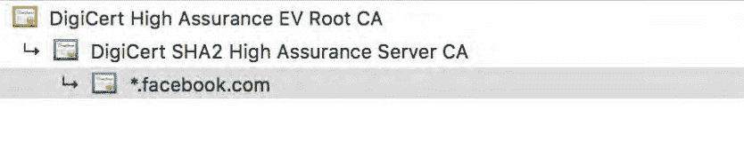

图13.5：一个示例证书链

CA 必须嵌入其发行的证书中。这个字段称为“CA”字段，如果被证书化的实体被允许作为 CA，则设置为 true，否则设置为 false。对于长度为 ℓ 的证书链要有效，链中的前 ℓ ⊕ 1 个证书必须将其 CA 基本约束设置为 true。如果不是，则验证者必须拒绝该链。Facebook 的证书将其 CA 字段设置为“false”，防止 Facebook 充当中间 CA。证书验证还包括许多其他细微的检查，通常很难正确实现。发现许多实现自定义证书验证的系统存在不安全性[46]，使其容易受到冒充和中间人攻击的威胁。

### 13.8.1 应对恶意或疏忽的证书机构

现在应该清楚，证书颁发机构拥有很大的权力。任何证书颁发机构都可以发布一个伪造的证书，并将错误的公钥绑定到 Facebook 上。如果不加以检查，伪造的证书将使对手能够对 Facebook 和毫无戒备的用户之间的通信进行中间人攻击，并窃听所有的通信。在我们讨论 TLS 会话建立机制之前，我们将详细讨论这些攻击。几个商业工具使这一过程变得非常容易实现。

目前有数千个中间证书颁发机构在互联网上运营，并且所有这些机构都被信任颁发证书。由于证书颁发机构的数量众多，发现错误证书并不令人意外。这里是一小部分事件的示例：

- Diginotar 是一个荷兰的证书颁发机构，在 2011 年遭到黑客攻击。攻击者获得了一个由 Diginotar 签名的 *.google.com 等许多其他域名的证书，使攻击者能够对所有这些域名进行中间人攻击。作为回应，主要的网络浏览器供应商撤销了对 Diginotar CA 颁发的所有证书的信任，导致 Diginotar 在 2011 年 9 月宣布破产。
- 2013 年，印度 NIC 错误地为几个 Google 和 Yahoo 域名颁发了证书[65]。这个中间 CA 由微软 Windows 信任的印度 CCA 根 CA 认证。因此，Chrome 浏览器不再信任由印度 NIC 颁发的证书。此外，根据这一事件，印度 CCA 根 CA 只有在以 .in 结尾的域名上颁发证书，例如 google.co.in。
- 2001 年，Verisign 错误地向一个冒充微软员工的个人颁发了一个微软代码签名证书[75]。这个证书使得该个人能够分发看起来像是由微软编写的代码。作为回应，微软发布了一个 Windows 软件补丁，撤销了对该证书的信任。

正如我们所看到的，许多这些事件都是由于 CA 的错误过程造成的。每当一个将错误的公钥绑定到域名的证书被颁发时，该证书就会使得中间人攻击目标域名成为可能。最终结果是攻击者可以检查和修改与受害域之间的通信。

那么问题是如何识别和控制行为不端的 CA。我们在下面讨论两个想法。

证书固定。读者一定想知道上述事件是如何被发现的。答案是一种被称为证书固定的机制，现在被 Web 浏览器广泛支持。基本思想是浏览器预先配置为知道唯一授权为域名 facebook.com 发行证书的 CA 是“DigiCert SHA2 High Assurance Server CA”，如图 13.5 所示。如果浏览器看到由其他 CA 发行的 facebook.com 的证书，它会做两件事：首先，将证书视为无效并关闭连接；其次，可选择性地向 Facebook 的管理员发出警报，表示发现了伪造的证书。上述涉及 India NIC 的事件是通过对 gmail.com 进行证书固定发现的。印度的浏览器向 Google 报告了 gmail.com 存在伪造证书链的情况。然后，Google 采取行动撤销该证书链并展开调查。伪造证书链中的签名提供了不可辩驳的证据，证明发生了问题。

更详细地说，证书固定工作原理如下。每个浏览器都维护着一个固定数据库，大致上，数据库中的每一行都是一个元组形式的数据（域名, 哈希值₀, 哈希值₁, ...）。每个哈希值ᵢ 都是一个哈希函数的输出（对于 SHA256，是一个 32 字节的字符串）。每条记录的数据由域名所有者提供。例如，Facebook 提供了 facebook.com 域名的哈希值。

当浏览器使用 HTTPS 连接到一个域名时，该域名会将其证书链发送给浏览器。如果该域名在固定数据库中，浏览器会计算链中每个证书的哈希值。令 S 为计算得到的哈希值集合。令 T 为该域名固定记录中的哈希值集合。如果 S 和 T 的交集为空，则证书链被拒绝，并且浏览器可以向域名管理员发送警报，指示遇到了一个恶意证书链。

为了看看这是如何工作的，再次考虑图 13.5 中的示例链。域名 facebook.com 的固定记录只是一个单一的哈希值，即“DigiCert SHA2 High Assurance Server CA”证书的哈希值。换句话说，集合 T 包含一个单一的哈希值。如果浏览器遇到一个证书链，其中没有任何证书的哈希值与固定值匹配，则拒绝该证书链。更一般地，从多个 CA 购买证书的域名将所有这些 CA 证书的哈希值包含在其固定记录中。

为什么 Facebook 在固定记录中写入其 CA 证书的哈希值？为什么不在固定记录中写入图 13.4 中的 Facebook 证书的哈希值？事实上，在固定记录中写入 CA 证书似乎是不安全的；这使得 DigiCert 有可能为 facebook.com 颁发一个被浏览器接受的恶意证书，尽管有固定记录。相反，如果 Facebook 将图 13.4 中的 Facebook 证书作为固定记录中的唯一哈希值，那么 DigiCert 将无法为 facebook.com 颁发恶意证书。浏览器只会接受图 13.4 中的证书作为 facebook.com 的唯一证书。然而，这样做存在巨大的风险。如果 Facebook 不慎丢失自己的秘密密钥，那么全世界的浏览器都将无法连接到 facebook.com。固定 CA 证书使得 Facebook 可以通过简单地请求 DigiCert 为 facebook.com 颁发新证书来从密钥丢失中恢复。因此，使网站崩溃的风险超过了 DigiCert 颁发恶意证书的安全风险。虽然对于像 Facebook 这样的大型网站来说，丢失秘密密钥可能不是一个问题，但对于使用证书固定的较小网站来说，这是一个重要的问题。

```
Public-Key-Pins: pin-sha256="hash"; max-age=expireTime
[; report-uri="reportURI";] [; includeSubDomains]
```

这里 pin-sha256 是要固定的哈希值，max-age 表示浏览器将忘记该固定记录的时间，report-uri 是一个可选的地址，用于报告固定记录验证失败。只有在加密的 HTTPS 会话中发送时，浏览器才会接受 HTTP 头。当通过未加密的 HTTP 发送时，该头部将被忽略。这可以防止网络攻击者注入无效的固定记录。

证书透明性。处理行为不端的 CA 的完全不同方法是基于公共证书日志。假设存在一个包含所有已发行证书列表的公共证书日志。然后像 Facebook 这样的公司可以监视日志并了解何时有人为 facebook.com 发行了一个恶意证书。这个被称为证书透明性的想法很有吸引力，但实施起来并不容易。我们如何确保每个已发行的证书都在日志中？我们如何确保日志是只追加的，以防止恶意证书从日志中删除？我们如何确保全世界的每个人都看到相同版本的日志？

证书透明度提供了对所有这些问题的答案。在这里，我们只是简要介绍了架构。当 CA 决定支持证书透明度时，它选择一个公共证书日志，并按照以下步骤扩充其证书签发过程：(1) 在签署新证书之前，CA 将证书数据发送到日志中，(2) 日志对证书数据进行签名并发送回签名，称为签名证书时间戳（SCT），(3) CA 将 SCT 作为扩展添加到证书数据中并对生成的结构进行签名，以获得最终签发的证书。SCT 嵌入在新签发的证书中作为扩展。

SCT 是证书日志在一定时间段内将证书发布到其日志中的承诺，比如一天。每天中午，证书日志将当天收到的所有新证书追加到日志中。然后，它计算整个日志的哈希值并与当前时间戳一起签名。日志数据和签名可供任何人下载。

架构的下一个部分是一组在全球范围内运行的审计员，确保证书日志的诚实行为 - 它们按要求发布到日志中，并且从日志中不删除任何数据。每天，审计员下载所有最新的日志和它们的签名，并检查是否从日志中删除了任何证书。如果他们发现某一天的证书在第二天的日志中丢失，则第一天和第二天的日志签名是证明证书日志行为不端的证据。

此外，每个审计员都会在互联网上搜索证书。对于包含 SCT 扩展的每个证书，审计员进行包含检查：验证证书是否出现在 SCT 指向的最新版本日志中。如果没有，则签名的 SCT 和签名的日志是证明证书日志行为不端的证据。这个过程确保所有部署的具有 SCT 扩展的证书必须出现在其中一个日志中；否则，其中一个证书日志被捕获到行为不端。任何人都可以运行审计员协议。特别是，每个 Web 浏览器可以选择作为审计员，并在选择信任证书之前运行包含检查。如果包含检查失败，浏览器会通知浏览器供应商，供应商可以对相关证书日志的做法进行调查。我们注意到，通过使用一种称为 Merkle 哈希树的数据结构，可以非常高效地进行包含检查，而无需下载整个日志。我们将讨论 Merkle 哈希树及其在应用中的应用。

## 第8.9节

不幸的是，审计还不够。一个狡猾的证书日志可以以一种不会被上述审计过程捕捉到的方式行为不端。假设一个CA为facebook.com发行了一个恶意证书，并将其写入证书日志，如所需。现在，证书日志创建了两个已签名的日志版本：一个带有恶意证书，一个没有。每当审计员下载日志时，它会得到带有恶意证书的日志版本。对于审计员来说，一切看起来都很好。然而，当Facebook读取日志以查找恶意facebook.com证书时，它会得到没有恶意证书的版本。这样一来，Facebook无法发现恶意证书，尽管所有的审计员都相信证书日志的行为是诚实的。

该架构通过两种方式来减轻这种攻击。首先，每个证书必须至少写入两个日志，以便攻击成功，两个证书日志都必须被破坏。其次，系统中存在一种广播机制，将所有日志的每日哈希广播给所有实体。不匹配广播哈希的日志将被简单地忽略。

该架构的最后一部分是要求所有CA都进行证书透明。在将来的某个时候，浏览器供应商可以决定拒绝所有没有来自受信任证书日志的有效SCT的证书。这将有效地强制所有CA普遍采用证书透明。在那时，如果发出了一个恶意证书，它将在一个证书日志中被发现并吊销。我们注意到许多大型CA已经支持证书透明。

## 13.8.2 证书吊销

接下来我们来看一下吊销证书的问题。证书吊销的目标是确保，在证书被吊销后，所有客户端都将该证书视为无效。

有很多原因可能导致证书需要被吊销。证书可能因为错误而被颁发，就像前一小节讨论的那样。与证书对应的私钥可能已经被盗取，这种情况下证书的所有者将希望吊销证书，以防止其被滥用。这种情况经常发生；网站被黑客攻击并且他们的机密信息被窃取。一个广为人知的例子是心脏出血事件。心脏出血是OpenSSL库中的一个漏洞，该漏洞在2012年引入。这个漏洞在2014年被公开发现和修复，但在这两年的时间里，从2012年到2014年，远程攻击者可以通过向服务器发送特定的格式错误请求，轻松地从每个使用OpenSSL的服务器中提取出秘密密钥。当这个漏洞在2014年被发现时，成千上万个证书不得不被吊销，因为人们担心相应的秘密密钥已经被泄露。

鉴于需要撤销证书，我们接下来描述了一些撤销证书的技术。

**短期证书。** 请记住，每个证书都有一个有效期，在过期日期之后，证书将不再有效。通常，当像Facebook这样的实体购买一年的证书时，CA会发放一个在发放后一年到期的证书。想象一下，相反地，CA生成了365个证书，每个证书在那一年中只有效一天。

所有365个证书都是用于同一个公钥的；唯一的区别是有效期。这些证书被称为短期证书，因为每个证书只在一天内有效。CA将所有这些证书保留给自己，并在最多一周之前发布每个证书的有效期。因此，1月28日要使用的证书将在1月21日提供，但不会更早。每天，Facebook连接到CA提供的公共网站并获取证书，一周后使用。这是一个简单的自动化过程，如果出现任何问题，有整整一周的时间来解决问题。

现在，当Facebook需要撤销其证书时，它只需指示CA停止发布其域名的短期证书。这有效地使被盗的私钥在最多一周后变得无用。如果需要更快的撤销，可以告诉CA在每个短期证书生效前一小时发布，这样密钥在被撤销后最多25小时后变得无用。

使用短期证书是目前最简单、最实用的证书吊销技术，但并不广泛使用。接下来的两种技术更加繁琐，但是是CA最常使用的技术。

## 证书吊销列表 (CRL)

一个非常不同的方法是让CA收集所有客户的证书吊销请求，并在每周基础上发布一份签名的吊销列表，列出了在那周内吊销的所有证书。这个列表称为证书吊销列表 (CRL)，包含了在那周内吊销的所有证书的序列号。该列表由CA签名。

每个证书都包含一个特殊的扩展字段，称为CRL分发点，如图13.6所示。该字段指示验证者从颁发机构获取CRL的位置。颁发机构必须运行一个公共服务器，向任何请求的人提供此列表。

当客户端需要验证证书时，它应该从CRL分发点下载CRL，并且如果证书的序列号出现在CRL中，则拒绝该证书。出于性能原因，CRL的有效期为一周，客户端可以在该期间缓存CRL。因此，从发出吊销请求到所有客户端了解到证书已被吊销可能需要一周的时间。

这种方法存在两个重要的困难。首先，如果CRL服务器不响应CRL下载请求，客户端应该怎么办？如果客户端接受了证书，那么这将导致非常严重的攻击。攻击者可以通过阻止客户端与CRL服务器的连接来导致客户端接受已吊销的证书。显然，安全的做法是拒绝该证书；然而，这也存在问题。这意味着如果Facebook的CA运行的CRL服务器意外崩溃，那么没有人能够连接到Facebook，直到CA修复CRL服务器。正如你可以想象的那样，这对Facebook来说并不好。CRL的第二个困难是它们强制客户端下载一大堆客户端不需要的已吊销证书列表。客户端只对学习单个证书的有效性状态感兴趣：即它正在尝试验证的证书。客户端不需要，也不关心其他证书的状态。这种低效性通过一种更好的机制称为OCSP得到解决，我们将在下面讨论。

## 在线证书状态协议 (OCSP)

需要验证证书的客户端可以使用OCSP协议查询CA关于该特定证书状态的信息。为了使其工作，CA在证书中包含了一个OCSP扩展字段，如图13.6所示。该字段告诉客户端将OCSP查询发送到何处。此外，CA必须设置一个名为OCSP响应者的服务器，以响应来自客户端的OCSP查询。

当客户端需要验证证书时，它将证书的序列号发送给OCSP响应者。粗略地说，响应者会返回一个签名消息，表示“有效”或“无效”。如果“无效”，客户端将拒绝证书。OCSP响应可以缓存，比如一周，并且因此吊销只在请求发出一周后生效。

与CRL一样，当OCSP响应者没有响应时，客户端应该做什么并不清楚。此外，OCSP还引入了另一个问题。因为客户端（如Web浏览器）向CA发送遇到的每个证书的序列号，CA可以有效地了解用户正在访问的网站。这是对用户隐私的侵犯。该问题可以通过OCSP的扩展，称为OCSP stapling，部分缓解，但这个扩展很少被使用。

## 13.9 案例研究：数字签名的法律方面

尽管密码学家说，如果签名方案在选择的消息攻击下是存在无法伪造的安全性，但在电子文档上构成有效数字签名的法律标准却非常不同。法律定义试图捕捉意图的概念：如果签署者“打算”签署该文件，则签名有效。在这里，我们简要回顾了一些试图阐明这一概念的立法努力。这个讨论表明，密码学数字签名与法律约束的电子签名非常不同。

**美国的电子签名。** 2000年6月30日，美国国会通过了《全球和国家商务电子签名法》（E-SIGN）。E-SIGN的目标是促进电子签名在州际和国际贸易中的使用。

美国的法律规定，超过500美元的货物销售合同必须签署。根据美国法律，为了具有可执行性，E-SIGN要求电子签名具备三个要素：（1）符号或声音，（2）与电子记录附加或逻辑关联，（3）具有签署电子记录的意图。在这里，我们只讨论第一个要素。美国对电子签名的定义认识到有许多不同的方法可以签署电子记录。符合E-SIGN的电子签名示例包括：

-   1. 发件人在电子邮件末尾输入的姓名，
-   2. 附加到电子文档的数字化手写签名图像，
-   3. 用于将发件人身份确认给收件人的秘密密码或PIN码，
-   4. 鼠标点击，例如“我接受”按钮，
-   5. 声音，例如在电话上按下‘9’时产生的声音，
-   6. 密码学数字签名。

显然，前五个例子很容易伪造，因此几乎无法用于识别签署人的身份。然而，请记住根据美国法律，用‘X’签署纸质合同是有效的，只要能够证明签署人有意签署合同。因此，前五个例子应被视为与用‘X’签署等效的法律行为。

**联合国关于电子签名的条约。** 2005年11月，联合国通过了关于国际合同中使用电子通信的公约。2005年联合国公约的签名要求超出了E-SIGN所要求的范围。特别是，该公约侧重于安全问题，要求使用一种既能够识别签署人又可靠的方法。特别是，该公约指出，仅满足适用于美国法律的基本要求（例如鼠标点击）的电子签名与可信赖的电子签名之间存在很大差异。因此，在联合国公约下，只有鼠标点击能够最终证明“谁”点击了，并确定点击背后的意图，才能被视为数字签名。

**欧洲共同体电子签名框架。** 在1999年12月，欧洲议会通过了电子签名指令。该指令涉及三种形式的电子签名。第一种可以简单地用个人姓名签署电子邮件，或者使用个人识别码。第二种被称为“高级电子签名”（AES）。该指令在技术上是中立的，但在实践中，AES主要指的是基于公钥基础设施（PKI）的加密数字签名。AES被认为更安全，因此享有更大的法律可接受性。如果电子签名满足以下条件，则被视为AES：（1）与签署人唯一相关联，（2）能够识别签署人，（3）使用签署人能够独自控制的手段创建，（4）与相关数据以可检测到任何后续数据更改的方式相关联。

## 13.10 一个有趣的应用：私人信息检索

待写。

## 13.11 笔记

待添加文献引用。

## 13.12 练习

**13.1 (多密钥签名安全)。** 就像我们在练习6.3中对安全MAC所做的那样，证明在单密钥签名环境中的安全性意味着在多密钥签名环境中的安全性。
(a) 展示如何扩展攻击游戏13.1，以便攻击者可以提交与多个签名密钥相关的签名查询。这类似于练习6.3中描述的多密钥推广。
(b) 证明每个有效的对手 $\mathcal{A}$ 在多密钥攻击游戏中以概率 $\epsilon$ 获胜，可以转化为在攻击游戏 13.1 中以概率 $\epsilon / Q$ 获胜的有效对手 $\mathcal{B}$。该证明使用与练习 6.3 中相同的“插入并祈祷”技术。

**13.2（非约束签名）** 在 13.1.1 节中，我们提到安全签名可以是非约束的：对于给定的 $(pk, sk)$，签名者可以找到两个不同的消息 $m_0$ 和 $m_1$，在 $pk$ 下相同的签名 $\sigma$ 对两个消息都有效。我们解释了这可能会引起问题。

给出一个安全的非绑定签名的例子。

提示：考虑使用第 13.2 节中讨论的哈希和签名范例，但使用练习 10.26 中讨论的抗碰撞哈希函数。

**13.3（RSA 的 DSKS 攻击）** 让我们展示 $\mathsf{S_{F}DH}$ 对于第 13.1.1 节中讨论的 DSKS 攻击是脆弱的。设 $(n, e)$ 是 Alice 的公钥，$(n, e, \sigma, m)$ 是某个消息 $m$ 的签名。展示一个对手可以有效地得到一个新的公钥 $pk' = (n', e')$ 和相应的私钥，使得 $(m, \sigma)$ 是关于 $pk'$ 的有效消息-签名对。

提示：我们在第 15.2.2 节中展示了对于一些质数 $p$，可以有效地解决 $\mathbb{Z}_p^*$ 中的离散对数问题。例如，当 $p = 2^{\ell} + 1$ 是质数，并且 $\ell$ 是多项式有界时，$\mathbb{Z}_p^*$ 中的离散对数问题是容易的。展示通过将 $n$ 形成为两个这样的质数的乘积，对手可以得到一个 $e'$ 使得 $\sigma^{(e')} = H(m)$ 在 $\mathbb{Z}_{n'}$ 中成立。

**13.4（防止 DSKS 攻击）** 在这个练习中，我们探讨了一种针对 DSKS 漏洞的一般防御方法，该漏洞在第 13.1.1 节中进行了讨论。
- (a) 定义一个安全游戏，捕捉到签名方案对 DSKS 攻击的安全性：攻击者对某个 $pk$ 发起了一个选择消息攻击，并且如果输出了一个 $(pk', sk')$，其中 $pk' = pk$，并且至少有一个给定的消息-签名对在 $pk'$ 下验证通过。此外，$sk'$ 是 $pk'$ 的有效签名密钥（假设你有一个算法 $T(pk', sk')$，只有在 $sk'$ 是 $pk'$ 的有效签名密钥时才返回接受）。
- (b) 在第 13.1.1 节中，我们描述了一种将存在性不可伪造的签名方案免疫于 DSKS 攻击的一般方法。证明这种方法满足部分 (a) 中的安全定义。

**13.5（去随机化签名）** 设 $\mathcal{S} = (G, S, V)$ 是在 $(\mathcal{M}, \Sigma)$ 上定义的安全签名方案，其中签名算法 $S$ 是概率性的。特别地，算法 $S$ 使用从空间 $\mathcal{R}$ 选择的随机性。我们用 $S(sk, m; r)$ 表示使用随机性 $r$ 执行算法 $S$ 的过程。设 $F$ 是在 $(\mathcal{K}, \mathcal{M}, \mathcal{R})$ 上定义的安全伪随机函数。证明以下签名方案 $\mathcal{S}' = (G', S', V)$ 是安全的：
```
$G'() := \{\; (pk, sk) \stackrel{R}{\leftarrow} G(),\; k \stackrel{R}{\leftarrow} \mathcal{K},\; sk' = (sk, k),\; \text{输出} \; (pk, sk')\; \}$
$S'(sk', m) := \{\; r \leftarrow F(k, m),\; \sigma \leftarrow S(sk, m; r),\; \text{输出} \; \sigma\; \}.$
```
现在，对于 $\mathcal{S}'$ 的签名算法是确定性的。

**13.6（使用增强 TCR 扩展域）** 在练习 8.26 中，我们定义了增强 TCR 的概念。展示如何使用增强 TCR 来高效地扩展签名的域。特别地，让 $H$ 是在 $(\mathcal{K}_H, \mathcal{M}, \mathcal{X})$ 上定义的增强 TCR，而 $\mathcal{S} = (G, S, V)$ 是一个具有消息空间$\mathcal{M}$的安全签名方案。证明$S' = (G, S', V')$是一个安全的签名方案：
```
$S'(sk, m) := \begin{cases} r \stackrel{R}{\leftarrow} \mathcal{K}_H, \sigma \leftarrow S(sk, H(r, m)), \text{输出} (\sigma, r); \end{cases}$
$V'(pk, m, (\sigma, r)) := \begin{cases} \text{如果 } V(pk, H(r, m)) = 1 \text{ 则接受，否则拒绝} \end{cases}.$
```
与第13.2.1节中的构造相比，好处是$r$不是给予签名过程的一部分。

**13.7 (FDH变种)**。证明签名方案 $S_{\text{RSA-FDH}}'$ (在第13.5节中定义) 不比签名方案 $S_{\text{RSA-FDH}}$ (在第13.3.1节中定义) 安全。你应该证明，如果存在一个成功概率为 $\epsilon$ 的攻击者 $\mathcal{A}$ 能够破解 $S_{\text{RSA-FDH}}'$ (其消息空间为 $\mathcal{M}$)，那么就存在一个成功概率为 $\epsilon$ 的攻击者 $\mathcal{B}$ (其运行时间与$\mathcal{A}$大致相同) 能够破解 $S_{\text{RSA-FDH}}$ (其消息空间为$\mathcal{M}' = \{0,1\} \times \mathcal{M}$)。这对于任何哈希函数 $H$ 都成立。

**13.8 (概率全域哈希)**。考虑以下签名方案 $S= (G, S, V)$ 其中消息空间 $\mathcal{M}$，并使用哈希函数 $H: \mathcal{M} \times \mathcal{R} \rightarrow \mathbb{Z}_n$:
```
$G() := \begin{cases} (n, d) \stackrel{R}{\leftarrow} \text{RSAGen}(\ell, e), pk:=(n, e), sk:=(n, d), \text{输出} (pk, sk); \end{cases}$
$S(sk, m) := \begin{cases} r \stackrel{R}{\leftarrow} \mathcal{R}, \text{结果} \leftarrow H(m, r), \sigma \leftarrow \text{结果}^d \mod n, \text{输出} (\sigma, r) \end{cases};$
$V(pk, m, (\sigma, r)) := \begin{cases} \text{结果} \leftarrow H(m, r), \text{如果 } \text{结果} = \sigma^e \mod n \text{ 则接受，否则拒绝} \end{cases}.$
```
证明如果 RSA 假设对于 $(\ell, e)$ 成立，数量 $1/|\mathcal{R}|$ 是可以忽略的，并且 $H$被建模为一个随机预言机，那么这个签名是安全的。此外，将 RSA 反演的约化是紧密的。

讨论：虽然 $S_{\text{RSA-FDH}}'$，从第13.5节可以看出，也有一个紧密的约化，但这里的构造没有使用 PRF。代价是签名更长，因为$r$被包含在签名中。

**13.9 (批量 RSA)**。让我们展示如何加速 $S_{\text{RSA-FDH}}$的签名生成。
- (a) 让 $n = pq$，使得既不是3也不是5能整除 $(p-1)(q-1)$。我们已知$p$，$q$和 $y_1, y_2 \in \mathbb{Z}_n$。展示如何通过仅计算 $t$的15次根来计算出 $x_1 := y_1^{1/3} \in \mathbb{Z}_n$和 $x_2 := y_2^{1/5} \in \mathbb{Z}_n$，并进行一些额外的算术运算。换句话说，展示给定 $t^{1/15} \in \mathbb{Z}_n$，可以使用常数次算术运算来计算出 $x_1$ 和 $x_2$。
- (b) 描述一个算法，用于计算一个15次方根在 $\mathbb{Z}_n$使用单个指数运算，对于 $n$ 如(a)部分所述。
- (c) 解释如何使用(a)和(b)部分来加速 $S_{\text{RSA-FDH}}$签名算法。具体来说，证明签名者可以同时签署两条消息，与签署单条消息的工作量几乎相同。第一条消息将在公钥$(n,3)$下签名，另一条消息将在公钥$(n,5)$下签名。这种方法可以推广到更大批量的快速RSA签名生成。

**13.10 (带消息恢复的签名)**。设 $\mathcal{T} = (G, F, I)$ 是一个定义在 $\mathcal{X} := \{0,1\}^n$上的单向陷门置换。设 $\mathcal{R} := \{0,1\}^\ell$和 $\mathcal{U} := \{0,1\}^{n-\ell}$，其中 $0 < \ell < n$。设 $H$## 13.11 (具有消息恢复的不安全签名)。

设 $\mathcal{T}= (G, F, I)$ 是一个定义在$X:=\{0,1\}^n$上的单向陷门置换。设 $H$是一个定义在 ($\mathcal{M}_0$, $\mathcal{X}$) 上的哈希函数。考虑以下签名方案 $S= (G, S, V)$ 定义在 ($\mathcal{M}_0 \times \mathcal{X}$, $\mathcal{X}$) 上，其中

```
S(sk, (m_0, m_1)) := \{\sigma \leftarrow I(sk, H(m_0) \oplus m_1), \quad \text{输出} \quad \sigma\}
V(pk, (m_0, m_1), \sigma) := \{y \leftarrow F(pk,\sigma) , \text{如果} \ y = H(m_0) \oplus m_1\text{则接受，否则拒绝}\}
```

- (a) 证明只给出 $(m_0,\sigma)$，其中 $\sigma$是消息 $(m_0, m_1)$ 的有效签名，可以恢复 $m_1$。
- (b) 证明即使 $\mathcal{T}$是单向的，$H$被建模为随机预言机，该签名方案也是不安全的。 你可以假设算法 $I$具有以下特性：对于所有由 $G$输出的 $(sk, pk)$，以及所有的 $x \in \mathcal{X}$，只给出 $I(sk, x)$ 作为输入，可以轻松计算 $I(sk, x \oplus 1^n)$。

## 13.12 (盲签名)。

在第13.3.1节的末尾，我们提到RSA签名可以被改进为盲签名。盲签名方案允许一方，Alice，从Bob那里获得消息 $m$的签名，以便Bob对 $m$一无所知。盲签名在电子现金系统和匿名投票系统中被使用。

令 $(n, d) \stackrel{\mathrm{R}}{\leftarrow} \text{RSAGen}(\ell, e)$ 并将 $(n, e)$ 设置为Bob的RSA公钥，将 $(n, d)$ 设置为他相应的私钥。通常情况下，令 $H : \mathcal{M} \rightarrow \mathbb{Z}_n$ 为一个哈希函数。Alice希望Bob对一条消息 $m \in \mathcal{M}$ 进行签名。他们进行以下三条消息的协议：

- (1) Alice选择 $r \stackrel{\mathrm{R}}{\leftarrow} \mathbb{Z}_n$，设置 $m' \leftarrow H(m) \cdot r^e \in \mathbb{Z}_n$，并将 $m'$发送给Bob，
- (2) Bob计算 $\sigma' \leftarrow (m')^d \in \mathbb{Z}_n$并将 $\sigma'$发送给Alice，
- (3) Alice计算签名 $\sigma$作为 $m$的 $\sigma \leftarrow \sigma' / r \in \mathbb{Z}_n$。

方程式 (13.4) 表明 $\sigma$ 是 $m$的一个有效签名。观察到在这个过程中，Bob看到了一个在 $\mathbb{Z}_n$中的随机消息 $m'$，它与 $m$是独立的。因此，他对 $m$一无所知。

- (a) 我们说一个盲签名协议是安全的，如果敌手在给定公钥和能够请求 $Q$ 个他选择的盲签名的能力下，不能产生 $Q+1$ 个有效的消息-签名对。写出安全的精确定义。
- (b) 假设RSA假设对于 $(\ell, e)$ 成立，并且 $H$ 被建模为随机预言机，证明RSA盲签名是安全的。

## 13.13 (阈值RSA签名)。

在练习11.16中，我们展示了如何将秘密RSA解密密钥分成三个份额，以便解密给定的密文需要两个份额，但一个份额不会泄露任何信息。在这个练习中，我们展示了RSA签名也可以做到同样的事情，即生成一个签名需要两个份额，但一个份额不会泄露任何信息。

- (a) 通过调整定义11.6来适应签名方案的上下文，定义什么是阈值签名方案。然后调整攻击游戏11.4，用于定义阈值解密的安全性，来定义安全的阈值签名。
- (b) 使用练习11.16构建一个2-of-3门限RSA签名方案。
- (c) 证明你在第(b)部分构建的方案满足第(a)部分的安全定义。

## 13.14 (不安全的签名加密)。

设 $\mathsf{E} = (G, \mathcal{E}, E, D)$ 是一个带有相关数据的CCA安全公钥加密方案，$S = (G_S, S, V)$ 是一个强安全的签名方案。定义算法 $G$ 如第13.7.3节所述。证明以下加密-然后签名的签名加密方案 $(G, E', D')$ 是不安全的：

```
E'(sk_S, id_S, pk_R, id_R, m) := c \stackrel{R}{\leftarrow} E(pk_R, m, id_R), \sigma \stackrel{R}{\leftarrow} S(sk_S, (c, id_S))
输出 (c, \sigma)

D'(pk_S, id_S, sk_R, id_R, (c, \sigma)) := 如果 V(pk_S, (c, id_S), \sigma) = \text{拒绝}, 输出 \text{拒绝}
否则, 输出 D(sk_R, c, id_R)
```

## 13.15 (iMessage攻击)。

令 $\mathsf{E} = (G, \mathcal{E}, E, D)$ 为CCA安全的公钥加密方案，令 $S = (G_S, S, V)$ 为强安全的签名方案。令 $(E_{\text{sym}}, D_{\text{sym}})$ 为具有密钥空间 $\mathcal{K}$ 的对称密码，实现确定性计数器模式。定义算法 $G$ 如第13.7.3节所述。考虑以下加密-然后签名的签密方案 $(G, E', D')$：

```
E'(sk_S, id_S, pk_R, id_R, m) := k \stackrel{R}{\leftarrow} \mathcal{K}, c_1 \leftarrow E_{\text{sym}}(k, (id_S, m)), c_0 \stackrel{R}{\leftarrow} E(pk_R, k)
\sigma \stackrel{R}{\leftarrow} S(sk_S, (c_0, c_1, id_R))
输出 (c_0, c_1, \sigma)

D'(pk_S, id_S, sk_R, id_R, (c_0, c_1, \sigma)) := 如果 V(pk_S, (c_0, c_1, id_R), \sigma) = \text{reject}, 输出 \text{reject}
k \leftarrow D(sk_R, c_0), (id, m) \leftarrow D_{\text{sym}}(k, c_1)
如果 id = id_S 输出 \text{reject}
否则, 输出 m
```

因为对称密文 $c_1$ 是发送者签名的一部分，设计者假设不需要使用AE密码，确定性计数器模式就足够了。
通过给出CCA攻击，证明该系统是一个不安全的签密方案。曾经有一段时间，苹果的iMessage系统使用了这个方案的变体，这导致了iMessage的重大泄漏。因为每个明文消息 $m$ 都包含一个校验和 (CRC)，攻击者可以使用类似chopchop的攻击解密任意加密消息 (练习9.5)。

## 13.16 (签密: 静态选择与自适应选择的用户ID)。

在13.8定义后的讨论中，我们简要讨论了一种更强大的安全定义的可能性，在这种定义中，攻击者可以在看到一个或两个公钥，甚至在看到一个或多个X →Y查询的响应之后，自适应地选择发送者和接收者的用户ID。

- (a) 解决这个更健壮定义的细节，定义相应的SCI和SCCA攻击游戏。
- (b) 给出一个满足定义13.8但不满足你的更健壮定义的签名加密方案的例子。为此，你应该从满足定义13.8的方案开始，然后以某种方式“破坏”该方案，使其仍然满足定义13.8，但不再满足你的更健壮定义。你可以使用任何其他标准的密码原语，方便的话。

## 13.17 (签名加密: 加密-签名-然后再签名)。

在这个练习中，我们开发了一种变种的加密-然后-签名的方案，称为加密-签名-然后再签名。与方案 $SC_{EtS}$一样，这个新方案，记作 $SC_{EaStS}$，使用了一个带有相关数据的公钥加密方案$\mathcal{E}= (G_{ENC}, E, D)$，和一个签名方案 $\mathcal{S} = (G_{SIG}, S, V)$。对于 $SC_{EaStS}$的密钥生成与 $SC_{EtS}$中的相同。然而，$SC_{EaStS}$使用了另一个签名方案 $\mathcal{S}' = (G'_{SIG}, S', V')$。

加密算法 $E_{EaStS}(sk_S, id_S, pk_R, id_R, m)$的运行如下：

```
(pk', sk') \stackrel{R}{\leftarrow} G'_{SIG}, c \stackrel{R}{\leftarrow} E(pk_R, m, pk'), \sigma \stackrel{R}{\leftarrow} S(sk_S, pk'), \sigma' \stackrel{R}{\leftarrow} S'(sk', (c, \sigma, id_S, id_R)), \text{输出}(pk', c, \sigma, \sigma')
```

解密算法 $D_{EaStS}(pk_S, id_S, sk_R, id_R, (pk', c, \sigma, \sigma'))$的运行如下：

```
如果 V(pk_S, pk', \sigma) = \text{拒绝} 或 V'(pk', (c, \sigma, id_S, id_R), \sigma') = \text{拒绝} 则输出拒绝 否则输出 D(sk_R, c, pk')
```

在这里，临时公共验证密钥 $pk'$被用作加密的相关数据方案 $\mathcal{E}$。

你的任务是证明 $SC_{EaStS}$ 是一个安全的签名加密方案，它提供前向保密性和不可否认性，基于以下假设：(i) $\mathcal{E}$是CCA安全的；(ii) $\mathcal{S}$是安全的(不一定是强安全的)；(iii) $\mathcal{S}'$是强安全的(只对抗1查询对手)。

讨论：注意我们必须每次加密时运行密钥生成算法 $S'$，从而生成一个仅用于签署单个消息的临时签名密钥。我们只需要对抗1查询对手的安全性这一事实意味着在合理的假设下可以非常高效地实现 $S'$。这是下一章的主题。

算法 $E_{EaStS}$的另一个特点是，我们可以并行运行算法 $E$和 $S$；此外，我们甚至可以并行运行算法 $G'_{SIG}$在调用算法 $E_{EaStS}$之前，我们可以并行运行算法 $V, V'$, 和 $D$（如第14.4.1节所讨论的）。同样，在算法 $D_{EaStS}$中，我们可以并行运行算法V,V0,和D.

## 第四部分

## 附录

## 附录A

### 基本数论

### A.1 循环群

记号：对于一个有限循环群 $\mathbb{G}$，我们用 $\mathbb{G}^*$ 表示 $\mathbb{G}$ 的生成元集合。

### A.2 素数取模算术

#### A.2.1 基本概念

我们用字母 $p$ 和 $q$ 表示素数。我们将使用大素数，例如约300位（1024位）。

- 1. 对于一个素数 $p$，我们有 $\mathbb{Z}_p = \{0, 1, 2, \ldots, p \ominus 1\}$。
$\mathbb{Z}_p$ 的元素可以在模 $p$ 下进行加法和乘法运算。对于 $\mathbb{Z}_p$ 的元素 $x$ 和 $y$，我们用 $+$ 和 $\cdot$ 表示 $x$ 和 $y$ 在模 $p$ 下的和与积。
$\epsilon$。费马定理：对于任意的 $g$，有 $g^{p-1} = 1$，其中 $g$ 为 $\mathbb{Z}_p$ 的元素。
例子：$3^4 \mod 5 = 81 \mod 5 = 1$。
3. 对于 $\mathbb{Z}_p$ 的元素 $x$，其逆元素 $a$ 满足 $a \cdot x = 1$。
在 $\mathbb{Z}_p$ 的元素 $x$ 的逆元素用 $x^{-1}$ 表示。
例子：1. 3的逆元素在 $\mathbb{Z}_5$ 中为2，因为 $2 \cdot 3 = 1 \mod 5$。
$2. \ 2^{\text{的逆元素在} \ \mathbb{Z}_p \ \text{中为}} \ \frac{p+1}{2}$。
4. 除了 $x=0$ 之外，所有元素 $x \in \mathbb{Z}_p$ 都是可逆的。
简单（但低效）的求逆算法：$x^{-1} = x^{p-2} \mod p$。
事实上，$x^{p-2} \cdot x = x^{p-1} = 1 \mod p$。
5. 我们用 $\mathbb{Z}_p^*$ 表示 $\mathbb{Z}_p$ 中的可逆元素集合。那么 $\mathbb{Z}_p^* = \{1, 2, \ldots, \ldots, \ldots, p \ominus 1\}$。
6. 我们现在有了在 $\mathbb{Z}_p$ 中解线性方程的算法：$a \cdot x = b$。
解：$x = b \cdot a^{-1} = b \cdot a^{p-2}$。
那么解二次方程的算法呢？

#### A.2.2 Z_p^*的结构

- 1. Z_p^*是一个循环群. 换句话说，存在一个 g ∈ Z_p^* 使得 Z_p^* = \{1, g, g^2, g^3, \ldots, g^{p-2}\}. 这样的 g 被称为 Z_p^*的生成元。 例子：在 Z_7^*中: ⟨3⟩ = \{1, 3, 3^2, 3^3, 3^4, 3^5, 3^6\} = \{1, 3, 2, 6, 4, 5\} (mod 7) = Z_7^*.
- 2. 并不是 Z_p^*的每个元素都是生成元。 例子：在 Z_7^*中, 我们有 ⟨2⟩ = \{1, 2, 4\} = Z_7^*.
- 3. g ∈ Z_p^*的阶是最小的正整数 a，使得 g^a = 1. g ∈ Z_p^*的阶记为 order_p(g). 例子：order_7(3) = 6, order_7(2) = 3.
- 4. 拉格朗日定理: 对于所有的 g ∈ Z_p^*, 我们有 order_p(g) 整除 p ⊖ 1. 观察到费马定理是一个简单的推论: 对于 g ∈ Z_p^*, 我们有 g^{p-1} = (g^{order(g)})^{(p-1)/order(g)} = (1)^{(p-1)/order(g)} = 1.
- 5. 如果已知 p ⊖ 1 的因数分解, 则存在一种简单且高效的算法来确定任意 g ∈ Z_p^* 的阶数 ( g ).

#### A.2.3 平方剩余

- 1. 对于任意 x ∈ Z_p 的平方根 y ∈ Z_p, 满足 y^2 = x mod p. 例子：1. √在 Z_7中, 2的平方根是 3, 因为 3^2=2 mod 7。 2. √在 Z_7中, 3不存在。
- 2. 如果一个元素 x ∈ Z_p^*在 Z_p中有一个平方根, 则称其为二次剩余(QR)。
- 3. 对于 x ∈ Z_p, 有多少个平方根? 如果在 Z_p中 x^2 = y^2, 则 0 = x^2 ⊖ y^2 = (x ⊖ y)(x + y). Z_p是一个“整环”，这意味着 x ⊖ y = 0 或 x + y = 0, 即 x = ±y. 因此，Z_p中的元素要么没有平方根，要么有两个平方根。 如果 a是 x的平方根, 那么 ⊖a也是 Z_p中 x的平方根。
- 4. 欧拉定理: x ∈ Z_p是一个QR 当且仅当 x^{(p-1)/2}=1时, x是QR。 例如：2^{(7-1)/2}=1在 Z_7中, 但 3^{(7-1)/2} = ⊖1在 Z_7中。 那么 a = g^{(p-1)/2} ∈是1的平方根。确实, a^2 = g^{p-1} = 1在 Z^p中。 Z_p中1的平方根是1和 ⊖1。 因此, 对于 g ∈ Z_p^*我们知道 g^{(p-1)/2}等于1或 ⊖1。
- 5. Legendre符号: 对于 x ∈ Z_p定义 (x/p) := { 如果 x是 Z_p中的QR, 则为1 如果 x=0 mod p, 则为0; 如果 x不是 Z_p中的QR, 则为⊖ }。
- 6. 根据欧拉定理, 我们知道 (x/p) = x^{(p-1)/2}在 Z_p中。 ==> Legendre符号可以高效计算。

## A.2.4 在 $\mathbb{Z}_p$ 中的计算

- 1. 由于 $p$ 是一个巨大的素数（例如，1024位长），它不能被存储在一个寄存器中。
- 2. $\mathbb{Z}_p$ 的元素存储在桶中，每个桶的长度为32或64位，取决于处理器的芯片大小。
- 3. 在 $\mathbb{Z}_p$ 中，两个元素 $x, y \in \mathbb{Z}_p$ 的相加可以在线性时间内完成，与 $p$ 的长度成正比。
- 4. 在 $\mathbb{Z}_p$ 中，两个元素 $x, y \in \mathbb{Z}_p$ 的相乘可以在与 $p$ 的长度成平方关系的时间内完成。 如果 $p$ 的长度为 $n$ 位，更好的算法可以在时间 $O(n^{1.7})$ （而不是 $O(n^2)$）内工作。
- 5. 反转一个元素 $x \in \mathbb{Z}_p$ 可以在 $p$ 的长度的二次时间内完成。
- 6. 使用重复平方算法，可以在时间 $(\log_2 r) O(n^2)$ 内计算出 $x^r \pmod{p}$，其中 $p$ 的长度为 $n$ 位。 注意，该算法的时间复杂度与 $r$ 的长度成线性关系。

## A.2.5 总结：素数取模算术

设 $p$ 为一个1024位的素数。 在 $\mathbb{Z}_p$ 中的简单问题有:

- 1. 生成一个随机元素。 添加和乘法运算。
- 2. 即使 $r$ 非常大，计算 $r \pmod{p}$ 也很容易。
- 3. 反转一个元素。解线性系统。
- 4. 测试一个元素是否为二次剩余，并计算其平方根。
- 5. 解决 $d$ 次多项式方程可以在多项式时间内完成。

在 $\mathbb{Z}_p$ 中被认为是困难的问题有：

- 1. 设 $g$ 为 $\mathbb{Z}_p^*$ 的生成元。给定 $x \in \mathbb{Z}_p^*$，找到一个 $r$ 使得 $x = g^r \mod p$。这被称为离散对数问题。
- 2. 让 $g$ 成为 $\mathbb{Z}_p^*$ 的生成元。这被称为 Diffie-Hellman 问题。

## A.3 合数取模算术

我们处理的整数长度约为300位数（1024位）。除非另有说明，我们假设 $n$ 是两个相等大小的素数的乘积，例如每个素数约为150位数（512位）。

- 1. 对于一个复合数 $n$，令 $\mathbb{Z}_n = \{0, 1, 2, \ldots, n - 1\}$。在 $\mathbb{Z}_n$ 中的元素可以进行模 $n$ 的加法和乘法运算。
- 2. 对于 $\mathbb{Z}_n$ 中的元素 $x$，其逆元素 $y$ 满足 $x \cdot y = 1 \mod n$。如果且仅当 $x$ 和 $n$ 互质时，元素 $x$ 在 $\mathbb{Z}_n$ 中有逆元。换句话说，$\gcd(x, n) = 1$。
- 3. 可以使用欧几里得算法高效地求解 $\mathbb{Z}_n$ 中的元素的逆。如果 $\gcd(x, n) = 1$，那么使用欧几里得算法可以高效地构造两个整数 $a, b \in \mathbb{Z}$ 使得 $a x + b n = 1$。将这个关系模 $n$ 约简得到 $a x = 1 \mod n$。因此，$a = x^{-1} \mod n$。注意：这个求逆算法也适用于 $\mathbb{Z}_p$ 中的素数 $p$，并且比计算 $x^{p-2} \mod p$ 更高效。
- 4. 我们将 $\mathbb{Z}_n^*$ 表示为 $\mathbb{Z}_n$ 中可逆元素的集合。
- 5. 现在我们有了一个解线性方程的算法：$a \cdot x = b \mod n$。解：$x = b \cdot a^{-1}$，其中 $a^{-1}$ 是使用欧几里得算法计算得到的。
- 6. 在 $\mathbb{Z}_n^*$ 中有多少个元素？我们用 $\varphi(n)$ 表示 $\mathbb{Z}_n^*$ 中的元素个数。我们已经知道 $\varphi(p) = p - 1$，其中 $p$ 是一个质数。
- 7. 可以证明，如果 $n = p_1^{e_1} \cdots p_m^{e_m}$，那么 $\varphi(n) = n \cdot \prod_{i=1}^{m} \left(1 - \frac{1}{p_i}\right)$。特别地，当 $n = p q$ 时，我们有 $\varphi(n) = (p - 1)(q - 1) = n - p - q + 1$。例子：$\varphi(15) = |\{1, 2, 4, 7, 8, 11, 13, 14\}| = 8 = 2 * 4$。
- 8. 欧拉定理：在 $\mathbb{Z}_n^*$ 中，所有的 $a \in \mathbb{Z}_n^*$ 都满足 $a^{\varphi(n)} = 1$。注意：对于素数 $p$ 欧拉定理意味着 $a^{\varphi(p)} = a^{p-1} = 1$ 对于所有的 $a \in \mathbb{Z}_p^*$。因此，欧拉定理是费马定理的一个推广。

## Zn的结构

定理A.1（中国剩余定理（CRT））。陈述定理

## 总结

设 $n$ 是一个由两个512位素数相乘得到的1024位整数。在 $Zn$ 中的简单问题：

- 1. 生成一个随机元素。添加和乘法运算。
- 2. 即使 $r$ 非常大，计算 $\mod n$ 也很容易。
- 3. 反转一个元素。解线性系统。

如果 $n$ 的因数分解未知，则认为这些问题很难，但如果 $n$ 的因数分解已知，则变得容易：

- 1. 找到 $n$ 的素因子。
- 2. 测试一个元素是否是 $Zn$ 中的二次剩余。
- 3. 计算 $Zn$ 中二次剩余的平方根。这被证明与因数分解 $n$ 一样困难。当 $n = pq$ 的因数分解已知时，首先计算 $x \mod p$ 在 $Z p$ 中的平方根，然后计算 $x \mod q$ 在 $Z q$ 中的平方根，最后使用CRT得到 $Zn$ 中的平方根 $x$。
- 4. 在计算机系统/信息安全/密码学领域，计算 $e$ 模 $n$ 的 $th$ 根时，要求 $\gcd(e,\varphi(n))=1$。
- 5. 更一般地，解决大于 $1$ 的多项式方程。如果已知 $n$ 的因式分解，则该问题很容易解决：首先找到多项式方程模 $n$ 的质因子的根，然后使用CRT得到 $Zn$ 中的根。

在 $Zn$ 中被认为是困难的问题：

- 1. 设 $g$ 为 $Zn^*$ 的生成元。给定 $x \in Zn^*$，找到一个 $r$ 使得 $x = g^r \mod n$。这被称为离散对数问题。
- 2. 设 $g$ 为 $Zn^*$ 的生成元。这被称为迪菲-赫尔曼问题。

## 附录B 基本概率论

包括统计距离的描述。

### B.1 生日悖论

定理B.1. 设 $\mathcal{M}$ 为大小为 $n$ 的集合，设 $X_1, \ldots, X_k$ 为 $k$ 个独立的均匀分布的随机变量在 $\mathcal{M}$ 中。设 $C$ 为存在不同的 $i, j \in \{1, \ldots, k\}$，使得 $X_i = X_j$ 的事件。则

$(i)$ 	 $\Pr[C] \geq 1 - e^{-k(k-1)/2n} - \min\left\{\frac{k(k - 1)}{4n}, 0.63\right\}$, 以及

$(ii)$ 	 $\Pr[C] \leq 1 - e^{-k(k-1)/n}$ 	 当 $k < n/2$ 时。

证明。这些都很容易从不等式得出

$$1 - x \leq e^{-x} \leq 1 - x/2,$$

对于所有的 $x \in [0, 1]$，都成立。 $\square$

最常见的情况是，我们会使用下界来表示碰撞发生的概率至少为某个值。但是偶尔我们会使用上界来证明碰撞不会发生。

有充分的文献证明，生日在一年中并不是均匀分布的。例如，在美国，九月份的出生率高于其他任何一个月。接下来我们将证明，这种不均匀性只会增加碰撞的概率。

我们提出了一个更强的生日悖论版本，适用于不一定均匀分布的独立随机变量。然而，我们要求所有的随机变量都是相同分布的。这种随机变量被称为独立同分布的（i.i.d.）。这个版本的生日悖论归功于Blom [Blom, D. (1973), "A birthday problem", American Mathematical Monthly, vol. 80, pp. 1141-1142]。

推论 B.2. 设 $\mathcal{M}$ 为大小为 $n$ 的集合，设 $X_1, \ldots, X_k$ 为 $k$ 个独立同分布的随机变量，取值范围为 $\mathcal{M}$ 其中 $k \leq 2$。设 $C$ 为存在不同的 $i, j \in \{1, \ldots, k\}$，使得 $X_i = X_j$ 的事件。那么

$$\Pr[C] \geq 1 - e^{-k(k-1)/2n} - \min\left\{\frac{k(k - 1)}{4n}, 0.63\right\}.$$

该图显示了当元素数量为 $n=10^6$，样本数量从一个样本到5000个样本时的碰撞概率。它展示了在平方根附近的阈值现象。在平方根处，当$n=1000$时，碰撞概率约为0.4。在$4\sqrt{n}=4000$时，碰撞概率几乎为1。在$0.5\sqrt{n}=500$时，碰撞概率很小。

图 B.1：生日悖论

证明。设 $X$ 为随机变量，分布为 $X_1$。设 $\mathcal{M} = \{a_1, \ldots, a_n\}$，设 $p_i = \Pr[X = a_i]$。设 $I$ 为包含不同元素的 $\mathcal{M}$ 上的所有 $k$ 元组的集合。则 $I$ 包含 $\binom{n}{k}k!$ 元组。由于变量是独立的，我们有：

$\Pr[\neg C] = \sum_{(b_1,\dots,b_k)\in I} \Pr[X_1 = b_1 \land \dots \land X_k = b_k] = \sum_{(b_1,\dots,b_k)\in I} \prod_{j=1}^k p_{b_j}$ \quad (B.1)

我们证明当 $p_1 = p_2 = \dots = p_n = 1/n$ 时，这个和达到最大值。这意味着当所有变量均匀分布时，碰撞的概率最小。推论将从定理 B.1 中得出。

假设有些 $p_i$不等于$1/n$，比如 $p_i < 1/n$。由于 $\sum_{j=1}^n p_j = 1$，必定存在另一个 $p_j$满足 $p_j > 1/n$。令 $\epsilon = \min((1/n) - p_i, p_j - 1/n)$，注意 $p_j - p_i > \epsilon$。我们证明用 $p_i + \epsilon$替换 $p_i$和用 $p_j - \epsilon$替换 $p_j$会增加(B.1)中的和的值。显然，得到的$p_1, \dots, p_n$仍然总和为1。因此，得到的 $p_1, \dots, p_n$构成了一个在 $\mathcal{M}$上的分布，其中有一个值不等于$1/n$。此外，在这个分布中，不发生碰撞的概率大于未修改的分布。重复这个替换过程最多 $n$次将会证明当所有的 $p_i$都等于$1/n$时，和的值最大。同样，这意味着当变量均匀时，不发生碰撞的概率最大。

现在，考虑(B.1)中的求和。有四种类型的项。首先，有些项既不包含 $p_i$也不包含 $p_j$。这些项不受 $p_i$和 $p_j$的变化影响。其次，有些项恰好包含 $p_i$或 $p_j$中的一个。这些项成对出现。对于每个包含 $i$但不包含 $j$的 $k$元组，都有一个对应的包含 $j$但不包含 $i$的元组。然后求和在(B.1)中，对应的两个项看起来像 $A(p_i + \epsilon) + A(p_j - \epsilon)$，其中 $A \in [0,1]$。由于这个等式等于 $A p_i + A p_j$，这两个项的和不受 $p_i$ 和 $p_j$ 的改变影响。最后，在(B.1)中有一些同时包含 $p_i$ 和 $p_j$ 的项。这些项会发生变化。

$B(p_i + \epsilon)(p_j - \epsilon) - B p_i p_j = B[\epsilon(p_j - p_i) - \epsilon^2]$

对于某些 $B \in [0,1]$。根据 $\epsilon$ 的定义，我们知道 $p_j - p_i > \epsilon$，因此 $\epsilon(p_j - p_i) - \epsilon^2 > 0$。因此，修改后的 $p_i$ 和 $p_j$ 的总和大于未修改值的总和。总的来说，我们证明了对 $p_i$ 和 $p_j$ 的修改增加了(B.1)中的总和值，如所需。这完成了推论的证明。$\square$

### B.1.1 更多碰撞界限

考虑序列 $x_i$ 对于一个随机函数 $f : \mathcal{X} \to \mathcal{X}$, 定义函数 $f(x_{i-1})$。分析这个行走的周期时间（用于波拉德算法）。现在，考虑一个置换 $\pi : \mathcal{X} \to \mathcal{X}$ 的相同序列。分析周期时间（用于SecureID身份识别的分析）。

### B.1.2 一个简单的区分器

我们描述了一个简单的算法，用于区分字符串在 $\{0,1\}^n$ 上的两个分布。设 $X_1, \ldots, X_n$ 和 $Y_1, \ldots$ 是取值为 $\{0,1\}$ 的独立随机变量。那么

$X := (X_1, \ldots, X_n)$ 和 $Y := (Y_1, \ldots, Y_n)$

是 $\{0,1\}^n$ 的元素。假设，对于 $i=1, \ldots, n$ 我们有

$\Pr[X_i = 1] = p$ 和 $\Pr[Y_i = 1] = (1 + 2\epsilon) \cdot p$

对于一些 $p \in [0,1]$ 和一些小的 $\epsilon > 0$，使得 $(1 + 2\epsilon) \cdot p \le 1$。然后 $X$ 和 $Y$ 在 $\{0,1\}^n$ 上产生两个不同的分布。

我们有一个 $n$位字符串 $T$，并且被告知它是根据分布 $X$ 或分布 $Y$ 采样的，因此我们都知道 $p$ 和 $\epsilon$。我们的目标是确定 $T$ 是从哪个分布采样的。考虑以下简单算法 $\mathcal{A}$: 输入: $T = (t_1, \ldots, t_n) \in \{0,1\}^n$ 输出: 如果 $T$ 是从 $X$ 采样的则输出1，否则输出0

$s = (1/n) \cdot \sum_{i=1}^n t_i$ 如果 $s > p \cdot (1 + \epsilon)$ 输出 0 否则输出 1

我们主要关注的是数量

$\text{ffi} := | \Pr[\mathcal{A}(T_x) = 1] - \Pr[\mathcal{A}(T_y) = 1] | \in [0,1]$

其中 $T_x \stackrel{R}{\leftarrow} X$ 和 $T_y \stackrel{R}{\leftarrow} Y$。这个数量捕捉了 $\mathcal{A}$ 区分 $X$ 和 $Y$ 的能力。对于一个好的区分器， ffi会接近于1。对于一个弱的区分器， ffi会接近于0。下面的定理表明，当 $n$ 约为 $1/(p\epsilon^2)$ 时， ffi约为1/2。

定理 B.3. 对于所有的 $p \in [0, 1]$ 和 $\epsilon < 0.3$，如果 $n = 4\lceil 1/(p\epsilon^2) \rceil$，那么 $\text{ffi} > 0.5$

证明。该证明直接来自Chernoff bound。当 $T$ 从 $X$ 中采样时，Chernoff bound意味着

$$\Pr[\mathcal{A}(T_x) = 1] = \Pr[s > p(1 + \epsilon)] \leq e^{-n \cdot (p \epsilon^2 / 2)} \leq e^{-2} \leq 0.135$$

当 $T$ 从 $Y$ 中采样时，Chernoff bound意味着

$$\Pr[\mathcal{A}(T_y) = 0] = \Pr[s < p(1 + \epsilon)] \leq e^{-n \cdot (p \epsilon^2 / 4)} \leq e^{-1} \leq 0.368$$

因此，$\text{ffi} > |(1 - 0.368) - 0.135| = 0.503$，得出结论。 $\square$

# 附录C

# 基本复杂性理论

待写。

# 附录D

## 概率算法

待写。

# 参考文献

[1] M. R. Albrecht, K. G. Paterson, and G. J. Watson. SSH的明文恢复攻击。在第30届IEEE安全与隐私研讨会上，页码16-26，2009年。

[2] N. AlFardan, D. Bernstein, K. Paterson, B. Poettering, and J. Schuldt. 关于TLS中RC4的安全性。在第22届USENIX安全研讨会上，页码305-320，2013年。

[3] N. J. AlFardan and K. G. Paterson. 幸运十三：破解TLS和DTLS记录协议。在2013年IEEE安全与隐私研讨会上，页码526-540，2013年。

[4] N. Aviram, S. Schinzel, J. Somorovsky, N. Heninger, M. Dankel, J. Steube, L. Valenta, D. Adrian, J. A. Halderman, V. Dukhovni, E. K`asper, S. Cohney, S. Engels, C. Paar, and Y. Shavitt. DROWN: 使用SSLv2破解TLS。在第25届USENIX安全研讨会上，2016年8月。

[5] A. Beimel. 秘密共享方案：一项调查。在编码和密码学2011年，第11-46页，2011年。

[6] M. Bellare和T. Kohno。相关密钥攻击的理论处理：RKA-PRPs，RKA-PRFs和应用。在Eurocrypt '03会议记录中，第2656卷LNCS。Springer-Verlag，2003年。

[7] M. Bellare和P. Rogaway。抗碰撞哈希：使UOWHFs实用化的努力。在Crypto '97会议记录中，第1294卷LNCS。Springer-Verlag，1997年。

[8] S. Bellovin。IP安全协议的问题领域。在第六届Usenix安全研讨会会议记录中，第1-16页，1996年。

[9] S. Bellovin和M. Merritt。Kerberos身份验证系统的局限性。在USENIX '91会议记录中，1991年。

[10] S. M. Bellovin. Frank Miller：一次性密码本的发明者。 Cryptologia, 35(3):203-222, 2011.

[11] K. Bhargavan 和 G. Leurent. 关于64位分组密码的实际（不）安全性：对HTTP over TLS和OpenVPN的碰撞攻击。在2016年ACM SIGSAC Conference on Computer and Communications Security会议论文集中，维也纳，奥地利，2016年10月24日至28日，页码456–467, 2016.

[12] E. Biham 和 R. Anderson. Tiger：一种快速的新哈希函数。在Fast Software Encryption (FSE) '96会议论文集中, volume 1039 of LNCS. Springer-Verlag, 1996.

[13] A. Biryukov 和 J. Großschädl. 使用类似GPU的专用硬件对完整AES进行密码分析。Fundam. Inform., 114(3-4):221–237, 2012.

[14] A. Biryukov和D. Khovratovich. 对完整的AES-192和AES-256的相关密钥密码分析。在密码学进展-ASIACRYPT 2009，第1-18页。2009年。

[15] A. Biryukov, J. Lano和B. Preneel. 对所谓的SecurID哈希函数的密码分析。IACR电子打印存档，报告162, 2003年, 2003年。

[16] J. Black和P. Rogaway. 一种可并行化消息认证的分组密码模式。在Eurocrypt '02会议论文集，卷2332的LNCS。Springer-Verlag, 2002年。

[17] J. Black, P. Rogaway和T. Shrimpton. 对基于分组密码的哈希函数构造的黑盒分析，来自PGV。在Crypto '02会议论文集，卷2442的LNCS。Springer-Verlag, 2002年。

[18] K. K. Bodo Möller, Thai Duong. 这只波斯犬咬人了：利用SSL 3.0回退。Google安全公告，2014年。

[19] A. Bogdanov, D. Khovratovich, and C. Rechberger. 全AES的双向密码分析。在密码学进展-ASIACRYPT 2011, 页344-371。2011年。

[20] A. Boldyreva, J. P. Degabriele, K. G. Paterson, and M. Stam. 在密文分段存在下的对称加密安全。在Eurocrypt '12会议论文集，页682–699, 2012年。

[21] D. Boneh. RSA和Rabin函数的简化OAEP。在密码学进展-CRYPTO 2001, 第21届国际密码学会议, 加利福尼亚圣巴巴拉, 美国, 2001年8月19日至23日, 论文集, 页275–291, 2001年。

[22] D. Boneh, R. Canetti, S. Halevi, 和 J. Katz. 基于身份的选择密文安全性。SIAM J. Comput., 36(5):1301–1328, 2007.

[23] J. Bonneau 和 I. Mironov. 针对AES的缓存碰撞时序攻击。在Proc. 密码硬件和嵌入式系统 (CHES) 2006. 计算机科学讲义, 第201–215页. Springer, 2006.

[24] R. Canetti, O. Goldreich, 和 S. Halevi. 随机预言方法论的再探讨。J. ACM, 51(4):557–594, 2004年7月.

[25] S. Chen, R. Wang, X. Wang, 和 K. Zhang. 网络应用中的侧信道泄漏:今天的现实, 明天的挑战。在第31届IEEE安全与隐私研讨会, S&P 2010, 2010年5月16-19日, 美国加利福尼亚州伯克利/奥克兰, 第191–206页, 2010年.

[26] D. Coppersmith. 数据加密标准及其抵抗攻击的强度。IBM研究与开发杂志, 38(3), 1994.

[27] J. Coron. 针对部分域哈希签名方案的安全证明。在密码学进展 - CRYPTO 2002, 第22届国际密码学会议, 圣巴巴拉, 加利福尼亚, 美国, 2002年8月18日-22日, 论文集, 页码613–626, 2002年。

[28] R. Cramer, R. Gennaro, and B. Schoenmakers. 一个安全且最优的多权威选举方案。欧洲电信交易, 8(5):481-490, 1997年。

[29] J. Daemen and V. Rijmen. Rijndael的设计：AES - 先进的加密标准。Springer, 2002年。

[30] Y. Desmedt和A. Oldyzko. 对RSA加密系统和一些离散对数方案的选择文本攻击。在Crypto '85的论文集中，卷218的LNCS，页码516-521。 Springer-Verlag，1985年。

[31] T. Dierks和C. Allen. TLS协议版本1.0。Internet RFC 2246，1999年。

[32] I. Dinur, O. Dunkelman, N. Keller和A. Shamir. 复合问题的高效解剖，以及对密码分析，背包问题和组合搜索问题的应用。在Advances in Cryptology-CRYPTO 2012，页码719-740。2012年。

[33] D. Dolev, C. Dwork和M. Naor. 不可塑密码学。SIAM J. Comput., 30(2):391-437, 2000年。

[34] O. Dunkelman和N. Keller. 省略最后一轮MixColumns对AES的影响。Inf. Process. Lett., 110(8-9):304-308, 2010年。

[35] T. Duong和J. Rizzo. 忍者来了 ⊕，2011年。另请参阅 en.wikipedia.org/wiki/Transport_Layer_Security#BEAST_attack。

[36] D. Feldmeier和P. Karn. UNIX密码安全-10年后。在Crypto '89的论文集中，第44-63页，1989年。

[37] J. Fischer和J. Stern. 一个高效的伪随机生成器，可以证明与综合解码一样安全。在EUROCRYPT'96，第245-255页，1996年。

[38] S. Fluhrer, I. Mantin和A. Shamir. RC4密钥调度算法的弱点。在密码学的选定领域的论文集（SAC），第1-24页，2001年。

[39] S. Fluhrer和D. McGrew. 对所谓的RC4密钥流生成器的统计分析。在FSE 2000会议论文集中，卷1978的LNCS。Springer-Verlag，2000年。

[40] A. M. Frieze, R. Kannan和J. C. Lagarias. 线性同余生成器不能产生随机序列。在FOCS，页码480-484, 1984年。

[41] E. Fujisaki, T. Okamoto, D. Pointcheval和J. Stern. RSA-OAEP在RSA假设下是安全的。J. Cryptology, 17(2):81-104, 2004年。

[42] S. Garfinkel和A. Shelat. 数据传递的回忆：磁盘消除实践研究。IEEE安全与隐私，2003年1月。

[43] C. Garman, M. Green, G. Kaptchuk, I. Miers, and M. Rushanan. 在火山口上跳舞：针对苹果iMessage的选择密文攻击。在USENIX安全研讨会，2017年。

[44] D. Genkin, A. Shamir, and E. Tromer. 通过低带宽声学密码分析提取RSA密钥。在密码学进展 - CRYPTO 2014 - 第34届年度密码学会议，页码444-461，2014年。

[45] R. Gennaro, S. Jarecki, H. Krawczyk, and T. Rabin. 面向离散对数的安全分布式密钥生成。在密码学进展 - EUROCRYPT '99, 国际密码学理论和应用会议，捷克共和国布拉格，1999年5月2日至6日，论文，页码295-310, 1999年。

[46] M. Georgiev, S. Iyengar, S. Jana, R. Anubhai, D. Boneh, and V. Shmatikov. 世界上最危险的代码：在非浏览器软件中验证SSL证书。在ACM计算机与通信安全会议CCS'12, 2012年，第38-49页。

[47] V. Gligor和P. Donescu. 快速加密和认证：XCBC加密和XECB认证模式。在快速软件加密(FSE)'01会议论文集，卷2355的LNCS，第92-108页。 Springer-Verlag, 2001年。

[48] M. T. Goodrich, J. Z. Sun和R. Tamassia. 低状态设备中高效的基于树的吊销。在密码学进展-CRYPTO 2004, 第24届国际密码学会议，美国加利福尼亚州圣巴巴拉，2004年8月15-19日，论文集，第511-527页，2004年。

[49] L. K. Grover. 一个快速的量子机械算法用于数据库搜索。在第二十八届ACM计算理论年会论文集, 第212-219页。 ACM, 1996年。

[50] T. Guneysu, T. Kasper, M. Novotny, C. Paar, 和 A. Rupp. 用Copacobana进行密码分析。计算机, IEEE Transactions on, 57(11):1498-1513, 2008年。

[51] D. Halevy 和 A. Shamir. LSD广播加密方案。在密码学进展 - CRYPTO 2002, 第22届国际密码学会议, 圣巴巴拉,加利福尼亚, 美国, 2002年8月18-22日, 论文集, 第47-60页, 2002年。

[52] J. Haynes 和 H. Klehr. Venona: 解码美国的苏联间谍活动。耶鲁大学出版社, 1999年。

[53] A. Herzberg, S. Jarecki, H. Krawczyk, and M. Yung. 积极的秘密分享或：如何应对永久泄漏。在CRYPTO '95, 1995年的第339-352页。

[54] J. Hoffstein, J. Pipher, and J. Silverman. NTRU：基于环的公钥加密系统。在Algorithmic Number Theory (ANTS), 1998年的第267-288页。

[55] S. Hohenberger, A. B. Lewko, and B. Waters. 检测危险查询：一种新的选择密文安全方法。在Eurocrypt 2012, 2012年的第663-681页。

[56] R. Impagliazzo and M. Naor. 高效的密码方案可证明与子集和一样安全。在30th Annual Symposium on Foundations of Computer Science, 1989年的第236-241页。

[57] R. Impagliazzo和S. Rudich. 一向置换的可证明后果的限制。在计算理论研讨会(STOC)的论文集中，页码为44-61, 1989年。

[58] T. Iwata和K. Kurosawa. OMAC: 一键CBC MAC。在快速软件加密（FSE）'03的论文集中，卷号为2887的LNCS，页码为129-153。Springer-Verlag，2003年。

[59] J. Jonsson和B. Kaliski. 关于TLS中RSA加密的安全性。在CRYPTO中，页码为127-142，2002年。

[60] M. Joye和M. Tunstall，编辑。密码学中的故障分析。信息安全和密码学。Springer，2012年。

[61] P. Junod. 关于松井攻击的复杂性。在密码学的选定领域（SAC）中，页码为199-211，2001年。

[62] C. Kaufman, P. Hoffman, Y. Nir, P. Eronen, 和 T. Kivinen. 互联网密钥交换协议版本2 (IKEv2)。互联网RFC 7296, 2014.

[63] G. Kim 和 E. Spafford. Tripwire的设计和实现: 一个文件系统完整性检查器。在第2届ACM计算机与通信安全会议论文集, 页码18-29, 1994.

[64] P. C. Kocher, J. Jaffe, B. Jun, 和 P. Rohatgi. 差分功率分析简介。J. 密码工程, 1(1):5-27, 2011.

[65] A. Langley. 维护数字证书安全, 2014. security.googleblog.com/2014/07/维护数字证书安全.html.

[66] A. Lenstra. 密钥长度。 Wiley, 2005.

[67] L. Levin. 单向函数和伪随机生成器。 组合数学, 7(4):357-363, 1987.

[68] S. Lucks. 攻击三重加密。 在Fast Software Encryption 1998会议论文集中, LNCS, 页码239-253, 1998.

[69] J. Manger. 对RSA最优非对称加密填充 (OAEP)的选择性密文攻击, PKCS #1 v2.0标准化。 在Advances in Cryptology - CRYPTO 2001, 第21届国际密码学会议, 美国加利福尼亚州圣巴巴拉, 2001年8月19-23日, 论文集, 页码230-238, 2001.

[70] I. Mantin and A. Shamir. 对广播RC4的实际攻击。 在FSE 2001会议论文集中. Springer-Verlag, 2001年.

[71] M. Matsui. 数据加密标准的第一次实验性密码分析。 在Crypto'94会议论文集中, 页码1-11, 1994年.

[72] M. Matsui. DES密码的线性密码分析方法。 在Eurocrypt'93会议论文集中, 页码386-397, 1994年.

[73] R. McEliece. 基于代数编码理论的公钥加密系统。 DSN进展报告, 44:114116, 1978年.

[74] R. Merkle和M. Hellman. 关于多重加密的安全性。 ACM通信, 24:465-467, 1981年.

[75] 错误的Verisign颁发的数字证书构成欺骗危险。 Microsoft安全公告 MS01-017，2001年。

[76] I. Mironov. 哈希函数：从Merkle-Damgard到Shoup。 在Eurocrypt '01会议记录中，LNCS卷2045，页码166-181。Springer-Verlag，2001年。

[77] T. Moran, M. Naor和G. Segev. 一个最公平的抛硬币。 在 TCC会议记录中,页码1-18, 2009年。

[78] R. Morris和K. Thompson. 密码安全性：一个案例研究。 ACM通信, 22(11):594-497, 1979年。

[79] S. Murdoch. 热门还是不受欢迎：通过时钟偏差揭示隐藏服务。 在第13届ACM计算机与通信安全会议会议记录中,页码27-36, 2006年。

[80] S. Myers和A. Shelat. 位加密是完备的。 在FOCS 2009会议记录中,页码607-616, 2009年。

[81] C. Nampremre, P. Rogaway, and T. Shrimpton. 重新考虑通用组合。 在 EUROCRYPT 2014,页码257-274,2014年。

[82] D. Naor, M. Naor, and J. Lotspeich. 用于无状态接收器的吊销和追踪方案。 在密码学进展 - CRYPTO 2001,第21届国际密码学会议, 美国加利福尼亚州圣巴巴拉,2001年8月19-23日,论文集,页码41-62,2001年。

[83] M. Naor. 使用伪随机性的位承诺。 在 CRYPTO,页码128-136,1989年。

[84] R. Napier. RNCryptor HMAC漏洞,2013年。 http://robnapier.net/rncryptor-hmac-vulnerability.

[85] NIST密钥管理第一部分的建议：概述，2005年。

[86] 块密码操作模式的建议：用于认证和保密性的CCM模式，2004年。

[87] K. Paterson和A. Yau。 密码学理论与实践：IPSec中的加密案例。 在Eurocrypt '06会议记录中，第4004卷 LNCS，第12-29页。Springer-Verlag，2006年。

[88] A. Prado, N. Harris和Y. Gluck。 30秒内消失的SSL：超越CRIME的BREACH攻击，2013年。

[89] B. Preneel, R. Govaerts和J. Vandewalle。 基于块密码的哈希函数：一种综合方法。 在Crypto '93会议记录中，第773卷 LNCS。Springer-Verlag，1993年。

[90] R. Rivest. MD4消息摘要算法。 在Crypto '90的论文集中，卷537，LNCS。Springer-Verlag，1990年。

[91] R. Rivest. MD5消息摘要算法。 互联网RFC 1321，1992年。

[92] J. Rizzo和T. Duong。 CRIME攻击。 2012年Ekoparty演讲，2012年。

[93] M. Sabt和J. Traoré。破解密钥库：针对Android密钥库的实际伪造攻击。 Cryptology ePrint Archive，报告2016/677，2016年。 http://eprint.iacr.org/2016/677。

[94] B. Schneier。现实世界的密码。Crypto-gram，2006年12月。

[95] B. Schneier和Mudge。对Microsoft的点对点隧道协议(PPTP)的密码分析。在第5届ACM通信和计算机安全会议的论文集中，1998年。

[96] V. Shoup。通用单向哈希函数的组合定理。在Eurocrypt '00会议记录中，第1807卷 LNCS, 第445-452页。Springer-Verlag, 2000年。

[97] V. Shoup。OAEP重新考虑。 J. Cryptology, 15(4): 223-249, 2002年。

[98] D. Song, D. Wagner和X. Tian。对SSH的击键和时序攻击的时序分析。在第10届USENIX安全研讨会, 2001年。

[99] F.-X. Standaert, G. Piret和J.-J. Quisquater。分组密码的密码分析：一项调查。UCL密码学小组, 2003年。

[100] J. Steiner, C. Neuman和J. Schiller。Kerberos: 开放网络系统的身份验证服务。在USENIX '88会议记录中, 第191-202页, 1988年。

[101] A. Stubblefield, J. Ioannidis, and A. Rubin. 802.11b有线等效隐私协议 (WEP) 的密钥恢复攻击。 ACM信息系统安全交易, 7(2): 319-332, 2004年。

[102] B. Vallée。高斯算法再探。 J.算法, 12(4): 556-572, 1991年。

[103] X. Wang, A. Yao, and F. Yao。SHA-1的新碰撞搜索。 Rump Session Crypto'05, 2005年。

[104] T. Wu。Kerberos密码安全的实际分析。在NDSS'99会议记录, 1999年。