# 石溪 CSE509 系统安全讲义

## 1/24 讲座：安全基础：目标与威胁模型

Beili Wang（经Rob Johnson稍作修改）

*（黑色是教授在黑板上写的内容；蓝色是课堂讨论的笔记。）

## 课程的一般信息：

该课程侧重于：多个用户可以使用但彼此不干扰的单一系统。

## 纸上审查的事项：

它会起作用吗？

会有什么成本？

结果是什么？

我如何访问系统？破坏系统？

## 安全目标：

- 1. 保护资源
- 2. 私人：文件、文件夹、银行账户等。
    - a. 保护对象是谁？
    - b. 对它们进行了什么操作？
- 3. 防止复制（读取）、删除、损坏。

## 一般目标：

- 1. 保密性（复制、读取）
- 2. 完整性（损坏）
- 3. 可用性（删除）例如病毒

示例：缓冲区溢出攻击

完整性 - 内存损坏

可用性 - 获得完全控制

保密性 - 可以执行任何操作

##### 1. 机密性：（保护资源）

- 窃听者无法在传输中读取消息。
- 小偷无法阅读被盗笔记本上的文件。
- 其他用户无法知道我正在进行大量计算。
（例如：主要用于军事环境，非常昂贵才能实现此目标。）
- 观察者无法知道我正在与鲍勃交谈。
（例如：投票机）

##### 2. 完整性：（系统是否实现了应该实现的功能？）

- 只有授权用户可以修改数据库。
- 没有人可以修改程序的内存。
- 只有授权用户可以运行程序。
- 我只想接受来自鲍勃的消息。

## 4. 可用性：

- 攻击者无法阻止我在亚马逊上购物。
- 攻击者无法占用所有磁盘空间。
- 用户无法将性能降低到无法使用的水平。

Q: 为什么要分离地址空间？
A: 更可靠。（错误发生时不需要关闭整个系统。）还可以交换到磁盘。

##### 问：安全与正确性之间的区别是什么？

- 1. 系统可能不完全正确。
- 2. 正确性：
   错误和意外是会发生的
   例如：Raid 5

事故和安全之间的主要区别是什么？
对手（谁有锤子？）
“以最糟糕的方式出错。”（安全）
“对手的能力有限。”

两个问题：
我们想要实现什么？
我们想要对抗谁？（攻击者）

## 威胁模型：

- 攻击者的限制：
- 1. 计算能力
- 2. 带宽（不是问题）
- 3. 存储（不是问题）
- 4. 时间
- 5. 金钱

##### 1. 计算能力

- 1 Pentium ~ 4GHz = 2^32 指令/秒
- 1 Blue Gene ~ 2^16 个 CPU
因此总共有 2^48 指令/秒
- 1 年约为 2^25 秒/年
因此约为 2^73 指令/年
- 100 年约为 2^7 年

所以总共大约有2^80条指令

这是很多，但不是无限的数量。 这条消息是时间敏感的，限制了攻击者。
(100年后不重要)
然而：例如：谁杀了肯尼迪？
2^128个密钥尝试2^80条指令，我们剩下2^-48的恢复密钥的概率。
摩尔定律：计算机性能翻倍，指数增长速度更快。

## 2. 带宽：

网络被数据包淹没：
- 1个攻击者，拨号上网速度为56kb/秒
- 100,000个攻击者，拨号上网速度为5.6Gb/秒
在今天的互联网上，带宽通常不是一个问题。
一种“从一台机器传播到另一台机器”的攻击被称为蠕虫。

## 3. 存储容量今天不是一个问题。

## 4. 时间：

“黎明时攻击。”

- a. 时间敏感：限制攻击者。
- b. 重新密钥，例如每24小时，限制攻击者。

## 2. 金钱：

攻击者受金钱限制。
- 贫穷的攻击者：脚本小子
- 资源不具有价值。(例如：商业机密：100万美元)
- 这也限制了防御者。
(例如：生物识别：指纹，日本研究人员用口香糖破解它。(甚至更便宜)
)

##### 1. 访问（获取访问权限）

外部人员或内部人员
本地与远程攻击者

- a. 远程攻击者
    - 攻击者可以与Web服务器、FTP服务器通信。
    - 无法登录
- b. 本地攻击者
    - 假设攻击者可以登录

##### 2. 与访问相关的知识

- 知道操作系统版本、应用程序版本
- 配置信息
- 源代码
- 操作系统/应用程序中的漏洞

## 3. 不知道的内容：

- 密码
- 私钥
- 随机数

（例如：ssh守护进程）

总结：

防御者：安全目标（你试图做什么？）

攻击者：威胁模型

- 计算能力
- 时间
- 带宽
- 存储
- 金钱

(你试图对抗什么？)

## 1/26 讲座：信任、开放设计、安全系统设计原则

* (黑色是教授在黑板上写的内容；蓝色是课堂讨论的笔记。 - 王贝丽)

### 信任

信任 == 依赖，不好

信任是可传递的。

对系统安全的信任意味着依赖，而依赖是不好的。

信任具有传递性。 如果A信任B，B信任C，那么A信任C。

例如：Apache强制执行.htaccess。 Apache只强制执行.htaccess。

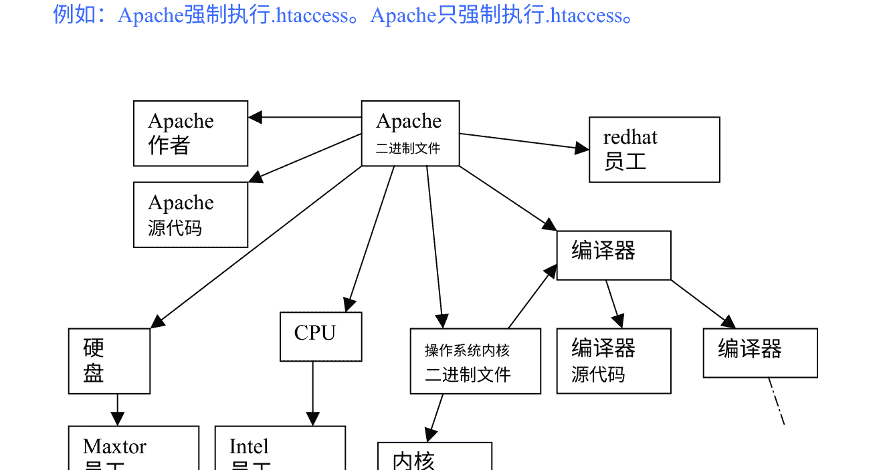

## 如何限制信任?

- 验证一切
- 多个独立验证（不同的人查看材料）
- 在线测试（实时测试）
- 从头开始构建一切

## 基本情况:

如果一个系统被入侵，我们就会失败。

## 独立检查:

攻击者必须突破所有冗余检查。

例如：三个组织检查选举结果或三个编译器编译代码。

## 可信计算基础：

如果一个资源的正确操作对于安全性是必要的，那么它就属于TCB。
如果你不在计算机上安装代码，你就不必信任代码。

规则：保持TCB小。
保持它小。保持它简单。

规则：机制经济。
- 更少的代码
- 简单的代码
清晰和概念简单

例如：机制经济

- 练习：密码
用户名唯一
哈希密码
- 平面文件 - 取决于操作系统
- 加密
- 数据库中的表 - 取决于数据库，操作系统

平面文件与数据库中的表存储
存储在平面文件中更好，但速度较慢。

规则：故障安全默认值。
- 不信任任何人
- 只读
- 受密码保护
- 默认：拒绝 vs. 允许

如果错误：
悄悄地闯入                 允许 - 简单（例如：微软）
投诉（大声地）拒绝 - 强制管理员设置策略（例如：DOS）

默认是允许的：如果错误，管理员知道何时闯入。系统默默失败。

默认是拒绝的：如果错误，管理员知道何时投诉。 系统失败
大声地。

规则：当失败时，尽可能大声地失败。

规则：最小权限。
- 给每个用户/程序最少的必要权限来完成其工作。

例如：你是root还是不是。

Root：可以做任何事情。

非Root：只能做可以的事情。
Unix不提供良好的最小权限支持。
练习：邮件传递系统。
- 监听网络
- 查找用户
- 写给用户邮件
- 排队
- 连接

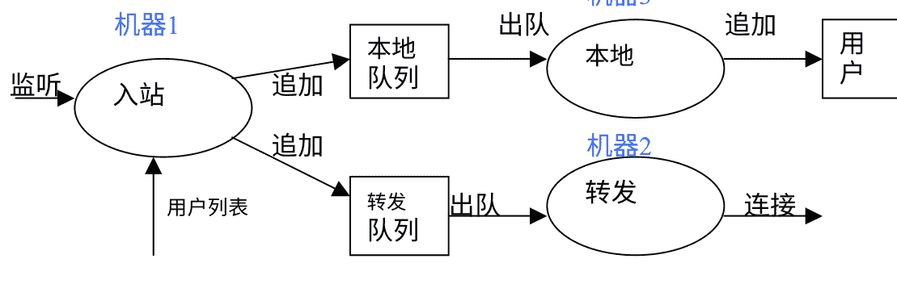

没有权限连接其他机器
机器1连接机器2很困难

- 规则：特权分离
- 更难破坏多个子系统。
例如：迫使攻击者执行两个动作而不是一个动作来获胜。

- 规则：最小共享机制（最小共享状态）
例如：Slashdot用户账户与Slashdot服务器用户账户不同。
- 分离数据库
- 登录账户没有访问服务器的特权。

- 规则：完全中介
- 开放
- 创建
保护一切可能获取它的方式。
例如：在开放时进行安全检查，必须在创建时进行安全检查。

- 打开() vs. 读取()
例如：Unix在文件系统上强制执行完全中介。

```
进程A                   进程B
打开(f)                 Chmod a –rf
读取(...)
```

#### 是和否的完全调解

Unix设计考虑效率。它缓存打开并用于读取。然而，缓存结果可能过时。Unix认为这是可以的。

#### 规则：开放设计

> “全面披露”

- 1. 应用发布
- 2. 用户发现错误
- 3. 用户向世界公开（探索错误） 或者3'。 用户私下告诉作者
- 3.5. 黑客，黑客，黑客
- 4. 作者修复错误
- 5. 用户升级

例如：纸张模糊。“全面披露”更好。例如：在全面披露中，微软的错误修复平均需要50天，而在没有全面披露的情况下需要100天。

## 安全中的人因素：

不可用的安全是没有用的安全。

有时安全会成为阻碍，所以用户会绕过它。
例如，配置NFS非常麻烦，很难在最初的几次尝试中做对。

在密码学中，有成功和失败的例子。
成功：SSH，SSL
失败：电子邮件（Mozilla插件加密工具-Enigmail），WEP（实现问题，加密不安全）

总的原则是，保护的成本应该小于你所保护的价值。
这对SSH（保护密码）和SSL（保护在线交易）中的加密有利，对电子邮件不利。因此，大多数电子邮件不是保密的。

例如，企业网络
它有一个防火墙和一个策略，不允许网络中的任何机器与外部连接，并且不允许访问除CNN之外的互联网网站。为了绕过这个安全策略，用户可以在一台PC上安装一个直接连接到互联网的调制解调器。因此，安全性受到了损害。

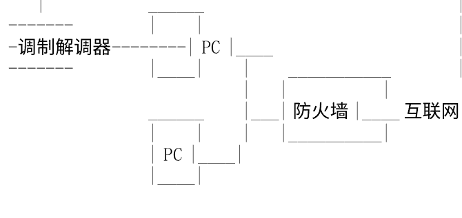

### 计算机安全趋势：更多的共享

分离计算机
共享CPU
--> 多程序环境
像Unix一样
--> 远程过程调用
IPC
共享数据
--> 移动
代码
--> ?
谁知道什么

我们今天在这里

#### 这是一个良好的安全性例子，但没有共享

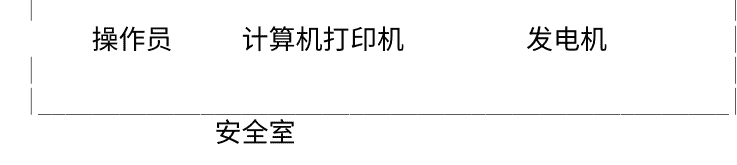

## 运行系统：

- 1. 用户将磁盘交给操作员。
- 2. 操作员插入磁盘并打开计算机。
- 3. 计算机运行一个小时。
- 4. 操作员将打印输出给用户。
- 5. 操作员关闭计算机。（完全重置）

## 系统的目标：

- 1. 保密性
- 2. 完整性
- 3. 可用性

## 安全可能被破坏的方式：

- 1. 用户在磁盘上提供恶意代码。
- 2. 运营商可以被贿赂。（不信任）
- 3. 运营商可能会（错误地）提供错误/不同的输出。（相信运营商是诚实、勤奋和完整可用的机器人。）
- 4. 从内存/磁盘中读取先前用户的数据。（假设/或设计是这样的，关机是完全重置，不保留任何属于先前用户的内容。）因此保密性。
- 5. 电磁攻击。（需要密封房间以防止此类攻击）
- 6. 盗取磁盘。（需要某种形式的用户身份验证）

该系统的主要缺点是效率低下。

似乎很难让这样一个简单的系统正常运行并保持安全。考虑一个更大、更复杂的系统。

## 虚拟机：

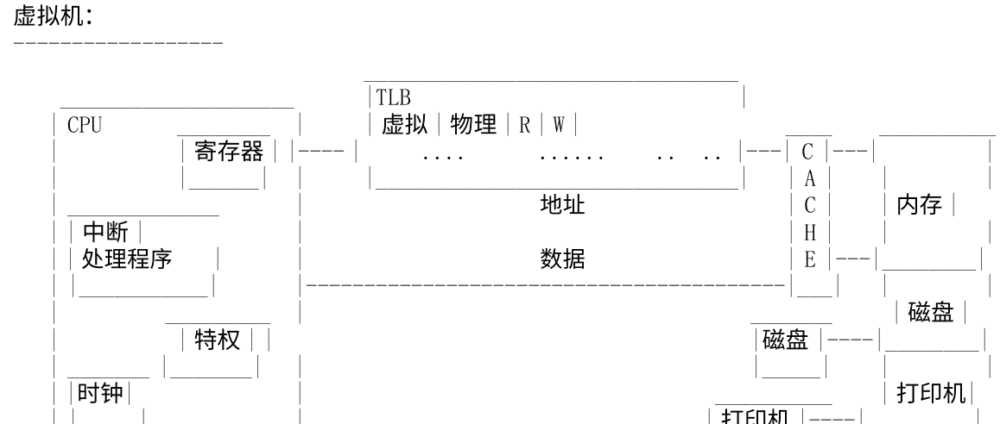

#### 介绍一个限制程序的监督者

这个系统上的程序可以在内存的任何地方写入。所以，在这个系统上，内存保护 => 输入/输出保护。

- 指令：
- 寄存器/内存之间的加载/存储
- 寄存器/寄存器计算
- 刷新缓存
- 加载/存储IHA

为了包含一个监督者，让我们添加一个指令来
- 加载/存储到TLB

但是，程序可以写出TLB并将其更改为允许访问某些内存的权限。
因此，我们需要一个特权寄存器。

特权寄存器：

| 操作 | 结果 |
| :--- | :--- |
| 加载TLB | 是的 |
| 读取TLB | 对于安全性来说不行，对于虚拟机来说是可以的 |
| 加载IHA | 是的 |
| 读取IHA | 对于安全性来说不行，对于虚拟机来说是可以的 |

我们需要一个页面错误处理机制。让我们利用中断处理来处理页面错误。
如果发生页面错误，中断处理程序会跳转到中断处理程序代码，这是监督者代码，特权位打开。现在，从虚拟到物理的转换可能会导致另一个页面错误。一种选择是在特权模式下不使用TLB。另一种选择是TLB为中断处理程序代码保留一个固定的条目。

- 操作系统的工作：
将中断处理程序（IH）的页面加载到TLB中（只读）
将IH的地址加载到IHA中。
加载进程TLB条目。
关闭特权位。
跳转到程序。

现在，我们有了内存保护！！

如果内核区域（特权区域）可被任何进程读取，显然是一个问题。例如，文件系统可以使用内存来缓存数据/结构。因此，不要保留任何可读的内容，或者不允许读取。操作系统应该重置寄存器，清除进程的内存页面。

然而，使用这种设计，我们没有可用性，因为没有任何东西能阻止一个进程永远运行。所以添加一个时钟，调度程序。

## 02/02/06讲座笔记：访问控制

> > （蓝色部分取自：http://en.wikipedia.org/wiki/Virtual_Machine）

### 硬件：

在上一节课中，我们讨论了一个支持监督员的计算机系统，该监督员可以控制以下内容：

- 内存可被非监管程序访问。（这是通过TLB、IHA和监管位的帮助来控制的。）
- 非监管者执行的I/O操作。（由于内存访问控制，我们可以免费获得这个。）
- 非监管者在CPU上的运行时间。（这是受控制的，因为我们可以每隔100或1000秒中断一次，将控制权交还给监管者。）

问题）现在，我们可以为这个计算机系统构建什么高级架构？

答案）我们可以有以下内容：

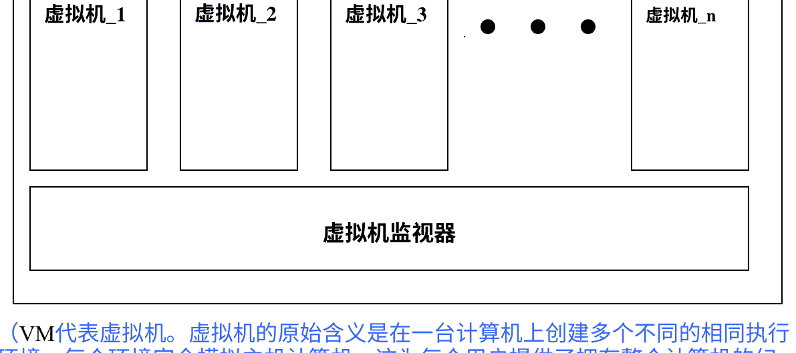

> > （VM代表虚拟机。虚拟机的原始含义是在一台计算机上创建多个不同的相同执行环境，每个环境完全模拟主机计算机。这为每个用户提供了拥有整个计算机的幻觉，但是这是他们的“私人”机器，与其他用户隔离，在一台物理机器上。提供此功能的主机软件通常被称为虚拟机监视器。）

### **关于该模型的一般信息：**

- 虚拟内存监视器（VMM）为每个虚拟机提供了一个完整的计算机的幻觉。
- 每个虚拟机都有自己的内存空间。
- 内存之间没有重叠。
- CPU每次运行一个虚拟机100th of a second，然后切换到下一个可执行的虚拟机。
- 对于需要从打印机打印的作业，CPU必须运行每个作业直到完成，然后再切换到下一个可用于打印的作业。
- 存在一个大磁盘，但磁盘空间被分区给各个虚拟机。

### **在这个系统中的共享：**

关于这个系统的共享，我们能说些什么？

- 代码：虚拟机之间没有代码共享。
- 数据：虚拟机之间没有数据共享。
- 硬件：所有虚拟机都在一台物理机上。

因此，就共享而言，这还不太好。

### **系统中的安全性：**

哪些安全目标已经实现？

- 机密性：这一点得到了保持。
- 完整性：	这一点也得到了保持。
- 可用性：	这一点得到了保持，除了在长时间作业使用打印机时。

因此，就安全性而言，系统是良好的。

然而，存在一个安全问题。在长时间计算过程中，CPU往往会变热，而且可以测量出这种热量。通过测量热量，一个虚拟机，比如VM_1，可能能够判断出另一个虚拟机，比如VM_2，正在进行大量计算。此外，通过使用多个虚拟机，用户可以了解调度策略，并确定哪个虚拟机具有较高的调度优先级。

### **系统中的可信计算基础（TCB）：**

我们在这个系统中信任哪些资源？

- VMM
- 硬件。

### **系统中的良好设计原则：**

系统是否具有

- 小的TCB：是的，VMM。
- 机制经济性：是的，该系统的代码简单易懂。
- 完全中介：是的，VMM需要保护自身和所有其他虚拟机。系统依赖于完全中介。

### **改变系统以实现更多共享：**

到目前为止，我们的虚拟机彼此之间没有合作。让我们添加一个属性，使得虚拟机之间可以更多地共享。

让我们以学生与教授关于成绩的沟通为例：

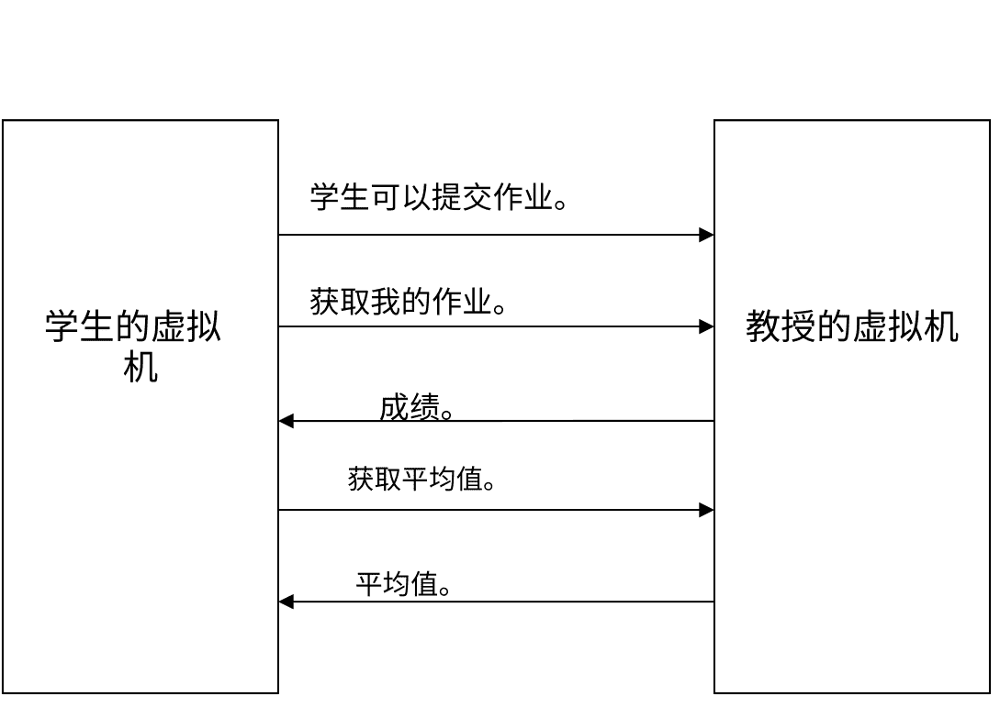

在这个系统中，你现在可以从一个虚拟机发送消息到另一个虚拟机。该系统具有以下特点：

- 建立在虚拟网络上。
- VMM确保每个消息中发送者ID的真实性。
- 客户端/服务器模型。

### **这两个虚拟机之间有多少信任？**

- 教授不会感到困惑，而且是诚实的。
- 学生不会发送大量恼人的消息。
- 信任只是应用层的问题。

### **远程过程调用：**

- 调用者和被调用者可能互不信任。 因此，我们需要构建一些东西，使得调用者和被调用者即使彼此不信任也能得到他们想要的。
  为了做到这一点，每个虚拟机都必须验证传入的消息。
- 这个系统是有效的：
  - 可以有一个共享数据库。
  - 可以有共享的代码来计算平均值等。
  - 有隐私保护。
  - 有机密性。
  - 有完整性，因为学生不能修改自己或他人的成绩。
  - 可用性也很好。

这个系统确实有一些代价：每个虚拟机都必须保护自己免受发送或接收到格式错误的消息。

### **在这个系统中，谁被允许做什么？**

- 教授的虚拟机正在执行一些访问控制策略。
  - 可能是临时的。
- 让我们形式化访问控制。
  - 我们有教授或学生想要访问的对象。
  - 主体 ↔域。
  - 我们可以将策略表示为矩阵，如下所示：
    A[d, O] = {r | d可以在O上执行r。 }，其中“r”是访问权限，“d”是“域”，“O”是对象。

访问控制矩阵的一个例子是：

|   | 教授 | 学生1 | 学生2 | 学生3 | 作业队列 | 学生1成绩 | 学生2成绩 | 平均值 |
|---|------|-------|-------|-------|----------|-----------|-----------|--------|
| 教授 | 授权 | 限制 | 限制 |   | 出队 | 读取写入 | 读取写入 | 授权撤销 |
| 学生1* |   | 授权 |   |   | 入队 | 读取 | - | 读取 |
| 学生2* |   |   | 授权 |   | 入队 | - | 读取 | 读取 |
| 学生3* |   |   |   | 授权 |   |   |   | 读取 |

* 学生1和学生2已注册，但学生3未注册。

### 访问控制矩阵的原始操作：

- 1) 添加权限: A[d,O] = A[d, O] U {r}
- 2) 删除权限: A[d,O] = A[d, O] \ {r}
- 3) Add_Object(d,O): { A[d,O] = {授予, 撤销} }
- 4) Add_Domain(d1, d2)
- 5) Delete_Object(d,O)
- 6) Delete_Domain (d1, d2)

此外，还有一些有条件的操作，例如：

grant_right (d1, d2, O, r)，意思是“如果d1对对象O具有‘授予’访问权限，则d1将权限‘r’授予d2的对象O。”

或者可以用符号表示：

```
如果grant ∈ A[d1, O]
→ A[d2, O] = A[d2, O] U {r}。
```

### 类似地，我们还可以有一个有条件的撤销权限：

revoke_right (d1, d2, O, r)，意思是：

```
如果revoke ∈ A[d1, O]
→ A[d2, O] = A[d2, O] \ {r}。
```

### 扩展访问控制矩阵：

我们可以有：
A[d,O] = {(r,p) | 如果p，则d对O有权利r}

举个例子，
学生3对对象“平均值”有权利。我们可以将这个权利定义为“有条件的访问权”，如下所示：

```
A[student3, avg] = {(read, end_of_semester’s_date >= current_date)}
```

### 我们能确定访问控制矩阵是否会出问题吗？

问题：给定一个初始矩阵A以及一组条件命令和一个安全条件‘r’ A[d,O]，是否存在一种算法来确定A是否可能违反这个条件？

回答：Harrison-Ruzzo Ulman定理说不可能。证明是通过将图灵机嵌入A并调用Rice定理给出的。

## CSE 509 2/7

+ 公告
- 不接受迟交评论
- 志愿者记录

### 上次：访问控制的可决定性

*可决定性体现在访问矩阵中

| 域   | 文件1     | 文件2 | 光盘 |
|------|-----------|-------|------|
| 域1  |           | 写    | 弹出 |
| 域2  | 授予<br>读取 |       |      |
| 域3  |           | 读取  | 烧录 |

原始操作：插入 r 到 A[d,o] 从 A[d,o]中删除 r

+ 原始操作包括：
- 插入写入
- 删除写入
- 创建/销毁对象
- 创建/销毁域

```
命令的通用形式：
命令(d1,...,dn,o1,...,om,r1,...,rk)
如果(r1'∈A[d1',o1'] 且 r2'∈A[d2',o2'] 且 ...
那么
    原始操作1;
    原始操作2;
    .
    .
    原始操作l;
```

访问控制系统，Σ = (A0, C)由初始矩阵A0和一组命令C组成。

> Q1：给定一个访问控制系统Σ和一个安全属性 r ∉ A[di,o]，是否存在一种算法能够始终确定是否可以使用来自C的命令将A转化为违反该安全属性的矩阵？

#### 定理：(Harrison, Ruzzo, Ullman)

问题1的答案是“否”。
*这意味着您不能始终确定访问控制的安全属性是否会被违反。

证明：在‘A’中嵌入一个图灵机，调用Rice定理。
*该定理表明，对于任何足够复杂的访问控制，我们无法预测会发生什么。

> 问：我们是否可以设计一个系统，使其不那么复杂，以便我们可以确定安全属性是否始终有效？

#### 天真的想法

*为什么不制定一个规则，永远不允许将 r添加到 A[di,o] 中。然后很容易证明安全性永远不会被违反。

*在具有数百或数千个域的实际系统中，拥有所有这些附加的补丁变得不切实际。

ACM是自由访问控制系统，即系统的用户可以在C的限制范围内任意改变ACM。

### 强制访问控制

限制用户对自己的对象的操作。

#### Belle - La Padula方案（思想来自军事，早于计算机）

军事：通过许可控制信息。

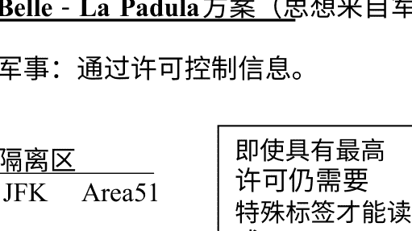

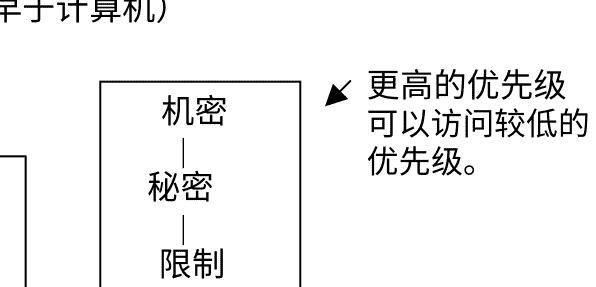

#### 格

TS = 机密，S = 秘密，F = 限制，P = 公开

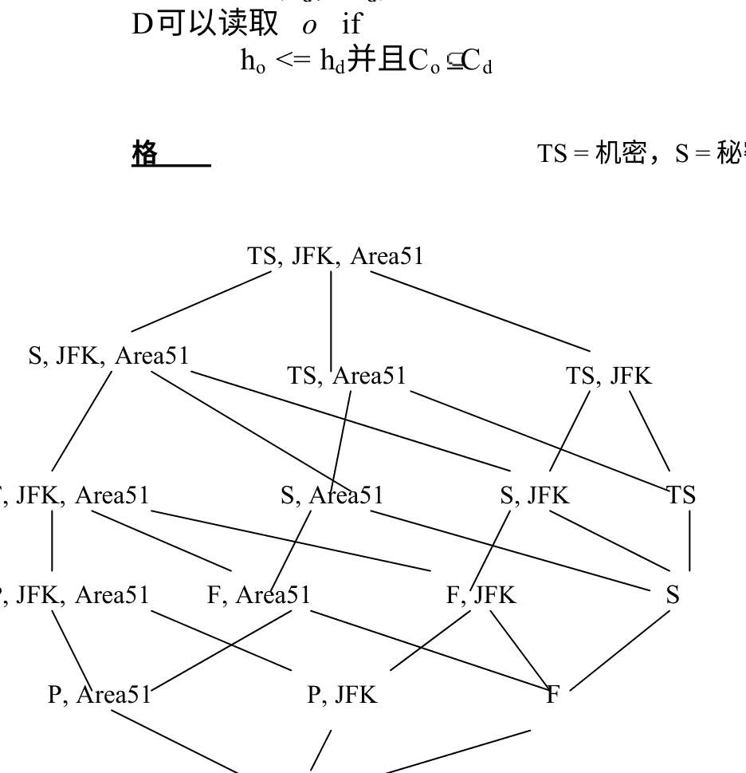

> 定义1
标签l₁ = (h₁, C₁)
支配l₂ = (h₂, C₂)
如果h₁ > h₂且C₂ ⊆ C₁，则写入l₁ >= l₂

定义2
对于任意两个标签L₁和l₂
，最小上界(l₁, l₂) = l₃，
其中l₁ <= l₃
l₂ <= l₃且
l₃ 是最小的

*我们对于读取有一个概念，但是对于写入呢？

#### 写入

> *（如果一个域可以读取TS文件，那么允许它写入公共文件是安全的吗？似乎很危险：将秘密信息转移到公共访问文件中。）

域1只能写入一个文件 o其中l_o>= l_i*(完整性可能是一个问题，但我们现在只关心保密性。）

#### 基本安全定理

如果域只能读取具有较低标签的文件，并且只能写入具有较高标签的文件那么信息永远不会从其原始分类级别泄漏。

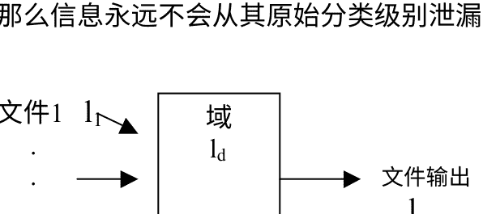

```
l_i <= l_d <= l_o
i = 1, ..., n
```

#### 变体

+ 1.) 如果一个进程尝试读取一个更高安全级别的文件=>拒绝 --写入较低安全级别的文件=>拒绝
2.) a.) 域标签=LUB(读取文件) b.) 域写入的文件被赋予LUB(域标签，文件的旧标签)

例如 %cat A B –o C A: 机密 B: 绝密 C: 尚不存在

+ 1.) cat开始： l_cat = 公开
2.) 猫打开 A: l_猫 = LUB(l_猫 , A) = 秘密
3.) 猫打开 B: l_猫 = LUB(l_猫 , B) = 绝密
4.) 猫写入 C: l猫= l猫= 绝密

#### 问题：解密

+ - 标记一些特殊的可信进程进行解密

例如: 成绩（绝密） -> 平均值 -> 平均值（公开）

例如：特权分离，即需要两个用户调用的程序。

### 访问控制：Biba，能力，撤销

## Biba模型：

+ - 类似于Bell-Lapadula模型，但用于信息完整性
- Bell-Lapadula颠倒过来。

从特定来源获取的信息有多可信？双重检查 = 可靠的证人 = 匿名提示 = 互联网双重检查的信息比从可靠的证人获取的信息更可信，而来自互联网的信息最不可信。

将对象标记为其完整性级别为I_o 将域标记为其完整性级别为I_d

如果I_d = I_o，则域可以读取对象如果I_d = I_o，则域可以写入对象

+ - 完整性是保密的颠倒
- 保密 - 不向下写入
- 完整性 - 不向上写入

## 信息流与保密性和完整性相关：

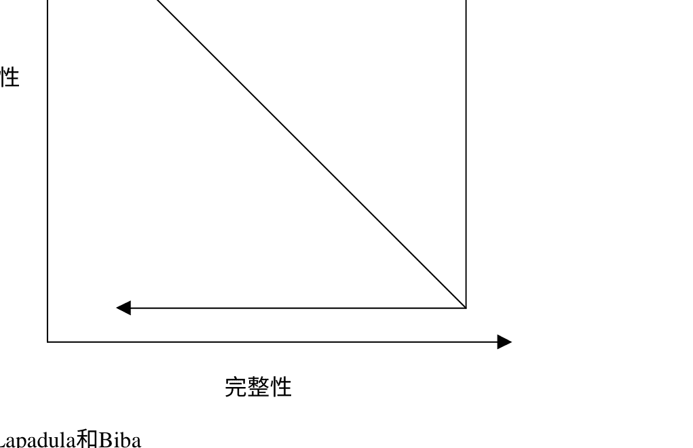

## 实现：

+ - Bell-Lapadula和Biba
- 作为文件和进程的标签实现
- 访问控制矩阵（ACM）
- 访问控制列表（ACL）

+ - 将ACM的列存储为链表
- 将它们与对象一起存储
  - Ext2, ext3, NTFS, Andrew FS

-能力列表

+ - 将ACM的行存储
- 与域一起存储
- 非常罕见
  - 痛苦的管理
  - 心理可接受性
  - 域是模糊的
  - 在这种表示中，很难回答关于谁可以访问此文件的一般问题。

贝尔-拉帕杜拉、比巴和ACMs都允许操作系统管理权限。

## 困惑的代理问题：

例如：酒店的打印设施：lpr守护程序在/var/lpr/txns中维护一个计费文件。

+ - 只有lpr才能读写txns文件。
- 用户可以使用lpr -b mytxns来编写他/她的交易。
- 如果用户输入命令lpr -b /var/lpr/txns会发生什么？

```
lpr                              操作系统
open("/var/lpr/txns", R)  ------------好的------------> R/W /var/lpr/txns
<生成用户账单>
open("/var/lpr/txns", W)  ------------好的------------> R/W /var/lpr/txns
<将账单写入输出文件>
```

通过上述步骤序列，交易文件将只保留用户的交易，通过一系列巧妙的步骤，可以从文件中删除所有用户的交易。

## 解决上述问题的方法：

+ 1. lpr应该检查输出文件是否可由用户访问
2. lpr应该告诉操作系统它正在尝试使用的特权

```
lpr                              操作系统
open(1, "/var/lpr/txns", R)  ------------好的------------> R/W /var/lpr/txns
<生成用户账单>
open(2, "/var/lpr/txns", W)  ------------错误------------> R/W /var/lpr/txns
```

## 实现：

+ - 使用不可伪造的句柄，即只有操作系统才能创建和传递给应用程序的句柄。例如：文件句柄
- 应用程序可以在每个请求中将句柄传递给操作系统。

```
fd = open("foo", R) - 获取文件描述符的唯一方法是通过操作系统
read(fd, ....)
```

write(fd, ....) - 应用程序必须将文件描述符传递给操作系统以进行其他请求

在这种实现类型中，吊销很容易，只需从应用程序的文件表中删除条目即可。

### 密码学 - 签名

+ - 签名 = Sig(秘密密钥, 数据)
- 不知道秘密密钥无法创建数据的签名
- 能力是来自操作系统的签名票据

```
cap = open("foo", R).
```

+ - 操作系统检查应用程序是否可以读取foo。
- 操作系统构建cap为cap = ("foo", R, signature)

```
read(cap, ....)
```

+ - 操作系统检查能力是否允许读取
- 操作系统检查签名是否有效。

上述过程的一个特点/缺陷是应用程序可以复制能力。

## 吊销更困难。

+ - 为能力设置过期日期。
    1. 无快速吊销
    2. 客户端必须更新他们的能力
- 操作系统维护一个能力黑名单
    1. 操作系统应该永久维护状态
    2. 检查更困难

## CSE509 2006年春季。系统安全

## 02/14/2006讲座笔记

### 认证

注：蓝线注释是我（张文斌）添加的。

到目前为止，我们已经学到了：

+ - 控制安全域中对象的访问
- 那么人们对计算机的访问怎么办

今天我们将讨论认证。

## 安全的目标：

+ - 将用户映射到域
- 识别用户
- 证明用户是其所声称的身份（认证）

## 思考下面图片中的场景：

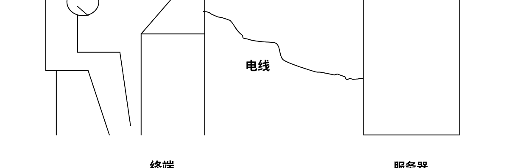

可能发生什么？

+ 威胁：
- 窃听
  - 嗅探
  - 欺骗
- 终端被攻陷
  - 键盘记录
  - 其他隐蔽通道
  - 欺骗
- 服务器攻击
  - 攻击者可能侵入服务器

### 三种认证方式：

+ - 所知道的事物
- 所拥有的事物
- 所是的事物

### 最简单的认证场景：

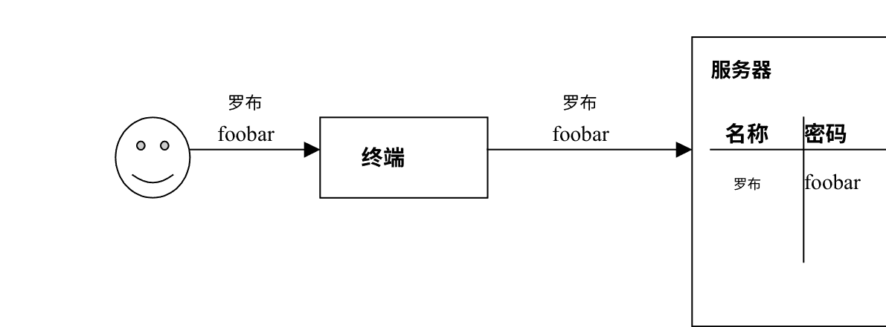

### 这个场景中的问题：

+ - 密码以明文形式存储在服务器上
- 密码以明文形式发送
- 终端可以窃取密码
- 密码中的人为因素：
  - 容易猜测
  - 自动生成密码
  - 可共享
  - 可窃取

##### 如何解决这些问题？

> > 定义：哈希函数H是预像抗性的，如果给定y = H(x)，则对于攻击者来说，要找到一个满足 H(x') = y 的 x' 是非常困难的。

例如 SHA-1，SHA-256

SHA (安全散列算法) 家族是一组相关的密码散列函数。在许多流行的安全应用程序和协议中，包括TLS、SSL、PGP、SSH、S/MIME和IPSec，最常用的函数家族SHA-1被广泛使用。SHA-1被认为是MD5的继任者，MD5是一种早期广泛使用的哈希函数。SHA算法是由美国国家安全局 (NSA) 设计并作为美国政府标准发布的。

该算法家族的第一个成员于1993年发布，正式称为SHA; 然而，为了避免与其后继者混淆，它通常被称为SHA-0。两年后，SHA-1作为SHA的第一个后继者被发布。此后又发布了四个更多的变种，增加了安全性。

输出范围和稍微不同的设计：SHA-224，SHA-256，SHA-384和SHA-512 - 有时被统称为SHA-2。

## 例子1:

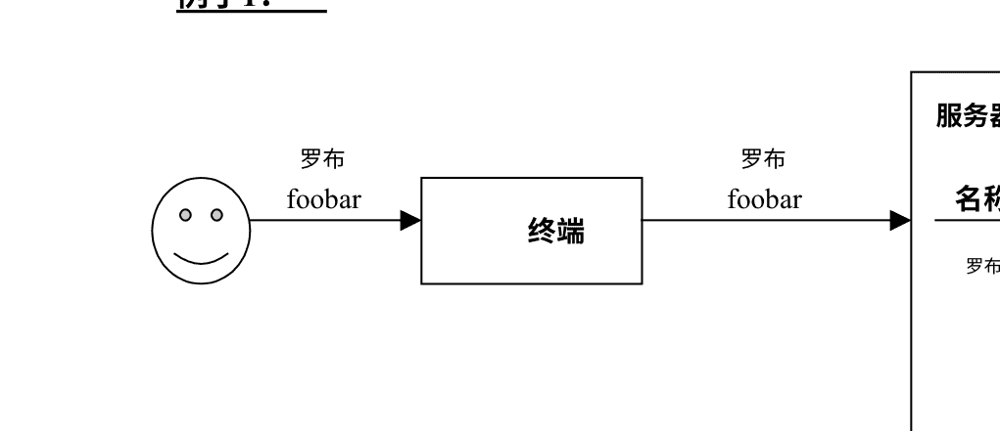

解决了“密码明文存储在服务器上”的问题。

## 例子2:

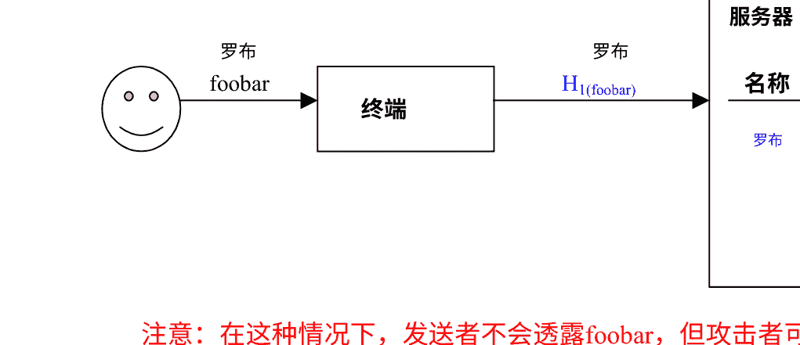

注意：在这种情况下，发送者不会透露foobar，但攻击者可以看到H1(foobar)，这足以登录。

## 传输中的数据:

加密：加密和MAC终端与服务器之间发送的所有数据。

## 挑战-响应协议:

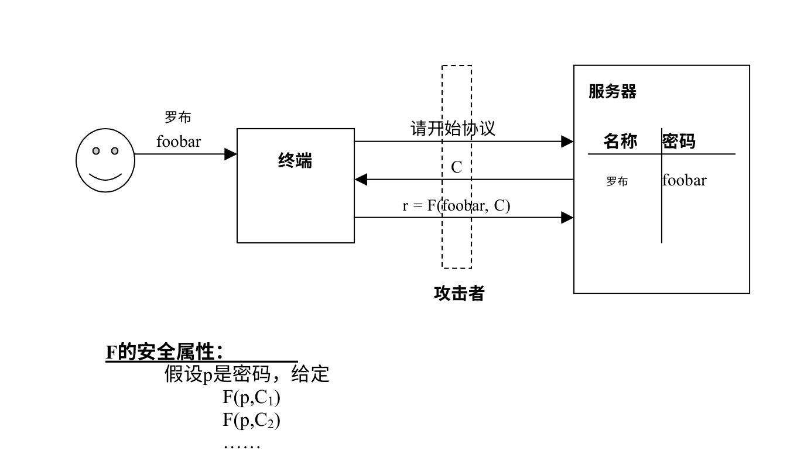

| 名称 | 密码 |
|------|------|
| 罗布 | foobar |

## F的安全属性：

假设p是密码，给定 F(p,C1) F(p,C2) ... F(p,Cn) 对于攻击者选择的C1, C2... Cn，要产生满足r=F(p,C)且C≠ C1, C2,... Cn的对(C,r)是极其困难的。

## 服务器：

+ 1. 设置 t = 当前时间。
2. 发送 C。
3. 如果在3秒内收到响应，则成功。

## 攻击者：

+ 1. 将 C 传递给终端。
2. 抓取响应并停止它。
3. 让用户再试一次，然后成功。
   --- 稍后 ---
4. 向服务器呈现原始响应。

注意：挑战不会过期。

## 数字签名：

+ - 用户拥有私钥 Kpriv，只有用户知道 Kpriv。
- 全世界可以知道相应的公钥 Kpub。
- 从 Kpub 计算 Kpriv 非常困难。
- 签名方案是两个函数Sig、Ver，使得 Ver(Kpub, M, Sig(Kpriv, M)) = 有效 但攻击者无法构造任何值 X，使得 Ver(Kpub, M, X) = 有效。

## 例子1：

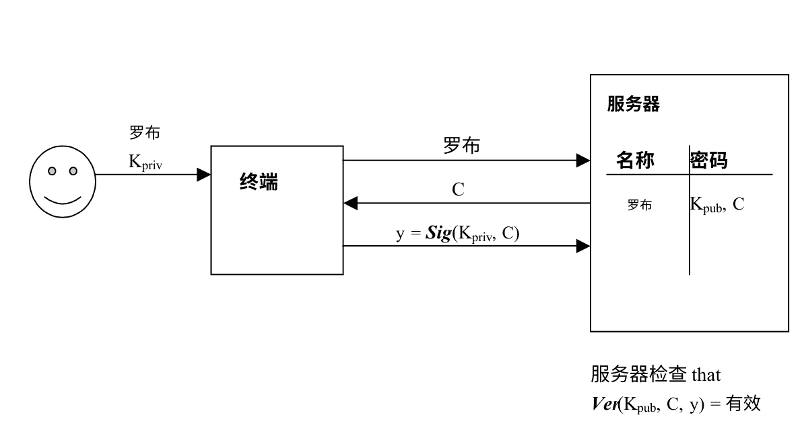

问题：初始认证和后续通信之间没有绑定关系。

+ **如何修复：**
- 也要对所有后续消息进行签名
- 包括 C 以确保新鲜性

## 示例2：

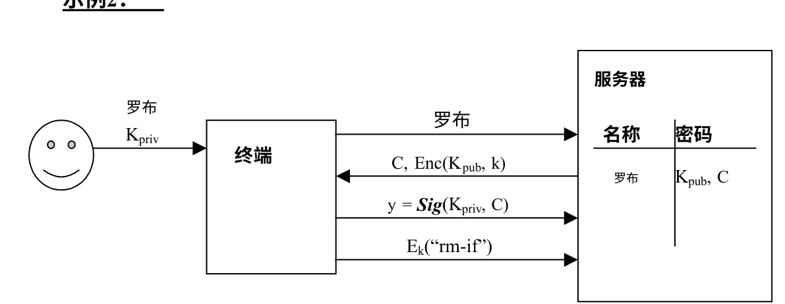

+ **有关真实密码协议，请参阅：**
- 加密密钥交换（EKE）
- Diffie-Hellman EKE（DH-EKE）
- 安全远程密码协议（SRP）
    - 在RFC2945中描述：[http://rfc.net/rfc2945.html](http://rfc.net/rfc2945.html)

### 对称密钥密码学

> (绿色部分摘自：[http://en.wikipedia.org/wiki/Data_Encryption_Standard](http://en.wikipedia.org/wiki/Data_Encryption_Standard))

**对称密钥密码学：**

通常加密系统中涉及两个参与方。例如，让我们看下面这种情况，两个人之间互相发送消息：

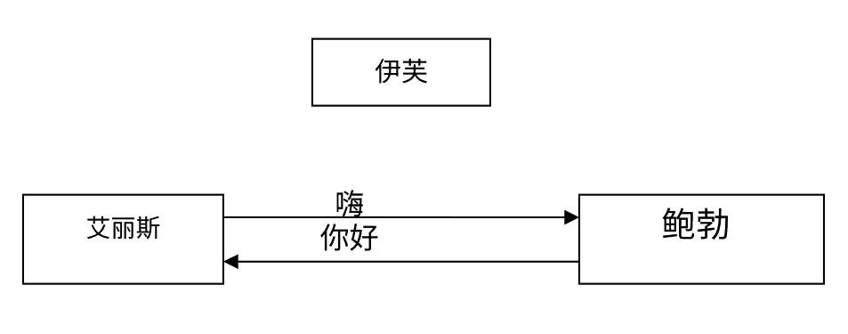

假设爱丽丝和鲍勃想要发送消息，而不让第三方知道。假设伊芙在监听，她想要读取爱丽丝和鲍勃之间的消息，如果她成功了，就会违反安全的机密性目标。

**为什么需要加密？**

那么，拥有加密系统的主要原因是什么？它是为了保护机密性。如果爱丽丝和鲍勃之间发送的消息是明文的，那么伊芙可以轻易地读取它们。因此，为了安全起见，发送的消息应该进行加密。

**直觉：**

加密应该给我们与密封信封相同的保密性。如果鲍勃将一封信放在信封中，并封好信封发送给爱丽丝，那么伊芙将无法读取密封信封中的信件。

需要注意的是，加密并不隐藏通信，而是隐藏正在通信的内容。因此，根据我们的例子，如果实施了加密，伊芙可能会知道有一条消息发送给了爱丽丝，但她将无法阅读它。加密的目的是能够秘密地发送消息，即使第三方知道正在发送消息并且了解一些有关发送消息的人的附加信息。

**对称密钥加密的类型：**

## 1) 一次性密码本：

一次性密码本具有以下组件和参数：

+ - M = 长度为“l”的消息
- K = 长度为“l”的密钥
- 对于密钥，每个位以1/2的概率等于0。换句话说，密钥的每个位都是随机选择的。

我们如何加密？

+ - C = M ⊕ K。
- C代表密文。
- K是一串位。
- 通过对M和K执行“XOR”操作可以获得密文。

将此应用于我们之前的例子，我们可以看到为了保密，Alice和Bob都必须知道加密消息的K，但是Eve不能知道K。为了得到密钥，Alice和Bob必须考虑并达成一致，选择一组随机排列的位。因此，如果Bob想说Hi，他会将“Hi”转换为ASCII码，然后将位与密钥位进行XOR运算，然后发送密文。

一个重要的事情要注意，在这个系统中，每个密钥的每一位只能使用一次。 这将引出以下定理：

## 定理：

一次性密码本对于计算能力无限的第三方是安全的。所以，无论第三方能够计算多长时间，他/她都无法读取消息。

##### 一次性密码本不实用。为什么？

+ - 密钥必须和消息一样巨大。
- 不能重复使用密钥的位。

##### 如果我们重复使用密钥的位会发生什么？

假设我们发送两条消息M1和M2，使得：

```
C1 = M1 ⊕K 和
C2 = M2 ⊕K。
```

会发生什么？

让我们尝试计算以下内容：

```
C1 ⊕ C2
= M1 ⊕ K ⊕ M2 ⊕ K
= M1 ⊕ M2。
```

所以，现在如果伊芙知道一些附加信息，例如M1和M2是英文的，那么她可以恢复M1和M2。

因此，在一次性加密系统中，密钥不能重复使用。

## 2) 分组密码:

分组密码具有以下组件和参数：

+ - 一个函数: E (K, M) = C。
  (一个以消息‘M’和密钥‘K’作为参数并返回密文‘C’的函数。)

+ - 该函数应该是这样的，即给定‘K’，可以轻松计算E（K，M）。

+ - 此外，给定密钥和密文，应该可以轻松计算出消息。因此，符号上，应该可以轻松计算出以下内容：M = E⁻¹（K，C）。

+ - 分组密码按块工作。

+ - 函数E接受k位密钥和n位消息，并返回n位密文。因此，符号上，

```
E: {0,1}ᵏ x {0,1}ⁿ → {0,1}ⁿ
```

下面是一个简单的图表，总结了加密方法：

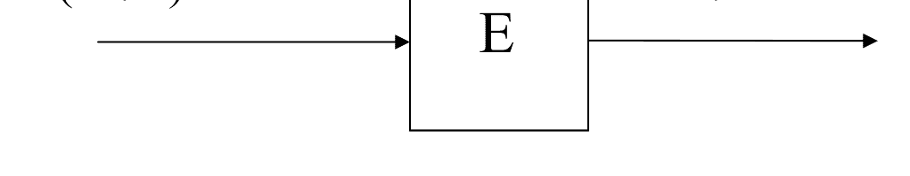

上面的图表显示了一个密码块加密，它接收一个64位的消息和一个128位的密钥，并生成一个64位的密文。

以下是块密码的示例：

## 3) DES（数据加密标准）：

DES是IBM和NSA在70年代发明的。

以下是DES的简单描述：

- 密钥应为56位。
- 块大小应为64位。
- DES是Feistel网络的一个例子。
- 给定密钥和消息，很容易计算出密文。此外，反过来也是正确的，即给定密文和密钥，很容易计算出消息。然而，对于不知道密钥的人来说，从密文中获取消息或反之亦然是困难的。
- 消息在进入Feistel网络之前经过初始置换。
- 通过Feistel网络计算得出的密文经历了初始置换的逆置换。

下面是一个显示DES结构和操作方式的图示：

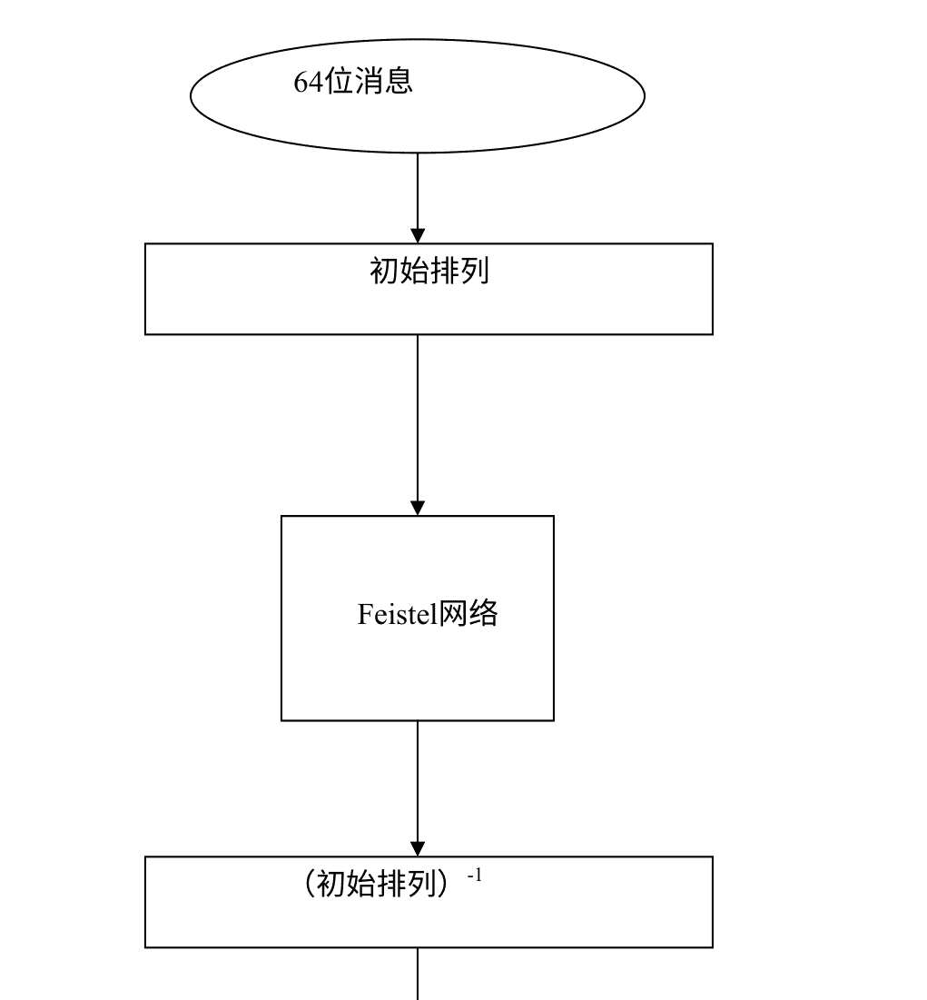

现在，在Feistel网络中，主要的64位消息被分成两个32位块，并且它们以交叉方式进行处理，借助Feistel或“F”函数的帮助。F函数将半个块与一些密钥混合在一起。F函数的输出然后通过使用XOR函数与另一半块组合在一起，并在下一轮之前交换两个半块。

下面是Feistel网络内部发生的情况的图片：

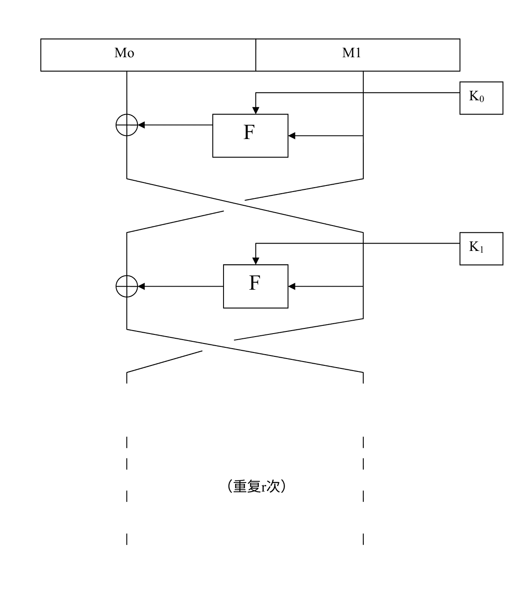

**输入块：** M0 | M1

```
轮函数：F
密钥：K₀
```

```
轮函数：F
密钥：K₁
```

（重复r次）

```
轮函数：F
密钥：K_{r-1}
```

**输出块：** C0 | C1

##### 问题：Feistel网络之前和之后的排列是否使破解代码变得更困难？

回答：不，这些排列在加密消息更难破解方面是毫无意义的。排列不是秘密的，因此从安全性的角度来看，这是浪费时间。

## 对DES的成功攻击：

- DES容易受到一种称为“差分密码分析”的攻击。
- 所需的密钥位数是已知的。它是56。因此，我们需要尝试2^56不同的密钥来破解系统。
- 使用超级计算机可以在一天内完成这个过程。
- EFF构建了一个DES破解器，只需不到24小时。（只需要一个密文来破解系统。）

结论：不要使用DES作为加密系统！

大多数分组密码现在都不是完全安全的。为了延长DES的寿命，人们提出了以下稍微更好的系统：

## 4）3DES（三重数据加密标准）：

该系统使用更多的密钥位。下面是一个说明3DES工作原理的图片。我们为以下系统使用了112位密钥：

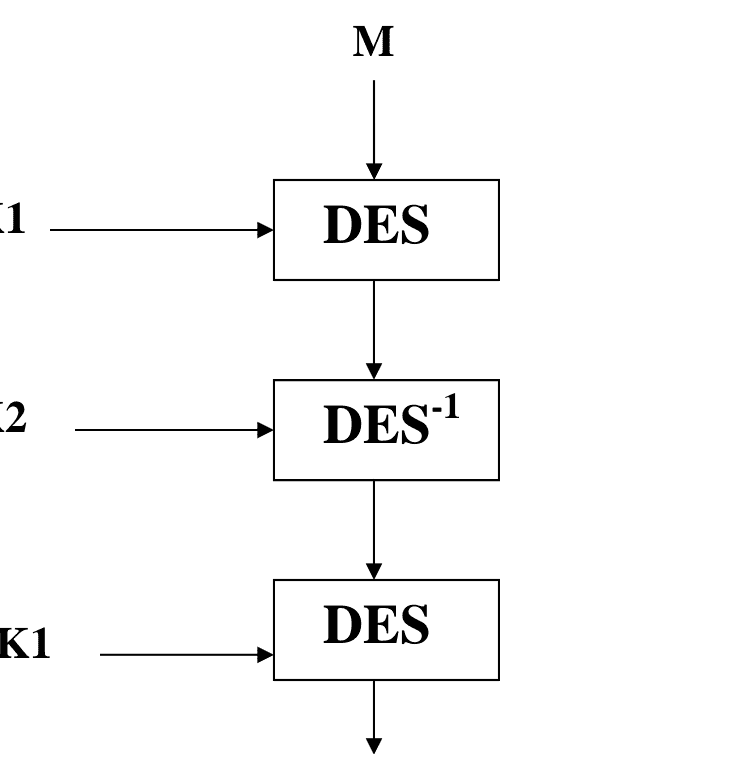

（如果我们使用的是K1而不是K2，那么我们将得到一个DES系统）

### 对该系统的可能攻击：

该系统容易受到已知明文和选择明文攻击。因此，这也不是很好的选择。
此外，该系统也被证明非常慢。

在90年代，一种名为AES的新的分组密码被美国政府选为加密标准。

## 5）高级加密标准（AES）：

- AES的另一个名称是Rijndael。
- 这是一种使用代数的特殊设计，它既快速又安全。

AES具有以下参数：

- 密钥模式有：128位密钥模式，192位密钥模式和256位密钥模式。
- 块大小为：128位。

因此，AES系统的最弱版本将具有128位密钥。即使如此，它也非常难以破解，可能需要数千年的时间。因此，AES是一种优秀的密码算法。

现在，上述所有密码算法都是分组密码。如果我们需要加密多个分组，我们应该怎么办？为了加密多个分组，我们有以下操作模式：

## 操作模式：

有三种操作模式：

- ECB（电子密码本）
- CTR（计数器模式）
- CBC（密码块链接）

### 1) ECB：

- 也被称为电子密码本。
- 它类似于字典。加密时，你查找一个单词并查看其对应的翻译。解密时，你相反地查找密文并查看它对应的消息。
- 不安全。
- 不像一个不透明的信封那样工作。
- 相同的消息→相同的密文。
- 需要随机化。
- 不好使用。

下面是ECB的示例：

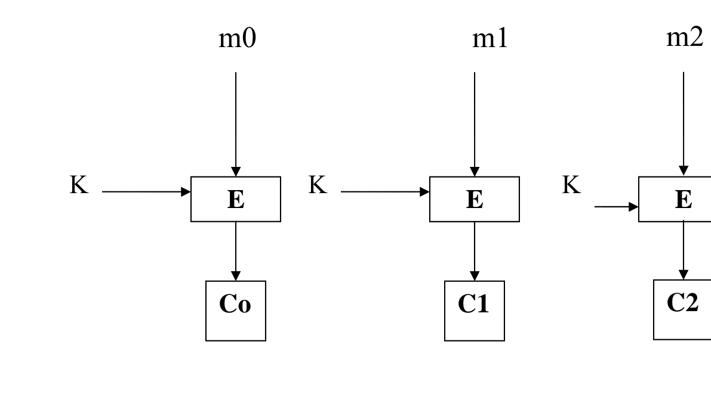

（上述是ECB的示例）

### 2) CTR:

- 也被称为计数器模式。
- 对选择明文攻击具有安全性。
- 该系统具有一个初始化向量“IV”，它是为每个密文随机选择的数字。
- 如果您两次使用相同的IV，则会破坏安全性，因此，IV的空间应该非常大。
- CTR类似于一次性填充。

下面是CTR工作模式的示意图：

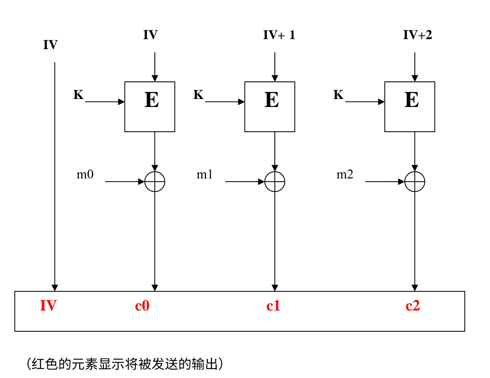

（红色的元素显示将被发送的输出）

### CBC:

- 密码块链接的缩写。
- 在此模式下，每个密码块与下一个密码块链接。
- 对选择明文攻击具有安全性。
- 最常见的。

下面是一张图，说明了CBC工作模式：

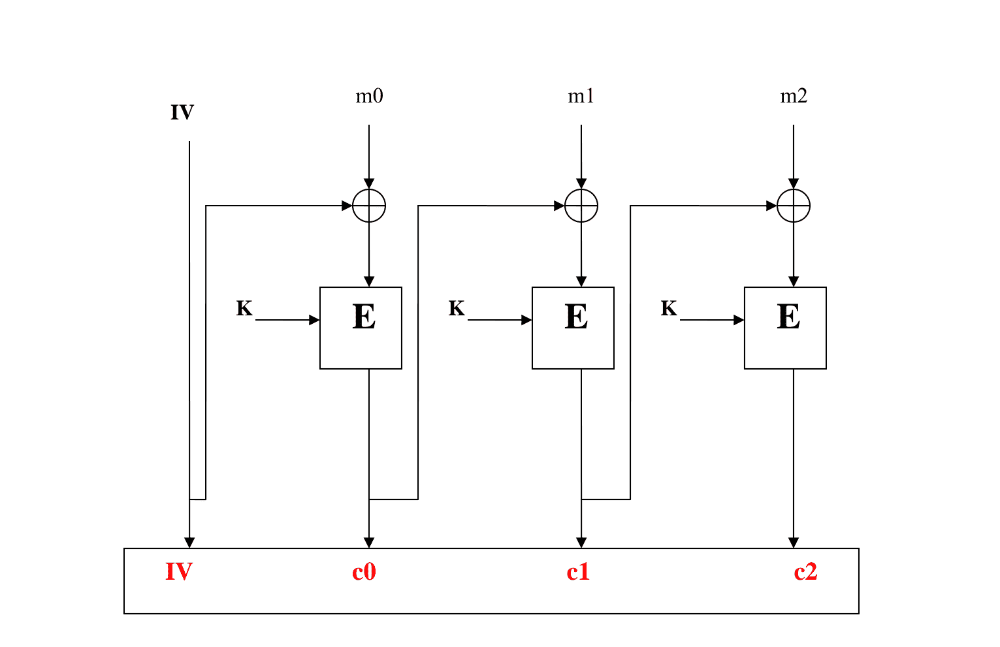

## 针对密码系统的攻击模型：

- 被动对手：
  - 最弱的攻击形式。
  - 观察密文。
  - 试图推断明文或可能的密钥。
- 已知明文攻击：
  - 攻击者知道输入到密码系统的明文，并知道密文。
  - 尝试解密未来的消息。
  - 攻击者无法向密码系统提供输入。
- 选择明文攻击：
  - 对手可以请求与任何明文对应的密文。
  - 然后对手尝试解密任何未来的消息。
  - 因此，可以将其视为对手被授予访问一个黑盒的权限，并允许对黑盒发送查询并从黑盒获得密文作为输出。

以下是这个案例的说明：

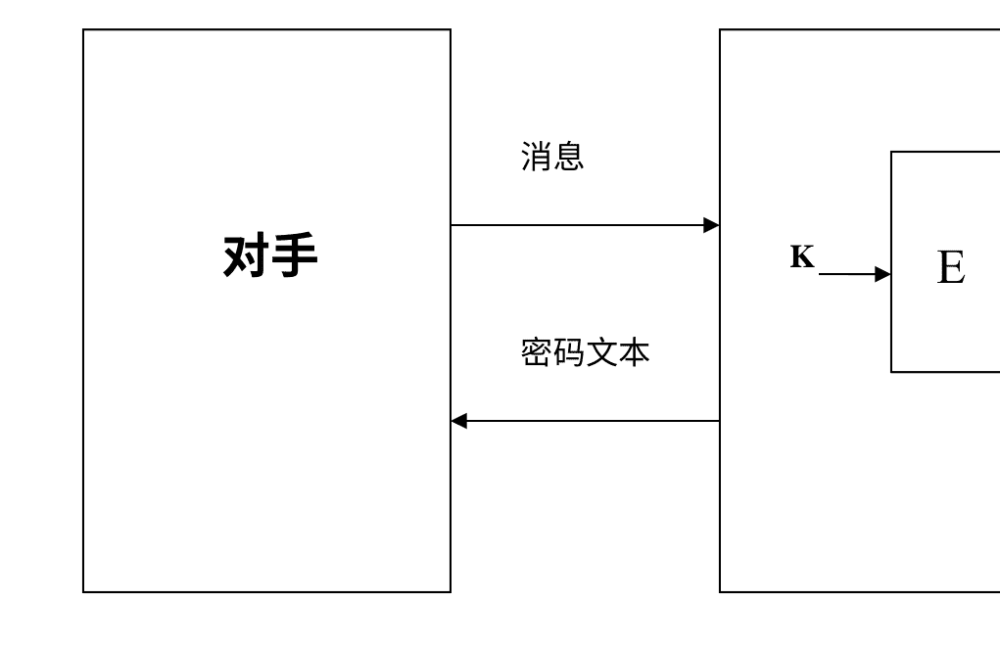

（选择明文攻击）

## 选择密文攻击：

- 这是最强大的攻击模式。
- 对手可以请求任何明文/密文的加密/解密。
- 然后对手尝试解密任何未来的消息。

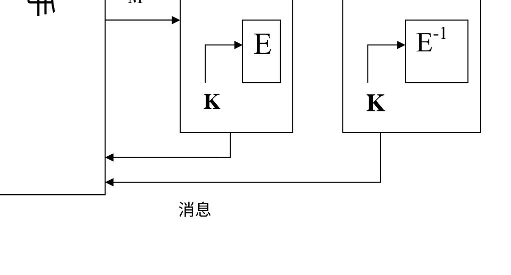

### 对称密钥完整性机制

#### 消息认证码（MAC）

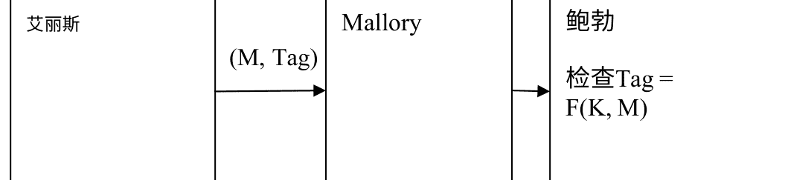

目标：Mallory无法修改或构造有效的消息。

- 重放攻击
- 垃圾攻击

## 一次性密码本:

```
C = C₀, C₁, ...
K = K₀, K₁, ...
M = K₀ + M₀, K₁ + M₁, ...
```

可以通过位翻转来改变它。

##### MAC

```
F (K，M) = 标签
F: {0, 1}^P x {0, 1}* -> {0, 1}^M
```

- Mallory无法猜测任何消息的标签。
- Mallory无法组合先前的消息/标签来构造新的消息。

## 哈希函数：

H: {0, 1}* -> {0, 1}^M

H (M) = h

- 给定y，找到任何使得H(x) = y的x是不可行的。
- 找到使得H(x) = H(x')的x和x'是不可行的。

##### 示例

- MD4, MD5, SHA-0, SHA-1：已被破解
- SHA-256, SHA-512：尚未被破解
- RIPEMD - 可以使用

#### HMAC

H (K⊕opad || H (K⊕ipad || M))

ipad = 0x36 x 64字节

opad = 0x5c x 64字节

K是任意的L位密钥。示例：HMAC - SHA-256

事实：如果H是安全的，则HMAC-H也是安全的。

你可以通过H(M1 || M2)计算H(M1)和M2

MAC (K, M) = H (K || M)

Mallory看到：Tag = H(K || M)

然后Mallory可以计算：

H((K || M) || M') = MAC(K, M || M')从H(K || M)和M' = Tag

### 哈希

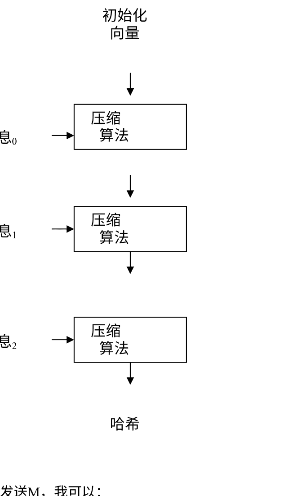

> (3) 不起作用，因为它给攻击者提供了两次获取 M 的机会。
> (2) 在一些异常设置下不起作用。（请问教授）
> (1) 目前仍然有效。它还没有被破解。

为了秘密和不可更改地发送M，我可以：

1. 加密-然后-MAC
   C = E_k (M)
   T = MAC_k (C)
   发送(C, T)
2. MAC-然后-加密
   T = MAC_k (M)
   发送E_k' (M || T)
3. MAC和加密
   T = MAC_k' (M)
   C = E_k (M)
   发送(C, T)

### 公钥密码学

- 到目前为止，Alice和Bob都知道 K - 无法区分Alice和Bob
- 任何一方都可以背叛另一方
- 对于 n 个参与方，需要 n(n-1)/2 个密钥 < n(n-1)/2

在公钥密码学中，每个人都有一个只有他们知道的密钥。

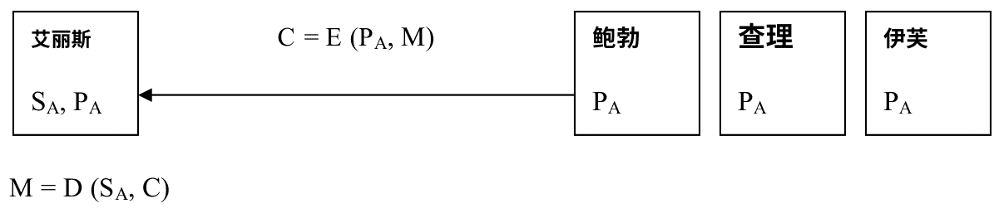

- Alice购买一个保险柜
  - 保存密钥
  - 将打开的保险柜邮寄给Bob
  - 收到时使用密钥打开保险柜
- Bob
  - 将 M 放入保险柜
  - 关上门

#### 数论

定义： $Z_n^* = (Z / nZ)^* = \{r \mid 0 < r < n, \gcd(r, n) = 1\}$

定义： $\varphi(n) = |Z_n^*|$ 例子： $\varphi(7) = 6$ $\varphi(p) = p-1$

$\varphi(pq) =??$

$Z_{15}^* = \{1, 2, 4, 7, 8, 11, 13, 14\}$ $\varphi(15) = 8 = (3-1)(5-1)$

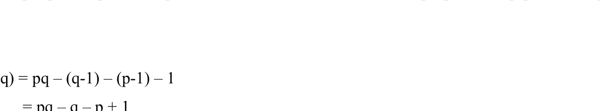

$\varphi(pq) = pq - (q-1) - (p-1) - 1 = pq - q - p + 1 = (p-1)(q-1)$

定义： 令，$*: Z_n^* \times Z_n^* \to Z_n^*$ 通过 $a*b = a \times b \mod n$ $n = 15, a = 13, b = 7$ $a*b = 1$

## 定义:

一个群是一个非空集合 G，具有二元运算符 o，使得,

- (i) ∃e ∈ G, ∀a ∈ G, e o a = a [单位元]
- (ii) ∀a ∈ G, ∃b ∈ G, a o b = e [逆元]
- (iii) ∀a, b, c ∈ G, (a o b) o c = a o (b o c) [结合律]

$Z_n^*$ 是一个群，具有 *

单位元: 1

满足结合律

### 逆元:

给定 a，找到 b，使得 (ab ≡ 1) mod n

```
当且仅当 ab = kn + 1
ab - kn = 1
```

#### 数论 (续)，公钥密码学

### 继续上一讲座 - 寻找逆元:

我们想要找到一个数 a 在 $(Z / nZ)^*$ 中的逆元

即给定 a，我们想要找到 b 使得 a * b ≡ 1 mod n.

现在，ab ≡ 1 mod n <==> ab = kn + 1 对于某个 k

即 ab - kn = 1

我们可以使用欧几里得算法找到 b (和 k)

### 欧几里得算法:

以下等式成立:

```
1 × a + 0 × n = a                (1)
0 × a + 1 × n = n                (2)
```

根据 $(Z / nZ)^*$ 的定义，我们知道 a < n。

现在我们找到一个值 $m_1$ 使得 $m_1a \le n$ 但是 $(m_1 + 1)a > n$

所以 $m_1a$ 是小于 n 的最大倍数。

即 $m_1 = \lfloor n / a \rfloor$

事实1： $a$ 和 $n$ 的每个除数都是 $(n - m_1a)$ 的除数
[更多信息请见侧边栏。]

因此，在欧几里得算法中，每一步都保留了方程右侧的除数集合。

事实2：方程的右侧值在每一步中都会变小。

事实3：最终，只有除数会留在右侧。然后，右侧是 $(a, n)$ 的最大公约数。

所有方程的形式为：
$x \cdot a + y \cdot n = r$

最终，$r$ 将成为 $a$ 和 $n$ 的最大公约数。即对于 $a \in (\mathbb{Z} / n\mathbb{Z})^*$，它将变为1。

因此，我们将得到 $x \cdot a + y \cdot n = 1$

### 例子：

我们想要找到37的逆元，模61。即 $37^{-1} \mod 61$

$1 \times 37 \quad + \quad 0 \times 61 \quad = \quad 37$ \qquad (1)
$0 \times 37 \quad + \quad 1 \times 61 \quad = \quad 61$ \qquad (2)

$m_1 = \lfloor 61 / 37 \rfloor = 1$

通过 $(2) - m_1(1)$ 我们得到：
$-1 \times 37 \quad + \quad 1 \times 61 \quad = \quad 24$ \qquad (3)

现在考虑 (1) 和 (3)。
$m_2 = \lfloor 37 / 24 \rfloor = 1$

通过 $(1) - m_2(3)$ 我们得到：
$2 \times 37 \quad - \quad 1 \times 61 \quad = \quad 13$ \qquad (4)

### 侧边栏：

我们还可以证明每个 $a$ 和 $(n - m_1a)$ 的除数必须是 $n$ 的除数：

考虑：
$n - m_1a \quad = \quad xd$ \qquad 对于某个 $x$
即 $n - m_1yd \quad = \quad xd$ 对于某个 $y$
(因为 $a$ 和 $n - m_1a$ 都是 $d$ 的倍数)

那么，
$n \quad = \quad xd + m_1yd$
$\qquad = \quad d (x + m_1y)$

也就是说，$n$ 也是 $d$ 的倍数。

现在考虑 (3) 和 (4) ($m_3 = \lfloor 24 / 13 \rfloor = 1$)
通过 (3) $- m_3(4)$ 我们得到: $-3 \times 37 + 2 \times 61 = 11$ (5)

现在考虑 (4) 和 (5) ($m_4 = \lfloor 13 / 11 \rfloor = 1$)
通过 (4) $- m_4 (5)$ 我们得到: $5 \times 37 - 3 \times 61 = 2$ (6)

现在用 (5) 和 (6) ($m_5 = \lfloor 11 / 2 \rfloor = 5$)
通过 (5) $- m_5 (6)$ 我们得到: $-28 \times 37 + 17 \times 61 = 1$ (7)

现在我们在等式右边得到了1。 (7) 的形式为 $b \times a - k \times n = 1$。因此， $b = -28$ 负数 (-28) 不可接受作为倒数。我们加上61 (即不断加 $n$ 直到得到一个正数) 得到33。

因此， $37 \times 33 \equiv 1 \mod 61$

## 计算指数模 $n$ 的高效算法：

我们需要一种方法来计算 $a^b \mod n$ 其中 $b$ 非常大 (例如， 2000位)

为了做到这一点，我们用二进制写 $b$。 例如， $b = 1001$ = $1 \times 2^3 + 0 \times 2^2 + 0 \times 2^1 + 1 \times 2^0$ = $1 \times 2^3 + 1 \times 2^0$

然后我们可以写成： $a^b = a^{2^3 + 2^0} = a^{2^3} \times a^{2^0}$
[ $x^y$ 表示 $x^y$ ]

所以我们可以按以下方式计算指数：

```
a^{2^0} = a        1
a^{2^1} = a^2      0
a^{2^2} = a^4      0
a^{2^3} = a^8      1
```

即计算 b 的位与相应指数的 a 的乘积，然后计算这些子乘积的乘积。在上述情况下，最多涉及3次平方运算和3次乘法运算。

一般来说，如果b的长度为n位，这种方法最多需要n-1次平方运算和n-1次乘法运算。

> 注意： a的各个指数也可以存储为模n的形式，因为一般来说，xy mod n = [(x mod n) * (y mod n)] mod n

##### 算法：计算a的b次方模n

1. 计算a的2^i次方模n，其中i = 0, 1, ..., |b|
2. 计算所有a的2^i次方模n的乘积，其中$b_i = 1$，即计算$\prod_{b_i=1} a^{2^i} \mod n$

利用前面讨论的数学背景，我们现在可以定义RSA公钥加密系统。

## RSA公钥加密系统：

### 密钥生成：

- Alice选择两个大素数p和q。然后她计算它们的乘积。$N = p \times q$
- 然后，Alice选择一个数 e，使得 $\gcd( e, \varphi(N)) = 1$
- 然后，Alice计算 d，使得 $e \times d \equiv 1 \mod \varphi(N)$

> [注意，如前所述，$\varphi(N) = (p-1)(q-1)$]

那么Alice的公钥为 $(N, e)$ 并且 Alice的私钥为 $(N, d)$

### 加密:

使用公钥进行加密。假设要加密的消息为 $M \in (\mathbb{Z} / N\mathbb{Z})^*$ 密文 C 计算如下

`C = M^e mod N`

### 解密:

使用私钥进行解密。

`M = C^d mod N`

因为 $\quad C^d \mod N \quad = \quad M^{ed} \mod N$
$\quad = \quad M^{k \varphi(N) + 1} \mod N \quad$ [因为 $\quad e \times d \equiv 1 \mod \varphi(N)$]
$\quad = \quad M^{(\varphi(N))^k} \times M \mod N$
$\quad = \quad 1^{k} \times M \mod N = \quad M \quad$ [定理 $\quad$：对于任意有限群 $\quad G$
$\quad$ 和 $\quad a \in G, \quad a^{|G|} = 1$]

对RSA的最明显的攻击是恶意用户可以尝试从 $(N, e)$ 中找到 d, 即从公钥中获取私钥。然而，可以证明如果攻击者可以从 $(N, e)$ 中找到 d, 则攻击者可以分解 N。 (证明是一个作业问题。 )

因此， N必须很难分解。为此， p和q必须大致相同大小。经验法则： p, q ≈ N的平方根

- 300位可以在PC上几秒钟内分解
- 512位可以用一个小集群分解
- 768位被推测可以用1000万美元的价格分解

因此，我们应该使 N比这个大得多。现在，通常 N ≈ 2048位。

#### 强RSA假设
给定 \(N\)、 \(C\)，找到 \(M\)、 \(e\)使得 \(M^e \equiv C \pmod{N}\)在计算上是不可行的。
较弱的假设是对于特定的密钥对（即特定的 \(e\)和 \(d\)），给定 \(C\)和 \(N\)找到 \(M\)在计算上是不可行的。较强的假设允许攻击者选择 \(e\)，即它表示对于给定的 \(C\)和 \(N\)找到任何一对（\(M\)、 \(e\)）在计算上是不可行的。

#### 常见的实现做法
一般来说，RSA比对称密钥算法更加计算密集，因为RSA涉及对大数进行大量的指数运算。
因此，在实践中，通常 \(e= 3\)。
因此，仅需进行一次平方和一次乘法即可对 \(M\)进行加密 \(M^3\)。在这种情况下，加密速度快，但解密速度慢。
（由于 \(e= 3\)， \(d\)的值将显著增大。尽管 \(e\)是常数，但 \(d\)的值在不同的 \(N\)值下将不同。）
使用RSA完全加密一个大文件效率低下。因此，常见的做法是对一个大文件 \(M\)进行以下操作：
- 选择一个密钥 \(k\)
- 使用任何分组密码算法和密钥 \(k\)对文件进行加密 \(C_0 = E_k(M)\)
- 使用接收方的公钥对密钥 \(k\)进行加密 \(C_1 = \text{RSA}_{\text{Pub}}(k)\)
- 将 \(C_0\)和 \(C_1\)作为密文传输。
然后，接收方需要使用私钥解密 \(C_1\)以获取密钥 \(k\)，然后使用该密钥解密 \(C_0\)。

## CSE509 – 计算机安全 – 3/02/06 讲座
（回到认证）
回顾三种基本的认证类型：
1. 你所知道的东西（已经涵盖：密码）
2. 你所拥有的东西
3. 你所是的东西

### 2 – 你所拥有的东西
在这里，这可以是一个密钥，但在计算机系统中，我们通常谈论的是以下两个事物：
- 智能卡
- 安全ID

### 安全ID的实施
### 安全密钥
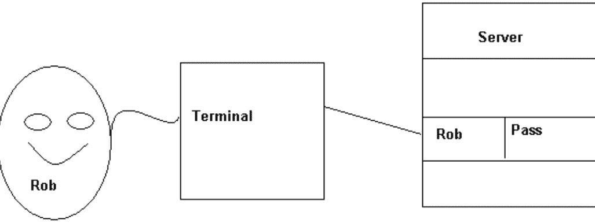
- 很明显，这个方案不安全，但可以通过使用挑战-响应协议使其更安全
- 频繁更改密码也可以使这个方案更安全，但对人类来说很麻烦
解决方案：将密码放在卡上 – 密码定期在卡上更改，因此是S/Key。

### 方法
1. 选择初始值 (IV)
2. 计算 V = H^k(IV) = H(H(H(..........H(IV).........)))
3. 最初服务器存储 (V，K) ，例如 (V，2000)
4. 最初将IV、K存储在智能卡上，例如 (V，2000)
5. 登录时使用卡片 - 在第一次使用时：发送H^1999(IV)
6. 卡片会自动更新新的登录参数
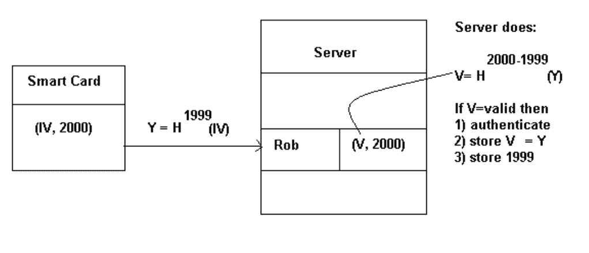

### 为什么这是安全的？
1. 我们在每个登录会话中使用不同的密码
2. 攻击者无法获取下一个密码，因为重新散列不起作用（请注意，我们的登录会话从外部到内部使用哈希值，重新散列将会朝相反的方向进行）
3. 在这个方案中，我们必须严格执行按顺序登录，所以2000、1998、1999会被拒绝，因为H^1999(V) 必须来自第三方（很可能是恶意的）

### 为什么这不安全？
它容易受到重放攻击。如果攻击者在一个登录尝试中缓存，并在有效用户的下一次尝试之前使用Y登录，系统无法知道这是一个恶意用户。

### 3-你是什么（生物特征）
（指纹、虹膜扫描、声纹、面部扫描、手掌扫描等）

### 传统生物特征登录
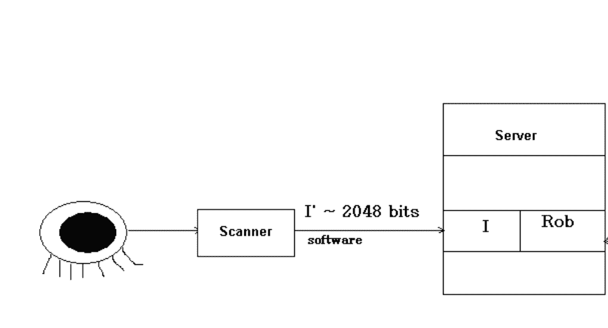
如果I'接近I，则有效

### 参数
- 如果I'和I来自同一只眼睛，则它们应该在大约1600位上达成一致 (大约有20%的差异)
- 如果I'和I来自两只不同的眼睛，则它们在大约60%的位上达成一致
- 两只不同的眼睛达成80%的一致性的问题非常小

### 问题
- 恶意扫描仪可以存储虹膜扫描以供以后扫描（请注意，智能扫描仪可以进行活体检测，以确保眼睛是真实的，而不是照片）
- 可用性取决于扫描仪-可能需要更高的接受阈值
- I以明文形式存储在服务器上
- 容易受到重放攻击
- 虹膜是终身的，供应有限，因此不需要频繁更改密码
- 无法进行挑战-响应

### 修复生物特征识别
步骤1: 使生物特征读数确定性
```
I = b₁, ……………………………b₂₀₄₈
I' = b₁' ………………………………b₂₀₄₈'
海明距离 dₕ(I, I') =< 400
```

### 错误纠正
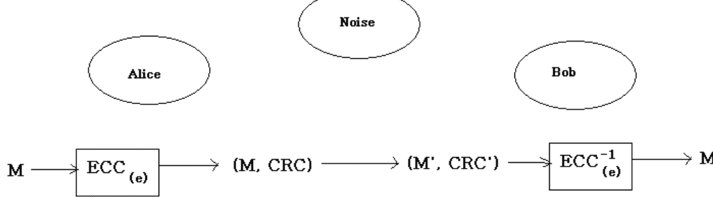
(CRC: 循环冗余校验)
在上面的图片中，如果 $d_h(M||CRC, M'||CRC') \leq e$，则Bob可以恢复M。换句话说，ECC可以纠正最多e位错误。

### ECC技巧
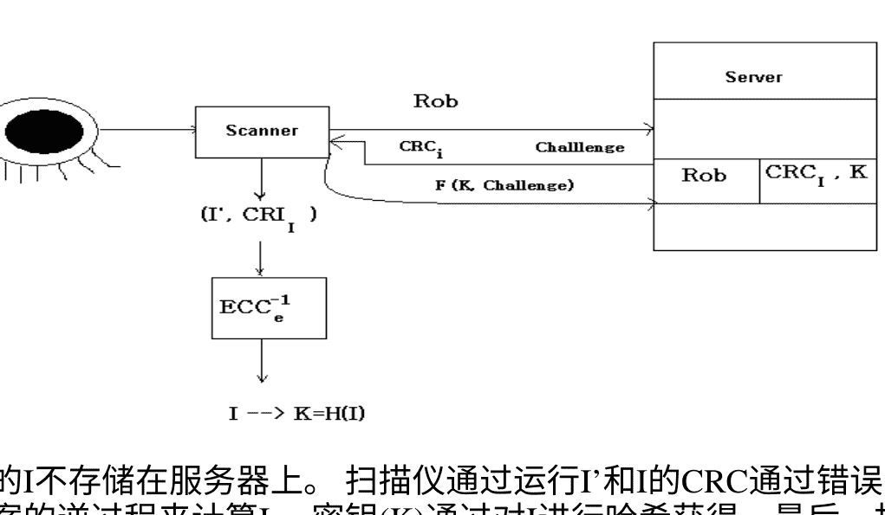
这里的I不存储在服务器上。扫描仪通过运行I'和I的CRC通过错误纠正方案的逆过程来计算I。密钥(K)通过对I进行哈希获得。最后，扫描仪用F(K, challenge)回应挑战。

### 生物特征识别和笔记本电脑（更安全的笔记本电脑）
敏感信息有时存储在易于被盗的笔记本电脑上。用于笔记本电脑的生物特征识别可以以类似上述方案的方式保护文件系统。
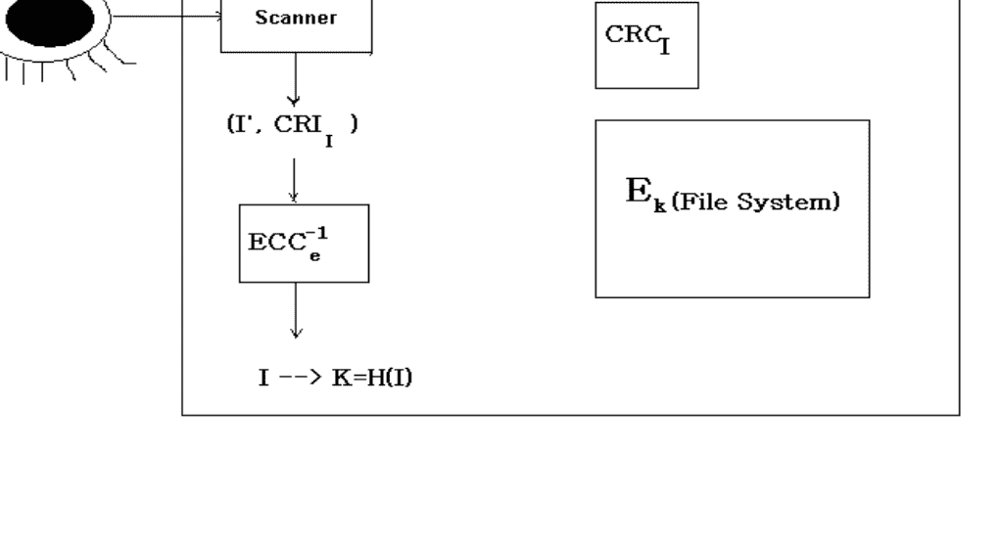
现在为了访问文件系统，你必须提供一个有效的虹膜。

### 第二步：能够更改你的密钥
- 不要：只是添加一个密钥
  请注意，仅仅使用密钥加上虹膜是不够的因为在上述方案中，扫描仪只需要CRC和虹膜就能找到密钥。换句话说，这并不能防止虹膜被盗。
- 做：确保用户带来一个辅助输入
  (拥有的东西 + 你是的东西)
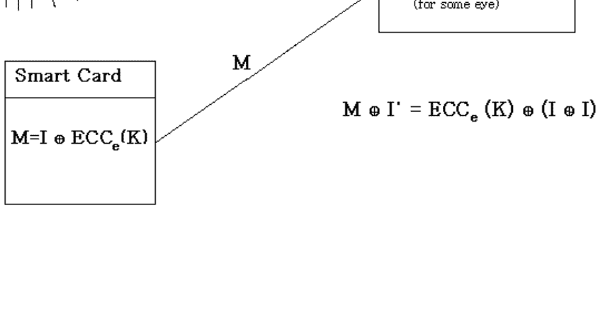

## CSE 509: 系统安全，2006年春季。
## 2006年03月14日讲座笔记。
setuid/exec漏洞：
Unix（及其变种）提供了一个系统调用seteuid()来改变用户的当前有效用户ID。
- seteuid(0)：将有效用户ID变为0。（因此，暂时成为root）
- seteuid(getruid())：返回/临时放弃root权限。
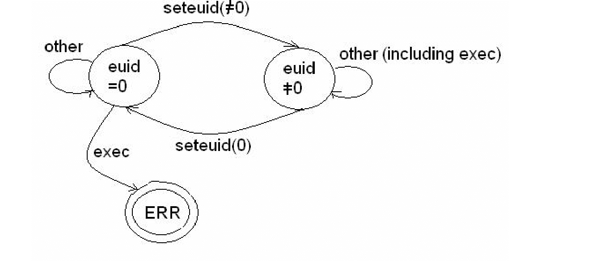
为什么要放弃root权限？
- 如果一个受信任的程序想要运行一个不受信任的辅助程序。
例如，从cron启动的emacs。
一个问题是，如果用户忘记放弃root权限。
考虑以下代码片段：
```c
void runhelper()
{
    if((cmd= malloc(...))!=NULL)
        seteuid(getruid());
    exec(...);
    seteuid(0);
}
```
现在如果Malloc失败，那么exec将以root身份执行。
> (要深入了解setuid，请参阅论文：Setuid Demystified: http://www.cs.berkeley.edu/~daw/papers/setuid-usenix02.pdf)

### chdir/chroot
考虑以下代码片段：
```c
void switch_to_new_root(...)
{
    chroot("/var/anonftp");
    printf("已切换到新的根目录！！");
}
```
一旦chroot完成，进程只能访问/var/anonftp目录下的文件问题是chroot不会改变FTP服务器的CWD（当前工作目录）。
在操作系统内部，有一个
```
root CWD
/   /usr/share
```
现在，open("pics/stuff");从CWD开始执行。
如果我们执行了chroot("/var/anonftp"), 它看起来像这样：
```
root CWD
/var/anonftp /usr/share
```
现在，另一个open("pics/stuff");从CWD开始执行，仍然有效！！
因此，在执行chroot()之后需要添加chdir("/")。即代码应该如下所示：
```c
void switch_to_new_root(...)
{
    chroot("/var/anonftp");
    chdir("/");
    printf("切换到新的根目录！！");
}
```

### 牵引光束攻击（很酷！）
考虑以下来自ftp服务器的代码片段：
```c
jmpbuf jb;
try_transfer(...)
{
    setjmp(&jb);
    do_transfer(...);
label1:
    ............
    ............
}
do_transfer(...)
{
label2:
    seteuid(0);
    // 与TCP进行一些I/O操作
    seteuid(getruid());
}
sig_urg_handler()
{
    longjmp(&jb);
}
```
在上述代码中，我们使用了setjmp - longjmp。TCP可以发送紧急的带外消息，而紧急信号的处理程序（sig_urg_handler()）会跳转到
```c
void read_from_net()
{
    char buf[1000];
    net_read(nuf, 1000);
    fprintf(logfd, buf);
}
say buf = "%s%s%s ...."
```
堆栈
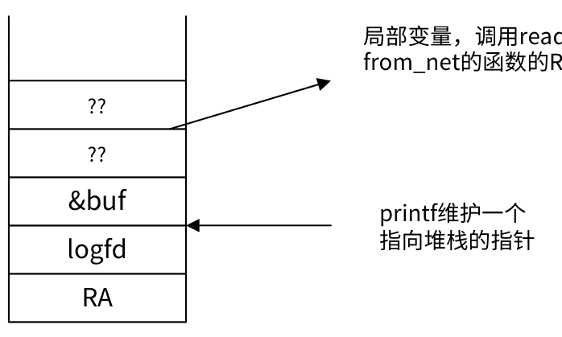

### printf如何工作？
Printf( “%s%s” , “A” , “B” );
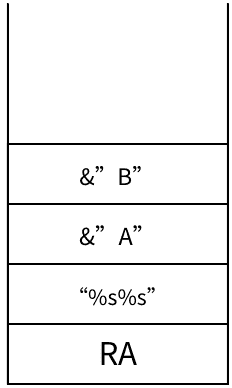

### 问题
Printf( “Hello%n” , &bytes); 将到目前为止写入的字节数写入*&bytes
```c
void login_user()
{
    int authenticated = 0;
    char uname[100];
    getusername();
}
void getusername(char* uname)
{
    net_read(uname);
    fprintf(logfd, uname);
}
```

### 上节课的回顾 - 利用生物特征生成密钥
生物特征的不足之处
- 一种生物特征终身使用
- 生物特征可以被盗用，例如使用摄影
- 生物特征读取有噪声（可以使用ECC修复）

#### 天真的方案
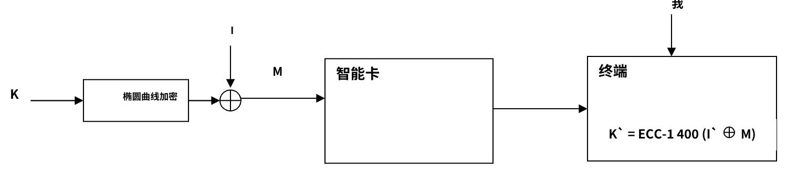
这个方案不能在公共场合使用。考虑一个商家和一个顾客的场景顾客使用智能卡进行付款。由于终端知道K` 商家可以生成另一张智能卡。问题在于智能卡仅仅被用作存储。

#### 解决方案
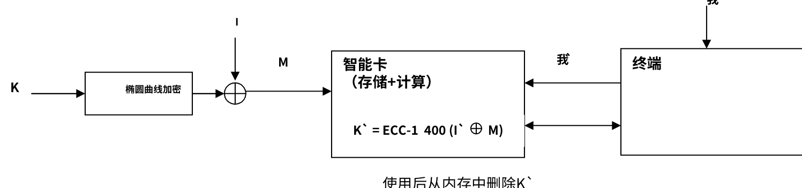
理念是没有秘密应该离开智能卡。
为什么智能卡+生物识别比只使用两张智能卡更好？偷两张智能卡通常和偷一张一样容易，因为用户通常会把它们放在一起。然而，偷取虹膜需要完全不同的攻击方式，与偷取智能卡不同。

### 攻击树
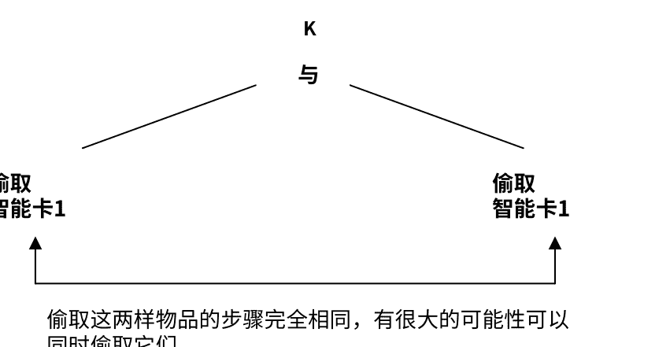
偷取这两样物品的步骤完全相同，有很大的可能性可以同时偷取它们

### 三因素认证-添加你所知道的东西
#### 理念1
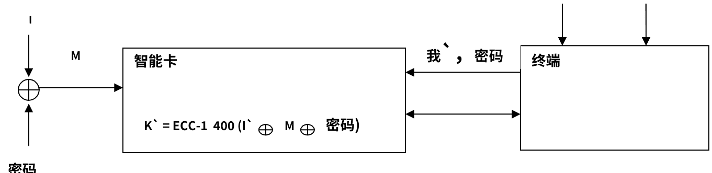

#### 理念2
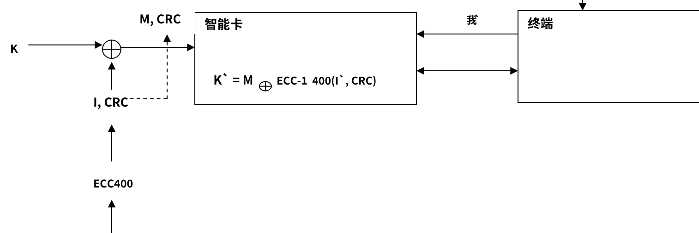
我们现在可以使用密码吗？

## Idea 3
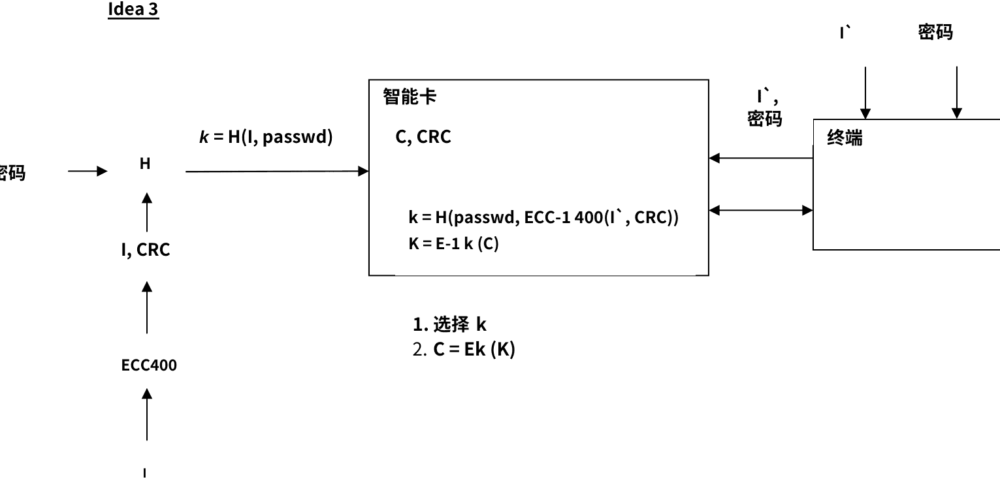
1. 选择 k
2. C = Ek (K)
#### 用户携带
- 密码
- 虹膜
- 智能卡 [C， CRC]
### 软件安全
- 缓冲区溢出
- 格式化字符串漏洞
- 竞态条件
- SQL注入漏洞
- 竞争条件
- XSS漏洞
- Chroot/chdir漏洞
- 文件描述符攻击
- RPC实现漏洞
- 糟糕的软件设计
- 可用性缺陷
除了最后两个之外，所有这些都是程序员犯的错误。
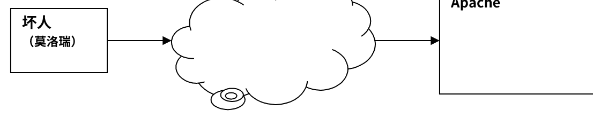
“AAAA AAAA AAAA ………… ………… ………… AAAA”
- Apache最终运行攻击者提供的代码
- Apache在unix上以root身份运行
## 不可信输入漏洞try_transfer()中的label1。这意味着，ftp服务器现在是root用户，因为我们在执行长跳转之前使用了seteuid(0)，但没有在执行长跳转之前放弃root权限。

有几种方法可以解决这个问题，其中一种方法是忽略来自TCP的紧急消息信号，如下所示：

```
do_transfer(...){
    label2:
    signal(SIG_URG,IGNORE);
    seteuid(0);
    // 与TCP进行一些I/O操作
    seteuid(getruid());
}
```

但是，我们的目标不是让程序员做正确的事情，而是阻止他们做错误的事情。

让我们提出一个规则，当euid=0时，所有信号必须被忽略。


对于32个信号，在状态机中有2^32个状态，再加上一个euid，因此同时分析所有信号需要2^33个状态，但我们可以高效地分析每个信号。

## 文件描述符攻击：

对于一个setuid程序，用户控制文件描述符的初始状态。你总是有3个文件描述符：

- 标准输入：0
- 标准输出：1
- 标准错误：2

`printf("HELLO"); // 使用文件描述符1（标准输出）进行硬编码写入。`

现在，如果我只打开了标准输入，那么fd=1。

```
fd = open("some-critical-file");
printf("opened critical file");
```

因此，setuid程序应该执行close(0); close(1); close(2);，然后执行open("/dev/tty"); open("/dev/tty"); open("/dev/tty");

正如我们所看到的，以上所有攻击都具有一些全局状态信息。

### 未经检查的输入：

考虑以下代码片段：

```
int len;
read(networkfd, &len, sizeof(len));
buf = malloc(len);
```

应该检查read返回的值。(因为read可能读取的数量少于请求的数量。)类似这样的代码： `if(read(...)==sizeof(len))`

这里的len值是不可信的（来自外部来源）。应该对len进行边界检查。

类似这样的代码：

```
if(read(...)==sizeof(len))
    if(len < 100 && len >= 0)
        buf = malloc(len);
```

因此，len具有如下状态，如状态机所示。


这不是一个非常保守的方法。状态机没有验证它是否在我们需要的值之间有界。

## 访问/打开：

setuid-root程序只有在调用者能够打开“文件”时才想要打开它。

如果我们有类似于: `open("文件")`, 而文件来自不受信任的来源，那么受害者可能会打开任何东西 (任何恶意文件)。因此，存在一个访问/打开机制。

```
if(access("文件"))
    open("文件");
```

对此的攻击是，如果文件如下所示:
“文件”被攻击者拥有，调用setuid受害者程序。然后受害者运行。
执行access("文件"), 从操作系统获得“ok”, 然后被操作系统调度出去。攻击者的代码现在获得控制权并执行rm("文件”), 并创建一个指向/etc/shadow文件的软链接。 然后被操作系统调度出去。
受害者代码然后执行open("文件”), 实际上打开了/etc/shadow文件。

只是演示同样的事情，很好看：

##### 受害者运行

##### 攻击者运行

文件由攻击者拥有 调用setuid受害者程序

```
访问("文件")
从操作系统得到"OK"
open("文件")
```

```
rm "文件"
ln -s /etc/shadow 文件
```

所以，没有办法原子地进行访问和打开操作。真正的问题是在两个不同的系统调用中对名称"文件"有两个用途 在这两个调用之间，操作系统可以安排其他进程/任务。

为了防止这种情况，我们可以将它们封装成一个事务。但这样做可以使程序员做正确的事情，而不是禁止他们做错误的事情。


这里有两篇有趣的论文：

> "修复竞态条件以供娱乐和利润：如何滥用atime" - http://www.cs.berkeley.edu/~daw/papers/races-usenix05.pdf
> "修复竞态条件以供娱乐和利润：如何使用access(2)" - http://www.csl.sri.com/users/ddean/papers/usenix04.pdf

## ● 模型检查


```
void func()
{
    while (......) {
        if (......) {
            seteuid(geteuid());
            exec(...);
            setuid(0);
        } else {
            exec(...);
        }
    }
}
```


假设：代码以*euid = 0开始。

#### CFG（控制流图）

CFG是一个有限状态机。

给定正则语言$L_{CFG}$，安全属性被指定为FSM，得到$L_P$。

我们想要的是 $L_P \cap L_{CFG} = \phi$.

$L_P \cap L_{CFG}$ 是正则的!

### 验证的四个步骤：

- 1. 将安全属性指定为FSA。
- 2. 将输入程序转换为FSA（PDA，下推自动机）.
- 3. 计算来自1和2的机器的乘积.
- 4. 检查产品机器是否提供空语言。

### 工具：

- MOPS
- SLAM
- BLAST
- MECA

### 模型检查设计中的选择：

##### 1. 函数与整个程序

MOPS、SLAM和BLAST是整个程序检查。MECA使用逐个函数分析。

##### 2. 声音与便利性

> 定义：如果一个程序分析工具说一个程序没有错误，那么这个程序就没有错误，那么这个程序就是声音的。

> 定义：误报是指分析工具声称一个程序有错误，但实际上没有错误。

> 定义：完整性 - 一个完整的分析工具没有误报。

###### 定理：从声音、完整性和终止中选择2个。

- MOPS：声音，终止
- SLAM和BLAST：声音，完整
- MECA：终止，便利性

##### 3. 定理证明

MOPS没有，SLAM/BLAST有很多，MECA有一点。

### 不可靠：

使用后可能不安全，但仍然有帮助。

- 激光束对比散弹枪方法
- 攻击与防御的不对称性

- * 防御者必须关闭所有漏洞
- * 攻击者只需找到一个弱点
    - 组合方法:
        - 肯定会有一个错误
        - 很可能会有一个错误
        - 有多大可能性是一个错误

### MECA结果:

- 成千上万个错误
- 低误报率: 10%~100%
- 商业覆盖范围
- 错过了真正的错误

### 公开:

设计级错误。

### 四个分析工具的总结:

|    | 健全性 | 完整性 | 终止性 | 分析方法 | 定理证明 |
|----|--------|--------|--------|----------|----------|
| MOPS | Y      | N      | Y      | 整个程序 | N        |
| SLAM | Y      | Y      | N      | 整个程序 | 许多     |
| BLAST | Y      | Y      | N      | 整个程序 | 许多     |
| MECA | N      | N      | Y      | 逐个函数 | 一点点   |

- 缓冲区溢出

#### 示例1:

```c
void func(char *name)
{
    char buf[1024];
    strcpy(buf, name);
    return;
}
```


###### 攻击者制造

- Name = "<Shell代码>\xfe12\0"
- Name = "NOP NOP NOP <Shell代码>\xfe12\0"

**Q1:攻击者如何知道需要填充的返回地址?**

A:例如，攻击者发现受害者机器正在使用Linux。然后攻击者需要在本地机器上安装完全相同版本的Linux，下载相同的开源代码。运行它，攻击者将能够找到返回地址。

**Q2:如何在缓冲区内执行Shell代码?**

A:攻击者可以使用解码器来消除禁止的字节。

### 如何修复?

使用NX位，在堆栈上禁止执行。

#### 示例2:

```
struct usestate {
    char name[64];
    int superuser;
};
void login_user(char *name)
{
    struct usestate *us = malloc(..);
    strcpy(us->name, name);
    return;
}
```

- 超级用户
- 名字
- 我们
- 堆
- 0x0

> 注意：如果参数'name'太长，'超级用户'字段可能会被覆盖。

#### 示例3：返回到libc攻击。

```c
void func(char *name)
{
    char buf[1024];
    strcpy(buf, name);
    return;
}
```


### 2006年03月21日的CSE 509课程

阅读任务是阅读关于C - Cured的论文

### C Cured


概述：C程序员常犯的一些常见错误

#### 1. 访问/引用数组外部

解决方法：在每次解引用操作之前对指针进行边界检查。
如何做到这一点？：FAT指针


在这种情况下，边界信息是数组的基地址，长度为'数组的字节数'。

#### 2. malloc / free错误

- 例如，释放相同的位置可能会破坏堆。
解决方法：
 a. 根本不使用free()函数
 b. 使用垃圾回收而不是释放。（注意：由于垃圾回收器运行懒散，攻击者可能利用这个临时额外空间来注入他的代码，因此存在可能的安全漏洞。但考虑到其优点超过缺点，垃圾回收似乎是一个不错的选择。）

#### 3. 强制转换和联合

- 使用强制转换进行运行时检查。
- 禁止联合

例如，不安全使用联合

```
union u
{
    int a;
    char *ptr;
};
```

在这个例子中，可以用一个整数初始化联合体，然后假设它是一个 char * 指针进行解引用。

不安全操作的例子，使用强制类型转换

```c
char *p = (char *)5;
```

在这种情况下，p 不应该被解引用。

##### 胖指针如何帮助？

将int强制转换为指针会产生一个不可引用的胖指针。

| 0 (基址) | 0 (长度) | 5 (值) |
|----------|----------|--------|

在类型转换为 ‘ (char *) 5’ 之后，它将被转换为上述所述的胖指针。 这个无法被引用。
规则：基址为0，长度为0的胖指针无法被引用。
因此，C-Cure改变了C结构，使其仍然可以像C一样使用，但比C更安全。

## 将C分解为具有不同关联安全级别的子集：

### 语言SAFE：

定义SAFE为C的子集，其中

- 没有指针算术
- 没有类型转换
- 没有联合

因此，我们消除了由于

- 边界检查
- 类型检查
- 不需要保留任何边界信息

例如

```c
int linked_list_search(list *i, int t)
{
    while(i != NULL && i->data != t)
        i = i->next;
    if(i)
        return true;
    return false;
}
```

### 语言SEQ = SAFE + 指针算术:

例如

```c
int sum(int *vec, int len)
{
    int acc = 0;
    int i;
    for(i = 0; i < len; i++)
        acc += vec[i];
    return acc;
}
```

将SEQ定义为C的子集

- 边界检查
- 边界信息
- 我们不需要类型检查

#### 语言C / 动态 / 野生 - 我们使用的正常C语言

思路是找到源代码中属于3种不同语言的部分，然后使用安全的方式分别处理属于不同语言的部分，如上述的1、2、3。

1. C - Cured将用户程序分成
    - SAFE
    - SEQ
    - WILD部分
2. 分别编译这3个部分
3. 处理从一种语言到另一种语言的过渡边界处的转换。

- 使用类型限定符推断进行分区。
- 分析是可靠的（sound的定义：分析确保由于类型转换而导致的错误）
- 代码应该没有缓冲区溢出。

### 性能:

开销-减速1.5倍

统计上，源程序有：

- 安全指针-90%
- SEQ指针-9%
- WILD指针-1%

比其他类似工具更好- （例如，净化减慢50倍）

### 二进制兼容性问题:

CCured与未使用CCured编译的其他库不兼容。

例如，未使用CCured编译的库可能没有Fat指针

- 需要在CCured和NonCCured代码之间的接口处转换指针。

提出的进展:

对于CCured和NonCCured代码之间的接口:

- 编写包装函数以解除指针的Fat化
- 编写包装函数以重新Fat化指针

### 特权分离

阅读作业是一篇论文-privTrans

最小特权原则:

只给用户分配完成某项任务所需的最低特权

程序需要特权有3个原因:

- 访问机密数据（例如读取文件）
- 执行特殊操作
- 更改身份

特权分离的方法:

将一个大程序分割成具有不同特权的小程序。


#### 特权分离（续）

根据上下文，几乎任何错误都可能影响安全性。例如，如果一个程序没有正确的返回值，它本身可能不容易受到攻击，但在调用它的上下文中可能容易受到攻击。

#### 问题7

讨论期中复习问题7的解决方案。设计一个特权系统和访问控制矩阵，只有至少3个人同意发射导弹且没有人反对发射时才能发射。让$ACM$（访问控制矩阵）的设计如表1所示。让我们只有一个对象导弹。域包括4个用户和一个发射器。发射器域将用于记录当前投票状态。最初，每个用户域都有投票特权。

$vote1$用于投第一票。它取消了选民的投票权，并改变了发射器域的状态，以反映支持发射的一票已经投出。类似地，$vote2$和$vote3$分别用于投第二和第三票。

```
vote1(d) {
    if (vote ∈ A[d, missile] && A[launcher, missile] = ∅) {
        A[d, missile] \= {vote}
        A[launcher, missile] ∪= {one-vote}
    }
}
```

|      | 导弹 |
|------|------|
| 用户1 | 投票 |
| 用户2 | 投票 |
| 用户3 | 投票 |
| 用户4 | 投票 |
| 发射器 |      |

表1：访问控制矩阵的初始条件

```
vote2(d) {
    if (vote ∈ A[d, missile] && A[launcher, missile] = {one-vote}) {
        A[d, missile] \= {vote}
        A[launcher, missile] = {two-vote}
    }
}
```

```
vote3(d) {
    if (vote ∈ A[d, missile] && A[launcher, missile] = {two-vote}) {
        A[d, missile] \= {vote}
        A[launcher, missile] = {three-vote}
    }
}
```

否决用于否决发射。弃权取消用户的投票权。虽然他可以在需要时否决发射，但无法恢复投票权。发射检查是否已经有三票赞成，并且每个人都已经投票，然后导弹的状态会改变为发射。

```
veto(d) {
    if (true) {
        A[Launcher, missile] = {veto}
    }
}
```

```
abstain(d) {
    if (true) {
        A[d, missile] \= {vote}
    }
}
```

```
launch() {
    if (A[发射器, 导弹] = {三票} && A[用户1, 导弹] = ∅ &&
        A[用户2, 导弹] = ∅ && A[用户3, 导弹] = ∅ && A[用户4, 导弹] = ∅
    ) {
        A[发射器, 导弹] = {发射}
    }
}
```

上述系统实现了以下安全目标：

- 不允许任何人投票超过一次。
- 一个人可以投票支持发射，然后随后否决。
- 一旦否决完成，就无法撤销。
- 在发射之前，每个人都应该投票或者放弃投票。

#### 问题2

讨论中期复习问题2的解决方案。虚拟机监视器如何设置两个虚拟机的页表，使它们共享一个内存页？应用程序可以共享物理页面，因此虚拟机监视器（VMM）为两个进程设置了页面转换，使得每个进程的不同虚拟页面都指向内存中的同一个物理页面。因此，一个进程对页面所做的更改可以被另一个进程看到。在不信任的应用程序之间共享的两种方法是：

使用锁：服务器可以对页面进行写锁定，这样可以防止客户端对页面进行写操作。这里的重要考虑因素是锁定应该是强制性的，而不是自愿的。因此，如果锁定方案需要有效，锁应该由VMM进行管理。并且VMM应该确保任何进程都无法在具有写锁的页面上进行写操作。

复制数据：解决共享问题的一个简单方法是，在每个进程开始在共享页面上处理数据之前，首先将其复制到私有页面。这确保数据永远不会处于不一致的状态，并且在此之后，所有未来的处理都应该在私有区域的数据上进行。

### 特权分离

以下情况需要特权：

1. 访问机密数据。
2. 执行特殊操作。
3. 更改身份。


### 图1：权限分离

权限分离的主要思想体现在图1中。从属程序与所有外部代理进行交互。为了执行特权任务，从属程序依赖于监视器。因此，从属程序与底层操作系统（OS）的所有交互都是通过监视器进行的。除了在从属程序和操作系统之间进行调解外，监视器还存储所有私有数据，该程序是其继承者。监视器以完全特权（root）运行，从属程序以无特权（nobody）运行。

这个想法是原始程序只在特定状态下执行特权操作。

图2捕捉了OpenBSD SSH Daemon（sshd）中用户身份验证的所有状态。在图中，preauth3的分割是由于sshd中可用的两种身份验证方式：通过密码短语和通过公钥。这个模型是Niels Provos [2]的研究成果。他通过研究sshd的代码构建了这个模型。使用这个模型，他继续对sshd代码进行手动权限分离。

以Provos的工作为基础，我们设计了一个修改后的特权分离结构。这在图3中显示。在这里，除了原始设计中监视器执行的操作外，监视器还检查一个模型。该模型显示了从属可能处于的所有可能状态以及可能在每个状态下执行的操作。因此，监视器存储状态并确保不偏离模型。这对于特权分离的有效性是必需的。


### 图2：SSHD身份验证的状态


### 图3：特权分离的新模型

### 自动特权分离

自动特权分离论文Privtrans提出了一种基于静态分析的解决方案。他们要求对其特权的函数和变量进行注释。通过类型限定符推断，确定所有特权函数。所有特权函数由监视器执行。监视器中存在一个存储子系统，并且监视器与从属之间的所有通信都使用RPC完成。该论文非常模糊，并且对于模型的生成仍然没有定论。

### 特权分离中的问题

奴隶应该执行监视器还是监视器执行奴隶？为了安全起见，监视器应该生成并执行奴隶。这样监视器可以更好地控制奴隶的行为。此外，监视器只能与奴隶通信，不能与其他应用程序通信。如果奴隶执行监视器功能，则无法确保这一点，因为恶意奴隶可能劫持监视器。

### 参考文献

> [1] *Privtrans*: 自动分割程序以进行特权分离，David Brumley和Dawn Song，卡内基梅隆大学。
> [2] 防止特权提升，Niels Provos，Markus Friedl和Peter Honeyman，第12届USENIX安全研讨会，华盛顿特区，2003年8月。

# CSE509 03/30/06讲座笔记

Pramod Adiddam

## 特权分离：

### 策略

特权分离是为了安全。在特权分离中，有两个组件 - 特权程序=特权+策略。特权和策略通常绑定在一起。


因此，策略需要进入监视器，因为特权将在监视器中。

此外，理想的特权分离不会引入新的错误。也就是说，新的分离程序只有在原始程序有错误的情况下才会有错误。原始程序可能有很多错误。这些错误将完整地传递到监视器或从属中。这样的错误可能会出现在从属或监视器中。如果它出现在从属中（并且特权和策略在监视器中），那么处于这种情况是可以接受的，因为现在无法利用该错误来获取特权。如果错误出现在监视器中，则不清楚是否容易或困难地利用它，因为可能存在更少的代码来查找错误，或者错误现在可能很难到达。

## 缓冲区溢出：

让我们通过列举攻击者可能会做的事情来看看在哪里可以阻止攻击者：

- 1. 在源代码中找到溢出 - （这类攻击可以通过工具如BOON来防范）
- 2. 发送溢出消息 - （使用工具如CCured）
- 3. 覆盖返回地址 - （通过地址空间随机化）
- 4. 程序返回到返回地址
- 5. 执行shell代码
- 6. 进行系统调用

### 随机化

对于缓冲区溢出，攻击者需要获取缓冲区的地址。如果他能够获得将要运行的程序的完全副本，那么他可以通过运行调试器来实现。如果我们使得很难找到缓冲区的地址，那么就没问题了。一种方法是随机化栈的顶部。返回地址是绝对的，但是返回地址在栈中的位置可以通过参数的大小、局部变量等计算出来。


主调用 foo，它通过某个数字减少 sp。每个新减少的 sp 相对于前一个 sp，因此每次进程启动时更改堆栈顶部，将更改存储在返回地址中的 sp。在这种情况下，攻击者无法阻止访问缓冲区，因此无法阻止进入RA中的绝对地址。此解决方案仅防止了从由缓冲区溢出写入的RA中的缓冲区访问的代码注入。

#### 为其他类型的攻击提供更多的随机化

- 随机化堆栈顶部
- 随机化 `libc` 位置
- 随机化代码位置 (重新编译代码以不使用绝对寻址或通过重写二进制文件进行一次性随机化)
- 随机化数据位置
- 帧间填充 (需要对代码进行侵入性修改，以在局部变量等和返回地址之间插入填充)
- 重新排列函数 (可以通过代码中添加的间接级别来实现`jmp`到函数)
- 重新排列基本块
- 重新排列局部变量 (最后3个，包括这个，使得返回到代码攻击变得非常困难)
- 重新排列数据
- 随机化 `malloc` (用于防止malloc分配的序列顺序被利用)

并非所有上述方法都使得攻击变得困难。它们中的每一个大多数是特定的攻击。正如评论文章中所讨论的，在32位系统上，地址空间随机化使得攻击者需要猜测22位来攻击系统。研究表明，对于这样的猜测来说很容易找到代码并进入。解决方案包括使用64位等。

#### Pointguard

在缓冲区溢出攻击之前，大多数讨论的解决方案都可能被格式化字符串攻击恶化。

```
c
void foo (char *c)
{
    char buf [1024];

    strcpy (buf, c);
    return;
}
```

我们可以看到上面的缓冲区通常是 `char` 或 `int` 类型。RA是指针类型，而缓冲区不是。我们不使用指针类型来表示缓冲区，因为我们通常不会将指针读入缓冲区。因此，如果缓冲区被标记（RA被标记为`p`，缓冲区与其类型在内存中标记），那么每次向标记位置写入数据类型时，这些标记将被覆盖。因此，如果我们将int缓冲区溢出到RA，那么在加载RA时，我们会发现它不是指针类型并引发异常，可能会导致 `jmp`。问题是在哪里存储标记？

另一个想法是将指针存储在内存中加密，而 `int/ char` 等则不加密。在启动时选择一个密钥`k`并加密所有指针。这样覆盖就不会解密时提供垃圾信息。为了使加密/解密更快，使用异或作为加密方法。

如果密钥在寄存器中，那是最安全的选择。但是如果由于性能/处理器限制的原因，无法将密钥存储在寄存器中，可以将其存储在内存中并进行读取。通过格式化字符串错误，我们可以打印出一个加密的RA并将其与已知的RA进行异或运算，以获取密钥。另一种方法是使用更大的着陆区（在之前的课程中讨论过），使缓冲区地址的最后几位变得多余，从而更容易猜测地址。

#### Stackguard

重新编译以分离缓冲区和RA存在旧和新库的问题。因此，在进程启动时，选择一个随机的*canary*（一个32位的数字）并将*canary*写在RA的下方。因此，无法猜测*canary*，如果由缓冲区溢出覆盖（在覆盖*canary*之后也覆盖RA），我们可以通过将其与*canary*进行比较并在加载RA之前进行检查来捕获缓冲区溢出。

### 04/04/06讲座笔记：

### 不可信代码

##### 法蒂玛·扎林尼。

上节课我们开始讨论了针对堆栈溢出的不同系统解决方案。我们将继续这个话题。

#### 堆栈溢出的阶段：

执行缓冲区溢出攻击的步骤如下：

- 1) 找到代码中的漏洞。
- 2) 发送溢出的输入。
- 3) 覆盖返回地址以指向缓冲区。
- 4) 跳转到*RA
- 5) 执行代码。
- 6) 进行系统调用。

#### 针对上述步骤的解决方案：

- 1) 静态分析。
- 2) CCured。
- 3) 地址空间随机化（ASR）和PointGuard
- 4) 堆栈保护
- 5) ISR（指令集随机化）
- 6) 系统调用随机化。

我们讨论了步骤1到4，今天我们将讨论步骤5和6。

#### 指令集随机化：

指令集随机化用于防止攻击者在受害者机器上运行他注入的机器代码。假设攻击者找到了一种方法，在受害者机器上注入一些机器代码。现在，攻击者想要注入能够在受害者CPU上执行的机器代码。因此，为了使攻击成功，攻击者需要知道以下内容：

##### 攻击者必须知道：

- 受害者机器的操作系统。
- 受害者机器的指令集。

因此，我们的目标是不让攻击者知道我们机器的指令集。我们可以采取以下措施：

- 1) 在执行代码时，我们对其进行加密，并将加密版本加载到内存中。
- 2) 在执行指令之前，我们对其进行解密并交给CPU。


在上述情况下，加密仅针对代码，而不针对数据。这个想法类似于PointGuard。

那么，当攻击者在代码中发现漏洞并尝试进行代码注入缓冲区溢出攻击时会发生什么？

假设攻击者成功地将他的代码注入到内存中，并使返回地址指向他注入的代码。因此，当程序获取返回地址时，攻击者成功地使PC指向他的字节。那么，现在将发生以下情况：


CPU在执行之前解密攻击者的字节。因此，如果攻击者不知道密钥，解密过程将产生随机字节，然后这些随机字节将由CPU执行。因此，如果攻击者不知道密钥，他很少有可能得到他想要的东西。现在，如果我们向CPU输入任何内容，程序将会崩溃。

因此，上述技术被称为指令集随机化。

让我们来看一些比较：

- ASR:
  - 可以自动地用于二进制文件。
  - 您不需要更改源代码。
  - 非常容易使用。
  - 提供较弱的保证，但工作量较少
- 静态分析:
  - 最强大的保证。
  - 需要大量的努力。
- CCured:
  - 在存在缓冲区溢出时起作用。
  - 相当成功。
- StackGuard:
  - Stack Guard非常成功。
- Point Guard:
  - PointGuard不成功。
- ISR:
  - 开销太大
  - 它只适用于代码注入缓冲区溢出攻击。
  - 不成功。

现在，让我们看看系统调用随机化。

#### 系统调用随机化：

攻击者通过系统调用可以造成永久性损害。因此，我们需要防止攻击者执行系统调用。

那么，系统调用是如何工作的？

让我们看一下以下汇编代码：

```
push eax （字节数。）
push eax （缓冲区地址。）
push ebx （文件描述符。）
push 127 （读取系统调用。127代表系统调用类型，可能是读取系统调用。）
int 0x80
```

最后一行要求操作系统执行系统调用。

#### 我们如何防止攻击者执行系统调用？

- 随机化系统调用号码。因此，每次程序运行时，所有系统调用类型会得到一个不同的数字。在我们上面的例子中，127是一个系统调用编号。
- 随机化系统调用参数顺序。
- 更改系统调用指令。
- 更新系统调用表。
- 更改C库。
- 更改内核。
- 重新构建整个系统以执行随机系统调用。

在缓冲区溢出攻击的哪个阶段会使用系统调用随机化用作防御措施吗？在攻击者成功溢出缓冲区并更改返回地址以执行返回到libc攻击时，当他使用已经存在的代码时，进行系统调用。

对于系统调用随机化，防御具有高开销和低安全性。

## 软件故障隔离：

主题：计算机安全研究的方向是朝着更细粒度的共享发展。

在学期开始时，我们看到了一个有操作员的封闭房间的例子。那个系统上没有共享。然后我们看到了VM架构，其中VMs不共享内存，但它们可以相互发送消息。现在，一个进程可以向另一个进程发出请求。

问题在于一切都非常慢。

### 共享和IPC：


Unix进程。(使用管道)

（管道有点像方法调用。安全领域1向安全领域2请求某些内容，安全领域2回复给安全领域1。）

- 消息可以通过管道来回传递。
- 请求以字节串形式发送。
- 回复以字节串形式返回。

为了使消息在进程之间来回传递，需要发生很多事情：

- 必须进行上下文切换，停止一个进程的运行并保存状态。然后加载第二个进程的状态，并开始运行第二个进程。
- 所以，上下文切换是昂贵的。

所以，现在让我们来看一些由于调用领域而引起的效率问题。在不同域之间：

| 函数调用 | 0.1微秒 |
| :--- | :--- |
| 管道IPC<br>(发送1个字节并返回1个字节) | 200微秒。<br>(比函数调用慢2000倍。) |
| SFI IPC | 1微秒。 |

因为管道IPC非常慢，所以我们不能频繁进行这些调用。如果我们想要传输大量数据，管道首先将数据从域1复制到操作系统，然后从操作系统复制到域2。

SFI中的一个重要操作是将副本数量减少到只有1个副本。

### 我们的目标：

在单个地址空间和进程线程中保持两个不信任的安全域间调用更快。

如何进行更快的域间通信？我们必须摆脱上下文切换。

所以，以下是我们想要的：

- 域必须存在于同一地址空间和进程线程中。
  - 在Unix进程中，我们可以有两个不信任的域在同一地址空间中正确运行。
  - 如果我们能做到这一点，那么我就不需要一个管道或上下文切换在两个域之间。
- 内存保护是一个问题吗？
  - 系统调用开销很大，我们不想牵涉到操作系统。

所以，再次，我们希望让两个域在同一地址空间中生活，而不允许他们互相干扰。我们该如何做到这一点呢？


#### 地址空间

所以，我们希望确保每当进程在域1中运行代码时，我们不能干扰域2中的内容，反之亦然。

**想法:** 为了能够做到上述，我们必须在进程的每次内存访问之前进行边界检查。

所以，让我们看一下以下示例代码:

```
领域1:
add eax ebx
mul ecx eax
mov ecx [eax] ← 将 ecx 移动到 eax 的内存位置。我们必须检查 eax 是否指向领域1。
```

因此，我们需要修复上述代码的第三行。

使用修复后的代码重写，确保 eax 指向领域1的位置:

### 领域 1:

```
add eax ebx
mul ecx eax
sethib eax 0xd1 // 将 eax 的高字节设置为 0xd1
mv ecx [eax]
```

这样修复了领域 1 尝试访问领域 2 的内存位置的问题。有没有办法绕过这个修复？

我们可以在 sethib 语句之前加上一个跳转语句，以便跳转到“mv ecx [eax]”指令。为了防止这种情况，我们必须有控制流完整性。

### 控制流完整性:

### 解决我们目标的子问题:

- 所有基本块必须从开头执行。

#### 什么是基本块？

程序中的一个块是一系列连续的指令，除了最后一条指令有时可以是跳转指令外，其他指令都没有跳转语句。这个跳转语句告诉我们下一步该去哪里。

### 例子:

假设我们有以下的C代码:

```
x = 7;
y = x + 5;
if (x > 11) {
    printf(“Hello”);
}
else {
    exit(0);
}
```

相应的汇编代码是:

### 基本块1：

```
mov 7 eax
add eax 5 ebx
comp ebx, 11
jge L1
```

### 基本块2：

```
call printf
jmp L2
```

### 基本块3：

```
L1:
call Exit
```

因此，我们希望域1和域2的代码从开头执行基本块，因为我们希望确保所有对内存位置的访问都经过检查。

所以，例如，我们希望确保在执行“sethib eax 0xd1”之前始终执行“move ecx [eax]”。

因此，控制流完整性将执行以下操作：

- 它会在每个块的顶部引入一个新的指令“label Tag”。
- “label”不做任何事情。
- “TAG”是一个4字节的数字。
- 我们必须确保每个jmp语句都跳转到一个基本块的标签指令。

因此，例如，控制流完整性将向汇编程序的一个基本块添加以下指令：

```
label TAG
:
:
cmp [eax + 4], TAG // 检查跳转是否实际跳转到一个
jne ABORT           // 基本块的开头。如果不是，则中止。
:
:
jmp eax
```

现在，还有另一个问题。代码来自不受信任的域，那么我们如何知道是否存在检查？

- 我们可以动态地重写代码以包含检查。
- 我们可以让编译器插入标签和检查。

#### SFI和CFI

总结一下，软件故障隔离的主要思想是让两个不信任彼此的模块在同一地址空间中安全执行，而不读取/写入彼此的数据，也不跳转到彼此的代码。


SFI翻译器会将模块的二进制代码反汇编，并在跳转或读/写指令之前插入检查，以限制模块在自己的域中执行。输出的故障安全模块可以在同一地址空间中安全执行。

值得注意的是，所有的信任都在SFI翻译器上，它被依赖于将输入模块正确转换为安全模块。

基本块属性：每个基本块从头开始执行。（基本块是一系列没有跳转的指令。基本块以某种跳转指令的出现结束。）

SFI的主要目标是将任何模块限制在特定的地址空间子集中。

我们可以插入运行时检查，以确保每个模块只对自己的域进行读取/存储调用。

然而，来自域1的代码可能会尝试跳转到域2的某些代码的中间位置。我们需要阻止域之间的这种跳转。

为了解决这个问题，我们为每个域设置了一个唯一的标签，并且任何域中的每个基本块都以标签TAGx语句开头，其中TAGx指定该域的标签。

例如，领域1中的每个基本块都以标签TAG1开头，而领域2中的每个基本块都以标签TAG2开头。

然后，在每次跳转之前，可以插入一个检查，以确保跳转指向该特定领域的基本块。下面是一个示例：

```
cmp eax, TAG1    <- 将目标与标签进行比较
jne terminate    <- 如果不匹配，则中止
jmp eax          <- 实际跳转调用
```

仍然存在问题。来自域的一些代码可能尝试写入自己的代码并编写一些恶意代码，以便以后执行。解决方案：

- 代码可以设置为只读
- 可以插入类似的运行时检查，并确保写操作仅在数据区域而非代码区域进行。

因此，我们已经实现了基本块属性并防止了跨域读/写/跳转。但是我们仍然需要让域之间相互调用。这在下面的部分中进行了解决。

### 通过存根进行跨域调用

存根是两个想要相互调用的域之间的可信第三方域。

例如，假设域1想要在域2中使用二分搜索函数。域1中的代码实际上调用了一个存在于域0中的存根，即可信的中介域。域0可以读取和写入域1和域2的数据。它还可以跳转到任一域中的基本块。

调用者仍然可以跳转到领域0中的存根。因此，领域0中的这个块被标记为TAG1，以便来自领域1的代码可以跳转到它。然后，存根从领域1读取数据并将其传递给领域2，然后跳转到领域2中的搜索代码。

当处理完成后，域2中的代码必须能够跳回到域0。因此，该块被标记为 TAG2。存根中的所有其他块都标记为TAG0，因此任何一个域都不能跳转到其他代码。然后，受信任的域从域2的数据中读取结果，将其写入域1的数据，并跳回到域1。

## 性能:

就性能而言，SFI在频繁域交叉时提供了低开销。相对性能数据如下:

- 管道 ： 200微秒
- SFI ： 1微秒
- 函数调用： 0.1微秒

SFI还支持与硬件和操作系统无关的灵活安全策略。

### 系统调用拦截

用户可能希望限制下载或不受信任应用程序所进行的系统调用。这可以完全阻止某些系统调用，或者禁止某些参数。系统调用拦截是一种检查系统调用并在必要时阻止/更改它们的方法。

系统调用拦截可以用于将用户的应用程序配置为受限访问策略。例如，如果用户希望确保下载的版本的不受信任的Photoshop不会在C:\Windows下写入文件，可以使用系统调用拦截来检查此类条件。

通常通过在应用程序和内核之间放置一个监视程序来实现。所有系统调用都经过监视器，监视器执行用户提供的策略。

### 监视器放在哪里：

一个天真的方法是将监视器直接放在内核中的系统调用入口处。这样，所有的系统调用都会经过监视器，然后再传递给内核。

这样可以避免调用期间的上下文切换，但是监视器可能有数千行代码，这可能导致内核臃肿。

更好的解决方案是在内核中有一个薄的拦截器层，它拦截系统调用，然后将控制权传递给位于内核外部的实际监视器。

然而，这种简单的方法容易受到竞态条件的影响，如下所述：

考虑到恶意应用程序具有多个线程。最初，正常的执行线程正在运行，并调用系统调用以打开用户主目录中的文件。

| 应用程序 | 线程1 | 线程2 |
| :--- | :--- | :--- |
| 应用程序 | `fname = "/home/usr/somefile"`<br>`open(fname)` | |
| 内核 | 拦截器将 `open(fname)` 传递给监视器 | |
| 监视器 | 监视器从应用程序的内存空间中获取由 `fname` 指向的字符串；监视器进行检查和批准 | |
| | 调度程序执行线程2 ----> | |
| 应用程序 | | 应用程序将 `fname` 覆盖为“/etc/shadow” |
| | <---- 执行返回到线程1 | |
| 内核 | 内核获取 `fname` 并使用 `fname` 指向的文件名执行打开调用 | |

幸运的是，调度程序会在恰当的时刻执行第二个线程，即在监视器批准调用之后。文件名将被覆盖为一个应用程序通常不允许访问的文件，并且当执行返回到主线程时，内核将使用新的文件名执行调用。

* * *

### 最后一堂课

图1中给出的结构与Ostia/Sandboxing非常相似。策略是一系列系统调用，用于确认Apache的正确行为。这里只是以Apache作为示例。几乎任何基于网络的服务都可以使用类似的设计。

这个设计基于这样一个假设，即当攻击者注入错误时，会出现异常的系统调用。“exec(”/bin/sh”）”这种在正常执行过程中无法预期的类型。正确行为的信息，称为策略，由监视器进行检查。我们开发了提取和存储（表示）这些策略的方法。

#### 模型 1

1.  在安全受控环境中运行Apache。
2.  学习Apache使用的系统调用集合（学习阶段）。这些存储在集合'S'中。
3.  只允许Apache进行集合'S'中的系统调用。这是一种动态分析方法。

#### 模型2

1.  在Apache源代码中搜索系统调用
2.  收集Apache使用的系统调用集合。这是一种静态分析方法。

#### 静态与动态

入侵检测系统的两个常见问题是：

- 误报：被标记为危险事件，但实际上并不构成威胁。类比：“喊狼来了的男孩”。
- 漏报：检测系统错过的威胁。类比：“沉睡的安全”。

静态方法（模型1）的局限性在于它很愚蠢。例如，它会解析注释。即使制作了一个智能解析器，跳过所有注释。可能存在代码中不一定被执行的区域，或者可能有条件地执行，这可能总是被该方案允许。因此，我们往往得到一个非常大的集合。从而导致漏报。

动态分析（模型2）首先需要一个安全的运行环境。代码覆盖率非常重要；我们需要执行所有可能的执行路径。如果我们错过了任何路径，可能会导致一个不完整的集合S - 比应该小。这意味着会有很高的假阳性概率。这可能对用户非常恼人并且无法使用。“无法使用的安全变成了未使用的安全”。

#### 模型3

```
1: 读取 (...)
2: 如果 (...)
3:     写入 (...)
4: 否则
5:     执行 (...)
6: 结束如果
7: 读取 (...)
```

如果使用模型1或2，则集合'S'将包含以下操作 {读取，写入，执行 }。因此，如果看到以下操作序列：读取，写入，执行，读取，将被允许。 显然，这是一个不好的序列，不应该被允许。 不幸的是，我们的模型无法处理这些情况。 我们使用更智能的设计来存储我们的信息。 我们使用有限状态自动机而不是集合。

图2代表了本节开头所示代码段的有限状态自动机。 这个自动机是静态生成的。 其中一个重要的事情是我们只考虑系统调用。 我们只试图捕捉权限滥用而不是逻辑错误。 所有其他状态都被合并。 此外，根据构造，这是一个非确定性自动机。 但是根据自动机理论的一个重要结果，我们知道非确定性有限状态自动机（FSA）等价于确定性FSA。因此，我们从生成的非确定性FSA构建一个确定性FSA。当使用这个模型时，监视器在自动机中遍历每个系统调用的状态。 如果从一个状态开始，发生了一个不能导致有效状态的调用，那么我们知道存在一个错误。 然后我们可以采取预防措施，比如终止有问题的进程。

#### 模型 4

在这个模型中，也使用了有限状态机（FSM）来存储允许的操作的结果。但是不同的是，在安全环境中运行进程时，有限状态自动机（FSA）是动态生成的。 这与模型 1 类似，但不是使用集合，而是使用有限状态自动机（FSA） 。考虑下面显示的代码段：

```
while(...)
{
    if(flag)
    {
        exec(...)
    }
    else
    {
        write(...)
    }
}
```

如果我们知道在 while 循环中 flag 不会改变，那么我们知道该代码段可能出现的正则表达式是 (read)*(exec)*。而如果自动机与模型 3 或 4 一起使用，那么自动机的正则表达式将是 (read|exec)*。图 3 表示了这个（错误）表达式的自动机。这意味着自动机允许出现 read、exec、read 等序列，但这不是代码的预期行为。

主要问题是自动机不存储任何状态。我们无法解读我们来自哪里。这个问题在下一个模型中得到解决。

#### 模型5

这个模型与模型3相似。我们静态生成自动机，但不使用有限状态自动机(FSA)，而是使用下推自动机(PDA)。在PDA中，除了状态，我们还有一个栈。栈可以用来记录我们来自哪里。

让foo(...)是一个没有进行系统调用的函数。根据我们的模型，foo可以折叠成一个单一节点。考虑以下调用序列：

```
read(...)
foo(...)
write(...)
foo(...)
exec(...)
```

图4显示了从上述序列生成的FSA。很明显，这样的自动机会导致错误的结果。很明显，这是有限自动机的固有问题。我们通过使用下推自动机(PDA)来解决这个问题。图5显示了代码片段生成的PDA。PDA不会遇到FSA的问题。不幸的是，PDA并不是非常高效。这是因为与FSA不同，确定性PDA与非确定性PDA并不等价。因此，如果存在歧义，栈可能会无限增长。

考虑图6中的非确定性PDA：

```
递归读取(...)
{
    如果(...)
    {
        读取(...);
        递归读取(...);
    }
}

其他函数(...)
{
    递归读取();
    当(...)
    {
        读取(...);
    }
}
```

对于上述代码片段，制作如图6所示的PDA。在这里，监视器无法确定调用是否归因于读取操作在 `其他 func` 中，或者代码是否仍在递归读取中。根本上存在歧义或两种可能性。

#### 性能问题

监视器需要查看调用和返回的顺序。只有这样，我们才能确保PDA是确定的。其中一种解决方案是引入两个新的系统调用：

- 调用函数(...) - 在函数调用之前调用。
- 返回函数(...) - 在函数返回之后调用。

对于这两个系统调用，我们传递函数指针给新的调用。 不幸的是，这种方法的缺点是开销很高。 这使得每个函数调用都会进行一次系统调用。 虽然函数调用只涉及2条指令，但系统调用至少涉及1000条指令。

解决这个问题的更好方法是使用宏来存储调用和返回指针。 这些指针存储在内存的固定位置。这个调用返回序列可以用来确定调用函数并解决歧义。

#### 一些改进

在所有讨论的模型中，我们只关注系统调用而不是其参数。 有时候查看参数是有用的。 例如，Apache可能只执行一些二进制文件，但永远不会执行exec (“/bin/sh”) 命令。 这可能导致更智能的监控。 其他改进可能是查看参数之间的关系。 例如，监控程序可以猜测如果打开了一个特定的文件并获得了文件描述符，那么读/写操作和最后的关闭系统调用应该在同一个描述符上执行；永远不要在没有从open获取的描述符上执行。

2006年4月25日讲座笔记：DOS
王贝丽

上一堂课我们讨论了入侵检测的工作原理。今天我们将讨论攻击方式。

在入侵检测中，我们称之为“模型”而不是“策略”，因为“模型”是从应用程序本身派生出来的。它描述了应用程序的正确行为，应用程序允许做什么，以及应用程序可以进行哪些系统调用。

攻击者编写用于攻击的Shell代码。

模仿攻击：
> 模仿攻击：
> Shell代码与模型一致。

### 1. 简单模型：一组系统调用。

如果攻击者知道这组系统调用，他将如何攻击？ 攻击者编写的Shell代码会被监视器传递给模型，而模型会表示该代码是可以接受的。 →Shell代码与模型一致。

Shell代码只使用允许的系统调用。

攻击者只能使用该集合中的系统调用来编写Shell代码。 他可以下载Aps并只使用模型允许的系统调用。

### 2. FSA（有限状态自动机）：

FSA模型怎么样？ Shell代码与FSA一致。

- 攻击者必须
  1. 下载Aps
  2. 构建模型（与受害者的模型相同）
  3. 搜索FSA接受且违反安全性的系统调用序列
  通常情况下，这并不太困难。

攻击者可以计算每一步的选项平均数。 它只比简单模型稍微复杂一点。

### 静态模型：

- 过度近似
- 接受有效序列
- 没有虚假警报
- 更容易的模仿攻击

### 动态模型：

- 更精确
- 更难模仿攻击
- 可能会出现误报

模仿攻击：任何与Shell代码一致的模型。

如果攻击没有进行任何系统调用怎么办？

哪种攻击不进行系统调用：

- DOS攻击（拒绝服务）
- 更改重要数据结构
    - 认证标志
    - 将安全数据复制到输出缓冲区（例如：获取私钥）
    - 其他（模仿攻击更灵活）

因此，入侵检测不能阻止攻击，但可以检测到攻击。 它提高了对攻击者的难度，并使他们更有创造力。

### DOS（拒绝服务）攻击

资源耗尽攻击：

- 内存
- CPU
- 网络
- 操作系统对象
- 磁盘

### 例如：fork()炸弹耗尽：

- 内存
- CPU
- 操作系统对象

```
while(1)
    fork();
```

另一个例子：随机访问一个巨大的数组并导致抖动。

### 网络上的DOS：

##### 以太网

网络：237.128.7.0
(0-网络地址)
(1到255为机器)
广播：237.128.7.255

##### 协议：TCP（传输控制协议）

使用TCP/IP:

- 按顺序（传递）
- 可靠（如果丢失，重新发送）
- 连续性/流量控制
- 端口（连接到哪台计算机，计算机上的哪个进程）

### TCP：三次握手：

1.  计算机A发送SYN数据包
2.  计算机B回复SYN ACK（确认）数据包
3.  计算机A发送包含数据的ACK到计算机B

### 攻击：

- 小型网站-容易受到（带宽耗尽）攻击
- 中型网站-容易受到（Smurf攻击）攻击
- 大型网站-容易受到（蠕虫）攻击

带宽耗尽：
攻击者以每秒10MB的速度发送数据包淹没连接。受害者的1MB/s路由器花费所有时间来处理这些数据包。受害者的数据包无法进出。

##### 中型网站：Smurf攻击

使网络上的攻击成为可能的条件：

1.  攻击者可以伪造返回地址。
2.  该地址上没有这样的网络服务器。

例如，攻击者向27.31.4.255（广播地址）发送带有端口27,000的数据包，以便网络上的每个人都收到该数据包。由于27,000端口上没有进程，网络上的每个人肯定会将数据包返回给发送者。攻击者伪造“发件人”地址并写上受害者的地址：237.128.7.12，这样网络上的每个人都会将数据包发送回给受害者。攻击者发送了1个数据包，但受害者接收到了大量数据。10MB/s变成了GB/s。

这种攻击在今天可能不太现实，因为如果使用防火墙、网络机器等，路由器会拒绝它。

##### 大型网站（例如：Amazon.com）- 蠕虫

- 发现缓冲区溢出。
- 利用代码（蠕虫）。
- 写入1个命令消息，所有机器都发送给受害者。

15分钟内，约有100,000台机器被控制。

- 受害者方面要抵御攻击：
  - 小型网站-防火墙，丢弃来自攻击者的所有数据包
  - 中型网站-丢弃来自特定网络的所有数据包
  - 大型网站-无法阻止来自随机地址的所有数据包

- 解决方案：
  - 获取一个非常大的连接
  - 在各处设置镜像服务器

### 3次握手TCP/IP

思路：计算机B有一个小数组，用于存储待处理的连接。例如，计算机A发送SYN消息，计算机B将A与端口号2047：22（22是SSH）存储在数组中。然后，计算机B向计算机A发送SYN ACK消息，并等待来自计算机A的ACK消息。当3次握手连接完成时，计算机B从数组中删除具有该端口的条目。如果计算机A不发送ACK消息，计算机B将保留该条目并超时，然后等待计算机A再次发送。

攻击：如果攻击者发送所有的SYN消息并且没有完成任何一个，它将占用数组中的所有条目空间，以至于当计算机C想要与计算机B通信时，计算机B没有可用的空间，最终会丢弃来自C的消息。这种攻击被称为SYN洪水攻击。早期的TCP/IP实现只在数组中有5个条目。

解决方案：为了击败SYN洪水攻击，使用SYN Cookies。

思路：如何实现向后兼容？基本思想被用于很多服务器设计中，以防止操作系统资源被耗尽。SYN Cookies使用MAC（消息认证码）和安全密钥。计算机B不在数组或表中存储任何东西，而是将条目打包发送回客户端计算机A，并让客户端存储它。计算机B使用MAC，以便客户端计算机A无法修改或更改条目。而且，为了完成连接，计算机A必须将带有数据的MAC条目发送回计算机B。通过这种方式，计算机B不再需要使用表格。

- 将其打包
- 发送给客户
- 让客户存储它
- 使用MAC使客户无法修改它
- 客户必须再次发送回来

| 方法 | 性能 |
|------|------|
| 基于集合 | 非常高效 |
| 有限自动机 | 高效 |
| 下推自动机 | 不可用（通过技巧高效） |

表1：性能比较计算机A SYN 2047: 22

计算机B SYN ACK MAC (A, 2047: 22)

ACK MAC (A, 2047: 22)

### 拒绝服务攻击

Pramod Adiddam 04/27

### 网络拒绝服务（续）

+   -> Smurf攻击 - 第三方广播
    ->僵尸网络 - 攻击者的财产
    -大量机器（100K僵尸）
    -攻击流量可能是合法流量
    -无法区分攻击者和合法浏览器
    - CAPTCHAs（否则不可能共享）。所以除了CAPTCHAs我们几乎没有其他线索。

### 计算拒绝服务

### 客户难题和TLS


H (Challenge)^d mod N

d很大，因此服务器端的计算成本很高。

如果服务器端的计算成本为10毫秒，客户端的计算成本为1毫秒，那么服务器和客户端之间的计算成本差异被利用来过载服务器。如果客户端与服务器的计算能力差距较大，则可以从单个客户端或客户端网络发送更多的请求，超过服务器的处理能力。

为了平衡计算成本或修复计算不对称，我们使用客户端难题。


难题应该：

+   - 对客户端来说难以解决
    - 对服务器来说易于生成
    - 对服务器来说易于评分

难题的例子包括：

```
如果 `h(X) = Y`
```


X’和X只在一些小的最低有效位上有所不同。

X: 12 32 16 104 16 35 7
H(X):           X’: 12 37 16 104 16 __ __

我们不：

+   1) 为解决问题提供完整的位集（对客户端来说太长）
    2) 仅提供L位，即一个小的X（太小，所有可能的X和Y对都可以存储在查找表中）
    3) 始终将客户端难题设为强制性（对客户来说太昂贵，因此只在遭受攻击时打开）

现在，如果客户端计算成本为1000毫秒，服务器计算成本仍为10毫秒，那么要使服务器超载：

+   - 您必须强制其每秒执行100个符号
    - 攻击者必须每秒解决100个难题
    - 攻击可以来自100个僵尸

### 网络内解决方案

### IP追踪


如果不伪造源地址，我们没有：

+   - A-R - 不是我们的问题
    - R-R - 链路非常高速
    - R-S - 过载的链路

其中A是攻击者，Rs是路由器，S是服务器。

如果A没有伪造地址，那么如果过滤器在R中，流量将停止在最后一个R处。

如果A伪造了源地址，那么R知道哪些IP地址可能出现，然后R会阻止它们（出口过滤）。但是在任何路由器上实施出口过滤几乎没有动力，因为它必须维护一个可能地址的列表。

数据包将包含它们经过的路由器列表，因此可以验证其来源。


因此，可以追踪DOS攻击。

### # 哈希表攻击


```
插入（X）
{
    i=h(X);
    LinkedListAdd (T[i], X);
}
```

如果T包含n个单元格，并且我们插入n个对象，则插入/查找的成本在很大概率下是O(1) - 这就是哈希表定理。

如果h是固定的并且攻击者已知，那么他可以强制发生大量碰撞，并持续发送对最后插入的X的查找请求以使服务器超载。解决方案是在程序的某个点（如启动时）从哈希函数族H中选择一个随机的h。

对于哈希函数的一个修改后的定理是 - 如果T包含n个单元格并插入n个对象和h∈H在R上，H是2-通用的，那么插入/查找的成本是O(1)，并且高概率下成立。如果给定(X, h_i(X))，对于某个X，哈希函数h_i的信息是不可知的。例如，h(X)=aX+b

### # 可信计算

我们设计了一个系统，用于通过互联网从电影服务器传输内容。图1显示了这样一个系统的结构图。这样一个系统的安全目标是：

+   1. 客户必须付费下载。
    2. 只能观看3天。
    3. 不能分享电影。
    4. 必须观看所有广告。
    5. 电影的完整性（无审查）。

在具有根权限的当前系统中，您可以执行任何操作；因此，您可以获取二进制文件。问题在于您不信任所有者/根用户。我们将研究解决此问题的三种方法：

+   - 封闭平台
    - 可信计算平台
    - Terra - 可信虚拟机监视器

## ## 封闭平台

封闭平台通常是具有有限计算能力的系统。它只满足一个小而特定的功能。这些系统的特征特点（封闭）是其结构和设计仅为系统设计者所知。此类计算设备的示例包括手机和DVD播放器。手机很难编程。设计者并不打算将其用于工厂中明确编程的目的之外。所有DVD都使用密钥进行加密。存在一个芯片


图1：互联网电影分发方案的原理图设计


### 图2：可信计算平台的设计

当公司设计DVD播放器时，它有合同义务以不损害这个秘密密钥的方式进行设计。

通过封闭平台，我们可以获得非常好的安全性。不幸的是，我们以牺牲灵活性和可扩展性为代价获得了安全性。

### 可信计算平台（TCP）

这有各种名称，如TCPA（可信计算平台联盟），Palladium，NGSCB（下一代安全计算基础）。我们希望有一小块防篡改硬件，即使是具有高级访问权限的攻击者也无法修改。我们需要的是远程认证，即我们希望能够安全地识别远程计算机上运行的软件。如果我们信任这个软件，那么我们可以与系统上运行的其他软件建立信任关系，从而实现我们的目标。

因此，我们将需要操作系统的哈希值。然而，系统可能会对其哈希值进行伪造 - 一个错误的系统可以从磁盘上存在的另一个操作系统的映像计算哈希值并发送。因此，我们将需要由我们信任的硬件签名的哈希值；可信计算平台（TCP）。TCP应该具有防篡改能力，并且只能签署当前正在运行的操作系统。TCP的可能设计在图2中阐述。

TCP向远程方证明当前运行的客户端是“WinXP”。然后服务器信任WinXP来执行安全策略。因此，客户端执行安全策略。这是远程认证的本质。

#### 批评

+   - 操作系统指纹识别 - 准确确定客户端运行的操作系统。
    - 供应商锁定 - 无法更换硬件或软件供应商。
    - 操作系统不灵活 - 只能使用可信操作系统。

### Terra

这个想法是在操作系统下运行一个可信的虚拟机监视器。虚拟机（VM）是在一台计算机上共存的多个不同的相同执行环境，每个环境完全模拟主机计算机。虚拟机监视器是管理这些虚拟机的东西。Terra的结构如图3所示。

虚拟化是一个经过深入研究的技术。通过使用VMM（虚拟机监控程序），可以实现良好的性能和强大的隔离（安全性）。在这里，我们还有一个TCP，用于对TVMM镜像进行签名。TVMM进而对VM镜像进行签名。TVMM将每个VM的签名安全地存储在磁盘上。如果当前运行的VM的签名与存储在磁盘上的签名相同，则TVMM能够验证VM未被篡改，因此可以信任。

信任是通过以下方式管理的：

+   1. 使用TCPA验证TVMM。
    2. TVMM验证虚拟机和磁盘镜像。


### 图3：Terra的设计

### 侧信道攻击

侧信道 - 主通道之外存在的其他通信渠道（例如：电力、连接时间等）

+   - 远程定时攻击 - 最初用于智能卡（用微芯片替代信用卡，将线缆插入卡的边缘，连接到读卡器盒，然后从读卡器盒到信用卡公司的线缆）。


+   - reader provides power
    - communication channel
    - smart card has no power in it

### Graph of RSA decryption


威胁模型 - 现在使用信用卡时，它在商家处使用，账号（数据）从卡中读取，然后扣款（假设餐厅的服务员可以使用卡号进行身份盗窃）。假设商家是不好的，但我们想从他那里购买，但不允许他们进行其他购买。这是一种功率分析攻击（经常与远程定时攻击一起使用）。

当智能卡连接到读卡器时，它会提供进行解密所需的确切时间。

+   - 本地定时攻击 - 一种远程定时攻击的类型，其中创建一个自定义读卡器来执行成千上万次的加密/解密，而不仅仅是一次。创建一对（C1，t1），（C2，t2），（C3，t3），...，（Cn，tn），计算每个解密对所需的时间，然后独立猜测每个位。

## 攻击：

## 例子：

```
对于 i = 0 到 L
    猜测密钥的第 i 位为 0。
    将样本分成慢组和快组。
    如果时间不同
        位 i = 0
    否则
        位 i = 1
```

(C1, t1) 是慢的
(C2, t2) 是慢的
(C3, t3) 是快的
...
(Cn, tn) 是慢的

如果密钥位被正确猜测并正确分割，则获得密钥。否则，每个解密的平均时间大致相同。这可以在数千条消息/交易内完成。

假设时间测量良好，并且指数运算具有某些属性，如果SSL使用相同类型的算法进行计时，也可以被破解，但人们没有考虑到这种可能性。然而，SSL除了简单的乘法和指数运算之外还使用了其他算法（与智能卡相反）。

通过进行握手并观察RSA解密的时间，SSL被破解了。这也是在有线和整个网络的背后完成的！每个密钥位的猜测大约需要400到800条消息，由于密钥大约有一千位，因此需要大约一百万条消息来完成这个过程！

这种类型的远程定时攻击从一个真实的SSL服务器中提取了密钥，使用了一百万条消息。因此，攻击者现在能够冒充具有SSL密钥的服务器！

### 另一种侧信道攻击

+   - 按键计时
    - 通过数据包计时，
    - 可以推断按键计时
    - 在按键输入中存在偏差（考虑一下你如何用手在键盘上输入字母，以及输入一对字母（如x和y）时的不同时间长度）。
    - 因此，可以通过按键之间的时间推断出一个人在输入什么！


### 获取键盘信息的模型

+   1. 开发按键之间时间的模型
    概率[给定按键之间时间为37毫秒，KeyPair =“xy”]（条件概率）
    2. 维特比算法：根据观察到的时间输出最可能的按键序列！如果房间里有一个麦克风，不仅可以知道时间，甚至可以知道每个唯一按键的频率/声音。然后，找出每个唯一键盘声音（基于键盘类型），并推断用户正在输入什么！

还有另一种类型的侧面攻击，但这是基于CRT监视器的技术：光学领域的暴风雨攻击

### Computer Screen

| 1 | 2 | 3 | 4 | 5 | 6 |
| 7 | 8 | 9 | 10 | 11 | 12 |
|   |   |   |   |   |   |
|   |   |   |   |   |   |
|   |   |   |   |   |   |


如果需要打开或关闭一个像素，就会逐个点亮。如果需要打开，就会向像素发射一个电子来将其打开，但是这个过程对整个屏幕来说非常快，人眼只能看到最终结果。然而，将一个高速摄像机放在屏幕前，就可以获取到信息。如果监视器面对窗户，而攻击者不在同一张桌子上甚至在不同的建筑物外面，这将特别有用！因此，像NSA这样的机构会强制监视器背离窗户。


将一个高速摄像机对准墙壁，当监视器点亮每个像素时，它会在墙上反射并被摄像机捕捉到。

LCD监视器不允许这样做！机构使用的另一个选项是法拉第笼，它通过在高安全区域的墙壁和窗户周围使用金属网来阻挡电磁辐射（请参见办公室的示意图）。

### 验证码


这些用于确保键盘上的是人类而不是脚本（例如：雅虎的免费电子邮件帐户）。

### 雅虎需要

+   - 拼图
    - 人类可以以极高的概率通过（但后来这对文盲或盲人、使用不同字母和字符的外国人，甚至儿童来说是个问题）。
    - 计算机无法通过（只有极低的概率通过）
    - 计算机可以创建拼图
    - 计算机可以评分拼图（计算机从字典或一组字符中选择一个单词，然后将其放入图像扭曲器中，然后检查用户的输入是否与用于创建它的单词匹配）。

试图破解这个会导致：

#### 基本的人工智能问题

+   - 光学字符识别（攻击：比过去使用的更好的OCR算法）
    - 图像识别（例如：从字典中选择两个单词，在两个单词上使用Google图像搜索，然后从一个单词中选择5个图像和另一个单词中选择一个图像。选择不同的图片）。


### 代理攻击

一个人可以运行自己的网站，每个人都想访问。然后，要求访问网站的人解决一个验证码。这个验证码是通过对雅虎运行脚本获得的，然后验证码从雅虎发送到网站，让访问者解决验证码，然后将他们的确切响应发送给雅虎。

破解这个验证码的目标是：人类是最便宜的解决方案。